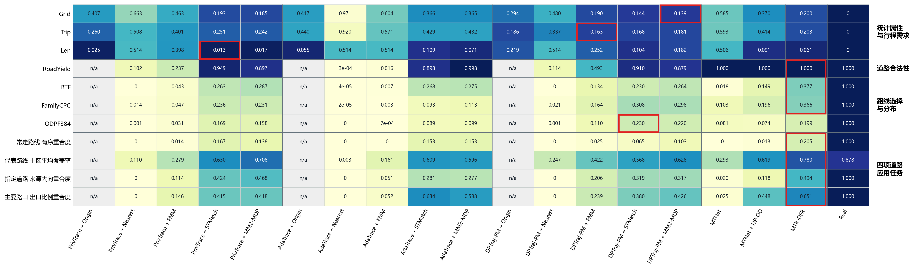
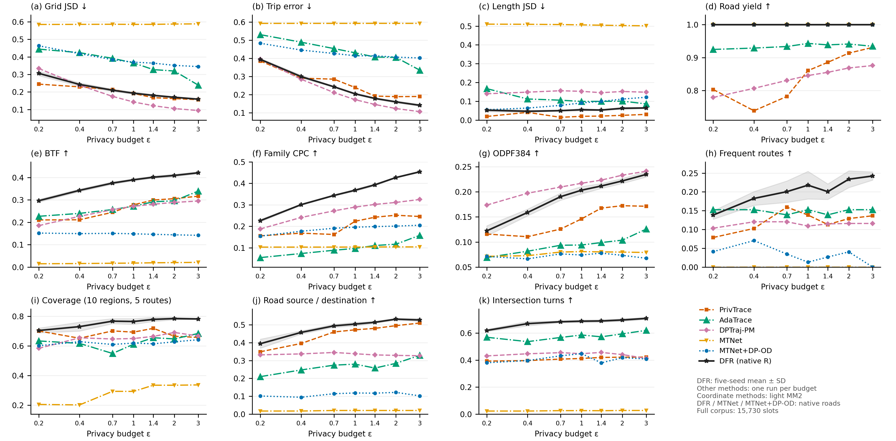

# MTR-DFR：北京实验复现

本指南按顺序整理三个实验：**ε＝1的MR热力图、隐私预算变化、DFR的K变化**。比较 **DFR、PrivTrace、AdaTrace、DPTraj-PM、MTNet、MTNet＋DP-OD**。不加入新的人工数据集，不重写作者核心算法或指标。

科学命令的工作目录统一为 `reproduction/beijing`。先激活Python环境，在同一终端设置 `$env:PYTHONUTF8='1'` 和 `$env:PYTHONIOENCODING='utf-8'`，再复制下面的命令。所有路径以北京为例，可自行改名，但要同步修改后续引用。已有成功结果先核对来源和设置再复用，不重训、不重新匹配。原版MTNet与MTNet＋DP-OD分别记录，不能互换。

整理基于GitHub提交 `eb9b563dbc371795dc84905de4e9e2f8c05ee146`。旧长篇指南及其历史结果保留于 [README_LEGACY.md](README_LEGACY.md)。本文件是新的主阅读顺序；旧分节文件只是历史命令和参数的来源，不需要重复跑。

**当前结果（2026-11-11）：** 北京冻结15730条的六方法ε＝1 MR、七档预算及DFR六档K实验已经完成计算与评分。MR包含209格（24格不适用，适用项无缺失）；预算图包含462个完整汇总点，DFR每档五种子，其余方法每档一次。下图直接来自本轮验收结果，不以旧ε＝1.4矩阵替代。环境安装条件及作者资源要求仍见第1章；已验证的服务器环境不等于所有新机器已安装这些依赖。

### 已完成结果

MR热力图（坐标方法运行全部适用路由；原生道路方法不重新匹配）：



六方法七档隐私预算（坐标方法使用轻量MM2；原生方法保留自身道路输出）：



[MR PDF](reproduction/beijing/reference_results/current_experiments/mr/framework_matrix_transposed.pdf) · [预算PDF](reproduction/beijing/reference_results/current_experiments/budget/budget_current.pdf) · [公开汇总数据与验收说明](reproduction/beijing/reference_results/current_experiments/README.md)

## 1．准备数据和资源

## 1.1 环境准备清单

先自行配好下面的环境，再开始处理数据。已有可用环境不必重新安装；首次安装的参考命令集中在文末附录A。

| 检查项 | 要求 |
|---|---|
| 系统与终端 | Windows x64、PowerShell；命令示例均按此环境编写 |
| Python | Python 3.13.9；当前终端已激活项目 `.venv` |
| Python依赖 | 安装 `requirements-clean-windows-py313.txt` 和 `requirements-torch-cpu-py313.txt`，`pip check` 通过；PrivTrace也需要PyTorch |
| 代码与大文件 | Git、Git LFS已安装；仓库大文件已实际下载，不是LFS指针 |
| 本机运行库 | Microsoft Visual C++ x64运行库 |
| 地图匹配运行库 | Conda环境 `data/fmm-runtime`：GDAL 2.4.4、Boost 1.75.0、conda-launchers；当前终端已设置PATH、GDAL_DATA、PROJ_LIB |
| MTNet训练 | NVIDIA GPU和兼容驱动，按附录A安装并实际验证GPU运算；其它方法不要求GPU |
| 文件与资源 | 输入、公共图和新输出目录可访问，磁盘与内存满足本次规模；不同城市用独立检出目录 |
| 中文与编码 | 当前终端设置PYTHONUTF8和PYTHONIOENCODING为UTF-8 |

后续所有命令均在仓库的 `reproduction/beijing` 目录执行。这个目录名沿用北京示例，运行Porto也不改目录名。环境安装、激活和检查命令见[附录A](README_LEGACY.md#sec-A)；已有环境可直接从下面的数据配置开始。

## 1.2 先确定输入：正文以北京为例

北京默认使用 `configs/datasets/beijing.workflow.json`，新终端未设置 `DFR_DATASET_CONFIG` 时不需要额外选择命令。先检查这个文件的内容：

| 配置字段 | 北京示例值 | 是什么、怎么改 |
|---|---|---|
| `schema` | `readme-dataset-workflow-v1` | 配置格式版本，保持不变 |
| `dataset` | `beijing` | 数据集名称，写入来源记录 |
| `adapter` | `geolife` | 原始文件读取方式；GeoLife的PLT格式使用此值 |
| `archive` | `data/downloads/geolife_1.3.zip` | 原始压缩包保存位置，可改为自己的文件路径 |
| `extract_to` | `data/geolife` | 压缩包解压目录，与下面的source保持对应 |
| `source` | `data/geolife/Geolife Trajectories 1.3/Data` | 原始Data目录；目录下应有用户编号及各自的Trajectory文件夹 |
| `bbox` | `[39.75, 40.15, 116.10, 116.65]` | 北京示例范围，顺序为纬度下界、纬度上界、经度下界、经度上界，单位为度 |
| `seed` | `20260713` | 数据整理和固定划分使用的种子，不是所有算法共用的生成种子 |

这些相对路径均相对于 `reproduction/beijing`，不是相对于配置文件所在目录。已有压缩包可以放到archive指定的位置；已有解压文件则让source指向实际Data目录。换目录名本身不改变算法，但后续引用必须一致。

### 换成其它城市：改输入配置，不改后续实验命令

换城市要换的是这座城市的轨迹、公共路网和输入配置，不只是把 `beijing` 改成另一个名字。先看你手里的数据属于哪一种：

| 你已有的数据 | 先准备什么 | 输入配置中的adapter |
|---|---|---|
| START的Porto作者压缩包 | 保留原始ZIP，程序已有专用读取方式；下面给出完整例子 | `start_porto_archive` |
| 已按本项目格式整理好的其它城市数据包 | 确认包内有dataset.json、轨迹记录、对应的公共图及固定训练/测试划分 | `standard_bundle` |
| 其它格式的原始GPS或道路序列 | 先完成该格式的读取、道路编号对应和统一格式导出；不能直接把原始CSV或ZIP填成统一包 | 当前没有通用原始文件读取器 |

对于已经整理好的其它城市，例如名称取 `city_a`，新建 `configs/datasets/city_a.workflow.json`，填写下面这些字段。文件名和city_a只是例子，可以自行命名：

| 字段 | 示例值 | 你需要做什么 |
|---|---|---|
| `schema` | `readme-dataset-workflow-v1` | 原样填写，表示这是输入选择配置 |
| `dataset` | `city_a` | 填自己的数据集名，必须与数据包dataset.json里的dataset一致 |
| `adapter` | `standard_bundle` | 原样填写，表示输入已经是统一格式 |
| `source` | `inputs/city_a/standard` | 改成统一包目录；该目录下必须直接有dataset.json，而不是只有原始轨迹文件 |

<!-- city-example-start -->
新建文件的完整内容如下；先把city_a和source路径换成自己的，再保存：

```json
{
  "schema": "readme-dataset-workflow-v1",
  "dataset": "city_a",
  "adapter": "standard_bundle",
  "source": "inputs/city_a/standard"
}
```

在首次处理数据前选择这个配置：

```powershell
$env:DFR_DATASET_CONFIG='configs/datasets/city_a.workflow.json'
```
<!-- city-example-end -->

然后从1.3继续执行原命令。这里只选择配置文件，尚未运行实验。输入选择配置回答“读哪份数据”，数据包内的dataset.json回答“轨迹、公共图、时间和划分分别在哪里”，两者不要混为同一个文件。

统一包应带齐以下内容：

| 内容 | 必须说明什么 |
|---|---|
| 轨迹记录 | 每条轨迹的坐标、道路序列、原始记录编号和训练/测试归属；记录与兼容格式文件逐条对应 |
| 公共道路图 | 有向道路编号、几何、连接关系和坐标系；轨迹道路编号能在图中找到 |
| 时间信息 | 有观测时间则保留并标注来源；没有则明确缺失，不用编造的时间替代，依赖时间的方法需另行处理 |
| 固定划分和来源 | 训练/测试互斥、覆盖全体保留记录，保留排除原因与原始来源 |
| 包内文件 | 除dataset.json外，还包括records.jsonl.gz及其引用的prepared、network等真实文件，不能只手写一个路径清单 |

北京和START Porto的读取器会自动导出这份统一包。新原始格式目前仍需先完成相应转换；统一包接口并不意味着程序已经能自动识别任意CSV、PLT或ZIP。统一包完成后，生成、路由和评分才不再关心原始文件格式。

### Porto作为换城市的具体例子

首次处理Porto时，输入是作者原始压缩包，不要求用户先做出统一数据包。下面只是在选择输入，不是一步完成预处理：选择后仍要依次执行1.3的读取、1.4的审查和导出，再执行1.5—1.6的资源准备及检查。

在独立的新检出目录配置环境，将START作者原始 `Porto_data.zip` 放到 `reproduction/beijing/inputs/Porto_data.zip`，然后在第一条dataset命令前执行：

```powershell
$env:DFR_DATASET_CONFIG='configs/datasets/porto.workflow.json'
```

Porto配置文件是 `configs/datasets/porto.workflow.json`。其中 `dataset=porto`，`adapter=start_porto_archive`，`source=inputs/Porto_data.zip`，`seed=20260713`。压缩包放在其它位置时，只改这个配置的source；fetch会检查该包是否存在，不会替你下载作者包。

选择后继续执行本章1.3起及后面各章的同一套命令。Porto复用作者已有真实道路序列，经编号映射与连接检查后导入；北京从PLT坐标开始做真实轨迹匹配。两种原始输入最终进入同一套统一数据接口。坐标型算法新生成的轨迹仍分别运行各路由。

城市选择只对当前终端有效。重新打开终端时恢复环境，并重新选择自己的城市配置；要回北京则使用未设置该变量的新终端。每座城市使用独立检出目录，不在已写出的数据/缓存目录中途切换，也不复用北京的道路缓存。

## 1.3 下载或读取原始数据，并准备公共图

按顺序执行这一组；每条成功后再执行下一条：

```powershell
python dataset.py fetch
python dataset.py public_graph
python dataset.py read
```

这三条命令没有需要临时填写的位置，输入路径和城市范围都来自前面的配置。

| 命令 | 北京示例 | 换成其它城市后做什么 |
|---|---|---|
| `dataset.py fetch` | 下载GeoLife压缩包并解压到配置目录 | 按配置检查输入是否就绪：统一包检查source目录下的dataset.json；Porto检查source指定的作者ZIP。不是自动搜索、下载任意城市数据 |
| `dataset.py public_graph` | 安装仓库提供的北京公共图；许可见 `public_assets/BEIJING_FULL_LICENSE.md` | 使用该城市自己的公共图。统一包已带图，本条只登记其入口；Porto从作者ZIP导出图。不会自动下载其它城市地图 |
| `dataset.py read` | 读取全部PLT，恢复坐标和原始时间，保留范围内至少2点的轨迹 | 使用所选格式的读取方式。统一包已经转换好，本条只登记入口；Porto解析作者道路序列与时间。统一包的逐条核验在1.4进行 |

因此，已有其它城市统一包时，这三条命令不会再重复下载、建图或转换；下一组roads命令负责核验包内轨迹、道路、坐标和划分。只有原始文件时，应先完成上面所说的格式转换，不能指望这三条命令自动猜出字段含义。

北京PLT前6行是文件头，之后读取经纬度与时间；正式流程不设置隐含的小样本上限。Porto道路几何坐标视图不是原始高频GPS，来源记录会保留这一区别。

## 1.4 审查并导出统一数据

先看输入和参数，再做道路准备及审查：

```powershell
python dataset.py roads --dry-run
python dataset.py roads --review-only
```

`--dry-run` 只显示将使用的路径和参数，不启动匹配；`--review-only` 生成或复用道路准备结果及筛选报告，供你确认哪些轨迹保留。

北京使用全部GPS点，8候选失败后仅对失败项改用16候选，搜索半径200米、GPS误差50米、8线程；报告为 `data/road_review/selection_review.json`。Porto核查已有道路映射，不做第二次匹配，报告为 `data/raw/start_mapping/manifest.json`。

其它城市使用standard_bundle时，本组命令核验现有统一包，报告为 `data/workflow/standard_input_verification.json`；不重新匹配、筛轨迹或重划分。其source指定的原包只读使用，派生资源写到本次新检出目录。

先打开对应报告，查看保留/排除数量和原因。确认接受该筛选结果，再运行：

```powershell
python dataset.py roads --accept-reviewed-subset yes
```

`--accept-reviewed-subset yes` 表示明确接受已审查的保留子集。北京审查阶段若退出码为2但已写出待接受报告，应先读报告，再执行接受命令，不要因此重新跑整套匹配。

| 输出 | 用途 |
|---|---|
| `data/road_accepted/dataset/trajectories.pkl` | 接受后的坐标表示，与道路轨迹逐槽对应 |
| `data/road_accepted/dataset/road_records.pkl.gz` | 道路序列，是道路生成和评分的真实输入 |
| `data/road_accepted/dataset/train.pkl`、`test.pkl` | 种子20260713的80%/20%固定划分 |
| `source_indices.json`、`canonical_manifest.json` | 保留原始记录对应关系及导出来源 |
| `data/road_accepted/standard/dataset.json` | 统一数据包入口，连接道路、坐标、时间、划分与公共图 |
| `data/workflow/commands.jsonl` | 数据准备阶段的内部参数、耗时和退出码记录 |

上表的data/road_accepted路径是北京和Porto自动转换后的输出。其它城市以standard_bundle接入时，统一包仍位于自己配置的source目录，不会额外复制到这个北京示例路径；后续bind读取的是当前选中的包。

### 统一格式究竟是什么

统一的是文件结构、字段和接口，不是把不同城市的道路编号、坐标来源或时间来源变成相同数据。数据集选择配置是“输入地址”；下面这个统一包才是预处理的结果。

<!-- format-example-start -->
统一包的主要文件如下。public中的道路文件需要一起保留；不是只复制.shp一个文件。

```text
standard/
  dataset.json                 数据包入口：城市、坐标系、数据语义及各文件路径
  records.jsonl.gz              压缩的逐条轨迹记录，每行一个JSON对象
  time_endpoints.csv            轨迹起止时间；无可靠时间时仅有表头
  export_report.json            导出数量、时间可用性、耗时及文件校验记录
  prepared/                    现有算法读取的兼容文件，与逐条记录内容一致
    trajectories.pkl           全集坐标序列
    road_records.pkl.gz        全集道路序列
    train.pkl / test.pkl       固定训练集、测试集
    train_split.json / test_split.json
    source_indices.json        对应原始数据的记录编号
    canonical_manifest.json    数据来源、数量及兼容文件清单
  public/
    network.shp / network.shx / network.dbf / network.prj
    public_ways.pkl            公共道路属性缓存；提供该资源时随包保存
```

records.jsonl.gz解压后的一条记录格式如下。以下数值仅用于解释字段，不是实验数据，也不是可单独运行的完整数据包：

```json
{
  "record_index": 0,
  "source_index": 123,
  "split": "train",
  "coordinates": [[39.90, 116.30], [39.91, 116.31]],
  "road_ids": [101, 102],
  "point_timestamps": null,
  "start_ts": null,
  "end_ts": null
}
```
<!-- format-example-end -->

| 字段 | 类型及含义 | 要满足什么 |
|---|---|---|
| `record_index` | 整数，本包内编号 | 从0开始连续排列，表示第几条轨迹 |
| `source_index` | 整数，原始来源记录编号 | 能追溯到筛选前记录；不因排除其它轨迹而失去来源 |
| `split` | 字符串train或test | 一条轨迹只属于一边，与固定划分文件一致 |
| `coordinates` | 二维数值数组，每点为 `[纬度, 经度]` | WGS84/EPSG:4326，单位度；不是 `[经度, 纬度]`，也不是投影米坐标 |
| `road_ids` | 按行驶顺序排列的整数道路编号数组 | 对应该包公共图的有向道路，顺序连通；不是节点编号，也不假设等于原始OSM编号 |
| `point_timestamps` | 与坐标点逐个对应的数值数组，或null | 有值时数量等于坐标点数、时间不倒退；无可靠逐点时间则为null |
| `start_ts` / `end_ts` | 轨迹起止时间数值，或null | 来源可靠且结束不早于开始；逐点时间存在时与其首尾一致 |

一条记录对应整条轨迹，不是一个点。coordinates的点数不要求等于road_ids的道路数；一个道路可对应多个坐标点。时间保留来源数值及含义，见dataset.json的timestamp_semantics，不能仅凭字段名假设不同源数据的数值都使用同一种时间单位或起点。

dataset.json记录 `schema=road-experiment-bundle-v1`、`record_schema=road-trajectory-record-v1`、dataset、coordinate_order、coordinate_crs、coordinate_semantics、timestamp_semantics和paths。paths.prepared指向兼容数据目录，paths.network指向本包公共图；包内相对路径以dataset.json所在目录为基准。道路图可使用投影坐标，其坐标系由图文件及routing_crs声明，不把它误当轨迹的经纬度。

prepared不是另一份独立选择的数据：它保留现有程序能读取的保存形式；records.jsonl.gz是相同轨迹的统一逐条表示。两者的轨迹顺序、坐标、道路序列和划分必须一致。只写一个dataset.json，或只放一份坐标CSV，均不算形成统一包。

### 北京和Porto分别怎样变成这个格式

| 环节 | 北京原始PLT | Porto作者原始ZIP |
|---|---|---|
| 读取 | 解析GPS点及原始时间 | 解析作者已经处理过的道路序列及时间 |
| 道路对应 | 用本城市公共图匹配GPS，保留审查通过的道路轨迹 | 映射作者道路编号，检查方向和连接，不再匹配真实轨迹 |
| 统一坐标表示 | 原始观测点在匹配道路上的投影 | 对应道路起点的确定几何坐标；不是原始高频GPS |
| 时间 | 保留可恢复的原始端点时间；当前统一导出没有逐点时间时写null | 保留作者处理后的逐点时间，不插值编造中间时间 |
| 最终导出 | 两者都写成上面的字段、包目录及80/20固定划分 | 格式相同，来源语义仍分别记录 |

上述步骤由dataset.py依次调用预处理程序：Porto公共图用preprocess/start_porto_graph.py，轨迹读取用preprocess/start_porto.py，接受与固定划分用preprocess/start_porto_freeze.py；两城最终都调用preprocess/standardize_dataset.py导出，再调用preprocess/check_standard_package.py逐条核对。用户按前面相同的dataset.py命令操作，无需再手动调用这些内部程序。

验证通过应得到 `STANDARD_PACKAGE_VERIFIED`，并报告全集、训练、测试数量。检查会比较全部记录与兼容文件，而不是看到目录存在就算成功。统一包完成后还需做1.5的公共路由资源准备；统一格式本身不包含已完成的合成实验或全部路由预计算。

北京冻结示例是15730条道路轨迹、12584条训练、3146条测试。历史原始坐标17123条与接受后的道路语料不是同一阶段，不能直接改名混用。Porto数量由实际验收结果决定，不填北京人数。后续程序都读取统一包，不再分别处理PLT或START原始格式。

## 1.5 一次准备好划分、路由资源和实验配置

下面一组承接统一数据包，生成后续各章使用的配置。它不启动合成实验，也不生成另一份命令指南：

```powershell
python preprocess/fetch_mm2.py --archive data/downloads/mm2_1.2.1.zip --extract-to data/mm2_upstream --install-to resources/mm2/map_matching_2.exe
python dataset.py bind
python dataset.py resources
python prepare_tstr_split.py --config configs/local_public.json --out data/local_split --out-config configs/local_split.json
python prepare_ubodt.py --config configs/local_split.json --out-dir data/local_ubodt --out-config configs/local_ready.json --delta-m 1500 --threads 4
python prepare_mm2_city.py --config configs/local_ready.json --executable resources/mm2/map_matching_2.exe --out data/local_mm2 --out-config configs/local_all_ready.json
python tools/prepare_experiment_configs.py --config configs/local_all_ready.json --out configs/experiments
```

同一组配置文件逐步增加已准备好的资源；路径名是北京示例名称，可自行统一改名，但要同步修改后续引用。

| 参数或命令 | 含义与输出 |
|---|---|
| fetch_mm2的 `--archive` | MM2原始ZIP的下载/保存路径 |
| `--extract-to` / `--install-to` | 解压目录 / 安装后的可执行文件路径；前者是目录，后者是文件 |
| `dataset.py bind` | 将统一数据包接到 `configs/local_new.json` 等当前工作配置 |
| `dataset.py resources` | 准备当前城市的道路指标与边缓存，写出 `configs/local_public.json` |
| `--config` | 本条命令读取的上一步JSON配置 |
| prepare_tstr_split的 `--out` / `--out-config` | 划分检查产物目录 / 增补划分引用的新配置；复验既有80/20划分，不另选一次测试集 |
| prepare_ubodt的 `--out-dir` / `--out-config` | FMM最短路预计算目录 / 带UBODT引用的新配置 |
| `--delta-m 1500` | 最短路预计算的道路距离阈值，单位米；不是隐私δ、GPS半径或轨迹最长距离 |
| `--threads 4` | 只控制本条UBODT准备命令的CPU线程数 |
| prepare_mm2_city的 `--executable` | 本城市MM2资源所用的程序，须与前面的安装位置一致 |
| prepare_mm2_city的 `--out` / `--out-config` | 当前城市MM2资源目录 / 最终资源配置 `configs/local_all_ready.json` |
| prepare_experiment_configs的 `--out` | 实验JSON配置总目录 `configs/experiments`，不是合成结果目录 |

配置顺序是：local_public（公共资源）→local_split（固定划分）→local_ready（FMM资源）→local_all_ready（再加MM2资源）→configs/experiments（各实验配置）。这些步骤准备公共图和配置，不提前执行后面的实际路由。

## 1.6 读入本城市变量，检查下一章所需输入

下面这些赋值放在同一PowerShell窗口一起执行，最后运行检查：

```powershell
$Experiment = Get-Content configs/experiments/configs/beijing.json -Raw -Encoding UTF8 | ConvertFrom-Json
$Network = $Experiment.paths.network
$MetricCache = $Experiment.paths.metric_cache
$EdgeCache = $Experiment.paths.edge_cache
$RoadRecords = $Experiment.paths.real_routes
$FullSlots = $Experiment.slots
$TrainSlots = $Experiment.train_slots
python tools/check_readme_handoff.py --config configs/local_all_ready.json --config-root configs/experiments --out results/readme_handoff_check.json
```

| 变量/参数 | 含义 |
|---|---|
| `$Experiment` | 当前城市的实验资源配置对象；文件名beijing.json是历史预设名，内容由所选城市写入 |
| `$Network` / `$MetricCache` / `$EdgeCache` | 当前城市公共图 / 指标缓存 / 边缓存，后续命令直接引用 |
| `$RoadRecords` | 本批接受后的真实道路序列 |
| `$FullSlots` / `$TrainSlots` | 当前城市全集 / 训练集的槽位数量，不手填北京人数 |
| check_readme_handoff的 `--config` | 最终数据与公共资源配置 |
| `--config-root` | 刚生成的各实验JSON配置目录 |
| `--out` | 本次检查报告路径，不是实验成绩 |

成功时应输出 `README_9_11_INPUT_AND_DOCUMENT_PREFLIGHT_PASSED`。其中9—11沿用历史检查名称，表示相关输入、资源和文档引用已接通，不表示实验已经完成。随后直接进入第02节运行M与R。全量发布和训练专用发布要分开生成；已有成功输出按记录接续，不重复覆盖。

如只重新评分/作图，可使用仓库现有 `datasets/synthetic/` 和 `reference_results/` 对应的产物，先核对城市与数据版本；不要将它们当成本次新运行的结果。

---

[完整运行指南](README_LEGACY.md#sec-01) · [下一节：02](第02节_统计M与五种R及全集评分.md)


### 1.5 六种方法的额外运行资源

| 方法 | 归位后的入口 | 环境／资源 |
|---|---|---|
| DFR | `synthesize_dfr.py` | 原生成核心、正式length-aware分支 |
| PrivTrace | `synthesize.py --method PrivTrace` | 原求解器和冻结实现，不替换算法 |
| AdaTrace | `adatrace.py`，统一生成也支持 `synthesize.py` | JDK；作者源码及两个jar |
| DPTraj-PM | `dptraj_pm.py`，统一生成也支持 `synthesize.py` | 已验作者C++ CLI，网格仅是配置参数 |
| MTNet | 原准备/部署/训练/生成入口 | PyTorch/CUDA和作者锁定代码 |
| MTNet＋DP-OD | `mtnet_dp_od.py` | 模型预算5/7、OD预算2/7，δ＝10⁻⁵ |

AdaTrace固定作者提交，核心不改；JDK从JAVA_HOME或PATH读取：

```powershell
git clone https://github.com/git-disl/AdaTrace.git vendor/adatrace
git -C vendor/adatrace checkout 55fc77b7255b8871c4ac6f95f6c12a141a07bdfc
python adatrace.py build
```

已有同源编译目录时不重复build。GPLv3许可证保留。DPTraj-PM的 `paths.dptraj_executable` 指向已经验收、接受“epsilon、网格边长”两个参数的作者C++ CLI，默认位置 `resources/dptraj/dptraj_grid.exe`。未获确认的作者源码许可不擅自改写；本地已验程序与源码保持原样。

以下只准备公共道路槽和MTNet作者输入，不训练：

```powershell
$Ready = Get-Content configs/experiments/configs/beijing.json -Raw -Encoding UTF8 | ConvertFrom-Json
$Network = $Ready.paths.network
$MetricCache = $Ready.paths.metric_cache
$EdgeCache = $Ready.paths.edge_cache
$OsmCache = $Ready.paths.osm
$Legacy = $Ready.paths.legacy
$BBox = $Ready.bbox
$RoadRecords = $Ready.paths.real_routes
$FullSlots = $Ready.slots
python prepare_application_inputs.py public --network "$Network" --metric-cache "$MetricCache" --out resources/application_public
python prepare_application_inputs.py adapt --input "$RoadRecords" --public-edges resources/application_public/public_edges.jsonl.gz --slots $FullSlots --out resources/application_real
python prepare_mtnet_frozen.py --config configs/experiments/configs/beijing.json --original-adapter-root vendor/mtnet --out resources/mtnet_prepared
```

北京已有相同输入的准备结果可以复用。`resources/mtnet_prepared`是全集作者输入，不是模型；训练专用输入不能冒充全集。

### 1.6 整理后的路径核验

已有北京全量统一输入时，可只验证AdaTrace的输入路径和坐标转换，不生成合成数据、不训练、不重新匹配。下列准备输出应与此前同一输入的作者文本逐字节一致：

```powershell
python adatrace.py prepare --config configs/experiments/configs/beijing.json --out results/adatrace_path_check
```

这项检查不是正式M实验，检查结果不进入图。已有同名检查输出不要覆盖。

## 2．实验一：MR热力图，ε＝1

### 2a．各方法生成

先复制已经准备好的配置，只改本实验预算、批次名称与相关参数。输出是新目录，不能覆盖旧结果。

```powershell
$Config = "configs/current_mr.json"
$Base = "results/mr_e1"
$Epsilon = 1.0
if ((Test-Path $Config) -or (Test-Path $Base)) { throw "已有配置或输出，请核对后接续或选择新名称" }
$Current = Get-Content configs/experiments/configs/beijing.json -Raw -Encoding UTF8 | ConvertFrom-Json
$Current.epsilon = $Epsilon
$Current.batch = "mr_e1"
$Current.paths.output = "results"
$Current | Add-Member -NotePropertyName dptraj_pm -NotePropertyValue @{grid=64} -Force
$Current | Add-Member -NotePropertyName mm2_profile -NotePropertyValue "standard" -Force
$Current.paths | Add-Member -NotePropertyName dptraj_executable -NotePropertyValue "resources/dptraj/dptraj_grid.exe" -Force
$Current | ConvertTo-Json -Depth 30 | Set-Content $Config -Encoding UTF8
```

DPTraj-PM的网格是64×64，方法名仍为DPTraj-PM。各方法保留自身隐私单位、δ及实现边界；相同请求ε不代表保护定义相同。MR的MM2使用 `standard`选项集，预算实验单独使用 `light`；旧默认light仍兼容。标准选项集来自加入轻量选项之前的原命令，保留4线程，不改MM2核心。

坐标方法各生成一份M；五条R必须共用这一份：

```powershell
python synthesize.py --config "$Config" --method PrivTrace --out "$Base/measurements/PrivTrace"
python synthesize.py --config "$Config" --method AdaTrace --out "$Base/measurements/AdaTrace"
python synthesize.py --config "$Config" --method DPTraj-PM --out "$Base/measurements/DPTraj-PM"
python synthesize_dfr.py --config "$Config" --length-aware --out "$Base/native/MTR-DFR"
```

原版MTNet使用原训练器已有的target-epsilon校准参数，生成清单从真实训练记录读取预算，不再写死1.4：

```powershell
python prepare_mtnet_deployment.py --prepared resources/mtnet_prepared --original-root vendor/mtnet --out "$Base/native/MTNet" --archive "$Base/native/MTNet.zip"
powershell -NoProfile -File deployment/RUN_MTNET_GPU.ps1 -Root "$Base/native/MTNet" -PythonExecutable (Get-Command python).Source -Epsilon $Epsilon
python register_mtnet.py --config "$Config" --source "$Base/native/MTNet/native_release" --preparation resources/mtnet_prepared/full_preparation_manifest.json --model "$Base/native/MTNet/trained/model.pt" --out "$Base/native/MTNet_records"
```

MTNet＋DP-OD独立训练，不能把原模型再加OD却仍标原总预算：

```powershell
python mtnet_dp_od.py prepare --config "$Config" --mtnet-prepared resources/mtnet_prepared --public-edges resources/application_public/public_edges.jsonl.gz --population full --out "$Base/native/MTNet_DP_OD"
python mtnet_dp_od.py graph --out "$Base/native/MTNet_DP_OD"
python mtnet_dp_od.py check --out "$Base/native/MTNet_DP_OD"
python mtnet_dp_od.py train --out "$Base/native/MTNet_DP_OD"
python mtnet_dp_od.py generate --out "$Base/native/MTNet_DP_OD"
```

### 2b．路由：全部适用的R

| 方法 | R |
|---|---|
| PrivTrace、AdaTrace、DPTraj-PM | Origin、Nearest、FMM、STMatch、MM2-MDP，合计15份 |
| DFR、MTNet、MTNet＋DP-OD | 各自完整原生道路，合计3份，不二次匹配 |

下面只是依次输入原入口，不是另一个实验调度器；也可依次设置Method后逐句执行。

```powershell
foreach ($Method in @("PrivTrace","AdaTrace","DPTraj-PM")) {
    python route.py --config "$Config" --method $Method --router Origin --input "$Base/measurements/$Method" --out "$Base/routes/$Method/Origin"
    if ($LASTEXITCODE -ne 0) { throw "Origin失败" }
    python route.py --config "$Config" --method $Method --router Nearest --input "$Base/measurements/$Method" --out "$Base/routes/$Method/Nearest"
    if ($LASTEXITCODE -ne 0) { throw "Nearest失败" }
    python route.py --config "$Config" --method $Method --router FMM --input "$Base/measurements/$Method" --out "$Base/routes/$Method/FMM"
    if ($LASTEXITCODE -ne 0) { throw "FMM失败" }
    python route.py --config "$Config" --method $Method --router STMatch --input "$Base/measurements/$Method" --out "$Base/routes/$Method/STMatch"
    if ($LASTEXITCODE -ne 0) { throw "STMatch失败" }
    python route.py --config "$Config" --method $Method --router MM2-MDP --input "$Base/measurements/$Method" --out "$Base/routes/$Method/MM2-MDP" --threads 4
    if ($LASTEXITCODE -ne 0) { throw "MM2失败" }
}
```

Origin保留坐标；道路指标不适用，不填0。Nearest的断路保留，不补最短路。路由结束核对退出、全槽位和最终清单，不用临时CSV冒充完成。

### 2c．评分、汇总和作图

DFR只转换表示，不重选路线：

```powershell
$Seed = $Current.seed
python tools/convert_native_node_pairs.py --routes "$Base/native/MTR-DFR/seed_$($Seed)_length/road_routes.pkl.gz" --source-cache "$MetricCache" --network "$Network" --expected-slots $FullSlots --out "$Base/native/DFR_records"
```

前三项统计和道路四指标沿用论文原入口。下面统一指定新输出，不修改旧分数：

```powershell
foreach ($Method in @("PrivTrace","AdaTrace","DPTraj-PM")) {
    python evaluate_coordinates.py --config "$Config" --method $Method --router Origin --input "$Base/measurements/$Method/measurement.pkl" --metric-protocol audit-v2 --out "$Base/coordinate_scores_audit_v2/$Method/Origin"
    foreach ($Router in @("Nearest","FMM","STMatch","MM2-MDP")) {
        python evaluate.py --config "$Config" --method $Method --router $Router --input "$Base/routes/$Method/$Router/synthetic_routes.pkl.gz" --out "$Base/road_scores/$Method/$Router"
        if ($LASTEXITCODE -ne 0) { throw "道路评分失败" }
        python evaluate_coordinates.py --config "$Config" --method $Method --router $Router --input "$Base/routes/$Method/$Router/synthetic_routes.pkl.gz" --metric-protocol audit-v2 --out "$Base/coordinate_scores_audit_v2/$Method/$Router"
        if ($LASTEXITCODE -ne 0) { throw "坐标评分失败" }
    }
}
$NativeInputs = @{
    "MTR-DFR"="$Base/native/DFR_records/synthetic_routes.pkl.gz"
    "MTNet"="$Base/native/MTNet_records/synthetic_routes.pkl.gz"
    "MTNet_DP_OD_coarse24"="$Base/native/MTNet_DP_OD/release_full/native_release/synthetic_routes.pkl.gz"
}
foreach ($Method in $NativeInputs.Keys) {
    python evaluate.py --config "$Config" --method $Method --router Origin --input $NativeInputs[$Method] --out "$Base/road_scores/$Method/Origin"
    python evaluate_coordinates.py --config "$Config" --method $Method --router Origin --input $NativeInputs[$Method] --metric-protocol audit-v2 --out "$Base/coordinate_scores_audit_v2/$Method/Origin"
}
```

四项任务仍是“真实数据出题，合成数据回答同题”。原题库 `configs/application_tasks/beijing_questions.json`和原三个任务定义不改；代表路线保持已完成版本的十区、每区最多5条、4437.46米、覆盖40米。所有方法使用同一题库，不能按合成分数选区域。

以下循环只列举已经生成的道路文件，调用原来的adapt、configure、answer、summarize入口。名称中的双下划线用于连接方法与路由，图上仍显示原方法名。没有合成、评分或选路的新实现。

```powershell
$RoadInputs = @{}
foreach ($Method in @("PrivTrace","AdaTrace","DPTraj-PM")) {
    foreach ($Router in @("Nearest","FMM","STMatch","MM2-MDP")) {
        $RoadInputs["$($Method)__$Router"] = "$Base/routes/$Method/$Router/synthetic_routes.pkl.gz"
    }
}
foreach ($Method in $NativeInputs.Keys) { $RoadInputs[$Method] = $NativeInputs[$Method] }
$ReleaseArgs = @()
$RegionInputs = @(@{method="Real";path=(Resolve-Path resources/application_real/slots.jsonl.gz).Path})
foreach ($Method in $RoadInputs.Keys) {
    python prepare_application_inputs.py adapt --input $RoadInputs[$Method] --public-edges resources/application_public/public_edges.jsonl.gz --slots $FullSlots --out "$Base/applications/slots/$Method"
    if ($LASTEXITCODE -ne 0) { throw "应用槽位适配失败" }
    $SlotFile = "$Base/applications/slots/$Method/slots.jsonl.gz"
    $ReleaseArgs += @("--release", "$Method=$SlotFile")
    $RegionInputs += @{method=$Method.Replace("__"," + ");path=(Resolve-Path $SlotFile).Path}
}
python configure_applications.py --questions configs/application_tasks/beijing_questions.json --region configs/application_tasks/beijing_region.json --public-edges resources/application_public/public_edges.jsonl.gz --real-slots resources/application_real/slots.jsonl.gz @ReleaseArgs --slots $FullSlots --resources "$Base/applications/resources" --out "$Base/applications/config.json"
python evaluate_applications.py prepare --config "$Base/applications/config.json" --out "$Base/applications/resources"
if ($LASTEXITCODE -ne 0) { throw "应用资源准备失败" }
python evaluate_applications.py answer --config "$Base/applications/config.json" --method Real --out "$Base/applications/answers/Real"
$SummaryArgs = @("--input", "$Base/applications/answers/Real")
foreach ($Method in $RoadInputs.Keys) {
    python evaluate_applications.py answer --config "$Base/applications/config.json" --method $Method --reference "$Base/applications/answers/Real" --out "$Base/applications/answers/$Method"
    if ($LASTEXITCODE -ne 0) { throw "应用评分失败" }
    $SummaryArgs += @("--input", "$Base/applications/answers/$Method")
}
python evaluate_applications.py summarize --config "$Base/applications/config.json" @SummaryArgs --out "$Base/applications/summary"
ConvertTo-Json -InputObject $RegionInputs -Depth 5 | Set-Content "$Base/applications/regional_inputs.json" -Encoding UTF8
```

十区域脚本从已跑过的regions.py归位，只改输入、资源和输出路径。仍调用原author_greedy、固定十区、每区最多5条、4437.46米和40米规则。配置只保留固定区域几何与人口计数，不随代码携带原逐轨迹区域成员ID。

```powershell
python evaluate_representative_regions.py --inputs "$Base/applications/regional_inputs.json" --public-edges resources/application_public/public_edges.jsonl.gz --regions configs/application_regions/regions.json --resources resources/application_regions --slots $FullSlots --out "$Base/applications/ten_regions"
```

Real几何参考使用相同真实道路作为两侧输入。下面借用已有MTNet原生道路“表示转换”的分支，不训练MTNet；汇总时明确标记为Real参考，而不是MTNet成绩。

```powershell
python evaluate.py --config "$Config" --method MTNet --router Origin --input "$RoadRecords" --out "$Base/reference/road_scores/MTNet/Origin"
python tools/stage_native_saved_coordinates.py --routes "$RoadRecords" --network "$Network" --edge-cache "$EdgeCache" --out-dir "$Base/reference/view"
python evaluation/audit_v2_runner.py --stage coordinates --legacy "$Legacy" -- --real "$Base/reference/view/coordinates.pkl" --synthetic "$Base/reference/view/coordinates.pkl" --out-dir "$Base/reference/coordinate_scores_audit_v2/MTNet/Origin" --bbox @BBox --evaluation-seed 20260713 --osm-cache "$OsmCache" --public-slot-count $FullSlots --road-routes "$RoadRecords" --edge-cache "$EdgeCache"
python tools/collect_frozen_matrix.py --config "$Config" --batch "$Base" --labeled-batch "Real-vs-real [geometry reference]=$Base/reference" --applications "$Base/applications/summary" --representative-regions "$Base/applications/ten_regions" --spec reference_results/matrix/spec_current_methods.json --out "$Base/matrix_sources"
python plot_applications.py --summary "$Base/applications/summary" --sources "$Base/matrix_sources" --spec reference_results/matrix/spec_current_methods.json --out "$Base/matrix_collected"
python plotting/render_mr.py --data "$Base/matrix_collected/cells.json" --epsilon 1 --slots $FullSlots --out "$Base/figures"
```

只在显示表中取十区域代表路线均值，原评分文件不覆盖。Real与两个历史控制不能从不同预算旧表拼入；六方法适用项缺失会阻止完整验收。零、不适用与缺项分开。

## 3．实验二：隐私预算变化

### 3a．各方法生成

七档为 **0.2、0.4、0.7、1、1.4、2、3**。每档复制第2章的城市配置，设置epsilon、新batch和新Base；其余五种方法使用第2a节相同的生成入口；DFR只运行下面原有35组命令，不额外生成第2a节seed42的预算副本。例：0.2档取 `Config="configs/current_budget_0p2.json"`、`Base="results/budget_0p2"`、`Epsilon=0.2`，其余目录后缀为0p4、0p7、1、1p4、2、3。模型和输出均不能跨预算复用。

DFR沿用五种子20260719—20260723；其余方法每档一次，不添加虚假误差带。MTNet＋DP-OD保持总预算内5:2分配；原版MTNet条件独立标注。多次运行不能合称一次ε发布。

### 3a.1 DFR原有35组逐条命令

以下是直接从原仓库第07-2节归位的DFR命令；其中五种子只适用于DFR，不扩大到其它方法。

本节改变隐私预算epsilon：0.2、0.4、0.7、1、1.4、2、3，每档5个种子。预算和种子已经写在该组配置里，所以命令主要更换--config。每组结果独立保存，共35次研究运行，不能把合计消耗仍标成一次epsilon。


工作目录始终是交付根目录，不依赖服务器盘符。先安装README指定环境。已完成的正式实验不重跑；以下用于其他机器的新批次复现。每组生成、表示转换、评分独立执行，后一步读取前一步输出，不覆盖既有目录。

每份使用15730条全集与相同公开输出数量。种子20260719—20260723；诊断只用20260719，标记为非私有端点准确测量，不进入同预算DP比较。


## budget_0p2_seed_20260719

**步骤 07-2.01：生成DFR的全集原生道路发布。**

读取：配置中的真实全集和公共道路资源。

```powershell
.venv/Scripts/python.exe synthesize_dfr.py --config configs/experiments/supplement/sweeps/budget_0p2_seed_20260719.json --length-aware
```

| 参数 | 简单含义 |
|---|---|
| `--config` | 读取这一份实验配置：真实数据、道路图、分集和算法设置从这里取得。 |
| `--length-aware` | 启用当前正式DFR的长度测量分支，仍在原总隐私预算内分配。 |

完成后：原生road_routes.pkl.gz、测量和来源清单；不是把坐标再交给匹配器。

产物：results/portable_sweeps/budget_0p2_seed_20260719/native/MTR-DFR；失败时保留该步骤日志与部分产物，不继续评分。

**步骤 07-2.02：将原生节点对表示转换为相同道路的编号。**

读取：原生道路文件、所选城市图及明确的源编号缓存。

```powershell
.venv/Scripts/python.exe tools/convert_native_node_pairs.py --routes results/portable_sweeps/budget_0p2_seed_20260719/native/MTR-DFR/seed_20260719_length/road_routes.pkl.gz --source-cache "$MetricCache" --network "$Network" --expected-slots $FullSlots --out results/portable_sweeps/budget_0p2_seed_20260719/representation
```

| 参数 | 简单含义 |
|---|---|
| `--routes` | 已经生成的道路轨迹文件，用于表示转换或坐标准备。 |
| `--source-cache` | 说明原生节点编号含义的缓存，通过共同道路编号与评价路网对应。 |
| `--network` | 所选城市的公共道路图文件；不是合成轨迹。 |
| `--expected-slots` | 应有的输出槽位总数；空槽也算在内，不能只数成功轨迹。 |
| `--out` | 本次输出的位置；改名后，后续读取这个结果的路径也要一起改。 |

完成后：synthetic_routes.pkl.gz及转换清单，空槽保留。

产物：results/portable_sweeps/budget_0p2_seed_20260719/representation；失败时保留该步骤日志与部分产物，不继续评分。

**步骤 07-2.03：计算道路合法性和路线选择相关指标。**

读取：合成道路结果、真实道路参考和同城评价缓存。

```powershell
.venv/Scripts/python.exe evaluate.py --config configs/experiments/supplement/sweeps/budget_0p2_seed_20260719.json --method MTR-DFR --router Origin --input results/portable_sweeps/budget_0p2_seed_20260719/representation/synthetic_routes.pkl.gz --out results/portable_sweeps/budget_0p2_seed_20260719/road_scores
```

| 参数 | 简单含义 |
|---|---|
| `--config` | 读取这一份实验配置：真实数据、道路图、分集和算法设置从这里取得。 |
| `--method` | 标记本次要处理或评价的方法；评分命令只读已有发布，不会因此重新生成。 |
| `--router` | 标记这份已保存结果对应的道路方法；这里是评分，不再次运行该路由。 |
| `--input` | 本条命令读取的上游产物；应是前面已成功生成的文件或目录。 |
| `--out` | 本次输出的位置；改名后，后续读取这个结果的路径也要一起改。 |

完成后：metrics.json、metrics.csv和manifest.json。

产物：results/portable_sweeps/budget_0p2_seed_20260719/road_scores；失败时保留该步骤日志与部分产物，不继续评分。

**步骤 07-2.04：对当前扫参组计算物理结构和有序片段评分。**

读取：--real-routes和--synthetic-routes指定的两份道路数据。

```powershell
.venv/Scripts/python.exe legacy/evaluation/run_physical_experiment.py --real-routes "$RoadRecords" --synthetic-routes results/portable_sweeps/budget_0p2_seed_20260719/representation/synthetic_routes.pkl.gz --edge-cache "$MetricCache" --network "$Network" --method MTR-DFR --sampling-label MTR-DFR --cap-per-stratum 20 --out-dir results/portable_sweeps/budget_0p2_seed_20260719/physical
```

| 参数 | 简单含义 |
|---|---|
| `--real-routes` | 所选城市的真实道路轨迹，用作评价参考。 |
| `--synthetic-routes` | 已经生成的合成道路轨迹，被评价的对象。 |
| `--edge-cache` | 道路几何或道路评价缓存；选择本条命令对应城市的文件。 |
| `--network` | 所选城市的公共道路图文件；不是合成轨迹。 |
| `--method` | 标记本次要处理或评价的方法；评分命令只读已有发布，不会因此重新生成。 |
| `--sampling-label` | 固定分层抽样的名称标记；本例与方法名一致，不表示抽样条数。 |
| `--cap-per-stratum` | 序列比较时每个分层最多选取的数量；20是序列部分的抽样上限。 |
| `--out-dir` | 本次输出目录；不要指向需要保留的旧结果。 |

完成后：当前组的物理结构评分和来源记录。

产物：results/portable_sweeps/budget_0p2_seed_20260719/physical；失败时保留该步骤日志与部分产物，不继续评分。

**步骤 07-2.05：比较合成数据保留了多少真实坐标统计特征。**

读取：合成坐标或道路结果，以及配置中的真实参考。

```powershell
.venv/Scripts/python.exe evaluate_coordinates.py --config configs/experiments/supplement/sweeps/budget_0p2_seed_20260719.json --method MTR-DFR --router Origin --input results/portable_sweeps/budget_0p2_seed_20260719/representation/synthetic_routes.pkl.gz --metric-protocol audit-v2 --out results/portable_sweeps/budget_0p2_seed_20260719/coordinate_scores
```

| 参数 | 简单含义 |
|---|---|
| `--config` | 读取这一份实验配置：真实数据、道路图、分集和算法设置从这里取得。 |
| `--method` | 标记本次要处理或评价的方法；评分命令只读已有发布，不会因此重新生成。 |
| `--router` | 标记这份已保存结果对应的道路方法；这里是评分，不再次运行该路由。 |
| `--input` | 本条命令读取的上游产物；应是前面已成功生成的文件或目录。 |
| `--metric-protocol` | 评分规则版本；本指南用audit-v2，各方法保持相同版本。 |
| `--out` | 本次输出的位置；改名后，后续读取这个结果的路径也要一起改。 |

完成后：坐标统计metrics.json及来源记录；不会重新训练生成器。

产物：results/portable_sweeps/budget_0p2_seed_20260719/coordinate_scores；失败时保留该步骤日志与部分产物，不继续评分。

**步骤 07-2.06：让合成数据回答道路选择与下一道路相关问题。**

读取：同一组合成道路，以及之前道路评分的来源清单。

```powershell
.venv/Scripts/python.exe evaluate_road_tasks.py --config configs/experiments/supplement/sweeps/budget_0p2_seed_20260719.json --method MTR-DFR --router Origin --input results/portable_sweeps/budget_0p2_seed_20260719/representation/synthetic_routes.pkl.gz --score-manifest results/portable_sweeps/budget_0p2_seed_20260719/road_scores/manifest.json --out results/portable_sweeps/budget_0p2_seed_20260719/road_tasks
```

| 参数 | 简单含义 |
|---|---|
| `--config` | 读取这一份实验配置：真实数据、道路图、分集和算法设置从这里取得。 |
| `--method` | 标记本次要处理或评价的方法；评分命令只读已有发布，不会因此重新生成。 |
| `--router` | 标记这份已保存结果对应的道路方法；这里是评分，不再次运行该路由。 |
| `--input` | 本条命令读取的上游产物；应是前面已成功生成的文件或目录。 |
| `--score-manifest` | 之前道路评分生成的manifest.json，用于核对本条道路任务使用同一输入。 |
| `--out` | 本次输出的位置；改名后，后续读取这个结果的路径也要一起改。 |

完成后：道路任务metrics.json等；本命令不计算四项应用。K与预算实验还须继续第08节，逐组回答第05节锁定的真实问题。

产物：results/portable_sweeps/budget_0p2_seed_20260719/road_tasks；失败时保留该步骤日志与部分产物，不继续评分。


## budget_0p2_seed_20260720

**步骤 07-2.07：生成DFR的全集原生道路发布。**

读取：配置中的真实全集和公共道路资源。

```powershell
.venv/Scripts/python.exe synthesize_dfr.py --config configs/experiments/supplement/sweeps/budget_0p2_seed_20260720.json --length-aware
```

| 参数 | 简单含义 |
|---|---|
| `--config` | 读取这一份实验配置：真实数据、道路图、分集和算法设置从这里取得。 |
| `--length-aware` | 启用当前正式DFR的长度测量分支，仍在原总隐私预算内分配。 |

完成后：原生road_routes.pkl.gz、测量和来源清单；不是把坐标再交给匹配器。

产物：results/portable_sweeps/budget_0p2_seed_20260720/native/MTR-DFR；失败时保留该步骤日志与部分产物，不继续评分。

**步骤 07-2.08：将原生节点对表示转换为相同道路的编号。**

读取：原生道路文件、所选城市图及明确的源编号缓存。

```powershell
.venv/Scripts/python.exe tools/convert_native_node_pairs.py --routes results/portable_sweeps/budget_0p2_seed_20260720/native/MTR-DFR/seed_20260720_length/road_routes.pkl.gz --source-cache "$MetricCache" --network "$Network" --expected-slots $FullSlots --out results/portable_sweeps/budget_0p2_seed_20260720/representation
```

| 参数 | 简单含义 |
|---|---|
| `--routes` | 已经生成的道路轨迹文件，用于表示转换或坐标准备。 |
| `--source-cache` | 说明原生节点编号含义的缓存，通过共同道路编号与评价路网对应。 |
| `--network` | 所选城市的公共道路图文件；不是合成轨迹。 |
| `--expected-slots` | 应有的输出槽位总数；空槽也算在内，不能只数成功轨迹。 |
| `--out` | 本次输出的位置；改名后，后续读取这个结果的路径也要一起改。 |

完成后：synthetic_routes.pkl.gz及转换清单，空槽保留。

产物：results/portable_sweeps/budget_0p2_seed_20260720/representation；失败时保留该步骤日志与部分产物，不继续评分。

**步骤 07-2.09：计算道路合法性和路线选择相关指标。**

读取：合成道路结果、真实道路参考和同城评价缓存。

```powershell
.venv/Scripts/python.exe evaluate.py --config configs/experiments/supplement/sweeps/budget_0p2_seed_20260720.json --method MTR-DFR --router Origin --input results/portable_sweeps/budget_0p2_seed_20260720/representation/synthetic_routes.pkl.gz --out results/portable_sweeps/budget_0p2_seed_20260720/road_scores
```

| 参数 | 简单含义 |
|---|---|
| `--config` | 读取这一份实验配置：真实数据、道路图、分集和算法设置从这里取得。 |
| `--method` | 标记本次要处理或评价的方法；评分命令只读已有发布，不会因此重新生成。 |
| `--router` | 标记这份已保存结果对应的道路方法；这里是评分，不再次运行该路由。 |
| `--input` | 本条命令读取的上游产物；应是前面已成功生成的文件或目录。 |
| `--out` | 本次输出的位置；改名后，后续读取这个结果的路径也要一起改。 |

完成后：metrics.json、metrics.csv和manifest.json。

产物：results/portable_sweeps/budget_0p2_seed_20260720/road_scores；失败时保留该步骤日志与部分产物，不继续评分。

**步骤 07-2.10：对当前扫参组计算物理结构和有序片段评分。**

读取：--real-routes和--synthetic-routes指定的两份道路数据。

```powershell
.venv/Scripts/python.exe legacy/evaluation/run_physical_experiment.py --real-routes "$RoadRecords" --synthetic-routes results/portable_sweeps/budget_0p2_seed_20260720/representation/synthetic_routes.pkl.gz --edge-cache "$MetricCache" --network "$Network" --method MTR-DFR --sampling-label MTR-DFR --cap-per-stratum 20 --out-dir results/portable_sweeps/budget_0p2_seed_20260720/physical
```

| 参数 | 简单含义 |
|---|---|
| `--real-routes` | 所选城市的真实道路轨迹，用作评价参考。 |
| `--synthetic-routes` | 已经生成的合成道路轨迹，被评价的对象。 |
| `--edge-cache` | 道路几何或道路评价缓存；选择本条命令对应城市的文件。 |
| `--network` | 所选城市的公共道路图文件；不是合成轨迹。 |
| `--method` | 标记本次要处理或评价的方法；评分命令只读已有发布，不会因此重新生成。 |
| `--sampling-label` | 固定分层抽样的名称标记；本例与方法名一致，不表示抽样条数。 |
| `--cap-per-stratum` | 序列比较时每个分层最多选取的数量；20是序列部分的抽样上限。 |
| `--out-dir` | 本次输出目录；不要指向需要保留的旧结果。 |

完成后：当前组的物理结构评分和来源记录。

产物：results/portable_sweeps/budget_0p2_seed_20260720/physical；失败时保留该步骤日志与部分产物，不继续评分。

**步骤 07-2.11：比较合成数据保留了多少真实坐标统计特征。**

读取：合成坐标或道路结果，以及配置中的真实参考。

```powershell
.venv/Scripts/python.exe evaluate_coordinates.py --config configs/experiments/supplement/sweeps/budget_0p2_seed_20260720.json --method MTR-DFR --router Origin --input results/portable_sweeps/budget_0p2_seed_20260720/representation/synthetic_routes.pkl.gz --metric-protocol audit-v2 --out results/portable_sweeps/budget_0p2_seed_20260720/coordinate_scores
```

| 参数 | 简单含义 |
|---|---|
| `--config` | 读取这一份实验配置：真实数据、道路图、分集和算法设置从这里取得。 |
| `--method` | 标记本次要处理或评价的方法；评分命令只读已有发布，不会因此重新生成。 |
| `--router` | 标记这份已保存结果对应的道路方法；这里是评分，不再次运行该路由。 |
| `--input` | 本条命令读取的上游产物；应是前面已成功生成的文件或目录。 |
| `--metric-protocol` | 评分规则版本；本指南用audit-v2，各方法保持相同版本。 |
| `--out` | 本次输出的位置；改名后，后续读取这个结果的路径也要一起改。 |

完成后：坐标统计metrics.json及来源记录；不会重新训练生成器。

产物：results/portable_sweeps/budget_0p2_seed_20260720/coordinate_scores；失败时保留该步骤日志与部分产物，不继续评分。

**步骤 07-2.12：让合成数据回答道路选择与下一道路相关问题。**

读取：同一组合成道路，以及之前道路评分的来源清单。

```powershell
.venv/Scripts/python.exe evaluate_road_tasks.py --config configs/experiments/supplement/sweeps/budget_0p2_seed_20260720.json --method MTR-DFR --router Origin --input results/portable_sweeps/budget_0p2_seed_20260720/representation/synthetic_routes.pkl.gz --score-manifest results/portable_sweeps/budget_0p2_seed_20260720/road_scores/manifest.json --out results/portable_sweeps/budget_0p2_seed_20260720/road_tasks
```

| 参数 | 简单含义 |
|---|---|
| `--config` | 读取这一份实验配置：真实数据、道路图、分集和算法设置从这里取得。 |
| `--method` | 标记本次要处理或评价的方法；评分命令只读已有发布，不会因此重新生成。 |
| `--router` | 标记这份已保存结果对应的道路方法；这里是评分，不再次运行该路由。 |
| `--input` | 本条命令读取的上游产物；应是前面已成功生成的文件或目录。 |
| `--score-manifest` | 之前道路评分生成的manifest.json，用于核对本条道路任务使用同一输入。 |
| `--out` | 本次输出的位置；改名后，后续读取这个结果的路径也要一起改。 |

完成后：道路任务metrics.json等；本命令不计算四项应用。K与预算实验还须继续第08节，逐组回答第05节锁定的真实问题。

产物：results/portable_sweeps/budget_0p2_seed_20260720/road_tasks；失败时保留该步骤日志与部分产物，不继续评分。


## budget_0p2_seed_20260721

**步骤 07-2.13：生成DFR的全集原生道路发布。**

读取：配置中的真实全集和公共道路资源。

```powershell
.venv/Scripts/python.exe synthesize_dfr.py --config configs/experiments/supplement/sweeps/budget_0p2_seed_20260721.json --length-aware
```

| 参数 | 简单含义 |
|---|---|
| `--config` | 读取这一份实验配置：真实数据、道路图、分集和算法设置从这里取得。 |
| `--length-aware` | 启用当前正式DFR的长度测量分支，仍在原总隐私预算内分配。 |

完成后：原生road_routes.pkl.gz、测量和来源清单；不是把坐标再交给匹配器。

产物：results/portable_sweeps/budget_0p2_seed_20260721/native/MTR-DFR；失败时保留该步骤日志与部分产物，不继续评分。

**步骤 07-2.14：将原生节点对表示转换为相同道路的编号。**

读取：原生道路文件、所选城市图及明确的源编号缓存。

```powershell
.venv/Scripts/python.exe tools/convert_native_node_pairs.py --routes results/portable_sweeps/budget_0p2_seed_20260721/native/MTR-DFR/seed_20260721_length/road_routes.pkl.gz --source-cache "$MetricCache" --network "$Network" --expected-slots $FullSlots --out results/portable_sweeps/budget_0p2_seed_20260721/representation
```

| 参数 | 简单含义 |
|---|---|
| `--routes` | 已经生成的道路轨迹文件，用于表示转换或坐标准备。 |
| `--source-cache` | 说明原生节点编号含义的缓存，通过共同道路编号与评价路网对应。 |
| `--network` | 所选城市的公共道路图文件；不是合成轨迹。 |
| `--expected-slots` | 应有的输出槽位总数；空槽也算在内，不能只数成功轨迹。 |
| `--out` | 本次输出的位置；改名后，后续读取这个结果的路径也要一起改。 |

完成后：synthetic_routes.pkl.gz及转换清单，空槽保留。

产物：results/portable_sweeps/budget_0p2_seed_20260721/representation；失败时保留该步骤日志与部分产物，不继续评分。

**步骤 07-2.15：计算道路合法性和路线选择相关指标。**

读取：合成道路结果、真实道路参考和同城评价缓存。

```powershell
.venv/Scripts/python.exe evaluate.py --config configs/experiments/supplement/sweeps/budget_0p2_seed_20260721.json --method MTR-DFR --router Origin --input results/portable_sweeps/budget_0p2_seed_20260721/representation/synthetic_routes.pkl.gz --out results/portable_sweeps/budget_0p2_seed_20260721/road_scores
```

| 参数 | 简单含义 |
|---|---|
| `--config` | 读取这一份实验配置：真实数据、道路图、分集和算法设置从这里取得。 |
| `--method` | 标记本次要处理或评价的方法；评分命令只读已有发布，不会因此重新生成。 |
| `--router` | 标记这份已保存结果对应的道路方法；这里是评分，不再次运行该路由。 |
| `--input` | 本条命令读取的上游产物；应是前面已成功生成的文件或目录。 |
| `--out` | 本次输出的位置；改名后，后续读取这个结果的路径也要一起改。 |

完成后：metrics.json、metrics.csv和manifest.json。

产物：results/portable_sweeps/budget_0p2_seed_20260721/road_scores；失败时保留该步骤日志与部分产物，不继续评分。

**步骤 07-2.16：对当前扫参组计算物理结构和有序片段评分。**

读取：--real-routes和--synthetic-routes指定的两份道路数据。

```powershell
.venv/Scripts/python.exe legacy/evaluation/run_physical_experiment.py --real-routes "$RoadRecords" --synthetic-routes results/portable_sweeps/budget_0p2_seed_20260721/representation/synthetic_routes.pkl.gz --edge-cache "$MetricCache" --network "$Network" --method MTR-DFR --sampling-label MTR-DFR --cap-per-stratum 20 --out-dir results/portable_sweeps/budget_0p2_seed_20260721/physical
```

| 参数 | 简单含义 |
|---|---|
| `--real-routes` | 所选城市的真实道路轨迹，用作评价参考。 |
| `--synthetic-routes` | 已经生成的合成道路轨迹，被评价的对象。 |
| `--edge-cache` | 道路几何或道路评价缓存；选择本条命令对应城市的文件。 |
| `--network` | 所选城市的公共道路图文件；不是合成轨迹。 |
| `--method` | 标记本次要处理或评价的方法；评分命令只读已有发布，不会因此重新生成。 |
| `--sampling-label` | 固定分层抽样的名称标记；本例与方法名一致，不表示抽样条数。 |
| `--cap-per-stratum` | 序列比较时每个分层最多选取的数量；20是序列部分的抽样上限。 |
| `--out-dir` | 本次输出目录；不要指向需要保留的旧结果。 |

完成后：当前组的物理结构评分和来源记录。

产物：results/portable_sweeps/budget_0p2_seed_20260721/physical；失败时保留该步骤日志与部分产物，不继续评分。

**步骤 07-2.17：比较合成数据保留了多少真实坐标统计特征。**

读取：合成坐标或道路结果，以及配置中的真实参考。

```powershell
.venv/Scripts/python.exe evaluate_coordinates.py --config configs/experiments/supplement/sweeps/budget_0p2_seed_20260721.json --method MTR-DFR --router Origin --input results/portable_sweeps/budget_0p2_seed_20260721/representation/synthetic_routes.pkl.gz --metric-protocol audit-v2 --out results/portable_sweeps/budget_0p2_seed_20260721/coordinate_scores
```

| 参数 | 简单含义 |
|---|---|
| `--config` | 读取这一份实验配置：真实数据、道路图、分集和算法设置从这里取得。 |
| `--method` | 标记本次要处理或评价的方法；评分命令只读已有发布，不会因此重新生成。 |
| `--router` | 标记这份已保存结果对应的道路方法；这里是评分，不再次运行该路由。 |
| `--input` | 本条命令读取的上游产物；应是前面已成功生成的文件或目录。 |
| `--metric-protocol` | 评分规则版本；本指南用audit-v2，各方法保持相同版本。 |
| `--out` | 本次输出的位置；改名后，后续读取这个结果的路径也要一起改。 |

完成后：坐标统计metrics.json及来源记录；不会重新训练生成器。

产物：results/portable_sweeps/budget_0p2_seed_20260721/coordinate_scores；失败时保留该步骤日志与部分产物，不继续评分。

**步骤 07-2.18：让合成数据回答道路选择与下一道路相关问题。**

读取：同一组合成道路，以及之前道路评分的来源清单。

```powershell
.venv/Scripts/python.exe evaluate_road_tasks.py --config configs/experiments/supplement/sweeps/budget_0p2_seed_20260721.json --method MTR-DFR --router Origin --input results/portable_sweeps/budget_0p2_seed_20260721/representation/synthetic_routes.pkl.gz --score-manifest results/portable_sweeps/budget_0p2_seed_20260721/road_scores/manifest.json --out results/portable_sweeps/budget_0p2_seed_20260721/road_tasks
```

| 参数 | 简单含义 |
|---|---|
| `--config` | 读取这一份实验配置：真实数据、道路图、分集和算法设置从这里取得。 |
| `--method` | 标记本次要处理或评价的方法；评分命令只读已有发布，不会因此重新生成。 |
| `--router` | 标记这份已保存结果对应的道路方法；这里是评分，不再次运行该路由。 |
| `--input` | 本条命令读取的上游产物；应是前面已成功生成的文件或目录。 |
| `--score-manifest` | 之前道路评分生成的manifest.json，用于核对本条道路任务使用同一输入。 |
| `--out` | 本次输出的位置；改名后，后续读取这个结果的路径也要一起改。 |

完成后：道路任务metrics.json等；本命令不计算四项应用。K与预算实验还须继续第08节，逐组回答第05节锁定的真实问题。

产物：results/portable_sweeps/budget_0p2_seed_20260721/road_tasks；失败时保留该步骤日志与部分产物，不继续评分。


## budget_0p2_seed_20260722

**步骤 07-2.19：生成DFR的全集原生道路发布。**

读取：配置中的真实全集和公共道路资源。

```powershell
.venv/Scripts/python.exe synthesize_dfr.py --config configs/experiments/supplement/sweeps/budget_0p2_seed_20260722.json --length-aware
```

| 参数 | 简单含义 |
|---|---|
| `--config` | 读取这一份实验配置：真实数据、道路图、分集和算法设置从这里取得。 |
| `--length-aware` | 启用当前正式DFR的长度测量分支，仍在原总隐私预算内分配。 |

完成后：原生road_routes.pkl.gz、测量和来源清单；不是把坐标再交给匹配器。

产物：results/portable_sweeps/budget_0p2_seed_20260722/native/MTR-DFR；失败时保留该步骤日志与部分产物，不继续评分。

**步骤 07-2.20：将原生节点对表示转换为相同道路的编号。**

读取：原生道路文件、所选城市图及明确的源编号缓存。

```powershell
.venv/Scripts/python.exe tools/convert_native_node_pairs.py --routes results/portable_sweeps/budget_0p2_seed_20260722/native/MTR-DFR/seed_20260722_length/road_routes.pkl.gz --source-cache "$MetricCache" --network "$Network" --expected-slots $FullSlots --out results/portable_sweeps/budget_0p2_seed_20260722/representation
```

| 参数 | 简单含义 |
|---|---|
| `--routes` | 已经生成的道路轨迹文件，用于表示转换或坐标准备。 |
| `--source-cache` | 说明原生节点编号含义的缓存，通过共同道路编号与评价路网对应。 |
| `--network` | 所选城市的公共道路图文件；不是合成轨迹。 |
| `--expected-slots` | 应有的输出槽位总数；空槽也算在内，不能只数成功轨迹。 |
| `--out` | 本次输出的位置；改名后，后续读取这个结果的路径也要一起改。 |

完成后：synthetic_routes.pkl.gz及转换清单，空槽保留。

产物：results/portable_sweeps/budget_0p2_seed_20260722/representation；失败时保留该步骤日志与部分产物，不继续评分。

**步骤 07-2.21：计算道路合法性和路线选择相关指标。**

读取：合成道路结果、真实道路参考和同城评价缓存。

```powershell
.venv/Scripts/python.exe evaluate.py --config configs/experiments/supplement/sweeps/budget_0p2_seed_20260722.json --method MTR-DFR --router Origin --input results/portable_sweeps/budget_0p2_seed_20260722/representation/synthetic_routes.pkl.gz --out results/portable_sweeps/budget_0p2_seed_20260722/road_scores
```

| 参数 | 简单含义 |
|---|---|
| `--config` | 读取这一份实验配置：真实数据、道路图、分集和算法设置从这里取得。 |
| `--method` | 标记本次要处理或评价的方法；评分命令只读已有发布，不会因此重新生成。 |
| `--router` | 标记这份已保存结果对应的道路方法；这里是评分，不再次运行该路由。 |
| `--input` | 本条命令读取的上游产物；应是前面已成功生成的文件或目录。 |
| `--out` | 本次输出的位置；改名后，后续读取这个结果的路径也要一起改。 |

完成后：metrics.json、metrics.csv和manifest.json。

产物：results/portable_sweeps/budget_0p2_seed_20260722/road_scores；失败时保留该步骤日志与部分产物，不继续评分。

**步骤 07-2.22：对当前扫参组计算物理结构和有序片段评分。**

读取：--real-routes和--synthetic-routes指定的两份道路数据。

```powershell
.venv/Scripts/python.exe legacy/evaluation/run_physical_experiment.py --real-routes "$RoadRecords" --synthetic-routes results/portable_sweeps/budget_0p2_seed_20260722/representation/synthetic_routes.pkl.gz --edge-cache "$MetricCache" --network "$Network" --method MTR-DFR --sampling-label MTR-DFR --cap-per-stratum 20 --out-dir results/portable_sweeps/budget_0p2_seed_20260722/physical
```

| 参数 | 简单含义 |
|---|---|
| `--real-routes` | 所选城市的真实道路轨迹，用作评价参考。 |
| `--synthetic-routes` | 已经生成的合成道路轨迹，被评价的对象。 |
| `--edge-cache` | 道路几何或道路评价缓存；选择本条命令对应城市的文件。 |
| `--network` | 所选城市的公共道路图文件；不是合成轨迹。 |
| `--method` | 标记本次要处理或评价的方法；评分命令只读已有发布，不会因此重新生成。 |
| `--sampling-label` | 固定分层抽样的名称标记；本例与方法名一致，不表示抽样条数。 |
| `--cap-per-stratum` | 序列比较时每个分层最多选取的数量；20是序列部分的抽样上限。 |
| `--out-dir` | 本次输出目录；不要指向需要保留的旧结果。 |

完成后：当前组的物理结构评分和来源记录。

产物：results/portable_sweeps/budget_0p2_seed_20260722/physical；失败时保留该步骤日志与部分产物，不继续评分。

**步骤 07-2.23：比较合成数据保留了多少真实坐标统计特征。**

读取：合成坐标或道路结果，以及配置中的真实参考。

```powershell
.venv/Scripts/python.exe evaluate_coordinates.py --config configs/experiments/supplement/sweeps/budget_0p2_seed_20260722.json --method MTR-DFR --router Origin --input results/portable_sweeps/budget_0p2_seed_20260722/representation/synthetic_routes.pkl.gz --metric-protocol audit-v2 --out results/portable_sweeps/budget_0p2_seed_20260722/coordinate_scores
```

| 参数 | 简单含义 |
|---|---|
| `--config` | 读取这一份实验配置：真实数据、道路图、分集和算法设置从这里取得。 |
| `--method` | 标记本次要处理或评价的方法；评分命令只读已有发布，不会因此重新生成。 |
| `--router` | 标记这份已保存结果对应的道路方法；这里是评分，不再次运行该路由。 |
| `--input` | 本条命令读取的上游产物；应是前面已成功生成的文件或目录。 |
| `--metric-protocol` | 评分规则版本；本指南用audit-v2，各方法保持相同版本。 |
| `--out` | 本次输出的位置；改名后，后续读取这个结果的路径也要一起改。 |

完成后：坐标统计metrics.json及来源记录；不会重新训练生成器。

产物：results/portable_sweeps/budget_0p2_seed_20260722/coordinate_scores；失败时保留该步骤日志与部分产物，不继续评分。

**步骤 07-2.24：让合成数据回答道路选择与下一道路相关问题。**

读取：同一组合成道路，以及之前道路评分的来源清单。

```powershell
.venv/Scripts/python.exe evaluate_road_tasks.py --config configs/experiments/supplement/sweeps/budget_0p2_seed_20260722.json --method MTR-DFR --router Origin --input results/portable_sweeps/budget_0p2_seed_20260722/representation/synthetic_routes.pkl.gz --score-manifest results/portable_sweeps/budget_0p2_seed_20260722/road_scores/manifest.json --out results/portable_sweeps/budget_0p2_seed_20260722/road_tasks
```

| 参数 | 简单含义 |
|---|---|
| `--config` | 读取这一份实验配置：真实数据、道路图、分集和算法设置从这里取得。 |
| `--method` | 标记本次要处理或评价的方法；评分命令只读已有发布，不会因此重新生成。 |
| `--router` | 标记这份已保存结果对应的道路方法；这里是评分，不再次运行该路由。 |
| `--input` | 本条命令读取的上游产物；应是前面已成功生成的文件或目录。 |
| `--score-manifest` | 之前道路评分生成的manifest.json，用于核对本条道路任务使用同一输入。 |
| `--out` | 本次输出的位置；改名后，后续读取这个结果的路径也要一起改。 |

完成后：道路任务metrics.json等；本命令不计算四项应用。K与预算实验还须继续第08节，逐组回答第05节锁定的真实问题。

产物：results/portable_sweeps/budget_0p2_seed_20260722/road_tasks；失败时保留该步骤日志与部分产物，不继续评分。


## budget_0p2_seed_20260723

**步骤 07-2.25：生成DFR的全集原生道路发布。**

读取：配置中的真实全集和公共道路资源。

```powershell
.venv/Scripts/python.exe synthesize_dfr.py --config configs/experiments/supplement/sweeps/budget_0p2_seed_20260723.json --length-aware
```

| 参数 | 简单含义 |
|---|---|
| `--config` | 读取这一份实验配置：真实数据、道路图、分集和算法设置从这里取得。 |
| `--length-aware` | 启用当前正式DFR的长度测量分支，仍在原总隐私预算内分配。 |

完成后：原生road_routes.pkl.gz、测量和来源清单；不是把坐标再交给匹配器。

产物：results/portable_sweeps/budget_0p2_seed_20260723/native/MTR-DFR；失败时保留该步骤日志与部分产物，不继续评分。

**步骤 07-2.26：将原生节点对表示转换为相同道路的编号。**

读取：原生道路文件、所选城市图及明确的源编号缓存。

```powershell
.venv/Scripts/python.exe tools/convert_native_node_pairs.py --routes results/portable_sweeps/budget_0p2_seed_20260723/native/MTR-DFR/seed_20260723_length/road_routes.pkl.gz --source-cache "$MetricCache" --network "$Network" --expected-slots $FullSlots --out results/portable_sweeps/budget_0p2_seed_20260723/representation
```

| 参数 | 简单含义 |
|---|---|
| `--routes` | 已经生成的道路轨迹文件，用于表示转换或坐标准备。 |
| `--source-cache` | 说明原生节点编号含义的缓存，通过共同道路编号与评价路网对应。 |
| `--network` | 所选城市的公共道路图文件；不是合成轨迹。 |
| `--expected-slots` | 应有的输出槽位总数；空槽也算在内，不能只数成功轨迹。 |
| `--out` | 本次输出的位置；改名后，后续读取这个结果的路径也要一起改。 |

完成后：synthetic_routes.pkl.gz及转换清单，空槽保留。

产物：results/portable_sweeps/budget_0p2_seed_20260723/representation；失败时保留该步骤日志与部分产物，不继续评分。

**步骤 07-2.27：计算道路合法性和路线选择相关指标。**

读取：合成道路结果、真实道路参考和同城评价缓存。

```powershell
.venv/Scripts/python.exe evaluate.py --config configs/experiments/supplement/sweeps/budget_0p2_seed_20260723.json --method MTR-DFR --router Origin --input results/portable_sweeps/budget_0p2_seed_20260723/representation/synthetic_routes.pkl.gz --out results/portable_sweeps/budget_0p2_seed_20260723/road_scores
```

| 参数 | 简单含义 |
|---|---|
| `--config` | 读取这一份实验配置：真实数据、道路图、分集和算法设置从这里取得。 |
| `--method` | 标记本次要处理或评价的方法；评分命令只读已有发布，不会因此重新生成。 |
| `--router` | 标记这份已保存结果对应的道路方法；这里是评分，不再次运行该路由。 |
| `--input` | 本条命令读取的上游产物；应是前面已成功生成的文件或目录。 |
| `--out` | 本次输出的位置；改名后，后续读取这个结果的路径也要一起改。 |

完成后：metrics.json、metrics.csv和manifest.json。

产物：results/portable_sweeps/budget_0p2_seed_20260723/road_scores；失败时保留该步骤日志与部分产物，不继续评分。

**步骤 07-2.28：对当前扫参组计算物理结构和有序片段评分。**

读取：--real-routes和--synthetic-routes指定的两份道路数据。

```powershell
.venv/Scripts/python.exe legacy/evaluation/run_physical_experiment.py --real-routes "$RoadRecords" --synthetic-routes results/portable_sweeps/budget_0p2_seed_20260723/representation/synthetic_routes.pkl.gz --edge-cache "$MetricCache" --network "$Network" --method MTR-DFR --sampling-label MTR-DFR --cap-per-stratum 20 --out-dir results/portable_sweeps/budget_0p2_seed_20260723/physical
```

| 参数 | 简单含义 |
|---|---|
| `--real-routes` | 所选城市的真实道路轨迹，用作评价参考。 |
| `--synthetic-routes` | 已经生成的合成道路轨迹，被评价的对象。 |
| `--edge-cache` | 道路几何或道路评价缓存；选择本条命令对应城市的文件。 |
| `--network` | 所选城市的公共道路图文件；不是合成轨迹。 |
| `--method` | 标记本次要处理或评价的方法；评分命令只读已有发布，不会因此重新生成。 |
| `--sampling-label` | 固定分层抽样的名称标记；本例与方法名一致，不表示抽样条数。 |
| `--cap-per-stratum` | 序列比较时每个分层最多选取的数量；20是序列部分的抽样上限。 |
| `--out-dir` | 本次输出目录；不要指向需要保留的旧结果。 |

完成后：当前组的物理结构评分和来源记录。

产物：results/portable_sweeps/budget_0p2_seed_20260723/physical；失败时保留该步骤日志与部分产物，不继续评分。

**步骤 07-2.29：比较合成数据保留了多少真实坐标统计特征。**

读取：合成坐标或道路结果，以及配置中的真实参考。

```powershell
.venv/Scripts/python.exe evaluate_coordinates.py --config configs/experiments/supplement/sweeps/budget_0p2_seed_20260723.json --method MTR-DFR --router Origin --input results/portable_sweeps/budget_0p2_seed_20260723/representation/synthetic_routes.pkl.gz --metric-protocol audit-v2 --out results/portable_sweeps/budget_0p2_seed_20260723/coordinate_scores
```

| 参数 | 简单含义 |
|---|---|
| `--config` | 读取这一份实验配置：真实数据、道路图、分集和算法设置从这里取得。 |
| `--method` | 标记本次要处理或评价的方法；评分命令只读已有发布，不会因此重新生成。 |
| `--router` | 标记这份已保存结果对应的道路方法；这里是评分，不再次运行该路由。 |
| `--input` | 本条命令读取的上游产物；应是前面已成功生成的文件或目录。 |
| `--metric-protocol` | 评分规则版本；本指南用audit-v2，各方法保持相同版本。 |
| `--out` | 本次输出的位置；改名后，后续读取这个结果的路径也要一起改。 |

完成后：坐标统计metrics.json及来源记录；不会重新训练生成器。

产物：results/portable_sweeps/budget_0p2_seed_20260723/coordinate_scores；失败时保留该步骤日志与部分产物，不继续评分。

**步骤 07-2.30：让合成数据回答道路选择与下一道路相关问题。**

读取：同一组合成道路，以及之前道路评分的来源清单。

```powershell
.venv/Scripts/python.exe evaluate_road_tasks.py --config configs/experiments/supplement/sweeps/budget_0p2_seed_20260723.json --method MTR-DFR --router Origin --input results/portable_sweeps/budget_0p2_seed_20260723/representation/synthetic_routes.pkl.gz --score-manifest results/portable_sweeps/budget_0p2_seed_20260723/road_scores/manifest.json --out results/portable_sweeps/budget_0p2_seed_20260723/road_tasks
```

| 参数 | 简单含义 |
|---|---|
| `--config` | 读取这一份实验配置：真实数据、道路图、分集和算法设置从这里取得。 |
| `--method` | 标记本次要处理或评价的方法；评分命令只读已有发布，不会因此重新生成。 |
| `--router` | 标记这份已保存结果对应的道路方法；这里是评分，不再次运行该路由。 |
| `--input` | 本条命令读取的上游产物；应是前面已成功生成的文件或目录。 |
| `--score-manifest` | 之前道路评分生成的manifest.json，用于核对本条道路任务使用同一输入。 |
| `--out` | 本次输出的位置；改名后，后续读取这个结果的路径也要一起改。 |

完成后：道路任务metrics.json等；本命令不计算四项应用。K与预算实验还须继续第08节，逐组回答第05节锁定的真实问题。

产物：results/portable_sweeps/budget_0p2_seed_20260723/road_tasks；失败时保留该步骤日志与部分产物，不继续评分。


## budget_0p4_seed_20260719

**步骤 07-2.31：生成DFR的全集原生道路发布。**

读取：配置中的真实全集和公共道路资源。

```powershell
.venv/Scripts/python.exe synthesize_dfr.py --config configs/experiments/supplement/sweeps/budget_0p4_seed_20260719.json --length-aware
```

| 参数 | 简单含义 |
|---|---|
| `--config` | 读取这一份实验配置：真实数据、道路图、分集和算法设置从这里取得。 |
| `--length-aware` | 启用当前正式DFR的长度测量分支，仍在原总隐私预算内分配。 |

完成后：原生road_routes.pkl.gz、测量和来源清单；不是把坐标再交给匹配器。

产物：results/portable_sweeps/budget_0p4_seed_20260719/native/MTR-DFR；失败时保留该步骤日志与部分产物，不继续评分。

**步骤 07-2.32：将原生节点对表示转换为相同道路的编号。**

读取：原生道路文件、所选城市图及明确的源编号缓存。

```powershell
.venv/Scripts/python.exe tools/convert_native_node_pairs.py --routes results/portable_sweeps/budget_0p4_seed_20260719/native/MTR-DFR/seed_20260719_length/road_routes.pkl.gz --source-cache "$MetricCache" --network "$Network" --expected-slots $FullSlots --out results/portable_sweeps/budget_0p4_seed_20260719/representation
```

| 参数 | 简单含义 |
|---|---|
| `--routes` | 已经生成的道路轨迹文件，用于表示转换或坐标准备。 |
| `--source-cache` | 说明原生节点编号含义的缓存，通过共同道路编号与评价路网对应。 |
| `--network` | 所选城市的公共道路图文件；不是合成轨迹。 |
| `--expected-slots` | 应有的输出槽位总数；空槽也算在内，不能只数成功轨迹。 |
| `--out` | 本次输出的位置；改名后，后续读取这个结果的路径也要一起改。 |

完成后：synthetic_routes.pkl.gz及转换清单，空槽保留。

产物：results/portable_sweeps/budget_0p4_seed_20260719/representation；失败时保留该步骤日志与部分产物，不继续评分。

**步骤 07-2.33：计算道路合法性和路线选择相关指标。**

读取：合成道路结果、真实道路参考和同城评价缓存。

```powershell
.venv/Scripts/python.exe evaluate.py --config configs/experiments/supplement/sweeps/budget_0p4_seed_20260719.json --method MTR-DFR --router Origin --input results/portable_sweeps/budget_0p4_seed_20260719/representation/synthetic_routes.pkl.gz --out results/portable_sweeps/budget_0p4_seed_20260719/road_scores
```

| 参数 | 简单含义 |
|---|---|
| `--config` | 读取这一份实验配置：真实数据、道路图、分集和算法设置从这里取得。 |
| `--method` | 标记本次要处理或评价的方法；评分命令只读已有发布，不会因此重新生成。 |
| `--router` | 标记这份已保存结果对应的道路方法；这里是评分，不再次运行该路由。 |
| `--input` | 本条命令读取的上游产物；应是前面已成功生成的文件或目录。 |
| `--out` | 本次输出的位置；改名后，后续读取这个结果的路径也要一起改。 |

完成后：metrics.json、metrics.csv和manifest.json。

产物：results/portable_sweeps/budget_0p4_seed_20260719/road_scores；失败时保留该步骤日志与部分产物，不继续评分。

**步骤 07-2.34：对当前扫参组计算物理结构和有序片段评分。**

读取：--real-routes和--synthetic-routes指定的两份道路数据。

```powershell
.venv/Scripts/python.exe legacy/evaluation/run_physical_experiment.py --real-routes "$RoadRecords" --synthetic-routes results/portable_sweeps/budget_0p4_seed_20260719/representation/synthetic_routes.pkl.gz --edge-cache "$MetricCache" --network "$Network" --method MTR-DFR --sampling-label MTR-DFR --cap-per-stratum 20 --out-dir results/portable_sweeps/budget_0p4_seed_20260719/physical
```

| 参数 | 简单含义 |
|---|---|
| `--real-routes` | 所选城市的真实道路轨迹，用作评价参考。 |
| `--synthetic-routes` | 已经生成的合成道路轨迹，被评价的对象。 |
| `--edge-cache` | 道路几何或道路评价缓存；选择本条命令对应城市的文件。 |
| `--network` | 所选城市的公共道路图文件；不是合成轨迹。 |
| `--method` | 标记本次要处理或评价的方法；评分命令只读已有发布，不会因此重新生成。 |
| `--sampling-label` | 固定分层抽样的名称标记；本例与方法名一致，不表示抽样条数。 |
| `--cap-per-stratum` | 序列比较时每个分层最多选取的数量；20是序列部分的抽样上限。 |
| `--out-dir` | 本次输出目录；不要指向需要保留的旧结果。 |

完成后：当前组的物理结构评分和来源记录。

产物：results/portable_sweeps/budget_0p4_seed_20260719/physical；失败时保留该步骤日志与部分产物，不继续评分。

**步骤 07-2.35：比较合成数据保留了多少真实坐标统计特征。**

读取：合成坐标或道路结果，以及配置中的真实参考。

```powershell
.venv/Scripts/python.exe evaluate_coordinates.py --config configs/experiments/supplement/sweeps/budget_0p4_seed_20260719.json --method MTR-DFR --router Origin --input results/portable_sweeps/budget_0p4_seed_20260719/representation/synthetic_routes.pkl.gz --metric-protocol audit-v2 --out results/portable_sweeps/budget_0p4_seed_20260719/coordinate_scores
```

| 参数 | 简单含义 |
|---|---|
| `--config` | 读取这一份实验配置：真实数据、道路图、分集和算法设置从这里取得。 |
| `--method` | 标记本次要处理或评价的方法；评分命令只读已有发布，不会因此重新生成。 |
| `--router` | 标记这份已保存结果对应的道路方法；这里是评分，不再次运行该路由。 |
| `--input` | 本条命令读取的上游产物；应是前面已成功生成的文件或目录。 |
| `--metric-protocol` | 评分规则版本；本指南用audit-v2，各方法保持相同版本。 |
| `--out` | 本次输出的位置；改名后，后续读取这个结果的路径也要一起改。 |

完成后：坐标统计metrics.json及来源记录；不会重新训练生成器。

产物：results/portable_sweeps/budget_0p4_seed_20260719/coordinate_scores；失败时保留该步骤日志与部分产物，不继续评分。

**步骤 07-2.36：让合成数据回答道路选择与下一道路相关问题。**

读取：同一组合成道路，以及之前道路评分的来源清单。

```powershell
.venv/Scripts/python.exe evaluate_road_tasks.py --config configs/experiments/supplement/sweeps/budget_0p4_seed_20260719.json --method MTR-DFR --router Origin --input results/portable_sweeps/budget_0p4_seed_20260719/representation/synthetic_routes.pkl.gz --score-manifest results/portable_sweeps/budget_0p4_seed_20260719/road_scores/manifest.json --out results/portable_sweeps/budget_0p4_seed_20260719/road_tasks
```

| 参数 | 简单含义 |
|---|---|
| `--config` | 读取这一份实验配置：真实数据、道路图、分集和算法设置从这里取得。 |
| `--method` | 标记本次要处理或评价的方法；评分命令只读已有发布，不会因此重新生成。 |
| `--router` | 标记这份已保存结果对应的道路方法；这里是评分，不再次运行该路由。 |
| `--input` | 本条命令读取的上游产物；应是前面已成功生成的文件或目录。 |
| `--score-manifest` | 之前道路评分生成的manifest.json，用于核对本条道路任务使用同一输入。 |
| `--out` | 本次输出的位置；改名后，后续读取这个结果的路径也要一起改。 |

完成后：道路任务metrics.json等；本命令不计算四项应用。K与预算实验还须继续第08节，逐组回答第05节锁定的真实问题。

产物：results/portable_sweeps/budget_0p4_seed_20260719/road_tasks；失败时保留该步骤日志与部分产物，不继续评分。


## budget_0p4_seed_20260720

**步骤 07-2.37：生成DFR的全集原生道路发布。**

读取：配置中的真实全集和公共道路资源。

```powershell
.venv/Scripts/python.exe synthesize_dfr.py --config configs/experiments/supplement/sweeps/budget_0p4_seed_20260720.json --length-aware
```

| 参数 | 简单含义 |
|---|---|
| `--config` | 读取这一份实验配置：真实数据、道路图、分集和算法设置从这里取得。 |
| `--length-aware` | 启用当前正式DFR的长度测量分支，仍在原总隐私预算内分配。 |

完成后：原生road_routes.pkl.gz、测量和来源清单；不是把坐标再交给匹配器。

产物：results/portable_sweeps/budget_0p4_seed_20260720/native/MTR-DFR；失败时保留该步骤日志与部分产物，不继续评分。

**步骤 07-2.38：将原生节点对表示转换为相同道路的编号。**

读取：原生道路文件、所选城市图及明确的源编号缓存。

```powershell
.venv/Scripts/python.exe tools/convert_native_node_pairs.py --routes results/portable_sweeps/budget_0p4_seed_20260720/native/MTR-DFR/seed_20260720_length/road_routes.pkl.gz --source-cache "$MetricCache" --network "$Network" --expected-slots $FullSlots --out results/portable_sweeps/budget_0p4_seed_20260720/representation
```

| 参数 | 简单含义 |
|---|---|
| `--routes` | 已经生成的道路轨迹文件，用于表示转换或坐标准备。 |
| `--source-cache` | 说明原生节点编号含义的缓存，通过共同道路编号与评价路网对应。 |
| `--network` | 所选城市的公共道路图文件；不是合成轨迹。 |
| `--expected-slots` | 应有的输出槽位总数；空槽也算在内，不能只数成功轨迹。 |
| `--out` | 本次输出的位置；改名后，后续读取这个结果的路径也要一起改。 |

完成后：synthetic_routes.pkl.gz及转换清单，空槽保留。

产物：results/portable_sweeps/budget_0p4_seed_20260720/representation；失败时保留该步骤日志与部分产物，不继续评分。

**步骤 07-2.39：计算道路合法性和路线选择相关指标。**

读取：合成道路结果、真实道路参考和同城评价缓存。

```powershell
.venv/Scripts/python.exe evaluate.py --config configs/experiments/supplement/sweeps/budget_0p4_seed_20260720.json --method MTR-DFR --router Origin --input results/portable_sweeps/budget_0p4_seed_20260720/representation/synthetic_routes.pkl.gz --out results/portable_sweeps/budget_0p4_seed_20260720/road_scores
```

| 参数 | 简单含义 |
|---|---|
| `--config` | 读取这一份实验配置：真实数据、道路图、分集和算法设置从这里取得。 |
| `--method` | 标记本次要处理或评价的方法；评分命令只读已有发布，不会因此重新生成。 |
| `--router` | 标记这份已保存结果对应的道路方法；这里是评分，不再次运行该路由。 |
| `--input` | 本条命令读取的上游产物；应是前面已成功生成的文件或目录。 |
| `--out` | 本次输出的位置；改名后，后续读取这个结果的路径也要一起改。 |

完成后：metrics.json、metrics.csv和manifest.json。

产物：results/portable_sweeps/budget_0p4_seed_20260720/road_scores；失败时保留该步骤日志与部分产物，不继续评分。

**步骤 07-2.40：对当前扫参组计算物理结构和有序片段评分。**

读取：--real-routes和--synthetic-routes指定的两份道路数据。

```powershell
.venv/Scripts/python.exe legacy/evaluation/run_physical_experiment.py --real-routes "$RoadRecords" --synthetic-routes results/portable_sweeps/budget_0p4_seed_20260720/representation/synthetic_routes.pkl.gz --edge-cache "$MetricCache" --network "$Network" --method MTR-DFR --sampling-label MTR-DFR --cap-per-stratum 20 --out-dir results/portable_sweeps/budget_0p4_seed_20260720/physical
```

| 参数 | 简单含义 |
|---|---|
| `--real-routes` | 所选城市的真实道路轨迹，用作评价参考。 |
| `--synthetic-routes` | 已经生成的合成道路轨迹，被评价的对象。 |
| `--edge-cache` | 道路几何或道路评价缓存；选择本条命令对应城市的文件。 |
| `--network` | 所选城市的公共道路图文件；不是合成轨迹。 |
| `--method` | 标记本次要处理或评价的方法；评分命令只读已有发布，不会因此重新生成。 |
| `--sampling-label` | 固定分层抽样的名称标记；本例与方法名一致，不表示抽样条数。 |
| `--cap-per-stratum` | 序列比较时每个分层最多选取的数量；20是序列部分的抽样上限。 |
| `--out-dir` | 本次输出目录；不要指向需要保留的旧结果。 |

完成后：当前组的物理结构评分和来源记录。

产物：results/portable_sweeps/budget_0p4_seed_20260720/physical；失败时保留该步骤日志与部分产物，不继续评分。

**步骤 07-2.41：比较合成数据保留了多少真实坐标统计特征。**

读取：合成坐标或道路结果，以及配置中的真实参考。

```powershell
.venv/Scripts/python.exe evaluate_coordinates.py --config configs/experiments/supplement/sweeps/budget_0p4_seed_20260720.json --method MTR-DFR --router Origin --input results/portable_sweeps/budget_0p4_seed_20260720/representation/synthetic_routes.pkl.gz --metric-protocol audit-v2 --out results/portable_sweeps/budget_0p4_seed_20260720/coordinate_scores
```

| 参数 | 简单含义 |
|---|---|
| `--config` | 读取这一份实验配置：真实数据、道路图、分集和算法设置从这里取得。 |
| `--method` | 标记本次要处理或评价的方法；评分命令只读已有发布，不会因此重新生成。 |
| `--router` | 标记这份已保存结果对应的道路方法；这里是评分，不再次运行该路由。 |
| `--input` | 本条命令读取的上游产物；应是前面已成功生成的文件或目录。 |
| `--metric-protocol` | 评分规则版本；本指南用audit-v2，各方法保持相同版本。 |
| `--out` | 本次输出的位置；改名后，后续读取这个结果的路径也要一起改。 |

完成后：坐标统计metrics.json及来源记录；不会重新训练生成器。

产物：results/portable_sweeps/budget_0p4_seed_20260720/coordinate_scores；失败时保留该步骤日志与部分产物，不继续评分。

**步骤 07-2.42：让合成数据回答道路选择与下一道路相关问题。**

读取：同一组合成道路，以及之前道路评分的来源清单。

```powershell
.venv/Scripts/python.exe evaluate_road_tasks.py --config configs/experiments/supplement/sweeps/budget_0p4_seed_20260720.json --method MTR-DFR --router Origin --input results/portable_sweeps/budget_0p4_seed_20260720/representation/synthetic_routes.pkl.gz --score-manifest results/portable_sweeps/budget_0p4_seed_20260720/road_scores/manifest.json --out results/portable_sweeps/budget_0p4_seed_20260720/road_tasks
```

| 参数 | 简单含义 |
|---|---|
| `--config` | 读取这一份实验配置：真实数据、道路图、分集和算法设置从这里取得。 |
| `--method` | 标记本次要处理或评价的方法；评分命令只读已有发布，不会因此重新生成。 |
| `--router` | 标记这份已保存结果对应的道路方法；这里是评分，不再次运行该路由。 |
| `--input` | 本条命令读取的上游产物；应是前面已成功生成的文件或目录。 |
| `--score-manifest` | 之前道路评分生成的manifest.json，用于核对本条道路任务使用同一输入。 |
| `--out` | 本次输出的位置；改名后，后续读取这个结果的路径也要一起改。 |

完成后：道路任务metrics.json等；本命令不计算四项应用。K与预算实验还须继续第08节，逐组回答第05节锁定的真实问题。

产物：results/portable_sweeps/budget_0p4_seed_20260720/road_tasks；失败时保留该步骤日志与部分产物，不继续评分。


## budget_0p4_seed_20260721

**步骤 07-2.43：生成DFR的全集原生道路发布。**

读取：配置中的真实全集和公共道路资源。

```powershell
.venv/Scripts/python.exe synthesize_dfr.py --config configs/experiments/supplement/sweeps/budget_0p4_seed_20260721.json --length-aware
```

| 参数 | 简单含义 |
|---|---|
| `--config` | 读取这一份实验配置：真实数据、道路图、分集和算法设置从这里取得。 |
| `--length-aware` | 启用当前正式DFR的长度测量分支，仍在原总隐私预算内分配。 |

完成后：原生road_routes.pkl.gz、测量和来源清单；不是把坐标再交给匹配器。

产物：results/portable_sweeps/budget_0p4_seed_20260721/native/MTR-DFR；失败时保留该步骤日志与部分产物，不继续评分。

**步骤 07-2.44：将原生节点对表示转换为相同道路的编号。**

读取：原生道路文件、所选城市图及明确的源编号缓存。

```powershell
.venv/Scripts/python.exe tools/convert_native_node_pairs.py --routes results/portable_sweeps/budget_0p4_seed_20260721/native/MTR-DFR/seed_20260721_length/road_routes.pkl.gz --source-cache "$MetricCache" --network "$Network" --expected-slots $FullSlots --out results/portable_sweeps/budget_0p4_seed_20260721/representation
```

| 参数 | 简单含义 |
|---|---|
| `--routes` | 已经生成的道路轨迹文件，用于表示转换或坐标准备。 |
| `--source-cache` | 说明原生节点编号含义的缓存，通过共同道路编号与评价路网对应。 |
| `--network` | 所选城市的公共道路图文件；不是合成轨迹。 |
| `--expected-slots` | 应有的输出槽位总数；空槽也算在内，不能只数成功轨迹。 |
| `--out` | 本次输出的位置；改名后，后续读取这个结果的路径也要一起改。 |

完成后：synthetic_routes.pkl.gz及转换清单，空槽保留。

产物：results/portable_sweeps/budget_0p4_seed_20260721/representation；失败时保留该步骤日志与部分产物，不继续评分。

**步骤 07-2.45：计算道路合法性和路线选择相关指标。**

读取：合成道路结果、真实道路参考和同城评价缓存。

```powershell
.venv/Scripts/python.exe evaluate.py --config configs/experiments/supplement/sweeps/budget_0p4_seed_20260721.json --method MTR-DFR --router Origin --input results/portable_sweeps/budget_0p4_seed_20260721/representation/synthetic_routes.pkl.gz --out results/portable_sweeps/budget_0p4_seed_20260721/road_scores
```

| 参数 | 简单含义 |
|---|---|
| `--config` | 读取这一份实验配置：真实数据、道路图、分集和算法设置从这里取得。 |
| `--method` | 标记本次要处理或评价的方法；评分命令只读已有发布，不会因此重新生成。 |
| `--router` | 标记这份已保存结果对应的道路方法；这里是评分，不再次运行该路由。 |
| `--input` | 本条命令读取的上游产物；应是前面已成功生成的文件或目录。 |
| `--out` | 本次输出的位置；改名后，后续读取这个结果的路径也要一起改。 |

完成后：metrics.json、metrics.csv和manifest.json。

产物：results/portable_sweeps/budget_0p4_seed_20260721/road_scores；失败时保留该步骤日志与部分产物，不继续评分。

**步骤 07-2.46：对当前扫参组计算物理结构和有序片段评分。**

读取：--real-routes和--synthetic-routes指定的两份道路数据。

```powershell
.venv/Scripts/python.exe legacy/evaluation/run_physical_experiment.py --real-routes "$RoadRecords" --synthetic-routes results/portable_sweeps/budget_0p4_seed_20260721/representation/synthetic_routes.pkl.gz --edge-cache "$MetricCache" --network "$Network" --method MTR-DFR --sampling-label MTR-DFR --cap-per-stratum 20 --out-dir results/portable_sweeps/budget_0p4_seed_20260721/physical
```

| 参数 | 简单含义 |
|---|---|
| `--real-routes` | 所选城市的真实道路轨迹，用作评价参考。 |
| `--synthetic-routes` | 已经生成的合成道路轨迹，被评价的对象。 |
| `--edge-cache` | 道路几何或道路评价缓存；选择本条命令对应城市的文件。 |
| `--network` | 所选城市的公共道路图文件；不是合成轨迹。 |
| `--method` | 标记本次要处理或评价的方法；评分命令只读已有发布，不会因此重新生成。 |
| `--sampling-label` | 固定分层抽样的名称标记；本例与方法名一致，不表示抽样条数。 |
| `--cap-per-stratum` | 序列比较时每个分层最多选取的数量；20是序列部分的抽样上限。 |
| `--out-dir` | 本次输出目录；不要指向需要保留的旧结果。 |

完成后：当前组的物理结构评分和来源记录。

产物：results/portable_sweeps/budget_0p4_seed_20260721/physical；失败时保留该步骤日志与部分产物，不继续评分。

**步骤 07-2.47：比较合成数据保留了多少真实坐标统计特征。**

读取：合成坐标或道路结果，以及配置中的真实参考。

```powershell
.venv/Scripts/python.exe evaluate_coordinates.py --config configs/experiments/supplement/sweeps/budget_0p4_seed_20260721.json --method MTR-DFR --router Origin --input results/portable_sweeps/budget_0p4_seed_20260721/representation/synthetic_routes.pkl.gz --metric-protocol audit-v2 --out results/portable_sweeps/budget_0p4_seed_20260721/coordinate_scores
```

| 参数 | 简单含义 |
|---|---|
| `--config` | 读取这一份实验配置：真实数据、道路图、分集和算法设置从这里取得。 |
| `--method` | 标记本次要处理或评价的方法；评分命令只读已有发布，不会因此重新生成。 |
| `--router` | 标记这份已保存结果对应的道路方法；这里是评分，不再次运行该路由。 |
| `--input` | 本条命令读取的上游产物；应是前面已成功生成的文件或目录。 |
| `--metric-protocol` | 评分规则版本；本指南用audit-v2，各方法保持相同版本。 |
| `--out` | 本次输出的位置；改名后，后续读取这个结果的路径也要一起改。 |

完成后：坐标统计metrics.json及来源记录；不会重新训练生成器。

产物：results/portable_sweeps/budget_0p4_seed_20260721/coordinate_scores；失败时保留该步骤日志与部分产物，不继续评分。

**步骤 07-2.48：让合成数据回答道路选择与下一道路相关问题。**

读取：同一组合成道路，以及之前道路评分的来源清单。

```powershell
.venv/Scripts/python.exe evaluate_road_tasks.py --config configs/experiments/supplement/sweeps/budget_0p4_seed_20260721.json --method MTR-DFR --router Origin --input results/portable_sweeps/budget_0p4_seed_20260721/representation/synthetic_routes.pkl.gz --score-manifest results/portable_sweeps/budget_0p4_seed_20260721/road_scores/manifest.json --out results/portable_sweeps/budget_0p4_seed_20260721/road_tasks
```

| 参数 | 简单含义 |
|---|---|
| `--config` | 读取这一份实验配置：真实数据、道路图、分集和算法设置从这里取得。 |
| `--method` | 标记本次要处理或评价的方法；评分命令只读已有发布，不会因此重新生成。 |
| `--router` | 标记这份已保存结果对应的道路方法；这里是评分，不再次运行该路由。 |
| `--input` | 本条命令读取的上游产物；应是前面已成功生成的文件或目录。 |
| `--score-manifest` | 之前道路评分生成的manifest.json，用于核对本条道路任务使用同一输入。 |
| `--out` | 本次输出的位置；改名后，后续读取这个结果的路径也要一起改。 |

完成后：道路任务metrics.json等；本命令不计算四项应用。K与预算实验还须继续第08节，逐组回答第05节锁定的真实问题。

产物：results/portable_sweeps/budget_0p4_seed_20260721/road_tasks；失败时保留该步骤日志与部分产物，不继续评分。


## budget_0p4_seed_20260722

**步骤 07-2.49：生成DFR的全集原生道路发布。**

读取：配置中的真实全集和公共道路资源。

```powershell
.venv/Scripts/python.exe synthesize_dfr.py --config configs/experiments/supplement/sweeps/budget_0p4_seed_20260722.json --length-aware
```

| 参数 | 简单含义 |
|---|---|
| `--config` | 读取这一份实验配置：真实数据、道路图、分集和算法设置从这里取得。 |
| `--length-aware` | 启用当前正式DFR的长度测量分支，仍在原总隐私预算内分配。 |

完成后：原生road_routes.pkl.gz、测量和来源清单；不是把坐标再交给匹配器。

产物：results/portable_sweeps/budget_0p4_seed_20260722/native/MTR-DFR；失败时保留该步骤日志与部分产物，不继续评分。

**步骤 07-2.50：将原生节点对表示转换为相同道路的编号。**

读取：原生道路文件、所选城市图及明确的源编号缓存。

```powershell
.venv/Scripts/python.exe tools/convert_native_node_pairs.py --routes results/portable_sweeps/budget_0p4_seed_20260722/native/MTR-DFR/seed_20260722_length/road_routes.pkl.gz --source-cache "$MetricCache" --network "$Network" --expected-slots $FullSlots --out results/portable_sweeps/budget_0p4_seed_20260722/representation
```

| 参数 | 简单含义 |
|---|---|
| `--routes` | 已经生成的道路轨迹文件，用于表示转换或坐标准备。 |
| `--source-cache` | 说明原生节点编号含义的缓存，通过共同道路编号与评价路网对应。 |
| `--network` | 所选城市的公共道路图文件；不是合成轨迹。 |
| `--expected-slots` | 应有的输出槽位总数；空槽也算在内，不能只数成功轨迹。 |
| `--out` | 本次输出的位置；改名后，后续读取这个结果的路径也要一起改。 |

完成后：synthetic_routes.pkl.gz及转换清单，空槽保留。

产物：results/portable_sweeps/budget_0p4_seed_20260722/representation；失败时保留该步骤日志与部分产物，不继续评分。

**步骤 07-2.51：计算道路合法性和路线选择相关指标。**

读取：合成道路结果、真实道路参考和同城评价缓存。

```powershell
.venv/Scripts/python.exe evaluate.py --config configs/experiments/supplement/sweeps/budget_0p4_seed_20260722.json --method MTR-DFR --router Origin --input results/portable_sweeps/budget_0p4_seed_20260722/representation/synthetic_routes.pkl.gz --out results/portable_sweeps/budget_0p4_seed_20260722/road_scores
```

| 参数 | 简单含义 |
|---|---|
| `--config` | 读取这一份实验配置：真实数据、道路图、分集和算法设置从这里取得。 |
| `--method` | 标记本次要处理或评价的方法；评分命令只读已有发布，不会因此重新生成。 |
| `--router` | 标记这份已保存结果对应的道路方法；这里是评分，不再次运行该路由。 |
| `--input` | 本条命令读取的上游产物；应是前面已成功生成的文件或目录。 |
| `--out` | 本次输出的位置；改名后，后续读取这个结果的路径也要一起改。 |

完成后：metrics.json、metrics.csv和manifest.json。

产物：results/portable_sweeps/budget_0p4_seed_20260722/road_scores；失败时保留该步骤日志与部分产物，不继续评分。

**步骤 07-2.52：对当前扫参组计算物理结构和有序片段评分。**

读取：--real-routes和--synthetic-routes指定的两份道路数据。

```powershell
.venv/Scripts/python.exe legacy/evaluation/run_physical_experiment.py --real-routes "$RoadRecords" --synthetic-routes results/portable_sweeps/budget_0p4_seed_20260722/representation/synthetic_routes.pkl.gz --edge-cache "$MetricCache" --network "$Network" --method MTR-DFR --sampling-label MTR-DFR --cap-per-stratum 20 --out-dir results/portable_sweeps/budget_0p4_seed_20260722/physical
```

| 参数 | 简单含义 |
|---|---|
| `--real-routes` | 所选城市的真实道路轨迹，用作评价参考。 |
| `--synthetic-routes` | 已经生成的合成道路轨迹，被评价的对象。 |
| `--edge-cache` | 道路几何或道路评价缓存；选择本条命令对应城市的文件。 |
| `--network` | 所选城市的公共道路图文件；不是合成轨迹。 |
| `--method` | 标记本次要处理或评价的方法；评分命令只读已有发布，不会因此重新生成。 |
| `--sampling-label` | 固定分层抽样的名称标记；本例与方法名一致，不表示抽样条数。 |
| `--cap-per-stratum` | 序列比较时每个分层最多选取的数量；20是序列部分的抽样上限。 |
| `--out-dir` | 本次输出目录；不要指向需要保留的旧结果。 |

完成后：当前组的物理结构评分和来源记录。

产物：results/portable_sweeps/budget_0p4_seed_20260722/physical；失败时保留该步骤日志与部分产物，不继续评分。

**步骤 07-2.53：比较合成数据保留了多少真实坐标统计特征。**

读取：合成坐标或道路结果，以及配置中的真实参考。

```powershell
.venv/Scripts/python.exe evaluate_coordinates.py --config configs/experiments/supplement/sweeps/budget_0p4_seed_20260722.json --method MTR-DFR --router Origin --input results/portable_sweeps/budget_0p4_seed_20260722/representation/synthetic_routes.pkl.gz --metric-protocol audit-v2 --out results/portable_sweeps/budget_0p4_seed_20260722/coordinate_scores
```

| 参数 | 简单含义 |
|---|---|
| `--config` | 读取这一份实验配置：真实数据、道路图、分集和算法设置从这里取得。 |
| `--method` | 标记本次要处理或评价的方法；评分命令只读已有发布，不会因此重新生成。 |
| `--router` | 标记这份已保存结果对应的道路方法；这里是评分，不再次运行该路由。 |
| `--input` | 本条命令读取的上游产物；应是前面已成功生成的文件或目录。 |
| `--metric-protocol` | 评分规则版本；本指南用audit-v2，各方法保持相同版本。 |
| `--out` | 本次输出的位置；改名后，后续读取这个结果的路径也要一起改。 |

完成后：坐标统计metrics.json及来源记录；不会重新训练生成器。

产物：results/portable_sweeps/budget_0p4_seed_20260722/coordinate_scores；失败时保留该步骤日志与部分产物，不继续评分。

**步骤 07-2.54：让合成数据回答道路选择与下一道路相关问题。**

读取：同一组合成道路，以及之前道路评分的来源清单。

```powershell
.venv/Scripts/python.exe evaluate_road_tasks.py --config configs/experiments/supplement/sweeps/budget_0p4_seed_20260722.json --method MTR-DFR --router Origin --input results/portable_sweeps/budget_0p4_seed_20260722/representation/synthetic_routes.pkl.gz --score-manifest results/portable_sweeps/budget_0p4_seed_20260722/road_scores/manifest.json --out results/portable_sweeps/budget_0p4_seed_20260722/road_tasks
```

| 参数 | 简单含义 |
|---|---|
| `--config` | 读取这一份实验配置：真实数据、道路图、分集和算法设置从这里取得。 |
| `--method` | 标记本次要处理或评价的方法；评分命令只读已有发布，不会因此重新生成。 |
| `--router` | 标记这份已保存结果对应的道路方法；这里是评分，不再次运行该路由。 |
| `--input` | 本条命令读取的上游产物；应是前面已成功生成的文件或目录。 |
| `--score-manifest` | 之前道路评分生成的manifest.json，用于核对本条道路任务使用同一输入。 |
| `--out` | 本次输出的位置；改名后，后续读取这个结果的路径也要一起改。 |

完成后：道路任务metrics.json等；本命令不计算四项应用。K与预算实验还须继续第08节，逐组回答第05节锁定的真实问题。

产物：results/portable_sweeps/budget_0p4_seed_20260722/road_tasks；失败时保留该步骤日志与部分产物，不继续评分。


## budget_0p4_seed_20260723

**步骤 07-2.55：生成DFR的全集原生道路发布。**

读取：配置中的真实全集和公共道路资源。

```powershell
.venv/Scripts/python.exe synthesize_dfr.py --config configs/experiments/supplement/sweeps/budget_0p4_seed_20260723.json --length-aware
```

| 参数 | 简单含义 |
|---|---|
| `--config` | 读取这一份实验配置：真实数据、道路图、分集和算法设置从这里取得。 |
| `--length-aware` | 启用当前正式DFR的长度测量分支，仍在原总隐私预算内分配。 |

完成后：原生road_routes.pkl.gz、测量和来源清单；不是把坐标再交给匹配器。

产物：results/portable_sweeps/budget_0p4_seed_20260723/native/MTR-DFR；失败时保留该步骤日志与部分产物，不继续评分。

**步骤 07-2.56：将原生节点对表示转换为相同道路的编号。**

读取：原生道路文件、所选城市图及明确的源编号缓存。

```powershell
.venv/Scripts/python.exe tools/convert_native_node_pairs.py --routes results/portable_sweeps/budget_0p4_seed_20260723/native/MTR-DFR/seed_20260723_length/road_routes.pkl.gz --source-cache "$MetricCache" --network "$Network" --expected-slots $FullSlots --out results/portable_sweeps/budget_0p4_seed_20260723/representation
```

| 参数 | 简单含义 |
|---|---|
| `--routes` | 已经生成的道路轨迹文件，用于表示转换或坐标准备。 |
| `--source-cache` | 说明原生节点编号含义的缓存，通过共同道路编号与评价路网对应。 |
| `--network` | 所选城市的公共道路图文件；不是合成轨迹。 |
| `--expected-slots` | 应有的输出槽位总数；空槽也算在内，不能只数成功轨迹。 |
| `--out` | 本次输出的位置；改名后，后续读取这个结果的路径也要一起改。 |

完成后：synthetic_routes.pkl.gz及转换清单，空槽保留。

产物：results/portable_sweeps/budget_0p4_seed_20260723/representation；失败时保留该步骤日志与部分产物，不继续评分。

**步骤 07-2.57：计算道路合法性和路线选择相关指标。**

读取：合成道路结果、真实道路参考和同城评价缓存。

```powershell
.venv/Scripts/python.exe evaluate.py --config configs/experiments/supplement/sweeps/budget_0p4_seed_20260723.json --method MTR-DFR --router Origin --input results/portable_sweeps/budget_0p4_seed_20260723/representation/synthetic_routes.pkl.gz --out results/portable_sweeps/budget_0p4_seed_20260723/road_scores
```

| 参数 | 简单含义 |
|---|---|
| `--config` | 读取这一份实验配置：真实数据、道路图、分集和算法设置从这里取得。 |
| `--method` | 标记本次要处理或评价的方法；评分命令只读已有发布，不会因此重新生成。 |
| `--router` | 标记这份已保存结果对应的道路方法；这里是评分，不再次运行该路由。 |
| `--input` | 本条命令读取的上游产物；应是前面已成功生成的文件或目录。 |
| `--out` | 本次输出的位置；改名后，后续读取这个结果的路径也要一起改。 |

完成后：metrics.json、metrics.csv和manifest.json。

产物：results/portable_sweeps/budget_0p4_seed_20260723/road_scores；失败时保留该步骤日志与部分产物，不继续评分。

**步骤 07-2.58：对当前扫参组计算物理结构和有序片段评分。**

读取：--real-routes和--synthetic-routes指定的两份道路数据。

```powershell
.venv/Scripts/python.exe legacy/evaluation/run_physical_experiment.py --real-routes "$RoadRecords" --synthetic-routes results/portable_sweeps/budget_0p4_seed_20260723/representation/synthetic_routes.pkl.gz --edge-cache "$MetricCache" --network "$Network" --method MTR-DFR --sampling-label MTR-DFR --cap-per-stratum 20 --out-dir results/portable_sweeps/budget_0p4_seed_20260723/physical
```

| 参数 | 简单含义 |
|---|---|
| `--real-routes` | 所选城市的真实道路轨迹，用作评价参考。 |
| `--synthetic-routes` | 已经生成的合成道路轨迹，被评价的对象。 |
| `--edge-cache` | 道路几何或道路评价缓存；选择本条命令对应城市的文件。 |
| `--network` | 所选城市的公共道路图文件；不是合成轨迹。 |
| `--method` | 标记本次要处理或评价的方法；评分命令只读已有发布，不会因此重新生成。 |
| `--sampling-label` | 固定分层抽样的名称标记；本例与方法名一致，不表示抽样条数。 |
| `--cap-per-stratum` | 序列比较时每个分层最多选取的数量；20是序列部分的抽样上限。 |
| `--out-dir` | 本次输出目录；不要指向需要保留的旧结果。 |

完成后：当前组的物理结构评分和来源记录。

产物：results/portable_sweeps/budget_0p4_seed_20260723/physical；失败时保留该步骤日志与部分产物，不继续评分。

**步骤 07-2.59：比较合成数据保留了多少真实坐标统计特征。**

读取：合成坐标或道路结果，以及配置中的真实参考。

```powershell
.venv/Scripts/python.exe evaluate_coordinates.py --config configs/experiments/supplement/sweeps/budget_0p4_seed_20260723.json --method MTR-DFR --router Origin --input results/portable_sweeps/budget_0p4_seed_20260723/representation/synthetic_routes.pkl.gz --metric-protocol audit-v2 --out results/portable_sweeps/budget_0p4_seed_20260723/coordinate_scores
```

| 参数 | 简单含义 |
|---|---|
| `--config` | 读取这一份实验配置：真实数据、道路图、分集和算法设置从这里取得。 |
| `--method` | 标记本次要处理或评价的方法；评分命令只读已有发布，不会因此重新生成。 |
| `--router` | 标记这份已保存结果对应的道路方法；这里是评分，不再次运行该路由。 |
| `--input` | 本条命令读取的上游产物；应是前面已成功生成的文件或目录。 |
| `--metric-protocol` | 评分规则版本；本指南用audit-v2，各方法保持相同版本。 |
| `--out` | 本次输出的位置；改名后，后续读取这个结果的路径也要一起改。 |

完成后：坐标统计metrics.json及来源记录；不会重新训练生成器。

产物：results/portable_sweeps/budget_0p4_seed_20260723/coordinate_scores；失败时保留该步骤日志与部分产物，不继续评分。

**步骤 07-2.60：让合成数据回答道路选择与下一道路相关问题。**

读取：同一组合成道路，以及之前道路评分的来源清单。

```powershell
.venv/Scripts/python.exe evaluate_road_tasks.py --config configs/experiments/supplement/sweeps/budget_0p4_seed_20260723.json --method MTR-DFR --router Origin --input results/portable_sweeps/budget_0p4_seed_20260723/representation/synthetic_routes.pkl.gz --score-manifest results/portable_sweeps/budget_0p4_seed_20260723/road_scores/manifest.json --out results/portable_sweeps/budget_0p4_seed_20260723/road_tasks
```

| 参数 | 简单含义 |
|---|---|
| `--config` | 读取这一份实验配置：真实数据、道路图、分集和算法设置从这里取得。 |
| `--method` | 标记本次要处理或评价的方法；评分命令只读已有发布，不会因此重新生成。 |
| `--router` | 标记这份已保存结果对应的道路方法；这里是评分，不再次运行该路由。 |
| `--input` | 本条命令读取的上游产物；应是前面已成功生成的文件或目录。 |
| `--score-manifest` | 之前道路评分生成的manifest.json，用于核对本条道路任务使用同一输入。 |
| `--out` | 本次输出的位置；改名后，后续读取这个结果的路径也要一起改。 |

完成后：道路任务metrics.json等；本命令不计算四项应用。K与预算实验还须继续第08节，逐组回答第05节锁定的真实问题。

产物：results/portable_sweeps/budget_0p4_seed_20260723/road_tasks；失败时保留该步骤日志与部分产物，不继续评分。


## budget_0p7_seed_20260719

**步骤 07-2.61：生成DFR的全集原生道路发布。**

读取：配置中的真实全集和公共道路资源。

```powershell
.venv/Scripts/python.exe synthesize_dfr.py --config configs/experiments/supplement/sweeps/budget_0p7_seed_20260719.json --length-aware
```

| 参数 | 简单含义 |
|---|---|
| `--config` | 读取这一份实验配置：真实数据、道路图、分集和算法设置从这里取得。 |
| `--length-aware` | 启用当前正式DFR的长度测量分支，仍在原总隐私预算内分配。 |

完成后：原生road_routes.pkl.gz、测量和来源清单；不是把坐标再交给匹配器。

产物：results/portable_sweeps/budget_0p7_seed_20260719/native/MTR-DFR；失败时保留该步骤日志与部分产物，不继续评分。

**步骤 07-2.62：将原生节点对表示转换为相同道路的编号。**

读取：原生道路文件、所选城市图及明确的源编号缓存。

```powershell
.venv/Scripts/python.exe tools/convert_native_node_pairs.py --routes results/portable_sweeps/budget_0p7_seed_20260719/native/MTR-DFR/seed_20260719_length/road_routes.pkl.gz --source-cache "$MetricCache" --network "$Network" --expected-slots $FullSlots --out results/portable_sweeps/budget_0p7_seed_20260719/representation
```

| 参数 | 简单含义 |
|---|---|
| `--routes` | 已经生成的道路轨迹文件，用于表示转换或坐标准备。 |
| `--source-cache` | 说明原生节点编号含义的缓存，通过共同道路编号与评价路网对应。 |
| `--network` | 所选城市的公共道路图文件；不是合成轨迹。 |
| `--expected-slots` | 应有的输出槽位总数；空槽也算在内，不能只数成功轨迹。 |
| `--out` | 本次输出的位置；改名后，后续读取这个结果的路径也要一起改。 |

完成后：synthetic_routes.pkl.gz及转换清单，空槽保留。

产物：results/portable_sweeps/budget_0p7_seed_20260719/representation；失败时保留该步骤日志与部分产物，不继续评分。

**步骤 07-2.63：计算道路合法性和路线选择相关指标。**

读取：合成道路结果、真实道路参考和同城评价缓存。

```powershell
.venv/Scripts/python.exe evaluate.py --config configs/experiments/supplement/sweeps/budget_0p7_seed_20260719.json --method MTR-DFR --router Origin --input results/portable_sweeps/budget_0p7_seed_20260719/representation/synthetic_routes.pkl.gz --out results/portable_sweeps/budget_0p7_seed_20260719/road_scores
```

| 参数 | 简单含义 |
|---|---|
| `--config` | 读取这一份实验配置：真实数据、道路图、分集和算法设置从这里取得。 |
| `--method` | 标记本次要处理或评价的方法；评分命令只读已有发布，不会因此重新生成。 |
| `--router` | 标记这份已保存结果对应的道路方法；这里是评分，不再次运行该路由。 |
| `--input` | 本条命令读取的上游产物；应是前面已成功生成的文件或目录。 |
| `--out` | 本次输出的位置；改名后，后续读取这个结果的路径也要一起改。 |

完成后：metrics.json、metrics.csv和manifest.json。

产物：results/portable_sweeps/budget_0p7_seed_20260719/road_scores；失败时保留该步骤日志与部分产物，不继续评分。

**步骤 07-2.64：对当前扫参组计算物理结构和有序片段评分。**

读取：--real-routes和--synthetic-routes指定的两份道路数据。

```powershell
.venv/Scripts/python.exe legacy/evaluation/run_physical_experiment.py --real-routes "$RoadRecords" --synthetic-routes results/portable_sweeps/budget_0p7_seed_20260719/representation/synthetic_routes.pkl.gz --edge-cache "$MetricCache" --network "$Network" --method MTR-DFR --sampling-label MTR-DFR --cap-per-stratum 20 --out-dir results/portable_sweeps/budget_0p7_seed_20260719/physical
```

| 参数 | 简单含义 |
|---|---|
| `--real-routes` | 所选城市的真实道路轨迹，用作评价参考。 |
| `--synthetic-routes` | 已经生成的合成道路轨迹，被评价的对象。 |
| `--edge-cache` | 道路几何或道路评价缓存；选择本条命令对应城市的文件。 |
| `--network` | 所选城市的公共道路图文件；不是合成轨迹。 |
| `--method` | 标记本次要处理或评价的方法；评分命令只读已有发布，不会因此重新生成。 |
| `--sampling-label` | 固定分层抽样的名称标记；本例与方法名一致，不表示抽样条数。 |
| `--cap-per-stratum` | 序列比较时每个分层最多选取的数量；20是序列部分的抽样上限。 |
| `--out-dir` | 本次输出目录；不要指向需要保留的旧结果。 |

完成后：当前组的物理结构评分和来源记录。

产物：results/portable_sweeps/budget_0p7_seed_20260719/physical；失败时保留该步骤日志与部分产物，不继续评分。

**步骤 07-2.65：比较合成数据保留了多少真实坐标统计特征。**

读取：合成坐标或道路结果，以及配置中的真实参考。

```powershell
.venv/Scripts/python.exe evaluate_coordinates.py --config configs/experiments/supplement/sweeps/budget_0p7_seed_20260719.json --method MTR-DFR --router Origin --input results/portable_sweeps/budget_0p7_seed_20260719/representation/synthetic_routes.pkl.gz --metric-protocol audit-v2 --out results/portable_sweeps/budget_0p7_seed_20260719/coordinate_scores
```

| 参数 | 简单含义 |
|---|---|
| `--config` | 读取这一份实验配置：真实数据、道路图、分集和算法设置从这里取得。 |
| `--method` | 标记本次要处理或评价的方法；评分命令只读已有发布，不会因此重新生成。 |
| `--router` | 标记这份已保存结果对应的道路方法；这里是评分，不再次运行该路由。 |
| `--input` | 本条命令读取的上游产物；应是前面已成功生成的文件或目录。 |
| `--metric-protocol` | 评分规则版本；本指南用audit-v2，各方法保持相同版本。 |
| `--out` | 本次输出的位置；改名后，后续读取这个结果的路径也要一起改。 |

完成后：坐标统计metrics.json及来源记录；不会重新训练生成器。

产物：results/portable_sweeps/budget_0p7_seed_20260719/coordinate_scores；失败时保留该步骤日志与部分产物，不继续评分。

**步骤 07-2.66：让合成数据回答道路选择与下一道路相关问题。**

读取：同一组合成道路，以及之前道路评分的来源清单。

```powershell
.venv/Scripts/python.exe evaluate_road_tasks.py --config configs/experiments/supplement/sweeps/budget_0p7_seed_20260719.json --method MTR-DFR --router Origin --input results/portable_sweeps/budget_0p7_seed_20260719/representation/synthetic_routes.pkl.gz --score-manifest results/portable_sweeps/budget_0p7_seed_20260719/road_scores/manifest.json --out results/portable_sweeps/budget_0p7_seed_20260719/road_tasks
```

| 参数 | 简单含义 |
|---|---|
| `--config` | 读取这一份实验配置：真实数据、道路图、分集和算法设置从这里取得。 |
| `--method` | 标记本次要处理或评价的方法；评分命令只读已有发布，不会因此重新生成。 |
| `--router` | 标记这份已保存结果对应的道路方法；这里是评分，不再次运行该路由。 |
| `--input` | 本条命令读取的上游产物；应是前面已成功生成的文件或目录。 |
| `--score-manifest` | 之前道路评分生成的manifest.json，用于核对本条道路任务使用同一输入。 |
| `--out` | 本次输出的位置；改名后，后续读取这个结果的路径也要一起改。 |

完成后：道路任务metrics.json等；本命令不计算四项应用。K与预算实验还须继续第08节，逐组回答第05节锁定的真实问题。

产物：results/portable_sweeps/budget_0p7_seed_20260719/road_tasks；失败时保留该步骤日志与部分产物，不继续评分。


## budget_0p7_seed_20260720

**步骤 07-2.67：生成DFR的全集原生道路发布。**

读取：配置中的真实全集和公共道路资源。

```powershell
.venv/Scripts/python.exe synthesize_dfr.py --config configs/experiments/supplement/sweeps/budget_0p7_seed_20260720.json --length-aware
```

| 参数 | 简单含义 |
|---|---|
| `--config` | 读取这一份实验配置：真实数据、道路图、分集和算法设置从这里取得。 |
| `--length-aware` | 启用当前正式DFR的长度测量分支，仍在原总隐私预算内分配。 |

完成后：原生road_routes.pkl.gz、测量和来源清单；不是把坐标再交给匹配器。

产物：results/portable_sweeps/budget_0p7_seed_20260720/native/MTR-DFR；失败时保留该步骤日志与部分产物，不继续评分。

**步骤 07-2.68：将原生节点对表示转换为相同道路的编号。**

读取：原生道路文件、所选城市图及明确的源编号缓存。

```powershell
.venv/Scripts/python.exe tools/convert_native_node_pairs.py --routes results/portable_sweeps/budget_0p7_seed_20260720/native/MTR-DFR/seed_20260720_length/road_routes.pkl.gz --source-cache "$MetricCache" --network "$Network" --expected-slots $FullSlots --out results/portable_sweeps/budget_0p7_seed_20260720/representation
```

| 参数 | 简单含义 |
|---|---|
| `--routes` | 已经生成的道路轨迹文件，用于表示转换或坐标准备。 |
| `--source-cache` | 说明原生节点编号含义的缓存，通过共同道路编号与评价路网对应。 |
| `--network` | 所选城市的公共道路图文件；不是合成轨迹。 |
| `--expected-slots` | 应有的输出槽位总数；空槽也算在内，不能只数成功轨迹。 |
| `--out` | 本次输出的位置；改名后，后续读取这个结果的路径也要一起改。 |

完成后：synthetic_routes.pkl.gz及转换清单，空槽保留。

产物：results/portable_sweeps/budget_0p7_seed_20260720/representation；失败时保留该步骤日志与部分产物，不继续评分。

**步骤 07-2.69：计算道路合法性和路线选择相关指标。**

读取：合成道路结果、真实道路参考和同城评价缓存。

```powershell
.venv/Scripts/python.exe evaluate.py --config configs/experiments/supplement/sweeps/budget_0p7_seed_20260720.json --method MTR-DFR --router Origin --input results/portable_sweeps/budget_0p7_seed_20260720/representation/synthetic_routes.pkl.gz --out results/portable_sweeps/budget_0p7_seed_20260720/road_scores
```

| 参数 | 简单含义 |
|---|---|
| `--config` | 读取这一份实验配置：真实数据、道路图、分集和算法设置从这里取得。 |
| `--method` | 标记本次要处理或评价的方法；评分命令只读已有发布，不会因此重新生成。 |
| `--router` | 标记这份已保存结果对应的道路方法；这里是评分，不再次运行该路由。 |
| `--input` | 本条命令读取的上游产物；应是前面已成功生成的文件或目录。 |
| `--out` | 本次输出的位置；改名后，后续读取这个结果的路径也要一起改。 |

完成后：metrics.json、metrics.csv和manifest.json。

产物：results/portable_sweeps/budget_0p7_seed_20260720/road_scores；失败时保留该步骤日志与部分产物，不继续评分。

**步骤 07-2.70：对当前扫参组计算物理结构和有序片段评分。**

读取：--real-routes和--synthetic-routes指定的两份道路数据。

```powershell
.venv/Scripts/python.exe legacy/evaluation/run_physical_experiment.py --real-routes "$RoadRecords" --synthetic-routes results/portable_sweeps/budget_0p7_seed_20260720/representation/synthetic_routes.pkl.gz --edge-cache "$MetricCache" --network "$Network" --method MTR-DFR --sampling-label MTR-DFR --cap-per-stratum 20 --out-dir results/portable_sweeps/budget_0p7_seed_20260720/physical
```

| 参数 | 简单含义 |
|---|---|
| `--real-routes` | 所选城市的真实道路轨迹，用作评价参考。 |
| `--synthetic-routes` | 已经生成的合成道路轨迹，被评价的对象。 |
| `--edge-cache` | 道路几何或道路评价缓存；选择本条命令对应城市的文件。 |
| `--network` | 所选城市的公共道路图文件；不是合成轨迹。 |
| `--method` | 标记本次要处理或评价的方法；评分命令只读已有发布，不会因此重新生成。 |
| `--sampling-label` | 固定分层抽样的名称标记；本例与方法名一致，不表示抽样条数。 |
| `--cap-per-stratum` | 序列比较时每个分层最多选取的数量；20是序列部分的抽样上限。 |
| `--out-dir` | 本次输出目录；不要指向需要保留的旧结果。 |

完成后：当前组的物理结构评分和来源记录。

产物：results/portable_sweeps/budget_0p7_seed_20260720/physical；失败时保留该步骤日志与部分产物，不继续评分。

**步骤 07-2.71：比较合成数据保留了多少真实坐标统计特征。**

读取：合成坐标或道路结果，以及配置中的真实参考。

```powershell
.venv/Scripts/python.exe evaluate_coordinates.py --config configs/experiments/supplement/sweeps/budget_0p7_seed_20260720.json --method MTR-DFR --router Origin --input results/portable_sweeps/budget_0p7_seed_20260720/representation/synthetic_routes.pkl.gz --metric-protocol audit-v2 --out results/portable_sweeps/budget_0p7_seed_20260720/coordinate_scores
```

| 参数 | 简单含义 |
|---|---|
| `--config` | 读取这一份实验配置：真实数据、道路图、分集和算法设置从这里取得。 |
| `--method` | 标记本次要处理或评价的方法；评分命令只读已有发布，不会因此重新生成。 |
| `--router` | 标记这份已保存结果对应的道路方法；这里是评分，不再次运行该路由。 |
| `--input` | 本条命令读取的上游产物；应是前面已成功生成的文件或目录。 |
| `--metric-protocol` | 评分规则版本；本指南用audit-v2，各方法保持相同版本。 |
| `--out` | 本次输出的位置；改名后，后续读取这个结果的路径也要一起改。 |

完成后：坐标统计metrics.json及来源记录；不会重新训练生成器。

产物：results/portable_sweeps/budget_0p7_seed_20260720/coordinate_scores；失败时保留该步骤日志与部分产物，不继续评分。

**步骤 07-2.72：让合成数据回答道路选择与下一道路相关问题。**

读取：同一组合成道路，以及之前道路评分的来源清单。

```powershell
.venv/Scripts/python.exe evaluate_road_tasks.py --config configs/experiments/supplement/sweeps/budget_0p7_seed_20260720.json --method MTR-DFR --router Origin --input results/portable_sweeps/budget_0p7_seed_20260720/representation/synthetic_routes.pkl.gz --score-manifest results/portable_sweeps/budget_0p7_seed_20260720/road_scores/manifest.json --out results/portable_sweeps/budget_0p7_seed_20260720/road_tasks
```

| 参数 | 简单含义 |
|---|---|
| `--config` | 读取这一份实验配置：真实数据、道路图、分集和算法设置从这里取得。 |
| `--method` | 标记本次要处理或评价的方法；评分命令只读已有发布，不会因此重新生成。 |
| `--router` | 标记这份已保存结果对应的道路方法；这里是评分，不再次运行该路由。 |
| `--input` | 本条命令读取的上游产物；应是前面已成功生成的文件或目录。 |
| `--score-manifest` | 之前道路评分生成的manifest.json，用于核对本条道路任务使用同一输入。 |
| `--out` | 本次输出的位置；改名后，后续读取这个结果的路径也要一起改。 |

完成后：道路任务metrics.json等；本命令不计算四项应用。K与预算实验还须继续第08节，逐组回答第05节锁定的真实问题。

产物：results/portable_sweeps/budget_0p7_seed_20260720/road_tasks；失败时保留该步骤日志与部分产物，不继续评分。


## budget_0p7_seed_20260721

**步骤 07-2.73：生成DFR的全集原生道路发布。**

读取：配置中的真实全集和公共道路资源。

```powershell
.venv/Scripts/python.exe synthesize_dfr.py --config configs/experiments/supplement/sweeps/budget_0p7_seed_20260721.json --length-aware
```

| 参数 | 简单含义 |
|---|---|
| `--config` | 读取这一份实验配置：真实数据、道路图、分集和算法设置从这里取得。 |
| `--length-aware` | 启用当前正式DFR的长度测量分支，仍在原总隐私预算内分配。 |

完成后：原生road_routes.pkl.gz、测量和来源清单；不是把坐标再交给匹配器。

产物：results/portable_sweeps/budget_0p7_seed_20260721/native/MTR-DFR；失败时保留该步骤日志与部分产物，不继续评分。

**步骤 07-2.74：将原生节点对表示转换为相同道路的编号。**

读取：原生道路文件、所选城市图及明确的源编号缓存。

```powershell
.venv/Scripts/python.exe tools/convert_native_node_pairs.py --routes results/portable_sweeps/budget_0p7_seed_20260721/native/MTR-DFR/seed_20260721_length/road_routes.pkl.gz --source-cache "$MetricCache" --network "$Network" --expected-slots $FullSlots --out results/portable_sweeps/budget_0p7_seed_20260721/representation
```

| 参数 | 简单含义 |
|---|---|
| `--routes` | 已经生成的道路轨迹文件，用于表示转换或坐标准备。 |
| `--source-cache` | 说明原生节点编号含义的缓存，通过共同道路编号与评价路网对应。 |
| `--network` | 所选城市的公共道路图文件；不是合成轨迹。 |
| `--expected-slots` | 应有的输出槽位总数；空槽也算在内，不能只数成功轨迹。 |
| `--out` | 本次输出的位置；改名后，后续读取这个结果的路径也要一起改。 |

完成后：synthetic_routes.pkl.gz及转换清单，空槽保留。

产物：results/portable_sweeps/budget_0p7_seed_20260721/representation；失败时保留该步骤日志与部分产物，不继续评分。

**步骤 07-2.75：计算道路合法性和路线选择相关指标。**

读取：合成道路结果、真实道路参考和同城评价缓存。

```powershell
.venv/Scripts/python.exe evaluate.py --config configs/experiments/supplement/sweeps/budget_0p7_seed_20260721.json --method MTR-DFR --router Origin --input results/portable_sweeps/budget_0p7_seed_20260721/representation/synthetic_routes.pkl.gz --out results/portable_sweeps/budget_0p7_seed_20260721/road_scores
```

| 参数 | 简单含义 |
|---|---|
| `--config` | 读取这一份实验配置：真实数据、道路图、分集和算法设置从这里取得。 |
| `--method` | 标记本次要处理或评价的方法；评分命令只读已有发布，不会因此重新生成。 |
| `--router` | 标记这份已保存结果对应的道路方法；这里是评分，不再次运行该路由。 |
| `--input` | 本条命令读取的上游产物；应是前面已成功生成的文件或目录。 |
| `--out` | 本次输出的位置；改名后，后续读取这个结果的路径也要一起改。 |

完成后：metrics.json、metrics.csv和manifest.json。

产物：results/portable_sweeps/budget_0p7_seed_20260721/road_scores；失败时保留该步骤日志与部分产物，不继续评分。

**步骤 07-2.76：对当前扫参组计算物理结构和有序片段评分。**

读取：--real-routes和--synthetic-routes指定的两份道路数据。

```powershell
.venv/Scripts/python.exe legacy/evaluation/run_physical_experiment.py --real-routes "$RoadRecords" --synthetic-routes results/portable_sweeps/budget_0p7_seed_20260721/representation/synthetic_routes.pkl.gz --edge-cache "$MetricCache" --network "$Network" --method MTR-DFR --sampling-label MTR-DFR --cap-per-stratum 20 --out-dir results/portable_sweeps/budget_0p7_seed_20260721/physical
```

| 参数 | 简单含义 |
|---|---|
| `--real-routes` | 所选城市的真实道路轨迹，用作评价参考。 |
| `--synthetic-routes` | 已经生成的合成道路轨迹，被评价的对象。 |
| `--edge-cache` | 道路几何或道路评价缓存；选择本条命令对应城市的文件。 |
| `--network` | 所选城市的公共道路图文件；不是合成轨迹。 |
| `--method` | 标记本次要处理或评价的方法；评分命令只读已有发布，不会因此重新生成。 |
| `--sampling-label` | 固定分层抽样的名称标记；本例与方法名一致，不表示抽样条数。 |
| `--cap-per-stratum` | 序列比较时每个分层最多选取的数量；20是序列部分的抽样上限。 |
| `--out-dir` | 本次输出目录；不要指向需要保留的旧结果。 |

完成后：当前组的物理结构评分和来源记录。

产物：results/portable_sweeps/budget_0p7_seed_20260721/physical；失败时保留该步骤日志与部分产物，不继续评分。

**步骤 07-2.77：比较合成数据保留了多少真实坐标统计特征。**

读取：合成坐标或道路结果，以及配置中的真实参考。

```powershell
.venv/Scripts/python.exe evaluate_coordinates.py --config configs/experiments/supplement/sweeps/budget_0p7_seed_20260721.json --method MTR-DFR --router Origin --input results/portable_sweeps/budget_0p7_seed_20260721/representation/synthetic_routes.pkl.gz --metric-protocol audit-v2 --out results/portable_sweeps/budget_0p7_seed_20260721/coordinate_scores
```

| 参数 | 简单含义 |
|---|---|
| `--config` | 读取这一份实验配置：真实数据、道路图、分集和算法设置从这里取得。 |
| `--method` | 标记本次要处理或评价的方法；评分命令只读已有发布，不会因此重新生成。 |
| `--router` | 标记这份已保存结果对应的道路方法；这里是评分，不再次运行该路由。 |
| `--input` | 本条命令读取的上游产物；应是前面已成功生成的文件或目录。 |
| `--metric-protocol` | 评分规则版本；本指南用audit-v2，各方法保持相同版本。 |
| `--out` | 本次输出的位置；改名后，后续读取这个结果的路径也要一起改。 |

完成后：坐标统计metrics.json及来源记录；不会重新训练生成器。

产物：results/portable_sweeps/budget_0p7_seed_20260721/coordinate_scores；失败时保留该步骤日志与部分产物，不继续评分。

**步骤 07-2.78：让合成数据回答道路选择与下一道路相关问题。**

读取：同一组合成道路，以及之前道路评分的来源清单。

```powershell
.venv/Scripts/python.exe evaluate_road_tasks.py --config configs/experiments/supplement/sweeps/budget_0p7_seed_20260721.json --method MTR-DFR --router Origin --input results/portable_sweeps/budget_0p7_seed_20260721/representation/synthetic_routes.pkl.gz --score-manifest results/portable_sweeps/budget_0p7_seed_20260721/road_scores/manifest.json --out results/portable_sweeps/budget_0p7_seed_20260721/road_tasks
```

| 参数 | 简单含义 |
|---|---|
| `--config` | 读取这一份实验配置：真实数据、道路图、分集和算法设置从这里取得。 |
| `--method` | 标记本次要处理或评价的方法；评分命令只读已有发布，不会因此重新生成。 |
| `--router` | 标记这份已保存结果对应的道路方法；这里是评分，不再次运行该路由。 |
| `--input` | 本条命令读取的上游产物；应是前面已成功生成的文件或目录。 |
| `--score-manifest` | 之前道路评分生成的manifest.json，用于核对本条道路任务使用同一输入。 |
| `--out` | 本次输出的位置；改名后，后续读取这个结果的路径也要一起改。 |

完成后：道路任务metrics.json等；本命令不计算四项应用。K与预算实验还须继续第08节，逐组回答第05节锁定的真实问题。

产物：results/portable_sweeps/budget_0p7_seed_20260721/road_tasks；失败时保留该步骤日志与部分产物，不继续评分。


## budget_0p7_seed_20260722

**步骤 07-2.79：生成DFR的全集原生道路发布。**

读取：配置中的真实全集和公共道路资源。

```powershell
.venv/Scripts/python.exe synthesize_dfr.py --config configs/experiments/supplement/sweeps/budget_0p7_seed_20260722.json --length-aware
```

| 参数 | 简单含义 |
|---|---|
| `--config` | 读取这一份实验配置：真实数据、道路图、分集和算法设置从这里取得。 |
| `--length-aware` | 启用当前正式DFR的长度测量分支，仍在原总隐私预算内分配。 |

完成后：原生road_routes.pkl.gz、测量和来源清单；不是把坐标再交给匹配器。

产物：results/portable_sweeps/budget_0p7_seed_20260722/native/MTR-DFR；失败时保留该步骤日志与部分产物，不继续评分。

**步骤 07-2.80：将原生节点对表示转换为相同道路的编号。**

读取：原生道路文件、所选城市图及明确的源编号缓存。

```powershell
.venv/Scripts/python.exe tools/convert_native_node_pairs.py --routes results/portable_sweeps/budget_0p7_seed_20260722/native/MTR-DFR/seed_20260722_length/road_routes.pkl.gz --source-cache "$MetricCache" --network "$Network" --expected-slots $FullSlots --out results/portable_sweeps/budget_0p7_seed_20260722/representation
```

| 参数 | 简单含义 |
|---|---|
| `--routes` | 已经生成的道路轨迹文件，用于表示转换或坐标准备。 |
| `--source-cache` | 说明原生节点编号含义的缓存，通过共同道路编号与评价路网对应。 |
| `--network` | 所选城市的公共道路图文件；不是合成轨迹。 |
| `--expected-slots` | 应有的输出槽位总数；空槽也算在内，不能只数成功轨迹。 |
| `--out` | 本次输出的位置；改名后，后续读取这个结果的路径也要一起改。 |

完成后：synthetic_routes.pkl.gz及转换清单，空槽保留。

产物：results/portable_sweeps/budget_0p7_seed_20260722/representation；失败时保留该步骤日志与部分产物，不继续评分。

**步骤 07-2.81：计算道路合法性和路线选择相关指标。**

读取：合成道路结果、真实道路参考和同城评价缓存。

```powershell
.venv/Scripts/python.exe evaluate.py --config configs/experiments/supplement/sweeps/budget_0p7_seed_20260722.json --method MTR-DFR --router Origin --input results/portable_sweeps/budget_0p7_seed_20260722/representation/synthetic_routes.pkl.gz --out results/portable_sweeps/budget_0p7_seed_20260722/road_scores
```

| 参数 | 简单含义 |
|---|---|
| `--config` | 读取这一份实验配置：真实数据、道路图、分集和算法设置从这里取得。 |
| `--method` | 标记本次要处理或评价的方法；评分命令只读已有发布，不会因此重新生成。 |
| `--router` | 标记这份已保存结果对应的道路方法；这里是评分，不再次运行该路由。 |
| `--input` | 本条命令读取的上游产物；应是前面已成功生成的文件或目录。 |
| `--out` | 本次输出的位置；改名后，后续读取这个结果的路径也要一起改。 |

完成后：metrics.json、metrics.csv和manifest.json。

产物：results/portable_sweeps/budget_0p7_seed_20260722/road_scores；失败时保留该步骤日志与部分产物，不继续评分。

**步骤 07-2.82：对当前扫参组计算物理结构和有序片段评分。**

读取：--real-routes和--synthetic-routes指定的两份道路数据。

```powershell
.venv/Scripts/python.exe legacy/evaluation/run_physical_experiment.py --real-routes "$RoadRecords" --synthetic-routes results/portable_sweeps/budget_0p7_seed_20260722/representation/synthetic_routes.pkl.gz --edge-cache "$MetricCache" --network "$Network" --method MTR-DFR --sampling-label MTR-DFR --cap-per-stratum 20 --out-dir results/portable_sweeps/budget_0p7_seed_20260722/physical
```

| 参数 | 简单含义 |
|---|---|
| `--real-routes` | 所选城市的真实道路轨迹，用作评价参考。 |
| `--synthetic-routes` | 已经生成的合成道路轨迹，被评价的对象。 |
| `--edge-cache` | 道路几何或道路评价缓存；选择本条命令对应城市的文件。 |
| `--network` | 所选城市的公共道路图文件；不是合成轨迹。 |
| `--method` | 标记本次要处理或评价的方法；评分命令只读已有发布，不会因此重新生成。 |
| `--sampling-label` | 固定分层抽样的名称标记；本例与方法名一致，不表示抽样条数。 |
| `--cap-per-stratum` | 序列比较时每个分层最多选取的数量；20是序列部分的抽样上限。 |
| `--out-dir` | 本次输出目录；不要指向需要保留的旧结果。 |

完成后：当前组的物理结构评分和来源记录。

产物：results/portable_sweeps/budget_0p7_seed_20260722/physical；失败时保留该步骤日志与部分产物，不继续评分。

**步骤 07-2.83：比较合成数据保留了多少真实坐标统计特征。**

读取：合成坐标或道路结果，以及配置中的真实参考。

```powershell
.venv/Scripts/python.exe evaluate_coordinates.py --config configs/experiments/supplement/sweeps/budget_0p7_seed_20260722.json --method MTR-DFR --router Origin --input results/portable_sweeps/budget_0p7_seed_20260722/representation/synthetic_routes.pkl.gz --metric-protocol audit-v2 --out results/portable_sweeps/budget_0p7_seed_20260722/coordinate_scores
```

| 参数 | 简单含义 |
|---|---|
| `--config` | 读取这一份实验配置：真实数据、道路图、分集和算法设置从这里取得。 |
| `--method` | 标记本次要处理或评价的方法；评分命令只读已有发布，不会因此重新生成。 |
| `--router` | 标记这份已保存结果对应的道路方法；这里是评分，不再次运行该路由。 |
| `--input` | 本条命令读取的上游产物；应是前面已成功生成的文件或目录。 |
| `--metric-protocol` | 评分规则版本；本指南用audit-v2，各方法保持相同版本。 |
| `--out` | 本次输出的位置；改名后，后续读取这个结果的路径也要一起改。 |

完成后：坐标统计metrics.json及来源记录；不会重新训练生成器。

产物：results/portable_sweeps/budget_0p7_seed_20260722/coordinate_scores；失败时保留该步骤日志与部分产物，不继续评分。

**步骤 07-2.84：让合成数据回答道路选择与下一道路相关问题。**

读取：同一组合成道路，以及之前道路评分的来源清单。

```powershell
.venv/Scripts/python.exe evaluate_road_tasks.py --config configs/experiments/supplement/sweeps/budget_0p7_seed_20260722.json --method MTR-DFR --router Origin --input results/portable_sweeps/budget_0p7_seed_20260722/representation/synthetic_routes.pkl.gz --score-manifest results/portable_sweeps/budget_0p7_seed_20260722/road_scores/manifest.json --out results/portable_sweeps/budget_0p7_seed_20260722/road_tasks
```

| 参数 | 简单含义 |
|---|---|
| `--config` | 读取这一份实验配置：真实数据、道路图、分集和算法设置从这里取得。 |
| `--method` | 标记本次要处理或评价的方法；评分命令只读已有发布，不会因此重新生成。 |
| `--router` | 标记这份已保存结果对应的道路方法；这里是评分，不再次运行该路由。 |
| `--input` | 本条命令读取的上游产物；应是前面已成功生成的文件或目录。 |
| `--score-manifest` | 之前道路评分生成的manifest.json，用于核对本条道路任务使用同一输入。 |
| `--out` | 本次输出的位置；改名后，后续读取这个结果的路径也要一起改。 |

完成后：道路任务metrics.json等；本命令不计算四项应用。K与预算实验还须继续第08节，逐组回答第05节锁定的真实问题。

产物：results/portable_sweeps/budget_0p7_seed_20260722/road_tasks；失败时保留该步骤日志与部分产物，不继续评分。


## budget_0p7_seed_20260723

**步骤 07-2.85：生成DFR的全集原生道路发布。**

读取：配置中的真实全集和公共道路资源。

```powershell
.venv/Scripts/python.exe synthesize_dfr.py --config configs/experiments/supplement/sweeps/budget_0p7_seed_20260723.json --length-aware
```

| 参数 | 简单含义 |
|---|---|
| `--config` | 读取这一份实验配置：真实数据、道路图、分集和算法设置从这里取得。 |
| `--length-aware` | 启用当前正式DFR的长度测量分支，仍在原总隐私预算内分配。 |

完成后：原生road_routes.pkl.gz、测量和来源清单；不是把坐标再交给匹配器。

产物：results/portable_sweeps/budget_0p7_seed_20260723/native/MTR-DFR；失败时保留该步骤日志与部分产物，不继续评分。

**步骤 07-2.86：将原生节点对表示转换为相同道路的编号。**

读取：原生道路文件、所选城市图及明确的源编号缓存。

```powershell
.venv/Scripts/python.exe tools/convert_native_node_pairs.py --routes results/portable_sweeps/budget_0p7_seed_20260723/native/MTR-DFR/seed_20260723_length/road_routes.pkl.gz --source-cache "$MetricCache" --network "$Network" --expected-slots $FullSlots --out results/portable_sweeps/budget_0p7_seed_20260723/representation
```

| 参数 | 简单含义 |
|---|---|
| `--routes` | 已经生成的道路轨迹文件，用于表示转换或坐标准备。 |
| `--source-cache` | 说明原生节点编号含义的缓存，通过共同道路编号与评价路网对应。 |
| `--network` | 所选城市的公共道路图文件；不是合成轨迹。 |
| `--expected-slots` | 应有的输出槽位总数；空槽也算在内，不能只数成功轨迹。 |
| `--out` | 本次输出的位置；改名后，后续读取这个结果的路径也要一起改。 |

完成后：synthetic_routes.pkl.gz及转换清单，空槽保留。

产物：results/portable_sweeps/budget_0p7_seed_20260723/representation；失败时保留该步骤日志与部分产物，不继续评分。

**步骤 07-2.87：计算道路合法性和路线选择相关指标。**

读取：合成道路结果、真实道路参考和同城评价缓存。

```powershell
.venv/Scripts/python.exe evaluate.py --config configs/experiments/supplement/sweeps/budget_0p7_seed_20260723.json --method MTR-DFR --router Origin --input results/portable_sweeps/budget_0p7_seed_20260723/representation/synthetic_routes.pkl.gz --out results/portable_sweeps/budget_0p7_seed_20260723/road_scores
```

| 参数 | 简单含义 |
|---|---|
| `--config` | 读取这一份实验配置：真实数据、道路图、分集和算法设置从这里取得。 |
| `--method` | 标记本次要处理或评价的方法；评分命令只读已有发布，不会因此重新生成。 |
| `--router` | 标记这份已保存结果对应的道路方法；这里是评分，不再次运行该路由。 |
| `--input` | 本条命令读取的上游产物；应是前面已成功生成的文件或目录。 |
| `--out` | 本次输出的位置；改名后，后续读取这个结果的路径也要一起改。 |

完成后：metrics.json、metrics.csv和manifest.json。

产物：results/portable_sweeps/budget_0p7_seed_20260723/road_scores；失败时保留该步骤日志与部分产物，不继续评分。

**步骤 07-2.88：对当前扫参组计算物理结构和有序片段评分。**

读取：--real-routes和--synthetic-routes指定的两份道路数据。

```powershell
.venv/Scripts/python.exe legacy/evaluation/run_physical_experiment.py --real-routes "$RoadRecords" --synthetic-routes results/portable_sweeps/budget_0p7_seed_20260723/representation/synthetic_routes.pkl.gz --edge-cache "$MetricCache" --network "$Network" --method MTR-DFR --sampling-label MTR-DFR --cap-per-stratum 20 --out-dir results/portable_sweeps/budget_0p7_seed_20260723/physical
```

| 参数 | 简单含义 |
|---|---|
| `--real-routes` | 所选城市的真实道路轨迹，用作评价参考。 |
| `--synthetic-routes` | 已经生成的合成道路轨迹，被评价的对象。 |
| `--edge-cache` | 道路几何或道路评价缓存；选择本条命令对应城市的文件。 |
| `--network` | 所选城市的公共道路图文件；不是合成轨迹。 |
| `--method` | 标记本次要处理或评价的方法；评分命令只读已有发布，不会因此重新生成。 |
| `--sampling-label` | 固定分层抽样的名称标记；本例与方法名一致，不表示抽样条数。 |
| `--cap-per-stratum` | 序列比较时每个分层最多选取的数量；20是序列部分的抽样上限。 |
| `--out-dir` | 本次输出目录；不要指向需要保留的旧结果。 |

完成后：当前组的物理结构评分和来源记录。

产物：results/portable_sweeps/budget_0p7_seed_20260723/physical；失败时保留该步骤日志与部分产物，不继续评分。

**步骤 07-2.89：比较合成数据保留了多少真实坐标统计特征。**

读取：合成坐标或道路结果，以及配置中的真实参考。

```powershell
.venv/Scripts/python.exe evaluate_coordinates.py --config configs/experiments/supplement/sweeps/budget_0p7_seed_20260723.json --method MTR-DFR --router Origin --input results/portable_sweeps/budget_0p7_seed_20260723/representation/synthetic_routes.pkl.gz --metric-protocol audit-v2 --out results/portable_sweeps/budget_0p7_seed_20260723/coordinate_scores
```

| 参数 | 简单含义 |
|---|---|
| `--config` | 读取这一份实验配置：真实数据、道路图、分集和算法设置从这里取得。 |
| `--method` | 标记本次要处理或评价的方法；评分命令只读已有发布，不会因此重新生成。 |
| `--router` | 标记这份已保存结果对应的道路方法；这里是评分，不再次运行该路由。 |
| `--input` | 本条命令读取的上游产物；应是前面已成功生成的文件或目录。 |
| `--metric-protocol` | 评分规则版本；本指南用audit-v2，各方法保持相同版本。 |
| `--out` | 本次输出的位置；改名后，后续读取这个结果的路径也要一起改。 |

完成后：坐标统计metrics.json及来源记录；不会重新训练生成器。

产物：results/portable_sweeps/budget_0p7_seed_20260723/coordinate_scores；失败时保留该步骤日志与部分产物，不继续评分。

**步骤 07-2.90：让合成数据回答道路选择与下一道路相关问题。**

读取：同一组合成道路，以及之前道路评分的来源清单。

```powershell
.venv/Scripts/python.exe evaluate_road_tasks.py --config configs/experiments/supplement/sweeps/budget_0p7_seed_20260723.json --method MTR-DFR --router Origin --input results/portable_sweeps/budget_0p7_seed_20260723/representation/synthetic_routes.pkl.gz --score-manifest results/portable_sweeps/budget_0p7_seed_20260723/road_scores/manifest.json --out results/portable_sweeps/budget_0p7_seed_20260723/road_tasks
```

| 参数 | 简单含义 |
|---|---|
| `--config` | 读取这一份实验配置：真实数据、道路图、分集和算法设置从这里取得。 |
| `--method` | 标记本次要处理或评价的方法；评分命令只读已有发布，不会因此重新生成。 |
| `--router` | 标记这份已保存结果对应的道路方法；这里是评分，不再次运行该路由。 |
| `--input` | 本条命令读取的上游产物；应是前面已成功生成的文件或目录。 |
| `--score-manifest` | 之前道路评分生成的manifest.json，用于核对本条道路任务使用同一输入。 |
| `--out` | 本次输出的位置；改名后，后续读取这个结果的路径也要一起改。 |

完成后：道路任务metrics.json等；本命令不计算四项应用。K与预算实验还须继续第08节，逐组回答第05节锁定的真实问题。

产物：results/portable_sweeps/budget_0p7_seed_20260723/road_tasks；失败时保留该步骤日志与部分产物，不继续评分。


## budget_1_seed_20260719

**步骤 07-2.91：生成DFR的全集原生道路发布。**

读取：配置中的真实全集和公共道路资源。

```powershell
.venv/Scripts/python.exe synthesize_dfr.py --config configs/experiments/supplement/sweeps/budget_1_seed_20260719.json --length-aware
```

| 参数 | 简单含义 |
|---|---|
| `--config` | 读取这一份实验配置：真实数据、道路图、分集和算法设置从这里取得。 |
| `--length-aware` | 启用当前正式DFR的长度测量分支，仍在原总隐私预算内分配。 |

完成后：原生road_routes.pkl.gz、测量和来源清单；不是把坐标再交给匹配器。

产物：results/portable_sweeps/budget_1_seed_20260719/native/MTR-DFR；失败时保留该步骤日志与部分产物，不继续评分。

**步骤 07-2.92：将原生节点对表示转换为相同道路的编号。**

读取：原生道路文件、所选城市图及明确的源编号缓存。

```powershell
.venv/Scripts/python.exe tools/convert_native_node_pairs.py --routes results/portable_sweeps/budget_1_seed_20260719/native/MTR-DFR/seed_20260719_length/road_routes.pkl.gz --source-cache "$MetricCache" --network "$Network" --expected-slots $FullSlots --out results/portable_sweeps/budget_1_seed_20260719/representation
```

| 参数 | 简单含义 |
|---|---|
| `--routes` | 已经生成的道路轨迹文件，用于表示转换或坐标准备。 |
| `--source-cache` | 说明原生节点编号含义的缓存，通过共同道路编号与评价路网对应。 |
| `--network` | 所选城市的公共道路图文件；不是合成轨迹。 |
| `--expected-slots` | 应有的输出槽位总数；空槽也算在内，不能只数成功轨迹。 |
| `--out` | 本次输出的位置；改名后，后续读取这个结果的路径也要一起改。 |

完成后：synthetic_routes.pkl.gz及转换清单，空槽保留。

产物：results/portable_sweeps/budget_1_seed_20260719/representation；失败时保留该步骤日志与部分产物，不继续评分。

**步骤 07-2.93：计算道路合法性和路线选择相关指标。**

读取：合成道路结果、真实道路参考和同城评价缓存。

```powershell
.venv/Scripts/python.exe evaluate.py --config configs/experiments/supplement/sweeps/budget_1_seed_20260719.json --method MTR-DFR --router Origin --input results/portable_sweeps/budget_1_seed_20260719/representation/synthetic_routes.pkl.gz --out results/portable_sweeps/budget_1_seed_20260719/road_scores
```

| 参数 | 简单含义 |
|---|---|
| `--config` | 读取这一份实验配置：真实数据、道路图、分集和算法设置从这里取得。 |
| `--method` | 标记本次要处理或评价的方法；评分命令只读已有发布，不会因此重新生成。 |
| `--router` | 标记这份已保存结果对应的道路方法；这里是评分，不再次运行该路由。 |
| `--input` | 本条命令读取的上游产物；应是前面已成功生成的文件或目录。 |
| `--out` | 本次输出的位置；改名后，后续读取这个结果的路径也要一起改。 |

完成后：metrics.json、metrics.csv和manifest.json。

产物：results/portable_sweeps/budget_1_seed_20260719/road_scores；失败时保留该步骤日志与部分产物，不继续评分。

**步骤 07-2.94：对当前扫参组计算物理结构和有序片段评分。**

读取：--real-routes和--synthetic-routes指定的两份道路数据。

```powershell
.venv/Scripts/python.exe legacy/evaluation/run_physical_experiment.py --real-routes "$RoadRecords" --synthetic-routes results/portable_sweeps/budget_1_seed_20260719/representation/synthetic_routes.pkl.gz --edge-cache "$MetricCache" --network "$Network" --method MTR-DFR --sampling-label MTR-DFR --cap-per-stratum 20 --out-dir results/portable_sweeps/budget_1_seed_20260719/physical
```

| 参数 | 简单含义 |
|---|---|
| `--real-routes` | 所选城市的真实道路轨迹，用作评价参考。 |
| `--synthetic-routes` | 已经生成的合成道路轨迹，被评价的对象。 |
| `--edge-cache` | 道路几何或道路评价缓存；选择本条命令对应城市的文件。 |
| `--network` | 所选城市的公共道路图文件；不是合成轨迹。 |
| `--method` | 标记本次要处理或评价的方法；评分命令只读已有发布，不会因此重新生成。 |
| `--sampling-label` | 固定分层抽样的名称标记；本例与方法名一致，不表示抽样条数。 |
| `--cap-per-stratum` | 序列比较时每个分层最多选取的数量；20是序列部分的抽样上限。 |
| `--out-dir` | 本次输出目录；不要指向需要保留的旧结果。 |

完成后：当前组的物理结构评分和来源记录。

产物：results/portable_sweeps/budget_1_seed_20260719/physical；失败时保留该步骤日志与部分产物，不继续评分。

**步骤 07-2.95：比较合成数据保留了多少真实坐标统计特征。**

读取：合成坐标或道路结果，以及配置中的真实参考。

```powershell
.venv/Scripts/python.exe evaluate_coordinates.py --config configs/experiments/supplement/sweeps/budget_1_seed_20260719.json --method MTR-DFR --router Origin --input results/portable_sweeps/budget_1_seed_20260719/representation/synthetic_routes.pkl.gz --metric-protocol audit-v2 --out results/portable_sweeps/budget_1_seed_20260719/coordinate_scores
```

| 参数 | 简单含义 |
|---|---|
| `--config` | 读取这一份实验配置：真实数据、道路图、分集和算法设置从这里取得。 |
| `--method` | 标记本次要处理或评价的方法；评分命令只读已有发布，不会因此重新生成。 |
| `--router` | 标记这份已保存结果对应的道路方法；这里是评分，不再次运行该路由。 |
| `--input` | 本条命令读取的上游产物；应是前面已成功生成的文件或目录。 |
| `--metric-protocol` | 评分规则版本；本指南用audit-v2，各方法保持相同版本。 |
| `--out` | 本次输出的位置；改名后，后续读取这个结果的路径也要一起改。 |

完成后：坐标统计metrics.json及来源记录；不会重新训练生成器。

产物：results/portable_sweeps/budget_1_seed_20260719/coordinate_scores；失败时保留该步骤日志与部分产物，不继续评分。

**步骤 07-2.96：让合成数据回答道路选择与下一道路相关问题。**

读取：同一组合成道路，以及之前道路评分的来源清单。

```powershell
.venv/Scripts/python.exe evaluate_road_tasks.py --config configs/experiments/supplement/sweeps/budget_1_seed_20260719.json --method MTR-DFR --router Origin --input results/portable_sweeps/budget_1_seed_20260719/representation/synthetic_routes.pkl.gz --score-manifest results/portable_sweeps/budget_1_seed_20260719/road_scores/manifest.json --out results/portable_sweeps/budget_1_seed_20260719/road_tasks
```

| 参数 | 简单含义 |
|---|---|
| `--config` | 读取这一份实验配置：真实数据、道路图、分集和算法设置从这里取得。 |
| `--method` | 标记本次要处理或评价的方法；评分命令只读已有发布，不会因此重新生成。 |
| `--router` | 标记这份已保存结果对应的道路方法；这里是评分，不再次运行该路由。 |
| `--input` | 本条命令读取的上游产物；应是前面已成功生成的文件或目录。 |
| `--score-manifest` | 之前道路评分生成的manifest.json，用于核对本条道路任务使用同一输入。 |
| `--out` | 本次输出的位置；改名后，后续读取这个结果的路径也要一起改。 |

完成后：道路任务metrics.json等；本命令不计算四项应用。K与预算实验还须继续第08节，逐组回答第05节锁定的真实问题。

产物：results/portable_sweeps/budget_1_seed_20260719/road_tasks；失败时保留该步骤日志与部分产物，不继续评分。


## budget_1_seed_20260720

**步骤 07-2.97：生成DFR的全集原生道路发布。**

读取：配置中的真实全集和公共道路资源。

```powershell
.venv/Scripts/python.exe synthesize_dfr.py --config configs/experiments/supplement/sweeps/budget_1_seed_20260720.json --length-aware
```

| 参数 | 简单含义 |
|---|---|
| `--config` | 读取这一份实验配置：真实数据、道路图、分集和算法设置从这里取得。 |
| `--length-aware` | 启用当前正式DFR的长度测量分支，仍在原总隐私预算内分配。 |

完成后：原生road_routes.pkl.gz、测量和来源清单；不是把坐标再交给匹配器。

产物：results/portable_sweeps/budget_1_seed_20260720/native/MTR-DFR；失败时保留该步骤日志与部分产物，不继续评分。

**步骤 07-2.98：将原生节点对表示转换为相同道路的编号。**

读取：原生道路文件、所选城市图及明确的源编号缓存。

```powershell
.venv/Scripts/python.exe tools/convert_native_node_pairs.py --routes results/portable_sweeps/budget_1_seed_20260720/native/MTR-DFR/seed_20260720_length/road_routes.pkl.gz --source-cache "$MetricCache" --network "$Network" --expected-slots $FullSlots --out results/portable_sweeps/budget_1_seed_20260720/representation
```

| 参数 | 简单含义 |
|---|---|
| `--routes` | 已经生成的道路轨迹文件，用于表示转换或坐标准备。 |
| `--source-cache` | 说明原生节点编号含义的缓存，通过共同道路编号与评价路网对应。 |
| `--network` | 所选城市的公共道路图文件；不是合成轨迹。 |
| `--expected-slots` | 应有的输出槽位总数；空槽也算在内，不能只数成功轨迹。 |
| `--out` | 本次输出的位置；改名后，后续读取这个结果的路径也要一起改。 |

完成后：synthetic_routes.pkl.gz及转换清单，空槽保留。

产物：results/portable_sweeps/budget_1_seed_20260720/representation；失败时保留该步骤日志与部分产物，不继续评分。

**步骤 07-2.99：计算道路合法性和路线选择相关指标。**

读取：合成道路结果、真实道路参考和同城评价缓存。

```powershell
.venv/Scripts/python.exe evaluate.py --config configs/experiments/supplement/sweeps/budget_1_seed_20260720.json --method MTR-DFR --router Origin --input results/portable_sweeps/budget_1_seed_20260720/representation/synthetic_routes.pkl.gz --out results/portable_sweeps/budget_1_seed_20260720/road_scores
```

| 参数 | 简单含义 |
|---|---|
| `--config` | 读取这一份实验配置：真实数据、道路图、分集和算法设置从这里取得。 |
| `--method` | 标记本次要处理或评价的方法；评分命令只读已有发布，不会因此重新生成。 |
| `--router` | 标记这份已保存结果对应的道路方法；这里是评分，不再次运行该路由。 |
| `--input` | 本条命令读取的上游产物；应是前面已成功生成的文件或目录。 |
| `--out` | 本次输出的位置；改名后，后续读取这个结果的路径也要一起改。 |

完成后：metrics.json、metrics.csv和manifest.json。

产物：results/portable_sweeps/budget_1_seed_20260720/road_scores；失败时保留该步骤日志与部分产物，不继续评分。

**步骤 07-2.100：对当前扫参组计算物理结构和有序片段评分。**

读取：--real-routes和--synthetic-routes指定的两份道路数据。

```powershell
.venv/Scripts/python.exe legacy/evaluation/run_physical_experiment.py --real-routes "$RoadRecords" --synthetic-routes results/portable_sweeps/budget_1_seed_20260720/representation/synthetic_routes.pkl.gz --edge-cache "$MetricCache" --network "$Network" --method MTR-DFR --sampling-label MTR-DFR --cap-per-stratum 20 --out-dir results/portable_sweeps/budget_1_seed_20260720/physical
```

| 参数 | 简单含义 |
|---|---|
| `--real-routes` | 所选城市的真实道路轨迹，用作评价参考。 |
| `--synthetic-routes` | 已经生成的合成道路轨迹，被评价的对象。 |
| `--edge-cache` | 道路几何或道路评价缓存；选择本条命令对应城市的文件。 |
| `--network` | 所选城市的公共道路图文件；不是合成轨迹。 |
| `--method` | 标记本次要处理或评价的方法；评分命令只读已有发布，不会因此重新生成。 |
| `--sampling-label` | 固定分层抽样的名称标记；本例与方法名一致，不表示抽样条数。 |
| `--cap-per-stratum` | 序列比较时每个分层最多选取的数量；20是序列部分的抽样上限。 |
| `--out-dir` | 本次输出目录；不要指向需要保留的旧结果。 |

完成后：当前组的物理结构评分和来源记录。

产物：results/portable_sweeps/budget_1_seed_20260720/physical；失败时保留该步骤日志与部分产物，不继续评分。

**步骤 07-2.101：比较合成数据保留了多少真实坐标统计特征。**

读取：合成坐标或道路结果，以及配置中的真实参考。

```powershell
.venv/Scripts/python.exe evaluate_coordinates.py --config configs/experiments/supplement/sweeps/budget_1_seed_20260720.json --method MTR-DFR --router Origin --input results/portable_sweeps/budget_1_seed_20260720/representation/synthetic_routes.pkl.gz --metric-protocol audit-v2 --out results/portable_sweeps/budget_1_seed_20260720/coordinate_scores
```

| 参数 | 简单含义 |
|---|---|
| `--config` | 读取这一份实验配置：真实数据、道路图、分集和算法设置从这里取得。 |
| `--method` | 标记本次要处理或评价的方法；评分命令只读已有发布，不会因此重新生成。 |
| `--router` | 标记这份已保存结果对应的道路方法；这里是评分，不再次运行该路由。 |
| `--input` | 本条命令读取的上游产物；应是前面已成功生成的文件或目录。 |
| `--metric-protocol` | 评分规则版本；本指南用audit-v2，各方法保持相同版本。 |
| `--out` | 本次输出的位置；改名后，后续读取这个结果的路径也要一起改。 |

完成后：坐标统计metrics.json及来源记录；不会重新训练生成器。

产物：results/portable_sweeps/budget_1_seed_20260720/coordinate_scores；失败时保留该步骤日志与部分产物，不继续评分。

**步骤 07-2.102：让合成数据回答道路选择与下一道路相关问题。**

读取：同一组合成道路，以及之前道路评分的来源清单。

```powershell
.venv/Scripts/python.exe evaluate_road_tasks.py --config configs/experiments/supplement/sweeps/budget_1_seed_20260720.json --method MTR-DFR --router Origin --input results/portable_sweeps/budget_1_seed_20260720/representation/synthetic_routes.pkl.gz --score-manifest results/portable_sweeps/budget_1_seed_20260720/road_scores/manifest.json --out results/portable_sweeps/budget_1_seed_20260720/road_tasks
```

| 参数 | 简单含义 |
|---|---|
| `--config` | 读取这一份实验配置：真实数据、道路图、分集和算法设置从这里取得。 |
| `--method` | 标记本次要处理或评价的方法；评分命令只读已有发布，不会因此重新生成。 |
| `--router` | 标记这份已保存结果对应的道路方法；这里是评分，不再次运行该路由。 |
| `--input` | 本条命令读取的上游产物；应是前面已成功生成的文件或目录。 |
| `--score-manifest` | 之前道路评分生成的manifest.json，用于核对本条道路任务使用同一输入。 |
| `--out` | 本次输出的位置；改名后，后续读取这个结果的路径也要一起改。 |

完成后：道路任务metrics.json等；本命令不计算四项应用。K与预算实验还须继续第08节，逐组回答第05节锁定的真实问题。

产物：results/portable_sweeps/budget_1_seed_20260720/road_tasks；失败时保留该步骤日志与部分产物，不继续评分。


## budget_1_seed_20260721

**步骤 07-2.103：生成DFR的全集原生道路发布。**

读取：配置中的真实全集和公共道路资源。

```powershell
.venv/Scripts/python.exe synthesize_dfr.py --config configs/experiments/supplement/sweeps/budget_1_seed_20260721.json --length-aware
```

| 参数 | 简单含义 |
|---|---|
| `--config` | 读取这一份实验配置：真实数据、道路图、分集和算法设置从这里取得。 |
| `--length-aware` | 启用当前正式DFR的长度测量分支，仍在原总隐私预算内分配。 |

完成后：原生road_routes.pkl.gz、测量和来源清单；不是把坐标再交给匹配器。

产物：results/portable_sweeps/budget_1_seed_20260721/native/MTR-DFR；失败时保留该步骤日志与部分产物，不继续评分。

**步骤 07-2.104：将原生节点对表示转换为相同道路的编号。**

读取：原生道路文件、所选城市图及明确的源编号缓存。

```powershell
.venv/Scripts/python.exe tools/convert_native_node_pairs.py --routes results/portable_sweeps/budget_1_seed_20260721/native/MTR-DFR/seed_20260721_length/road_routes.pkl.gz --source-cache "$MetricCache" --network "$Network" --expected-slots $FullSlots --out results/portable_sweeps/budget_1_seed_20260721/representation
```

| 参数 | 简单含义 |
|---|---|
| `--routes` | 已经生成的道路轨迹文件，用于表示转换或坐标准备。 |
| `--source-cache` | 说明原生节点编号含义的缓存，通过共同道路编号与评价路网对应。 |
| `--network` | 所选城市的公共道路图文件；不是合成轨迹。 |
| `--expected-slots` | 应有的输出槽位总数；空槽也算在内，不能只数成功轨迹。 |
| `--out` | 本次输出的位置；改名后，后续读取这个结果的路径也要一起改。 |

完成后：synthetic_routes.pkl.gz及转换清单，空槽保留。

产物：results/portable_sweeps/budget_1_seed_20260721/representation；失败时保留该步骤日志与部分产物，不继续评分。

**步骤 07-2.105：计算道路合法性和路线选择相关指标。**

读取：合成道路结果、真实道路参考和同城评价缓存。

```powershell
.venv/Scripts/python.exe evaluate.py --config configs/experiments/supplement/sweeps/budget_1_seed_20260721.json --method MTR-DFR --router Origin --input results/portable_sweeps/budget_1_seed_20260721/representation/synthetic_routes.pkl.gz --out results/portable_sweeps/budget_1_seed_20260721/road_scores
```

| 参数 | 简单含义 |
|---|---|
| `--config` | 读取这一份实验配置：真实数据、道路图、分集和算法设置从这里取得。 |
| `--method` | 标记本次要处理或评价的方法；评分命令只读已有发布，不会因此重新生成。 |
| `--router` | 标记这份已保存结果对应的道路方法；这里是评分，不再次运行该路由。 |
| `--input` | 本条命令读取的上游产物；应是前面已成功生成的文件或目录。 |
| `--out` | 本次输出的位置；改名后，后续读取这个结果的路径也要一起改。 |

完成后：metrics.json、metrics.csv和manifest.json。

产物：results/portable_sweeps/budget_1_seed_20260721/road_scores；失败时保留该步骤日志与部分产物，不继续评分。

**步骤 07-2.106：对当前扫参组计算物理结构和有序片段评分。**

读取：--real-routes和--synthetic-routes指定的两份道路数据。

```powershell
.venv/Scripts/python.exe legacy/evaluation/run_physical_experiment.py --real-routes "$RoadRecords" --synthetic-routes results/portable_sweeps/budget_1_seed_20260721/representation/synthetic_routes.pkl.gz --edge-cache "$MetricCache" --network "$Network" --method MTR-DFR --sampling-label MTR-DFR --cap-per-stratum 20 --out-dir results/portable_sweeps/budget_1_seed_20260721/physical
```

| 参数 | 简单含义 |
|---|---|
| `--real-routes` | 所选城市的真实道路轨迹，用作评价参考。 |
| `--synthetic-routes` | 已经生成的合成道路轨迹，被评价的对象。 |
| `--edge-cache` | 道路几何或道路评价缓存；选择本条命令对应城市的文件。 |
| `--network` | 所选城市的公共道路图文件；不是合成轨迹。 |
| `--method` | 标记本次要处理或评价的方法；评分命令只读已有发布，不会因此重新生成。 |
| `--sampling-label` | 固定分层抽样的名称标记；本例与方法名一致，不表示抽样条数。 |
| `--cap-per-stratum` | 序列比较时每个分层最多选取的数量；20是序列部分的抽样上限。 |
| `--out-dir` | 本次输出目录；不要指向需要保留的旧结果。 |

完成后：当前组的物理结构评分和来源记录。

产物：results/portable_sweeps/budget_1_seed_20260721/physical；失败时保留该步骤日志与部分产物，不继续评分。

**步骤 07-2.107：比较合成数据保留了多少真实坐标统计特征。**

读取：合成坐标或道路结果，以及配置中的真实参考。

```powershell
.venv/Scripts/python.exe evaluate_coordinates.py --config configs/experiments/supplement/sweeps/budget_1_seed_20260721.json --method MTR-DFR --router Origin --input results/portable_sweeps/budget_1_seed_20260721/representation/synthetic_routes.pkl.gz --metric-protocol audit-v2 --out results/portable_sweeps/budget_1_seed_20260721/coordinate_scores
```

| 参数 | 简单含义 |
|---|---|
| `--config` | 读取这一份实验配置：真实数据、道路图、分集和算法设置从这里取得。 |
| `--method` | 标记本次要处理或评价的方法；评分命令只读已有发布，不会因此重新生成。 |
| `--router` | 标记这份已保存结果对应的道路方法；这里是评分，不再次运行该路由。 |
| `--input` | 本条命令读取的上游产物；应是前面已成功生成的文件或目录。 |
| `--metric-protocol` | 评分规则版本；本指南用audit-v2，各方法保持相同版本。 |
| `--out` | 本次输出的位置；改名后，后续读取这个结果的路径也要一起改。 |

完成后：坐标统计metrics.json及来源记录；不会重新训练生成器。

产物：results/portable_sweeps/budget_1_seed_20260721/coordinate_scores；失败时保留该步骤日志与部分产物，不继续评分。

**步骤 07-2.108：让合成数据回答道路选择与下一道路相关问题。**

读取：同一组合成道路，以及之前道路评分的来源清单。

```powershell
.venv/Scripts/python.exe evaluate_road_tasks.py --config configs/experiments/supplement/sweeps/budget_1_seed_20260721.json --method MTR-DFR --router Origin --input results/portable_sweeps/budget_1_seed_20260721/representation/synthetic_routes.pkl.gz --score-manifest results/portable_sweeps/budget_1_seed_20260721/road_scores/manifest.json --out results/portable_sweeps/budget_1_seed_20260721/road_tasks
```

| 参数 | 简单含义 |
|---|---|
| `--config` | 读取这一份实验配置：真实数据、道路图、分集和算法设置从这里取得。 |
| `--method` | 标记本次要处理或评价的方法；评分命令只读已有发布，不会因此重新生成。 |
| `--router` | 标记这份已保存结果对应的道路方法；这里是评分，不再次运行该路由。 |
| `--input` | 本条命令读取的上游产物；应是前面已成功生成的文件或目录。 |
| `--score-manifest` | 之前道路评分生成的manifest.json，用于核对本条道路任务使用同一输入。 |
| `--out` | 本次输出的位置；改名后，后续读取这个结果的路径也要一起改。 |

完成后：道路任务metrics.json等；本命令不计算四项应用。K与预算实验还须继续第08节，逐组回答第05节锁定的真实问题。

产物：results/portable_sweeps/budget_1_seed_20260721/road_tasks；失败时保留该步骤日志与部分产物，不继续评分。


## budget_1_seed_20260722

**步骤 07-2.109：生成DFR的全集原生道路发布。**

读取：配置中的真实全集和公共道路资源。

```powershell
.venv/Scripts/python.exe synthesize_dfr.py --config configs/experiments/supplement/sweeps/budget_1_seed_20260722.json --length-aware
```

| 参数 | 简单含义 |
|---|---|
| `--config` | 读取这一份实验配置：真实数据、道路图、分集和算法设置从这里取得。 |
| `--length-aware` | 启用当前正式DFR的长度测量分支，仍在原总隐私预算内分配。 |

完成后：原生road_routes.pkl.gz、测量和来源清单；不是把坐标再交给匹配器。

产物：results/portable_sweeps/budget_1_seed_20260722/native/MTR-DFR；失败时保留该步骤日志与部分产物，不继续评分。

**步骤 07-2.110：将原生节点对表示转换为相同道路的编号。**

读取：原生道路文件、所选城市图及明确的源编号缓存。

```powershell
.venv/Scripts/python.exe tools/convert_native_node_pairs.py --routes results/portable_sweeps/budget_1_seed_20260722/native/MTR-DFR/seed_20260722_length/road_routes.pkl.gz --source-cache "$MetricCache" --network "$Network" --expected-slots $FullSlots --out results/portable_sweeps/budget_1_seed_20260722/representation
```

| 参数 | 简单含义 |
|---|---|
| `--routes` | 已经生成的道路轨迹文件，用于表示转换或坐标准备。 |
| `--source-cache` | 说明原生节点编号含义的缓存，通过共同道路编号与评价路网对应。 |
| `--network` | 所选城市的公共道路图文件；不是合成轨迹。 |
| `--expected-slots` | 应有的输出槽位总数；空槽也算在内，不能只数成功轨迹。 |
| `--out` | 本次输出的位置；改名后，后续读取这个结果的路径也要一起改。 |

完成后：synthetic_routes.pkl.gz及转换清单，空槽保留。

产物：results/portable_sweeps/budget_1_seed_20260722/representation；失败时保留该步骤日志与部分产物，不继续评分。

**步骤 07-2.111：计算道路合法性和路线选择相关指标。**

读取：合成道路结果、真实道路参考和同城评价缓存。

```powershell
.venv/Scripts/python.exe evaluate.py --config configs/experiments/supplement/sweeps/budget_1_seed_20260722.json --method MTR-DFR --router Origin --input results/portable_sweeps/budget_1_seed_20260722/representation/synthetic_routes.pkl.gz --out results/portable_sweeps/budget_1_seed_20260722/road_scores
```

| 参数 | 简单含义 |
|---|---|
| `--config` | 读取这一份实验配置：真实数据、道路图、分集和算法设置从这里取得。 |
| `--method` | 标记本次要处理或评价的方法；评分命令只读已有发布，不会因此重新生成。 |
| `--router` | 标记这份已保存结果对应的道路方法；这里是评分，不再次运行该路由。 |
| `--input` | 本条命令读取的上游产物；应是前面已成功生成的文件或目录。 |
| `--out` | 本次输出的位置；改名后，后续读取这个结果的路径也要一起改。 |

完成后：metrics.json、metrics.csv和manifest.json。

产物：results/portable_sweeps/budget_1_seed_20260722/road_scores；失败时保留该步骤日志与部分产物，不继续评分。

**步骤 07-2.112：对当前扫参组计算物理结构和有序片段评分。**

读取：--real-routes和--synthetic-routes指定的两份道路数据。

```powershell
.venv/Scripts/python.exe legacy/evaluation/run_physical_experiment.py --real-routes "$RoadRecords" --synthetic-routes results/portable_sweeps/budget_1_seed_20260722/representation/synthetic_routes.pkl.gz --edge-cache "$MetricCache" --network "$Network" --method MTR-DFR --sampling-label MTR-DFR --cap-per-stratum 20 --out-dir results/portable_sweeps/budget_1_seed_20260722/physical
```

| 参数 | 简单含义 |
|---|---|
| `--real-routes` | 所选城市的真实道路轨迹，用作评价参考。 |
| `--synthetic-routes` | 已经生成的合成道路轨迹，被评价的对象。 |
| `--edge-cache` | 道路几何或道路评价缓存；选择本条命令对应城市的文件。 |
| `--network` | 所选城市的公共道路图文件；不是合成轨迹。 |
| `--method` | 标记本次要处理或评价的方法；评分命令只读已有发布，不会因此重新生成。 |
| `--sampling-label` | 固定分层抽样的名称标记；本例与方法名一致，不表示抽样条数。 |
| `--cap-per-stratum` | 序列比较时每个分层最多选取的数量；20是序列部分的抽样上限。 |
| `--out-dir` | 本次输出目录；不要指向需要保留的旧结果。 |

完成后：当前组的物理结构评分和来源记录。

产物：results/portable_sweeps/budget_1_seed_20260722/physical；失败时保留该步骤日志与部分产物，不继续评分。

**步骤 07-2.113：比较合成数据保留了多少真实坐标统计特征。**

读取：合成坐标或道路结果，以及配置中的真实参考。

```powershell
.venv/Scripts/python.exe evaluate_coordinates.py --config configs/experiments/supplement/sweeps/budget_1_seed_20260722.json --method MTR-DFR --router Origin --input results/portable_sweeps/budget_1_seed_20260722/representation/synthetic_routes.pkl.gz --metric-protocol audit-v2 --out results/portable_sweeps/budget_1_seed_20260722/coordinate_scores
```

| 参数 | 简单含义 |
|---|---|
| `--config` | 读取这一份实验配置：真实数据、道路图、分集和算法设置从这里取得。 |
| `--method` | 标记本次要处理或评价的方法；评分命令只读已有发布，不会因此重新生成。 |
| `--router` | 标记这份已保存结果对应的道路方法；这里是评分，不再次运行该路由。 |
| `--input` | 本条命令读取的上游产物；应是前面已成功生成的文件或目录。 |
| `--metric-protocol` | 评分规则版本；本指南用audit-v2，各方法保持相同版本。 |
| `--out` | 本次输出的位置；改名后，后续读取这个结果的路径也要一起改。 |

完成后：坐标统计metrics.json及来源记录；不会重新训练生成器。

产物：results/portable_sweeps/budget_1_seed_20260722/coordinate_scores；失败时保留该步骤日志与部分产物，不继续评分。

**步骤 07-2.114：让合成数据回答道路选择与下一道路相关问题。**

读取：同一组合成道路，以及之前道路评分的来源清单。

```powershell
.venv/Scripts/python.exe evaluate_road_tasks.py --config configs/experiments/supplement/sweeps/budget_1_seed_20260722.json --method MTR-DFR --router Origin --input results/portable_sweeps/budget_1_seed_20260722/representation/synthetic_routes.pkl.gz --score-manifest results/portable_sweeps/budget_1_seed_20260722/road_scores/manifest.json --out results/portable_sweeps/budget_1_seed_20260722/road_tasks
```

| 参数 | 简单含义 |
|---|---|
| `--config` | 读取这一份实验配置：真实数据、道路图、分集和算法设置从这里取得。 |
| `--method` | 标记本次要处理或评价的方法；评分命令只读已有发布，不会因此重新生成。 |
| `--router` | 标记这份已保存结果对应的道路方法；这里是评分，不再次运行该路由。 |
| `--input` | 本条命令读取的上游产物；应是前面已成功生成的文件或目录。 |
| `--score-manifest` | 之前道路评分生成的manifest.json，用于核对本条道路任务使用同一输入。 |
| `--out` | 本次输出的位置；改名后，后续读取这个结果的路径也要一起改。 |

完成后：道路任务metrics.json等；本命令不计算四项应用。K与预算实验还须继续第08节，逐组回答第05节锁定的真实问题。

产物：results/portable_sweeps/budget_1_seed_20260722/road_tasks；失败时保留该步骤日志与部分产物，不继续评分。


## budget_1_seed_20260723

**步骤 07-2.115：生成DFR的全集原生道路发布。**

读取：配置中的真实全集和公共道路资源。

```powershell
.venv/Scripts/python.exe synthesize_dfr.py --config configs/experiments/supplement/sweeps/budget_1_seed_20260723.json --length-aware
```

| 参数 | 简单含义 |
|---|---|
| `--config` | 读取这一份实验配置：真实数据、道路图、分集和算法设置从这里取得。 |
| `--length-aware` | 启用当前正式DFR的长度测量分支，仍在原总隐私预算内分配。 |

完成后：原生road_routes.pkl.gz、测量和来源清单；不是把坐标再交给匹配器。

产物：results/portable_sweeps/budget_1_seed_20260723/native/MTR-DFR；失败时保留该步骤日志与部分产物，不继续评分。

**步骤 07-2.116：将原生节点对表示转换为相同道路的编号。**

读取：原生道路文件、所选城市图及明确的源编号缓存。

```powershell
.venv/Scripts/python.exe tools/convert_native_node_pairs.py --routes results/portable_sweeps/budget_1_seed_20260723/native/MTR-DFR/seed_20260723_length/road_routes.pkl.gz --source-cache "$MetricCache" --network "$Network" --expected-slots $FullSlots --out results/portable_sweeps/budget_1_seed_20260723/representation
```

| 参数 | 简单含义 |
|---|---|
| `--routes` | 已经生成的道路轨迹文件，用于表示转换或坐标准备。 |
| `--source-cache` | 说明原生节点编号含义的缓存，通过共同道路编号与评价路网对应。 |
| `--network` | 所选城市的公共道路图文件；不是合成轨迹。 |
| `--expected-slots` | 应有的输出槽位总数；空槽也算在内，不能只数成功轨迹。 |
| `--out` | 本次输出的位置；改名后，后续读取这个结果的路径也要一起改。 |

完成后：synthetic_routes.pkl.gz及转换清单，空槽保留。

产物：results/portable_sweeps/budget_1_seed_20260723/representation；失败时保留该步骤日志与部分产物，不继续评分。

**步骤 07-2.117：计算道路合法性和路线选择相关指标。**

读取：合成道路结果、真实道路参考和同城评价缓存。

```powershell
.venv/Scripts/python.exe evaluate.py --config configs/experiments/supplement/sweeps/budget_1_seed_20260723.json --method MTR-DFR --router Origin --input results/portable_sweeps/budget_1_seed_20260723/representation/synthetic_routes.pkl.gz --out results/portable_sweeps/budget_1_seed_20260723/road_scores
```

| 参数 | 简单含义 |
|---|---|
| `--config` | 读取这一份实验配置：真实数据、道路图、分集和算法设置从这里取得。 |
| `--method` | 标记本次要处理或评价的方法；评分命令只读已有发布，不会因此重新生成。 |
| `--router` | 标记这份已保存结果对应的道路方法；这里是评分，不再次运行该路由。 |
| `--input` | 本条命令读取的上游产物；应是前面已成功生成的文件或目录。 |
| `--out` | 本次输出的位置；改名后，后续读取这个结果的路径也要一起改。 |

完成后：metrics.json、metrics.csv和manifest.json。

产物：results/portable_sweeps/budget_1_seed_20260723/road_scores；失败时保留该步骤日志与部分产物，不继续评分。

**步骤 07-2.118：对当前扫参组计算物理结构和有序片段评分。**

读取：--real-routes和--synthetic-routes指定的两份道路数据。

```powershell
.venv/Scripts/python.exe legacy/evaluation/run_physical_experiment.py --real-routes "$RoadRecords" --synthetic-routes results/portable_sweeps/budget_1_seed_20260723/representation/synthetic_routes.pkl.gz --edge-cache "$MetricCache" --network "$Network" --method MTR-DFR --sampling-label MTR-DFR --cap-per-stratum 20 --out-dir results/portable_sweeps/budget_1_seed_20260723/physical
```

| 参数 | 简单含义 |
|---|---|
| `--real-routes` | 所选城市的真实道路轨迹，用作评价参考。 |
| `--synthetic-routes` | 已经生成的合成道路轨迹，被评价的对象。 |
| `--edge-cache` | 道路几何或道路评价缓存；选择本条命令对应城市的文件。 |
| `--network` | 所选城市的公共道路图文件；不是合成轨迹。 |
| `--method` | 标记本次要处理或评价的方法；评分命令只读已有发布，不会因此重新生成。 |
| `--sampling-label` | 固定分层抽样的名称标记；本例与方法名一致，不表示抽样条数。 |
| `--cap-per-stratum` | 序列比较时每个分层最多选取的数量；20是序列部分的抽样上限。 |
| `--out-dir` | 本次输出目录；不要指向需要保留的旧结果。 |

完成后：当前组的物理结构评分和来源记录。

产物：results/portable_sweeps/budget_1_seed_20260723/physical；失败时保留该步骤日志与部分产物，不继续评分。

**步骤 07-2.119：比较合成数据保留了多少真实坐标统计特征。**

读取：合成坐标或道路结果，以及配置中的真实参考。

```powershell
.venv/Scripts/python.exe evaluate_coordinates.py --config configs/experiments/supplement/sweeps/budget_1_seed_20260723.json --method MTR-DFR --router Origin --input results/portable_sweeps/budget_1_seed_20260723/representation/synthetic_routes.pkl.gz --metric-protocol audit-v2 --out results/portable_sweeps/budget_1_seed_20260723/coordinate_scores
```

| 参数 | 简单含义 |
|---|---|
| `--config` | 读取这一份实验配置：真实数据、道路图、分集和算法设置从这里取得。 |
| `--method` | 标记本次要处理或评价的方法；评分命令只读已有发布，不会因此重新生成。 |
| `--router` | 标记这份已保存结果对应的道路方法；这里是评分，不再次运行该路由。 |
| `--input` | 本条命令读取的上游产物；应是前面已成功生成的文件或目录。 |
| `--metric-protocol` | 评分规则版本；本指南用audit-v2，各方法保持相同版本。 |
| `--out` | 本次输出的位置；改名后，后续读取这个结果的路径也要一起改。 |

完成后：坐标统计metrics.json及来源记录；不会重新训练生成器。

产物：results/portable_sweeps/budget_1_seed_20260723/coordinate_scores；失败时保留该步骤日志与部分产物，不继续评分。

**步骤 07-2.120：让合成数据回答道路选择与下一道路相关问题。**

读取：同一组合成道路，以及之前道路评分的来源清单。

```powershell
.venv/Scripts/python.exe evaluate_road_tasks.py --config configs/experiments/supplement/sweeps/budget_1_seed_20260723.json --method MTR-DFR --router Origin --input results/portable_sweeps/budget_1_seed_20260723/representation/synthetic_routes.pkl.gz --score-manifest results/portable_sweeps/budget_1_seed_20260723/road_scores/manifest.json --out results/portable_sweeps/budget_1_seed_20260723/road_tasks
```

| 参数 | 简单含义 |
|---|---|
| `--config` | 读取这一份实验配置：真实数据、道路图、分集和算法设置从这里取得。 |
| `--method` | 标记本次要处理或评价的方法；评分命令只读已有发布，不会因此重新生成。 |
| `--router` | 标记这份已保存结果对应的道路方法；这里是评分，不再次运行该路由。 |
| `--input` | 本条命令读取的上游产物；应是前面已成功生成的文件或目录。 |
| `--score-manifest` | 之前道路评分生成的manifest.json，用于核对本条道路任务使用同一输入。 |
| `--out` | 本次输出的位置；改名后，后续读取这个结果的路径也要一起改。 |

完成后：道路任务metrics.json等；本命令不计算四项应用。K与预算实验还须继续第08节，逐组回答第05节锁定的真实问题。

产物：results/portable_sweeps/budget_1_seed_20260723/road_tasks；失败时保留该步骤日志与部分产物，不继续评分。


## budget_1p4_seed_20260719

**步骤 07-2.121：生成DFR的全集原生道路发布。**

读取：配置中的真实全集和公共道路资源。

```powershell
.venv/Scripts/python.exe synthesize_dfr.py --config configs/experiments/supplement/sweeps/budget_1p4_seed_20260719.json --length-aware
```

| 参数 | 简单含义 |
|---|---|
| `--config` | 读取这一份实验配置：真实数据、道路图、分集和算法设置从这里取得。 |
| `--length-aware` | 启用当前正式DFR的长度测量分支，仍在原总隐私预算内分配。 |

完成后：原生road_routes.pkl.gz、测量和来源清单；不是把坐标再交给匹配器。

产物：results/portable_sweeps/budget_1p4_seed_20260719/native/MTR-DFR；失败时保留该步骤日志与部分产物，不继续评分。

**步骤 07-2.122：将原生节点对表示转换为相同道路的编号。**

读取：原生道路文件、所选城市图及明确的源编号缓存。

```powershell
.venv/Scripts/python.exe tools/convert_native_node_pairs.py --routes results/portable_sweeps/budget_1p4_seed_20260719/native/MTR-DFR/seed_20260719_length/road_routes.pkl.gz --source-cache "$MetricCache" --network "$Network" --expected-slots $FullSlots --out results/portable_sweeps/budget_1p4_seed_20260719/representation
```

| 参数 | 简单含义 |
|---|---|
| `--routes` | 已经生成的道路轨迹文件，用于表示转换或坐标准备。 |
| `--source-cache` | 说明原生节点编号含义的缓存，通过共同道路编号与评价路网对应。 |
| `--network` | 所选城市的公共道路图文件；不是合成轨迹。 |
| `--expected-slots` | 应有的输出槽位总数；空槽也算在内，不能只数成功轨迹。 |
| `--out` | 本次输出的位置；改名后，后续读取这个结果的路径也要一起改。 |

完成后：synthetic_routes.pkl.gz及转换清单，空槽保留。

产物：results/portable_sweeps/budget_1p4_seed_20260719/representation；失败时保留该步骤日志与部分产物，不继续评分。

**步骤 07-2.123：计算道路合法性和路线选择相关指标。**

读取：合成道路结果、真实道路参考和同城评价缓存。

```powershell
.venv/Scripts/python.exe evaluate.py --config configs/experiments/supplement/sweeps/budget_1p4_seed_20260719.json --method MTR-DFR --router Origin --input results/portable_sweeps/budget_1p4_seed_20260719/representation/synthetic_routes.pkl.gz --out results/portable_sweeps/budget_1p4_seed_20260719/road_scores
```

| 参数 | 简单含义 |
|---|---|
| `--config` | 读取这一份实验配置：真实数据、道路图、分集和算法设置从这里取得。 |
| `--method` | 标记本次要处理或评价的方法；评分命令只读已有发布，不会因此重新生成。 |
| `--router` | 标记这份已保存结果对应的道路方法；这里是评分，不再次运行该路由。 |
| `--input` | 本条命令读取的上游产物；应是前面已成功生成的文件或目录。 |
| `--out` | 本次输出的位置；改名后，后续读取这个结果的路径也要一起改。 |

完成后：metrics.json、metrics.csv和manifest.json。

产物：results/portable_sweeps/budget_1p4_seed_20260719/road_scores；失败时保留该步骤日志与部分产物，不继续评分。

**步骤 07-2.124：对当前扫参组计算物理结构和有序片段评分。**

读取：--real-routes和--synthetic-routes指定的两份道路数据。

```powershell
.venv/Scripts/python.exe legacy/evaluation/run_physical_experiment.py --real-routes "$RoadRecords" --synthetic-routes results/portable_sweeps/budget_1p4_seed_20260719/representation/synthetic_routes.pkl.gz --edge-cache "$MetricCache" --network "$Network" --method MTR-DFR --sampling-label MTR-DFR --cap-per-stratum 20 --out-dir results/portable_sweeps/budget_1p4_seed_20260719/physical
```

| 参数 | 简单含义 |
|---|---|
| `--real-routes` | 所选城市的真实道路轨迹，用作评价参考。 |
| `--synthetic-routes` | 已经生成的合成道路轨迹，被评价的对象。 |
| `--edge-cache` | 道路几何或道路评价缓存；选择本条命令对应城市的文件。 |
| `--network` | 所选城市的公共道路图文件；不是合成轨迹。 |
| `--method` | 标记本次要处理或评价的方法；评分命令只读已有发布，不会因此重新生成。 |
| `--sampling-label` | 固定分层抽样的名称标记；本例与方法名一致，不表示抽样条数。 |
| `--cap-per-stratum` | 序列比较时每个分层最多选取的数量；20是序列部分的抽样上限。 |
| `--out-dir` | 本次输出目录；不要指向需要保留的旧结果。 |

完成后：当前组的物理结构评分和来源记录。

产物：results/portable_sweeps/budget_1p4_seed_20260719/physical；失败时保留该步骤日志与部分产物，不继续评分。

**步骤 07-2.125：比较合成数据保留了多少真实坐标统计特征。**

读取：合成坐标或道路结果，以及配置中的真实参考。

```powershell
.venv/Scripts/python.exe evaluate_coordinates.py --config configs/experiments/supplement/sweeps/budget_1p4_seed_20260719.json --method MTR-DFR --router Origin --input results/portable_sweeps/budget_1p4_seed_20260719/representation/synthetic_routes.pkl.gz --metric-protocol audit-v2 --out results/portable_sweeps/budget_1p4_seed_20260719/coordinate_scores
```

| 参数 | 简单含义 |
|---|---|
| `--config` | 读取这一份实验配置：真实数据、道路图、分集和算法设置从这里取得。 |
| `--method` | 标记本次要处理或评价的方法；评分命令只读已有发布，不会因此重新生成。 |
| `--router` | 标记这份已保存结果对应的道路方法；这里是评分，不再次运行该路由。 |
| `--input` | 本条命令读取的上游产物；应是前面已成功生成的文件或目录。 |
| `--metric-protocol` | 评分规则版本；本指南用audit-v2，各方法保持相同版本。 |
| `--out` | 本次输出的位置；改名后，后续读取这个结果的路径也要一起改。 |

完成后：坐标统计metrics.json及来源记录；不会重新训练生成器。

产物：results/portable_sweeps/budget_1p4_seed_20260719/coordinate_scores；失败时保留该步骤日志与部分产物，不继续评分。

**步骤 07-2.126：让合成数据回答道路选择与下一道路相关问题。**

读取：同一组合成道路，以及之前道路评分的来源清单。

```powershell
.venv/Scripts/python.exe evaluate_road_tasks.py --config configs/experiments/supplement/sweeps/budget_1p4_seed_20260719.json --method MTR-DFR --router Origin --input results/portable_sweeps/budget_1p4_seed_20260719/representation/synthetic_routes.pkl.gz --score-manifest results/portable_sweeps/budget_1p4_seed_20260719/road_scores/manifest.json --out results/portable_sweeps/budget_1p4_seed_20260719/road_tasks
```

| 参数 | 简单含义 |
|---|---|
| `--config` | 读取这一份实验配置：真实数据、道路图、分集和算法设置从这里取得。 |
| `--method` | 标记本次要处理或评价的方法；评分命令只读已有发布，不会因此重新生成。 |
| `--router` | 标记这份已保存结果对应的道路方法；这里是评分，不再次运行该路由。 |
| `--input` | 本条命令读取的上游产物；应是前面已成功生成的文件或目录。 |
| `--score-manifest` | 之前道路评分生成的manifest.json，用于核对本条道路任务使用同一输入。 |
| `--out` | 本次输出的位置；改名后，后续读取这个结果的路径也要一起改。 |

完成后：道路任务metrics.json等；本命令不计算四项应用。K与预算实验还须继续第08节，逐组回答第05节锁定的真实问题。

产物：results/portable_sweeps/budget_1p4_seed_20260719/road_tasks；失败时保留该步骤日志与部分产物，不继续评分。


## budget_1p4_seed_20260720

**步骤 07-2.127：生成DFR的全集原生道路发布。**

读取：配置中的真实全集和公共道路资源。

```powershell
.venv/Scripts/python.exe synthesize_dfr.py --config configs/experiments/supplement/sweeps/budget_1p4_seed_20260720.json --length-aware
```

| 参数 | 简单含义 |
|---|---|
| `--config` | 读取这一份实验配置：真实数据、道路图、分集和算法设置从这里取得。 |
| `--length-aware` | 启用当前正式DFR的长度测量分支，仍在原总隐私预算内分配。 |

完成后：原生road_routes.pkl.gz、测量和来源清单；不是把坐标再交给匹配器。

产物：results/portable_sweeps/budget_1p4_seed_20260720/native/MTR-DFR；失败时保留该步骤日志与部分产物，不继续评分。

**步骤 07-2.128：将原生节点对表示转换为相同道路的编号。**

读取：原生道路文件、所选城市图及明确的源编号缓存。

```powershell
.venv/Scripts/python.exe tools/convert_native_node_pairs.py --routes results/portable_sweeps/budget_1p4_seed_20260720/native/MTR-DFR/seed_20260720_length/road_routes.pkl.gz --source-cache "$MetricCache" --network "$Network" --expected-slots $FullSlots --out results/portable_sweeps/budget_1p4_seed_20260720/representation
```

| 参数 | 简单含义 |
|---|---|
| `--routes` | 已经生成的道路轨迹文件，用于表示转换或坐标准备。 |
| `--source-cache` | 说明原生节点编号含义的缓存，通过共同道路编号与评价路网对应。 |
| `--network` | 所选城市的公共道路图文件；不是合成轨迹。 |
| `--expected-slots` | 应有的输出槽位总数；空槽也算在内，不能只数成功轨迹。 |
| `--out` | 本次输出的位置；改名后，后续读取这个结果的路径也要一起改。 |

完成后：synthetic_routes.pkl.gz及转换清单，空槽保留。

产物：results/portable_sweeps/budget_1p4_seed_20260720/representation；失败时保留该步骤日志与部分产物，不继续评分。

**步骤 07-2.129：计算道路合法性和路线选择相关指标。**

读取：合成道路结果、真实道路参考和同城评价缓存。

```powershell
.venv/Scripts/python.exe evaluate.py --config configs/experiments/supplement/sweeps/budget_1p4_seed_20260720.json --method MTR-DFR --router Origin --input results/portable_sweeps/budget_1p4_seed_20260720/representation/synthetic_routes.pkl.gz --out results/portable_sweeps/budget_1p4_seed_20260720/road_scores
```

| 参数 | 简单含义 |
|---|---|
| `--config` | 读取这一份实验配置：真实数据、道路图、分集和算法设置从这里取得。 |
| `--method` | 标记本次要处理或评价的方法；评分命令只读已有发布，不会因此重新生成。 |
| `--router` | 标记这份已保存结果对应的道路方法；这里是评分，不再次运行该路由。 |
| `--input` | 本条命令读取的上游产物；应是前面已成功生成的文件或目录。 |
| `--out` | 本次输出的位置；改名后，后续读取这个结果的路径也要一起改。 |

完成后：metrics.json、metrics.csv和manifest.json。
产物：results/portable_sweeps/budget_1p4_seed_20260720/road_scores；失败时保留该步骤日志与部分产物，不继续评分。

**步骤 07-2.130：对当前扫参组计算物理结构和有序片段评分。**

读取：--real-routes和--synthetic-routes指定的两份道路数据。

```powershell
.venv/Scripts/python.exe legacy/evaluation/run_physical_experiment.py --real-routes "$RoadRecords" --synthetic-routes results/portable_sweeps/budget_1p4_seed_20260720/representation/synthetic_routes.pkl.gz --edge-cache "$MetricCache" --network "$Network" --method MTR-DFR --sampling-label MTR-DFR --cap-per-stratum 20 --out-dir results/portable_sweeps/budget_1p4_seed_20260720/physical
```

| 参数 | 简单含义 |
|---|---|
| `--real-routes` | 所选城市的真实道路轨迹，用作评价参考。 |
| `--synthetic-routes` | 已经生成的合成道路轨迹，被评价的对象。 |
| `--edge-cache` | 道路几何或道路评价缓存；选择本条命令对应城市的文件。 |
| `--network` | 所选城市的公共道路图文件；不是合成轨迹。 |
| `--method` | 标记本次要处理或评价的方法；评分命令只读已有发布，不会因此重新生成。 |
| `--sampling-label` | 固定分层抽样的名称标记；本例与方法名一致，不表示抽样条数。 |
| `--cap-per-stratum` | 序列比较时每个分层最多选取的数量；20是序列部分的抽样上限。 |
| `--out-dir` | 本次输出目录；不要指向需要保留的旧结果。 |

完成后：当前组的物理结构评分和来源记录。

产物：results/portable_sweeps/budget_1p4_seed_20260720/physical；失败时保留该步骤日志与部分产物，不继续评分。

**步骤 07-2.131：比较合成数据保留了多少真实坐标统计特征。**

读取：合成坐标或道路结果，以及配置中的真实参考。

```powershell
.venv/Scripts/python.exe evaluate_coordinates.py --config configs/experiments/supplement/sweeps/budget_1p4_seed_20260720.json --method MTR-DFR --router Origin --input results/portable_sweeps/budget_1p4_seed_20260720/representation/synthetic_routes.pkl.gz --metric-protocol audit-v2 --out results/portable_sweeps/budget_1p4_seed_20260720/coordinate_scores
```

| 参数 | 简单含义 |
|---|---|
| `--config` | 读取这一份实验配置：真实数据、道路图、分集和算法设置从这里取得。 |
| `--method` | 标记本次要处理或评价的方法；评分命令只读已有发布，不会因此重新生成。 |
| `--router` | 标记这份已保存结果对应的道路方法；这里是评分，不再次运行该路由。 |
| `--input` | 本条命令读取的上游产物；应是前面已成功生成的文件或目录。 |
| `--metric-protocol` | 评分规则版本；本指南用audit-v2，各方法保持相同版本。 |
| `--out` | 本次输出的位置；改名后，后续读取这个结果的路径也要一起改。 |

完成后：坐标统计metrics.json及来源记录；不会重新训练生成器。

产物：results/portable_sweeps/budget_1p4_seed_20260720/coordinate_scores；失败时保留该步骤日志与部分产物，不继续评分。

**步骤 07-2.132：让合成数据回答道路选择与下一道路相关问题。**

读取：同一组合成道路，以及之前道路评分的来源清单。

```powershell
.venv/Scripts/python.exe evaluate_road_tasks.py --config configs/experiments/supplement/sweeps/budget_1p4_seed_20260720.json --method MTR-DFR --router Origin --input results/portable_sweeps/budget_1p4_seed_20260720/representation/synthetic_routes.pkl.gz --score-manifest results/portable_sweeps/budget_1p4_seed_20260720/road_scores/manifest.json --out results/portable_sweeps/budget_1p4_seed_20260720/road_tasks
```

| 参数 | 简单含义 |
|---|---|
| `--config` | 读取这一份实验配置：真实数据、道路图、分集和算法设置从这里取得。 |
| `--method` | 标记本次要处理或评价的方法；评分命令只读已有发布，不会因此重新生成。 |
| `--router` | 标记这份已保存结果对应的道路方法；这里是评分，不再次运行该路由。 |
| `--input` | 本条命令读取的上游产物；应是前面已成功生成的文件或目录。 |
| `--score-manifest` | 之前道路评分生成的manifest.json，用于核对本条道路任务使用同一输入。 |
| `--out` | 本次输出的位置；改名后，后续读取这个结果的路径也要一起改。 |

完成后：道路任务metrics.json等；本命令不计算四项应用。K与预算实验还须继续第08节，逐组回答第05节锁定的真实问题。

产物：results/portable_sweeps/budget_1p4_seed_20260720/road_tasks；失败时保留该步骤日志与部分产物，不继续评分。


## budget_1p4_seed_20260721

**步骤 07-2.133：生成DFR的全集原生道路发布。**

读取：配置中的真实全集和公共道路资源。

```powershell
.venv/Scripts/python.exe synthesize_dfr.py --config configs/experiments/supplement/sweeps/budget_1p4_seed_20260721.json --length-aware
```

| 参数 | 简单含义 |
|---|---|
| `--config` | 读取这一份实验配置：真实数据、道路图、分集和算法设置从这里取得。 |
| `--length-aware` | 启用当前正式DFR的长度测量分支，仍在原总隐私预算内分配。 |

完成后：原生road_routes.pkl.gz、测量和来源清单；不是把坐标再交给匹配器。

产物：results/portable_sweeps/budget_1p4_seed_20260721/native/MTR-DFR；失败时保留该步骤日志与部分产物，不继续评分。

**步骤 07-2.134：将原生节点对表示转换为相同道路的编号。**

读取：原生道路文件、所选城市图及明确的源编号缓存。

```powershell
.venv/Scripts/python.exe tools/convert_native_node_pairs.py --routes results/portable_sweeps/budget_1p4_seed_20260721/native/MTR-DFR/seed_20260721_length/road_routes.pkl.gz --source-cache "$MetricCache" --network "$Network" --expected-slots $FullSlots --out results/portable_sweeps/budget_1p4_seed_20260721/representation
```

| 参数 | 简单含义 |
|---|---|
| `--routes` | 已经生成的道路轨迹文件，用于表示转换或坐标准备。 |
| `--source-cache` | 说明原生节点编号含义的缓存，通过共同道路编号与评价路网对应。 |
| `--network` | 所选城市的公共道路图文件；不是合成轨迹。 |
| `--expected-slots` | 应有的输出槽位总数；空槽也算在内，不能只数成功轨迹。 |
| `--out` | 本次输出的位置；改名后，后续读取这个结果的路径也要一起改。 |

完成后：synthetic_routes.pkl.gz及转换清单，空槽保留。

产物：results/portable_sweeps/budget_1p4_seed_20260721/representation；失败时保留该步骤日志与部分产物，不继续评分。

**步骤 07-2.135：计算道路合法性和路线选择相关指标。**

读取：合成道路结果、真实道路参考和同城评价缓存。

```powershell
.venv/Scripts/python.exe evaluate.py --config configs/experiments/supplement/sweeps/budget_1p4_seed_20260721.json --method MTR-DFR --router Origin --input results/portable_sweeps/budget_1p4_seed_20260721/representation/synthetic_routes.pkl.gz --out results/portable_sweeps/budget_1p4_seed_20260721/road_scores
```

| 参数 | 简单含义 |
|---|---|
| `--config` | 读取这一份实验配置：真实数据、道路图、分集和算法设置从这里取得。 |
| `--method` | 标记本次要处理或评价的方法；评分命令只读已有发布，不会因此重新生成。 |
| `--router` | 标记这份已保存结果对应的道路方法；这里是评分，不再次运行该路由。 |
| `--input` | 本条命令读取的上游产物；应是前面已成功生成的文件或目录。 |
| `--out` | 本次输出的位置；改名后，后续读取这个结果的路径也要一起改。 |

完成后：metrics.json、metrics.csv和manifest.json。

产物：results/portable_sweeps/budget_1p4_seed_20260721/road_scores；失败时保留该步骤日志与部分产物，不继续评分。

**步骤 07-2.136：对当前扫参组计算物理结构和有序片段评分。**

读取：--real-routes和--synthetic-routes指定的两份道路数据。

```powershell
.venv/Scripts/python.exe legacy/evaluation/run_physical_experiment.py --real-routes "$RoadRecords" --synthetic-routes results/portable_sweeps/budget_1p4_seed_20260721/representation/synthetic_routes.pkl.gz --edge-cache "$MetricCache" --network "$Network" --method MTR-DFR --sampling-label MTR-DFR --cap-per-stratum 20 --out-dir results/portable_sweeps/budget_1p4_seed_20260721/physical
```

| 参数 | 简单含义 |
|---|---|
| `--real-routes` | 所选城市的真实道路轨迹，用作评价参考。 |
| `--synthetic-routes` | 已经生成的合成道路轨迹，被评价的对象。 |
| `--edge-cache` | 道路几何或道路评价缓存；选择本条命令对应城市的文件。 |
| `--network` | 所选城市的公共道路图文件；不是合成轨迹。 |
| `--method` | 标记本次要处理或评价的方法；评分命令只读已有发布，不会因此重新生成。 |
| `--sampling-label` | 固定分层抽样的名称标记；本例与方法名一致，不表示抽样条数。 |
| `--cap-per-stratum` | 序列比较时每个分层最多选取的数量；20是序列部分的抽样上限。 |
| `--out-dir` | 本次输出目录；不要指向需要保留的旧结果。 |

完成后：当前组的物理结构评分和来源记录。

产物：results/portable_sweeps/budget_1p4_seed_20260721/physical；失败时保留该步骤日志与部分产物，不继续评分。

**步骤 07-2.137：比较合成数据保留了多少真实坐标统计特征。**

读取：合成坐标或道路结果，以及配置中的真实参考。

```powershell
.venv/Scripts/python.exe evaluate_coordinates.py --config configs/experiments/supplement/sweeps/budget_1p4_seed_20260721.json --method MTR-DFR --router Origin --input results/portable_sweeps/budget_1p4_seed_20260721/representation/synthetic_routes.pkl.gz --metric-protocol audit-v2 --out results/portable_sweeps/budget_1p4_seed_20260721/coordinate_scores
```

| 参数 | 简单含义 |
|---|---|
| `--config` | 读取这一份实验配置：真实数据、道路图、分集和算法设置从这里取得。 |
| `--method` | 标记本次要处理或评价的方法；评分命令只读已有发布，不会因此重新生成。 |
| `--router` | 标记这份已保存结果对应的道路方法；这里是评分，不再次运行该路由。 |
| `--input` | 本条命令读取的上游产物；应是前面已成功生成的文件或目录。 |
| `--metric-protocol` | 评分规则版本；本指南用audit-v2，各方法保持相同版本。 |
| `--out` | 本次输出的位置；改名后，后续读取这个结果的路径也要一起改。 |

完成后：坐标统计metrics.json及来源记录；不会重新训练生成器。

产物：results/portable_sweeps/budget_1p4_seed_20260721/coordinate_scores；失败时保留该步骤日志与部分产物，不继续评分。

**步骤 07-2.138：让合成数据回答道路选择与下一道路相关问题。**

读取：同一组合成道路，以及之前道路评分的来源清单。

```powershell
.venv/Scripts/python.exe evaluate_road_tasks.py --config configs/experiments/supplement/sweeps/budget_1p4_seed_20260721.json --method MTR-DFR --router Origin --input results/portable_sweeps/budget_1p4_seed_20260721/representation/synthetic_routes.pkl.gz --score-manifest results/portable_sweeps/budget_1p4_seed_20260721/road_scores/manifest.json --out results/portable_sweeps/budget_1p4_seed_20260721/road_tasks
```

| 参数 | 简单含义 |
|---|---|
| `--config` | 读取这一份实验配置：真实数据、道路图、分集和算法设置从这里取得。 |
| `--method` | 标记本次要处理或评价的方法；评分命令只读已有发布，不会因此重新生成。 |
| `--router` | 标记这份已保存结果对应的道路方法；这里是评分，不再次运行该路由。 |
| `--input` | 本条命令读取的上游产物；应是前面已成功生成的文件或目录。 |
| `--score-manifest` | 之前道路评分生成的manifest.json，用于核对本条道路任务使用同一输入。 |
| `--out` | 本次输出的位置；改名后，后续读取这个结果的路径也要一起改。 |

完成后：道路任务metrics.json等；本命令不计算四项应用。K与预算实验还须继续第08节，逐组回答第05节锁定的真实问题。

产物：results/portable_sweeps/budget_1p4_seed_20260721/road_tasks；失败时保留该步骤日志与部分产物，不继续评分。


## budget_1p4_seed_20260722

**步骤 07-2.139：生成DFR的全集原生道路发布。**

读取：配置中的真实全集和公共道路资源。

```powershell
.venv/Scripts/python.exe synthesize_dfr.py --config configs/experiments/supplement/sweeps/budget_1p4_seed_20260722.json --length-aware
```

| 参数 | 简单含义 |
|---|---|
| `--config` | 读取这一份实验配置：真实数据、道路图、分集和算法设置从这里取得。 |
| `--length-aware` | 启用当前正式DFR的长度测量分支，仍在原总隐私预算内分配。 |

完成后：原生road_routes.pkl.gz、测量和来源清单；不是把坐标再交给匹配器。

产物：results/portable_sweeps/budget_1p4_seed_20260722/native/MTR-DFR；失败时保留该步骤日志与部分产物，不继续评分。

**步骤 07-2.140：将原生节点对表示转换为相同道路的编号。**

读取：原生道路文件、所选城市图及明确的源编号缓存。

```powershell
.venv/Scripts/python.exe tools/convert_native_node_pairs.py --routes results/portable_sweeps/budget_1p4_seed_20260722/native/MTR-DFR/seed_20260722_length/road_routes.pkl.gz --source-cache "$MetricCache" --network "$Network" --expected-slots $FullSlots --out results/portable_sweeps/budget_1p4_seed_20260722/representation
```

| 参数 | 简单含义 |
|---|---|
| `--routes` | 已经生成的道路轨迹文件，用于表示转换或坐标准备。 |
| `--source-cache` | 说明原生节点编号含义的缓存，通过共同道路编号与评价路网对应。 |
| `--network` | 所选城市的公共道路图文件；不是合成轨迹。 |
| `--expected-slots` | 应有的输出槽位总数；空槽也算在内，不能只数成功轨迹。 |
| `--out` | 本次输出的位置；改名后，后续读取这个结果的路径也要一起改。 |

完成后：synthetic_routes.pkl.gz及转换清单，空槽保留。

产物：results/portable_sweeps/budget_1p4_seed_20260722/representation；失败时保留该步骤日志与部分产物，不继续评分。

**步骤 07-2.141：计算道路合法性和路线选择相关指标。**

读取：合成道路结果、真实道路参考和同城评价缓存。

```powershell
.venv/Scripts/python.exe evaluate.py --config configs/experiments/supplement/sweeps/budget_1p4_seed_20260722.json --method MTR-DFR --router Origin --input results/portable_sweeps/budget_1p4_seed_20260722/representation/synthetic_routes.pkl.gz --out results/portable_sweeps/budget_1p4_seed_20260722/road_scores
```

| 参数 | 简单含义 |
|---|---|
| `--config` | 读取这一份实验配置：真实数据、道路图、分集和算法设置从这里取得。 |
| `--method` | 标记本次要处理或评价的方法；评分命令只读已有发布，不会因此重新生成。 |
| `--router` | 标记这份已保存结果对应的道路方法；这里是评分，不再次运行该路由。 |
| `--input` | 本条命令读取的上游产物；应是前面已成功生成的文件或目录。 |
| `--out` | 本次输出的位置；改名后，后续读取这个结果的路径也要一起改。 |

完成后：metrics.json、metrics.csv和manifest.json。

产物：results/portable_sweeps/budget_1p4_seed_20260722/road_scores；失败时保留该步骤日志与部分产物，不继续评分。

**步骤 07-2.142：对当前扫参组计算物理结构和有序片段评分。**

读取：--real-routes和--synthetic-routes指定的两份道路数据。

```powershell
.venv/Scripts/python.exe legacy/evaluation/run_physical_experiment.py --real-routes "$RoadRecords" --synthetic-routes results/portable_sweeps/budget_1p4_seed_20260722/representation/synthetic_routes.pkl.gz --edge-cache "$MetricCache" --network "$Network" --method MTR-DFR --sampling-label MTR-DFR --cap-per-stratum 20 --out-dir results/portable_sweeps/budget_1p4_seed_20260722/physical
```

| 参数 | 简单含义 |
|---|---|
| `--real-routes` | 所选城市的真实道路轨迹，用作评价参考。 |
| `--synthetic-routes` | 已经生成的合成道路轨迹，被评价的对象。 |
| `--edge-cache` | 道路几何或道路评价缓存；选择本条命令对应城市的文件。 |
| `--network` | 所选城市的公共道路图文件；不是合成轨迹。 |
| `--method` | 标记本次要处理或评价的方法；评分命令只读已有发布，不会因此重新生成。 |
| `--sampling-label` | 固定分层抽样的名称标记；本例与方法名一致，不表示抽样条数。 |
| `--cap-per-stratum` | 序列比较时每个分层最多选取的数量；20是序列部分的抽样上限。 |
| `--out-dir` | 本次输出目录；不要指向需要保留的旧结果。 |

完成后：当前组的物理结构评分和来源记录。

产物：results/portable_sweeps/budget_1p4_seed_20260722/physical；失败时保留该步骤日志与部分产物，不继续评分。

**步骤 07-2.143：比较合成数据保留了多少真实坐标统计特征。**

读取：合成坐标或道路结果，以及配置中的真实参考。

```powershell
.venv/Scripts/python.exe evaluate_coordinates.py --config configs/experiments/supplement/sweeps/budget_1p4_seed_20260722.json --method MTR-DFR --router Origin --input results/portable_sweeps/budget_1p4_seed_20260722/representation/synthetic_routes.pkl.gz --metric-protocol audit-v2 --out results/portable_sweeps/budget_1p4_seed_20260722/coordinate_scores
```

| 参数 | 简单含义 |
|---|---|
| `--config` | 读取这一份实验配置：真实数据、道路图、分集和算法设置从这里取得。 |
| `--method` | 标记本次要处理或评价的方法；评分命令只读已有发布，不会因此重新生成。 |
| `--router` | 标记这份已保存结果对应的道路方法；这里是评分，不再次运行该路由。 |
| `--input` | 本条命令读取的上游产物；应是前面已成功生成的文件或目录。 |
| `--metric-protocol` | 评分规则版本；本指南用audit-v2，各方法保持相同版本。 |
| `--out` | 本次输出的位置；改名后，后续读取这个结果的路径也要一起改。 |

完成后：坐标统计metrics.json及来源记录；不会重新训练生成器。

产物：results/portable_sweeps/budget_1p4_seed_20260722/coordinate_scores；失败时保留该步骤日志与部分产物，不继续评分。

**步骤 07-2.144：让合成数据回答道路选择与下一道路相关问题。**

读取：同一组合成道路，以及之前道路评分的来源清单。

```powershell
.venv/Scripts/python.exe evaluate_road_tasks.py --config configs/experiments/supplement/sweeps/budget_1p4_seed_20260722.json --method MTR-DFR --router Origin --input results/portable_sweeps/budget_1p4_seed_20260722/representation/synthetic_routes.pkl.gz --score-manifest results/portable_sweeps/budget_1p4_seed_20260722/road_scores/manifest.json --out results/portable_sweeps/budget_1p4_seed_20260722/road_tasks
```

| 参数 | 简单含义 |
|---|---|
| `--config` | 读取这一份实验配置：真实数据、道路图、分集和算法设置从这里取得。 |
| `--method` | 标记本次要处理或评价的方法；评分命令只读已有发布，不会因此重新生成。 |
| `--router` | 标记这份已保存结果对应的道路方法；这里是评分，不再次运行该路由。 |
| `--input` | 本条命令读取的上游产物；应是前面已成功生成的文件或目录。 |
| `--score-manifest` | 之前道路评分生成的manifest.json，用于核对本条道路任务使用同一输入。 |
| `--out` | 本次输出的位置；改名后，后续读取这个结果的路径也要一起改。 |

完成后：道路任务metrics.json等；本命令不计算四项应用。K与预算实验还须继续第08节，逐组回答第05节锁定的真实问题。

产物：results/portable_sweeps/budget_1p4_seed_20260722/road_tasks；失败时保留该步骤日志与部分产物，不继续评分。


## budget_1p4_seed_20260723

**步骤 07-2.145：生成DFR的全集原生道路发布。**

读取：配置中的真实全集和公共道路资源。

```powershell
.venv/Scripts/python.exe synthesize_dfr.py --config configs/experiments/supplement/sweeps/budget_1p4_seed_20260723.json --length-aware
```

| 参数 | 简单含义 |
|---|---|
| `--config` | 读取这一份实验配置：真实数据、道路图、分集和算法设置从这里取得。 |
| `--length-aware` | 启用当前正式DFR的长度测量分支，仍在原总隐私预算内分配。 |

完成后：原生road_routes.pkl.gz、测量和来源清单；不是把坐标再交给匹配器。

产物：results/portable_sweeps/budget_1p4_seed_20260723/native/MTR-DFR；失败时保留该步骤日志与部分产物，不继续评分。

**步骤 07-2.146：将原生节点对表示转换为相同道路的编号。**

读取：原生道路文件、所选城市图及明确的源编号缓存。

```powershell
.venv/Scripts/python.exe tools/convert_native_node_pairs.py --routes results/portable_sweeps/budget_1p4_seed_20260723/native/MTR-DFR/seed_20260723_length/road_routes.pkl.gz --source-cache "$MetricCache" --network "$Network" --expected-slots $FullSlots --out results/portable_sweeps/budget_1p4_seed_20260723/representation
```

| 参数 | 简单含义 |
|---|---|
| `--routes` | 已经生成的道路轨迹文件，用于表示转换或坐标准备。 |
| `--source-cache` | 说明原生节点编号含义的缓存，通过共同道路编号与评价路网对应。 |
| `--network` | 所选城市的公共道路图文件；不是合成轨迹。 |
| `--expected-slots` | 应有的输出槽位总数；空槽也算在内，不能只数成功轨迹。 |
| `--out` | 本次输出的位置；改名后，后续读取这个结果的路径也要一起改。 |

完成后：synthetic_routes.pkl.gz及转换清单，空槽保留。

产物：results/portable_sweeps/budget_1p4_seed_20260723/representation；失败时保留该步骤日志与部分产物，不继续评分。

**步骤 07-2.147：计算道路合法性和路线选择相关指标。**

读取：合成道路结果、真实道路参考和同城评价缓存。

```powershell
.venv/Scripts/python.exe evaluate.py --config configs/experiments/supplement/sweeps/budget_1p4_seed_20260723.json --method MTR-DFR --router Origin --input results/portable_sweeps/budget_1p4_seed_20260723/representation/synthetic_routes.pkl.gz --out results/portable_sweeps/budget_1p4_seed_20260723/road_scores
```

| 参数 | 简单含义 |
|---|---|
| `--config` | 读取这一份实验配置：真实数据、道路图、分集和算法设置从这里取得。 |
| `--method` | 标记本次要处理或评价的方法；评分命令只读已有发布，不会因此重新生成。 |
| `--router` | 标记这份已保存结果对应的道路方法；这里是评分，不再次运行该路由。 |
| `--input` | 本条命令读取的上游产物；应是前面已成功生成的文件或目录。 |
| `--out` | 本次输出的位置；改名后，后续读取这个结果的路径也要一起改。 |

完成后：metrics.json、metrics.csv和manifest.json。

产物：results/portable_sweeps/budget_1p4_seed_20260723/road_scores；失败时保留该步骤日志与部分产物，不继续评分。

**步骤 07-2.148：对当前扫参组计算物理结构和有序片段评分。**

读取：--real-routes和--synthetic-routes指定的两份道路数据。

```powershell
.venv/Scripts/python.exe legacy/evaluation/run_physical_experiment.py --real-routes "$RoadRecords" --synthetic-routes results/portable_sweeps/budget_1p4_seed_20260723/representation/synthetic_routes.pkl.gz --edge-cache "$MetricCache" --network "$Network" --method MTR-DFR --sampling-label MTR-DFR --cap-per-stratum 20 --out-dir results/portable_sweeps/budget_1p4_seed_20260723/physical
```

| 参数 | 简单含义 |
|---|---|
| `--real-routes` | 所选城市的真实道路轨迹，用作评价参考。 |
| `--synthetic-routes` | 已经生成的合成道路轨迹，被评价的对象。 |
| `--edge-cache` | 道路几何或道路评价缓存；选择本条命令对应城市的文件。 |
| `--network` | 所选城市的公共道路图文件；不是合成轨迹。 |
| `--method` | 标记本次要处理或评价的方法；评分命令只读已有发布，不会因此重新生成。 |
| `--sampling-label` | 固定分层抽样的名称标记；本例与方法名一致，不表示抽样条数。 |
| `--cap-per-stratum` | 序列比较时每个分层最多选取的数量；20是序列部分的抽样上限。 |
| `--out-dir` | 本次输出目录；不要指向需要保留的旧结果。 |

完成后：当前组的物理结构评分和来源记录。

产物：results/portable_sweeps/budget_1p4_seed_20260723/physical；失败时保留该步骤日志与部分产物，不继续评分。

**步骤 07-2.149：比较合成数据保留了多少真实坐标统计特征。**

读取：合成坐标或道路结果，以及配置中的真实参考。

```powershell
.venv/Scripts/python.exe evaluate_coordinates.py --config configs/experiments/supplement/sweeps/budget_1p4_seed_20260723.json --method MTR-DFR --router Origin --input results/portable_sweeps/budget_1p4_seed_20260723/representation/synthetic_routes.pkl.gz --metric-protocol audit-v2 --out results/portable_sweeps/budget_1p4_seed_20260723/coordinate_scores
```

| 参数 | 简单含义 |
|---|---|
| `--config` | 读取这一份实验配置：真实数据、道路图、分集和算法设置从这里取得。 |
| `--method` | 标记本次要处理或评价的方法；评分命令只读已有发布，不会因此重新生成。 |
| `--router` | 标记这份已保存结果对应的道路方法；这里是评分，不再次运行该路由。 |
| `--input` | 本条命令读取的上游产物；应是前面已成功生成的文件或目录。 |
| `--metric-protocol` | 评分规则版本；本指南用audit-v2，各方法保持相同版本。 |
| `--out` | 本次输出的位置；改名后，后续读取这个结果的路径也要一起改。 |

完成后：坐标统计metrics.json及来源记录；不会重新训练生成器。

产物：results/portable_sweeps/budget_1p4_seed_20260723/coordinate_scores；失败时保留该步骤日志与部分产物，不继续评分。

**步骤 07-2.150：让合成数据回答道路选择与下一道路相关问题。**

读取：同一组合成道路，以及之前道路评分的来源清单。

```powershell
.venv/Scripts/python.exe evaluate_road_tasks.py --config configs/experiments/supplement/sweeps/budget_1p4_seed_20260723.json --method MTR-DFR --router Origin --input results/portable_sweeps/budget_1p4_seed_20260723/representation/synthetic_routes.pkl.gz --score-manifest results/portable_sweeps/budget_1p4_seed_20260723/road_scores/manifest.json --out results/portable_sweeps/budget_1p4_seed_20260723/road_tasks
```

| 参数 | 简单含义 |
|---|---|
| `--config` | 读取这一份实验配置：真实数据、道路图、分集和算法设置从这里取得。 |
| `--method` | 标记本次要处理或评价的方法；评分命令只读已有发布，不会因此重新生成。 |
| `--router` | 标记这份已保存结果对应的道路方法；这里是评分，不再次运行该路由。 |
| `--input` | 本条命令读取的上游产物；应是前面已成功生成的文件或目录。 |
| `--score-manifest` | 之前道路评分生成的manifest.json，用于核对本条道路任务使用同一输入。 |
| `--out` | 本次输出的位置；改名后，后续读取这个结果的路径也要一起改。 |

完成后：道路任务metrics.json等；本命令不计算四项应用。K与预算实验还须继续第08节，逐组回答第05节锁定的真实问题。

产物：results/portable_sweeps/budget_1p4_seed_20260723/road_tasks；失败时保留该步骤日志与部分产物，不继续评分。


## budget_2_seed_20260719

**步骤 07-2.151：生成DFR的全集原生道路发布。**

读取：配置中的真实全集和公共道路资源。

```powershell
.venv/Scripts/python.exe synthesize_dfr.py --config configs/experiments/supplement/sweeps/budget_2_seed_20260719.json --length-aware
```

| 参数 | 简单含义 |
|---|---|
| `--config` | 读取这一份实验配置：真实数据、道路图、分集和算法设置从这里取得。 |
| `--length-aware` | 启用当前正式DFR的长度测量分支，仍在原总隐私预算内分配。 |

完成后：原生road_routes.pkl.gz、测量和来源清单；不是把坐标再交给匹配器。

产物：results/portable_sweeps/budget_2_seed_20260719/native/MTR-DFR；失败时保留该步骤日志与部分产物，不继续评分。

**步骤 07-2.152：将原生节点对表示转换为相同道路的编号。**

读取：原生道路文件、所选城市图及明确的源编号缓存。

```powershell
.venv/Scripts/python.exe tools/convert_native_node_pairs.py --routes results/portable_sweeps/budget_2_seed_20260719/native/MTR-DFR/seed_20260719_length/road_routes.pkl.gz --source-cache "$MetricCache" --network "$Network" --expected-slots $FullSlots --out results/portable_sweeps/budget_2_seed_20260719/representation
```

| 参数 | 简单含义 |
|---|---|
| `--routes` | 已经生成的道路轨迹文件，用于表示转换或坐标准备。 |
| `--source-cache` | 说明原生节点编号含义的缓存，通过共同道路编号与评价路网对应。 |
| `--network` | 所选城市的公共道路图文件；不是合成轨迹。 |
| `--expected-slots` | 应有的输出槽位总数；空槽也算在内，不能只数成功轨迹。 |
| `--out` | 本次输出的位置；改名后，后续读取这个结果的路径也要一起改。 |

完成后：synthetic_routes.pkl.gz及转换清单，空槽保留。

产物：results/portable_sweeps/budget_2_seed_20260719/representation；失败时保留该步骤日志与部分产物，不继续评分。

**步骤 07-2.153：计算道路合法性和路线选择相关指标。**

读取：合成道路结果、真实道路参考和同城评价缓存。

```powershell
.venv/Scripts/python.exe evaluate.py --config configs/experiments/supplement/sweeps/budget_2_seed_20260719.json --method MTR-DFR --router Origin --input results/portable_sweeps/budget_2_seed_20260719/representation/synthetic_routes.pkl.gz --out results/portable_sweeps/budget_2_seed_20260719/road_scores
```

| 参数 | 简单含义 |
|---|---|
| `--config` | 读取这一份实验配置：真实数据、道路图、分集和算法设置从这里取得。 |
| `--method` | 标记本次要处理或评价的方法；评分命令只读已有发布，不会因此重新生成。 |
| `--router` | 标记这份已保存结果对应的道路方法；这里是评分，不再次运行该路由。 |
| `--input` | 本条命令读取的上游产物；应是前面已成功生成的文件或目录。 |
| `--out` | 本次输出的位置；改名后，后续读取这个结果的路径也要一起改。 |

完成后：metrics.json、metrics.csv和manifest.json。

产物：results/portable_sweeps/budget_2_seed_20260719/road_scores；失败时保留该步骤日志与部分产物，不继续评分。

**步骤 07-2.154：对当前扫参组计算物理结构和有序片段评分。**

读取：--real-routes和--synthetic-routes指定的两份道路数据。

```powershell
.venv/Scripts/python.exe legacy/evaluation/run_physical_experiment.py --real-routes "$RoadRecords" --synthetic-routes results/portable_sweeps/budget_2_seed_20260719/representation/synthetic_routes.pkl.gz --edge-cache "$MetricCache" --network "$Network" --method MTR-DFR --sampling-label MTR-DFR --cap-per-stratum 20 --out-dir results/portable_sweeps/budget_2_seed_20260719/physical
```

| 参数 | 简单含义 |
|---|---|
| `--real-routes` | 所选城市的真实道路轨迹，用作评价参考。 |
| `--synthetic-routes` | 已经生成的合成道路轨迹，被评价的对象。 |
| `--edge-cache` | 道路几何或道路评价缓存；选择本条命令对应城市的文件。 |
| `--network` | 所选城市的公共道路图文件；不是合成轨迹。 |
| `--method` | 标记本次要处理或评价的方法；评分命令只读已有发布，不会因此重新生成。 |
| `--sampling-label` | 固定分层抽样的名称标记；本例与方法名一致，不表示抽样条数。 |
| `--cap-per-stratum` | 序列比较时每个分层最多选取的数量；20是序列部分的抽样上限。 |
| `--out-dir` | 本次输出目录；不要指向需要保留的旧结果。 |

完成后：当前组的物理结构评分和来源记录。

产物：results/portable_sweeps/budget_2_seed_20260719/physical；失败时保留该步骤日志与部分产物，不继续评分。

**步骤 07-2.155：比较合成数据保留了多少真实坐标统计特征。**

读取：合成坐标或道路结果，以及配置中的真实参考。

```powershell
.venv/Scripts/python.exe evaluate_coordinates.py --config configs/experiments/supplement/sweeps/budget_2_seed_20260719.json --method MTR-DFR --router Origin --input results/portable_sweeps/budget_2_seed_20260719/representation/synthetic_routes.pkl.gz --metric-protocol audit-v2 --out results/portable_sweeps/budget_2_seed_20260719/coordinate_scores
```

| 参数 | 简单含义 |
|---|---|
| `--config` | 读取这一份实验配置：真实数据、道路图、分集和算法设置从这里取得。 |
| `--method` | 标记本次要处理或评价的方法；评分命令只读已有发布，不会因此重新生成。 |
| `--router` | 标记这份已保存结果对应的道路方法；这里是评分，不再次运行该路由。 |
| `--input` | 本条命令读取的上游产物；应是前面已成功生成的文件或目录。 |
| `--metric-protocol` | 评分规则版本；本指南用audit-v2，各方法保持相同版本。 |
| `--out` | 本次输出的位置；改名后，后续读取这个结果的路径也要一起改。 |

完成后：坐标统计metrics.json及来源记录；不会重新训练生成器。

产物：results/portable_sweeps/budget_2_seed_20260719/coordinate_scores；失败时保留该步骤日志与部分产物，不继续评分。

**步骤 07-2.156：让合成数据回答道路选择与下一道路相关问题。**

读取：同一组合成道路，以及之前道路评分的来源清单。

```powershell
.venv/Scripts/python.exe evaluate_road_tasks.py --config configs/experiments/supplement/sweeps/budget_2_seed_20260719.json --method MTR-DFR --router Origin --input results/portable_sweeps/budget_2_seed_20260719/representation/synthetic_routes.pkl.gz --score-manifest results/portable_sweeps/budget_2_seed_20260719/road_scores/manifest.json --out results/portable_sweeps/budget_2_seed_20260719/road_tasks
```

| 参数 | 简单含义 |
|---|---|
| `--config` | 读取这一份实验配置：真实数据、道路图、分集和算法设置从这里取得。 |
| `--method` | 标记本次要处理或评价的方法；评分命令只读已有发布，不会因此重新生成。 |
| `--router` | 标记这份已保存结果对应的道路方法；这里是评分，不再次运行该路由。 |
| `--input` | 本条命令读取的上游产物；应是前面已成功生成的文件或目录。 |
| `--score-manifest` | 之前道路评分生成的manifest.json，用于核对本条道路任务使用同一输入。 |
| `--out` | 本次输出的位置；改名后，后续读取这个结果的路径也要一起改。 |

完成后：道路任务metrics.json等；本命令不计算四项应用。K与预算实验还须继续第08节，逐组回答第05节锁定的真实问题。

产物：results/portable_sweeps/budget_2_seed_20260719/road_tasks；失败时保留该步骤日志与部分产物，不继续评分。


## budget_2_seed_20260720

**步骤 07-2.157：生成DFR的全集原生道路发布。**

读取：配置中的真实全集和公共道路资源。

```powershell
.venv/Scripts/python.exe synthesize_dfr.py --config configs/experiments/supplement/sweeps/budget_2_seed_20260720.json --length-aware
```

| 参数 | 简单含义 |
|---|---|
| `--config` | 读取这一份实验配置：真实数据、道路图、分集和算法设置从这里取得。 |
| `--length-aware` | 启用当前正式DFR的长度测量分支，仍在原总隐私预算内分配。 |

完成后：原生road_routes.pkl.gz、测量和来源清单；不是把坐标再交给匹配器。

产物：results/portable_sweeps/budget_2_seed_20260720/native/MTR-DFR；失败时保留该步骤日志与部分产物，不继续评分。

**步骤 07-2.158：将原生节点对表示转换为相同道路的编号。**

读取：原生道路文件、所选城市图及明确的源编号缓存。

```powershell
.venv/Scripts/python.exe tools/convert_native_node_pairs.py --routes results/portable_sweeps/budget_2_seed_20260720/native/MTR-DFR/seed_20260720_length/road_routes.pkl.gz --source-cache "$MetricCache" --network "$Network" --expected-slots $FullSlots --out results/portable_sweeps/budget_2_seed_20260720/representation
```

| 参数 | 简单含义 |
|---|---|
| `--routes` | 已经生成的道路轨迹文件，用于表示转换或坐标准备。 |
| `--source-cache` | 说明原生节点编号含义的缓存，通过共同道路编号与评价路网对应。 |
| `--network` | 所选城市的公共道路图文件；不是合成轨迹。 |
| `--expected-slots` | 应有的输出槽位总数；空槽也算在内，不能只数成功轨迹。 |
| `--out` | 本次输出的位置；改名后，后续读取这个结果的路径也要一起改。 |

完成后：synthetic_routes.pkl.gz及转换清单，空槽保留。

产物：results/portable_sweeps/budget_2_seed_20260720/representation；失败时保留该步骤日志与部分产物，不继续评分。

**步骤 07-2.159：计算道路合法性和路线选择相关指标。**

读取：合成道路结果、真实道路参考和同城评价缓存。

```powershell
.venv/Scripts/python.exe evaluate.py --config configs/experiments/supplement/sweeps/budget_2_seed_20260720.json --method MTR-DFR --router Origin --input results/portable_sweeps/budget_2_seed_20260720/representation/synthetic_routes.pkl.gz --out results/portable_sweeps/budget_2_seed_20260720/road_scores
```

| 参数 | 简单含义 |
|---|---|
| `--config` | 读取这一份实验配置：真实数据、道路图、分集和算法设置从这里取得。 |
| `--method` | 标记本次要处理或评价的方法；评分命令只读已有发布，不会因此重新生成。 |
| `--router` | 标记这份已保存结果对应的道路方法；这里是评分，不再次运行该路由。 |
| `--input` | 本条命令读取的上游产物；应是前面已成功生成的文件或目录。 |
| `--out` | 本次输出的位置；改名后，后续读取这个结果的路径也要一起改。 |

完成后：metrics.json、metrics.csv和manifest.json。

产物：results/portable_sweeps/budget_2_seed_20260720/road_scores；失败时保留该步骤日志与部分产物，不继续评分。

**步骤 07-2.160：对当前扫参组计算物理结构和有序片段评分。**

读取：--real-routes和--synthetic-routes指定的两份道路数据。

```powershell
.venv/Scripts/python.exe legacy/evaluation/run_physical_experiment.py --real-routes "$RoadRecords" --synthetic-routes results/portable_sweeps/budget_2_seed_20260720/representation/synthetic_routes.pkl.gz --edge-cache "$MetricCache" --network "$Network" --method MTR-DFR --sampling-label MTR-DFR --cap-per-stratum 20 --out-dir results/portable_sweeps/budget_2_seed_20260720/physical
```

| 参数 | 简单含义 |
|---|---|
| `--real-routes` | 所选城市的真实道路轨迹，用作评价参考。 |
| `--synthetic-routes` | 已经生成的合成道路轨迹，被评价的对象。 |
| `--edge-cache` | 道路几何或道路评价缓存；选择本条命令对应城市的文件。 |
| `--network` | 所选城市的公共道路图文件；不是合成轨迹。 |
| `--method` | 标记本次要处理或评价的方法；评分命令只读已有发布，不会因此重新生成。 |
| `--sampling-label` | 固定分层抽样的名称标记；本例与方法名一致，不表示抽样条数。 |
| `--cap-per-stratum` | 序列比较时每个分层最多选取的数量；20是序列部分的抽样上限。 |
| `--out-dir` | 本次输出目录；不要指向需要保留的旧结果。 |

完成后：当前组的物理结构评分和来源记录。

产物：results/portable_sweeps/budget_2_seed_20260720/physical；失败时保留该步骤日志与部分产物，不继续评分。

**步骤 07-2.161：比较合成数据保留了多少真实坐标统计特征。**

读取：合成坐标或道路结果，以及配置中的真实参考。

```powershell
.venv/Scripts/python.exe evaluate_coordinates.py --config configs/experiments/supplement/sweeps/budget_2_seed_20260720.json --method MTR-DFR --router Origin --input results/portable_sweeps/budget_2_seed_20260720/representation/synthetic_routes.pkl.gz --metric-protocol audit-v2 --out results/portable_sweeps/budget_2_seed_20260720/coordinate_scores
```

| 参数 | 简单含义 |
|---|---|
| `--config` | 读取这一份实验配置：真实数据、道路图、分集和算法设置从这里取得。 |
| `--method` | 标记本次要处理或评价的方法；评分命令只读已有发布，不会因此重新生成。 |
| `--router` | 标记这份已保存结果对应的道路方法；这里是评分，不再次运行该路由。 |
| `--input` | 本条命令读取的上游产物；应是前面已成功生成的文件或目录。 |
| `--metric-protocol` | 评分规则版本；本指南用audit-v2，各方法保持相同版本。 |
| `--out` | 本次输出的位置；改名后，后续读取这个结果的路径也要一起改。 |

完成后：坐标统计metrics.json及来源记录；不会重新训练生成器。

产物：results/portable_sweeps/budget_2_seed_20260720/coordinate_scores；失败时保留该步骤日志与部分产物，不继续评分。

**步骤 07-2.162：让合成数据回答道路选择与下一道路相关问题。**

读取：同一组合成道路，以及之前道路评分的来源清单。

```powershell
.venv/Scripts/python.exe evaluate_road_tasks.py --config configs/experiments/supplement/sweeps/budget_2_seed_20260720.json --method MTR-DFR --router Origin --input results/portable_sweeps/budget_2_seed_20260720/representation/synthetic_routes.pkl.gz --score-manifest results/portable_sweeps/budget_2_seed_20260720/road_scores/manifest.json --out results/portable_sweeps/budget_2_seed_20260720/road_tasks
```

| 参数 | 简单含义 |
|---|---|
| `--config` | 读取这一份实验配置：真实数据、道路图、分集和算法设置从这里取得。 |
| `--method` | 标记本次要处理或评价的方法；评分命令只读已有发布，不会因此重新生成。 |
| `--router` | 标记这份已保存结果对应的道路方法；这里是评分，不再次运行该路由。 |
| `--input` | 本条命令读取的上游产物；应是前面已成功生成的文件或目录。 |
| `--score-manifest` | 之前道路评分生成的manifest.json，用于核对本条道路任务使用同一输入。 |
| `--out` | 本次输出的位置；改名后，后续读取这个结果的路径也要一起改。 |

完成后：道路任务metrics.json等；本命令不计算四项应用。K与预算实验还须继续第08节，逐组回答第05节锁定的真实问题。

产物：results/portable_sweeps/budget_2_seed_20260720/road_tasks；失败时保留该步骤日志与部分产物，不继续评分。


## budget_2_seed_20260721

**步骤 07-2.163：生成DFR的全集原生道路发布。**

读取：配置中的真实全集和公共道路资源。

```powershell
.venv/Scripts/python.exe synthesize_dfr.py --config configs/experiments/supplement/sweeps/budget_2_seed_20260721.json --length-aware
```

| 参数 | 简单含义 |
|---|---|
| `--config` | 读取这一份实验配置：真实数据、道路图、分集和算法设置从这里取得。 |
| `--length-aware` | 启用当前正式DFR的长度测量分支，仍在原总隐私预算内分配。 |

完成后：原生road_routes.pkl.gz、测量和来源清单；不是把坐标再交给匹配器。

产物：results/portable_sweeps/budget_2_seed_20260721/native/MTR-DFR；失败时保留该步骤日志与部分产物，不继续评分。

**步骤 07-2.164：将原生节点对表示转换为相同道路的编号。**

读取：原生道路文件、所选城市图及明确的源编号缓存。

```powershell
.venv/Scripts/python.exe tools/convert_native_node_pairs.py --routes results/portable_sweeps/budget_2_seed_20260721/native/MTR-DFR/seed_20260721_length/road_routes.pkl.gz --source-cache "$MetricCache" --network "$Network" --expected-slots $FullSlots --out results/portable_sweeps/budget_2_seed_20260721/representation
```

| 参数 | 简单含义 |
|---|---|
| `--routes` | 已经生成的道路轨迹文件，用于表示转换或坐标准备。 |
| `--source-cache` | 说明原生节点编号含义的缓存，通过共同道路编号与评价路网对应。 |
| `--network` | 所选城市的公共道路图文件；不是合成轨迹。 |
| `--expected-slots` | 应有的输出槽位总数；空槽也算在内，不能只数成功轨迹。 |
| `--out` | 本次输出的位置；改名后，后续读取这个结果的路径也要一起改。 |

完成后：synthetic_routes.pkl.gz及转换清单，空槽保留。

产物：results/portable_sweeps/budget_2_seed_20260721/representation；失败时保留该步骤日志与部分产物，不继续评分。

**步骤 07-2.165：计算道路合法性和路线选择相关指标。**

读取：合成道路结果、真实道路参考和同城评价缓存。

```powershell
.venv/Scripts/python.exe evaluate.py --config configs/experiments/supplement/sweeps/budget_2_seed_20260721.json --method MTR-DFR --router Origin --input results/portable_sweeps/budget_2_seed_20260721/representation/synthetic_routes.pkl.gz --out results/portable_sweeps/budget_2_seed_20260721/road_scores
```

| 参数 | 简单含义 |
|---|---|
| `--config` | 读取这一份实验配置：真实数据、道路图、分集和算法设置从这里取得。 |
| `--method` | 标记本次要处理或评价的方法；评分命令只读已有发布，不会因此重新生成。 |
| `--router` | 标记这份已保存结果对应的道路方法；这里是评分，不再次运行该路由。 |
| `--input` | 本条命令读取的上游产物；应是前面已成功生成的文件或目录。 |
| `--out` | 本次输出的位置；改名后，后续读取这个结果的路径也要一起改。 |

完成后：metrics.json、metrics.csv和manifest.json。

产物：results/portable_sweeps/budget_2_seed_20260721/road_scores；失败时保留该步骤日志与部分产物，不继续评分。

**步骤 07-2.166：对当前扫参组计算物理结构和有序片段评分。**

读取：--real-routes和--synthetic-routes指定的两份道路数据。

```powershell
.venv/Scripts/python.exe legacy/evaluation/run_physical_experiment.py --real-routes "$RoadRecords" --synthetic-routes results/portable_sweeps/budget_2_seed_20260721/representation/synthetic_routes.pkl.gz --edge-cache "$MetricCache" --network "$Network" --method MTR-DFR --sampling-label MTR-DFR --cap-per-stratum 20 --out-dir results/portable_sweeps/budget_2_seed_20260721/physical
```

| 参数 | 简单含义 |
|---|---|
| `--real-routes` | 所选城市的真实道路轨迹，用作评价参考。 |
| `--synthetic-routes` | 已经生成的合成道路轨迹，被评价的对象。 |
| `--edge-cache` | 道路几何或道路评价缓存；选择本条命令对应城市的文件。 |
| `--network` | 所选城市的公共道路图文件；不是合成轨迹。 |
| `--method` | 标记本次要处理或评价的方法；评分命令只读已有发布，不会因此重新生成。 |
| `--sampling-label` | 固定分层抽样的名称标记；本例与方法名一致，不表示抽样条数。 |
| `--cap-per-stratum` | 序列比较时每个分层最多选取的数量；20是序列部分的抽样上限。 |
| `--out-dir` | 本次输出目录；不要指向需要保留的旧结果。 |

完成后：当前组的物理结构评分和来源记录。

产物：results/portable_sweeps/budget_2_seed_20260721/physical；失败时保留该步骤日志与部分产物，不继续评分。

**步骤 07-2.167：比较合成数据保留了多少真实坐标统计特征。**

读取：合成坐标或道路结果，以及配置中的真实参考。

```powershell
.venv/Scripts/python.exe evaluate_coordinates.py --config configs/experiments/supplement/sweeps/budget_2_seed_20260721.json --method MTR-DFR --router Origin --input results/portable_sweeps/budget_2_seed_20260721/representation/synthetic_routes.pkl.gz --metric-protocol audit-v2 --out results/portable_sweeps/budget_2_seed_20260721/coordinate_scores
```

| 参数 | 简单含义 |
|---|---|
| `--config` | 读取这一份实验配置：真实数据、道路图、分集和算法设置从这里取得。 |
| `--method` | 标记本次要处理或评价的方法；评分命令只读已有发布，不会因此重新生成。 |
| `--router` | 标记这份已保存结果对应的道路方法；这里是评分，不再次运行该路由。 |
| `--input` | 本条命令读取的上游产物；应是前面已成功生成的文件或目录。 |
| `--metric-protocol` | 评分规则版本；本指南用audit-v2，各方法保持相同版本。 |
| `--out` | 本次输出的位置；改名后，后续读取这个结果的路径也要一起改。 |

完成后：坐标统计metrics.json及来源记录；不会重新训练生成器。

产物：results/portable_sweeps/budget_2_seed_20260721/coordinate_scores；失败时保留该步骤日志与部分产物，不继续评分。

**步骤 07-2.168：让合成数据回答道路选择与下一道路相关问题。**

读取：同一组合成道路，以及之前道路评分的来源清单。

```powershell
.venv/Scripts/python.exe evaluate_road_tasks.py --config configs/experiments/supplement/sweeps/budget_2_seed_20260721.json --method MTR-DFR --router Origin --input results/portable_sweeps/budget_2_seed_20260721/representation/synthetic_routes.pkl.gz --score-manifest results/portable_sweeps/budget_2_seed_20260721/road_scores/manifest.json --out results/portable_sweeps/budget_2_seed_20260721/road_tasks
```

| 参数 | 简单含义 |
|---|---|
| `--config` | 读取这一份实验配置：真实数据、道路图、分集和算法设置从这里取得。 |
| `--method` | 标记本次要处理或评价的方法；评分命令只读已有发布，不会因此重新生成。 |
| `--router` | 标记这份已保存结果对应的道路方法；这里是评分，不再次运行该路由。 |
| `--input` | 本条命令读取的上游产物；应是前面已成功生成的文件或目录。 |
| `--score-manifest` | 之前道路评分生成的manifest.json，用于核对本条道路任务使用同一输入。 |
| `--out` | 本次输出的位置；改名后，后续读取这个结果的路径也要一起改。 |

完成后：道路任务metrics.json等；本命令不计算四项应用。K与预算实验还须继续第08节，逐组回答第05节锁定的真实问题。

产物：results/portable_sweeps/budget_2_seed_20260721/road_tasks；失败时保留该步骤日志与部分产物，不继续评分。


## budget_2_seed_20260722

**步骤 07-2.169：生成DFR的全集原生道路发布。**

读取：配置中的真实全集和公共道路资源。

```powershell
.venv/Scripts/python.exe synthesize_dfr.py --config configs/experiments/supplement/sweeps/budget_2_seed_20260722.json --length-aware
```

| 参数 | 简单含义 |
|---|---|
| `--config` | 读取这一份实验配置：真实数据、道路图、分集和算法设置从这里取得。 |
| `--length-aware` | 启用当前正式DFR的长度测量分支，仍在原总隐私预算内分配。 |

完成后：原生road_routes.pkl.gz、测量和来源清单；不是把坐标再交给匹配器。

产物：results/portable_sweeps/budget_2_seed_20260722/native/MTR-DFR；失败时保留该步骤日志与部分产物，不继续评分。

**步骤 07-2.170：将原生节点对表示转换为相同道路的编号。**

读取：原生道路文件、所选城市图及明确的源编号缓存。

```powershell
.venv/Scripts/python.exe tools/convert_native_node_pairs.py --routes results/portable_sweeps/budget_2_seed_20260722/native/MTR-DFR/seed_20260722_length/road_routes.pkl.gz --source-cache "$MetricCache" --network "$Network" --expected-slots $FullSlots --out results/portable_sweeps/budget_2_seed_20260722/representation
```

| 参数 | 简单含义 |
|---|---|
| `--routes` | 已经生成的道路轨迹文件，用于表示转换或坐标准备。 |
| `--source-cache` | 说明原生节点编号含义的缓存，通过共同道路编号与评价路网对应。 |
| `--network` | 所选城市的公共道路图文件；不是合成轨迹。 |
| `--expected-slots` | 应有的输出槽位总数；空槽也算在内，不能只数成功轨迹。 |
| `--out` | 本次输出的位置；改名后，后续读取这个结果的路径也要一起改。 |

完成后：synthetic_routes.pkl.gz及转换清单，空槽保留。

产物：results/portable_sweeps/budget_2_seed_20260722/representation；失败时保留该步骤日志与部分产物，不继续评分。

**步骤 07-2.171：计算道路合法性和路线选择相关指标。**

读取：合成道路结果、真实道路参考和同城评价缓存。

```powershell
.venv/Scripts/python.exe evaluate.py --config configs/experiments/supplement/sweeps/budget_2_seed_20260722.json --method MTR-DFR --router Origin --input results/portable_sweeps/budget_2_seed_20260722/representation/synthetic_routes.pkl.gz --out results/portable_sweeps/budget_2_seed_20260722/road_scores
```

| 参数 | 简单含义 |
|---|---|
| `--config` | 读取这一份实验配置：真实数据、道路图、分集和算法设置从这里取得。 |
| `--method` | 标记本次要处理或评价的方法；评分命令只读已有发布，不会因此重新生成。 |
| `--router` | 标记这份已保存结果对应的道路方法；这里是评分，不再次运行该路由。 |
| `--input` | 本条命令读取的上游产物；应是前面已成功生成的文件或目录。 |
| `--out` | 本次输出的位置；改名后，后续读取这个结果的路径也要一起改。 |

完成后：metrics.json、metrics.csv和manifest.json。

产物：results/portable_sweeps/budget_2_seed_20260722/road_scores；失败时保留该步骤日志与部分产物，不继续评分。

**步骤 07-2.172：对当前扫参组计算物理结构和有序片段评分。**

读取：--real-routes和--synthetic-routes指定的两份道路数据。

```powershell
.venv/Scripts/python.exe legacy/evaluation/run_physical_experiment.py --real-routes "$RoadRecords" --synthetic-routes results/portable_sweeps/budget_2_seed_20260722/representation/synthetic_routes.pkl.gz --edge-cache "$MetricCache" --network "$Network" --method MTR-DFR --sampling-label MTR-DFR --cap-per-stratum 20 --out-dir results/portable_sweeps/budget_2_seed_20260722/physical
```

| 参数 | 简单含义 |
|---|---|
| `--real-routes` | 所选城市的真实道路轨迹，用作评价参考。 |
| `--synthetic-routes` | 已经生成的合成道路轨迹，被评价的对象。 |
| `--edge-cache` | 道路几何或道路评价缓存；选择本条命令对应城市的文件。 |
| `--network` | 所选城市的公共道路图文件；不是合成轨迹。 |
| `--method` | 标记本次要处理或评价的方法；评分命令只读已有发布，不会因此重新生成。 |
| `--sampling-label` | 固定分层抽样的名称标记；本例与方法名一致，不表示抽样条数。 |
| `--cap-per-stratum` | 序列比较时每个分层最多选取的数量；20是序列部分的抽样上限。 |
| `--out-dir` | 本次输出目录；不要指向需要保留的旧结果。 |

完成后：当前组的物理结构评分和来源记录。

产物：results/portable_sweeps/budget_2_seed_20260722/physical；失败时保留该步骤日志与部分产物，不继续评分。
**步骤 07-2.173：比较合成数据保留了多少真实坐标统计特征。**

读取：合成坐标或道路结果，以及配置中的真实参考。

```powershell
.venv/Scripts/python.exe evaluate_coordinates.py --config configs/experiments/supplement/sweeps/budget_2_seed_20260722.json --method MTR-DFR --router Origin --input results/portable_sweeps/budget_2_seed_20260722/representation/synthetic_routes.pkl.gz --metric-protocol audit-v2 --out results/portable_sweeps/budget_2_seed_20260722/coordinate_scores
```

| 参数 | 简单含义 |
|---|---|
| `--config` | 读取这一份实验配置：真实数据、道路图、分集和算法设置从这里取得。 |
| `--method` | 标记本次要处理或评价的方法；评分命令只读已有发布，不会因此重新生成。 |
| `--router` | 标记这份已保存结果对应的道路方法；这里是评分，不再次运行该路由。 |
| `--input` | 本条命令读取的上游产物；应是前面已成功生成的文件或目录。 |
| `--metric-protocol` | 评分规则版本；本指南用audit-v2，各方法保持相同版本。 |
| `--out` | 本次输出的位置；改名后，后续读取这个结果的路径也要一起改。 |

完成后：坐标统计metrics.json及来源记录；不会重新训练生成器。

产物：results/portable_sweeps/budget_2_seed_20260722/coordinate_scores；失败时保留该步骤日志与部分产物，不继续评分。

**步骤 07-2.174：让合成数据回答道路选择与下一道路相关问题。**

读取：同一组合成道路，以及之前道路评分的来源清单。

```powershell
.venv/Scripts/python.exe evaluate_road_tasks.py --config configs/experiments/supplement/sweeps/budget_2_seed_20260722.json --method MTR-DFR --router Origin --input results/portable_sweeps/budget_2_seed_20260722/representation/synthetic_routes.pkl.gz --score-manifest results/portable_sweeps/budget_2_seed_20260722/road_scores/manifest.json --out results/portable_sweeps/budget_2_seed_20260722/road_tasks
```

| 参数 | 简单含义 |
|---|---|
| `--config` | 读取这一份实验配置：真实数据、道路图、分集和算法设置从这里取得。 |
| `--method` | 标记本次要处理或评价的方法；评分命令只读已有发布，不会因此重新生成。 |
| `--router` | 标记这份已保存结果对应的道路方法；这里是评分，不再次运行该路由。 |
| `--input` | 本条命令读取的上游产物；应是前面已成功生成的文件或目录。 |
| `--score-manifest` | 之前道路评分生成的manifest.json，用于核对本条道路任务使用同一输入。 |
| `--out` | 本次输出的位置；改名后，后续读取这个结果的路径也要一起改。 |

完成后：道路任务metrics.json等；本命令不计算四项应用。K与预算实验还须继续第08节，逐组回答第05节锁定的真实问题。

产物：results/portable_sweeps/budget_2_seed_20260722/road_tasks；失败时保留该步骤日志与部分产物，不继续评分。


## budget_2_seed_20260723

**步骤 07-2.175：生成DFR的全集原生道路发布。**

读取：配置中的真实全集和公共道路资源。

```powershell
.venv/Scripts/python.exe synthesize_dfr.py --config configs/experiments/supplement/sweeps/budget_2_seed_20260723.json --length-aware
```

| 参数 | 简单含义 |
|---|---|
| `--config` | 读取这一份实验配置：真实数据、道路图、分集和算法设置从这里取得。 |
| `--length-aware` | 启用当前正式DFR的长度测量分支，仍在原总隐私预算内分配。 |

完成后：原生road_routes.pkl.gz、测量和来源清单；不是把坐标再交给匹配器。

产物：results/portable_sweeps/budget_2_seed_20260723/native/MTR-DFR；失败时保留该步骤日志与部分产物，不继续评分。

**步骤 07-2.176：将原生节点对表示转换为相同道路的编号。**

读取：原生道路文件、所选城市图及明确的源编号缓存。

```powershell
.venv/Scripts/python.exe tools/convert_native_node_pairs.py --routes results/portable_sweeps/budget_2_seed_20260723/native/MTR-DFR/seed_20260723_length/road_routes.pkl.gz --source-cache "$MetricCache" --network "$Network" --expected-slots $FullSlots --out results/portable_sweeps/budget_2_seed_20260723/representation
```

| 参数 | 简单含义 |
|---|---|
| `--routes` | 已经生成的道路轨迹文件，用于表示转换或坐标准备。 |
| `--source-cache` | 说明原生节点编号含义的缓存，通过共同道路编号与评价路网对应。 |
| `--network` | 所选城市的公共道路图文件；不是合成轨迹。 |
| `--expected-slots` | 应有的输出槽位总数；空槽也算在内，不能只数成功轨迹。 |
| `--out` | 本次输出的位置；改名后，后续读取这个结果的路径也要一起改。 |

完成后：synthetic_routes.pkl.gz及转换清单，空槽保留。

产物：results/portable_sweeps/budget_2_seed_20260723/representation；失败时保留该步骤日志与部分产物，不继续评分。

**步骤 07-2.177：计算道路合法性和路线选择相关指标。**

读取：合成道路结果、真实道路参考和同城评价缓存。

```powershell
.venv/Scripts/python.exe evaluate.py --config configs/experiments/supplement/sweeps/budget_2_seed_20260723.json --method MTR-DFR --router Origin --input results/portable_sweeps/budget_2_seed_20260723/representation/synthetic_routes.pkl.gz --out results/portable_sweeps/budget_2_seed_20260723/road_scores
```

| 参数 | 简单含义 |
|---|---|
| `--config` | 读取这一份实验配置：真实数据、道路图、分集和算法设置从这里取得。 |
| `--method` | 标记本次要处理或评价的方法；评分命令只读已有发布，不会因此重新生成。 |
| `--router` | 标记这份已保存结果对应的道路方法；这里是评分，不再次运行该路由。 |
| `--input` | 本条命令读取的上游产物；应是前面已成功生成的文件或目录。 |
| `--out` | 本次输出的位置；改名后，后续读取这个结果的路径也要一起改。 |

完成后：metrics.json、metrics.csv和manifest.json。

产物：results/portable_sweeps/budget_2_seed_20260723/road_scores；失败时保留该步骤日志与部分产物，不继续评分。

**步骤 07-2.178：对当前扫参组计算物理结构和有序片段评分。**

读取：--real-routes和--synthetic-routes指定的两份道路数据。

```powershell
.venv/Scripts/python.exe legacy/evaluation/run_physical_experiment.py --real-routes "$RoadRecords" --synthetic-routes results/portable_sweeps/budget_2_seed_20260723/representation/synthetic_routes.pkl.gz --edge-cache "$MetricCache" --network "$Network" --method MTR-DFR --sampling-label MTR-DFR --cap-per-stratum 20 --out-dir results/portable_sweeps/budget_2_seed_20260723/physical
```

| 参数 | 简单含义 |
|---|---|
| `--real-routes` | 所选城市的真实道路轨迹，用作评价参考。 |
| `--synthetic-routes` | 已经生成的合成道路轨迹，被评价的对象。 |
| `--edge-cache` | 道路几何或道路评价缓存；选择本条命令对应城市的文件。 |
| `--network` | 所选城市的公共道路图文件；不是合成轨迹。 |
| `--method` | 标记本次要处理或评价的方法；评分命令只读已有发布，不会因此重新生成。 |
| `--sampling-label` | 固定分层抽样的名称标记；本例与方法名一致，不表示抽样条数。 |
| `--cap-per-stratum` | 序列比较时每个分层最多选取的数量；20是序列部分的抽样上限。 |
| `--out-dir` | 本次输出目录；不要指向需要保留的旧结果。 |

完成后：当前组的物理结构评分和来源记录。

产物：results/portable_sweeps/budget_2_seed_20260723/physical；失败时保留该步骤日志与部分产物，不继续评分。

**步骤 07-2.179：比较合成数据保留了多少真实坐标统计特征。**

读取：合成坐标或道路结果，以及配置中的真实参考。

```powershell
.venv/Scripts/python.exe evaluate_coordinates.py --config configs/experiments/supplement/sweeps/budget_2_seed_20260723.json --method MTR-DFR --router Origin --input results/portable_sweeps/budget_2_seed_20260723/representation/synthetic_routes.pkl.gz --metric-protocol audit-v2 --out results/portable_sweeps/budget_2_seed_20260723/coordinate_scores
```

| 参数 | 简单含义 |
|---|---|
| `--config` | 读取这一份实验配置：真实数据、道路图、分集和算法设置从这里取得。 |
| `--method` | 标记本次要处理或评价的方法；评分命令只读已有发布，不会因此重新生成。 |
| `--router` | 标记这份已保存结果对应的道路方法；这里是评分，不再次运行该路由。 |
| `--input` | 本条命令读取的上游产物；应是前面已成功生成的文件或目录。 |
| `--metric-protocol` | 评分规则版本；本指南用audit-v2，各方法保持相同版本。 |
| `--out` | 本次输出的位置；改名后，后续读取这个结果的路径也要一起改。 |

完成后：坐标统计metrics.json及来源记录；不会重新训练生成器。

产物：results/portable_sweeps/budget_2_seed_20260723/coordinate_scores；失败时保留该步骤日志与部分产物，不继续评分。

**步骤 07-2.180：让合成数据回答道路选择与下一道路相关问题。**

读取：同一组合成道路，以及之前道路评分的来源清单。

```powershell
.venv/Scripts/python.exe evaluate_road_tasks.py --config configs/experiments/supplement/sweeps/budget_2_seed_20260723.json --method MTR-DFR --router Origin --input results/portable_sweeps/budget_2_seed_20260723/representation/synthetic_routes.pkl.gz --score-manifest results/portable_sweeps/budget_2_seed_20260723/road_scores/manifest.json --out results/portable_sweeps/budget_2_seed_20260723/road_tasks
```

| 参数 | 简单含义 |
|---|---|
| `--config` | 读取这一份实验配置：真实数据、道路图、分集和算法设置从这里取得。 |
| `--method` | 标记本次要处理或评价的方法；评分命令只读已有发布，不会因此重新生成。 |
| `--router` | 标记这份已保存结果对应的道路方法；这里是评分，不再次运行该路由。 |
| `--input` | 本条命令读取的上游产物；应是前面已成功生成的文件或目录。 |
| `--score-manifest` | 之前道路评分生成的manifest.json，用于核对本条道路任务使用同一输入。 |
| `--out` | 本次输出的位置；改名后，后续读取这个结果的路径也要一起改。 |

完成后：道路任务metrics.json等；本命令不计算四项应用。K与预算实验还须继续第08节，逐组回答第05节锁定的真实问题。

产物：results/portable_sweeps/budget_2_seed_20260723/road_tasks；失败时保留该步骤日志与部分产物，不继续评分。


## budget_3_seed_20260719

**步骤 07-2.181：生成DFR的全集原生道路发布。**

读取：配置中的真实全集和公共道路资源。

```powershell
.venv/Scripts/python.exe synthesize_dfr.py --config configs/experiments/supplement/sweeps/budget_3_seed_20260719.json --length-aware
```

| 参数 | 简单含义 |
|---|---|
| `--config` | 读取这一份实验配置：真实数据、道路图、分集和算法设置从这里取得。 |
| `--length-aware` | 启用当前正式DFR的长度测量分支，仍在原总隐私预算内分配。 |

完成后：原生road_routes.pkl.gz、测量和来源清单；不是把坐标再交给匹配器。

产物：results/portable_sweeps/budget_3_seed_20260719/native/MTR-DFR；失败时保留该步骤日志与部分产物，不继续评分。

**步骤 07-2.182：将原生节点对表示转换为相同道路的编号。**

读取：原生道路文件、所选城市图及明确的源编号缓存。

```powershell
.venv/Scripts/python.exe tools/convert_native_node_pairs.py --routes results/portable_sweeps/budget_3_seed_20260719/native/MTR-DFR/seed_20260719_length/road_routes.pkl.gz --source-cache "$MetricCache" --network "$Network" --expected-slots $FullSlots --out results/portable_sweeps/budget_3_seed_20260719/representation
```

| 参数 | 简单含义 |
|---|---|
| `--routes` | 已经生成的道路轨迹文件，用于表示转换或坐标准备。 |
| `--source-cache` | 说明原生节点编号含义的缓存，通过共同道路编号与评价路网对应。 |
| `--network` | 所选城市的公共道路图文件；不是合成轨迹。 |
| `--expected-slots` | 应有的输出槽位总数；空槽也算在内，不能只数成功轨迹。 |
| `--out` | 本次输出的位置；改名后，后续读取这个结果的路径也要一起改。 |

完成后：synthetic_routes.pkl.gz及转换清单，空槽保留。

产物：results/portable_sweeps/budget_3_seed_20260719/representation；失败时保留该步骤日志与部分产物，不继续评分。

**步骤 07-2.183：计算道路合法性和路线选择相关指标。**

读取：合成道路结果、真实道路参考和同城评价缓存。

```powershell
.venv/Scripts/python.exe evaluate.py --config configs/experiments/supplement/sweeps/budget_3_seed_20260719.json --method MTR-DFR --router Origin --input results/portable_sweeps/budget_3_seed_20260719/representation/synthetic_routes.pkl.gz --out results/portable_sweeps/budget_3_seed_20260719/road_scores
```

| 参数 | 简单含义 |
|---|---|
| `--config` | 读取这一份实验配置：真实数据、道路图、分集和算法设置从这里取得。 |
| `--method` | 标记本次要处理或评价的方法；评分命令只读已有发布，不会因此重新生成。 |
| `--router` | 标记这份已保存结果对应的道路方法；这里是评分，不再次运行该路由。 |
| `--input` | 本条命令读取的上游产物；应是前面已成功生成的文件或目录。 |
| `--out` | 本次输出的位置；改名后，后续读取这个结果的路径也要一起改。 |

完成后：metrics.json、metrics.csv和manifest.json。

产物：results/portable_sweeps/budget_3_seed_20260719/road_scores；失败时保留该步骤日志与部分产物，不继续评分。

**步骤 07-2.184：对当前扫参组计算物理结构和有序片段评分。**

读取：--real-routes和--synthetic-routes指定的两份道路数据。

```powershell
.venv/Scripts/python.exe legacy/evaluation/run_physical_experiment.py --real-routes "$RoadRecords" --synthetic-routes results/portable_sweeps/budget_3_seed_20260719/representation/synthetic_routes.pkl.gz --edge-cache "$MetricCache" --network "$Network" --method MTR-DFR --sampling-label MTR-DFR --cap-per-stratum 20 --out-dir results/portable_sweeps/budget_3_seed_20260719/physical
```

| 参数 | 简单含义 |
|---|---|
| `--real-routes` | 所选城市的真实道路轨迹，用作评价参考。 |
| `--synthetic-routes` | 已经生成的合成道路轨迹，被评价的对象。 |
| `--edge-cache` | 道路几何或道路评价缓存；选择本条命令对应城市的文件。 |
| `--network` | 所选城市的公共道路图文件；不是合成轨迹。 |
| `--method` | 标记本次要处理或评价的方法；评分命令只读已有发布，不会因此重新生成。 |
| `--sampling-label` | 固定分层抽样的名称标记；本例与方法名一致，不表示抽样条数。 |
| `--cap-per-stratum` | 序列比较时每个分层最多选取的数量；20是序列部分的抽样上限。 |
| `--out-dir` | 本次输出目录；不要指向需要保留的旧结果。 |

完成后：当前组的物理结构评分和来源记录。

产物：results/portable_sweeps/budget_3_seed_20260719/physical；失败时保留该步骤日志与部分产物，不继续评分。

**步骤 07-2.185：比较合成数据保留了多少真实坐标统计特征。**

读取：合成坐标或道路结果，以及配置中的真实参考。

```powershell
.venv/Scripts/python.exe evaluate_coordinates.py --config configs/experiments/supplement/sweeps/budget_3_seed_20260719.json --method MTR-DFR --router Origin --input results/portable_sweeps/budget_3_seed_20260719/representation/synthetic_routes.pkl.gz --metric-protocol audit-v2 --out results/portable_sweeps/budget_3_seed_20260719/coordinate_scores
```

| 参数 | 简单含义 |
|---|---|
| `--config` | 读取这一份实验配置：真实数据、道路图、分集和算法设置从这里取得。 |
| `--method` | 标记本次要处理或评价的方法；评分命令只读已有发布，不会因此重新生成。 |
| `--router` | 标记这份已保存结果对应的道路方法；这里是评分，不再次运行该路由。 |
| `--input` | 本条命令读取的上游产物；应是前面已成功生成的文件或目录。 |
| `--metric-protocol` | 评分规则版本；本指南用audit-v2，各方法保持相同版本。 |
| `--out` | 本次输出的位置；改名后，后续读取这个结果的路径也要一起改。 |

完成后：坐标统计metrics.json及来源记录；不会重新训练生成器。

产物：results/portable_sweeps/budget_3_seed_20260719/coordinate_scores；失败时保留该步骤日志与部分产物，不继续评分。

**步骤 07-2.186：让合成数据回答道路选择与下一道路相关问题。**

读取：同一组合成道路，以及之前道路评分的来源清单。

```powershell
.venv/Scripts/python.exe evaluate_road_tasks.py --config configs/experiments/supplement/sweeps/budget_3_seed_20260719.json --method MTR-DFR --router Origin --input results/portable_sweeps/budget_3_seed_20260719/representation/synthetic_routes.pkl.gz --score-manifest results/portable_sweeps/budget_3_seed_20260719/road_scores/manifest.json --out results/portable_sweeps/budget_3_seed_20260719/road_tasks
```

| 参数 | 简单含义 |
|---|---|
| `--config` | 读取这一份实验配置：真实数据、道路图、分集和算法设置从这里取得。 |
| `--method` | 标记本次要处理或评价的方法；评分命令只读已有发布，不会因此重新生成。 |
| `--router` | 标记这份已保存结果对应的道路方法；这里是评分，不再次运行该路由。 |
| `--input` | 本条命令读取的上游产物；应是前面已成功生成的文件或目录。 |
| `--score-manifest` | 之前道路评分生成的manifest.json，用于核对本条道路任务使用同一输入。 |
| `--out` | 本次输出的位置；改名后，后续读取这个结果的路径也要一起改。 |

完成后：道路任务metrics.json等；本命令不计算四项应用。K与预算实验还须继续第08节，逐组回答第05节锁定的真实问题。

产物：results/portable_sweeps/budget_3_seed_20260719/road_tasks；失败时保留该步骤日志与部分产物，不继续评分。


## budget_3_seed_20260720

**步骤 07-2.187：生成DFR的全集原生道路发布。**

读取：配置中的真实全集和公共道路资源。

```powershell
.venv/Scripts/python.exe synthesize_dfr.py --config configs/experiments/supplement/sweeps/budget_3_seed_20260720.json --length-aware
```

| 参数 | 简单含义 |
|---|---|
| `--config` | 读取这一份实验配置：真实数据、道路图、分集和算法设置从这里取得。 |
| `--length-aware` | 启用当前正式DFR的长度测量分支，仍在原总隐私预算内分配。 |

完成后：原生road_routes.pkl.gz、测量和来源清单；不是把坐标再交给匹配器。

产物：results/portable_sweeps/budget_3_seed_20260720/native/MTR-DFR；失败时保留该步骤日志与部分产物，不继续评分。

**步骤 07-2.188：将原生节点对表示转换为相同道路的编号。**

读取：原生道路文件、所选城市图及明确的源编号缓存。

```powershell
.venv/Scripts/python.exe tools/convert_native_node_pairs.py --routes results/portable_sweeps/budget_3_seed_20260720/native/MTR-DFR/seed_20260720_length/road_routes.pkl.gz --source-cache "$MetricCache" --network "$Network" --expected-slots $FullSlots --out results/portable_sweeps/budget_3_seed_20260720/representation
```

| 参数 | 简单含义 |
|---|---|
| `--routes` | 已经生成的道路轨迹文件，用于表示转换或坐标准备。 |
| `--source-cache` | 说明原生节点编号含义的缓存，通过共同道路编号与评价路网对应。 |
| `--network` | 所选城市的公共道路图文件；不是合成轨迹。 |
| `--expected-slots` | 应有的输出槽位总数；空槽也算在内，不能只数成功轨迹。 |
| `--out` | 本次输出的位置；改名后，后续读取这个结果的路径也要一起改。 |

完成后：synthetic_routes.pkl.gz及转换清单，空槽保留。

产物：results/portable_sweeps/budget_3_seed_20260720/representation；失败时保留该步骤日志与部分产物，不继续评分。

**步骤 07-2.189：计算道路合法性和路线选择相关指标。**

读取：合成道路结果、真实道路参考和同城评价缓存。

```powershell
.venv/Scripts/python.exe evaluate.py --config configs/experiments/supplement/sweeps/budget_3_seed_20260720.json --method MTR-DFR --router Origin --input results/portable_sweeps/budget_3_seed_20260720/representation/synthetic_routes.pkl.gz --out results/portable_sweeps/budget_3_seed_20260720/road_scores
```

| 参数 | 简单含义 |
|---|---|
| `--config` | 读取这一份实验配置：真实数据、道路图、分集和算法设置从这里取得。 |
| `--method` | 标记本次要处理或评价的方法；评分命令只读已有发布，不会因此重新生成。 |
| `--router` | 标记这份已保存结果对应的道路方法；这里是评分，不再次运行该路由。 |
| `--input` | 本条命令读取的上游产物；应是前面已成功生成的文件或目录。 |
| `--out` | 本次输出的位置；改名后，后续读取这个结果的路径也要一起改。 |

完成后：metrics.json、metrics.csv和manifest.json。

产物：results/portable_sweeps/budget_3_seed_20260720/road_scores；失败时保留该步骤日志与部分产物，不继续评分。

**步骤 07-2.190：对当前扫参组计算物理结构和有序片段评分。**

读取：--real-routes和--synthetic-routes指定的两份道路数据。

```powershell
.venv/Scripts/python.exe legacy/evaluation/run_physical_experiment.py --real-routes "$RoadRecords" --synthetic-routes results/portable_sweeps/budget_3_seed_20260720/representation/synthetic_routes.pkl.gz --edge-cache "$MetricCache" --network "$Network" --method MTR-DFR --sampling-label MTR-DFR --cap-per-stratum 20 --out-dir results/portable_sweeps/budget_3_seed_20260720/physical
```

| 参数 | 简单含义 |
|---|---|
| `--real-routes` | 所选城市的真实道路轨迹，用作评价参考。 |
| `--synthetic-routes` | 已经生成的合成道路轨迹，被评价的对象。 |
| `--edge-cache` | 道路几何或道路评价缓存；选择本条命令对应城市的文件。 |
| `--network` | 所选城市的公共道路图文件；不是合成轨迹。 |
| `--method` | 标记本次要处理或评价的方法；评分命令只读已有发布，不会因此重新生成。 |
| `--sampling-label` | 固定分层抽样的名称标记；本例与方法名一致，不表示抽样条数。 |
| `--cap-per-stratum` | 序列比较时每个分层最多选取的数量；20是序列部分的抽样上限。 |
| `--out-dir` | 本次输出目录；不要指向需要保留的旧结果。 |

完成后：当前组的物理结构评分和来源记录。

产物：results/portable_sweeps/budget_3_seed_20260720/physical；失败时保留该步骤日志与部分产物，不继续评分。

**步骤 07-2.191：比较合成数据保留了多少真实坐标统计特征。**

读取：合成坐标或道路结果，以及配置中的真实参考。

```powershell
.venv/Scripts/python.exe evaluate_coordinates.py --config configs/experiments/supplement/sweeps/budget_3_seed_20260720.json --method MTR-DFR --router Origin --input results/portable_sweeps/budget_3_seed_20260720/representation/synthetic_routes.pkl.gz --metric-protocol audit-v2 --out results/portable_sweeps/budget_3_seed_20260720/coordinate_scores
```

| 参数 | 简单含义 |
|---|---|
| `--config` | 读取这一份实验配置：真实数据、道路图、分集和算法设置从这里取得。 |
| `--method` | 标记本次要处理或评价的方法；评分命令只读已有发布，不会因此重新生成。 |
| `--router` | 标记这份已保存结果对应的道路方法；这里是评分，不再次运行该路由。 |
| `--input` | 本条命令读取的上游产物；应是前面已成功生成的文件或目录。 |
| `--metric-protocol` | 评分规则版本；本指南用audit-v2，各方法保持相同版本。 |
| `--out` | 本次输出的位置；改名后，后续读取这个结果的路径也要一起改。 |

完成后：坐标统计metrics.json及来源记录；不会重新训练生成器。

产物：results/portable_sweeps/budget_3_seed_20260720/coordinate_scores；失败时保留该步骤日志与部分产物，不继续评分。

**步骤 07-2.192：让合成数据回答道路选择与下一道路相关问题。**

读取：同一组合成道路，以及之前道路评分的来源清单。

```powershell
.venv/Scripts/python.exe evaluate_road_tasks.py --config configs/experiments/supplement/sweeps/budget_3_seed_20260720.json --method MTR-DFR --router Origin --input results/portable_sweeps/budget_3_seed_20260720/representation/synthetic_routes.pkl.gz --score-manifest results/portable_sweeps/budget_3_seed_20260720/road_scores/manifest.json --out results/portable_sweeps/budget_3_seed_20260720/road_tasks
```

| 参数 | 简单含义 |
|---|---|
| `--config` | 读取这一份实验配置：真实数据、道路图、分集和算法设置从这里取得。 |
| `--method` | 标记本次要处理或评价的方法；评分命令只读已有发布，不会因此重新生成。 |
| `--router` | 标记这份已保存结果对应的道路方法；这里是评分，不再次运行该路由。 |
| `--input` | 本条命令读取的上游产物；应是前面已成功生成的文件或目录。 |
| `--score-manifest` | 之前道路评分生成的manifest.json，用于核对本条道路任务使用同一输入。 |
| `--out` | 本次输出的位置；改名后，后续读取这个结果的路径也要一起改。 |

完成后：道路任务metrics.json等；本命令不计算四项应用。K与预算实验还须继续第08节，逐组回答第05节锁定的真实问题。

产物：results/portable_sweeps/budget_3_seed_20260720/road_tasks；失败时保留该步骤日志与部分产物，不继续评分。


## budget_3_seed_20260721

**步骤 07-2.193：生成DFR的全集原生道路发布。**

读取：配置中的真实全集和公共道路资源。

```powershell
.venv/Scripts/python.exe synthesize_dfr.py --config configs/experiments/supplement/sweeps/budget_3_seed_20260721.json --length-aware
```

| 参数 | 简单含义 |
|---|---|
| `--config` | 读取这一份实验配置：真实数据、道路图、分集和算法设置从这里取得。 |
| `--length-aware` | 启用当前正式DFR的长度测量分支，仍在原总隐私预算内分配。 |

完成后：原生road_routes.pkl.gz、测量和来源清单；不是把坐标再交给匹配器。

产物：results/portable_sweeps/budget_3_seed_20260721/native/MTR-DFR；失败时保留该步骤日志与部分产物，不继续评分。

**步骤 07-2.194：将原生节点对表示转换为相同道路的编号。**

读取：原生道路文件、所选城市图及明确的源编号缓存。

```powershell
.venv/Scripts/python.exe tools/convert_native_node_pairs.py --routes results/portable_sweeps/budget_3_seed_20260721/native/MTR-DFR/seed_20260721_length/road_routes.pkl.gz --source-cache "$MetricCache" --network "$Network" --expected-slots $FullSlots --out results/portable_sweeps/budget_3_seed_20260721/representation
```

| 参数 | 简单含义 |
|---|---|
| `--routes` | 已经生成的道路轨迹文件，用于表示转换或坐标准备。 |
| `--source-cache` | 说明原生节点编号含义的缓存，通过共同道路编号与评价路网对应。 |
| `--network` | 所选城市的公共道路图文件；不是合成轨迹。 |
| `--expected-slots` | 应有的输出槽位总数；空槽也算在内，不能只数成功轨迹。 |
| `--out` | 本次输出的位置；改名后，后续读取这个结果的路径也要一起改。 |

完成后：synthetic_routes.pkl.gz及转换清单，空槽保留。

产物：results/portable_sweeps/budget_3_seed_20260721/representation；失败时保留该步骤日志与部分产物，不继续评分。

**步骤 07-2.195：计算道路合法性和路线选择相关指标。**

读取：合成道路结果、真实道路参考和同城评价缓存。

```powershell
.venv/Scripts/python.exe evaluate.py --config configs/experiments/supplement/sweeps/budget_3_seed_20260721.json --method MTR-DFR --router Origin --input results/portable_sweeps/budget_3_seed_20260721/representation/synthetic_routes.pkl.gz --out results/portable_sweeps/budget_3_seed_20260721/road_scores
```

| 参数 | 简单含义 |
|---|---|
| `--config` | 读取这一份实验配置：真实数据、道路图、分集和算法设置从这里取得。 |
| `--method` | 标记本次要处理或评价的方法；评分命令只读已有发布，不会因此重新生成。 |
| `--router` | 标记这份已保存结果对应的道路方法；这里是评分，不再次运行该路由。 |
| `--input` | 本条命令读取的上游产物；应是前面已成功生成的文件或目录。 |
| `--out` | 本次输出的位置；改名后，后续读取这个结果的路径也要一起改。 |

完成后：metrics.json、metrics.csv和manifest.json。

产物：results/portable_sweeps/budget_3_seed_20260721/road_scores；失败时保留该步骤日志与部分产物，不继续评分。

**步骤 07-2.196：对当前扫参组计算物理结构和有序片段评分。**

读取：--real-routes和--synthetic-routes指定的两份道路数据。

```powershell
.venv/Scripts/python.exe legacy/evaluation/run_physical_experiment.py --real-routes "$RoadRecords" --synthetic-routes results/portable_sweeps/budget_3_seed_20260721/representation/synthetic_routes.pkl.gz --edge-cache "$MetricCache" --network "$Network" --method MTR-DFR --sampling-label MTR-DFR --cap-per-stratum 20 --out-dir results/portable_sweeps/budget_3_seed_20260721/physical
```

| 参数 | 简单含义 |
|---|---|
| `--real-routes` | 所选城市的真实道路轨迹，用作评价参考。 |
| `--synthetic-routes` | 已经生成的合成道路轨迹，被评价的对象。 |
| `--edge-cache` | 道路几何或道路评价缓存；选择本条命令对应城市的文件。 |
| `--network` | 所选城市的公共道路图文件；不是合成轨迹。 |
| `--method` | 标记本次要处理或评价的方法；评分命令只读已有发布，不会因此重新生成。 |
| `--sampling-label` | 固定分层抽样的名称标记；本例与方法名一致，不表示抽样条数。 |
| `--cap-per-stratum` | 序列比较时每个分层最多选取的数量；20是序列部分的抽样上限。 |
| `--out-dir` | 本次输出目录；不要指向需要保留的旧结果。 |

完成后：当前组的物理结构评分和来源记录。

产物：results/portable_sweeps/budget_3_seed_20260721/physical；失败时保留该步骤日志与部分产物，不继续评分。

**步骤 07-2.197：比较合成数据保留了多少真实坐标统计特征。**

读取：合成坐标或道路结果，以及配置中的真实参考。

```powershell
.venv/Scripts/python.exe evaluate_coordinates.py --config configs/experiments/supplement/sweeps/budget_3_seed_20260721.json --method MTR-DFR --router Origin --input results/portable_sweeps/budget_3_seed_20260721/representation/synthetic_routes.pkl.gz --metric-protocol audit-v2 --out results/portable_sweeps/budget_3_seed_20260721/coordinate_scores
```

| 参数 | 简单含义 |
|---|---|
| `--config` | 读取这一份实验配置：真实数据、道路图、分集和算法设置从这里取得。 |
| `--method` | 标记本次要处理或评价的方法；评分命令只读已有发布，不会因此重新生成。 |
| `--router` | 标记这份已保存结果对应的道路方法；这里是评分，不再次运行该路由。 |
| `--input` | 本条命令读取的上游产物；应是前面已成功生成的文件或目录。 |
| `--metric-protocol` | 评分规则版本；本指南用audit-v2，各方法保持相同版本。 |
| `--out` | 本次输出的位置；改名后，后续读取这个结果的路径也要一起改。 |

完成后：坐标统计metrics.json及来源记录；不会重新训练生成器。

产物：results/portable_sweeps/budget_3_seed_20260721/coordinate_scores；失败时保留该步骤日志与部分产物，不继续评分。

**步骤 07-2.198：让合成数据回答道路选择与下一道路相关问题。**

读取：同一组合成道路，以及之前道路评分的来源清单。

```powershell
.venv/Scripts/python.exe evaluate_road_tasks.py --config configs/experiments/supplement/sweeps/budget_3_seed_20260721.json --method MTR-DFR --router Origin --input results/portable_sweeps/budget_3_seed_20260721/representation/synthetic_routes.pkl.gz --score-manifest results/portable_sweeps/budget_3_seed_20260721/road_scores/manifest.json --out results/portable_sweeps/budget_3_seed_20260721/road_tasks
```

| 参数 | 简单含义 |
|---|---|
| `--config` | 读取这一份实验配置：真实数据、道路图、分集和算法设置从这里取得。 |
| `--method` | 标记本次要处理或评价的方法；评分命令只读已有发布，不会因此重新生成。 |
| `--router` | 标记这份已保存结果对应的道路方法；这里是评分，不再次运行该路由。 |
| `--input` | 本条命令读取的上游产物；应是前面已成功生成的文件或目录。 |
| `--score-manifest` | 之前道路评分生成的manifest.json，用于核对本条道路任务使用同一输入。 |
| `--out` | 本次输出的位置；改名后，后续读取这个结果的路径也要一起改。 |

完成后：道路任务metrics.json等；本命令不计算四项应用。K与预算实验还须继续第08节，逐组回答第05节锁定的真实问题。

产物：results/portable_sweeps/budget_3_seed_20260721/road_tasks；失败时保留该步骤日志与部分产物，不继续评分。


## budget_3_seed_20260722

**步骤 07-2.199：生成DFR的全集原生道路发布。**

读取：配置中的真实全集和公共道路资源。

```powershell
.venv/Scripts/python.exe synthesize_dfr.py --config configs/experiments/supplement/sweeps/budget_3_seed_20260722.json --length-aware
```

| 参数 | 简单含义 |
|---|---|
| `--config` | 读取这一份实验配置：真实数据、道路图、分集和算法设置从这里取得。 |
| `--length-aware` | 启用当前正式DFR的长度测量分支，仍在原总隐私预算内分配。 |

完成后：原生road_routes.pkl.gz、测量和来源清单；不是把坐标再交给匹配器。

产物：results/portable_sweeps/budget_3_seed_20260722/native/MTR-DFR；失败时保留该步骤日志与部分产物，不继续评分。

**步骤 07-2.200：将原生节点对表示转换为相同道路的编号。**

读取：原生道路文件、所选城市图及明确的源编号缓存。

```powershell
.venv/Scripts/python.exe tools/convert_native_node_pairs.py --routes results/portable_sweeps/budget_3_seed_20260722/native/MTR-DFR/seed_20260722_length/road_routes.pkl.gz --source-cache "$MetricCache" --network "$Network" --expected-slots $FullSlots --out results/portable_sweeps/budget_3_seed_20260722/representation
```

| 参数 | 简单含义 |
|---|---|
| `--routes` | 已经生成的道路轨迹文件，用于表示转换或坐标准备。 |
| `--source-cache` | 说明原生节点编号含义的缓存，通过共同道路编号与评价路网对应。 |
| `--network` | 所选城市的公共道路图文件；不是合成轨迹。 |
| `--expected-slots` | 应有的输出槽位总数；空槽也算在内，不能只数成功轨迹。 |
| `--out` | 本次输出的位置；改名后，后续读取这个结果的路径也要一起改。 |

完成后：synthetic_routes.pkl.gz及转换清单，空槽保留。

产物：results/portable_sweeps/budget_3_seed_20260722/representation；失败时保留该步骤日志与部分产物，不继续评分。

**步骤 07-2.201：计算道路合法性和路线选择相关指标。**

读取：合成道路结果、真实道路参考和同城评价缓存。

```powershell
.venv/Scripts/python.exe evaluate.py --config configs/experiments/supplement/sweeps/budget_3_seed_20260722.json --method MTR-DFR --router Origin --input results/portable_sweeps/budget_3_seed_20260722/representation/synthetic_routes.pkl.gz --out results/portable_sweeps/budget_3_seed_20260722/road_scores
```

| 参数 | 简单含义 |
|---|---|
| `--config` | 读取这一份实验配置：真实数据、道路图、分集和算法设置从这里取得。 |
| `--method` | 标记本次要处理或评价的方法；评分命令只读已有发布，不会因此重新生成。 |
| `--router` | 标记这份已保存结果对应的道路方法；这里是评分，不再次运行该路由。 |
| `--input` | 本条命令读取的上游产物；应是前面已成功生成的文件或目录。 |
| `--out` | 本次输出的位置；改名后，后续读取这个结果的路径也要一起改。 |

完成后：metrics.json、metrics.csv和manifest.json。

产物：results/portable_sweeps/budget_3_seed_20260722/road_scores；失败时保留该步骤日志与部分产物，不继续评分。

**步骤 07-2.202：对当前扫参组计算物理结构和有序片段评分。**

读取：--real-routes和--synthetic-routes指定的两份道路数据。

```powershell
.venv/Scripts/python.exe legacy/evaluation/run_physical_experiment.py --real-routes "$RoadRecords" --synthetic-routes results/portable_sweeps/budget_3_seed_20260722/representation/synthetic_routes.pkl.gz --edge-cache "$MetricCache" --network "$Network" --method MTR-DFR --sampling-label MTR-DFR --cap-per-stratum 20 --out-dir results/portable_sweeps/budget_3_seed_20260722/physical
```

| 参数 | 简单含义 |
|---|---|
| `--real-routes` | 所选城市的真实道路轨迹，用作评价参考。 |
| `--synthetic-routes` | 已经生成的合成道路轨迹，被评价的对象。 |
| `--edge-cache` | 道路几何或道路评价缓存；选择本条命令对应城市的文件。 |
| `--network` | 所选城市的公共道路图文件；不是合成轨迹。 |
| `--method` | 标记本次要处理或评价的方法；评分命令只读已有发布，不会因此重新生成。 |
| `--sampling-label` | 固定分层抽样的名称标记；本例与方法名一致，不表示抽样条数。 |
| `--cap-per-stratum` | 序列比较时每个分层最多选取的数量；20是序列部分的抽样上限。 |
| `--out-dir` | 本次输出目录；不要指向需要保留的旧结果。 |

完成后：当前组的物理结构评分和来源记录。

产物：results/portable_sweeps/budget_3_seed_20260722/physical；失败时保留该步骤日志与部分产物，不继续评分。

**步骤 07-2.203：比较合成数据保留了多少真实坐标统计特征。**

读取：合成坐标或道路结果，以及配置中的真实参考。

```powershell
.venv/Scripts/python.exe evaluate_coordinates.py --config configs/experiments/supplement/sweeps/budget_3_seed_20260722.json --method MTR-DFR --router Origin --input results/portable_sweeps/budget_3_seed_20260722/representation/synthetic_routes.pkl.gz --metric-protocol audit-v2 --out results/portable_sweeps/budget_3_seed_20260722/coordinate_scores
```

| 参数 | 简单含义 |
|---|---|
| `--config` | 读取这一份实验配置：真实数据、道路图、分集和算法设置从这里取得。 |
| `--method` | 标记本次要处理或评价的方法；评分命令只读已有发布，不会因此重新生成。 |
| `--router` | 标记这份已保存结果对应的道路方法；这里是评分，不再次运行该路由。 |
| `--input` | 本条命令读取的上游产物；应是前面已成功生成的文件或目录。 |
| `--metric-protocol` | 评分规则版本；本指南用audit-v2，各方法保持相同版本。 |
| `--out` | 本次输出的位置；改名后，后续读取这个结果的路径也要一起改。 |

完成后：坐标统计metrics.json及来源记录；不会重新训练生成器。

产物：results/portable_sweeps/budget_3_seed_20260722/coordinate_scores；失败时保留该步骤日志与部分产物，不继续评分。

**步骤 07-2.204：让合成数据回答道路选择与下一道路相关问题。**

读取：同一组合成道路，以及之前道路评分的来源清单。

```powershell
.venv/Scripts/python.exe evaluate_road_tasks.py --config configs/experiments/supplement/sweeps/budget_3_seed_20260722.json --method MTR-DFR --router Origin --input results/portable_sweeps/budget_3_seed_20260722/representation/synthetic_routes.pkl.gz --score-manifest results/portable_sweeps/budget_3_seed_20260722/road_scores/manifest.json --out results/portable_sweeps/budget_3_seed_20260722/road_tasks
```

| 参数 | 简单含义 |
|---|---|
| `--config` | 读取这一份实验配置：真实数据、道路图、分集和算法设置从这里取得。 |
| `--method` | 标记本次要处理或评价的方法；评分命令只读已有发布，不会因此重新生成。 |
| `--router` | 标记这份已保存结果对应的道路方法；这里是评分，不再次运行该路由。 |
| `--input` | 本条命令读取的上游产物；应是前面已成功生成的文件或目录。 |
| `--score-manifest` | 之前道路评分生成的manifest.json，用于核对本条道路任务使用同一输入。 |
| `--out` | 本次输出的位置；改名后，后续读取这个结果的路径也要一起改。 |

完成后：道路任务metrics.json等；本命令不计算四项应用。K与预算实验还须继续第08节，逐组回答第05节锁定的真实问题。

产物：results/portable_sweeps/budget_3_seed_20260722/road_tasks；失败时保留该步骤日志与部分产物，不继续评分。


## budget_3_seed_20260723

**步骤 07-2.205：生成DFR的全集原生道路发布。**

读取：配置中的真实全集和公共道路资源。

```powershell
.venv/Scripts/python.exe synthesize_dfr.py --config configs/experiments/supplement/sweeps/budget_3_seed_20260723.json --length-aware
```

| 参数 | 简单含义 |
|---|---|
| `--config` | 读取这一份实验配置：真实数据、道路图、分集和算法设置从这里取得。 |
| `--length-aware` | 启用当前正式DFR的长度测量分支，仍在原总隐私预算内分配。 |

完成后：原生road_routes.pkl.gz、测量和来源清单；不是把坐标再交给匹配器。

产物：results/portable_sweeps/budget_3_seed_20260723/native/MTR-DFR；失败时保留该步骤日志与部分产物，不继续评分。

**步骤 07-2.206：将原生节点对表示转换为相同道路的编号。**

读取：原生道路文件、所选城市图及明确的源编号缓存。

```powershell
.venv/Scripts/python.exe tools/convert_native_node_pairs.py --routes results/portable_sweeps/budget_3_seed_20260723/native/MTR-DFR/seed_20260723_length/road_routes.pkl.gz --source-cache "$MetricCache" --network "$Network" --expected-slots $FullSlots --out results/portable_sweeps/budget_3_seed_20260723/representation
```

| 参数 | 简单含义 |
|---|---|
| `--routes` | 已经生成的道路轨迹文件，用于表示转换或坐标准备。 |
| `--source-cache` | 说明原生节点编号含义的缓存，通过共同道路编号与评价路网对应。 |
| `--network` | 所选城市的公共道路图文件；不是合成轨迹。 |
| `--expected-slots` | 应有的输出槽位总数；空槽也算在内，不能只数成功轨迹。 |
| `--out` | 本次输出的位置；改名后，后续读取这个结果的路径也要一起改。 |

完成后：synthetic_routes.pkl.gz及转换清单，空槽保留。

产物：results/portable_sweeps/budget_3_seed_20260723/representation；失败时保留该步骤日志与部分产物，不继续评分。

**步骤 07-2.207：计算道路合法性和路线选择相关指标。**

读取：合成道路结果、真实道路参考和同城评价缓存。

```powershell
.venv/Scripts/python.exe evaluate.py --config configs/experiments/supplement/sweeps/budget_3_seed_20260723.json --method MTR-DFR --router Origin --input results/portable_sweeps/budget_3_seed_20260723/representation/synthetic_routes.pkl.gz --out results/portable_sweeps/budget_3_seed_20260723/road_scores
```

| 参数 | 简单含义 |
|---|---|
| `--config` | 读取这一份实验配置：真实数据、道路图、分集和算法设置从这里取得。 |
| `--method` | 标记本次要处理或评价的方法；评分命令只读已有发布，不会因此重新生成。 |
| `--router` | 标记这份已保存结果对应的道路方法；这里是评分，不再次运行该路由。 |
| `--input` | 本条命令读取的上游产物；应是前面已成功生成的文件或目录。 |
| `--out` | 本次输出的位置；改名后，后续读取这个结果的路径也要一起改。 |

完成后：metrics.json、metrics.csv和manifest.json。

产物：results/portable_sweeps/budget_3_seed_20260723/road_scores；失败时保留该步骤日志与部分产物，不继续评分。

**步骤 07-2.208：对当前扫参组计算物理结构和有序片段评分。**

读取：--real-routes和--synthetic-routes指定的两份道路数据。

```powershell
.venv/Scripts/python.exe legacy/evaluation/run_physical_experiment.py --real-routes "$RoadRecords" --synthetic-routes results/portable_sweeps/budget_3_seed_20260723/representation/synthetic_routes.pkl.gz --edge-cache "$MetricCache" --network "$Network" --method MTR-DFR --sampling-label MTR-DFR --cap-per-stratum 20 --out-dir results/portable_sweeps/budget_3_seed_20260723/physical
```

| 参数 | 简单含义 |
|---|---|
| `--real-routes` | 所选城市的真实道路轨迹，用作评价参考。 |
| `--synthetic-routes` | 已经生成的合成道路轨迹，被评价的对象。 |
| `--edge-cache` | 道路几何或道路评价缓存；选择本条命令对应城市的文件。 |
| `--network` | 所选城市的公共道路图文件；不是合成轨迹。 |
| `--method` | 标记本次要处理或评价的方法；评分命令只读已有发布，不会因此重新生成。 |
| `--sampling-label` | 固定分层抽样的名称标记；本例与方法名一致，不表示抽样条数。 |
| `--cap-per-stratum` | 序列比较时每个分层最多选取的数量；20是序列部分的抽样上限。 |
| `--out-dir` | 本次输出目录；不要指向需要保留的旧结果。 |

完成后：当前组的物理结构评分和来源记录。

产物：results/portable_sweeps/budget_3_seed_20260723/physical；失败时保留该步骤日志与部分产物，不继续评分。

**步骤 07-2.209：比较合成数据保留了多少真实坐标统计特征。**

读取：合成坐标或道路结果，以及配置中的真实参考。

```powershell
.venv/Scripts/python.exe evaluate_coordinates.py --config configs/experiments/supplement/sweeps/budget_3_seed_20260723.json --method MTR-DFR --router Origin --input results/portable_sweeps/budget_3_seed_20260723/representation/synthetic_routes.pkl.gz --metric-protocol audit-v2 --out results/portable_sweeps/budget_3_seed_20260723/coordinate_scores
```

| 参数 | 简单含义 |
|---|---|
| `--config` | 读取这一份实验配置：真实数据、道路图、分集和算法设置从这里取得。 |
| `--method` | 标记本次要处理或评价的方法；评分命令只读已有发布，不会因此重新生成。 |
| `--router` | 标记这份已保存结果对应的道路方法；这里是评分，不再次运行该路由。 |
| `--input` | 本条命令读取的上游产物；应是前面已成功生成的文件或目录。 |
| `--metric-protocol` | 评分规则版本；本指南用audit-v2，各方法保持相同版本。 |
| `--out` | 本次输出的位置；改名后，后续读取这个结果的路径也要一起改。 |

完成后：坐标统计metrics.json及来源记录；不会重新训练生成器。

产物：results/portable_sweeps/budget_3_seed_20260723/coordinate_scores；失败时保留该步骤日志与部分产物，不继续评分。

**步骤 07-2.210：让合成数据回答道路选择与下一道路相关问题。**

读取：同一组合成道路，以及之前道路评分的来源清单。

```powershell
.venv/Scripts/python.exe evaluate_road_tasks.py --config configs/experiments/supplement/sweeps/budget_3_seed_20260723.json --method MTR-DFR --router Origin --input results/portable_sweeps/budget_3_seed_20260723/representation/synthetic_routes.pkl.gz --score-manifest results/portable_sweeps/budget_3_seed_20260723/road_scores/manifest.json --out results/portable_sweeps/budget_3_seed_20260723/road_tasks
```

| 参数 | 简单含义 |
|---|---|
| `--config` | 读取这一份实验配置：真实数据、道路图、分集和算法设置从这里取得。 |
| `--method` | 标记本次要处理或评价的方法；评分命令只读已有发布，不会因此重新生成。 |
| `--router` | 标记这份已保存结果对应的道路方法；这里是评分，不再次运行该路由。 |
| `--input` | 本条命令读取的上游产物；应是前面已成功生成的文件或目录。 |
| `--score-manifest` | 之前道路评分生成的manifest.json，用于核对本条道路任务使用同一输入。 |
| `--out` | 本次输出的位置；改名后，后续读取这个结果的路径也要一起改。 |

完成后：道路任务metrics.json等；本命令不计算四项应用。K与预算实验还须继续第08节，逐组回答第05节锁定的真实问题。

产物：results/portable_sweeps/budget_3_seed_20260723/road_tasks；失败时保留该步骤日志与部分产物，不继续评分。

---

[完整运行指南](README_LEGACY.md#sec-07-2) · [上一节：07-1](第07-1节_K分辨率实验.md) · [下一节：07-3](第07-3节_准确端点诊断.md)

### 3b．仅运行轻量MM2

本章配置明确 `mm2_profile="light"`，三种坐标方法只接这一种R；原生方法不匹配。

```powershell
foreach ($Method in @("PrivTrace","AdaTrace","DPTraj-PM")) {
    python route.py --config "$Config" --method $Method --router MM2-MDP --input "$Base/measurements/$Method" --out "$Base/routes/$Method/MM2-MDP" --threads 4
    if ($LASTEXITCODE -ne 0) { throw "预算路由失败" }
}
```

轻量选项为最多32点、candidate-adoption off、simplify-track on；MM2核心不改。不能把标准MM2和轻量结果互相改名复用。

### 3c．评分与作图

本章不要原样重跑第2c节的五R循环。具体只取下面这些已有结果：

| 方法 | 本章评分输入 |
|---|---|
| PrivTrace、AdaTrace、DPTraj-PM | 当前Base/routes/方法/MM2-MDP/synthetic_routes.pkl.gz |
| MTNet | 当前Base/native/MTNet_records/synthetic_routes.pkl.gz |
| MTNet＋DP-OD | 当前Base/native/MTNet_DP_OD/release_full/native_release/synthetic_routes.pkl.gz |
| DFR | 原35组各自的representation/synthetic_routes.pkl.gz；已完成的七项评分不重跑 |

对其它五种方法：第2c节的CoordinateMethods只取三种坐标方法、Router只取MM2-MDP；NativeInputs只登记MTNet和MTNet_DP_OD_coarse24，不增加不存在的DFR seed42。之后使用同一应用适配/登记/answer/summarize/十区/收集原命令，结果根目录为各档Base。

对每一份DFR种子结果：原35组命令已给出表示转换、七项基础评分；继续用第2c节应用入口，只登记Real和这一份MTR-DFR，不能复制五种方法的模型来填列。十区同样只登记Real和这一份DFR，结果放该组applications/ten_regions。最后运行相同collect_frozen_matrix命令，--batch指该组根目录、--applications和--representative-regions指该组结果，输出该组matrix_sources；仅供汇总，不把这一份局部表画成完整MR。

所有档位/种子的题库、公共资源、真实答案和十区描述一致。生成文件改变时只补受影响的后处理，不重跑已经完成的M和R。


各档使用第2c节同一评分和题库口径，坐标方法只选MM2-MDP。原收集入口 `tools/collect_portable_sweeps.py`和`tools/collect_sweep_applications.py`用于DFR现有重复实验；`tools/collect_frozen_matrix.py`收集各档实际六方法评分。绘图器只读汇总表，不替代评分或生成。

汇总CSV字段为 `method,epsilon,stage,metric,value,n,sd`及来源字段；n和sd来自实际重复运行，单次sd留空。七档、六方法、11项应有462个汇总点；旧五方法385点不当作六方法完成。

汇总计划只列实际结果目录和对应发布清单，不填写分数。每项含 `method,epsilon,seed,sources,release_manifest`；`sources`指向这一组 `collect_frozen_matrix.py` 的输出。DFR每种子单独列，其余每档一项。所有路径可改为自己的目录，以下以本指南结果名为例：

```powershell
$BudgetRuns = @()
$BudgetTags = @(@{epsilon=0.2;tag="0p2"},@{epsilon=0.4;tag="0p4"},@{epsilon=0.7;tag="0p7"},@{epsilon=1;tag="1"},@{epsilon=1.4;tag="1p4"},@{epsilon=2;tag="2"},@{epsilon=3;tag="3"})
foreach ($Item in $BudgetTags) {
    $RunBase = "results/budget_$($Item.tag)"
    $ReleaseFiles = @{
        "PrivTrace"="$RunBase/measurements/PrivTrace/measurement_manifest.json"
        "AdaTrace"="$RunBase/measurements/AdaTrace/measurement_manifest.json"
        "DPTraj-PM"="$RunBase/measurements/DPTraj-PM/measurement_manifest.json"
        "MTNet"="$RunBase/native/MTNet/native_release/manifest.json"
        "MTNet+DP-OD"="$RunBase/native/MTNet_DP_OD/release_full/native_release/manifest.json"
    }
    foreach ($Method in $ReleaseFiles.Keys) {
        $BudgetRuns += @{method=$Method;epsilon=$Item.epsilon;seed="single";sources=(Resolve-Path "$RunBase/matrix_sources").Path;release_manifest=(Resolve-Path $ReleaseFiles[$Method]).Path}
    }
    foreach ($RunSeed in 20260719..20260723) {
        $DfrBase = "results/portable_sweeps/budget_$($Item.tag)_seed_$RunSeed"
        $BudgetRuns += @{method="DFR";epsilon=$Item.epsilon;seed=$RunSeed;sources=(Resolve-Path "$DfrBase/matrix_sources").Path;release_manifest=(Resolve-Path "$DfrBase/native/MTR-DFR.private_audit/input_lineage.json").Path}
    }
}
ConvertTo-Json -InputObject $BudgetRuns -Depth 6 | Set-Content results/budget_comparison_plan.json -Encoding UTF8
python tools/collect_current_budget.py --plan results/budget_comparison_plan.json --out results/budget_comparison
```

`collect_current_budget.py`只是把原收集器已核验的表接到现有绘图CSV：检查六方法×七档完整性、总预算、相同人口和来源文件，复用原均值/样本标准差计算，不重新实现指标。`single`是单次运行标识，不声称控制了AdaTrace未暴露的随机数。

```powershell
python plotting/render_budget_comparison.py --data results/budget_comparison/plot_data.csv --out results/budget_comparison/figures --representative-label "Coverage (10 regions, 5 routes)"
```

图例中只用原方法名。不会为尚未补齐的原版MTNet预算伪造成绩。完整新实验未全部运行前，不以历史重画通过冒充端到端通过。

## 4．超参数设置：DFR的K变化

K为 **24、48、96、192、384、768**，每档五种子20260719—20260723；其它设置沿用既有配置。K是公共端点分区数量，不是路径长度或线程数。本节直接保留原仓库逐组命令，不重新设计生成和指标；已有同源结果验收后复用，不重复30组长运行。


本节改变公共端点分区K：24、48、96、192、384、768，每档5个种子。K表示分区粒度，不是每条轨迹长度、每个角色选取的块数或并行进程数。每个标题是一组设置，下面六步依次生成、转换和评分，预算保持对应配置值。


工作目录始终是交付根目录，不依赖服务器盘符。先安装README指定环境。已完成的正式实验不重跑；以下用于其他机器的新批次复现。每组生成、表示转换、评分独立执行，后一步读取前一步输出，不覆盖既有目录。

每份使用15730条全集与相同公开输出数量。种子20260719—20260723；诊断只用20260719，标记为非私有端点准确测量，不进入同预算DP比较。


## k_24_seed_20260719

**步骤 07-1.01：在指定公共端点分区下生成一组DFR结果。**

读取：该K与种子的配置和公共分区文件。

```powershell
.venv/Scripts/python.exe synthesize_k.py --config configs/experiments/supplement/sweeps/k_24_seed_20260719.json --length-aware --endpoint-partition resources/endpoint_partitions/partition24.json
```

| 参数 | 简单含义 |
|---|---|
| `--config` | 读取这一份实验配置：真实数据、道路图、分集和算法设置从这里取得。 |
| `--length-aware` | 启用当前正式DFR的长度测量分支，仍在原总隐私预算内分配。 |
| `--endpoint-partition` | 公共端点分区文件；K实验的不同取值选择不同分区，不是进程数。 |

完成后：当前组的原生发布，供紧接着的表示转换和评分使用。

产物：results/portable_sweeps/k_24_seed_20260719/native/MTR-DFR；失败时保留该步骤日志与部分产物，不继续评分。

**步骤 07-1.02：将原生节点对表示转换为相同道路的编号。**

读取：原生道路文件、所选城市图及明确的源编号缓存。

```powershell
.venv/Scripts/python.exe tools/convert_native_node_pairs.py --routes results/portable_sweeps/k_24_seed_20260719/native/MTR-DFR/seed_20260719_length/road_routes.pkl.gz --source-cache "$MetricCache" --network "$Network" --expected-slots $FullSlots --out results/portable_sweeps/k_24_seed_20260719/representation
```

| 参数 | 简单含义 |
|---|---|
| `--routes` | 已经生成的道路轨迹文件，用于表示转换或坐标准备。 |
| `--source-cache` | 说明原生节点编号含义的缓存，通过共同道路编号与评价路网对应。 |
| `--network` | 所选城市的公共道路图文件；不是合成轨迹。 |
| `--expected-slots` | 应有的输出槽位总数；空槽也算在内，不能只数成功轨迹。 |
| `--out` | 本次输出的位置；改名后，后续读取这个结果的路径也要一起改。 |

完成后：synthetic_routes.pkl.gz及转换清单，空槽保留。

产物：results/portable_sweeps/k_24_seed_20260719/representation；失败时保留该步骤日志与部分产物，不继续评分。

**步骤 07-1.03：计算道路合法性和路线选择相关指标。**

读取：合成道路结果、真实道路参考和同城评价缓存。

```powershell
.venv/Scripts/python.exe evaluate.py --config configs/experiments/supplement/sweeps/k_24_seed_20260719.json --method MTR-DFR --router Origin --input results/portable_sweeps/k_24_seed_20260719/representation/synthetic_routes.pkl.gz --out results/portable_sweeps/k_24_seed_20260719/road_scores
```

| 参数 | 简单含义 |
|---|---|
| `--config` | 读取这一份实验配置：真实数据、道路图、分集和算法设置从这里取得。 |
| `--method` | 标记本次要处理或评价的方法；评分命令只读已有发布，不会因此重新生成。 |
| `--router` | 标记这份已保存结果对应的道路方法；这里是评分，不再次运行该路由。 |
| `--input` | 本条命令读取的上游产物；应是前面已成功生成的文件或目录。 |
| `--out` | 本次输出的位置；改名后，后续读取这个结果的路径也要一起改。 |

完成后：metrics.json、metrics.csv和manifest.json。

产物：results/portable_sweeps/k_24_seed_20260719/road_scores；失败时保留该步骤日志与部分产物，不继续评分。

**步骤 07-1.04：对当前扫参组计算物理结构和有序片段评分。**

读取：--real-routes和--synthetic-routes指定的两份道路数据。

```powershell
.venv/Scripts/python.exe legacy/evaluation/run_physical_experiment.py --real-routes "$RoadRecords" --synthetic-routes results/portable_sweeps/k_24_seed_20260719/representation/synthetic_routes.pkl.gz --edge-cache "$MetricCache" --network "$Network" --method MTR-DFR --sampling-label MTR-DFR --cap-per-stratum 20 --out-dir results/portable_sweeps/k_24_seed_20260719/physical
```

| 参数 | 简单含义 |
|---|---|
| `--real-routes` | 所选城市的真实道路轨迹，用作评价参考。 |
| `--synthetic-routes` | 已经生成的合成道路轨迹，被评价的对象。 |
| `--edge-cache` | 道路几何或道路评价缓存；选择本条命令对应城市的文件。 |
| `--network` | 所选城市的公共道路图文件；不是合成轨迹。 |
| `--method` | 标记本次要处理或评价的方法；评分命令只读已有发布，不会因此重新生成。 |
| `--sampling-label` | 固定分层抽样的名称标记；本例与方法名一致，不表示抽样条数。 |
| `--cap-per-stratum` | 序列比较时每个分层最多选取的数量；20是序列部分的抽样上限。 |
| `--out-dir` | 本次输出目录；不要指向需要保留的旧结果。 |

完成后：当前组的物理结构评分和来源记录。

产物：results/portable_sweeps/k_24_seed_20260719/physical；失败时保留该步骤日志与部分产物，不继续评分。

**步骤 07-1.05：比较合成数据保留了多少真实坐标统计特征。**

读取：合成坐标或道路结果，以及配置中的真实参考。

```powershell
.venv/Scripts/python.exe evaluate_coordinates.py --config configs/experiments/supplement/sweeps/k_24_seed_20260719.json --method MTR-DFR --router Origin --input results/portable_sweeps/k_24_seed_20260719/representation/synthetic_routes.pkl.gz --metric-protocol audit-v2 --out results/portable_sweeps/k_24_seed_20260719/coordinate_scores
```

| 参数 | 简单含义 |
|---|---|
| `--config` | 读取这一份实验配置：真实数据、道路图、分集和算法设置从这里取得。 |
| `--method` | 标记本次要处理或评价的方法；评分命令只读已有发布，不会因此重新生成。 |
| `--router` | 标记这份已保存结果对应的道路方法；这里是评分，不再次运行该路由。 |
| `--input` | 本条命令读取的上游产物；应是前面已成功生成的文件或目录。 |
| `--metric-protocol` | 评分规则版本；本指南用audit-v2，各方法保持相同版本。 |
| `--out` | 本次输出的位置；改名后，后续读取这个结果的路径也要一起改。 |

完成后：坐标统计metrics.json及来源记录；不会重新训练生成器。

产物：results/portable_sweeps/k_24_seed_20260719/coordinate_scores；失败时保留该步骤日志与部分产物，不继续评分。

**步骤 07-1.06：让合成数据回答道路选择与下一道路相关问题。**

读取：同一组合成道路，以及之前道路评分的来源清单。

```powershell
.venv/Scripts/python.exe evaluate_road_tasks.py --config configs/experiments/supplement/sweeps/k_24_seed_20260719.json --method MTR-DFR --router Origin --input results/portable_sweeps/k_24_seed_20260719/representation/synthetic_routes.pkl.gz --score-manifest results/portable_sweeps/k_24_seed_20260719/road_scores/manifest.json --out results/portable_sweeps/k_24_seed_20260719/road_tasks
```

| 参数 | 简单含义 |
|---|---|
| `--config` | 读取这一份实验配置：真实数据、道路图、分集和算法设置从这里取得。 |
| `--method` | 标记本次要处理或评价的方法；评分命令只读已有发布，不会因此重新生成。 |
| `--router` | 标记这份已保存结果对应的道路方法；这里是评分，不再次运行该路由。 |
| `--input` | 本条命令读取的上游产物；应是前面已成功生成的文件或目录。 |
| `--score-manifest` | 之前道路评分生成的manifest.json，用于核对本条道路任务使用同一输入。 |
| `--out` | 本次输出的位置；改名后，后续读取这个结果的路径也要一起改。 |

完成后：道路任务metrics.json等；本命令不计算四项应用。K与预算实验还须继续第08节，逐组回答第05节锁定的真实问题。

产物：results/portable_sweeps/k_24_seed_20260719/road_tasks；失败时保留该步骤日志与部分产物，不继续评分。


## k_24_seed_20260720

**步骤 07-1.07：在指定公共端点分区下生成一组DFR结果。**

读取：该K与种子的配置和公共分区文件。

```powershell
.venv/Scripts/python.exe synthesize_k.py --config configs/experiments/supplement/sweeps/k_24_seed_20260720.json --length-aware --endpoint-partition resources/endpoint_partitions/partition24.json
```

| 参数 | 简单含义 |
|---|---|
| `--config` | 读取这一份实验配置：真实数据、道路图、分集和算法设置从这里取得。 |
| `--length-aware` | 启用当前正式DFR的长度测量分支，仍在原总隐私预算内分配。 |
| `--endpoint-partition` | 公共端点分区文件；K实验的不同取值选择不同分区，不是进程数。 |

完成后：当前组的原生发布，供紧接着的表示转换和评分使用。

产物：results/portable_sweeps/k_24_seed_20260720/native/MTR-DFR；失败时保留该步骤日志与部分产物，不继续评分。

**步骤 07-1.08：将原生节点对表示转换为相同道路的编号。**

读取：原生道路文件、所选城市图及明确的源编号缓存。

```powershell
.venv/Scripts/python.exe tools/convert_native_node_pairs.py --routes results/portable_sweeps/k_24_seed_20260720/native/MTR-DFR/seed_20260720_length/road_routes.pkl.gz --source-cache "$MetricCache" --network "$Network" --expected-slots $FullSlots --out results/portable_sweeps/k_24_seed_20260720/representation
```

| 参数 | 简单含义 |
|---|---|
| `--routes` | 已经生成的道路轨迹文件，用于表示转换或坐标准备。 |
| `--source-cache` | 说明原生节点编号含义的缓存，通过共同道路编号与评价路网对应。 |
| `--network` | 所选城市的公共道路图文件；不是合成轨迹。 |
| `--expected-slots` | 应有的输出槽位总数；空槽也算在内，不能只数成功轨迹。 |
| `--out` | 本次输出的位置；改名后，后续读取这个结果的路径也要一起改。 |

完成后：synthetic_routes.pkl.gz及转换清单，空槽保留。

产物：results/portable_sweeps/k_24_seed_20260720/representation；失败时保留该步骤日志与部分产物，不继续评分。

**步骤 07-1.09：计算道路合法性和路线选择相关指标。**

读取：合成道路结果、真实道路参考和同城评价缓存。

```powershell
.venv/Scripts/python.exe evaluate.py --config configs/experiments/supplement/sweeps/k_24_seed_20260720.json --method MTR-DFR --router Origin --input results/portable_sweeps/k_24_seed_20260720/representation/synthetic_routes.pkl.gz --out results/portable_sweeps/k_24_seed_20260720/road_scores
```

| 参数 | 简单含义 |
|---|---|
| `--config` | 读取这一份实验配置：真实数据、道路图、分集和算法设置从这里取得。 |
| `--method` | 标记本次要处理或评价的方法；评分命令只读已有发布，不会因此重新生成。 |
| `--router` | 标记这份已保存结果对应的道路方法；这里是评分，不再次运行该路由。 |
| `--input` | 本条命令读取的上游产物；应是前面已成功生成的文件或目录。 |
| `--out` | 本次输出的位置；改名后，后续读取这个结果的路径也要一起改。 |

完成后：metrics.json、metrics.csv和manifest.json。

产物：results/portable_sweeps/k_24_seed_20260720/road_scores；失败时保留该步骤日志与部分产物，不继续评分。

**步骤 07-1.10：对当前扫参组计算物理结构和有序片段评分。**

读取：--real-routes和--synthetic-routes指定的两份道路数据。

```powershell
.venv/Scripts/python.exe legacy/evaluation/run_physical_experiment.py --real-routes "$RoadRecords" --synthetic-routes results/portable_sweeps/k_24_seed_20260720/representation/synthetic_routes.pkl.gz --edge-cache "$MetricCache" --network "$Network" --method MTR-DFR --sampling-label MTR-DFR --cap-per-stratum 20 --out-dir results/portable_sweeps/k_24_seed_20260720/physical
```

| 参数 | 简单含义 |
|---|---|
| `--real-routes` | 所选城市的真实道路轨迹，用作评价参考。 |
| `--synthetic-routes` | 已经生成的合成道路轨迹，被评价的对象。 |
| `--edge-cache` | 道路几何或道路评价缓存；选择本条命令对应城市的文件。 |
| `--network` | 所选城市的公共道路图文件；不是合成轨迹。 |
| `--method` | 标记本次要处理或评价的方法；评分命令只读已有发布，不会因此重新生成。 |
| `--sampling-label` | 固定分层抽样的名称标记；本例与方法名一致，不表示抽样条数。 |
| `--cap-per-stratum` | 序列比较时每个分层最多选取的数量；20是序列部分的抽样上限。 |
| `--out-dir` | 本次输出目录；不要指向需要保留的旧结果。 |

完成后：当前组的物理结构评分和来源记录。

产物：results/portable_sweeps/k_24_seed_20260720/physical；失败时保留该步骤日志与部分产物，不继续评分。

**步骤 07-1.11：比较合成数据保留了多少真实坐标统计特征。**

读取：合成坐标或道路结果，以及配置中的真实参考。

```powershell
.venv/Scripts/python.exe evaluate_coordinates.py --config configs/experiments/supplement/sweeps/k_24_seed_20260720.json --method MTR-DFR --router Origin --input results/portable_sweeps/k_24_seed_20260720/representation/synthetic_routes.pkl.gz --metric-protocol audit-v2 --out results/portable_sweeps/k_24_seed_20260720/coordinate_scores
```

| 参数 | 简单含义 |
|---|---|
| `--config` | 读取这一份实验配置：真实数据、道路图、分集和算法设置从这里取得。 |
| `--method` | 标记本次要处理或评价的方法；评分命令只读已有发布，不会因此重新生成。 |
| `--router` | 标记这份已保存结果对应的道路方法；这里是评分，不再次运行该路由。 |
| `--input` | 本条命令读取的上游产物；应是前面已成功生成的文件或目录。 |
| `--metric-protocol` | 评分规则版本；本指南用audit-v2，各方法保持相同版本。 |
| `--out` | 本次输出的位置；改名后，后续读取这个结果的路径也要一起改。 |

完成后：坐标统计metrics.json及来源记录；不会重新训练生成器。

产物：results/portable_sweeps/k_24_seed_20260720/coordinate_scores；失败时保留该步骤日志与部分产物，不继续评分。

**步骤 07-1.12：让合成数据回答道路选择与下一道路相关问题。**

读取：同一组合成道路，以及之前道路评分的来源清单。

```powershell
.venv/Scripts/python.exe evaluate_road_tasks.py --config configs/experiments/supplement/sweeps/k_24_seed_20260720.json --method MTR-DFR --router Origin --input results/portable_sweeps/k_24_seed_20260720/representation/synthetic_routes.pkl.gz --score-manifest results/portable_sweeps/k_24_seed_20260720/road_scores/manifest.json --out results/portable_sweeps/k_24_seed_20260720/road_tasks
```

| 参数 | 简单含义 |
|---|---|
| `--config` | 读取这一份实验配置：真实数据、道路图、分集和算法设置从这里取得。 |
| `--method` | 标记本次要处理或评价的方法；评分命令只读已有发布，不会因此重新生成。 |
| `--router` | 标记这份已保存结果对应的道路方法；这里是评分，不再次运行该路由。 |
| `--input` | 本条命令读取的上游产物；应是前面已成功生成的文件或目录。 |
| `--score-manifest` | 之前道路评分生成的manifest.json，用于核对本条道路任务使用同一输入。 |
| `--out` | 本次输出的位置；改名后，后续读取这个结果的路径也要一起改。 |

完成后：道路任务metrics.json等；本命令不计算四项应用。K与预算实验还须继续第08节，逐组回答第05节锁定的真实问题。

产物：results/portable_sweeps/k_24_seed_20260720/road_tasks；失败时保留该步骤日志与部分产物，不继续评分。


## k_24_seed_20260721

**步骤 07-1.13：在指定公共端点分区下生成一组DFR结果。**

读取：该K与种子的配置和公共分区文件。

```powershell
.venv/Scripts/python.exe synthesize_k.py --config configs/experiments/supplement/sweeps/k_24_seed_20260721.json --length-aware --endpoint-partition resources/endpoint_partitions/partition24.json
```

| 参数 | 简单含义 |
|---|---|
| `--config` | 读取这一份实验配置：真实数据、道路图、分集和算法设置从这里取得。 |
| `--length-aware` | 启用当前正式DFR的长度测量分支，仍在原总隐私预算内分配。 |
| `--endpoint-partition` | 公共端点分区文件；K实验的不同取值选择不同分区，不是进程数。 |

完成后：当前组的原生发布，供紧接着的表示转换和评分使用。

产物：results/portable_sweeps/k_24_seed_20260721/native/MTR-DFR；失败时保留该步骤日志与部分产物，不继续评分。

**步骤 07-1.14：将原生节点对表示转换为相同道路的编号。**

读取：原生道路文件、所选城市图及明确的源编号缓存。

```powershell
.venv/Scripts/python.exe tools/convert_native_node_pairs.py --routes results/portable_sweeps/k_24_seed_20260721/native/MTR-DFR/seed_20260721_length/road_routes.pkl.gz --source-cache "$MetricCache" --network "$Network" --expected-slots $FullSlots --out results/portable_sweeps/k_24_seed_20260721/representation
```

| 参数 | 简单含义 |
|---|---|
| `--routes` | 已经生成的道路轨迹文件，用于表示转换或坐标准备。 |
| `--source-cache` | 说明原生节点编号含义的缓存，通过共同道路编号与评价路网对应。 |
| `--network` | 所选城市的公共道路图文件；不是合成轨迹。 |
| `--expected-slots` | 应有的输出槽位总数；空槽也算在内，不能只数成功轨迹。 |
| `--out` | 本次输出的位置；改名后，后续读取这个结果的路径也要一起改。 |

完成后：synthetic_routes.pkl.gz及转换清单，空槽保留。

产物：results/portable_sweeps/k_24_seed_20260721/representation；失败时保留该步骤日志与部分产物，不继续评分。

**步骤 07-1.15：计算道路合法性和路线选择相关指标。**

读取：合成道路结果、真实道路参考和同城评价缓存。

```powershell
.venv/Scripts/python.exe evaluate.py --config configs/experiments/supplement/sweeps/k_24_seed_20260721.json --method MTR-DFR --router Origin --input results/portable_sweeps/k_24_seed_20260721/representation/synthetic_routes.pkl.gz --out results/portable_sweeps/k_24_seed_20260721/road_scores
```

| 参数 | 简单含义 |
|---|---|
| `--config` | 读取这一份实验配置：真实数据、道路图、分集和算法设置从这里取得。 |
| `--method` | 标记本次要处理或评价的方法；评分命令只读已有发布，不会因此重新生成。 |
| `--router` | 标记这份已保存结果对应的道路方法；这里是评分，不再次运行该路由。 |
| `--input` | 本条命令读取的上游产物；应是前面已成功生成的文件或目录。 |
| `--out` | 本次输出的位置；改名后，后续读取这个结果的路径也要一起改。 |

完成后：metrics.json、metrics.csv和manifest.json。

产物：results/portable_sweeps/k_24_seed_20260721/road_scores；失败时保留该步骤日志与部分产物，不继续评分。

**步骤 07-1.16：对当前扫参组计算物理结构和有序片段评分。**

读取：--real-routes和--synthetic-routes指定的两份道路数据。

```powershell
.venv/Scripts/python.exe legacy/evaluation/run_physical_experiment.py --real-routes "$RoadRecords" --synthetic-routes results/portable_sweeps/k_24_seed_20260721/representation/synthetic_routes.pkl.gz --edge-cache "$MetricCache" --network "$Network" --method MTR-DFR --sampling-label MTR-DFR --cap-per-stratum 20 --out-dir results/portable_sweeps/k_24_seed_20260721/physical
```

| 参数 | 简单含义 |
|---|---|
| `--real-routes` | 所选城市的真实道路轨迹，用作评价参考。 |
| `--synthetic-routes` | 已经生成的合成道路轨迹，被评价的对象。 |
| `--edge-cache` | 道路几何或道路评价缓存；选择本条命令对应城市的文件。 |
| `--network` | 所选城市的公共道路图文件；不是合成轨迹。 |
| `--method` | 标记本次要处理或评价的方法；评分命令只读已有发布，不会因此重新生成。 |
| `--sampling-label` | 固定分层抽样的名称标记；本例与方法名一致，不表示抽样条数。 |
| `--cap-per-stratum` | 序列比较时每个分层最多选取的数量；20是序列部分的抽样上限。 |
| `--out-dir` | 本次输出目录；不要指向需要保留的旧结果。 |

完成后：当前组的物理结构评分和来源记录。

产物：results/portable_sweeps/k_24_seed_20260721/physical；失败时保留该步骤日志与部分产物，不继续评分。

**步骤 07-1.17：比较合成数据保留了多少真实坐标统计特征。**

读取：合成坐标或道路结果，以及配置中的真实参考。

```powershell
.venv/Scripts/python.exe evaluate_coordinates.py --config configs/experiments/supplement/sweeps/k_24_seed_20260721.json --method MTR-DFR --router Origin --input results/portable_sweeps/k_24_seed_20260721/representation/synthetic_routes.pkl.gz --metric-protocol audit-v2 --out results/portable_sweeps/k_24_seed_20260721/coordinate_scores
```

| 参数 | 简单含义 |
|---|---|
| `--config` | 读取这一份实验配置：真实数据、道路图、分集和算法设置从这里取得。 |
| `--method` | 标记本次要处理或评价的方法；评分命令只读已有发布，不会因此重新生成。 |
| `--router` | 标记这份已保存结果对应的道路方法；这里是评分，不再次运行该路由。 |
| `--input` | 本条命令读取的上游产物；应是前面已成功生成的文件或目录。 |
| `--metric-protocol` | 评分规则版本；本指南用audit-v2，各方法保持相同版本。 |
| `--out` | 本次输出的位置；改名后，后续读取这个结果的路径也要一起改。 |

完成后：坐标统计metrics.json及来源记录；不会重新训练生成器。

产物：results/portable_sweeps/k_24_seed_20260721/coordinate_scores；失败时保留该步骤日志与部分产物，不继续评分。

**步骤 07-1.18：让合成数据回答道路选择与下一道路相关问题。**

读取：同一组合成道路，以及之前道路评分的来源清单。

```powershell
.venv/Scripts/python.exe evaluate_road_tasks.py --config configs/experiments/supplement/sweeps/k_24_seed_20260721.json --method MTR-DFR --router Origin --input results/portable_sweeps/k_24_seed_20260721/representation/synthetic_routes.pkl.gz --score-manifest results/portable_sweeps/k_24_seed_20260721/road_scores/manifest.json --out results/portable_sweeps/k_24_seed_20260721/road_tasks
```

| 参数 | 简单含义 |
|---|---|
| `--config` | 读取这一份实验配置：真实数据、道路图、分集和算法设置从这里取得。 |
| `--method` | 标记本次要处理或评价的方法；评分命令只读已有发布，不会因此重新生成。 |
| `--router` | 标记这份已保存结果对应的道路方法；这里是评分，不再次运行该路由。 |
| `--input` | 本条命令读取的上游产物；应是前面已成功生成的文件或目录。 |
| `--score-manifest` | 之前道路评分生成的manifest.json，用于核对本条道路任务使用同一输入。 |
| `--out` | 本次输出的位置；改名后，后续读取这个结果的路径也要一起改。 |

完成后：道路任务metrics.json等；本命令不计算四项应用。K与预算实验还须继续第08节，逐组回答第05节锁定的真实问题。

产物：results/portable_sweeps/k_24_seed_20260721/road_tasks；失败时保留该步骤日志与部分产物，不继续评分。


## k_24_seed_20260722

**步骤 07-1.19：在指定公共端点分区下生成一组DFR结果。**

读取：该K与种子的配置和公共分区文件。

```powershell
.venv/Scripts/python.exe synthesize_k.py --config configs/experiments/supplement/sweeps/k_24_seed_20260722.json --length-aware --endpoint-partition resources/endpoint_partitions/partition24.json
```

| 参数 | 简单含义 |
|---|---|
| `--config` | 读取这一份实验配置：真实数据、道路图、分集和算法设置从这里取得。 |
| `--length-aware` | 启用当前正式DFR的长度测量分支，仍在原总隐私预算内分配。 |
| `--endpoint-partition` | 公共端点分区文件；K实验的不同取值选择不同分区，不是进程数。 |

完成后：当前组的原生发布，供紧接着的表示转换和评分使用。

产物：results/portable_sweeps/k_24_seed_20260722/native/MTR-DFR；失败时保留该步骤日志与部分产物，不继续评分。

**步骤 07-1.20：将原生节点对表示转换为相同道路的编号。**

读取：原生道路文件、所选城市图及明确的源编号缓存。

```powershell
.venv/Scripts/python.exe tools/convert_native_node_pairs.py --routes results/portable_sweeps/k_24_seed_20260722/native/MTR-DFR/seed_20260722_length/road_routes.pkl.gz --source-cache "$MetricCache" --network "$Network" --expected-slots $FullSlots --out results/portable_sweeps/k_24_seed_20260722/representation
```

| 参数 | 简单含义 |
|---|---|
| `--routes` | 已经生成的道路轨迹文件，用于表示转换或坐标准备。 |
| `--source-cache` | 说明原生节点编号含义的缓存，通过共同道路编号与评价路网对应。 |
| `--network` | 所选城市的公共道路图文件；不是合成轨迹。 |
| `--expected-slots` | 应有的输出槽位总数；空槽也算在内，不能只数成功轨迹。 |
| `--out` | 本次输出的位置；改名后，后续读取这个结果的路径也要一起改。 |

完成后：synthetic_routes.pkl.gz及转换清单，空槽保留。

产物：results/portable_sweeps/k_24_seed_20260722/representation；失败时保留该步骤日志与部分产物，不继续评分。

**步骤 07-1.21：计算道路合法性和路线选择相关指标。**

读取：合成道路结果、真实道路参考和同城评价缓存。

```powershell
.venv/Scripts/python.exe evaluate.py --config configs/experiments/supplement/sweeps/k_24_seed_20260722.json --method MTR-DFR --router Origin --input results/portable_sweeps/k_24_seed_20260722/representation/synthetic_routes.pkl.gz --out results/portable_sweeps/k_24_seed_20260722/road_scores
```

| 参数 | 简单含义 |
|---|---|
| `--config` | 读取这一份实验配置：真实数据、道路图、分集和算法设置从这里取得。 |
| `--method` | 标记本次要处理或评价的方法；评分命令只读已有发布，不会因此重新生成。 |
| `--router` | 标记这份已保存结果对应的道路方法；这里是评分，不再次运行该路由。 |
| `--input` | 本条命令读取的上游产物；应是前面已成功生成的文件或目录。 |
| `--out` | 本次输出的位置；改名后，后续读取这个结果的路径也要一起改。 |

完成后：metrics.json、metrics.csv和manifest.json。

产物：results/portable_sweeps/k_24_seed_20260722/road_scores；失败时保留该步骤日志与部分产物，不继续评分。

**步骤 07-1.22：对当前扫参组计算物理结构和有序片段评分。**

读取：--real-routes和--synthetic-routes指定的两份道路数据。

```powershell
.venv/Scripts/python.exe legacy/evaluation/run_physical_experiment.py --real-routes "$RoadRecords" --synthetic-routes results/portable_sweeps/k_24_seed_20260722/representation/synthetic_routes.pkl.gz --edge-cache "$MetricCache" --network "$Network" --method MTR-DFR --sampling-label MTR-DFR --cap-per-stratum 20 --out-dir results/portable_sweeps/k_24_seed_20260722/physical
```

| 参数 | 简单含义 |
|---|---|
| `--real-routes` | 所选城市的真实道路轨迹，用作评价参考。 |
| `--synthetic-routes` | 已经生成的合成道路轨迹，被评价的对象。 |
| `--edge-cache` | 道路几何或道路评价缓存；选择本条命令对应城市的文件。 |
| `--network` | 所选城市的公共道路图文件；不是合成轨迹。 |
| `--method` | 标记本次要处理或评价的方法；评分命令只读已有发布，不会因此重新生成。 |
| `--sampling-label` | 固定分层抽样的名称标记；本例与方法名一致，不表示抽样条数。 |
| `--cap-per-stratum` | 序列比较时每个分层最多选取的数量；20是序列部分的抽样上限。 |
| `--out-dir` | 本次输出目录；不要指向需要保留的旧结果。 |

完成后：当前组的物理结构评分和来源记录。

产物：results/portable_sweeps/k_24_seed_20260722/physical；失败时保留该步骤日志与部分产物，不继续评分。

**步骤 07-1.23：比较合成数据保留了多少真实坐标统计特征。**

读取：合成坐标或道路结果，以及配置中的真实参考。

```powershell
.venv/Scripts/python.exe evaluate_coordinates.py --config configs/experiments/supplement/sweeps/k_24_seed_20260722.json --method MTR-DFR --router Origin --input results/portable_sweeps/k_24_seed_20260722/representation/synthetic_routes.pkl.gz --metric-protocol audit-v2 --out results/portable_sweeps/k_24_seed_20260722/coordinate_scores
```

| 参数 | 简单含义 |
|---|---|
| `--config` | 读取这一份实验配置：真实数据、道路图、分集和算法设置从这里取得。 |
| `--method` | 标记本次要处理或评价的方法；评分命令只读已有发布，不会因此重新生成。 |
| `--router` | 标记这份已保存结果对应的道路方法；这里是评分，不再次运行该路由。 |
| `--input` | 本条命令读取的上游产物；应是前面已成功生成的文件或目录。 |
| `--metric-protocol` | 评分规则版本；本指南用audit-v2，各方法保持相同版本。 |
| `--out` | 本次输出的位置；改名后，后续读取这个结果的路径也要一起改。 |

完成后：坐标统计metrics.json及来源记录；不会重新训练生成器。

产物：results/portable_sweeps/k_24_seed_20260722/coordinate_scores；失败时保留该步骤日志与部分产物，不继续评分。

**步骤 07-1.24：让合成数据回答道路选择与下一道路相关问题。**

读取：同一组合成道路，以及之前道路评分的来源清单。

```powershell
.venv/Scripts/python.exe evaluate_road_tasks.py --config configs/experiments/supplement/sweeps/k_24_seed_20260722.json --method MTR-DFR --router Origin --input results/portable_sweeps/k_24_seed_20260722/representation/synthetic_routes.pkl.gz --score-manifest results/portable_sweeps/k_24_seed_20260722/road_scores/manifest.json --out results/portable_sweeps/k_24_seed_20260722/road_tasks
```

| 参数 | 简单含义 |
|---|---|
| `--config` | 读取这一份实验配置：真实数据、道路图、分集和算法设置从这里取得。 |
| `--method` | 标记本次要处理或评价的方法；评分命令只读已有发布，不会因此重新生成。 |
| `--router` | 标记这份已保存结果对应的道路方法；这里是评分，不再次运行该路由。 |
| `--input` | 本条命令读取的上游产物；应是前面已成功生成的文件或目录。 |
| `--score-manifest` | 之前道路评分生成的manifest.json，用于核对本条道路任务使用同一输入。 |
| `--out` | 本次输出的位置；改名后，后续读取这个结果的路径也要一起改。 |

完成后：道路任务metrics.json等；本命令不计算四项应用。K与预算实验还须继续第08节，逐组回答第05节锁定的真实问题。

产物：results/portable_sweeps/k_24_seed_20260722/road_tasks；失败时保留该步骤日志与部分产物，不继续评分。


## k_24_seed_20260723

**步骤 07-1.25：在指定公共端点分区下生成一组DFR结果。**

读取：该K与种子的配置和公共分区文件。

```powershell
.venv/Scripts/python.exe synthesize_k.py --config configs/experiments/supplement/sweeps/k_24_seed_20260723.json --length-aware --endpoint-partition resources/endpoint_partitions/partition24.json
```

| 参数 | 简单含义 |
|---|---|
| `--config` | 读取这一份实验配置：真实数据、道路图、分集和算法设置从这里取得。 |
| `--length-aware` | 启用当前正式DFR的长度测量分支，仍在原总隐私预算内分配。 |
| `--endpoint-partition` | 公共端点分区文件；K实验的不同取值选择不同分区，不是进程数。 |

完成后：当前组的原生发布，供紧接着的表示转换和评分使用。

产物：results/portable_sweeps/k_24_seed_20260723/native/MTR-DFR；失败时保留该步骤日志与部分产物，不继续评分。

**步骤 07-1.26：将原生节点对表示转换为相同道路的编号。**

读取：原生道路文件、所选城市图及明确的源编号缓存。

```powershell
.venv/Scripts/python.exe tools/convert_native_node_pairs.py --routes results/portable_sweeps/k_24_seed_20260723/native/MTR-DFR/seed_20260723_length/road_routes.pkl.gz --source-cache "$MetricCache" --network "$Network" --expected-slots $FullSlots --out results/portable_sweeps/k_24_seed_20260723/representation
```

| 参数 | 简单含义 |
|---|---|
| `--routes` | 已经生成的道路轨迹文件，用于表示转换或坐标准备。 |
| `--source-cache` | 说明原生节点编号含义的缓存，通过共同道路编号与评价路网对应。 |
| `--network` | 所选城市的公共道路图文件；不是合成轨迹。 |
| `--expected-slots` | 应有的输出槽位总数；空槽也算在内，不能只数成功轨迹。 |
| `--out` | 本次输出的位置；改名后，后续读取这个结果的路径也要一起改。 |

完成后：synthetic_routes.pkl.gz及转换清单，空槽保留。

产物：results/portable_sweeps/k_24_seed_20260723/representation；失败时保留该步骤日志与部分产物，不继续评分。

**步骤 07-1.27：计算道路合法性和路线选择相关指标。**

读取：合成道路结果、真实道路参考和同城评价缓存。

```powershell
.venv/Scripts/python.exe evaluate.py --config configs/experiments/supplement/sweeps/k_24_seed_20260723.json --method MTR-DFR --router Origin --input results/portable_sweeps/k_24_seed_20260723/representation/synthetic_routes.pkl.gz --out results/portable_sweeps/k_24_seed_20260723/road_scores
```

| 参数 | 简单含义 |
|---|---|
| `--config` | 读取这一份实验配置：真实数据、道路图、分集和算法设置从这里取得。 |
| `--method` | 标记本次要处理或评价的方法；评分命令只读已有发布，不会因此重新生成。 |
| `--router` | 标记这份已保存结果对应的道路方法；这里是评分，不再次运行该路由。 |
| `--input` | 本条命令读取的上游产物；应是前面已成功生成的文件或目录。 |
| `--out` | 本次输出的位置；改名后，后续读取这个结果的路径也要一起改。 |

完成后：metrics.json、metrics.csv和manifest.json。

产物：results/portable_sweeps/k_24_seed_20260723/road_scores；失败时保留该步骤日志与部分产物，不继续评分。

**步骤 07-1.28：对当前扫参组计算物理结构和有序片段评分。**

读取：--real-routes和--synthetic-routes指定的两份道路数据。

```powershell
.venv/Scripts/python.exe legacy/evaluation/run_physical_experiment.py --real-routes "$RoadRecords" --synthetic-routes results/portable_sweeps/k_24_seed_20260723/representation/synthetic_routes.pkl.gz --edge-cache "$MetricCache" --network "$Network" --method MTR-DFR --sampling-label MTR-DFR --cap-per-stratum 20 --out-dir results/portable_sweeps/k_24_seed_20260723/physical
```

| 参数 | 简单含义 |
|---|---|
| `--real-routes` | 所选城市的真实道路轨迹，用作评价参考。 |
| `--synthetic-routes` | 已经生成的合成道路轨迹，被评价的对象。 |
| `--edge-cache` | 道路几何或道路评价缓存；选择本条命令对应城市的文件。 |
| `--network` | 所选城市的公共道路图文件；不是合成轨迹。 |
| `--method` | 标记本次要处理或评价的方法；评分命令只读已有发布，不会因此重新生成。 |
| `--sampling-label` | 固定分层抽样的名称标记；本例与方法名一致，不表示抽样条数。 |
| `--cap-per-stratum` | 序列比较时每个分层最多选取的数量；20是序列部分的抽样上限。 |
| `--out-dir` | 本次输出目录；不要指向需要保留的旧结果。 |

完成后：当前组的物理结构评分和来源记录。

产物：results/portable_sweeps/k_24_seed_20260723/physical；失败时保留该步骤日志与部分产物，不继续评分。

**步骤 07-1.29：比较合成数据保留了多少真实坐标统计特征。**

读取：合成坐标或道路结果，以及配置中的真实参考。

```powershell
.venv/Scripts/python.exe evaluate_coordinates.py --config configs/experiments/supplement/sweeps/k_24_seed_20260723.json --method MTR-DFR --router Origin --input results/portable_sweeps/k_24_seed_20260723/representation/synthetic_routes.pkl.gz --metric-protocol audit-v2 --out results/portable_sweeps/k_24_seed_20260723/coordinate_scores
```

| 参数 | 简单含义 |
|---|---|
| `--config` | 读取这一份实验配置：真实数据、道路图、分集和算法设置从这里取得。 |
| `--method` | 标记本次要处理或评价的方法；评分命令只读已有发布，不会因此重新生成。 |
| `--router` | 标记这份已保存结果对应的道路方法；这里是评分，不再次运行该路由。 |
| `--input` | 本条命令读取的上游产物；应是前面已成功生成的文件或目录。 |
| `--metric-protocol` | 评分规则版本；本指南用audit-v2，各方法保持相同版本。 |
| `--out` | 本次输出的位置；改名后，后续读取这个结果的路径也要一起改。 |

完成后：坐标统计metrics.json及来源记录；不会重新训练生成器。

产物：results/portable_sweeps/k_24_seed_20260723/coordinate_scores；失败时保留该步骤日志与部分产物，不继续评分。

**步骤 07-1.30：让合成数据回答道路选择与下一道路相关问题。**

读取：同一组合成道路，以及之前道路评分的来源清单。

```powershell
.venv/Scripts/python.exe evaluate_road_tasks.py --config configs/experiments/supplement/sweeps/k_24_seed_20260723.json --method MTR-DFR --router Origin --input results/portable_sweeps/k_24_seed_20260723/representation/synthetic_routes.pkl.gz --score-manifest results/portable_sweeps/k_24_seed_20260723/road_scores/manifest.json --out results/portable_sweeps/k_24_seed_20260723/road_tasks
```

| 参数 | 简单含义 |
|---|---|
| `--config` | 读取这一份实验配置：真实数据、道路图、分集和算法设置从这里取得。 |
| `--method` | 标记本次要处理或评价的方法；评分命令只读已有发布，不会因此重新生成。 |
| `--router` | 标记这份已保存结果对应的道路方法；这里是评分，不再次运行该路由。 |
| `--input` | 本条命令读取的上游产物；应是前面已成功生成的文件或目录。 |
| `--score-manifest` | 之前道路评分生成的manifest.json，用于核对本条道路任务使用同一输入。 |
| `--out` | 本次输出的位置；改名后，后续读取这个结果的路径也要一起改。 |

完成后：道路任务metrics.json等；本命令不计算四项应用。K与预算实验还须继续第08节，逐组回答第05节锁定的真实问题。

产物：results/portable_sweeps/k_24_seed_20260723/road_tasks；失败时保留该步骤日志与部分产物，不继续评分。


## k_48_seed_20260719

**步骤 07-1.31：在指定公共端点分区下生成一组DFR结果。**

读取：该K与种子的配置和公共分区文件。

```powershell
.venv/Scripts/python.exe synthesize_k.py --config configs/experiments/supplement/sweeps/k_48_seed_20260719.json --length-aware --endpoint-partition resources/endpoint_partitions/partition48.json
```

| 参数 | 简单含义 |
|---|---|
| `--config` | 读取这一份实验配置：真实数据、道路图、分集和算法设置从这里取得。 |
| `--length-aware` | 启用当前正式DFR的长度测量分支，仍在原总隐私预算内分配。 |
| `--endpoint-partition` | 公共端点分区文件；K实验的不同取值选择不同分区，不是进程数。 |

完成后：当前组的原生发布，供紧接着的表示转换和评分使用。

产物：results/portable_sweeps/k_48_seed_20260719/native/MTR-DFR；失败时保留该步骤日志与部分产物，不继续评分。

**步骤 07-1.32：将原生节点对表示转换为相同道路的编号。**

读取：原生道路文件、所选城市图及明确的源编号缓存。

```powershell
.venv/Scripts/python.exe tools/convert_native_node_pairs.py --routes results/portable_sweeps/k_48_seed_20260719/native/MTR-DFR/seed_20260719_length/road_routes.pkl.gz --source-cache "$MetricCache" --network "$Network" --expected-slots $FullSlots --out results/portable_sweeps/k_48_seed_20260719/representation
```

| 参数 | 简单含义 |
|---|---|
| `--routes` | 已经生成的道路轨迹文件，用于表示转换或坐标准备。 |
| `--source-cache` | 说明原生节点编号含义的缓存，通过共同道路编号与评价路网对应。 |
| `--network` | 所选城市的公共道路图文件；不是合成轨迹。 |
| `--expected-slots` | 应有的输出槽位总数；空槽也算在内，不能只数成功轨迹。 |
| `--out` | 本次输出的位置；改名后，后续读取这个结果的路径也要一起改。 |

完成后：synthetic_routes.pkl.gz及转换清单，空槽保留。

产物：results/portable_sweeps/k_48_seed_20260719/representation；失败时保留该步骤日志与部分产物，不继续评分。

**步骤 07-1.33：计算道路合法性和路线选择相关指标。**

读取：合成道路结果、真实道路参考和同城评价缓存。

```powershell
.venv/Scripts/python.exe evaluate.py --config configs/experiments/supplement/sweeps/k_48_seed_20260719.json --method MTR-DFR --router Origin --input results/portable_sweeps/k_48_seed_20260719/representation/synthetic_routes.pkl.gz --out results/portable_sweeps/k_48_seed_20260719/road_scores
```

| 参数 | 简单含义 |
|---|---|
| `--config` | 读取这一份实验配置：真实数据、道路图、分集和算法设置从这里取得。 |
| `--method` | 标记本次要处理或评价的方法；评分命令只读已有发布，不会因此重新生成。 |
| `--router` | 标记这份已保存结果对应的道路方法；这里是评分，不再次运行该路由。 |
| `--input` | 本条命令读取的上游产物；应是前面已成功生成的文件或目录。 |
| `--out` | 本次输出的位置；改名后，后续读取这个结果的路径也要一起改。 |

完成后：metrics.json、metrics.csv和manifest.json。

产物：results/portable_sweeps/k_48_seed_20260719/road_scores；失败时保留该步骤日志与部分产物，不继续评分。

**步骤 07-1.34：对当前扫参组计算物理结构和有序片段评分。**

读取：--real-routes和--synthetic-routes指定的两份道路数据。

```powershell
.venv/Scripts/python.exe legacy/evaluation/run_physical_experiment.py --real-routes "$RoadRecords" --synthetic-routes results/portable_sweeps/k_48_seed_20260719/representation/synthetic_routes.pkl.gz --edge-cache "$MetricCache" --network "$Network" --method MTR-DFR --sampling-label MTR-DFR --cap-per-stratum 20 --out-dir results/portable_sweeps/k_48_seed_20260719/physical
```

| 参数 | 简单含义 |
|---|---|
| `--real-routes` | 所选城市的真实道路轨迹，用作评价参考。 |
| `--synthetic-routes` | 已经生成的合成道路轨迹，被评价的对象。 |
| `--edge-cache` | 道路几何或道路评价缓存；选择本条命令对应城市的文件。 |
| `--network` | 所选城市的公共道路图文件；不是合成轨迹。 |
| `--method` | 标记本次要处理或评价的方法；评分命令只读已有发布，不会因此重新生成。 |
| `--sampling-label` | 固定分层抽样的名称标记；本例与方法名一致，不表示抽样条数。 |
| `--cap-per-stratum` | 序列比较时每个分层最多选取的数量；20是序列部分的抽样上限。 |
| `--out-dir` | 本次输出目录；不要指向需要保留的旧结果。 |

完成后：当前组的物理结构评分和来源记录。

产物：results/portable_sweeps/k_48_seed_20260719/physical；失败时保留该步骤日志与部分产物，不继续评分。

**步骤 07-1.35：比较合成数据保留了多少真实坐标统计特征。**

读取：合成坐标或道路结果，以及配置中的真实参考。

```powershell
.venv/Scripts/python.exe evaluate_coordinates.py --config configs/experiments/supplement/sweeps/k_48_seed_20260719.json --method MTR-DFR --router Origin --input results/portable_sweeps/k_48_seed_20260719/representation/synthetic_routes.pkl.gz --metric-protocol audit-v2 --out results/portable_sweeps/k_48_seed_20260719/coordinate_scores
```

| 参数 | 简单含义 |
|---|---|
| `--config` | 读取这一份实验配置：真实数据、道路图、分集和算法设置从这里取得。 |
| `--method` | 标记本次要处理或评价的方法；评分命令只读已有发布，不会因此重新生成。 |
| `--router` | 标记这份已保存结果对应的道路方法；这里是评分，不再次运行该路由。 |
| `--input` | 本条命令读取的上游产物；应是前面已成功生成的文件或目录。 |
| `--metric-protocol` | 评分规则版本；本指南用audit-v2，各方法保持相同版本。 |
| `--out` | 本次输出的位置；改名后，后续读取这个结果的路径也要一起改。 |

完成后：坐标统计metrics.json及来源记录；不会重新训练生成器。

产物：results/portable_sweeps/k_48_seed_20260719/coordinate_scores；失败时保留该步骤日志与部分产物，不继续评分。

**步骤 07-1.36：让合成数据回答道路选择与下一道路相关问题。**

读取：同一组合成道路，以及之前道路评分的来源清单。

```powershell
.venv/Scripts/python.exe evaluate_road_tasks.py --config configs/experiments/supplement/sweeps/k_48_seed_20260719.json --method MTR-DFR --router Origin --input results/portable_sweeps/k_48_seed_20260719/representation/synthetic_routes.pkl.gz --score-manifest results/portable_sweeps/k_48_seed_20260719/road_scores/manifest.json --out results/portable_sweeps/k_48_seed_20260719/road_tasks
```

| 参数 | 简单含义 |
|---|---|
| `--config` | 读取这一份实验配置：真实数据、道路图、分集和算法设置从这里取得。 |
| `--method` | 标记本次要处理或评价的方法；评分命令只读已有发布，不会因此重新生成。 |
| `--router` | 标记这份已保存结果对应的道路方法；这里是评分，不再次运行该路由。 |
| `--input` | 本条命令读取的上游产物；应是前面已成功生成的文件或目录。 |
| `--score-manifest` | 之前道路评分生成的manifest.json，用于核对本条道路任务使用同一输入。 |
| `--out` | 本次输出的位置；改名后，后续读取这个结果的路径也要一起改。 |

完成后：道路任务metrics.json等；本命令不计算四项应用。K与预算实验还须继续第08节，逐组回答第05节锁定的真实问题。

产物：results/portable_sweeps/k_48_seed_20260719/road_tasks；失败时保留该步骤日志与部分产物，不继续评分。


## k_48_seed_20260720

**步骤 07-1.37：在指定公共端点分区下生成一组DFR结果。**

读取：该K与种子的配置和公共分区文件。

```powershell
.venv/Scripts/python.exe synthesize_k.py --config configs/experiments/supplement/sweeps/k_48_seed_20260720.json --length-aware --endpoint-partition resources/endpoint_partitions/partition48.json
```

| 参数 | 简单含义 |
|---|---|
| `--config` | 读取这一份实验配置：真实数据、道路图、分集和算法设置从这里取得。 |
| `--length-aware` | 启用当前正式DFR的长度测量分支，仍在原总隐私预算内分配。 |
| `--endpoint-partition` | 公共端点分区文件；K实验的不同取值选择不同分区，不是进程数。 |

完成后：当前组的原生发布，供紧接着的表示转换和评分使用。

产物：results/portable_sweeps/k_48_seed_20260720/native/MTR-DFR；失败时保留该步骤日志与部分产物，不继续评分。

**步骤 07-1.38：将原生节点对表示转换为相同道路的编号。**

读取：原生道路文件、所选城市图及明确的源编号缓存。

```powershell
.venv/Scripts/python.exe tools/convert_native_node_pairs.py --routes results/portable_sweeps/k_48_seed_20260720/native/MTR-DFR/seed_20260720_length/road_routes.pkl.gz --source-cache "$MetricCache" --network "$Network" --expected-slots $FullSlots --out results/portable_sweeps/k_48_seed_20260720/representation
```

| 参数 | 简单含义 |
|---|---|
| `--routes` | 已经生成的道路轨迹文件，用于表示转换或坐标准备。 |
| `--source-cache` | 说明原生节点编号含义的缓存，通过共同道路编号与评价路网对应。 |
| `--network` | 所选城市的公共道路图文件；不是合成轨迹。 |
| `--expected-slots` | 应有的输出槽位总数；空槽也算在内，不能只数成功轨迹。 |
| `--out` | 本次输出的位置；改名后，后续读取这个结果的路径也要一起改。 |

完成后：synthetic_routes.pkl.gz及转换清单，空槽保留。

产物：results/portable_sweeps/k_48_seed_20260720/representation；失败时保留该步骤日志与部分产物，不继续评分。

**步骤 07-1.39：计算道路合法性和路线选择相关指标。**

读取：合成道路结果、真实道路参考和同城评价缓存。

```powershell
.venv/Scripts/python.exe evaluate.py --config configs/experiments/supplement/sweeps/k_48_seed_20260720.json --method MTR-DFR --router Origin --input results/portable_sweeps/k_48_seed_20260720/representation/synthetic_routes.pkl.gz --out results/portable_sweeps/k_48_seed_20260720/road_scores
```

| 参数 | 简单含义 |
|---|---|
| `--config` | 读取这一份实验配置：真实数据、道路图、分集和算法设置从这里取得。 |
| `--method` | 标记本次要处理或评价的方法；评分命令只读已有发布，不会因此重新生成。 |
| `--router` | 标记这份已保存结果对应的道路方法；这里是评分，不再次运行该路由。 |
| `--input` | 本条命令读取的上游产物；应是前面已成功生成的文件或目录。 |
| `--out` | 本次输出的位置；改名后，后续读取这个结果的路径也要一起改。 |

完成后：metrics.json、metrics.csv和manifest.json。

产物：results/portable_sweeps/k_48_seed_20260720/road_scores；失败时保留该步骤日志与部分产物，不继续评分。

**步骤 07-1.40：对当前扫参组计算物理结构和有序片段评分。**

读取：--real-routes和--synthetic-routes指定的两份道路数据。

```powershell
.venv/Scripts/python.exe legacy/evaluation/run_physical_experiment.py --real-routes "$RoadRecords" --synthetic-routes results/portable_sweeps/k_48_seed_20260720/representation/synthetic_routes.pkl.gz --edge-cache "$MetricCache" --network "$Network" --method MTR-DFR --sampling-label MTR-DFR --cap-per-stratum 20 --out-dir results/portable_sweeps/k_48_seed_20260720/physical
```

| 参数 | 简单含义 |
|---|---|
| `--real-routes` | 所选城市的真实道路轨迹，用作评价参考。 |
| `--synthetic-routes` | 已经生成的合成道路轨迹，被评价的对象。 |
| `--edge-cache` | 道路几何或道路评价缓存；选择本条命令对应城市的文件。 |
| `--network` | 所选城市的公共道路图文件；不是合成轨迹。 |
| `--method` | 标记本次要处理或评价的方法；评分命令只读已有发布，不会因此重新生成。 |
| `--sampling-label` | 固定分层抽样的名称标记；本例与方法名一致，不表示抽样条数。 |
| `--cap-per-stratum` | 序列比较时每个分层最多选取的数量；20是序列部分的抽样上限。 |
| `--out-dir` | 本次输出目录；不要指向需要保留的旧结果。 |

完成后：当前组的物理结构评分和来源记录。

产物：results/portable_sweeps/k_48_seed_20260720/physical；失败时保留该步骤日志与部分产物，不继续评分。

**步骤 07-1.41：比较合成数据保留了多少真实坐标统计特征。**

读取：合成坐标或道路结果，以及配置中的真实参考。

```powershell
.venv/Scripts/python.exe evaluate_coordinates.py --config configs/experiments/supplement/sweeps/k_48_seed_20260720.json --method MTR-DFR --router Origin --input results/portable_sweeps/k_48_seed_20260720/representation/synthetic_routes.pkl.gz --metric-protocol audit-v2 --out results/portable_sweeps/k_48_seed_20260720/coordinate_scores
```

| 参数 | 简单含义 |
|---|---|
| `--config` | 读取这一份实验配置：真实数据、道路图、分集和算法设置从这里取得。 |
| `--method` | 标记本次要处理或评价的方法；评分命令只读已有发布，不会因此重新生成。 |
| `--router` | 标记这份已保存结果对应的道路方法；这里是评分，不再次运行该路由。 |
| `--input` | 本条命令读取的上游产物；应是前面已成功生成的文件或目录。 |
| `--metric-protocol` | 评分规则版本；本指南用audit-v2，各方法保持相同版本。 |
| `--out` | 本次输出的位置；改名后，后续读取这个结果的路径也要一起改。 |

完成后：坐标统计metrics.json及来源记录；不会重新训练生成器。

产物：results/portable_sweeps/k_48_seed_20260720/coordinate_scores；失败时保留该步骤日志与部分产物，不继续评分。

**步骤 07-1.42：让合成数据回答道路选择与下一道路相关问题。**

读取：同一组合成道路，以及之前道路评分的来源清单。

```powershell
.venv/Scripts/python.exe evaluate_road_tasks.py --config configs/experiments/supplement/sweeps/k_48_seed_20260720.json --method MTR-DFR --router Origin --input results/portable_sweeps/k_48_seed_20260720/representation/synthetic_routes.pkl.gz --score-manifest results/portable_sweeps/k_48_seed_20260720/road_scores/manifest.json --out results/portable_sweeps/k_48_seed_20260720/road_tasks
```

| 参数 | 简单含义 |
|---|---|
| `--config` | 读取这一份实验配置：真实数据、道路图、分集和算法设置从这里取得。 |
| `--method` | 标记本次要处理或评价的方法；评分命令只读已有发布，不会因此重新生成。 |
| `--router` | 标记这份已保存结果对应的道路方法；这里是评分，不再次运行该路由。 |
| `--input` | 本条命令读取的上游产物；应是前面已成功生成的文件或目录。 |
| `--score-manifest` | 之前道路评分生成的manifest.json，用于核对本条道路任务使用同一输入。 |
| `--out` | 本次输出的位置；改名后，后续读取这个结果的路径也要一起改。 |

完成后：道路任务metrics.json等；本命令不计算四项应用。K与预算实验还须继续第08节，逐组回答第05节锁定的真实问题。

产物：results/portable_sweeps/k_48_seed_20260720/road_tasks；失败时保留该步骤日志与部分产物，不继续评分。
## k_48_seed_20260721

**步骤 07-1.43：在指定公共端点分区下生成一组DFR结果。**

读取：该K与种子的配置和公共分区文件。

```powershell
.venv/Scripts/python.exe synthesize_k.py --config configs/experiments/supplement/sweeps/k_48_seed_20260721.json --length-aware --endpoint-partition resources/endpoint_partitions/partition48.json
```

| 参数 | 简单含义 |
|---|---|
| `--config` | 读取这一份实验配置：真实数据、道路图、分集和算法设置从这里取得。 |
| `--length-aware` | 启用当前正式DFR的长度测量分支，仍在原总隐私预算内分配。 |
| `--endpoint-partition` | 公共端点分区文件；K实验的不同取值选择不同分区，不是进程数。 |

完成后：当前组的原生发布，供紧接着的表示转换和评分使用。

产物：results/portable_sweeps/k_48_seed_20260721/native/MTR-DFR；失败时保留该步骤日志与部分产物，不继续评分。

**步骤 07-1.44：将原生节点对表示转换为相同道路的编号。**

读取：原生道路文件、所选城市图及明确的源编号缓存。

```powershell
.venv/Scripts/python.exe tools/convert_native_node_pairs.py --routes results/portable_sweeps/k_48_seed_20260721/native/MTR-DFR/seed_20260721_length/road_routes.pkl.gz --source-cache "$MetricCache" --network "$Network" --expected-slots $FullSlots --out results/portable_sweeps/k_48_seed_20260721/representation
```

| 参数 | 简单含义 |
|---|---|
| `--routes` | 已经生成的道路轨迹文件，用于表示转换或坐标准备。 |
| `--source-cache` | 说明原生节点编号含义的缓存，通过共同道路编号与评价路网对应。 |
| `--network` | 所选城市的公共道路图文件；不是合成轨迹。 |
| `--expected-slots` | 应有的输出槽位总数；空槽也算在内，不能只数成功轨迹。 |
| `--out` | 本次输出的位置；改名后，后续读取这个结果的路径也要一起改。 |

完成后：synthetic_routes.pkl.gz及转换清单，空槽保留。

产物：results/portable_sweeps/k_48_seed_20260721/representation；失败时保留该步骤日志与部分产物，不继续评分。

**步骤 07-1.45：计算道路合法性和路线选择相关指标。**

读取：合成道路结果、真实道路参考和同城评价缓存。

```powershell
.venv/Scripts/python.exe evaluate.py --config configs/experiments/supplement/sweeps/k_48_seed_20260721.json --method MTR-DFR --router Origin --input results/portable_sweeps/k_48_seed_20260721/representation/synthetic_routes.pkl.gz --out results/portable_sweeps/k_48_seed_20260721/road_scores
```

| 参数 | 简单含义 |
|---|---|
| `--config` | 读取这一份实验配置：真实数据、道路图、分集和算法设置从这里取得。 |
| `--method` | 标记本次要处理或评价的方法；评分命令只读已有发布，不会因此重新生成。 |
| `--router` | 标记这份已保存结果对应的道路方法；这里是评分，不再次运行该路由。 |
| `--input` | 本条命令读取的上游产物；应是前面已成功生成的文件或目录。 |
| `--out` | 本次输出的位置；改名后，后续读取这个结果的路径也要一起改。 |

完成后：metrics.json、metrics.csv和manifest.json。

产物：results/portable_sweeps/k_48_seed_20260721/road_scores；失败时保留该步骤日志与部分产物，不继续评分。

**步骤 07-1.46：对当前扫参组计算物理结构和有序片段评分。**

读取：--real-routes和--synthetic-routes指定的两份道路数据。

```powershell
.venv/Scripts/python.exe legacy/evaluation/run_physical_experiment.py --real-routes "$RoadRecords" --synthetic-routes results/portable_sweeps/k_48_seed_20260721/representation/synthetic_routes.pkl.gz --edge-cache "$MetricCache" --network "$Network" --method MTR-DFR --sampling-label MTR-DFR --cap-per-stratum 20 --out-dir results/portable_sweeps/k_48_seed_20260721/physical
```

| 参数 | 简单含义 |
|---|---|
| `--real-routes` | 所选城市的真实道路轨迹，用作评价参考。 |
| `--synthetic-routes` | 已经生成的合成道路轨迹，被评价的对象。 |
| `--edge-cache` | 道路几何或道路评价缓存；选择本条命令对应城市的文件。 |
| `--network` | 所选城市的公共道路图文件；不是合成轨迹。 |
| `--method` | 标记本次要处理或评价的方法；评分命令只读已有发布，不会因此重新生成。 |
| `--sampling-label` | 固定分层抽样的名称标记；本例与方法名一致，不表示抽样条数。 |
| `--cap-per-stratum` | 序列比较时每个分层最多选取的数量；20是序列部分的抽样上限。 |
| `--out-dir` | 本次输出目录；不要指向需要保留的旧结果。 |

完成后：当前组的物理结构评分和来源记录。

产物：results/portable_sweeps/k_48_seed_20260721/physical；失败时保留该步骤日志与部分产物，不继续评分。

**步骤 07-1.47：比较合成数据保留了多少真实坐标统计特征。**

读取：合成坐标或道路结果，以及配置中的真实参考。

```powershell
.venv/Scripts/python.exe evaluate_coordinates.py --config configs/experiments/supplement/sweeps/k_48_seed_20260721.json --method MTR-DFR --router Origin --input results/portable_sweeps/k_48_seed_20260721/representation/synthetic_routes.pkl.gz --metric-protocol audit-v2 --out results/portable_sweeps/k_48_seed_20260721/coordinate_scores
```

| 参数 | 简单含义 |
|---|---|
| `--config` | 读取这一份实验配置：真实数据、道路图、分集和算法设置从这里取得。 |
| `--method` | 标记本次要处理或评价的方法；评分命令只读已有发布，不会因此重新生成。 |
| `--router` | 标记这份已保存结果对应的道路方法；这里是评分，不再次运行该路由。 |
| `--input` | 本条命令读取的上游产物；应是前面已成功生成的文件或目录。 |
| `--metric-protocol` | 评分规则版本；本指南用audit-v2，各方法保持相同版本。 |
| `--out` | 本次输出的位置；改名后，后续读取这个结果的路径也要一起改。 |

完成后：坐标统计metrics.json及来源记录；不会重新训练生成器。

产物：results/portable_sweeps/k_48_seed_20260721/coordinate_scores；失败时保留该步骤日志与部分产物，不继续评分。

**步骤 07-1.48：让合成数据回答道路选择与下一道路相关问题。**

读取：同一组合成道路，以及之前道路评分的来源清单。

```powershell
.venv/Scripts/python.exe evaluate_road_tasks.py --config configs/experiments/supplement/sweeps/k_48_seed_20260721.json --method MTR-DFR --router Origin --input results/portable_sweeps/k_48_seed_20260721/representation/synthetic_routes.pkl.gz --score-manifest results/portable_sweeps/k_48_seed_20260721/road_scores/manifest.json --out results/portable_sweeps/k_48_seed_20260721/road_tasks
```

| 参数 | 简单含义 |
|---|---|
| `--config` | 读取这一份实验配置：真实数据、道路图、分集和算法设置从这里取得。 |
| `--method` | 标记本次要处理或评价的方法；评分命令只读已有发布，不会因此重新生成。 |
| `--router` | 标记这份已保存结果对应的道路方法；这里是评分，不再次运行该路由。 |
| `--input` | 本条命令读取的上游产物；应是前面已成功生成的文件或目录。 |
| `--score-manifest` | 之前道路评分生成的manifest.json，用于核对本条道路任务使用同一输入。 |
| `--out` | 本次输出的位置；改名后，后续读取这个结果的路径也要一起改。 |

完成后：道路任务metrics.json等；本命令不计算四项应用。K与预算实验还须继续第08节，逐组回答第05节锁定的真实问题。

产物：results/portable_sweeps/k_48_seed_20260721/road_tasks；失败时保留该步骤日志与部分产物，不继续评分。


## k_48_seed_20260722

**步骤 07-1.49：在指定公共端点分区下生成一组DFR结果。**

读取：该K与种子的配置和公共分区文件。

```powershell
.venv/Scripts/python.exe synthesize_k.py --config configs/experiments/supplement/sweeps/k_48_seed_20260722.json --length-aware --endpoint-partition resources/endpoint_partitions/partition48.json
```

| 参数 | 简单含义 |
|---|---|
| `--config` | 读取这一份实验配置：真实数据、道路图、分集和算法设置从这里取得。 |
| `--length-aware` | 启用当前正式DFR的长度测量分支，仍在原总隐私预算内分配。 |
| `--endpoint-partition` | 公共端点分区文件；K实验的不同取值选择不同分区，不是进程数。 |

完成后：当前组的原生发布，供紧接着的表示转换和评分使用。

产物：results/portable_sweeps/k_48_seed_20260722/native/MTR-DFR；失败时保留该步骤日志与部分产物，不继续评分。

**步骤 07-1.50：将原生节点对表示转换为相同道路的编号。**

读取：原生道路文件、所选城市图及明确的源编号缓存。

```powershell
.venv/Scripts/python.exe tools/convert_native_node_pairs.py --routes results/portable_sweeps/k_48_seed_20260722/native/MTR-DFR/seed_20260722_length/road_routes.pkl.gz --source-cache "$MetricCache" --network "$Network" --expected-slots $FullSlots --out results/portable_sweeps/k_48_seed_20260722/representation
```

| 参数 | 简单含义 |
|---|---|
| `--routes` | 已经生成的道路轨迹文件，用于表示转换或坐标准备。 |
| `--source-cache` | 说明原生节点编号含义的缓存，通过共同道路编号与评价路网对应。 |
| `--network` | 所选城市的公共道路图文件；不是合成轨迹。 |
| `--expected-slots` | 应有的输出槽位总数；空槽也算在内，不能只数成功轨迹。 |
| `--out` | 本次输出的位置；改名后，后续读取这个结果的路径也要一起改。 |

完成后：synthetic_routes.pkl.gz及转换清单，空槽保留。

产物：results/portable_sweeps/k_48_seed_20260722/representation；失败时保留该步骤日志与部分产物，不继续评分。

**步骤 07-1.51：计算道路合法性和路线选择相关指标。**

读取：合成道路结果、真实道路参考和同城评价缓存。

```powershell
.venv/Scripts/python.exe evaluate.py --config configs/experiments/supplement/sweeps/k_48_seed_20260722.json --method MTR-DFR --router Origin --input results/portable_sweeps/k_48_seed_20260722/representation/synthetic_routes.pkl.gz --out results/portable_sweeps/k_48_seed_20260722/road_scores
```

| 参数 | 简单含义 |
|---|---|
| `--config` | 读取这一份实验配置：真实数据、道路图、分集和算法设置从这里取得。 |
| `--method` | 标记本次要处理或评价的方法；评分命令只读已有发布，不会因此重新生成。 |
| `--router` | 标记这份已保存结果对应的道路方法；这里是评分，不再次运行该路由。 |
| `--input` | 本条命令读取的上游产物；应是前面已成功生成的文件或目录。 |
| `--out` | 本次输出的位置；改名后，后续读取这个结果的路径也要一起改。 |

完成后：metrics.json、metrics.csv和manifest.json。

产物：results/portable_sweeps/k_48_seed_20260722/road_scores；失败时保留该步骤日志与部分产物，不继续评分。

**步骤 07-1.52：对当前扫参组计算物理结构和有序片段评分。**

读取：--real-routes和--synthetic-routes指定的两份道路数据。

```powershell
.venv/Scripts/python.exe legacy/evaluation/run_physical_experiment.py --real-routes "$RoadRecords" --synthetic-routes results/portable_sweeps/k_48_seed_20260722/representation/synthetic_routes.pkl.gz --edge-cache "$MetricCache" --network "$Network" --method MTR-DFR --sampling-label MTR-DFR --cap-per-stratum 20 --out-dir results/portable_sweeps/k_48_seed_20260722/physical
```

| 参数 | 简单含义 |
|---|---|
| `--real-routes` | 所选城市的真实道路轨迹，用作评价参考。 |
| `--synthetic-routes` | 已经生成的合成道路轨迹，被评价的对象。 |
| `--edge-cache` | 道路几何或道路评价缓存；选择本条命令对应城市的文件。 |
| `--network` | 所选城市的公共道路图文件；不是合成轨迹。 |
| `--method` | 标记本次要处理或评价的方法；评分命令只读已有发布，不会因此重新生成。 |
| `--sampling-label` | 固定分层抽样的名称标记；本例与方法名一致，不表示抽样条数。 |
| `--cap-per-stratum` | 序列比较时每个分层最多选取的数量；20是序列部分的抽样上限。 |
| `--out-dir` | 本次输出目录；不要指向需要保留的旧结果。 |

完成后：当前组的物理结构评分和来源记录。

产物：results/portable_sweeps/k_48_seed_20260722/physical；失败时保留该步骤日志与部分产物，不继续评分。

**步骤 07-1.53：比较合成数据保留了多少真实坐标统计特征。**

读取：合成坐标或道路结果，以及配置中的真实参考。

```powershell
.venv/Scripts/python.exe evaluate_coordinates.py --config configs/experiments/supplement/sweeps/k_48_seed_20260722.json --method MTR-DFR --router Origin --input results/portable_sweeps/k_48_seed_20260722/representation/synthetic_routes.pkl.gz --metric-protocol audit-v2 --out results/portable_sweeps/k_48_seed_20260722/coordinate_scores
```

| 参数 | 简单含义 |
|---|---|
| `--config` | 读取这一份实验配置：真实数据、道路图、分集和算法设置从这里取得。 |
| `--method` | 标记本次要处理或评价的方法；评分命令只读已有发布，不会因此重新生成。 |
| `--router` | 标记这份已保存结果对应的道路方法；这里是评分，不再次运行该路由。 |
| `--input` | 本条命令读取的上游产物；应是前面已成功生成的文件或目录。 |
| `--metric-protocol` | 评分规则版本；本指南用audit-v2，各方法保持相同版本。 |
| `--out` | 本次输出的位置；改名后，后续读取这个结果的路径也要一起改。 |

完成后：坐标统计metrics.json及来源记录；不会重新训练生成器。

产物：results/portable_sweeps/k_48_seed_20260722/coordinate_scores；失败时保留该步骤日志与部分产物，不继续评分。

**步骤 07-1.54：让合成数据回答道路选择与下一道路相关问题。**

读取：同一组合成道路，以及之前道路评分的来源清单。

```powershell
.venv/Scripts/python.exe evaluate_road_tasks.py --config configs/experiments/supplement/sweeps/k_48_seed_20260722.json --method MTR-DFR --router Origin --input results/portable_sweeps/k_48_seed_20260722/representation/synthetic_routes.pkl.gz --score-manifest results/portable_sweeps/k_48_seed_20260722/road_scores/manifest.json --out results/portable_sweeps/k_48_seed_20260722/road_tasks
```

| 参数 | 简单含义 |
|---|---|
| `--config` | 读取这一份实验配置：真实数据、道路图、分集和算法设置从这里取得。 |
| `--method` | 标记本次要处理或评价的方法；评分命令只读已有发布，不会因此重新生成。 |
| `--router` | 标记这份已保存结果对应的道路方法；这里是评分，不再次运行该路由。 |
| `--input` | 本条命令读取的上游产物；应是前面已成功生成的文件或目录。 |
| `--score-manifest` | 之前道路评分生成的manifest.json，用于核对本条道路任务使用同一输入。 |
| `--out` | 本次输出的位置；改名后，后续读取这个结果的路径也要一起改。 |

完成后：道路任务metrics.json等；本命令不计算四项应用。K与预算实验还须继续第08节，逐组回答第05节锁定的真实问题。

产物：results/portable_sweeps/k_48_seed_20260722/road_tasks；失败时保留该步骤日志与部分产物，不继续评分。


## k_48_seed_20260723

**步骤 07-1.55：在指定公共端点分区下生成一组DFR结果。**

读取：该K与种子的配置和公共分区文件。

```powershell
.venv/Scripts/python.exe synthesize_k.py --config configs/experiments/supplement/sweeps/k_48_seed_20260723.json --length-aware --endpoint-partition resources/endpoint_partitions/partition48.json
```

| 参数 | 简单含义 |
|---|---|
| `--config` | 读取这一份实验配置：真实数据、道路图、分集和算法设置从这里取得。 |
| `--length-aware` | 启用当前正式DFR的长度测量分支，仍在原总隐私预算内分配。 |
| `--endpoint-partition` | 公共端点分区文件；K实验的不同取值选择不同分区，不是进程数。 |

完成后：当前组的原生发布，供紧接着的表示转换和评分使用。

产物：results/portable_sweeps/k_48_seed_20260723/native/MTR-DFR；失败时保留该步骤日志与部分产物，不继续评分。

**步骤 07-1.56：将原生节点对表示转换为相同道路的编号。**

读取：原生道路文件、所选城市图及明确的源编号缓存。

```powershell
.venv/Scripts/python.exe tools/convert_native_node_pairs.py --routes results/portable_sweeps/k_48_seed_20260723/native/MTR-DFR/seed_20260723_length/road_routes.pkl.gz --source-cache "$MetricCache" --network "$Network" --expected-slots $FullSlots --out results/portable_sweeps/k_48_seed_20260723/representation
```

| 参数 | 简单含义 |
|---|---|
| `--routes` | 已经生成的道路轨迹文件，用于表示转换或坐标准备。 |
| `--source-cache` | 说明原生节点编号含义的缓存，通过共同道路编号与评价路网对应。 |
| `--network` | 所选城市的公共道路图文件；不是合成轨迹。 |
| `--expected-slots` | 应有的输出槽位总数；空槽也算在内，不能只数成功轨迹。 |
| `--out` | 本次输出的位置；改名后，后续读取这个结果的路径也要一起改。 |

完成后：synthetic_routes.pkl.gz及转换清单，空槽保留。

产物：results/portable_sweeps/k_48_seed_20260723/representation；失败时保留该步骤日志与部分产物，不继续评分。

**步骤 07-1.57：计算道路合法性和路线选择相关指标。**

读取：合成道路结果、真实道路参考和同城评价缓存。

```powershell
.venv/Scripts/python.exe evaluate.py --config configs/experiments/supplement/sweeps/k_48_seed_20260723.json --method MTR-DFR --router Origin --input results/portable_sweeps/k_48_seed_20260723/representation/synthetic_routes.pkl.gz --out results/portable_sweeps/k_48_seed_20260723/road_scores
```

| 参数 | 简单含义 |
|---|---|
| `--config` | 读取这一份实验配置：真实数据、道路图、分集和算法设置从这里取得。 |
| `--method` | 标记本次要处理或评价的方法；评分命令只读已有发布，不会因此重新生成。 |
| `--router` | 标记这份已保存结果对应的道路方法；这里是评分，不再次运行该路由。 |
| `--input` | 本条命令读取的上游产物；应是前面已成功生成的文件或目录。 |
| `--out` | 本次输出的位置；改名后，后续读取这个结果的路径也要一起改。 |

完成后：metrics.json、metrics.csv和manifest.json。

产物：results/portable_sweeps/k_48_seed_20260723/road_scores；失败时保留该步骤日志与部分产物，不继续评分。

**步骤 07-1.58：对当前扫参组计算物理结构和有序片段评分。**

读取：--real-routes和--synthetic-routes指定的两份道路数据。

```powershell
.venv/Scripts/python.exe legacy/evaluation/run_physical_experiment.py --real-routes "$RoadRecords" --synthetic-routes results/portable_sweeps/k_48_seed_20260723/representation/synthetic_routes.pkl.gz --edge-cache "$MetricCache" --network "$Network" --method MTR-DFR --sampling-label MTR-DFR --cap-per-stratum 20 --out-dir results/portable_sweeps/k_48_seed_20260723/physical
```

| 参数 | 简单含义 |
|---|---|
| `--real-routes` | 所选城市的真实道路轨迹，用作评价参考。 |
| `--synthetic-routes` | 已经生成的合成道路轨迹，被评价的对象。 |
| `--edge-cache` | 道路几何或道路评价缓存；选择本条命令对应城市的文件。 |
| `--network` | 所选城市的公共道路图文件；不是合成轨迹。 |
| `--method` | 标记本次要处理或评价的方法；评分命令只读已有发布，不会因此重新生成。 |
| `--sampling-label` | 固定分层抽样的名称标记；本例与方法名一致，不表示抽样条数。 |
| `--cap-per-stratum` | 序列比较时每个分层最多选取的数量；20是序列部分的抽样上限。 |
| `--out-dir` | 本次输出目录；不要指向需要保留的旧结果。 |

完成后：当前组的物理结构评分和来源记录。

产物：results/portable_sweeps/k_48_seed_20260723/physical；失败时保留该步骤日志与部分产物，不继续评分。

**步骤 07-1.59：比较合成数据保留了多少真实坐标统计特征。**

读取：合成坐标或道路结果，以及配置中的真实参考。

```powershell
.venv/Scripts/python.exe evaluate_coordinates.py --config configs/experiments/supplement/sweeps/k_48_seed_20260723.json --method MTR-DFR --router Origin --input results/portable_sweeps/k_48_seed_20260723/representation/synthetic_routes.pkl.gz --metric-protocol audit-v2 --out results/portable_sweeps/k_48_seed_20260723/coordinate_scores
```

| 参数 | 简单含义 |
|---|---|
| `--config` | 读取这一份实验配置：真实数据、道路图、分集和算法设置从这里取得。 |
| `--method` | 标记本次要处理或评价的方法；评分命令只读已有发布，不会因此重新生成。 |
| `--router` | 标记这份已保存结果对应的道路方法；这里是评分，不再次运行该路由。 |
| `--input` | 本条命令读取的上游产物；应是前面已成功生成的文件或目录。 |
| `--metric-protocol` | 评分规则版本；本指南用audit-v2，各方法保持相同版本。 |
| `--out` | 本次输出的位置；改名后，后续读取这个结果的路径也要一起改。 |

完成后：坐标统计metrics.json及来源记录；不会重新训练生成器。

产物：results/portable_sweeps/k_48_seed_20260723/coordinate_scores；失败时保留该步骤日志与部分产物，不继续评分。

**步骤 07-1.60：让合成数据回答道路选择与下一道路相关问题。**

读取：同一组合成道路，以及之前道路评分的来源清单。

```powershell
.venv/Scripts/python.exe evaluate_road_tasks.py --config configs/experiments/supplement/sweeps/k_48_seed_20260723.json --method MTR-DFR --router Origin --input results/portable_sweeps/k_48_seed_20260723/representation/synthetic_routes.pkl.gz --score-manifest results/portable_sweeps/k_48_seed_20260723/road_scores/manifest.json --out results/portable_sweeps/k_48_seed_20260723/road_tasks
```

| 参数 | 简单含义 |
|---|---|
| `--config` | 读取这一份实验配置：真实数据、道路图、分集和算法设置从这里取得。 |
| `--method` | 标记本次要处理或评价的方法；评分命令只读已有发布，不会因此重新生成。 |
| `--router` | 标记这份已保存结果对应的道路方法；这里是评分，不再次运行该路由。 |
| `--input` | 本条命令读取的上游产物；应是前面已成功生成的文件或目录。 |
| `--score-manifest` | 之前道路评分生成的manifest.json，用于核对本条道路任务使用同一输入。 |
| `--out` | 本次输出的位置；改名后，后续读取这个结果的路径也要一起改。 |

完成后：道路任务metrics.json等；本命令不计算四项应用。K与预算实验还须继续第08节，逐组回答第05节锁定的真实问题。

产物：results/portable_sweeps/k_48_seed_20260723/road_tasks；失败时保留该步骤日志与部分产物，不继续评分。


## k_96_seed_20260719

**步骤 07-1.61：在指定公共端点分区下生成一组DFR结果。**

读取：该K与种子的配置和公共分区文件。

```powershell
.venv/Scripts/python.exe synthesize_k.py --config configs/experiments/supplement/sweeps/k_96_seed_20260719.json --length-aware --endpoint-partition resources/endpoint_partitions/partition96.json
```

| 参数 | 简单含义 |
|---|---|
| `--config` | 读取这一份实验配置：真实数据、道路图、分集和算法设置从这里取得。 |
| `--length-aware` | 启用当前正式DFR的长度测量分支，仍在原总隐私预算内分配。 |
| `--endpoint-partition` | 公共端点分区文件；K实验的不同取值选择不同分区，不是进程数。 |

完成后：当前组的原生发布，供紧接着的表示转换和评分使用。

产物：results/portable_sweeps/k_96_seed_20260719/native/MTR-DFR；失败时保留该步骤日志与部分产物，不继续评分。

**步骤 07-1.62：将原生节点对表示转换为相同道路的编号。**

读取：原生道路文件、所选城市图及明确的源编号缓存。

```powershell
.venv/Scripts/python.exe tools/convert_native_node_pairs.py --routes results/portable_sweeps/k_96_seed_20260719/native/MTR-DFR/seed_20260719_length/road_routes.pkl.gz --source-cache "$MetricCache" --network "$Network" --expected-slots $FullSlots --out results/portable_sweeps/k_96_seed_20260719/representation
```

| 参数 | 简单含义 |
|---|---|
| `--routes` | 已经生成的道路轨迹文件，用于表示转换或坐标准备。 |
| `--source-cache` | 说明原生节点编号含义的缓存，通过共同道路编号与评价路网对应。 |
| `--network` | 所选城市的公共道路图文件；不是合成轨迹。 |
| `--expected-slots` | 应有的输出槽位总数；空槽也算在内，不能只数成功轨迹。 |
| `--out` | 本次输出的位置；改名后，后续读取这个结果的路径也要一起改。 |

完成后：synthetic_routes.pkl.gz及转换清单，空槽保留。

产物：results/portable_sweeps/k_96_seed_20260719/representation；失败时保留该步骤日志与部分产物，不继续评分。

**步骤 07-1.63：计算道路合法性和路线选择相关指标。**

读取：合成道路结果、真实道路参考和同城评价缓存。

```powershell
.venv/Scripts/python.exe evaluate.py --config configs/experiments/supplement/sweeps/k_96_seed_20260719.json --method MTR-DFR --router Origin --input results/portable_sweeps/k_96_seed_20260719/representation/synthetic_routes.pkl.gz --out results/portable_sweeps/k_96_seed_20260719/road_scores
```

| 参数 | 简单含义 |
|---|---|
| `--config` | 读取这一份实验配置：真实数据、道路图、分集和算法设置从这里取得。 |
| `--method` | 标记本次要处理或评价的方法；评分命令只读已有发布，不会因此重新生成。 |
| `--router` | 标记这份已保存结果对应的道路方法；这里是评分，不再次运行该路由。 |
| `--input` | 本条命令读取的上游产物；应是前面已成功生成的文件或目录。 |
| `--out` | 本次输出的位置；改名后，后续读取这个结果的路径也要一起改。 |

完成后：metrics.json、metrics.csv和manifest.json。

产物：results/portable_sweeps/k_96_seed_20260719/road_scores；失败时保留该步骤日志与部分产物，不继续评分。

**步骤 07-1.64：对当前扫参组计算物理结构和有序片段评分。**

读取：--real-routes和--synthetic-routes指定的两份道路数据。

```powershell
.venv/Scripts/python.exe legacy/evaluation/run_physical_experiment.py --real-routes "$RoadRecords" --synthetic-routes results/portable_sweeps/k_96_seed_20260719/representation/synthetic_routes.pkl.gz --edge-cache "$MetricCache" --network "$Network" --method MTR-DFR --sampling-label MTR-DFR --cap-per-stratum 20 --out-dir results/portable_sweeps/k_96_seed_20260719/physical
```

| 参数 | 简单含义 |
|---|---|
| `--real-routes` | 所选城市的真实道路轨迹，用作评价参考。 |
| `--synthetic-routes` | 已经生成的合成道路轨迹，被评价的对象。 |
| `--edge-cache` | 道路几何或道路评价缓存；选择本条命令对应城市的文件。 |
| `--network` | 所选城市的公共道路图文件；不是合成轨迹。 |
| `--method` | 标记本次要处理或评价的方法；评分命令只读已有发布，不会因此重新生成。 |
| `--sampling-label` | 固定分层抽样的名称标记；本例与方法名一致，不表示抽样条数。 |
| `--cap-per-stratum` | 序列比较时每个分层最多选取的数量；20是序列部分的抽样上限。 |
| `--out-dir` | 本次输出目录；不要指向需要保留的旧结果。 |

完成后：当前组的物理结构评分和来源记录。

产物：results/portable_sweeps/k_96_seed_20260719/physical；失败时保留该步骤日志与部分产物，不继续评分。

**步骤 07-1.65：比较合成数据保留了多少真实坐标统计特征。**

读取：合成坐标或道路结果，以及配置中的真实参考。

```powershell
.venv/Scripts/python.exe evaluate_coordinates.py --config configs/experiments/supplement/sweeps/k_96_seed_20260719.json --method MTR-DFR --router Origin --input results/portable_sweeps/k_96_seed_20260719/representation/synthetic_routes.pkl.gz --metric-protocol audit-v2 --out results/portable_sweeps/k_96_seed_20260719/coordinate_scores
```

| 参数 | 简单含义 |
|---|---|
| `--config` | 读取这一份实验配置：真实数据、道路图、分集和算法设置从这里取得。 |
| `--method` | 标记本次要处理或评价的方法；评分命令只读已有发布，不会因此重新生成。 |
| `--router` | 标记这份已保存结果对应的道路方法；这里是评分，不再次运行该路由。 |
| `--input` | 本条命令读取的上游产物；应是前面已成功生成的文件或目录。 |
| `--metric-protocol` | 评分规则版本；本指南用audit-v2，各方法保持相同版本。 |
| `--out` | 本次输出的位置；改名后，后续读取这个结果的路径也要一起改。 |

完成后：坐标统计metrics.json及来源记录；不会重新训练生成器。

产物：results/portable_sweeps/k_96_seed_20260719/coordinate_scores；失败时保留该步骤日志与部分产物，不继续评分。

**步骤 07-1.66：让合成数据回答道路选择与下一道路相关问题。**

读取：同一组合成道路，以及之前道路评分的来源清单。

```powershell
.venv/Scripts/python.exe evaluate_road_tasks.py --config configs/experiments/supplement/sweeps/k_96_seed_20260719.json --method MTR-DFR --router Origin --input results/portable_sweeps/k_96_seed_20260719/representation/synthetic_routes.pkl.gz --score-manifest results/portable_sweeps/k_96_seed_20260719/road_scores/manifest.json --out results/portable_sweeps/k_96_seed_20260719/road_tasks
```

| 参数 | 简单含义 |
|---|---|
| `--config` | 读取这一份实验配置：真实数据、道路图、分集和算法设置从这里取得。 |
| `--method` | 标记本次要处理或评价的方法；评分命令只读已有发布，不会因此重新生成。 |
| `--router` | 标记这份已保存结果对应的道路方法；这里是评分，不再次运行该路由。 |
| `--input` | 本条命令读取的上游产物；应是前面已成功生成的文件或目录。 |
| `--score-manifest` | 之前道路评分生成的manifest.json，用于核对本条道路任务使用同一输入。 |
| `--out` | 本次输出的位置；改名后，后续读取这个结果的路径也要一起改。 |

完成后：道路任务metrics.json等；本命令不计算四项应用。K与预算实验还须继续第08节，逐组回答第05节锁定的真实问题。

产物：results/portable_sweeps/k_96_seed_20260719/road_tasks；失败时保留该步骤日志与部分产物，不继续评分。


## k_96_seed_20260720

**步骤 07-1.67：在指定公共端点分区下生成一组DFR结果。**

读取：该K与种子的配置和公共分区文件。

```powershell
.venv/Scripts/python.exe synthesize_k.py --config configs/experiments/supplement/sweeps/k_96_seed_20260720.json --length-aware --endpoint-partition resources/endpoint_partitions/partition96.json
```

| 参数 | 简单含义 |
|---|---|
| `--config` | 读取这一份实验配置：真实数据、道路图、分集和算法设置从这里取得。 |
| `--length-aware` | 启用当前正式DFR的长度测量分支，仍在原总隐私预算内分配。 |
| `--endpoint-partition` | 公共端点分区文件；K实验的不同取值选择不同分区，不是进程数。 |

完成后：当前组的原生发布，供紧接着的表示转换和评分使用。

产物：results/portable_sweeps/k_96_seed_20260720/native/MTR-DFR；失败时保留该步骤日志与部分产物，不继续评分。

**步骤 07-1.68：将原生节点对表示转换为相同道路的编号。**

读取：原生道路文件、所选城市图及明确的源编号缓存。

```powershell
.venv/Scripts/python.exe tools/convert_native_node_pairs.py --routes results/portable_sweeps/k_96_seed_20260720/native/MTR-DFR/seed_20260720_length/road_routes.pkl.gz --source-cache "$MetricCache" --network "$Network" --expected-slots $FullSlots --out results/portable_sweeps/k_96_seed_20260720/representation
```

| 参数 | 简单含义 |
|---|---|
| `--routes` | 已经生成的道路轨迹文件，用于表示转换或坐标准备。 |
| `--source-cache` | 说明原生节点编号含义的缓存，通过共同道路编号与评价路网对应。 |
| `--network` | 所选城市的公共道路图文件；不是合成轨迹。 |
| `--expected-slots` | 应有的输出槽位总数；空槽也算在内，不能只数成功轨迹。 |
| `--out` | 本次输出的位置；改名后，后续读取这个结果的路径也要一起改。 |

完成后：synthetic_routes.pkl.gz及转换清单，空槽保留。

产物：results/portable_sweeps/k_96_seed_20260720/representation；失败时保留该步骤日志与部分产物，不继续评分。

**步骤 07-1.69：计算道路合法性和路线选择相关指标。**

读取：合成道路结果、真实道路参考和同城评价缓存。

```powershell
.venv/Scripts/python.exe evaluate.py --config configs/experiments/supplement/sweeps/k_96_seed_20260720.json --method MTR-DFR --router Origin --input results/portable_sweeps/k_96_seed_20260720/representation/synthetic_routes.pkl.gz --out results/portable_sweeps/k_96_seed_20260720/road_scores
```

| 参数 | 简单含义 |
|---|---|
| `--config` | 读取这一份实验配置：真实数据、道路图、分集和算法设置从这里取得。 |
| `--method` | 标记本次要处理或评价的方法；评分命令只读已有发布，不会因此重新生成。 |
| `--router` | 标记这份已保存结果对应的道路方法；这里是评分，不再次运行该路由。 |
| `--input` | 本条命令读取的上游产物；应是前面已成功生成的文件或目录。 |
| `--out` | 本次输出的位置；改名后，后续读取这个结果的路径也要一起改。 |

完成后：metrics.json、metrics.csv和manifest.json。

产物：results/portable_sweeps/k_96_seed_20260720/road_scores；失败时保留该步骤日志与部分产物，不继续评分。

**步骤 07-1.70：对当前扫参组计算物理结构和有序片段评分。**

读取：--real-routes和--synthetic-routes指定的两份道路数据。

```powershell
.venv/Scripts/python.exe legacy/evaluation/run_physical_experiment.py --real-routes "$RoadRecords" --synthetic-routes results/portable_sweeps/k_96_seed_20260720/representation/synthetic_routes.pkl.gz --edge-cache "$MetricCache" --network "$Network" --method MTR-DFR --sampling-label MTR-DFR --cap-per-stratum 20 --out-dir results/portable_sweeps/k_96_seed_20260720/physical
```

| 参数 | 简单含义 |
|---|---|
| `--real-routes` | 所选城市的真实道路轨迹，用作评价参考。 |
| `--synthetic-routes` | 已经生成的合成道路轨迹，被评价的对象。 |
| `--edge-cache` | 道路几何或道路评价缓存；选择本条命令对应城市的文件。 |
| `--network` | 所选城市的公共道路图文件；不是合成轨迹。 |
| `--method` | 标记本次要处理或评价的方法；评分命令只读已有发布，不会因此重新生成。 |
| `--sampling-label` | 固定分层抽样的名称标记；本例与方法名一致，不表示抽样条数。 |
| `--cap-per-stratum` | 序列比较时每个分层最多选取的数量；20是序列部分的抽样上限。 |
| `--out-dir` | 本次输出目录；不要指向需要保留的旧结果。 |

完成后：当前组的物理结构评分和来源记录。

产物：results/portable_sweeps/k_96_seed_20260720/physical；失败时保留该步骤日志与部分产物，不继续评分。

**步骤 07-1.71：比较合成数据保留了多少真实坐标统计特征。**

读取：合成坐标或道路结果，以及配置中的真实参考。

```powershell
.venv/Scripts/python.exe evaluate_coordinates.py --config configs/experiments/supplement/sweeps/k_96_seed_20260720.json --method MTR-DFR --router Origin --input results/portable_sweeps/k_96_seed_20260720/representation/synthetic_routes.pkl.gz --metric-protocol audit-v2 --out results/portable_sweeps/k_96_seed_20260720/coordinate_scores
```

| 参数 | 简单含义 |
|---|---|
| `--config` | 读取这一份实验配置：真实数据、道路图、分集和算法设置从这里取得。 |
| `--method` | 标记本次要处理或评价的方法；评分命令只读已有发布，不会因此重新生成。 |
| `--router` | 标记这份已保存结果对应的道路方法；这里是评分，不再次运行该路由。 |
| `--input` | 本条命令读取的上游产物；应是前面已成功生成的文件或目录。 |
| `--metric-protocol` | 评分规则版本；本指南用audit-v2，各方法保持相同版本。 |
| `--out` | 本次输出的位置；改名后，后续读取这个结果的路径也要一起改。 |

完成后：坐标统计metrics.json及来源记录；不会重新训练生成器。

产物：results/portable_sweeps/k_96_seed_20260720/coordinate_scores；失败时保留该步骤日志与部分产物，不继续评分。

**步骤 07-1.72：让合成数据回答道路选择与下一道路相关问题。**

读取：同一组合成道路，以及之前道路评分的来源清单。

```powershell
.venv/Scripts/python.exe evaluate_road_tasks.py --config configs/experiments/supplement/sweeps/k_96_seed_20260720.json --method MTR-DFR --router Origin --input results/portable_sweeps/k_96_seed_20260720/representation/synthetic_routes.pkl.gz --score-manifest results/portable_sweeps/k_96_seed_20260720/road_scores/manifest.json --out results/portable_sweeps/k_96_seed_20260720/road_tasks
```

| 参数 | 简单含义 |
|---|---|
| `--config` | 读取这一份实验配置：真实数据、道路图、分集和算法设置从这里取得。 |
| `--method` | 标记本次要处理或评价的方法；评分命令只读已有发布，不会因此重新生成。 |
| `--router` | 标记这份已保存结果对应的道路方法；这里是评分，不再次运行该路由。 |
| `--input` | 本条命令读取的上游产物；应是前面已成功生成的文件或目录。 |
| `--score-manifest` | 之前道路评分生成的manifest.json，用于核对本条道路任务使用同一输入。 |
| `--out` | 本次输出的位置；改名后，后续读取这个结果的路径也要一起改。 |

完成后：道路任务metrics.json等；本命令不计算四项应用。K与预算实验还须继续第08节，逐组回答第05节锁定的真实问题。

产物：results/portable_sweeps/k_96_seed_20260720/road_tasks；失败时保留该步骤日志与部分产物，不继续评分。


## k_96_seed_20260721

**步骤 07-1.73：在指定公共端点分区下生成一组DFR结果。**

读取：该K与种子的配置和公共分区文件。

```powershell
.venv/Scripts/python.exe synthesize_k.py --config configs/experiments/supplement/sweeps/k_96_seed_20260721.json --length-aware --endpoint-partition resources/endpoint_partitions/partition96.json
```

| 参数 | 简单含义 |
|---|---|
| `--config` | 读取这一份实验配置：真实数据、道路图、分集和算法设置从这里取得。 |
| `--length-aware` | 启用当前正式DFR的长度测量分支，仍在原总隐私预算内分配。 |
| `--endpoint-partition` | 公共端点分区文件；K实验的不同取值选择不同分区，不是进程数。 |

完成后：当前组的原生发布，供紧接着的表示转换和评分使用。

产物：results/portable_sweeps/k_96_seed_20260721/native/MTR-DFR；失败时保留该步骤日志与部分产物，不继续评分。

**步骤 07-1.74：将原生节点对表示转换为相同道路的编号。**

读取：原生道路文件、所选城市图及明确的源编号缓存。

```powershell
.venv/Scripts/python.exe tools/convert_native_node_pairs.py --routes results/portable_sweeps/k_96_seed_20260721/native/MTR-DFR/seed_20260721_length/road_routes.pkl.gz --source-cache "$MetricCache" --network "$Network" --expected-slots $FullSlots --out results/portable_sweeps/k_96_seed_20260721/representation
```

| 参数 | 简单含义 |
|---|---|
| `--routes` | 已经生成的道路轨迹文件，用于表示转换或坐标准备。 |
| `--source-cache` | 说明原生节点编号含义的缓存，通过共同道路编号与评价路网对应。 |
| `--network` | 所选城市的公共道路图文件；不是合成轨迹。 |
| `--expected-slots` | 应有的输出槽位总数；空槽也算在内，不能只数成功轨迹。 |
| `--out` | 本次输出的位置；改名后，后续读取这个结果的路径也要一起改。 |

完成后：synthetic_routes.pkl.gz及转换清单，空槽保留。

产物：results/portable_sweeps/k_96_seed_20260721/representation；失败时保留该步骤日志与部分产物，不继续评分。

**步骤 07-1.75：计算道路合法性和路线选择相关指标。**

读取：合成道路结果、真实道路参考和同城评价缓存。

```powershell
.venv/Scripts/python.exe evaluate.py --config configs/experiments/supplement/sweeps/k_96_seed_20260721.json --method MTR-DFR --router Origin --input results/portable_sweeps/k_96_seed_20260721/representation/synthetic_routes.pkl.gz --out results/portable_sweeps/k_96_seed_20260721/road_scores
```

| 参数 | 简单含义 |
|---|---|
| `--config` | 读取这一份实验配置：真实数据、道路图、分集和算法设置从这里取得。 |
| `--method` | 标记本次要处理或评价的方法；评分命令只读已有发布，不会因此重新生成。 |
| `--router` | 标记这份已保存结果对应的道路方法；这里是评分，不再次运行该路由。 |
| `--input` | 本条命令读取的上游产物；应是前面已成功生成的文件或目录。 |
| `--out` | 本次输出的位置；改名后，后续读取这个结果的路径也要一起改。 |

完成后：metrics.json、metrics.csv和manifest.json。

产物：results/portable_sweeps/k_96_seed_20260721/road_scores；失败时保留该步骤日志与部分产物，不继续评分。

**步骤 07-1.76：对当前扫参组计算物理结构和有序片段评分。**

读取：--real-routes和--synthetic-routes指定的两份道路数据。

```powershell
.venv/Scripts/python.exe legacy/evaluation/run_physical_experiment.py --real-routes "$RoadRecords" --synthetic-routes results/portable_sweeps/k_96_seed_20260721/representation/synthetic_routes.pkl.gz --edge-cache "$MetricCache" --network "$Network" --method MTR-DFR --sampling-label MTR-DFR --cap-per-stratum 20 --out-dir results/portable_sweeps/k_96_seed_20260721/physical
```

| 参数 | 简单含义 |
|---|---|
| `--real-routes` | 所选城市的真实道路轨迹，用作评价参考。 |
| `--synthetic-routes` | 已经生成的合成道路轨迹，被评价的对象。 |
| `--edge-cache` | 道路几何或道路评价缓存；选择本条命令对应城市的文件。 |
| `--network` | 所选城市的公共道路图文件；不是合成轨迹。 |
| `--method` | 标记本次要处理或评价的方法；评分命令只读已有发布，不会因此重新生成。 |
| `--sampling-label` | 固定分层抽样的名称标记；本例与方法名一致，不表示抽样条数。 |
| `--cap-per-stratum` | 序列比较时每个分层最多选取的数量；20是序列部分的抽样上限。 |
| `--out-dir` | 本次输出目录；不要指向需要保留的旧结果。 |

完成后：当前组的物理结构评分和来源记录。

产物：results/portable_sweeps/k_96_seed_20260721/physical；失败时保留该步骤日志与部分产物，不继续评分。

**步骤 07-1.77：比较合成数据保留了多少真实坐标统计特征。**

读取：合成坐标或道路结果，以及配置中的真实参考。

```powershell
.venv/Scripts/python.exe evaluate_coordinates.py --config configs/experiments/supplement/sweeps/k_96_seed_20260721.json --method MTR-DFR --router Origin --input results/portable_sweeps/k_96_seed_20260721/representation/synthetic_routes.pkl.gz --metric-protocol audit-v2 --out results/portable_sweeps/k_96_seed_20260721/coordinate_scores
```

| 参数 | 简单含义 |
|---|---|
| `--config` | 读取这一份实验配置：真实数据、道路图、分集和算法设置从这里取得。 |
| `--method` | 标记本次要处理或评价的方法；评分命令只读已有发布，不会因此重新生成。 |
| `--router` | 标记这份已保存结果对应的道路方法；这里是评分，不再次运行该路由。 |
| `--input` | 本条命令读取的上游产物；应是前面已成功生成的文件或目录。 |
| `--metric-protocol` | 评分规则版本；本指南用audit-v2，各方法保持相同版本。 |
| `--out` | 本次输出的位置；改名后，后续读取这个结果的路径也要一起改。 |

完成后：坐标统计metrics.json及来源记录；不会重新训练生成器。

产物：results/portable_sweeps/k_96_seed_20260721/coordinate_scores；失败时保留该步骤日志与部分产物，不继续评分。

**步骤 07-1.78：让合成数据回答道路选择与下一道路相关问题。**

读取：同一组合成道路，以及之前道路评分的来源清单。

```powershell
.venv/Scripts/python.exe evaluate_road_tasks.py --config configs/experiments/supplement/sweeps/k_96_seed_20260721.json --method MTR-DFR --router Origin --input results/portable_sweeps/k_96_seed_20260721/representation/synthetic_routes.pkl.gz --score-manifest results/portable_sweeps/k_96_seed_20260721/road_scores/manifest.json --out results/portable_sweeps/k_96_seed_20260721/road_tasks
```

| 参数 | 简单含义 |
|---|---|
| `--config` | 读取这一份实验配置：真实数据、道路图、分集和算法设置从这里取得。 |
| `--method` | 标记本次要处理或评价的方法；评分命令只读已有发布，不会因此重新生成。 |
| `--router` | 标记这份已保存结果对应的道路方法；这里是评分，不再次运行该路由。 |
| `--input` | 本条命令读取的上游产物；应是前面已成功生成的文件或目录。 |
| `--score-manifest` | 之前道路评分生成的manifest.json，用于核对本条道路任务使用同一输入。 |
| `--out` | 本次输出的位置；改名后，后续读取这个结果的路径也要一起改。 |

完成后：道路任务metrics.json等；本命令不计算四项应用。K与预算实验还须继续第08节，逐组回答第05节锁定的真实问题。

产物：results/portable_sweeps/k_96_seed_20260721/road_tasks；失败时保留该步骤日志与部分产物，不继续评分。


## k_96_seed_20260722

**步骤 07-1.79：在指定公共端点分区下生成一组DFR结果。**

读取：该K与种子的配置和公共分区文件。

```powershell
.venv/Scripts/python.exe synthesize_k.py --config configs/experiments/supplement/sweeps/k_96_seed_20260722.json --length-aware --endpoint-partition resources/endpoint_partitions/partition96.json
```

| 参数 | 简单含义 |
|---|---|
| `--config` | 读取这一份实验配置：真实数据、道路图、分集和算法设置从这里取得。 |
| `--length-aware` | 启用当前正式DFR的长度测量分支，仍在原总隐私预算内分配。 |
| `--endpoint-partition` | 公共端点分区文件；K实验的不同取值选择不同分区，不是进程数。 |

完成后：当前组的原生发布，供紧接着的表示转换和评分使用。

产物：results/portable_sweeps/k_96_seed_20260722/native/MTR-DFR；失败时保留该步骤日志与部分产物，不继续评分。

**步骤 07-1.80：将原生节点对表示转换为相同道路的编号。**

读取：原生道路文件、所选城市图及明确的源编号缓存。

```powershell
.venv/Scripts/python.exe tools/convert_native_node_pairs.py --routes results/portable_sweeps/k_96_seed_20260722/native/MTR-DFR/seed_20260722_length/road_routes.pkl.gz --source-cache "$MetricCache" --network "$Network" --expected-slots $FullSlots --out results/portable_sweeps/k_96_seed_20260722/representation
```

| 参数 | 简单含义 |
|---|---|
| `--routes` | 已经生成的道路轨迹文件，用于表示转换或坐标准备。 |
| `--source-cache` | 说明原生节点编号含义的缓存，通过共同道路编号与评价路网对应。 |
| `--network` | 所选城市的公共道路图文件；不是合成轨迹。 |
| `--expected-slots` | 应有的输出槽位总数；空槽也算在内，不能只数成功轨迹。 |
| `--out` | 本次输出的位置；改名后，后续读取这个结果的路径也要一起改。 |

完成后：synthetic_routes.pkl.gz及转换清单，空槽保留。

产物：results/portable_sweeps/k_96_seed_20260722/representation；失败时保留该步骤日志与部分产物，不继续评分。

**步骤 07-1.81：计算道路合法性和路线选择相关指标。**

读取：合成道路结果、真实道路参考和同城评价缓存。

```powershell
.venv/Scripts/python.exe evaluate.py --config configs/experiments/supplement/sweeps/k_96_seed_20260722.json --method MTR-DFR --router Origin --input results/portable_sweeps/k_96_seed_20260722/representation/synthetic_routes.pkl.gz --out results/portable_sweeps/k_96_seed_20260722/road_scores
```

| 参数 | 简单含义 |
|---|---|
| `--config` | 读取这一份实验配置：真实数据、道路图、分集和算法设置从这里取得。 |
| `--method` | 标记本次要处理或评价的方法；评分命令只读已有发布，不会因此重新生成。 |
| `--router` | 标记这份已保存结果对应的道路方法；这里是评分，不再次运行该路由。 |
| `--input` | 本条命令读取的上游产物；应是前面已成功生成的文件或目录。 |
| `--out` | 本次输出的位置；改名后，后续读取这个结果的路径也要一起改。 |

完成后：metrics.json、metrics.csv和manifest.json。

产物：results/portable_sweeps/k_96_seed_20260722/road_scores；失败时保留该步骤日志与部分产物，不继续评分。

**步骤 07-1.82：对当前扫参组计算物理结构和有序片段评分。**

读取：--real-routes和--synthetic-routes指定的两份道路数据。

```powershell
.venv/Scripts/python.exe legacy/evaluation/run_physical_experiment.py --real-routes "$RoadRecords" --synthetic-routes results/portable_sweeps/k_96_seed_20260722/representation/synthetic_routes.pkl.gz --edge-cache "$MetricCache" --network "$Network" --method MTR-DFR --sampling-label MTR-DFR --cap-per-stratum 20 --out-dir results/portable_sweeps/k_96_seed_20260722/physical
```

| 参数 | 简单含义 |
|---|---|
| `--real-routes` | 所选城市的真实道路轨迹，用作评价参考。 |
| `--synthetic-routes` | 已经生成的合成道路轨迹，被评价的对象。 |
| `--edge-cache` | 道路几何或道路评价缓存；选择本条命令对应城市的文件。 |
| `--network` | 所选城市的公共道路图文件；不是合成轨迹。 |
| `--method` | 标记本次要处理或评价的方法；评分命令只读已有发布，不会因此重新生成。 |
| `--sampling-label` | 固定分层抽样的名称标记；本例与方法名一致，不表示抽样条数。 |
| `--cap-per-stratum` | 序列比较时每个分层最多选取的数量；20是序列部分的抽样上限。 |
| `--out-dir` | 本次输出目录；不要指向需要保留的旧结果。 |

完成后：当前组的物理结构评分和来源记录。

产物：results/portable_sweeps/k_96_seed_20260722/physical；失败时保留该步骤日志与部分产物，不继续评分。

**步骤 07-1.83：比较合成数据保留了多少真实坐标统计特征。**

读取：合成坐标或道路结果，以及配置中的真实参考。

```powershell
.venv/Scripts/python.exe evaluate_coordinates.py --config configs/experiments/supplement/sweeps/k_96_seed_20260722.json --method MTR-DFR --router Origin --input results/portable_sweeps/k_96_seed_20260722/representation/synthetic_routes.pkl.gz --metric-protocol audit-v2 --out results/portable_sweeps/k_96_seed_20260722/coordinate_scores
```

| 参数 | 简单含义 |
|---|---|
| `--config` | 读取这一份实验配置：真实数据、道路图、分集和算法设置从这里取得。 |
| `--method` | 标记本次要处理或评价的方法；评分命令只读已有发布，不会因此重新生成。 |
| `--router` | 标记这份已保存结果对应的道路方法；这里是评分，不再次运行该路由。 |
| `--input` | 本条命令读取的上游产物；应是前面已成功生成的文件或目录。 |
| `--metric-protocol` | 评分规则版本；本指南用audit-v2，各方法保持相同版本。 |
| `--out` | 本次输出的位置；改名后，后续读取这个结果的路径也要一起改。 |

完成后：坐标统计metrics.json及来源记录；不会重新训练生成器。

产物：results/portable_sweeps/k_96_seed_20260722/coordinate_scores；失败时保留该步骤日志与部分产物，不继续评分。

**步骤 07-1.84：让合成数据回答道路选择与下一道路相关问题。**

读取：同一组合成道路，以及之前道路评分的来源清单。

```powershell
.venv/Scripts/python.exe evaluate_road_tasks.py --config configs/experiments/supplement/sweeps/k_96_seed_20260722.json --method MTR-DFR --router Origin --input results/portable_sweeps/k_96_seed_20260722/representation/synthetic_routes.pkl.gz --score-manifest results/portable_sweeps/k_96_seed_20260722/road_scores/manifest.json --out results/portable_sweeps/k_96_seed_20260722/road_tasks
```

| 参数 | 简单含义 |
|---|---|
| `--config` | 读取这一份实验配置：真实数据、道路图、分集和算法设置从这里取得。 |
| `--method` | 标记本次要处理或评价的方法；评分命令只读已有发布，不会因此重新生成。 |
| `--router` | 标记这份已保存结果对应的道路方法；这里是评分，不再次运行该路由。 |
| `--input` | 本条命令读取的上游产物；应是前面已成功生成的文件或目录。 |
| `--score-manifest` | 之前道路评分生成的manifest.json，用于核对本条道路任务使用同一输入。 |
| `--out` | 本次输出的位置；改名后，后续读取这个结果的路径也要一起改。 |

完成后：道路任务metrics.json等；本命令不计算四项应用。K与预算实验还须继续第08节，逐组回答第05节锁定的真实问题。

产物：results/portable_sweeps/k_96_seed_20260722/road_tasks；失败时保留该步骤日志与部分产物，不继续评分。


## k_96_seed_20260723

**步骤 07-1.85：在指定公共端点分区下生成一组DFR结果。**

读取：该K与种子的配置和公共分区文件。

```powershell
.venv/Scripts/python.exe synthesize_k.py --config configs/experiments/supplement/sweeps/k_96_seed_20260723.json --length-aware --endpoint-partition resources/endpoint_partitions/partition96.json
```

| 参数 | 简单含义 |
|---|---|
| `--config` | 读取这一份实验配置：真实数据、道路图、分集和算法设置从这里取得。 |
| `--length-aware` | 启用当前正式DFR的长度测量分支，仍在原总隐私预算内分配。 |
| `--endpoint-partition` | 公共端点分区文件；K实验的不同取值选择不同分区，不是进程数。 |

完成后：当前组的原生发布，供紧接着的表示转换和评分使用。
产物：results/portable_sweeps/k_96_seed_20260723/native/MTR-DFR；失败时保留该步骤日志与部分产物，不继续评分。

**步骤 07-1.86：将原生节点对表示转换为相同道路的编号。**

读取：原生道路文件、所选城市图及明确的源编号缓存。

```powershell
.venv/Scripts/python.exe tools/convert_native_node_pairs.py --routes results/portable_sweeps/k_96_seed_20260723/native/MTR-DFR/seed_20260723_length/road_routes.pkl.gz --source-cache "$MetricCache" --network "$Network" --expected-slots $FullSlots --out results/portable_sweeps/k_96_seed_20260723/representation
```

| 参数 | 简单含义 |
|---|---|
| `--routes` | 已经生成的道路轨迹文件，用于表示转换或坐标准备。 |
| `--source-cache` | 说明原生节点编号含义的缓存，通过共同道路编号与评价路网对应。 |
| `--network` | 所选城市的公共道路图文件；不是合成轨迹。 |
| `--expected-slots` | 应有的输出槽位总数；空槽也算在内，不能只数成功轨迹。 |
| `--out` | 本次输出的位置；改名后，后续读取这个结果的路径也要一起改。 |

完成后：synthetic_routes.pkl.gz及转换清单，空槽保留。

产物：results/portable_sweeps/k_96_seed_20260723/representation；失败时保留该步骤日志与部分产物，不继续评分。

**步骤 07-1.87：计算道路合法性和路线选择相关指标。**

读取：合成道路结果、真实道路参考和同城评价缓存。

```powershell
.venv/Scripts/python.exe evaluate.py --config configs/experiments/supplement/sweeps/k_96_seed_20260723.json --method MTR-DFR --router Origin --input results/portable_sweeps/k_96_seed_20260723/representation/synthetic_routes.pkl.gz --out results/portable_sweeps/k_96_seed_20260723/road_scores
```

| 参数 | 简单含义 |
|---|---|
| `--config` | 读取这一份实验配置：真实数据、道路图、分集和算法设置从这里取得。 |
| `--method` | 标记本次要处理或评价的方法；评分命令只读已有发布，不会因此重新生成。 |
| `--router` | 标记这份已保存结果对应的道路方法；这里是评分，不再次运行该路由。 |
| `--input` | 本条命令读取的上游产物；应是前面已成功生成的文件或目录。 |
| `--out` | 本次输出的位置；改名后，后续读取这个结果的路径也要一起改。 |

完成后：metrics.json、metrics.csv和manifest.json。

产物：results/portable_sweeps/k_96_seed_20260723/road_scores；失败时保留该步骤日志与部分产物，不继续评分。

**步骤 07-1.88：对当前扫参组计算物理结构和有序片段评分。**

读取：--real-routes和--synthetic-routes指定的两份道路数据。

```powershell
.venv/Scripts/python.exe legacy/evaluation/run_physical_experiment.py --real-routes "$RoadRecords" --synthetic-routes results/portable_sweeps/k_96_seed_20260723/representation/synthetic_routes.pkl.gz --edge-cache "$MetricCache" --network "$Network" --method MTR-DFR --sampling-label MTR-DFR --cap-per-stratum 20 --out-dir results/portable_sweeps/k_96_seed_20260723/physical
```

| 参数 | 简单含义 |
|---|---|
| `--real-routes` | 所选城市的真实道路轨迹，用作评价参考。 |
| `--synthetic-routes` | 已经生成的合成道路轨迹，被评价的对象。 |
| `--edge-cache` | 道路几何或道路评价缓存；选择本条命令对应城市的文件。 |
| `--network` | 所选城市的公共道路图文件；不是合成轨迹。 |
| `--method` | 标记本次要处理或评价的方法；评分命令只读已有发布，不会因此重新生成。 |
| `--sampling-label` | 固定分层抽样的名称标记；本例与方法名一致，不表示抽样条数。 |
| `--cap-per-stratum` | 序列比较时每个分层最多选取的数量；20是序列部分的抽样上限。 |
| `--out-dir` | 本次输出目录；不要指向需要保留的旧结果。 |

完成后：当前组的物理结构评分和来源记录。

产物：results/portable_sweeps/k_96_seed_20260723/physical；失败时保留该步骤日志与部分产物，不继续评分。

**步骤 07-1.89：比较合成数据保留了多少真实坐标统计特征。**

读取：合成坐标或道路结果，以及配置中的真实参考。

```powershell
.venv/Scripts/python.exe evaluate_coordinates.py --config configs/experiments/supplement/sweeps/k_96_seed_20260723.json --method MTR-DFR --router Origin --input results/portable_sweeps/k_96_seed_20260723/representation/synthetic_routes.pkl.gz --metric-protocol audit-v2 --out results/portable_sweeps/k_96_seed_20260723/coordinate_scores
```

| 参数 | 简单含义 |
|---|---|
| `--config` | 读取这一份实验配置：真实数据、道路图、分集和算法设置从这里取得。 |
| `--method` | 标记本次要处理或评价的方法；评分命令只读已有发布，不会因此重新生成。 |
| `--router` | 标记这份已保存结果对应的道路方法；这里是评分，不再次运行该路由。 |
| `--input` | 本条命令读取的上游产物；应是前面已成功生成的文件或目录。 |
| `--metric-protocol` | 评分规则版本；本指南用audit-v2，各方法保持相同版本。 |
| `--out` | 本次输出的位置；改名后，后续读取这个结果的路径也要一起改。 |

完成后：坐标统计metrics.json及来源记录；不会重新训练生成器。

产物：results/portable_sweeps/k_96_seed_20260723/coordinate_scores；失败时保留该步骤日志与部分产物，不继续评分。

**步骤 07-1.90：让合成数据回答道路选择与下一道路相关问题。**

读取：同一组合成道路，以及之前道路评分的来源清单。

```powershell
.venv/Scripts/python.exe evaluate_road_tasks.py --config configs/experiments/supplement/sweeps/k_96_seed_20260723.json --method MTR-DFR --router Origin --input results/portable_sweeps/k_96_seed_20260723/representation/synthetic_routes.pkl.gz --score-manifest results/portable_sweeps/k_96_seed_20260723/road_scores/manifest.json --out results/portable_sweeps/k_96_seed_20260723/road_tasks
```

| 参数 | 简单含义 |
|---|---|
| `--config` | 读取这一份实验配置：真实数据、道路图、分集和算法设置从这里取得。 |
| `--method` | 标记本次要处理或评价的方法；评分命令只读已有发布，不会因此重新生成。 |
| `--router` | 标记这份已保存结果对应的道路方法；这里是评分，不再次运行该路由。 |
| `--input` | 本条命令读取的上游产物；应是前面已成功生成的文件或目录。 |
| `--score-manifest` | 之前道路评分生成的manifest.json，用于核对本条道路任务使用同一输入。 |
| `--out` | 本次输出的位置；改名后，后续读取这个结果的路径也要一起改。 |

完成后：道路任务metrics.json等；本命令不计算四项应用。K与预算实验还须继续第08节，逐组回答第05节锁定的真实问题。

产物：results/portable_sweeps/k_96_seed_20260723/road_tasks；失败时保留该步骤日志与部分产物，不继续评分。


## k_192_seed_20260719

**步骤 07-1.91：在指定公共端点分区下生成一组DFR结果。**

读取：该K与种子的配置和公共分区文件。

```powershell
.venv/Scripts/python.exe synthesize_k.py --config configs/experiments/supplement/sweeps/k_192_seed_20260719.json --length-aware --endpoint-partition resources/endpoint_partitions/partition192.json
```

| 参数 | 简单含义 |
|---|---|
| `--config` | 读取这一份实验配置：真实数据、道路图、分集和算法设置从这里取得。 |
| `--length-aware` | 启用当前正式DFR的长度测量分支，仍在原总隐私预算内分配。 |
| `--endpoint-partition` | 公共端点分区文件；K实验的不同取值选择不同分区，不是进程数。 |

完成后：当前组的原生发布，供紧接着的表示转换和评分使用。

产物：results/portable_sweeps/k_192_seed_20260719/native/MTR-DFR；失败时保留该步骤日志与部分产物，不继续评分。

**步骤 07-1.92：将原生节点对表示转换为相同道路的编号。**

读取：原生道路文件、所选城市图及明确的源编号缓存。

```powershell
.venv/Scripts/python.exe tools/convert_native_node_pairs.py --routes results/portable_sweeps/k_192_seed_20260719/native/MTR-DFR/seed_20260719_length/road_routes.pkl.gz --source-cache "$MetricCache" --network "$Network" --expected-slots $FullSlots --out results/portable_sweeps/k_192_seed_20260719/representation
```

| 参数 | 简单含义 |
|---|---|
| `--routes` | 已经生成的道路轨迹文件，用于表示转换或坐标准备。 |
| `--source-cache` | 说明原生节点编号含义的缓存，通过共同道路编号与评价路网对应。 |
| `--network` | 所选城市的公共道路图文件；不是合成轨迹。 |
| `--expected-slots` | 应有的输出槽位总数；空槽也算在内，不能只数成功轨迹。 |
| `--out` | 本次输出的位置；改名后，后续读取这个结果的路径也要一起改。 |

完成后：synthetic_routes.pkl.gz及转换清单，空槽保留。

产物：results/portable_sweeps/k_192_seed_20260719/representation；失败时保留该步骤日志与部分产物，不继续评分。

**步骤 07-1.93：计算道路合法性和路线选择相关指标。**

读取：合成道路结果、真实道路参考和同城评价缓存。

```powershell
.venv/Scripts/python.exe evaluate.py --config configs/experiments/supplement/sweeps/k_192_seed_20260719.json --method MTR-DFR --router Origin --input results/portable_sweeps/k_192_seed_20260719/representation/synthetic_routes.pkl.gz --out results/portable_sweeps/k_192_seed_20260719/road_scores
```

| 参数 | 简单含义 |
|---|---|
| `--config` | 读取这一份实验配置：真实数据、道路图、分集和算法设置从这里取得。 |
| `--method` | 标记本次要处理或评价的方法；评分命令只读已有发布，不会因此重新生成。 |
| `--router` | 标记这份已保存结果对应的道路方法；这里是评分，不再次运行该路由。 |
| `--input` | 本条命令读取的上游产物；应是前面已成功生成的文件或目录。 |
| `--out` | 本次输出的位置；改名后，后续读取这个结果的路径也要一起改。 |

完成后：metrics.json、metrics.csv和manifest.json。

产物：results/portable_sweeps/k_192_seed_20260719/road_scores；失败时保留该步骤日志与部分产物，不继续评分。

**步骤 07-1.94：对当前扫参组计算物理结构和有序片段评分。**

读取：--real-routes和--synthetic-routes指定的两份道路数据。

```powershell
.venv/Scripts/python.exe legacy/evaluation/run_physical_experiment.py --real-routes "$RoadRecords" --synthetic-routes results/portable_sweeps/k_192_seed_20260719/representation/synthetic_routes.pkl.gz --edge-cache "$MetricCache" --network "$Network" --method MTR-DFR --sampling-label MTR-DFR --cap-per-stratum 20 --out-dir results/portable_sweeps/k_192_seed_20260719/physical
```

| 参数 | 简单含义 |
|---|---|
| `--real-routes` | 所选城市的真实道路轨迹，用作评价参考。 |
| `--synthetic-routes` | 已经生成的合成道路轨迹，被评价的对象。 |
| `--edge-cache` | 道路几何或道路评价缓存；选择本条命令对应城市的文件。 |
| `--network` | 所选城市的公共道路图文件；不是合成轨迹。 |
| `--method` | 标记本次要处理或评价的方法；评分命令只读已有发布，不会因此重新生成。 |
| `--sampling-label` | 固定分层抽样的名称标记；本例与方法名一致，不表示抽样条数。 |
| `--cap-per-stratum` | 序列比较时每个分层最多选取的数量；20是序列部分的抽样上限。 |
| `--out-dir` | 本次输出目录；不要指向需要保留的旧结果。 |

完成后：当前组的物理结构评分和来源记录。

产物：results/portable_sweeps/k_192_seed_20260719/physical；失败时保留该步骤日志与部分产物，不继续评分。

**步骤 07-1.95：比较合成数据保留了多少真实坐标统计特征。**

读取：合成坐标或道路结果，以及配置中的真实参考。

```powershell
.venv/Scripts/python.exe evaluate_coordinates.py --config configs/experiments/supplement/sweeps/k_192_seed_20260719.json --method MTR-DFR --router Origin --input results/portable_sweeps/k_192_seed_20260719/representation/synthetic_routes.pkl.gz --metric-protocol audit-v2 --out results/portable_sweeps/k_192_seed_20260719/coordinate_scores
```

| 参数 | 简单含义 |
|---|---|
| `--config` | 读取这一份实验配置：真实数据、道路图、分集和算法设置从这里取得。 |
| `--method` | 标记本次要处理或评价的方法；评分命令只读已有发布，不会因此重新生成。 |
| `--router` | 标记这份已保存结果对应的道路方法；这里是评分，不再次运行该路由。 |
| `--input` | 本条命令读取的上游产物；应是前面已成功生成的文件或目录。 |
| `--metric-protocol` | 评分规则版本；本指南用audit-v2，各方法保持相同版本。 |
| `--out` | 本次输出的位置；改名后，后续读取这个结果的路径也要一起改。 |

完成后：坐标统计metrics.json及来源记录；不会重新训练生成器。

产物：results/portable_sweeps/k_192_seed_20260719/coordinate_scores；失败时保留该步骤日志与部分产物，不继续评分。

**步骤 07-1.96：让合成数据回答道路选择与下一道路相关问题。**

读取：同一组合成道路，以及之前道路评分的来源清单。

```powershell
.venv/Scripts/python.exe evaluate_road_tasks.py --config configs/experiments/supplement/sweeps/k_192_seed_20260719.json --method MTR-DFR --router Origin --input results/portable_sweeps/k_192_seed_20260719/representation/synthetic_routes.pkl.gz --score-manifest results/portable_sweeps/k_192_seed_20260719/road_scores/manifest.json --out results/portable_sweeps/k_192_seed_20260719/road_tasks
```

| 参数 | 简单含义 |
|---|---|
| `--config` | 读取这一份实验配置：真实数据、道路图、分集和算法设置从这里取得。 |
| `--method` | 标记本次要处理或评价的方法；评分命令只读已有发布，不会因此重新生成。 |
| `--router` | 标记这份已保存结果对应的道路方法；这里是评分，不再次运行该路由。 |
| `--input` | 本条命令读取的上游产物；应是前面已成功生成的文件或目录。 |
| `--score-manifest` | 之前道路评分生成的manifest.json，用于核对本条道路任务使用同一输入。 |
| `--out` | 本次输出的位置；改名后，后续读取这个结果的路径也要一起改。 |

完成后：道路任务metrics.json等；本命令不计算四项应用。K与预算实验还须继续第08节，逐组回答第05节锁定的真实问题。

产物：results/portable_sweeps/k_192_seed_20260719/road_tasks；失败时保留该步骤日志与部分产物，不继续评分。


## k_192_seed_20260720

**步骤 07-1.97：在指定公共端点分区下生成一组DFR结果。**

读取：该K与种子的配置和公共分区文件。

```powershell
.venv/Scripts/python.exe synthesize_k.py --config configs/experiments/supplement/sweeps/k_192_seed_20260720.json --length-aware --endpoint-partition resources/endpoint_partitions/partition192.json
```

| 参数 | 简单含义 |
|---|---|
| `--config` | 读取这一份实验配置：真实数据、道路图、分集和算法设置从这里取得。 |
| `--length-aware` | 启用当前正式DFR的长度测量分支，仍在原总隐私预算内分配。 |
| `--endpoint-partition` | 公共端点分区文件；K实验的不同取值选择不同分区，不是进程数。 |

完成后：当前组的原生发布，供紧接着的表示转换和评分使用。

产物：results/portable_sweeps/k_192_seed_20260720/native/MTR-DFR；失败时保留该步骤日志与部分产物，不继续评分。

**步骤 07-1.98：将原生节点对表示转换为相同道路的编号。**

读取：原生道路文件、所选城市图及明确的源编号缓存。

```powershell
.venv/Scripts/python.exe tools/convert_native_node_pairs.py --routes results/portable_sweeps/k_192_seed_20260720/native/MTR-DFR/seed_20260720_length/road_routes.pkl.gz --source-cache "$MetricCache" --network "$Network" --expected-slots $FullSlots --out results/portable_sweeps/k_192_seed_20260720/representation
```

| 参数 | 简单含义 |
|---|---|
| `--routes` | 已经生成的道路轨迹文件，用于表示转换或坐标准备。 |
| `--source-cache` | 说明原生节点编号含义的缓存，通过共同道路编号与评价路网对应。 |
| `--network` | 所选城市的公共道路图文件；不是合成轨迹。 |
| `--expected-slots` | 应有的输出槽位总数；空槽也算在内，不能只数成功轨迹。 |
| `--out` | 本次输出的位置；改名后，后续读取这个结果的路径也要一起改。 |

完成后：synthetic_routes.pkl.gz及转换清单，空槽保留。

产物：results/portable_sweeps/k_192_seed_20260720/representation；失败时保留该步骤日志与部分产物，不继续评分。

**步骤 07-1.99：计算道路合法性和路线选择相关指标。**

读取：合成道路结果、真实道路参考和同城评价缓存。

```powershell
.venv/Scripts/python.exe evaluate.py --config configs/experiments/supplement/sweeps/k_192_seed_20260720.json --method MTR-DFR --router Origin --input results/portable_sweeps/k_192_seed_20260720/representation/synthetic_routes.pkl.gz --out results/portable_sweeps/k_192_seed_20260720/road_scores
```

| 参数 | 简单含义 |
|---|---|
| `--config` | 读取这一份实验配置：真实数据、道路图、分集和算法设置从这里取得。 |
| `--method` | 标记本次要处理或评价的方法；评分命令只读已有发布，不会因此重新生成。 |
| `--router` | 标记这份已保存结果对应的道路方法；这里是评分，不再次运行该路由。 |
| `--input` | 本条命令读取的上游产物；应是前面已成功生成的文件或目录。 |
| `--out` | 本次输出的位置；改名后，后续读取这个结果的路径也要一起改。 |

完成后：metrics.json、metrics.csv和manifest.json。

产物：results/portable_sweeps/k_192_seed_20260720/road_scores；失败时保留该步骤日志与部分产物，不继续评分。

**步骤 07-1.100：对当前扫参组计算物理结构和有序片段评分。**

读取：--real-routes和--synthetic-routes指定的两份道路数据。

```powershell
.venv/Scripts/python.exe legacy/evaluation/run_physical_experiment.py --real-routes "$RoadRecords" --synthetic-routes results/portable_sweeps/k_192_seed_20260720/representation/synthetic_routes.pkl.gz --edge-cache "$MetricCache" --network "$Network" --method MTR-DFR --sampling-label MTR-DFR --cap-per-stratum 20 --out-dir results/portable_sweeps/k_192_seed_20260720/physical
```

| 参数 | 简单含义 |
|---|---|
| `--real-routes` | 所选城市的真实道路轨迹，用作评价参考。 |
| `--synthetic-routes` | 已经生成的合成道路轨迹，被评价的对象。 |
| `--edge-cache` | 道路几何或道路评价缓存；选择本条命令对应城市的文件。 |
| `--network` | 所选城市的公共道路图文件；不是合成轨迹。 |
| `--method` | 标记本次要处理或评价的方法；评分命令只读已有发布，不会因此重新生成。 |
| `--sampling-label` | 固定分层抽样的名称标记；本例与方法名一致，不表示抽样条数。 |
| `--cap-per-stratum` | 序列比较时每个分层最多选取的数量；20是序列部分的抽样上限。 |
| `--out-dir` | 本次输出目录；不要指向需要保留的旧结果。 |

完成后：当前组的物理结构评分和来源记录。

产物：results/portable_sweeps/k_192_seed_20260720/physical；失败时保留该步骤日志与部分产物，不继续评分。

**步骤 07-1.101：比较合成数据保留了多少真实坐标统计特征。**

读取：合成坐标或道路结果，以及配置中的真实参考。

```powershell
.venv/Scripts/python.exe evaluate_coordinates.py --config configs/experiments/supplement/sweeps/k_192_seed_20260720.json --method MTR-DFR --router Origin --input results/portable_sweeps/k_192_seed_20260720/representation/synthetic_routes.pkl.gz --metric-protocol audit-v2 --out results/portable_sweeps/k_192_seed_20260720/coordinate_scores
```

| 参数 | 简单含义 |
|---|---|
| `--config` | 读取这一份实验配置：真实数据、道路图、分集和算法设置从这里取得。 |
| `--method` | 标记本次要处理或评价的方法；评分命令只读已有发布，不会因此重新生成。 |
| `--router` | 标记这份已保存结果对应的道路方法；这里是评分，不再次运行该路由。 |
| `--input` | 本条命令读取的上游产物；应是前面已成功生成的文件或目录。 |
| `--metric-protocol` | 评分规则版本；本指南用audit-v2，各方法保持相同版本。 |
| `--out` | 本次输出的位置；改名后，后续读取这个结果的路径也要一起改。 |

完成后：坐标统计metrics.json及来源记录；不会重新训练生成器。

产物：results/portable_sweeps/k_192_seed_20260720/coordinate_scores；失败时保留该步骤日志与部分产物，不继续评分。

**步骤 07-1.102：让合成数据回答道路选择与下一道路相关问题。**

读取：同一组合成道路，以及之前道路评分的来源清单。

```powershell
.venv/Scripts/python.exe evaluate_road_tasks.py --config configs/experiments/supplement/sweeps/k_192_seed_20260720.json --method MTR-DFR --router Origin --input results/portable_sweeps/k_192_seed_20260720/representation/synthetic_routes.pkl.gz --score-manifest results/portable_sweeps/k_192_seed_20260720/road_scores/manifest.json --out results/portable_sweeps/k_192_seed_20260720/road_tasks
```

| 参数 | 简单含义 |
|---|---|
| `--config` | 读取这一份实验配置：真实数据、道路图、分集和算法设置从这里取得。 |
| `--method` | 标记本次要处理或评价的方法；评分命令只读已有发布，不会因此重新生成。 |
| `--router` | 标记这份已保存结果对应的道路方法；这里是评分，不再次运行该路由。 |
| `--input` | 本条命令读取的上游产物；应是前面已成功生成的文件或目录。 |
| `--score-manifest` | 之前道路评分生成的manifest.json，用于核对本条道路任务使用同一输入。 |
| `--out` | 本次输出的位置；改名后，后续读取这个结果的路径也要一起改。 |

完成后：道路任务metrics.json等；本命令不计算四项应用。K与预算实验还须继续第08节，逐组回答第05节锁定的真实问题。

产物：results/portable_sweeps/k_192_seed_20260720/road_tasks；失败时保留该步骤日志与部分产物，不继续评分。


## k_192_seed_20260721

**步骤 07-1.103：在指定公共端点分区下生成一组DFR结果。**

读取：该K与种子的配置和公共分区文件。

```powershell
.venv/Scripts/python.exe synthesize_k.py --config configs/experiments/supplement/sweeps/k_192_seed_20260721.json --length-aware --endpoint-partition resources/endpoint_partitions/partition192.json
```

| 参数 | 简单含义 |
|---|---|
| `--config` | 读取这一份实验配置：真实数据、道路图、分集和算法设置从这里取得。 |
| `--length-aware` | 启用当前正式DFR的长度测量分支，仍在原总隐私预算内分配。 |
| `--endpoint-partition` | 公共端点分区文件；K实验的不同取值选择不同分区，不是进程数。 |

完成后：当前组的原生发布，供紧接着的表示转换和评分使用。

产物：results/portable_sweeps/k_192_seed_20260721/native/MTR-DFR；失败时保留该步骤日志与部分产物，不继续评分。

**步骤 07-1.104：将原生节点对表示转换为相同道路的编号。**

读取：原生道路文件、所选城市图及明确的源编号缓存。

```powershell
.venv/Scripts/python.exe tools/convert_native_node_pairs.py --routes results/portable_sweeps/k_192_seed_20260721/native/MTR-DFR/seed_20260721_length/road_routes.pkl.gz --source-cache "$MetricCache" --network "$Network" --expected-slots $FullSlots --out results/portable_sweeps/k_192_seed_20260721/representation
```

| 参数 | 简单含义 |
|---|---|
| `--routes` | 已经生成的道路轨迹文件，用于表示转换或坐标准备。 |
| `--source-cache` | 说明原生节点编号含义的缓存，通过共同道路编号与评价路网对应。 |
| `--network` | 所选城市的公共道路图文件；不是合成轨迹。 |
| `--expected-slots` | 应有的输出槽位总数；空槽也算在内，不能只数成功轨迹。 |
| `--out` | 本次输出的位置；改名后，后续读取这个结果的路径也要一起改。 |

完成后：synthetic_routes.pkl.gz及转换清单，空槽保留。

产物：results/portable_sweeps/k_192_seed_20260721/representation；失败时保留该步骤日志与部分产物，不继续评分。

**步骤 07-1.105：计算道路合法性和路线选择相关指标。**

读取：合成道路结果、真实道路参考和同城评价缓存。

```powershell
.venv/Scripts/python.exe evaluate.py --config configs/experiments/supplement/sweeps/k_192_seed_20260721.json --method MTR-DFR --router Origin --input results/portable_sweeps/k_192_seed_20260721/representation/synthetic_routes.pkl.gz --out results/portable_sweeps/k_192_seed_20260721/road_scores
```

| 参数 | 简单含义 |
|---|---|
| `--config` | 读取这一份实验配置：真实数据、道路图、分集和算法设置从这里取得。 |
| `--method` | 标记本次要处理或评价的方法；评分命令只读已有发布，不会因此重新生成。 |
| `--router` | 标记这份已保存结果对应的道路方法；这里是评分，不再次运行该路由。 |
| `--input` | 本条命令读取的上游产物；应是前面已成功生成的文件或目录。 |
| `--out` | 本次输出的位置；改名后，后续读取这个结果的路径也要一起改。 |

完成后：metrics.json、metrics.csv和manifest.json。

产物：results/portable_sweeps/k_192_seed_20260721/road_scores；失败时保留该步骤日志与部分产物，不继续评分。

**步骤 07-1.106：对当前扫参组计算物理结构和有序片段评分。**

读取：--real-routes和--synthetic-routes指定的两份道路数据。

```powershell
.venv/Scripts/python.exe legacy/evaluation/run_physical_experiment.py --real-routes "$RoadRecords" --synthetic-routes results/portable_sweeps/k_192_seed_20260721/representation/synthetic_routes.pkl.gz --edge-cache "$MetricCache" --network "$Network" --method MTR-DFR --sampling-label MTR-DFR --cap-per-stratum 20 --out-dir results/portable_sweeps/k_192_seed_20260721/physical
```

| 参数 | 简单含义 |
|---|---|
| `--real-routes` | 所选城市的真实道路轨迹，用作评价参考。 |
| `--synthetic-routes` | 已经生成的合成道路轨迹，被评价的对象。 |
| `--edge-cache` | 道路几何或道路评价缓存；选择本条命令对应城市的文件。 |
| `--network` | 所选城市的公共道路图文件；不是合成轨迹。 |
| `--method` | 标记本次要处理或评价的方法；评分命令只读已有发布，不会因此重新生成。 |
| `--sampling-label` | 固定分层抽样的名称标记；本例与方法名一致，不表示抽样条数。 |
| `--cap-per-stratum` | 序列比较时每个分层最多选取的数量；20是序列部分的抽样上限。 |
| `--out-dir` | 本次输出目录；不要指向需要保留的旧结果。 |

完成后：当前组的物理结构评分和来源记录。

产物：results/portable_sweeps/k_192_seed_20260721/physical；失败时保留该步骤日志与部分产物，不继续评分。

**步骤 07-1.107：比较合成数据保留了多少真实坐标统计特征。**

读取：合成坐标或道路结果，以及配置中的真实参考。

```powershell
.venv/Scripts/python.exe evaluate_coordinates.py --config configs/experiments/supplement/sweeps/k_192_seed_20260721.json --method MTR-DFR --router Origin --input results/portable_sweeps/k_192_seed_20260721/representation/synthetic_routes.pkl.gz --metric-protocol audit-v2 --out results/portable_sweeps/k_192_seed_20260721/coordinate_scores
```

| 参数 | 简单含义 |
|---|---|
| `--config` | 读取这一份实验配置：真实数据、道路图、分集和算法设置从这里取得。 |
| `--method` | 标记本次要处理或评价的方法；评分命令只读已有发布，不会因此重新生成。 |
| `--router` | 标记这份已保存结果对应的道路方法；这里是评分，不再次运行该路由。 |
| `--input` | 本条命令读取的上游产物；应是前面已成功生成的文件或目录。 |
| `--metric-protocol` | 评分规则版本；本指南用audit-v2，各方法保持相同版本。 |
| `--out` | 本次输出的位置；改名后，后续读取这个结果的路径也要一起改。 |

完成后：坐标统计metrics.json及来源记录；不会重新训练生成器。

产物：results/portable_sweeps/k_192_seed_20260721/coordinate_scores；失败时保留该步骤日志与部分产物，不继续评分。

**步骤 07-1.108：让合成数据回答道路选择与下一道路相关问题。**

读取：同一组合成道路，以及之前道路评分的来源清单。

```powershell
.venv/Scripts/python.exe evaluate_road_tasks.py --config configs/experiments/supplement/sweeps/k_192_seed_20260721.json --method MTR-DFR --router Origin --input results/portable_sweeps/k_192_seed_20260721/representation/synthetic_routes.pkl.gz --score-manifest results/portable_sweeps/k_192_seed_20260721/road_scores/manifest.json --out results/portable_sweeps/k_192_seed_20260721/road_tasks
```

| 参数 | 简单含义 |
|---|---|
| `--config` | 读取这一份实验配置：真实数据、道路图、分集和算法设置从这里取得。 |
| `--method` | 标记本次要处理或评价的方法；评分命令只读已有发布，不会因此重新生成。 |
| `--router` | 标记这份已保存结果对应的道路方法；这里是评分，不再次运行该路由。 |
| `--input` | 本条命令读取的上游产物；应是前面已成功生成的文件或目录。 |
| `--score-manifest` | 之前道路评分生成的manifest.json，用于核对本条道路任务使用同一输入。 |
| `--out` | 本次输出的位置；改名后，后续读取这个结果的路径也要一起改。 |

完成后：道路任务metrics.json等；本命令不计算四项应用。K与预算实验还须继续第08节，逐组回答第05节锁定的真实问题。

产物：results/portable_sweeps/k_192_seed_20260721/road_tasks；失败时保留该步骤日志与部分产物，不继续评分。


## k_192_seed_20260722

**步骤 07-1.109：在指定公共端点分区下生成一组DFR结果。**

读取：该K与种子的配置和公共分区文件。

```powershell
.venv/Scripts/python.exe synthesize_k.py --config configs/experiments/supplement/sweeps/k_192_seed_20260722.json --length-aware --endpoint-partition resources/endpoint_partitions/partition192.json
```

| 参数 | 简单含义 |
|---|---|
| `--config` | 读取这一份实验配置：真实数据、道路图、分集和算法设置从这里取得。 |
| `--length-aware` | 启用当前正式DFR的长度测量分支，仍在原总隐私预算内分配。 |
| `--endpoint-partition` | 公共端点分区文件；K实验的不同取值选择不同分区，不是进程数。 |

完成后：当前组的原生发布，供紧接着的表示转换和评分使用。

产物：results/portable_sweeps/k_192_seed_20260722/native/MTR-DFR；失败时保留该步骤日志与部分产物，不继续评分。

**步骤 07-1.110：将原生节点对表示转换为相同道路的编号。**

读取：原生道路文件、所选城市图及明确的源编号缓存。

```powershell
.venv/Scripts/python.exe tools/convert_native_node_pairs.py --routes results/portable_sweeps/k_192_seed_20260722/native/MTR-DFR/seed_20260722_length/road_routes.pkl.gz --source-cache "$MetricCache" --network "$Network" --expected-slots $FullSlots --out results/portable_sweeps/k_192_seed_20260722/representation
```

| 参数 | 简单含义 |
|---|---|
| `--routes` | 已经生成的道路轨迹文件，用于表示转换或坐标准备。 |
| `--source-cache` | 说明原生节点编号含义的缓存，通过共同道路编号与评价路网对应。 |
| `--network` | 所选城市的公共道路图文件；不是合成轨迹。 |
| `--expected-slots` | 应有的输出槽位总数；空槽也算在内，不能只数成功轨迹。 |
| `--out` | 本次输出的位置；改名后，后续读取这个结果的路径也要一起改。 |

完成后：synthetic_routes.pkl.gz及转换清单，空槽保留。

产物：results/portable_sweeps/k_192_seed_20260722/representation；失败时保留该步骤日志与部分产物，不继续评分。

**步骤 07-1.111：计算道路合法性和路线选择相关指标。**

读取：合成道路结果、真实道路参考和同城评价缓存。

```powershell
.venv/Scripts/python.exe evaluate.py --config configs/experiments/supplement/sweeps/k_192_seed_20260722.json --method MTR-DFR --router Origin --input results/portable_sweeps/k_192_seed_20260722/representation/synthetic_routes.pkl.gz --out results/portable_sweeps/k_192_seed_20260722/road_scores
```

| 参数 | 简单含义 |
|---|---|
| `--config` | 读取这一份实验配置：真实数据、道路图、分集和算法设置从这里取得。 |
| `--method` | 标记本次要处理或评价的方法；评分命令只读已有发布，不会因此重新生成。 |
| `--router` | 标记这份已保存结果对应的道路方法；这里是评分，不再次运行该路由。 |
| `--input` | 本条命令读取的上游产物；应是前面已成功生成的文件或目录。 |
| `--out` | 本次输出的位置；改名后，后续读取这个结果的路径也要一起改。 |

完成后：metrics.json、metrics.csv和manifest.json。

产物：results/portable_sweeps/k_192_seed_20260722/road_scores；失败时保留该步骤日志与部分产物，不继续评分。

**步骤 07-1.112：对当前扫参组计算物理结构和有序片段评分。**

读取：--real-routes和--synthetic-routes指定的两份道路数据。

```powershell
.venv/Scripts/python.exe legacy/evaluation/run_physical_experiment.py --real-routes "$RoadRecords" --synthetic-routes results/portable_sweeps/k_192_seed_20260722/representation/synthetic_routes.pkl.gz --edge-cache "$MetricCache" --network "$Network" --method MTR-DFR --sampling-label MTR-DFR --cap-per-stratum 20 --out-dir results/portable_sweeps/k_192_seed_20260722/physical
```

| 参数 | 简单含义 |
|---|---|
| `--real-routes` | 所选城市的真实道路轨迹，用作评价参考。 |
| `--synthetic-routes` | 已经生成的合成道路轨迹，被评价的对象。 |
| `--edge-cache` | 道路几何或道路评价缓存；选择本条命令对应城市的文件。 |
| `--network` | 所选城市的公共道路图文件；不是合成轨迹。 |
| `--method` | 标记本次要处理或评价的方法；评分命令只读已有发布，不会因此重新生成。 |
| `--sampling-label` | 固定分层抽样的名称标记；本例与方法名一致，不表示抽样条数。 |
| `--cap-per-stratum` | 序列比较时每个分层最多选取的数量；20是序列部分的抽样上限。 |
| `--out-dir` | 本次输出目录；不要指向需要保留的旧结果。 |

完成后：当前组的物理结构评分和来源记录。

产物：results/portable_sweeps/k_192_seed_20260722/physical；失败时保留该步骤日志与部分产物，不继续评分。

**步骤 07-1.113：比较合成数据保留了多少真实坐标统计特征。**

读取：合成坐标或道路结果，以及配置中的真实参考。

```powershell
.venv/Scripts/python.exe evaluate_coordinates.py --config configs/experiments/supplement/sweeps/k_192_seed_20260722.json --method MTR-DFR --router Origin --input results/portable_sweeps/k_192_seed_20260722/representation/synthetic_routes.pkl.gz --metric-protocol audit-v2 --out results/portable_sweeps/k_192_seed_20260722/coordinate_scores
```

| 参数 | 简单含义 |
|---|---|
| `--config` | 读取这一份实验配置：真实数据、道路图、分集和算法设置从这里取得。 |
| `--method` | 标记本次要处理或评价的方法；评分命令只读已有发布，不会因此重新生成。 |
| `--router` | 标记这份已保存结果对应的道路方法；这里是评分，不再次运行该路由。 |
| `--input` | 本条命令读取的上游产物；应是前面已成功生成的文件或目录。 |
| `--metric-protocol` | 评分规则版本；本指南用audit-v2，各方法保持相同版本。 |
| `--out` | 本次输出的位置；改名后，后续读取这个结果的路径也要一起改。 |

完成后：坐标统计metrics.json及来源记录；不会重新训练生成器。

产物：results/portable_sweeps/k_192_seed_20260722/coordinate_scores；失败时保留该步骤日志与部分产物，不继续评分。

**步骤 07-1.114：让合成数据回答道路选择与下一道路相关问题。**

读取：同一组合成道路，以及之前道路评分的来源清单。

```powershell
.venv/Scripts/python.exe evaluate_road_tasks.py --config configs/experiments/supplement/sweeps/k_192_seed_20260722.json --method MTR-DFR --router Origin --input results/portable_sweeps/k_192_seed_20260722/representation/synthetic_routes.pkl.gz --score-manifest results/portable_sweeps/k_192_seed_20260722/road_scores/manifest.json --out results/portable_sweeps/k_192_seed_20260722/road_tasks
```

| 参数 | 简单含义 |
|---|---|
| `--config` | 读取这一份实验配置：真实数据、道路图、分集和算法设置从这里取得。 |
| `--method` | 标记本次要处理或评价的方法；评分命令只读已有发布，不会因此重新生成。 |
| `--router` | 标记这份已保存结果对应的道路方法；这里是评分，不再次运行该路由。 |
| `--input` | 本条命令读取的上游产物；应是前面已成功生成的文件或目录。 |
| `--score-manifest` | 之前道路评分生成的manifest.json，用于核对本条道路任务使用同一输入。 |
| `--out` | 本次输出的位置；改名后，后续读取这个结果的路径也要一起改。 |

完成后：道路任务metrics.json等；本命令不计算四项应用。K与预算实验还须继续第08节，逐组回答第05节锁定的真实问题。

产物：results/portable_sweeps/k_192_seed_20260722/road_tasks；失败时保留该步骤日志与部分产物，不继续评分。


## k_192_seed_20260723

**步骤 07-1.115：在指定公共端点分区下生成一组DFR结果。**

读取：该K与种子的配置和公共分区文件。

```powershell
.venv/Scripts/python.exe synthesize_k.py --config configs/experiments/supplement/sweeps/k_192_seed_20260723.json --length-aware --endpoint-partition resources/endpoint_partitions/partition192.json
```

| 参数 | 简单含义 |
|---|---|
| `--config` | 读取这一份实验配置：真实数据、道路图、分集和算法设置从这里取得。 |
| `--length-aware` | 启用当前正式DFR的长度测量分支，仍在原总隐私预算内分配。 |
| `--endpoint-partition` | 公共端点分区文件；K实验的不同取值选择不同分区，不是进程数。 |

完成后：当前组的原生发布，供紧接着的表示转换和评分使用。

产物：results/portable_sweeps/k_192_seed_20260723/native/MTR-DFR；失败时保留该步骤日志与部分产物，不继续评分。

**步骤 07-1.116：将原生节点对表示转换为相同道路的编号。**

读取：原生道路文件、所选城市图及明确的源编号缓存。

```powershell
.venv/Scripts/python.exe tools/convert_native_node_pairs.py --routes results/portable_sweeps/k_192_seed_20260723/native/MTR-DFR/seed_20260723_length/road_routes.pkl.gz --source-cache "$MetricCache" --network "$Network" --expected-slots $FullSlots --out results/portable_sweeps/k_192_seed_20260723/representation
```

| 参数 | 简单含义 |
|---|---|
| `--routes` | 已经生成的道路轨迹文件，用于表示转换或坐标准备。 |
| `--source-cache` | 说明原生节点编号含义的缓存，通过共同道路编号与评价路网对应。 |
| `--network` | 所选城市的公共道路图文件；不是合成轨迹。 |
| `--expected-slots` | 应有的输出槽位总数；空槽也算在内，不能只数成功轨迹。 |
| `--out` | 本次输出的位置；改名后，后续读取这个结果的路径也要一起改。 |

完成后：synthetic_routes.pkl.gz及转换清单，空槽保留。

产物：results/portable_sweeps/k_192_seed_20260723/representation；失败时保留该步骤日志与部分产物，不继续评分。

**步骤 07-1.117：计算道路合法性和路线选择相关指标。**

读取：合成道路结果、真实道路参考和同城评价缓存。

```powershell
.venv/Scripts/python.exe evaluate.py --config configs/experiments/supplement/sweeps/k_192_seed_20260723.json --method MTR-DFR --router Origin --input results/portable_sweeps/k_192_seed_20260723/representation/synthetic_routes.pkl.gz --out results/portable_sweeps/k_192_seed_20260723/road_scores
```

| 参数 | 简单含义 |
|---|---|
| `--config` | 读取这一份实验配置：真实数据、道路图、分集和算法设置从这里取得。 |
| `--method` | 标记本次要处理或评价的方法；评分命令只读已有发布，不会因此重新生成。 |
| `--router` | 标记这份已保存结果对应的道路方法；这里是评分，不再次运行该路由。 |
| `--input` | 本条命令读取的上游产物；应是前面已成功生成的文件或目录。 |
| `--out` | 本次输出的位置；改名后，后续读取这个结果的路径也要一起改。 |

完成后：metrics.json、metrics.csv和manifest.json。

产物：results/portable_sweeps/k_192_seed_20260723/road_scores；失败时保留该步骤日志与部分产物，不继续评分。

**步骤 07-1.118：对当前扫参组计算物理结构和有序片段评分。**

读取：--real-routes和--synthetic-routes指定的两份道路数据。

```powershell
.venv/Scripts/python.exe legacy/evaluation/run_physical_experiment.py --real-routes "$RoadRecords" --synthetic-routes results/portable_sweeps/k_192_seed_20260723/representation/synthetic_routes.pkl.gz --edge-cache "$MetricCache" --network "$Network" --method MTR-DFR --sampling-label MTR-DFR --cap-per-stratum 20 --out-dir results/portable_sweeps/k_192_seed_20260723/physical
```

| 参数 | 简单含义 |
|---|---|
| `--real-routes` | 所选城市的真实道路轨迹，用作评价参考。 |
| `--synthetic-routes` | 已经生成的合成道路轨迹，被评价的对象。 |
| `--edge-cache` | 道路几何或道路评价缓存；选择本条命令对应城市的文件。 |
| `--network` | 所选城市的公共道路图文件；不是合成轨迹。 |
| `--method` | 标记本次要处理或评价的方法；评分命令只读已有发布，不会因此重新生成。 |
| `--sampling-label` | 固定分层抽样的名称标记；本例与方法名一致，不表示抽样条数。 |
| `--cap-per-stratum` | 序列比较时每个分层最多选取的数量；20是序列部分的抽样上限。 |
| `--out-dir` | 本次输出目录；不要指向需要保留的旧结果。 |

完成后：当前组的物理结构评分和来源记录。

产物：results/portable_sweeps/k_192_seed_20260723/physical；失败时保留该步骤日志与部分产物，不继续评分。

**步骤 07-1.119：比较合成数据保留了多少真实坐标统计特征。**

读取：合成坐标或道路结果，以及配置中的真实参考。

```powershell
.venv/Scripts/python.exe evaluate_coordinates.py --config configs/experiments/supplement/sweeps/k_192_seed_20260723.json --method MTR-DFR --router Origin --input results/portable_sweeps/k_192_seed_20260723/representation/synthetic_routes.pkl.gz --metric-protocol audit-v2 --out results/portable_sweeps/k_192_seed_20260723/coordinate_scores
```

| 参数 | 简单含义 |
|---|---|
| `--config` | 读取这一份实验配置：真实数据、道路图、分集和算法设置从这里取得。 |
| `--method` | 标记本次要处理或评价的方法；评分命令只读已有发布，不会因此重新生成。 |
| `--router` | 标记这份已保存结果对应的道路方法；这里是评分，不再次运行该路由。 |
| `--input` | 本条命令读取的上游产物；应是前面已成功生成的文件或目录。 |
| `--metric-protocol` | 评分规则版本；本指南用audit-v2，各方法保持相同版本。 |
| `--out` | 本次输出的位置；改名后，后续读取这个结果的路径也要一起改。 |

完成后：坐标统计metrics.json及来源记录；不会重新训练生成器。

产物：results/portable_sweeps/k_192_seed_20260723/coordinate_scores；失败时保留该步骤日志与部分产物，不继续评分。

**步骤 07-1.120：让合成数据回答道路选择与下一道路相关问题。**

读取：同一组合成道路，以及之前道路评分的来源清单。

```powershell
.venv/Scripts/python.exe evaluate_road_tasks.py --config configs/experiments/supplement/sweeps/k_192_seed_20260723.json --method MTR-DFR --router Origin --input results/portable_sweeps/k_192_seed_20260723/representation/synthetic_routes.pkl.gz --score-manifest results/portable_sweeps/k_192_seed_20260723/road_scores/manifest.json --out results/portable_sweeps/k_192_seed_20260723/road_tasks
```

| 参数 | 简单含义 |
|---|---|
| `--config` | 读取这一份实验配置：真实数据、道路图、分集和算法设置从这里取得。 |
| `--method` | 标记本次要处理或评价的方法；评分命令只读已有发布，不会因此重新生成。 |
| `--router` | 标记这份已保存结果对应的道路方法；这里是评分，不再次运行该路由。 |
| `--input` | 本条命令读取的上游产物；应是前面已成功生成的文件或目录。 |
| `--score-manifest` | 之前道路评分生成的manifest.json，用于核对本条道路任务使用同一输入。 |
| `--out` | 本次输出的位置；改名后，后续读取这个结果的路径也要一起改。 |

完成后：道路任务metrics.json等；本命令不计算四项应用。K与预算实验还须继续第08节，逐组回答第05节锁定的真实问题。

产物：results/portable_sweeps/k_192_seed_20260723/road_tasks；失败时保留该步骤日志与部分产物，不继续评分。


## k_384_seed_20260719

**步骤 07-1.121：在指定公共端点分区下生成一组DFR结果。**

读取：该K与种子的配置和公共分区文件。

```powershell
.venv/Scripts/python.exe synthesize_k.py --config configs/experiments/supplement/sweeps/k_384_seed_20260719.json --length-aware --endpoint-partition resources/endpoint_partitions/partition384.json
```

| 参数 | 简单含义 |
|---|---|
| `--config` | 读取这一份实验配置：真实数据、道路图、分集和算法设置从这里取得。 |
| `--length-aware` | 启用当前正式DFR的长度测量分支，仍在原总隐私预算内分配。 |
| `--endpoint-partition` | 公共端点分区文件；K实验的不同取值选择不同分区，不是进程数。 |

完成后：当前组的原生发布，供紧接着的表示转换和评分使用。

产物：results/portable_sweeps/k_384_seed_20260719/native/MTR-DFR；失败时保留该步骤日志与部分产物，不继续评分。

**步骤 07-1.122：将原生节点对表示转换为相同道路的编号。**

读取：原生道路文件、所选城市图及明确的源编号缓存。

```powershell
.venv/Scripts/python.exe tools/convert_native_node_pairs.py --routes results/portable_sweeps/k_384_seed_20260719/native/MTR-DFR/seed_20260719_length/road_routes.pkl.gz --source-cache "$MetricCache" --network "$Network" --expected-slots $FullSlots --out results/portable_sweeps/k_384_seed_20260719/representation
```

| 参数 | 简单含义 |
|---|---|
| `--routes` | 已经生成的道路轨迹文件，用于表示转换或坐标准备。 |
| `--source-cache` | 说明原生节点编号含义的缓存，通过共同道路编号与评价路网对应。 |
| `--network` | 所选城市的公共道路图文件；不是合成轨迹。 |
| `--expected-slots` | 应有的输出槽位总数；空槽也算在内，不能只数成功轨迹。 |
| `--out` | 本次输出的位置；改名后，后续读取这个结果的路径也要一起改。 |

完成后：synthetic_routes.pkl.gz及转换清单，空槽保留。

产物：results/portable_sweeps/k_384_seed_20260719/representation；失败时保留该步骤日志与部分产物，不继续评分。

**步骤 07-1.123：计算道路合法性和路线选择相关指标。**

读取：合成道路结果、真实道路参考和同城评价缓存。

```powershell
.venv/Scripts/python.exe evaluate.py --config configs/experiments/supplement/sweeps/k_384_seed_20260719.json --method MTR-DFR --router Origin --input results/portable_sweeps/k_384_seed_20260719/representation/synthetic_routes.pkl.gz --out results/portable_sweeps/k_384_seed_20260719/road_scores
```

| 参数 | 简单含义 |
|---|---|
| `--config` | 读取这一份实验配置：真实数据、道路图、分集和算法设置从这里取得。 |
| `--method` | 标记本次要处理或评价的方法；评分命令只读已有发布，不会因此重新生成。 |
| `--router` | 标记这份已保存结果对应的道路方法；这里是评分，不再次运行该路由。 |
| `--input` | 本条命令读取的上游产物；应是前面已成功生成的文件或目录。 |
| `--out` | 本次输出的位置；改名后，后续读取这个结果的路径也要一起改。 |

完成后：metrics.json、metrics.csv和manifest.json。

产物：results/portable_sweeps/k_384_seed_20260719/road_scores；失败时保留该步骤日志与部分产物，不继续评分。

**步骤 07-1.124：对当前扫参组计算物理结构和有序片段评分。**

读取：--real-routes和--synthetic-routes指定的两份道路数据。

```powershell
.venv/Scripts/python.exe legacy/evaluation/run_physical_experiment.py --real-routes "$RoadRecords" --synthetic-routes results/portable_sweeps/k_384_seed_20260719/representation/synthetic_routes.pkl.gz --edge-cache "$MetricCache" --network "$Network" --method MTR-DFR --sampling-label MTR-DFR --cap-per-stratum 20 --out-dir results/portable_sweeps/k_384_seed_20260719/physical
```

| 参数 | 简单含义 |
|---|---|
| `--real-routes` | 所选城市的真实道路轨迹，用作评价参考。 |
| `--synthetic-routes` | 已经生成的合成道路轨迹，被评价的对象。 |
| `--edge-cache` | 道路几何或道路评价缓存；选择本条命令对应城市的文件。 |
| `--network` | 所选城市的公共道路图文件；不是合成轨迹。 |
| `--method` | 标记本次要处理或评价的方法；评分命令只读已有发布，不会因此重新生成。 |
| `--sampling-label` | 固定分层抽样的名称标记；本例与方法名一致，不表示抽样条数。 |
| `--cap-per-stratum` | 序列比较时每个分层最多选取的数量；20是序列部分的抽样上限。 |
| `--out-dir` | 本次输出目录；不要指向需要保留的旧结果。 |

完成后：当前组的物理结构评分和来源记录。

产物：results/portable_sweeps/k_384_seed_20260719/physical；失败时保留该步骤日志与部分产物，不继续评分。

**步骤 07-1.125：比较合成数据保留了多少真实坐标统计特征。**

读取：合成坐标或道路结果，以及配置中的真实参考。

```powershell
.venv/Scripts/python.exe evaluate_coordinates.py --config configs/experiments/supplement/sweeps/k_384_seed_20260719.json --method MTR-DFR --router Origin --input results/portable_sweeps/k_384_seed_20260719/representation/synthetic_routes.pkl.gz --metric-protocol audit-v2 --out results/portable_sweeps/k_384_seed_20260719/coordinate_scores
```

| 参数 | 简单含义 |
|---|---|
| `--config` | 读取这一份实验配置：真实数据、道路图、分集和算法设置从这里取得。 |
| `--method` | 标记本次要处理或评价的方法；评分命令只读已有发布，不会因此重新生成。 |
| `--router` | 标记这份已保存结果对应的道路方法；这里是评分，不再次运行该路由。 |
| `--input` | 本条命令读取的上游产物；应是前面已成功生成的文件或目录。 |
| `--metric-protocol` | 评分规则版本；本指南用audit-v2，各方法保持相同版本。 |
| `--out` | 本次输出的位置；改名后，后续读取这个结果的路径也要一起改。 |

完成后：坐标统计metrics.json及来源记录；不会重新训练生成器。

产物：results/portable_sweeps/k_384_seed_20260719/coordinate_scores；失败时保留该步骤日志与部分产物，不继续评分。

**步骤 07-1.126：让合成数据回答道路选择与下一道路相关问题。**

读取：同一组合成道路，以及之前道路评分的来源清单。

```powershell
.venv/Scripts/python.exe evaluate_road_tasks.py --config configs/experiments/supplement/sweeps/k_384_seed_20260719.json --method MTR-DFR --router Origin --input results/portable_sweeps/k_384_seed_20260719/representation/synthetic_routes.pkl.gz --score-manifest results/portable_sweeps/k_384_seed_20260719/road_scores/manifest.json --out results/portable_sweeps/k_384_seed_20260719/road_tasks
```

| 参数 | 简单含义 |
|---|---|
| `--config` | 读取这一份实验配置：真实数据、道路图、分集和算法设置从这里取得。 |
| `--method` | 标记本次要处理或评价的方法；评分命令只读已有发布，不会因此重新生成。 |
| `--router` | 标记这份已保存结果对应的道路方法；这里是评分，不再次运行该路由。 |
| `--input` | 本条命令读取的上游产物；应是前面已成功生成的文件或目录。 |
| `--score-manifest` | 之前道路评分生成的manifest.json，用于核对本条道路任务使用同一输入。 |
| `--out` | 本次输出的位置；改名后，后续读取这个结果的路径也要一起改。 |

完成后：道路任务metrics.json等；本命令不计算四项应用。K与预算实验还须继续第08节，逐组回答第05节锁定的真实问题。

产物：results/portable_sweeps/k_384_seed_20260719/road_tasks；失败时保留该步骤日志与部分产物，不继续评分。


## k_384_seed_20260720

**步骤 07-1.127：在指定公共端点分区下生成一组DFR结果。**

读取：该K与种子的配置和公共分区文件。

```powershell
.venv/Scripts/python.exe synthesize_k.py --config configs/experiments/supplement/sweeps/k_384_seed_20260720.json --length-aware --endpoint-partition resources/endpoint_partitions/partition384.json
```

| 参数 | 简单含义 |
|---|---|
| `--config` | 读取这一份实验配置：真实数据、道路图、分集和算法设置从这里取得。 |
| `--length-aware` | 启用当前正式DFR的长度测量分支，仍在原总隐私预算内分配。 |
| `--endpoint-partition` | 公共端点分区文件；K实验的不同取值选择不同分区，不是进程数。 |

完成后：当前组的原生发布，供紧接着的表示转换和评分使用。

产物：results/portable_sweeps/k_384_seed_20260720/native/MTR-DFR；失败时保留该步骤日志与部分产物，不继续评分。

**步骤 07-1.128：将原生节点对表示转换为相同道路的编号。**

读取：原生道路文件、所选城市图及明确的源编号缓存。

```powershell
.venv/Scripts/python.exe tools/convert_native_node_pairs.py --routes results/portable_sweeps/k_384_seed_20260720/native/MTR-DFR/seed_20260720_length/road_routes.pkl.gz --source-cache "$MetricCache" --network "$Network" --expected-slots $FullSlots --out results/portable_sweeps/k_384_seed_20260720/representation
```

| 参数 | 简单含义 |
|---|---|
| `--routes` | 已经生成的道路轨迹文件，用于表示转换或坐标准备。 |
| `--source-cache` | 说明原生节点编号含义的缓存，通过共同道路编号与评价路网对应。 |
| `--network` | 所选城市的公共道路图文件；不是合成轨迹。 |
| `--expected-slots` | 应有的输出槽位总数；空槽也算在内，不能只数成功轨迹。 |
| `--out` | 本次输出的位置；改名后，后续读取这个结果的路径也要一起改。 |
完成后：synthetic_routes.pkl.gz及转换清单，空槽保留。

产物：results/portable_sweeps/k_384_seed_20260720/representation；失败时保留该步骤日志与部分产物，不继续评分。

**步骤 07-1.129：计算道路合法性和路线选择相关指标。**

读取：合成道路结果、真实道路参考和同城评价缓存。

```powershell
.venv/Scripts/python.exe evaluate.py --config configs/experiments/supplement/sweeps/k_384_seed_20260720.json --method MTR-DFR --router Origin --input results/portable_sweeps/k_384_seed_20260720/representation/synthetic_routes.pkl.gz --out results/portable_sweeps/k_384_seed_20260720/road_scores
```

| 参数 | 简单含义 |
|---|---|
| `--config` | 读取这一份实验配置：真实数据、道路图、分集和算法设置从这里取得。 |
| `--method` | 标记本次要处理或评价的方法；评分命令只读已有发布，不会因此重新生成。 |
| `--router` | 标记这份已保存结果对应的道路方法；这里是评分，不再次运行该路由。 |
| `--input` | 本条命令读取的上游产物；应是前面已成功生成的文件或目录。 |
| `--out` | 本次输出的位置；改名后，后续读取这个结果的路径也要一起改。 |

完成后：metrics.json、metrics.csv和manifest.json。

产物：results/portable_sweeps/k_384_seed_20260720/road_scores；失败时保留该步骤日志与部分产物，不继续评分。

**步骤 07-1.130：对当前扫参组计算物理结构和有序片段评分。**

读取：--real-routes和--synthetic-routes指定的两份道路数据。

```powershell
.venv/Scripts/python.exe legacy/evaluation/run_physical_experiment.py --real-routes "$RoadRecords" --synthetic-routes results/portable_sweeps/k_384_seed_20260720/representation/synthetic_routes.pkl.gz --edge-cache "$MetricCache" --network "$Network" --method MTR-DFR --sampling-label MTR-DFR --cap-per-stratum 20 --out-dir results/portable_sweeps/k_384_seed_20260720/physical
```

| 参数 | 简单含义 |
|---|---|
| `--real-routes` | 所选城市的真实道路轨迹，用作评价参考。 |
| `--synthetic-routes` | 已经生成的合成道路轨迹，被评价的对象。 |
| `--edge-cache` | 道路几何或道路评价缓存；选择本条命令对应城市的文件。 |
| `--network` | 所选城市的公共道路图文件；不是合成轨迹。 |
| `--method` | 标记本次要处理或评价的方法；评分命令只读已有发布，不会因此重新生成。 |
| `--sampling-label` | 固定分层抽样的名称标记；本例与方法名一致，不表示抽样条数。 |
| `--cap-per-stratum` | 序列比较时每个分层最多选取的数量；20是序列部分的抽样上限。 |
| `--out-dir` | 本次输出目录；不要指向需要保留的旧结果。 |

完成后：当前组的物理结构评分和来源记录。

产物：results/portable_sweeps/k_384_seed_20260720/physical；失败时保留该步骤日志与部分产物，不继续评分。

**步骤 07-1.131：比较合成数据保留了多少真实坐标统计特征。**

读取：合成坐标或道路结果，以及配置中的真实参考。

```powershell
.venv/Scripts/python.exe evaluate_coordinates.py --config configs/experiments/supplement/sweeps/k_384_seed_20260720.json --method MTR-DFR --router Origin --input results/portable_sweeps/k_384_seed_20260720/representation/synthetic_routes.pkl.gz --metric-protocol audit-v2 --out results/portable_sweeps/k_384_seed_20260720/coordinate_scores
```

| 参数 | 简单含义 |
|---|---|
| `--config` | 读取这一份实验配置：真实数据、道路图、分集和算法设置从这里取得。 |
| `--method` | 标记本次要处理或评价的方法；评分命令只读已有发布，不会因此重新生成。 |
| `--router` | 标记这份已保存结果对应的道路方法；这里是评分，不再次运行该路由。 |
| `--input` | 本条命令读取的上游产物；应是前面已成功生成的文件或目录。 |
| `--metric-protocol` | 评分规则版本；本指南用audit-v2，各方法保持相同版本。 |
| `--out` | 本次输出的位置；改名后，后续读取这个结果的路径也要一起改。 |

完成后：坐标统计metrics.json及来源记录；不会重新训练生成器。

产物：results/portable_sweeps/k_384_seed_20260720/coordinate_scores；失败时保留该步骤日志与部分产物，不继续评分。

**步骤 07-1.132：让合成数据回答道路选择与下一道路相关问题。**

读取：同一组合成道路，以及之前道路评分的来源清单。

```powershell
.venv/Scripts/python.exe evaluate_road_tasks.py --config configs/experiments/supplement/sweeps/k_384_seed_20260720.json --method MTR-DFR --router Origin --input results/portable_sweeps/k_384_seed_20260720/representation/synthetic_routes.pkl.gz --score-manifest results/portable_sweeps/k_384_seed_20260720/road_scores/manifest.json --out results/portable_sweeps/k_384_seed_20260720/road_tasks
```

| 参数 | 简单含义 |
|---|---|
| `--config` | 读取这一份实验配置：真实数据、道路图、分集和算法设置从这里取得。 |
| `--method` | 标记本次要处理或评价的方法；评分命令只读已有发布，不会因此重新生成。 |
| `--router` | 标记这份已保存结果对应的道路方法；这里是评分，不再次运行该路由。 |
| `--input` | 本条命令读取的上游产物；应是前面已成功生成的文件或目录。 |
| `--score-manifest` | 之前道路评分生成的manifest.json，用于核对本条道路任务使用同一输入。 |
| `--out` | 本次输出的位置；改名后，后续读取这个结果的路径也要一起改。 |

完成后：道路任务metrics.json等；本命令不计算四项应用。K与预算实验还须继续第08节，逐组回答第05节锁定的真实问题。

产物：results/portable_sweeps/k_384_seed_20260720/road_tasks；失败时保留该步骤日志与部分产物，不继续评分。


## k_384_seed_20260721

**步骤 07-1.133：在指定公共端点分区下生成一组DFR结果。**

读取：该K与种子的配置和公共分区文件。

```powershell
.venv/Scripts/python.exe synthesize_k.py --config configs/experiments/supplement/sweeps/k_384_seed_20260721.json --length-aware --endpoint-partition resources/endpoint_partitions/partition384.json
```

| 参数 | 简单含义 |
|---|---|
| `--config` | 读取这一份实验配置：真实数据、道路图、分集和算法设置从这里取得。 |
| `--length-aware` | 启用当前正式DFR的长度测量分支，仍在原总隐私预算内分配。 |
| `--endpoint-partition` | 公共端点分区文件；K实验的不同取值选择不同分区，不是进程数。 |

完成后：当前组的原生发布，供紧接着的表示转换和评分使用。

产物：results/portable_sweeps/k_384_seed_20260721/native/MTR-DFR；失败时保留该步骤日志与部分产物，不继续评分。

**步骤 07-1.134：将原生节点对表示转换为相同道路的编号。**

读取：原生道路文件、所选城市图及明确的源编号缓存。

```powershell
.venv/Scripts/python.exe tools/convert_native_node_pairs.py --routes results/portable_sweeps/k_384_seed_20260721/native/MTR-DFR/seed_20260721_length/road_routes.pkl.gz --source-cache "$MetricCache" --network "$Network" --expected-slots $FullSlots --out results/portable_sweeps/k_384_seed_20260721/representation
```

| 参数 | 简单含义 |
|---|---|
| `--routes` | 已经生成的道路轨迹文件，用于表示转换或坐标准备。 |
| `--source-cache` | 说明原生节点编号含义的缓存，通过共同道路编号与评价路网对应。 |
| `--network` | 所选城市的公共道路图文件；不是合成轨迹。 |
| `--expected-slots` | 应有的输出槽位总数；空槽也算在内，不能只数成功轨迹。 |
| `--out` | 本次输出的位置；改名后，后续读取这个结果的路径也要一起改。 |

完成后：synthetic_routes.pkl.gz及转换清单，空槽保留。

产物：results/portable_sweeps/k_384_seed_20260721/representation；失败时保留该步骤日志与部分产物，不继续评分。

**步骤 07-1.135：计算道路合法性和路线选择相关指标。**

读取：合成道路结果、真实道路参考和同城评价缓存。

```powershell
.venv/Scripts/python.exe evaluate.py --config configs/experiments/supplement/sweeps/k_384_seed_20260721.json --method MTR-DFR --router Origin --input results/portable_sweeps/k_384_seed_20260721/representation/synthetic_routes.pkl.gz --out results/portable_sweeps/k_384_seed_20260721/road_scores
```

| 参数 | 简单含义 |
|---|---|
| `--config` | 读取这一份实验配置：真实数据、道路图、分集和算法设置从这里取得。 |
| `--method` | 标记本次要处理或评价的方法；评分命令只读已有发布，不会因此重新生成。 |
| `--router` | 标记这份已保存结果对应的道路方法；这里是评分，不再次运行该路由。 |
| `--input` | 本条命令读取的上游产物；应是前面已成功生成的文件或目录。 |
| `--out` | 本次输出的位置；改名后，后续读取这个结果的路径也要一起改。 |

完成后：metrics.json、metrics.csv和manifest.json。

产物：results/portable_sweeps/k_384_seed_20260721/road_scores；失败时保留该步骤日志与部分产物，不继续评分。

**步骤 07-1.136：对当前扫参组计算物理结构和有序片段评分。**

读取：--real-routes和--synthetic-routes指定的两份道路数据。

```powershell
.venv/Scripts/python.exe legacy/evaluation/run_physical_experiment.py --real-routes "$RoadRecords" --synthetic-routes results/portable_sweeps/k_384_seed_20260721/representation/synthetic_routes.pkl.gz --edge-cache "$MetricCache" --network "$Network" --method MTR-DFR --sampling-label MTR-DFR --cap-per-stratum 20 --out-dir results/portable_sweeps/k_384_seed_20260721/physical
```

| 参数 | 简单含义 |
|---|---|
| `--real-routes` | 所选城市的真实道路轨迹，用作评价参考。 |
| `--synthetic-routes` | 已经生成的合成道路轨迹，被评价的对象。 |
| `--edge-cache` | 道路几何或道路评价缓存；选择本条命令对应城市的文件。 |
| `--network` | 所选城市的公共道路图文件；不是合成轨迹。 |
| `--method` | 标记本次要处理或评价的方法；评分命令只读已有发布，不会因此重新生成。 |
| `--sampling-label` | 固定分层抽样的名称标记；本例与方法名一致，不表示抽样条数。 |
| `--cap-per-stratum` | 序列比较时每个分层最多选取的数量；20是序列部分的抽样上限。 |
| `--out-dir` | 本次输出目录；不要指向需要保留的旧结果。 |

完成后：当前组的物理结构评分和来源记录。

产物：results/portable_sweeps/k_384_seed_20260721/physical；失败时保留该步骤日志与部分产物，不继续评分。

**步骤 07-1.137：比较合成数据保留了多少真实坐标统计特征。**

读取：合成坐标或道路结果，以及配置中的真实参考。

```powershell
.venv/Scripts/python.exe evaluate_coordinates.py --config configs/experiments/supplement/sweeps/k_384_seed_20260721.json --method MTR-DFR --router Origin --input results/portable_sweeps/k_384_seed_20260721/representation/synthetic_routes.pkl.gz --metric-protocol audit-v2 --out results/portable_sweeps/k_384_seed_20260721/coordinate_scores
```

| 参数 | 简单含义 |
|---|---|
| `--config` | 读取这一份实验配置：真实数据、道路图、分集和算法设置从这里取得。 |
| `--method` | 标记本次要处理或评价的方法；评分命令只读已有发布，不会因此重新生成。 |
| `--router` | 标记这份已保存结果对应的道路方法；这里是评分，不再次运行该路由。 |
| `--input` | 本条命令读取的上游产物；应是前面已成功生成的文件或目录。 |
| `--metric-protocol` | 评分规则版本；本指南用audit-v2，各方法保持相同版本。 |
| `--out` | 本次输出的位置；改名后，后续读取这个结果的路径也要一起改。 |

完成后：坐标统计metrics.json及来源记录；不会重新训练生成器。

产物：results/portable_sweeps/k_384_seed_20260721/coordinate_scores；失败时保留该步骤日志与部分产物，不继续评分。

**步骤 07-1.138：让合成数据回答道路选择与下一道路相关问题。**

读取：同一组合成道路，以及之前道路评分的来源清单。

```powershell
.venv/Scripts/python.exe evaluate_road_tasks.py --config configs/experiments/supplement/sweeps/k_384_seed_20260721.json --method MTR-DFR --router Origin --input results/portable_sweeps/k_384_seed_20260721/representation/synthetic_routes.pkl.gz --score-manifest results/portable_sweeps/k_384_seed_20260721/road_scores/manifest.json --out results/portable_sweeps/k_384_seed_20260721/road_tasks
```

| 参数 | 简单含义 |
|---|---|
| `--config` | 读取这一份实验配置：真实数据、道路图、分集和算法设置从这里取得。 |
| `--method` | 标记本次要处理或评价的方法；评分命令只读已有发布，不会因此重新生成。 |
| `--router` | 标记这份已保存结果对应的道路方法；这里是评分，不再次运行该路由。 |
| `--input` | 本条命令读取的上游产物；应是前面已成功生成的文件或目录。 |
| `--score-manifest` | 之前道路评分生成的manifest.json，用于核对本条道路任务使用同一输入。 |
| `--out` | 本次输出的位置；改名后，后续读取这个结果的路径也要一起改。 |

完成后：道路任务metrics.json等；本命令不计算四项应用。K与预算实验还须继续第08节，逐组回答第05节锁定的真实问题。

产物：results/portable_sweeps/k_384_seed_20260721/road_tasks；失败时保留该步骤日志与部分产物，不继续评分。


## k_384_seed_20260722

**步骤 07-1.139：在指定公共端点分区下生成一组DFR结果。**

读取：该K与种子的配置和公共分区文件。

```powershell
.venv/Scripts/python.exe synthesize_k.py --config configs/experiments/supplement/sweeps/k_384_seed_20260722.json --length-aware --endpoint-partition resources/endpoint_partitions/partition384.json
```

| 参数 | 简单含义 |
|---|---|
| `--config` | 读取这一份实验配置：真实数据、道路图、分集和算法设置从这里取得。 |
| `--length-aware` | 启用当前正式DFR的长度测量分支，仍在原总隐私预算内分配。 |
| `--endpoint-partition` | 公共端点分区文件；K实验的不同取值选择不同分区，不是进程数。 |

完成后：当前组的原生发布，供紧接着的表示转换和评分使用。

产物：results/portable_sweeps/k_384_seed_20260722/native/MTR-DFR；失败时保留该步骤日志与部分产物，不继续评分。

**步骤 07-1.140：将原生节点对表示转换为相同道路的编号。**

读取：原生道路文件、所选城市图及明确的源编号缓存。

```powershell
.venv/Scripts/python.exe tools/convert_native_node_pairs.py --routes results/portable_sweeps/k_384_seed_20260722/native/MTR-DFR/seed_20260722_length/road_routes.pkl.gz --source-cache "$MetricCache" --network "$Network" --expected-slots $FullSlots --out results/portable_sweeps/k_384_seed_20260722/representation
```

| 参数 | 简单含义 |
|---|---|
| `--routes` | 已经生成的道路轨迹文件，用于表示转换或坐标准备。 |
| `--source-cache` | 说明原生节点编号含义的缓存，通过共同道路编号与评价路网对应。 |
| `--network` | 所选城市的公共道路图文件；不是合成轨迹。 |
| `--expected-slots` | 应有的输出槽位总数；空槽也算在内，不能只数成功轨迹。 |
| `--out` | 本次输出的位置；改名后，后续读取这个结果的路径也要一起改。 |

完成后：synthetic_routes.pkl.gz及转换清单，空槽保留。

产物：results/portable_sweeps/k_384_seed_20260722/representation；失败时保留该步骤日志与部分产物，不继续评分。

**步骤 07-1.141：计算道路合法性和路线选择相关指标。**

读取：合成道路结果、真实道路参考和同城评价缓存。

```powershell
.venv/Scripts/python.exe evaluate.py --config configs/experiments/supplement/sweeps/k_384_seed_20260722.json --method MTR-DFR --router Origin --input results/portable_sweeps/k_384_seed_20260722/representation/synthetic_routes.pkl.gz --out results/portable_sweeps/k_384_seed_20260722/road_scores
```

| 参数 | 简单含义 |
|---|---|
| `--config` | 读取这一份实验配置：真实数据、道路图、分集和算法设置从这里取得。 |
| `--method` | 标记本次要处理或评价的方法；评分命令只读已有发布，不会因此重新生成。 |
| `--router` | 标记这份已保存结果对应的道路方法；这里是评分，不再次运行该路由。 |
| `--input` | 本条命令读取的上游产物；应是前面已成功生成的文件或目录。 |
| `--out` | 本次输出的位置；改名后，后续读取这个结果的路径也要一起改。 |

完成后：metrics.json、metrics.csv和manifest.json。

产物：results/portable_sweeps/k_384_seed_20260722/road_scores；失败时保留该步骤日志与部分产物，不继续评分。

**步骤 07-1.142：对当前扫参组计算物理结构和有序片段评分。**

读取：--real-routes和--synthetic-routes指定的两份道路数据。

```powershell
.venv/Scripts/python.exe legacy/evaluation/run_physical_experiment.py --real-routes "$RoadRecords" --synthetic-routes results/portable_sweeps/k_384_seed_20260722/representation/synthetic_routes.pkl.gz --edge-cache "$MetricCache" --network "$Network" --method MTR-DFR --sampling-label MTR-DFR --cap-per-stratum 20 --out-dir results/portable_sweeps/k_384_seed_20260722/physical
```

| 参数 | 简单含义 |
|---|---|
| `--real-routes` | 所选城市的真实道路轨迹，用作评价参考。 |
| `--synthetic-routes` | 已经生成的合成道路轨迹，被评价的对象。 |
| `--edge-cache` | 道路几何或道路评价缓存；选择本条命令对应城市的文件。 |
| `--network` | 所选城市的公共道路图文件；不是合成轨迹。 |
| `--method` | 标记本次要处理或评价的方法；评分命令只读已有发布，不会因此重新生成。 |
| `--sampling-label` | 固定分层抽样的名称标记；本例与方法名一致，不表示抽样条数。 |
| `--cap-per-stratum` | 序列比较时每个分层最多选取的数量；20是序列部分的抽样上限。 |
| `--out-dir` | 本次输出目录；不要指向需要保留的旧结果。 |

完成后：当前组的物理结构评分和来源记录。

产物：results/portable_sweeps/k_384_seed_20260722/physical；失败时保留该步骤日志与部分产物，不继续评分。

**步骤 07-1.143：比较合成数据保留了多少真实坐标统计特征。**

读取：合成坐标或道路结果，以及配置中的真实参考。

```powershell
.venv/Scripts/python.exe evaluate_coordinates.py --config configs/experiments/supplement/sweeps/k_384_seed_20260722.json --method MTR-DFR --router Origin --input results/portable_sweeps/k_384_seed_20260722/representation/synthetic_routes.pkl.gz --metric-protocol audit-v2 --out results/portable_sweeps/k_384_seed_20260722/coordinate_scores
```

| 参数 | 简单含义 |
|---|---|
| `--config` | 读取这一份实验配置：真实数据、道路图、分集和算法设置从这里取得。 |
| `--method` | 标记本次要处理或评价的方法；评分命令只读已有发布，不会因此重新生成。 |
| `--router` | 标记这份已保存结果对应的道路方法；这里是评分，不再次运行该路由。 |
| `--input` | 本条命令读取的上游产物；应是前面已成功生成的文件或目录。 |
| `--metric-protocol` | 评分规则版本；本指南用audit-v2，各方法保持相同版本。 |
| `--out` | 本次输出的位置；改名后，后续读取这个结果的路径也要一起改。 |

完成后：坐标统计metrics.json及来源记录；不会重新训练生成器。

产物：results/portable_sweeps/k_384_seed_20260722/coordinate_scores；失败时保留该步骤日志与部分产物，不继续评分。

**步骤 07-1.144：让合成数据回答道路选择与下一道路相关问题。**

读取：同一组合成道路，以及之前道路评分的来源清单。

```powershell
.venv/Scripts/python.exe evaluate_road_tasks.py --config configs/experiments/supplement/sweeps/k_384_seed_20260722.json --method MTR-DFR --router Origin --input results/portable_sweeps/k_384_seed_20260722/representation/synthetic_routes.pkl.gz --score-manifest results/portable_sweeps/k_384_seed_20260722/road_scores/manifest.json --out results/portable_sweeps/k_384_seed_20260722/road_tasks
```

| 参数 | 简单含义 |
|---|---|
| `--config` | 读取这一份实验配置：真实数据、道路图、分集和算法设置从这里取得。 |
| `--method` | 标记本次要处理或评价的方法；评分命令只读已有发布，不会因此重新生成。 |
| `--router` | 标记这份已保存结果对应的道路方法；这里是评分，不再次运行该路由。 |
| `--input` | 本条命令读取的上游产物；应是前面已成功生成的文件或目录。 |
| `--score-manifest` | 之前道路评分生成的manifest.json，用于核对本条道路任务使用同一输入。 |
| `--out` | 本次输出的位置；改名后，后续读取这个结果的路径也要一起改。 |

完成后：道路任务metrics.json等；本命令不计算四项应用。K与预算实验还须继续第08节，逐组回答第05节锁定的真实问题。

产物：results/portable_sweeps/k_384_seed_20260722/road_tasks；失败时保留该步骤日志与部分产物，不继续评分。


## k_384_seed_20260723

**步骤 07-1.145：在指定公共端点分区下生成一组DFR结果。**

读取：该K与种子的配置和公共分区文件。

```powershell
.venv/Scripts/python.exe synthesize_k.py --config configs/experiments/supplement/sweeps/k_384_seed_20260723.json --length-aware --endpoint-partition resources/endpoint_partitions/partition384.json
```

| 参数 | 简单含义 |
|---|---|
| `--config` | 读取这一份实验配置：真实数据、道路图、分集和算法设置从这里取得。 |
| `--length-aware` | 启用当前正式DFR的长度测量分支，仍在原总隐私预算内分配。 |
| `--endpoint-partition` | 公共端点分区文件；K实验的不同取值选择不同分区，不是进程数。 |

完成后：当前组的原生发布，供紧接着的表示转换和评分使用。

产物：results/portable_sweeps/k_384_seed_20260723/native/MTR-DFR；失败时保留该步骤日志与部分产物，不继续评分。

**步骤 07-1.146：将原生节点对表示转换为相同道路的编号。**

读取：原生道路文件、所选城市图及明确的源编号缓存。

```powershell
.venv/Scripts/python.exe tools/convert_native_node_pairs.py --routes results/portable_sweeps/k_384_seed_20260723/native/MTR-DFR/seed_20260723_length/road_routes.pkl.gz --source-cache "$MetricCache" --network "$Network" --expected-slots $FullSlots --out results/portable_sweeps/k_384_seed_20260723/representation
```

| 参数 | 简单含义 |
|---|---|
| `--routes` | 已经生成的道路轨迹文件，用于表示转换或坐标准备。 |
| `--source-cache` | 说明原生节点编号含义的缓存，通过共同道路编号与评价路网对应。 |
| `--network` | 所选城市的公共道路图文件；不是合成轨迹。 |
| `--expected-slots` | 应有的输出槽位总数；空槽也算在内，不能只数成功轨迹。 |
| `--out` | 本次输出的位置；改名后，后续读取这个结果的路径也要一起改。 |

完成后：synthetic_routes.pkl.gz及转换清单，空槽保留。

产物：results/portable_sweeps/k_384_seed_20260723/representation；失败时保留该步骤日志与部分产物，不继续评分。

**步骤 07-1.147：计算道路合法性和路线选择相关指标。**

读取：合成道路结果、真实道路参考和同城评价缓存。

```powershell
.venv/Scripts/python.exe evaluate.py --config configs/experiments/supplement/sweeps/k_384_seed_20260723.json --method MTR-DFR --router Origin --input results/portable_sweeps/k_384_seed_20260723/representation/synthetic_routes.pkl.gz --out results/portable_sweeps/k_384_seed_20260723/road_scores
```

| 参数 | 简单含义 |
|---|---|
| `--config` | 读取这一份实验配置：真实数据、道路图、分集和算法设置从这里取得。 |
| `--method` | 标记本次要处理或评价的方法；评分命令只读已有发布，不会因此重新生成。 |
| `--router` | 标记这份已保存结果对应的道路方法；这里是评分，不再次运行该路由。 |
| `--input` | 本条命令读取的上游产物；应是前面已成功生成的文件或目录。 |
| `--out` | 本次输出的位置；改名后，后续读取这个结果的路径也要一起改。 |

完成后：metrics.json、metrics.csv和manifest.json。

产物：results/portable_sweeps/k_384_seed_20260723/road_scores；失败时保留该步骤日志与部分产物，不继续评分。

**步骤 07-1.148：对当前扫参组计算物理结构和有序片段评分。**

读取：--real-routes和--synthetic-routes指定的两份道路数据。

```powershell
.venv/Scripts/python.exe legacy/evaluation/run_physical_experiment.py --real-routes "$RoadRecords" --synthetic-routes results/portable_sweeps/k_384_seed_20260723/representation/synthetic_routes.pkl.gz --edge-cache "$MetricCache" --network "$Network" --method MTR-DFR --sampling-label MTR-DFR --cap-per-stratum 20 --out-dir results/portable_sweeps/k_384_seed_20260723/physical
```

| 参数 | 简单含义 |
|---|---|
| `--real-routes` | 所选城市的真实道路轨迹，用作评价参考。 |
| `--synthetic-routes` | 已经生成的合成道路轨迹，被评价的对象。 |
| `--edge-cache` | 道路几何或道路评价缓存；选择本条命令对应城市的文件。 |
| `--network` | 所选城市的公共道路图文件；不是合成轨迹。 |
| `--method` | 标记本次要处理或评价的方法；评分命令只读已有发布，不会因此重新生成。 |
| `--sampling-label` | 固定分层抽样的名称标记；本例与方法名一致，不表示抽样条数。 |
| `--cap-per-stratum` | 序列比较时每个分层最多选取的数量；20是序列部分的抽样上限。 |
| `--out-dir` | 本次输出目录；不要指向需要保留的旧结果。 |

完成后：当前组的物理结构评分和来源记录。

产物：results/portable_sweeps/k_384_seed_20260723/physical；失败时保留该步骤日志与部分产物，不继续评分。

**步骤 07-1.149：比较合成数据保留了多少真实坐标统计特征。**

读取：合成坐标或道路结果，以及配置中的真实参考。

```powershell
.venv/Scripts/python.exe evaluate_coordinates.py --config configs/experiments/supplement/sweeps/k_384_seed_20260723.json --method MTR-DFR --router Origin --input results/portable_sweeps/k_384_seed_20260723/representation/synthetic_routes.pkl.gz --metric-protocol audit-v2 --out results/portable_sweeps/k_384_seed_20260723/coordinate_scores
```

| 参数 | 简单含义 |
|---|---|
| `--config` | 读取这一份实验配置：真实数据、道路图、分集和算法设置从这里取得。 |
| `--method` | 标记本次要处理或评价的方法；评分命令只读已有发布，不会因此重新生成。 |
| `--router` | 标记这份已保存结果对应的道路方法；这里是评分，不再次运行该路由。 |
| `--input` | 本条命令读取的上游产物；应是前面已成功生成的文件或目录。 |
| `--metric-protocol` | 评分规则版本；本指南用audit-v2，各方法保持相同版本。 |
| `--out` | 本次输出的位置；改名后，后续读取这个结果的路径也要一起改。 |

完成后：坐标统计metrics.json及来源记录；不会重新训练生成器。

产物：results/portable_sweeps/k_384_seed_20260723/coordinate_scores；失败时保留该步骤日志与部分产物，不继续评分。

**步骤 07-1.150：让合成数据回答道路选择与下一道路相关问题。**

读取：同一组合成道路，以及之前道路评分的来源清单。

```powershell
.venv/Scripts/python.exe evaluate_road_tasks.py --config configs/experiments/supplement/sweeps/k_384_seed_20260723.json --method MTR-DFR --router Origin --input results/portable_sweeps/k_384_seed_20260723/representation/synthetic_routes.pkl.gz --score-manifest results/portable_sweeps/k_384_seed_20260723/road_scores/manifest.json --out results/portable_sweeps/k_384_seed_20260723/road_tasks
```

| 参数 | 简单含义 |
|---|---|
| `--config` | 读取这一份实验配置：真实数据、道路图、分集和算法设置从这里取得。 |
| `--method` | 标记本次要处理或评价的方法；评分命令只读已有发布，不会因此重新生成。 |
| `--router` | 标记这份已保存结果对应的道路方法；这里是评分，不再次运行该路由。 |
| `--input` | 本条命令读取的上游产物；应是前面已成功生成的文件或目录。 |
| `--score-manifest` | 之前道路评分生成的manifest.json，用于核对本条道路任务使用同一输入。 |
| `--out` | 本次输出的位置；改名后，后续读取这个结果的路径也要一起改。 |

完成后：道路任务metrics.json等；本命令不计算四项应用。K与预算实验还须继续第08节，逐组回答第05节锁定的真实问题。

产物：results/portable_sweeps/k_384_seed_20260723/road_tasks；失败时保留该步骤日志与部分产物，不继续评分。


## k_768_seed_20260719

**步骤 07-1.151：在指定公共端点分区下生成一组DFR结果。**

读取：该K与种子的配置和公共分区文件。

```powershell
.venv/Scripts/python.exe synthesize_k.py --config configs/experiments/supplement/sweeps/k_768_seed_20260719.json --length-aware --endpoint-partition resources/endpoint_partitions/partition768.json
```

| 参数 | 简单含义 |
|---|---|
| `--config` | 读取这一份实验配置：真实数据、道路图、分集和算法设置从这里取得。 |
| `--length-aware` | 启用当前正式DFR的长度测量分支，仍在原总隐私预算内分配。 |
| `--endpoint-partition` | 公共端点分区文件；K实验的不同取值选择不同分区，不是进程数。 |

完成后：当前组的原生发布，供紧接着的表示转换和评分使用。

产物：results/portable_sweeps/k_768_seed_20260719/native/MTR-DFR；失败时保留该步骤日志与部分产物，不继续评分。

**步骤 07-1.152：将原生节点对表示转换为相同道路的编号。**

读取：原生道路文件、所选城市图及明确的源编号缓存。

```powershell
.venv/Scripts/python.exe tools/convert_native_node_pairs.py --routes results/portable_sweeps/k_768_seed_20260719/native/MTR-DFR/seed_20260719_length/road_routes.pkl.gz --source-cache "$MetricCache" --network "$Network" --expected-slots $FullSlots --out results/portable_sweeps/k_768_seed_20260719/representation
```

| 参数 | 简单含义 |
|---|---|
| `--routes` | 已经生成的道路轨迹文件，用于表示转换或坐标准备。 |
| `--source-cache` | 说明原生节点编号含义的缓存，通过共同道路编号与评价路网对应。 |
| `--network` | 所选城市的公共道路图文件；不是合成轨迹。 |
| `--expected-slots` | 应有的输出槽位总数；空槽也算在内，不能只数成功轨迹。 |
| `--out` | 本次输出的位置；改名后，后续读取这个结果的路径也要一起改。 |

完成后：synthetic_routes.pkl.gz及转换清单，空槽保留。

产物：results/portable_sweeps/k_768_seed_20260719/representation；失败时保留该步骤日志与部分产物，不继续评分。

**步骤 07-1.153：计算道路合法性和路线选择相关指标。**

读取：合成道路结果、真实道路参考和同城评价缓存。

```powershell
.venv/Scripts/python.exe evaluate.py --config configs/experiments/supplement/sweeps/k_768_seed_20260719.json --method MTR-DFR --router Origin --input results/portable_sweeps/k_768_seed_20260719/representation/synthetic_routes.pkl.gz --out results/portable_sweeps/k_768_seed_20260719/road_scores
```

| 参数 | 简单含义 |
|---|---|
| `--config` | 读取这一份实验配置：真实数据、道路图、分集和算法设置从这里取得。 |
| `--method` | 标记本次要处理或评价的方法；评分命令只读已有发布，不会因此重新生成。 |
| `--router` | 标记这份已保存结果对应的道路方法；这里是评分，不再次运行该路由。 |
| `--input` | 本条命令读取的上游产物；应是前面已成功生成的文件或目录。 |
| `--out` | 本次输出的位置；改名后，后续读取这个结果的路径也要一起改。 |

完成后：metrics.json、metrics.csv和manifest.json。

产物：results/portable_sweeps/k_768_seed_20260719/road_scores；失败时保留该步骤日志与部分产物，不继续评分。

**步骤 07-1.154：对当前扫参组计算物理结构和有序片段评分。**

读取：--real-routes和--synthetic-routes指定的两份道路数据。

```powershell
.venv/Scripts/python.exe legacy/evaluation/run_physical_experiment.py --real-routes "$RoadRecords" --synthetic-routes results/portable_sweeps/k_768_seed_20260719/representation/synthetic_routes.pkl.gz --edge-cache "$MetricCache" --network "$Network" --method MTR-DFR --sampling-label MTR-DFR --cap-per-stratum 20 --out-dir results/portable_sweeps/k_768_seed_20260719/physical
```

| 参数 | 简单含义 |
|---|---|
| `--real-routes` | 所选城市的真实道路轨迹，用作评价参考。 |
| `--synthetic-routes` | 已经生成的合成道路轨迹，被评价的对象。 |
| `--edge-cache` | 道路几何或道路评价缓存；选择本条命令对应城市的文件。 |
| `--network` | 所选城市的公共道路图文件；不是合成轨迹。 |
| `--method` | 标记本次要处理或评价的方法；评分命令只读已有发布，不会因此重新生成。 |
| `--sampling-label` | 固定分层抽样的名称标记；本例与方法名一致，不表示抽样条数。 |
| `--cap-per-stratum` | 序列比较时每个分层最多选取的数量；20是序列部分的抽样上限。 |
| `--out-dir` | 本次输出目录；不要指向需要保留的旧结果。 |

完成后：当前组的物理结构评分和来源记录。

产物：results/portable_sweeps/k_768_seed_20260719/physical；失败时保留该步骤日志与部分产物，不继续评分。

**步骤 07-1.155：比较合成数据保留了多少真实坐标统计特征。**

读取：合成坐标或道路结果，以及配置中的真实参考。

```powershell
.venv/Scripts/python.exe evaluate_coordinates.py --config configs/experiments/supplement/sweeps/k_768_seed_20260719.json --method MTR-DFR --router Origin --input results/portable_sweeps/k_768_seed_20260719/representation/synthetic_routes.pkl.gz --metric-protocol audit-v2 --out results/portable_sweeps/k_768_seed_20260719/coordinate_scores
```

| 参数 | 简单含义 |
|---|---|
| `--config` | 读取这一份实验配置：真实数据、道路图、分集和算法设置从这里取得。 |
| `--method` | 标记本次要处理或评价的方法；评分命令只读已有发布，不会因此重新生成。 |
| `--router` | 标记这份已保存结果对应的道路方法；这里是评分，不再次运行该路由。 |
| `--input` | 本条命令读取的上游产物；应是前面已成功生成的文件或目录。 |
| `--metric-protocol` | 评分规则版本；本指南用audit-v2，各方法保持相同版本。 |
| `--out` | 本次输出的位置；改名后，后续读取这个结果的路径也要一起改。 |

完成后：坐标统计metrics.json及来源记录；不会重新训练生成器。

产物：results/portable_sweeps/k_768_seed_20260719/coordinate_scores；失败时保留该步骤日志与部分产物，不继续评分。

**步骤 07-1.156：让合成数据回答道路选择与下一道路相关问题。**

读取：同一组合成道路，以及之前道路评分的来源清单。

```powershell
.venv/Scripts/python.exe evaluate_road_tasks.py --config configs/experiments/supplement/sweeps/k_768_seed_20260719.json --method MTR-DFR --router Origin --input results/portable_sweeps/k_768_seed_20260719/representation/synthetic_routes.pkl.gz --score-manifest results/portable_sweeps/k_768_seed_20260719/road_scores/manifest.json --out results/portable_sweeps/k_768_seed_20260719/road_tasks
```

| 参数 | 简单含义 |
|---|---|
| `--config` | 读取这一份实验配置：真实数据、道路图、分集和算法设置从这里取得。 |
| `--method` | 标记本次要处理或评价的方法；评分命令只读已有发布，不会因此重新生成。 |
| `--router` | 标记这份已保存结果对应的道路方法；这里是评分，不再次运行该路由。 |
| `--input` | 本条命令读取的上游产物；应是前面已成功生成的文件或目录。 |
| `--score-manifest` | 之前道路评分生成的manifest.json，用于核对本条道路任务使用同一输入。 |
| `--out` | 本次输出的位置；改名后，后续读取这个结果的路径也要一起改。 |

完成后：道路任务metrics.json等；本命令不计算四项应用。K与预算实验还须继续第08节，逐组回答第05节锁定的真实问题。

产物：results/portable_sweeps/k_768_seed_20260719/road_tasks；失败时保留该步骤日志与部分产物，不继续评分。


## k_768_seed_20260720

**步骤 07-1.157：在指定公共端点分区下生成一组DFR结果。**

读取：该K与种子的配置和公共分区文件。

```powershell
.venv/Scripts/python.exe synthesize_k.py --config configs/experiments/supplement/sweeps/k_768_seed_20260720.json --length-aware --endpoint-partition resources/endpoint_partitions/partition768.json
```

| 参数 | 简单含义 |
|---|---|
| `--config` | 读取这一份实验配置：真实数据、道路图、分集和算法设置从这里取得。 |
| `--length-aware` | 启用当前正式DFR的长度测量分支，仍在原总隐私预算内分配。 |
| `--endpoint-partition` | 公共端点分区文件；K实验的不同取值选择不同分区，不是进程数。 |

完成后：当前组的原生发布，供紧接着的表示转换和评分使用。

产物：results/portable_sweeps/k_768_seed_20260720/native/MTR-DFR；失败时保留该步骤日志与部分产物，不继续评分。

**步骤 07-1.158：将原生节点对表示转换为相同道路的编号。**

读取：原生道路文件、所选城市图及明确的源编号缓存。

```powershell
.venv/Scripts/python.exe tools/convert_native_node_pairs.py --routes results/portable_sweeps/k_768_seed_20260720/native/MTR-DFR/seed_20260720_length/road_routes.pkl.gz --source-cache "$MetricCache" --network "$Network" --expected-slots $FullSlots --out results/portable_sweeps/k_768_seed_20260720/representation
```

| 参数 | 简单含义 |
|---|---|
| `--routes` | 已经生成的道路轨迹文件，用于表示转换或坐标准备。 |
| `--source-cache` | 说明原生节点编号含义的缓存，通过共同道路编号与评价路网对应。 |
| `--network` | 所选城市的公共道路图文件；不是合成轨迹。 |
| `--expected-slots` | 应有的输出槽位总数；空槽也算在内，不能只数成功轨迹。 |
| `--out` | 本次输出的位置；改名后，后续读取这个结果的路径也要一起改。 |

完成后：synthetic_routes.pkl.gz及转换清单，空槽保留。

产物：results/portable_sweeps/k_768_seed_20260720/representation；失败时保留该步骤日志与部分产物，不继续评分。

**步骤 07-1.159：计算道路合法性和路线选择相关指标。**

读取：合成道路结果、真实道路参考和同城评价缓存。

```powershell
.venv/Scripts/python.exe evaluate.py --config configs/experiments/supplement/sweeps/k_768_seed_20260720.json --method MTR-DFR --router Origin --input results/portable_sweeps/k_768_seed_20260720/representation/synthetic_routes.pkl.gz --out results/portable_sweeps/k_768_seed_20260720/road_scores
```

| 参数 | 简单含义 |
|---|---|
| `--config` | 读取这一份实验配置：真实数据、道路图、分集和算法设置从这里取得。 |
| `--method` | 标记本次要处理或评价的方法；评分命令只读已有发布，不会因此重新生成。 |
| `--router` | 标记这份已保存结果对应的道路方法；这里是评分，不再次运行该路由。 |
| `--input` | 本条命令读取的上游产物；应是前面已成功生成的文件或目录。 |
| `--out` | 本次输出的位置；改名后，后续读取这个结果的路径也要一起改。 |

完成后：metrics.json、metrics.csv和manifest.json。

产物：results/portable_sweeps/k_768_seed_20260720/road_scores；失败时保留该步骤日志与部分产物，不继续评分。

**步骤 07-1.160：对当前扫参组计算物理结构和有序片段评分。**

读取：--real-routes和--synthetic-routes指定的两份道路数据。

```powershell
.venv/Scripts/python.exe legacy/evaluation/run_physical_experiment.py --real-routes "$RoadRecords" --synthetic-routes results/portable_sweeps/k_768_seed_20260720/representation/synthetic_routes.pkl.gz --edge-cache "$MetricCache" --network "$Network" --method MTR-DFR --sampling-label MTR-DFR --cap-per-stratum 20 --out-dir results/portable_sweeps/k_768_seed_20260720/physical
```

| 参数 | 简单含义 |
|---|---|
| `--real-routes` | 所选城市的真实道路轨迹，用作评价参考。 |
| `--synthetic-routes` | 已经生成的合成道路轨迹，被评价的对象。 |
| `--edge-cache` | 道路几何或道路评价缓存；选择本条命令对应城市的文件。 |
| `--network` | 所选城市的公共道路图文件；不是合成轨迹。 |
| `--method` | 标记本次要处理或评价的方法；评分命令只读已有发布，不会因此重新生成。 |
| `--sampling-label` | 固定分层抽样的名称标记；本例与方法名一致，不表示抽样条数。 |
| `--cap-per-stratum` | 序列比较时每个分层最多选取的数量；20是序列部分的抽样上限。 |
| `--out-dir` | 本次输出目录；不要指向需要保留的旧结果。 |

完成后：当前组的物理结构评分和来源记录。

产物：results/portable_sweeps/k_768_seed_20260720/physical；失败时保留该步骤日志与部分产物，不继续评分。

**步骤 07-1.161：比较合成数据保留了多少真实坐标统计特征。**

读取：合成坐标或道路结果，以及配置中的真实参考。

```powershell
.venv/Scripts/python.exe evaluate_coordinates.py --config configs/experiments/supplement/sweeps/k_768_seed_20260720.json --method MTR-DFR --router Origin --input results/portable_sweeps/k_768_seed_20260720/representation/synthetic_routes.pkl.gz --metric-protocol audit-v2 --out results/portable_sweeps/k_768_seed_20260720/coordinate_scores
```

| 参数 | 简单含义 |
|---|---|
| `--config` | 读取这一份实验配置：真实数据、道路图、分集和算法设置从这里取得。 |
| `--method` | 标记本次要处理或评价的方法；评分命令只读已有发布，不会因此重新生成。 |
| `--router` | 标记这份已保存结果对应的道路方法；这里是评分，不再次运行该路由。 |
| `--input` | 本条命令读取的上游产物；应是前面已成功生成的文件或目录。 |
| `--metric-protocol` | 评分规则版本；本指南用audit-v2，各方法保持相同版本。 |
| `--out` | 本次输出的位置；改名后，后续读取这个结果的路径也要一起改。 |

完成后：坐标统计metrics.json及来源记录；不会重新训练生成器。

产物：results/portable_sweeps/k_768_seed_20260720/coordinate_scores；失败时保留该步骤日志与部分产物，不继续评分。

**步骤 07-1.162：让合成数据回答道路选择与下一道路相关问题。**

读取：同一组合成道路，以及之前道路评分的来源清单。

```powershell
.venv/Scripts/python.exe evaluate_road_tasks.py --config configs/experiments/supplement/sweeps/k_768_seed_20260720.json --method MTR-DFR --router Origin --input results/portable_sweeps/k_768_seed_20260720/representation/synthetic_routes.pkl.gz --score-manifest results/portable_sweeps/k_768_seed_20260720/road_scores/manifest.json --out results/portable_sweeps/k_768_seed_20260720/road_tasks
```

| 参数 | 简单含义 |
|---|---|
| `--config` | 读取这一份实验配置：真实数据、道路图、分集和算法设置从这里取得。 |
| `--method` | 标记本次要处理或评价的方法；评分命令只读已有发布，不会因此重新生成。 |
| `--router` | 标记这份已保存结果对应的道路方法；这里是评分，不再次运行该路由。 |
| `--input` | 本条命令读取的上游产物；应是前面已成功生成的文件或目录。 |
| `--score-manifest` | 之前道路评分生成的manifest.json，用于核对本条道路任务使用同一输入。 |
| `--out` | 本次输出的位置；改名后，后续读取这个结果的路径也要一起改。 |

完成后：道路任务metrics.json等；本命令不计算四项应用。K与预算实验还须继续第08节，逐组回答第05节锁定的真实问题。

产物：results/portable_sweeps/k_768_seed_20260720/road_tasks；失败时保留该步骤日志与部分产物，不继续评分。


## k_768_seed_20260721

**步骤 07-1.163：在指定公共端点分区下生成一组DFR结果。**

读取：该K与种子的配置和公共分区文件。

```powershell
.venv/Scripts/python.exe synthesize_k.py --config configs/experiments/supplement/sweeps/k_768_seed_20260721.json --length-aware --endpoint-partition resources/endpoint_partitions/partition768.json
```

| 参数 | 简单含义 |
|---|---|
| `--config` | 读取这一份实验配置：真实数据、道路图、分集和算法设置从这里取得。 |
| `--length-aware` | 启用当前正式DFR的长度测量分支，仍在原总隐私预算内分配。 |
| `--endpoint-partition` | 公共端点分区文件；K实验的不同取值选择不同分区，不是进程数。 |

完成后：当前组的原生发布，供紧接着的表示转换和评分使用。

产物：results/portable_sweeps/k_768_seed_20260721/native/MTR-DFR；失败时保留该步骤日志与部分产物，不继续评分。

**步骤 07-1.164：将原生节点对表示转换为相同道路的编号。**

读取：原生道路文件、所选城市图及明确的源编号缓存。

```powershell
.venv/Scripts/python.exe tools/convert_native_node_pairs.py --routes results/portable_sweeps/k_768_seed_20260721/native/MTR-DFR/seed_20260721_length/road_routes.pkl.gz --source-cache "$MetricCache" --network "$Network" --expected-slots $FullSlots --out results/portable_sweeps/k_768_seed_20260721/representation
```

| 参数 | 简单含义 |
|---|---|
| `--routes` | 已经生成的道路轨迹文件，用于表示转换或坐标准备。 |
| `--source-cache` | 说明原生节点编号含义的缓存，通过共同道路编号与评价路网对应。 |
| `--network` | 所选城市的公共道路图文件；不是合成轨迹。 |
| `--expected-slots` | 应有的输出槽位总数；空槽也算在内，不能只数成功轨迹。 |
| `--out` | 本次输出的位置；改名后，后续读取这个结果的路径也要一起改。 |

完成后：synthetic_routes.pkl.gz及转换清单，空槽保留。

产物：results/portable_sweeps/k_768_seed_20260721/representation；失败时保留该步骤日志与部分产物，不继续评分。

**步骤 07-1.165：计算道路合法性和路线选择相关指标。**

读取：合成道路结果、真实道路参考和同城评价缓存。

```powershell
.venv/Scripts/python.exe evaluate.py --config configs/experiments/supplement/sweeps/k_768_seed_20260721.json --method MTR-DFR --router Origin --input results/portable_sweeps/k_768_seed_20260721/representation/synthetic_routes.pkl.gz --out results/portable_sweeps/k_768_seed_20260721/road_scores
```

| 参数 | 简单含义 |
|---|---|
| `--config` | 读取这一份实验配置：真实数据、道路图、分集和算法设置从这里取得。 |
| `--method` | 标记本次要处理或评价的方法；评分命令只读已有发布，不会因此重新生成。 |
| `--router` | 标记这份已保存结果对应的道路方法；这里是评分，不再次运行该路由。 |
| `--input` | 本条命令读取的上游产物；应是前面已成功生成的文件或目录。 |
| `--out` | 本次输出的位置；改名后，后续读取这个结果的路径也要一起改。 |

完成后：metrics.json、metrics.csv和manifest.json。

产物：results/portable_sweeps/k_768_seed_20260721/road_scores；失败时保留该步骤日志与部分产物，不继续评分。

**步骤 07-1.166：对当前扫参组计算物理结构和有序片段评分。**

读取：--real-routes和--synthetic-routes指定的两份道路数据。

```powershell
.venv/Scripts/python.exe legacy/evaluation/run_physical_experiment.py --real-routes "$RoadRecords" --synthetic-routes results/portable_sweeps/k_768_seed_20260721/representation/synthetic_routes.pkl.gz --edge-cache "$MetricCache" --network "$Network" --method MTR-DFR --sampling-label MTR-DFR --cap-per-stratum 20 --out-dir results/portable_sweeps/k_768_seed_20260721/physical
```

| 参数 | 简单含义 |
|---|---|
| `--real-routes` | 所选城市的真实道路轨迹，用作评价参考。 |
| `--synthetic-routes` | 已经生成的合成道路轨迹，被评价的对象。 |
| `--edge-cache` | 道路几何或道路评价缓存；选择本条命令对应城市的文件。 |
| `--network` | 所选城市的公共道路图文件；不是合成轨迹。 |
| `--method` | 标记本次要处理或评价的方法；评分命令只读已有发布，不会因此重新生成。 |
| `--sampling-label` | 固定分层抽样的名称标记；本例与方法名一致，不表示抽样条数。 |
| `--cap-per-stratum` | 序列比较时每个分层最多选取的数量；20是序列部分的抽样上限。 |
| `--out-dir` | 本次输出目录；不要指向需要保留的旧结果。 |

完成后：当前组的物理结构评分和来源记录。

产物：results/portable_sweeps/k_768_seed_20260721/physical；失败时保留该步骤日志与部分产物，不继续评分。

**步骤 07-1.167：比较合成数据保留了多少真实坐标统计特征。**

读取：合成坐标或道路结果，以及配置中的真实参考。

```powershell
.venv/Scripts/python.exe evaluate_coordinates.py --config configs/experiments/supplement/sweeps/k_768_seed_20260721.json --method MTR-DFR --router Origin --input results/portable_sweeps/k_768_seed_20260721/representation/synthetic_routes.pkl.gz --metric-protocol audit-v2 --out results/portable_sweeps/k_768_seed_20260721/coordinate_scores
```

| 参数 | 简单含义 |
|---|---|
| `--config` | 读取这一份实验配置：真实数据、道路图、分集和算法设置从这里取得。 |
| `--method` | 标记本次要处理或评价的方法；评分命令只读已有发布，不会因此重新生成。 |
| `--router` | 标记这份已保存结果对应的道路方法；这里是评分，不再次运行该路由。 |
| `--input` | 本条命令读取的上游产物；应是前面已成功生成的文件或目录。 |
| `--metric-protocol` | 评分规则版本；本指南用audit-v2，各方法保持相同版本。 |
| `--out` | 本次输出的位置；改名后，后续读取这个结果的路径也要一起改。 |

完成后：坐标统计metrics.json及来源记录；不会重新训练生成器。

产物：results/portable_sweeps/k_768_seed_20260721/coordinate_scores；失败时保留该步骤日志与部分产物，不继续评分。

**步骤 07-1.168：让合成数据回答道路选择与下一道路相关问题。**

读取：同一组合成道路，以及之前道路评分的来源清单。

```powershell
.venv/Scripts/python.exe evaluate_road_tasks.py --config configs/experiments/supplement/sweeps/k_768_seed_20260721.json --method MTR-DFR --router Origin --input results/portable_sweeps/k_768_seed_20260721/representation/synthetic_routes.pkl.gz --score-manifest results/portable_sweeps/k_768_seed_20260721/road_scores/manifest.json --out results/portable_sweeps/k_768_seed_20260721/road_tasks
```

| 参数 | 简单含义 |
|---|---|
| `--config` | 读取这一份实验配置：真实数据、道路图、分集和算法设置从这里取得。 |
| `--method` | 标记本次要处理或评价的方法；评分命令只读已有发布，不会因此重新生成。 |
| `--router` | 标记这份已保存结果对应的道路方法；这里是评分，不再次运行该路由。 |
| `--input` | 本条命令读取的上游产物；应是前面已成功生成的文件或目录。 |
| `--score-manifest` | 之前道路评分生成的manifest.json，用于核对本条道路任务使用同一输入。 |
| `--out` | 本次输出的位置；改名后，后续读取这个结果的路径也要一起改。 |

完成后：道路任务metrics.json等；本命令不计算四项应用。K与预算实验还须继续第08节，逐组回答第05节锁定的真实问题。

产物：results/portable_sweeps/k_768_seed_20260721/road_tasks；失败时保留该步骤日志与部分产物，不继续评分。


## k_768_seed_20260722

**步骤 07-1.169：在指定公共端点分区下生成一组DFR结果。**

读取：该K与种子的配置和公共分区文件。

```powershell
.venv/Scripts/python.exe synthesize_k.py --config configs/experiments/supplement/sweeps/k_768_seed_20260722.json --length-aware --endpoint-partition resources/endpoint_partitions/partition768.json
```

| 参数 | 简单含义 |
|---|---|
| `--config` | 读取这一份实验配置：真实数据、道路图、分集和算法设置从这里取得。 |
| `--length-aware` | 启用当前正式DFR的长度测量分支，仍在原总隐私预算内分配。 |
| `--endpoint-partition` | 公共端点分区文件；K实验的不同取值选择不同分区，不是进程数。 |

完成后：当前组的原生发布，供紧接着的表示转换和评分使用。

产物：results/portable_sweeps/k_768_seed_20260722/native/MTR-DFR；失败时保留该步骤日志与部分产物，不继续评分。

**步骤 07-1.170：将原生节点对表示转换为相同道路的编号。**

读取：原生道路文件、所选城市图及明确的源编号缓存。

```powershell
.venv/Scripts/python.exe tools/convert_native_node_pairs.py --routes results/portable_sweeps/k_768_seed_20260722/native/MTR-DFR/seed_20260722_length/road_routes.pkl.gz --source-cache "$MetricCache" --network "$Network" --expected-slots $FullSlots --out results/portable_sweeps/k_768_seed_20260722/representation
```

| 参数 | 简单含义 |
|---|---|
| `--routes` | 已经生成的道路轨迹文件，用于表示转换或坐标准备。 |
| `--source-cache` | 说明原生节点编号含义的缓存，通过共同道路编号与评价路网对应。 |
| `--network` | 所选城市的公共道路图文件；不是合成轨迹。 |
| `--expected-slots` | 应有的输出槽位总数；空槽也算在内，不能只数成功轨迹。 |
| `--out` | 本次输出的位置；改名后，后续读取这个结果的路径也要一起改。 |

完成后：synthetic_routes.pkl.gz及转换清单，空槽保留。

产物：results/portable_sweeps/k_768_seed_20260722/representation；失败时保留该步骤日志与部分产物，不继续评分。

**步骤 07-1.171：计算道路合法性和路线选择相关指标。**

读取：合成道路结果、真实道路参考和同城评价缓存。

```powershell
.venv/Scripts/python.exe evaluate.py --config configs/experiments/supplement/sweeps/k_768_seed_20260722.json --method MTR-DFR --router Origin --input results/portable_sweeps/k_768_seed_20260722/representation/synthetic_routes.pkl.gz --out results/portable_sweeps/k_768_seed_20260722/road_scores
```

| 参数 | 简单含义 |
|---|---|
| `--config` | 读取这一份实验配置：真实数据、道路图、分集和算法设置从这里取得。 |
| `--method` | 标记本次要处理或评价的方法；评分命令只读已有发布，不会因此重新生成。 |
| `--router` | 标记这份已保存结果对应的道路方法；这里是评分，不再次运行该路由。 |
| `--input` | 本条命令读取的上游产物；应是前面已成功生成的文件或目录。 |
| `--out` | 本次输出的位置；改名后，后续读取这个结果的路径也要一起改。 |

完成后：metrics.json、metrics.csv和manifest.json。

产物：results/portable_sweeps/k_768_seed_20260722/road_scores；失败时保留该步骤日志与部分产物，不继续评分。

**步骤 07-1.172：对当前扫参组计算物理结构和有序片段评分。**

读取：--real-routes和--synthetic-routes指定的两份道路数据。

```powershell
.venv/Scripts/python.exe legacy/evaluation/run_physical_experiment.py --real-routes "$RoadRecords" --synthetic-routes results/portable_sweeps/k_768_seed_20260722/representation/synthetic_routes.pkl.gz --edge-cache "$MetricCache" --network "$Network" --method MTR-DFR --sampling-label MTR-DFR --cap-per-stratum 20 --out-dir results/portable_sweeps/k_768_seed_20260722/physical
```

| 参数 | 简单含义 |
|---|---|
| `--real-routes` | 所选城市的真实道路轨迹，用作评价参考。 |
| `--synthetic-routes` | 已经生成的合成道路轨迹，被评价的对象。 |
| `--edge-cache` | 道路几何或道路评价缓存；选择本条命令对应城市的文件。 |
| `--network` | 所选城市的公共道路图文件；不是合成轨迹。 |
| `--method` | 标记本次要处理或评价的方法；评分命令只读已有发布，不会因此重新生成。 |
| `--sampling-label` | 固定分层抽样的名称标记；本例与方法名一致，不表示抽样条数。 |
| `--cap-per-stratum` | 序列比较时每个分层最多选取的数量；20是序列部分的抽样上限。 |
| `--out-dir` | 本次输出目录；不要指向需要保留的旧结果。 |

完成后：当前组的物理结构评分和来源记录。

产物：results/portable_sweeps/k_768_seed_20260722/physical；失败时保留该步骤日志与部分产物，不继续评分。

**步骤 07-1.173：比较合成数据保留了多少真实坐标统计特征。**

读取：合成坐标或道路结果，以及配置中的真实参考。

```powershell
.venv/Scripts/python.exe evaluate_coordinates.py --config configs/experiments/supplement/sweeps/k_768_seed_20260722.json --method MTR-DFR --router Origin --input results/portable_sweeps/k_768_seed_20260722/representation/synthetic_routes.pkl.gz --metric-protocol audit-v2 --out results/portable_sweeps/k_768_seed_20260722/coordinate_scores
```

| 参数 | 简单含义 |
|---|---|
| `--config` | 读取这一份实验配置：真实数据、道路图、分集和算法设置从这里取得。 |
| `--method` | 标记本次要处理或评价的方法；评分命令只读已有发布，不会因此重新生成。 |
| `--router` | 标记这份已保存结果对应的道路方法；这里是评分，不再次运行该路由。 |
| `--input` | 本条命令读取的上游产物；应是前面已成功生成的文件或目录。 |
| `--metric-protocol` | 评分规则版本；本指南用audit-v2，各方法保持相同版本。 |
| `--out` | 本次输出的位置；改名后，后续读取这个结果的路径也要一起改。 |

完成后：坐标统计metrics.json及来源记录；不会重新训练生成器。

产物：results/portable_sweeps/k_768_seed_20260722/coordinate_scores；失败时保留该步骤日志与部分产物，不继续评分。

**步骤 07-1.174：让合成数据回答道路选择与下一道路相关问题。**

读取：同一组合成道路，以及之前道路评分的来源清单。

```powershell
.venv/Scripts/python.exe evaluate_road_tasks.py --config configs/experiments/supplement/sweeps/k_768_seed_20260722.json --method MTR-DFR --router Origin --input results/portable_sweeps/k_768_seed_20260722/representation/synthetic_routes.pkl.gz --score-manifest results/portable_sweeps/k_768_seed_20260722/road_scores/manifest.json --out results/portable_sweeps/k_768_seed_20260722/road_tasks
```

| 参数 | 简单含义 |
|---|---|
| `--config` | 读取这一份实验配置：真实数据、道路图、分集和算法设置从这里取得。 |
| `--method` | 标记本次要处理或评价的方法；评分命令只读已有发布，不会因此重新生成。 |
| `--router` | 标记这份已保存结果对应的道路方法；这里是评分，不再次运行该路由。 |
| `--input` | 本条命令读取的上游产物；应是前面已成功生成的文件或目录。 |
| `--score-manifest` | 之前道路评分生成的manifest.json，用于核对本条道路任务使用同一输入。 |
| `--out` | 本次输出的位置；改名后，后续读取这个结果的路径也要一起改。 |

完成后：道路任务metrics.json等；本命令不计算四项应用。K与预算实验还须继续第08节，逐组回答第05节锁定的真实问题。

产物：results/portable_sweeps/k_768_seed_20260722/road_tasks；失败时保留该步骤日志与部分产物，不继续评分。


## k_768_seed_20260723

**步骤 07-1.175：在指定公共端点分区下生成一组DFR结果。**

读取：该K与种子的配置和公共分区文件。

```powershell
.venv/Scripts/python.exe synthesize_k.py --config configs/experiments/supplement/sweeps/k_768_seed_20260723.json --length-aware --endpoint-partition resources/endpoint_partitions/partition768.json
```

| 参数 | 简单含义 |
|---|---|
| `--config` | 读取这一份实验配置：真实数据、道路图、分集和算法设置从这里取得。 |
| `--length-aware` | 启用当前正式DFR的长度测量分支，仍在原总隐私预算内分配。 |
| `--endpoint-partition` | 公共端点分区文件；K实验的不同取值选择不同分区，不是进程数。 |

完成后：当前组的原生发布，供紧接着的表示转换和评分使用。

产物：results/portable_sweeps/k_768_seed_20260723/native/MTR-DFR；失败时保留该步骤日志与部分产物，不继续评分。

**步骤 07-1.176：将原生节点对表示转换为相同道路的编号。**

读取：原生道路文件、所选城市图及明确的源编号缓存。

```powershell
.venv/Scripts/python.exe tools/convert_native_node_pairs.py --routes results/portable_sweeps/k_768_seed_20260723/native/MTR-DFR/seed_20260723_length/road_routes.pkl.gz --source-cache "$MetricCache" --network "$Network" --expected-slots $FullSlots --out results/portable_sweeps/k_768_seed_20260723/representation
```

| 参数 | 简单含义 |
|---|---|
| `--routes` | 已经生成的道路轨迹文件，用于表示转换或坐标准备。 |
| `--source-cache` | 说明原生节点编号含义的缓存，通过共同道路编号与评价路网对应。 |
| `--network` | 所选城市的公共道路图文件；不是合成轨迹。 |
| `--expected-slots` | 应有的输出槽位总数；空槽也算在内，不能只数成功轨迹。 |
| `--out` | 本次输出的位置；改名后，后续读取这个结果的路径也要一起改。 |

完成后：synthetic_routes.pkl.gz及转换清单，空槽保留。

产物：results/portable_sweeps/k_768_seed_20260723/representation；失败时保留该步骤日志与部分产物，不继续评分。

**步骤 07-1.177：计算道路合法性和路线选择相关指标。**

读取：合成道路结果、真实道路参考和同城评价缓存。

```powershell
.venv/Scripts/python.exe evaluate.py --config configs/experiments/supplement/sweeps/k_768_seed_20260723.json --method MTR-DFR --router Origin --input results/portable_sweeps/k_768_seed_20260723/representation/synthetic_routes.pkl.gz --out results/portable_sweeps/k_768_seed_20260723/road_scores
```

| 参数 | 简单含义 |
|---|---|
| `--config` | 读取这一份实验配置：真实数据、道路图、分集和算法设置从这里取得。 |
| `--method` | 标记本次要处理或评价的方法；评分命令只读已有发布，不会因此重新生成。 |
| `--router` | 标记这份已保存结果对应的道路方法；这里是评分，不再次运行该路由。 |
| `--input` | 本条命令读取的上游产物；应是前面已成功生成的文件或目录。 |
| `--out` | 本次输出的位置；改名后，后续读取这个结果的路径也要一起改。 |

完成后：metrics.json、metrics.csv和manifest.json。

产物：results/portable_sweeps/k_768_seed_20260723/road_scores；失败时保留该步骤日志与部分产物，不继续评分。

**步骤 07-1.178：对当前扫参组计算物理结构和有序片段评分。**

读取：--real-routes和--synthetic-routes指定的两份道路数据。

```powershell
.venv/Scripts/python.exe legacy/evaluation/run_physical_experiment.py --real-routes "$RoadRecords" --synthetic-routes results/portable_sweeps/k_768_seed_20260723/representation/synthetic_routes.pkl.gz --edge-cache "$MetricCache" --network "$Network" --method MTR-DFR --sampling-label MTR-DFR --cap-per-stratum 20 --out-dir results/portable_sweeps/k_768_seed_20260723/physical
```

| 参数 | 简单含义 |
|---|---|
| `--real-routes` | 所选城市的真实道路轨迹，用作评价参考。 |
| `--synthetic-routes` | 已经生成的合成道路轨迹，被评价的对象。 |
| `--edge-cache` | 道路几何或道路评价缓存；选择本条命令对应城市的文件。 |
| `--network` | 所选城市的公共道路图文件；不是合成轨迹。 |
| `--method` | 标记本次要处理或评价的方法；评分命令只读已有发布，不会因此重新生成。 |
| `--sampling-label` | 固定分层抽样的名称标记；本例与方法名一致，不表示抽样条数。 |
| `--cap-per-stratum` | 序列比较时每个分层最多选取的数量；20是序列部分的抽样上限。 |
| `--out-dir` | 本次输出目录；不要指向需要保留的旧结果。 |

完成后：当前组的物理结构评分和来源记录。

产物：results/portable_sweeps/k_768_seed_20260723/physical；失败时保留该步骤日志与部分产物，不继续评分。

**步骤 07-1.179：比较合成数据保留了多少真实坐标统计特征。**

读取：合成坐标或道路结果，以及配置中的真实参考。

```powershell
.venv/Scripts/python.exe evaluate_coordinates.py --config configs/experiments/supplement/sweeps/k_768_seed_20260723.json --method MTR-DFR --router Origin --input results/portable_sweeps/k_768_seed_20260723/representation/synthetic_routes.pkl.gz --metric-protocol audit-v2 --out results/portable_sweeps/k_768_seed_20260723/coordinate_scores
```

| 参数 | 简单含义 |
|---|---|
| `--config` | 读取这一份实验配置：真实数据、道路图、分集和算法设置从这里取得。 |
| `--method` | 标记本次要处理或评价的方法；评分命令只读已有发布，不会因此重新生成。 |
| `--router` | 标记这份已保存结果对应的道路方法；这里是评分，不再次运行该路由。 |
| `--input` | 本条命令读取的上游产物；应是前面已成功生成的文件或目录。 |
| `--metric-protocol` | 评分规则版本；本指南用audit-v2，各方法保持相同版本。 |
| `--out` | 本次输出的位置；改名后，后续读取这个结果的路径也要一起改。 |

完成后：坐标统计metrics.json及来源记录；不会重新训练生成器。

产物：results/portable_sweeps/k_768_seed_20260723/coordinate_scores；失败时保留该步骤日志与部分产物，不继续评分。

**步骤 07-1.180：让合成数据回答道路选择与下一道路相关问题。**

读取：同一组合成道路，以及之前道路评分的来源清单。

```powershell
.venv/Scripts/python.exe evaluate_road_tasks.py --config configs/experiments/supplement/sweeps/k_768_seed_20260723.json --method MTR-DFR --router Origin --input results/portable_sweeps/k_768_seed_20260723/representation/synthetic_routes.pkl.gz --score-manifest results/portable_sweeps/k_768_seed_20260723/road_scores/manifest.json --out results/portable_sweeps/k_768_seed_20260723/road_tasks
```

| 参数 | 简单含义 |
|---|---|
| `--config` | 读取这一份实验配置：真实数据、道路图、分集和算法设置从这里取得。 |
| `--method` | 标记本次要处理或评价的方法；评分命令只读已有发布，不会因此重新生成。 |
| `--router` | 标记这份已保存结果对应的道路方法；这里是评分，不再次运行该路由。 |
| `--input` | 本条命令读取的上游产物；应是前面已成功生成的文件或目录。 |
| `--score-manifest` | 之前道路评分生成的manifest.json，用于核对本条道路任务使用同一输入。 |
| `--out` | 本次输出的位置；改名后，后续读取这个结果的路径也要一起改。 |

完成后：道路任务metrics.json等；本命令不计算四项应用。K与预算实验还须继续第08节，逐组回答第05节锁定的真实问题。

产物：results/portable_sweeps/k_768_seed_20260723/road_tasks；失败时保留该步骤日志与部分产物，不继续评分。

---

[完整运行指南](README_LEGACY.md#sec-07-1) · [上一节：06](第06节_算法消融与隐私攻击.md) · [下一节：07-2](第07-2节_隐私预算实验.md)
