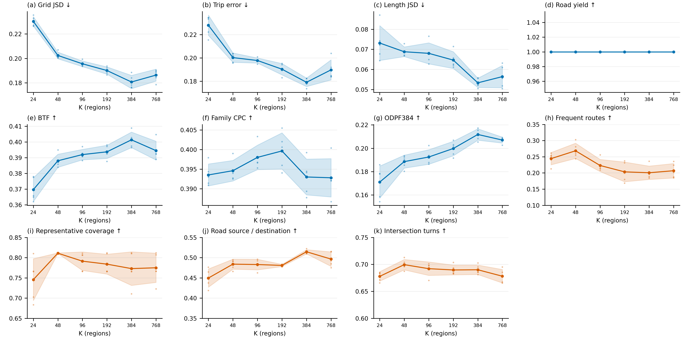
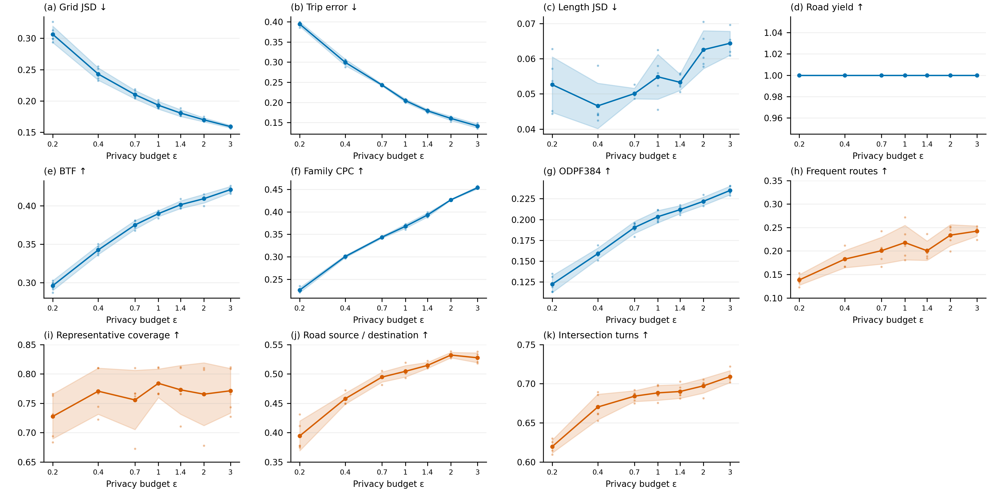

# MTR-DFR: complete reproduction guide

MM2 routing commands explicitly use `--threads 4`, passed to the native MM2 executable; `OMP_NUM_THREADS` alone does not enable MM2 parallelism. The default is also four threads for both Beijing and Porto. Select concurrency within available memory. To resume an interrupted single-thread run, first stop its writer and preserve its entire output directory, then use `--resume-from OLD_MM2_DIRECTORY` with a new output directory. Only complete records from identical M tracks and matching public routing settings are reused; missing IDs are computed and the full population is verified before scoring. Never run two writers against one output directory.

Native DFR scoring keeps the existing `evaluate.py --representation node-pairs --source-cache ...` command. Parallel edge IDs are canonicalized only after checking identical directed geometry, physical endpoints and metric-cache endpoints. Otherwise ambiguity remains an error. Road-task scoring uses the same rule; physical scoring retains the node walk, and coordinate scoring uses the documented representation-only conversion. No route is selected, repaired or rematched; saved outputs and empty slots are preserved.

The full commands are included below. Preparation is grouped in chapter 1; optional environment installation commands are in appendix A. The numbered files in `分节命令/` contain the same commands; choose one version, not both. The detailed shared descriptions below are in Chinese.

所有命令均在仓库的 `reproduction/beijing` 工作目录执行；文档位于仓库根目录，不要因为打开了分节文件就切换工作目录。北京默认，Porto只在第01节首次处理数据前选择一次配置。完整指南与分节版内容相同，选择一种阅读执行，不要两份都跑。

命令中的文件名和目录名沿用当前北京示例。`--config` 是配置，`--input` 是上游产物，`--out` 是新输出目录；自行改名时同步修改后续引用。每条命令成功并核对产物后再继续，已有成功产物按记录接续，不从头重复生成。

个别命令的 `--document` 指向仓库原命令文件，供执行来源登记使用；这些文件保留，无需跳过去阅读或再次执行。

分节目录：

- [第01节 前期准备_环境清单与数据处理](#sec-01) · [分节文件](分节命令/第01节_前期准备_环境清单与数据处理.md)
- [第02节 统计M与五种R及全集评分](#sec-02) · [分节文件](分节命令/第02节_统计M与五种R及全集评分.md)
- [第03-1节 DFR全集与训练专用生成](#sec-03-1) · [分节文件](分节命令/第03-1节_DFR全集与训练专用生成.md)
- [第03-2节 DPMM与MTNet生成](#sec-03-2) · [分节文件](分节命令/第03-2节_DPMM与MTNet生成.md)
- [第04节 原生方法全集效用评分](#sec-04) · [分节文件](分节命令/第04节_原生方法全集效用评分.md)
- [第05节 四项下游任务与图件](#sec-05) · [分节文件](分节命令/第05节_四项下游任务与图件.md)
- [第06节 算法消融与隐私攻击](#sec-06) · [分节文件](分节命令/第06节_算法消融与隐私攻击.md)
- [第07-1节 K分辨率实验](#sec-07-1) · [分节文件](分节命令/第07-1节_K分辨率实验.md)
- [第07-2节 隐私预算实验](#sec-07-2) · [分节文件](分节命令/第07-2节_隐私预算实验.md)
- [第07-3节 准确端点诊断](#sec-07-3) · [分节文件](分节命令/第07-3节_准确端点诊断.md)
- [第08节 敏感性结果汇总与作图](#sec-08) · [分节文件](分节命令/第08节_敏感性结果汇总与作图.md)
- [第09节 完整矩阵与图件](#sec-09) · [分节文件](分节命令/第09节_完整矩阵与图件.md)
- [第10节 小规模程序测试](#sec-10) · [分节文件](分节命令/第10节_小规模程序测试.md)
- [附录A 环境配置命令参考](#sec-A) · [分节文件](分节命令/附录A_环境配置命令参考.md)

<a id="sec-01"></a>

## 第01节 前期准备_环境清单与数据处理

[单独打开本节](分节命令/第01节_前期准备_环境清单与数据处理.md)

### 1.1 环境准备清单

先自行配好下面的环境，再开始处理数据。已有可用环境不必重新安装；首次安装的参考命令集中在文末附录A。

| 检查项 | 要求 |
|---|---|
| 系统与终端 | Windows x64、PowerShell；命令示例均按此环境编写 |
| Python | Python 3.13.9；当前终端已激活项目 `.venv` |
| Python依赖 | 安装 `requirements-clean-windows-py313.txt` 和 `requirements-torch-cpu-py313.txt`，`pip check` 通过；PrivTrace也需要PyTorch |
| 代码与大文件 | Git、Git LFS已安装；仓库大文件已实际下载，不是LFS指针 |
| 本机运行库 | Microsoft Visual C++ x64运行库 |
| 地图匹配运行库 | Conda环境 `data/fmm-runtime`：GDAL 2.4.4、Boost 1.75.0、conda-launchers；当前终端已设置PATH、GDAL_DATA、PROJ_LIB |
| MTNet训练 | NVIDIA GPU和兼容驱动，按附录A安装并实际验证GPU运算；其它方法不要求GPU |
| 文件与资源 | 输入、公共图和新输出目录可访问，磁盘与内存满足本次规模；不同城市用独立检出目录 |
| 中文与编码 | 当前终端设置PYTHONUTF8和PYTHONIOENCODING为UTF-8 |

后续所有命令均在仓库的 `reproduction/beijing` 目录执行。这个目录名沿用北京示例，运行Porto也不改目录名。环境安装、激活和检查命令见[附录A](README_CN.md#sec-A)；已有环境可直接从下面的数据配置开始。

### 1.2 先确定输入：正文以北京为例

北京默认使用 `configs/datasets/beijing.workflow.json`，新终端未设置 `DFR_DATASET_CONFIG` 时不需要额外选择命令。先检查这个文件的内容：

| 配置字段 | 北京示例值 | 是什么、怎么改 |
|---|---|---|
| `schema` | `readme-dataset-workflow-v1` | 配置格式版本，保持不变 |
| `dataset` | `beijing` | 数据集名称，写入来源记录 |
| `adapter` | `geolife` | 原始文件读取方式；GeoLife的PLT格式使用此值 |
| `archive` | `data/downloads/geolife_1.3.zip` | 原始压缩包保存位置，可改为自己的文件路径 |
| `extract_to` | `data/geolife` | 压缩包解压目录，与下面的source保持对应 |
| `source` | `data/geolife/Geolife Trajectories 1.3/Data` | 原始Data目录；目录下应有用户编号及各自的Trajectory文件夹 |
| `bbox` | `[39.75, 40.15, 116.10, 116.65]` | 北京示例范围，顺序为纬度下界、纬度上界、经度下界、经度上界，单位为度 |
| `seed` | `20260713` | 数据整理和固定划分使用的种子，不是所有算法共用的生成种子 |

这些相对路径均相对于 `reproduction/beijing`，不是相对于配置文件所在目录。已有压缩包可以放到archive指定的位置；已有解压文件则让source指向实际Data目录。换目录名本身不改变算法，但后续引用必须一致。

#### 换成其它城市：改输入配置，不改后续实验命令

换城市要换的是这座城市的轨迹、公共路网和输入配置，不只是把 `beijing` 改成另一个名字。先看你手里的数据属于哪一种：

| 你已有的数据 | 先准备什么 | 输入配置中的adapter |
|---|---|---|
| START的Porto作者压缩包 | 保留原始ZIP，程序已有专用读取方式；下面给出完整例子 | `start_porto_archive` |
| 已按本项目格式整理好的其它城市数据包 | 确认包内有dataset.json、轨迹记录、对应的公共图及固定训练/测试划分 | `standard_bundle` |
| 其它格式的原始GPS或道路序列 | 先完成该格式的读取、道路编号对应和统一格式导出；不能直接把原始CSV或ZIP填成统一包 | 当前没有通用原始文件读取器 |

对于已经整理好的其它城市，例如名称取 `city_a`，新建 `configs/datasets/city_a.workflow.json`，填写下面这些字段。文件名和city_a只是例子，可以自行命名：

| 字段 | 示例值 | 你需要做什么 |
|---|---|---|
| `schema` | `readme-dataset-workflow-v1` | 原样填写，表示这是输入选择配置 |
| `dataset` | `city_a` | 填自己的数据集名，必须与数据包dataset.json里的dataset一致 |
| `adapter` | `standard_bundle` | 原样填写，表示输入已经是统一格式 |
| `source` | `inputs/city_a/standard` | 改成统一包目录；该目录下必须直接有dataset.json，而不是只有原始轨迹文件 |

<!-- city-example-start -->
新建文件的完整内容如下；先把city_a和source路径换成自己的，再保存：

```json
{
  "schema": "readme-dataset-workflow-v1",
  "dataset": "city_a",
  "adapter": "standard_bundle",
  "source": "inputs/city_a/standard"
}
```

在首次处理数据前选择这个配置：

```powershell
$env:DFR_DATASET_CONFIG='configs/datasets/city_a.workflow.json'
```
<!-- city-example-end -->

然后从1.3继续执行原命令。这里只选择配置文件，尚未运行实验。输入选择配置回答“读哪份数据”，数据包内的dataset.json回答“轨迹、公共图、时间和划分分别在哪里”，两者不要混为同一个文件。

统一包应带齐以下内容：

| 内容 | 必须说明什么 |
|---|---|
| 轨迹记录 | 每条轨迹的坐标、道路序列、原始记录编号和训练/测试归属；记录与兼容格式文件逐条对应 |
| 公共道路图 | 有向道路编号、几何、连接关系和坐标系；轨迹道路编号能在图中找到 |
| 时间信息 | 有观测时间则保留并标注来源；没有则明确缺失，不用编造的时间替代，依赖时间的方法需另行处理 |
| 固定划分和来源 | 训练/测试互斥、覆盖全体保留记录，保留排除原因与原始来源 |
| 包内文件 | 除dataset.json外，还包括records.jsonl.gz及其引用的prepared、network等真实文件，不能只手写一个路径清单 |

北京和START Porto的读取器会自动导出这份统一包。新原始格式目前仍需先完成相应转换；统一包接口并不意味着程序已经能自动识别任意CSV、PLT或ZIP。统一包完成后，生成、路由和评分才不再关心原始文件格式。

#### Porto作为换城市的具体例子

首次处理Porto时，输入是作者原始压缩包，不要求用户先做出统一数据包。下面只是在选择输入，不是一步完成预处理：选择后仍要依次执行1.3的读取、1.4的审查和导出，再执行1.5—1.6的资源准备及检查。

在独立的新检出目录配置环境，将START作者原始 `Porto_data.zip` 放到 `reproduction/beijing/inputs/Porto_data.zip`，然后在第一条dataset命令前执行：

```powershell
$env:DFR_DATASET_CONFIG='configs/datasets/porto.workflow.json'
```

Porto配置文件是 `configs/datasets/porto.workflow.json`。其中 `dataset=porto`，`adapter=start_porto_archive`，`source=inputs/Porto_data.zip`，`seed=20260713`。压缩包放在其它位置时，只改这个配置的source；fetch会检查该包是否存在，不会替你下载作者包。

选择后继续执行本章1.3起及后面各章的同一套命令。Porto复用作者已有真实道路序列，经编号映射与连接检查后导入；北京从PLT坐标开始做真实轨迹匹配。两种原始输入最终进入同一套统一数据接口。坐标型算法新生成的轨迹仍分别运行各路由。

城市选择只对当前终端有效。重新打开终端时恢复环境，并重新选择自己的城市配置；要回北京则使用未设置该变量的新终端。每座城市使用独立检出目录，不在已写出的数据/缓存目录中途切换，也不复用北京的道路缓存。

### 1.3 下载或读取原始数据，并准备公共图

按顺序执行这一组；每条成功后再执行下一条：

```powershell
python dataset.py fetch
python dataset.py public_graph
python dataset.py read
```

这三条命令没有需要临时填写的位置，输入路径和城市范围都来自前面的配置。

| 命令 | 北京示例 | 换成其它城市后做什么 |
|---|---|---|
| `dataset.py fetch` | 下载GeoLife压缩包并解压到配置目录 | 按配置检查输入是否就绪：统一包检查source目录下的dataset.json；Porto检查source指定的作者ZIP。不是自动搜索、下载任意城市数据 |
| `dataset.py public_graph` | 安装仓库提供的北京公共图；许可见 `public_assets/BEIJING_FULL_LICENSE.md` | 使用该城市自己的公共图。统一包已带图，本条只登记其入口；Porto从作者ZIP导出图。不会自动下载其它城市地图 |
| `dataset.py read` | 读取全部PLT，恢复坐标和原始时间，保留范围内至少2点的轨迹 | 使用所选格式的读取方式。统一包已经转换好，本条只登记入口；Porto解析作者道路序列与时间。统一包的逐条核验在1.4进行 |

因此，已有其它城市统一包时，这三条命令不会再重复下载、建图或转换；下一组roads命令负责核验包内轨迹、道路、坐标和划分。只有原始文件时，应先完成上面所说的格式转换，不能指望这三条命令自动猜出字段含义。

北京PLT前6行是文件头，之后读取经纬度与时间；正式流程不设置隐含的小样本上限。Porto道路几何坐标视图不是原始高频GPS，来源记录会保留这一区别。

### 1.4 审查并导出统一数据

先看输入和参数，再做道路准备及审查：

```powershell
python dataset.py roads --dry-run
python dataset.py roads --review-only
```

`--dry-run` 只显示将使用的路径和参数，不启动匹配；`--review-only` 生成或复用道路准备结果及筛选报告，供你确认哪些轨迹保留。

北京使用全部GPS点，8候选失败后仅对失败项改用16候选，搜索半径200米、GPS误差50米、8线程；报告为 `data/road_review/selection_review.json`。Porto核查已有道路映射，不做第二次匹配，报告为 `data/raw/start_mapping/manifest.json`。

其它城市使用standard_bundle时，本组命令核验现有统一包，报告为 `data/workflow/standard_input_verification.json`；不重新匹配、筛轨迹或重划分。其source指定的原包只读使用，派生资源写到本次新检出目录。

先打开对应报告，查看保留/排除数量和原因。确认接受该筛选结果，再运行：

```powershell
python dataset.py roads --accept-reviewed-subset yes
```

`--accept-reviewed-subset yes` 表示明确接受已审查的保留子集。北京审查阶段若退出码为2但已写出待接受报告，应先读报告，再执行接受命令，不要因此重新跑整套匹配。

| 输出 | 用途 |
|---|---|
| `data/road_accepted/dataset/trajectories.pkl` | 接受后的坐标表示，与道路轨迹逐槽对应 |
| `data/road_accepted/dataset/road_records.pkl.gz` | 道路序列，是道路生成和评分的真实输入 |
| `data/road_accepted/dataset/train.pkl`、`test.pkl` | 种子20260713的80%/20%固定划分 |
| `source_indices.json`、`canonical_manifest.json` | 保留原始记录对应关系及导出来源 |
| `data/road_accepted/standard/dataset.json` | 统一数据包入口，连接道路、坐标、时间、划分与公共图 |
| `data/workflow/commands.jsonl` | 数据准备阶段的内部参数、耗时和退出码记录 |

上表的data/road_accepted路径是北京和Porto自动转换后的输出。其它城市以standard_bundle接入时，统一包仍位于自己配置的source目录，不会额外复制到这个北京示例路径；后续bind读取的是当前选中的包。

#### 统一格式究竟是什么

统一的是文件结构、字段和接口，不是把不同城市的道路编号、坐标来源或时间来源变成相同数据。数据集选择配置是“输入地址”；下面这个统一包才是预处理的结果。

<!-- format-example-start -->
统一包的主要文件如下。public中的道路文件需要一起保留；不是只复制.shp一个文件。

```text
standard/
  dataset.json                 数据包入口：城市、坐标系、数据语义及各文件路径
  records.jsonl.gz              压缩的逐条轨迹记录，每行一个JSON对象
  time_endpoints.csv            轨迹起止时间；无可靠时间时仅有表头
  export_report.json            导出数量、时间可用性、耗时及文件校验记录
  prepared/                    现有算法读取的兼容文件，与逐条记录内容一致
    trajectories.pkl           全集坐标序列
    road_records.pkl.gz        全集道路序列
    train.pkl / test.pkl       固定训练集、测试集
    train_split.json / test_split.json
    source_indices.json        对应原始数据的记录编号
    canonical_manifest.json    数据来源、数量及兼容文件清单
  public/
    network.shp / network.shx / network.dbf / network.prj
    public_ways.pkl            公共道路属性缓存；提供该资源时随包保存
```

records.jsonl.gz解压后的一条记录格式如下。以下数值仅用于解释字段，不是实验数据，也不是可单独运行的完整数据包：

```json
{
  "record_index": 0,
  "source_index": 123,
  "split": "train",
  "coordinates": [[39.90, 116.30], [39.91, 116.31]],
  "road_ids": [101, 102],
  "point_timestamps": null,
  "start_ts": null,
  "end_ts": null
}
```
<!-- format-example-end -->

| 字段 | 类型及含义 | 要满足什么 |
|---|---|---|
| `record_index` | 整数，本包内编号 | 从0开始连续排列，表示第几条轨迹 |
| `source_index` | 整数，原始来源记录编号 | 能追溯到筛选前记录；不因排除其它轨迹而失去来源 |
| `split` | 字符串train或test | 一条轨迹只属于一边，与固定划分文件一致 |
| `coordinates` | 二维数值数组，每点为 `[纬度, 经度]` | WGS84/EPSG:4326，单位度；不是 `[经度, 纬度]`，也不是投影米坐标 |
| `road_ids` | 按行驶顺序排列的整数道路编号数组 | 对应该包公共图的有向道路，顺序连通；不是节点编号，也不假设等于原始OSM编号 |
| `point_timestamps` | 与坐标点逐个对应的数值数组，或null | 有值时数量等于坐标点数、时间不倒退；无可靠逐点时间则为null |
| `start_ts` / `end_ts` | 轨迹起止时间数值，或null | 来源可靠且结束不早于开始；逐点时间存在时与其首尾一致 |

一条记录对应整条轨迹，不是一个点。coordinates的点数不要求等于road_ids的道路数；一个道路可对应多个坐标点。时间保留来源数值及含义，见dataset.json的timestamp_semantics，不能仅凭字段名假设不同源数据的数值都使用同一种时间单位或起点。

dataset.json记录 `schema=road-experiment-bundle-v1`、`record_schema=road-trajectory-record-v1`、dataset、coordinate_order、coordinate_crs、coordinate_semantics、timestamp_semantics和paths。paths.prepared指向兼容数据目录，paths.network指向本包公共图；包内相对路径以dataset.json所在目录为基准。道路图可使用投影坐标，其坐标系由图文件及routing_crs声明，不把它误当轨迹的经纬度。

prepared不是另一份独立选择的数据：它保留现有程序能读取的保存形式；records.jsonl.gz是相同轨迹的统一逐条表示。两者的轨迹顺序、坐标、道路序列和划分必须一致。只写一个dataset.json，或只放一份坐标CSV，均不算形成统一包。

#### 北京和Porto分别怎样变成这个格式

| 环节 | 北京原始PLT | Porto作者原始ZIP |
|---|---|---|
| 读取 | 解析GPS点及原始时间 | 解析作者已经处理过的道路序列及时间 |
| 道路对应 | 用本城市公共图匹配GPS，保留审查通过的道路轨迹 | 映射作者道路编号，检查方向和连接，不再匹配真实轨迹 |
| 统一坐标表示 | 原始观测点在匹配道路上的投影 | 对应道路起点的确定几何坐标；不是原始高频GPS |
| 时间 | 保留可恢复的原始端点时间；当前统一导出没有逐点时间时写null | 保留作者处理后的逐点时间，不插值编造中间时间 |
| 最终导出 | 两者都写成上面的字段、包目录及80/20固定划分 | 格式相同，来源语义仍分别记录 |

上述步骤由dataset.py依次调用预处理程序：Porto公共图用preprocess/start_porto_graph.py，轨迹读取用preprocess/start_porto.py，接受与固定划分用preprocess/start_porto_freeze.py；两城最终都调用preprocess/standardize_dataset.py导出，再调用preprocess/check_standard_package.py逐条核对。用户按前面相同的dataset.py命令操作，无需再手动调用这些内部程序。

验证通过应得到 `STANDARD_PACKAGE_VERIFIED`，并报告全集、训练、测试数量。检查会比较全部记录与兼容文件，而不是看到目录存在就算成功。统一包完成后还需做1.5的公共路由资源准备；统一格式本身不包含已完成的合成实验或全部路由预计算。

北京冻结示例是15730条道路轨迹、12584条训练、3146条测试。历史原始坐标17123条与接受后的道路语料不是同一阶段，不能直接改名混用。Porto数量由实际验收结果决定，不填北京人数。后续程序都读取统一包，不再分别处理PLT或START原始格式。

### 1.5 一次准备好划分、路由资源和实验配置

下面一组承接统一数据包，生成后续各章使用的配置。它不启动合成实验，也不生成另一份命令指南：

```powershell
python preprocess/fetch_mm2.py --archive data/downloads/mm2_1.2.1.zip --extract-to data/mm2_upstream --install-to resources/mm2/map_matching_2.exe
python dataset.py bind
python dataset.py resources
python prepare_tstr_split.py --config configs/local_public.json --out data/local_split --out-config configs/local_split.json
python prepare_ubodt.py --config configs/local_split.json --out-dir data/local_ubodt --out-config configs/local_ready.json --delta-m 1500 --threads 4
python prepare_mm2_city.py --config configs/local_ready.json --executable resources/mm2/map_matching_2.exe --out data/local_mm2 --out-config configs/local_all_ready.json
python tools/prepare_experiment_configs.py --config configs/local_all_ready.json --out configs/experiments
```

同一组配置文件逐步增加已准备好的资源；路径名是北京示例名称，可自行统一改名，但要同步修改后续引用。

| 参数或命令 | 含义与输出 |
|---|---|
| fetch_mm2的 `--archive` | MM2原始ZIP的下载/保存路径 |
| `--extract-to` / `--install-to` | 解压目录 / 安装后的可执行文件路径；前者是目录，后者是文件 |
| `dataset.py bind` | 将统一数据包接到 `configs/local_new.json` 等当前工作配置 |
| `dataset.py resources` | 准备当前城市的道路指标与边缓存，写出 `configs/local_public.json` |
| `--config` | 本条命令读取的上一步JSON配置 |
| prepare_tstr_split的 `--out` / `--out-config` | 划分检查产物目录 / 增补划分引用的新配置；复验既有80/20划分，不另选一次测试集 |
| prepare_ubodt的 `--out-dir` / `--out-config` | FMM最短路预计算目录 / 带UBODT引用的新配置 |
| `--delta-m 1500` | 最短路预计算的道路距离阈值，单位米；不是隐私δ、GPS半径或轨迹最长距离 |
| `--threads 4` | 只控制本条UBODT准备命令的CPU线程数 |
| prepare_mm2_city的 `--executable` | 本城市MM2资源所用的程序，须与前面的安装位置一致 |
| prepare_mm2_city的 `--out` / `--out-config` | 当前城市MM2资源目录 / 最终资源配置 `configs/local_all_ready.json` |
| prepare_experiment_configs的 `--out` | 实验JSON配置总目录 `configs/experiments`，不是合成结果目录 |

配置顺序是：local_public（公共资源）→local_split（固定划分）→local_ready（FMM资源）→local_all_ready（再加MM2资源）→configs/experiments（各实验配置）。这些步骤准备公共图和配置，不提前执行后面的实际路由。

### 1.6 读入本城市变量，检查下一章所需输入

下面这些赋值放在同一PowerShell窗口一起执行，最后运行检查：

```powershell
$Experiment = Get-Content configs/experiments/configs/beijing.json -Raw -Encoding UTF8 | ConvertFrom-Json
$Network = $Experiment.paths.network
$MetricCache = $Experiment.paths.metric_cache
$EdgeCache = $Experiment.paths.edge_cache
$RoadRecords = $Experiment.paths.real_routes
$FullSlots = $Experiment.slots
$TrainSlots = $Experiment.train_slots
python tools/check_readme_handoff.py --config configs/local_all_ready.json --config-root configs/experiments --out results/readme_handoff_check.json
```

| 变量/参数 | 含义 |
|---|---|
| `$Experiment` | 当前城市的实验资源配置对象；文件名beijing.json是历史预设名，内容由所选城市写入 |
| `$Network` / `$MetricCache` / `$EdgeCache` | 当前城市公共图 / 指标缓存 / 边缓存，后续命令直接引用 |
| `$RoadRecords` | 本批接受后的真实道路序列 |
| `$FullSlots` / `$TrainSlots` | 当前城市全集 / 训练集的槽位数量，不手填北京人数 |
| check_readme_handoff的 `--config` | 最终数据与公共资源配置 |
| `--config-root` | 刚生成的各实验JSON配置目录 |
| `--out` | 本次检查报告路径，不是实验成绩 |

成功时应输出 `README_9_11_INPUT_AND_DOCUMENT_PREFLIGHT_PASSED`。其中9—11沿用历史检查名称，表示相关输入、资源和文档引用已接通，不表示实验已经完成。随后直接进入第02节运行M与R。全量发布和训练专用发布要分开生成；已有成功输出按记录接续，不重复覆盖。

如只重新评分/作图，可使用仓库现有 `datasets/synthetic/` 和 `reference_results/` 对应的产物，先核对城市与数据版本；不要将它们当成本次新运行的结果。

<a id="sec-02"></a>

## 第02节 统计M与五种R及全集评分

[单独打开本节](分节命令/第02节_统计M与五种R及全集评分.md)

**本节先生成，再处理道路，最后评分。** M是合成算法，R是处理其输出的道路方法。同一份M输出分别交给五种R，不为每种R重新生成M。`full`表示全集发布；`train`表示只读真实训练集的发布，供训练集隔离与隐私攻击使用。

`Origin`保留M原输出，`Nearest`做最近道路处理，`FMM`、`STMatch`和`MM2-MDP`运行各自道路方法。每条命令前面的标题会写明算法、full/train和当前阶段。当前主实验配置请求epsilon=1.4，生成种子由对应配置的seed给出；它与第01节的数据划分种子不是一回事。

| 配置里的设置 | 北京主实验示例 | 简单含义 |
|---|---|---|
| `epsilon` | `1.4` | 本次请求的隐私预算；各算法的隐私单位仍按各自记录说明 |
| `seed` | `42` | 本节统计合成算法的随机种子；扫参组在自己的配置中另列 |
| `evaluation_seed` | `20260713` | 评价中需要固定随机抽样时使用的种子 |
| `slots` | `15730` | 全集输出应保留的槽位数 |
| `train_slots` / `test_slots` | `12584` / `3146` | 本批固定的真实训练/测试人数 |
| `paths.prepared` | 当前接受后的数据目录 | 真实坐标、道路记录和固定分集来自这里 |
| `paths.output` + `batch` | 当前结果根目录与批次名 | 没有显式--out时，程序按这两项确定输出位置 |

例如第一条SPRT命令的 `--config` 是一份JSON设置，`--method SPRT` 选择算法，`--out` 保存这次SPRT结果。下一条Origin的 `--input` 应读取这次SPRT目录；改了上一步目录名，就同步改这一项。第03节原生算法可能有自己的固定种子，不把本节seed=42套到所有程序上。


在部署根目录执行。先设置当前终端编码；每条实验命令独立运行，不通过队列替换外层入口。

**步骤 02.01：让Python使用UTF-8模式，避免中文路径或内容乱码。**

读取：当前窗口和配置中的已有值。

```powershell
$env:PYTHONUTF8='1'
```

完成后：仅影响当前PowerShell窗口，不生成轨迹或评分。

**步骤 02.02：让Python终端输入输出使用UTF-8编码。**

读取：当前窗口和配置中的已有值。

```powershell
$env:PYTHONIOENCODING='utf-8'
```

完成后：仅影响当前PowerShell窗口，不生成轨迹或评分。

全量发布用于统计、道路保真和第05节四项下游任务；训练发布用于训练集隔离与隐私攻击。
此清单覆盖四个统计M及五个R，不包括DFR/DPMM/MTNet原生生成、训练lineage登记、攻击、K/预算及作图。
这是待执行的新批次计划，不是已完成的实验记录。M只生成一次，五个R读取同一份测量。

### SPRT/full/M

依赖：冻结输入与公共资源

**步骤 02.03：运行--method指定的统计合成算法。**

读取：配置指定的真实全集；带--train-only时只读训练集。

```powershell
.venv/Scripts/python.exe synthesize.py --config configs/experiments/reproduction_checked_20261024/config.json --method SPRT --out results\reproduction_checked_20261024\measurements\SPRT
```

| 参数 | 简单含义 |
|---|---|
| `--config` | 读取这一份实验配置：真实数据、道路图、分集和算法设置从这里取得。 |
| `--method` | 选择本次运行的统计合成算法，例如SPRT；名称后面不是文件路径。 |
| `--out` | 本次输出的位置；改名后，后续读取这个结果的路径也要一起改。 |

完成后：measurement.pkl和measurement_manifest.json；训练专用时还保存来源记录。

预期输出：`results\reproduction_checked_20261024\measurements\SPRT\measurement.pkl`、`results\reproduction_checked_20261024\measurements\SPRT\measurement_manifest.json`

### SPRT/full/Origin/R

依赖：SPRT/full/M

**步骤 02.04：用--router指定的方法处理同一份M输出。**

读取：--input指定的合成测量，以及配置里的公共道路资源。

```powershell
.venv/Scripts/python.exe route.py --config configs/experiments/reproduction_checked_20261024/config.json --method SPRT --router Origin --input results\reproduction_checked_20261024\measurements\SPRT --out results\reproduction_checked_20261024\routes\SPRT\Origin
```

| 参数 | 简单含义 |
|---|---|
| `--config` | 读取这一份实验配置：真实数据、道路图、分集和算法设置从这里取得。 |
| `--method` | 标记本次要处理或评价的方法；评分命令只读已有发布，不会因此重新生成。 |
| `--router` | 选择道路处理方式：Origin保留原输出，其余选择Nearest、FMM、STMatch或MM2-MDP。 |
| `--input` | 本条命令读取的上游产物；应是前面已成功生成的文件或目录。 |
| `--out` | 本次输出的位置；改名后，后续读取这个结果的路径也要一起改。 |

完成后：Origin写坐标文件；道路方法写synthetic_routes.pkl.gz及route_manifest.json。

预期输出：`results\reproduction_checked_20261024\routes\SPRT\Origin\synthetic_coordinates.pkl`、`results\reproduction_checked_20261024\routes\SPRT\Origin\route_manifest.json`

### SPRT/full/Origin/coordinates

依赖：SPRT/full/Origin/R

**步骤 02.05：比较合成数据保留了多少真实坐标统计特征。**

读取：合成坐标或道路结果，以及配置中的真实参考。

```powershell
.venv/Scripts/python.exe evaluate_coordinates.py --config configs/experiments/reproduction_checked_20261024/config.json --method SPRT --router Origin --input results\reproduction_checked_20261024\routes\SPRT\Origin\synthetic_coordinates.pkl --metric-protocol audit-v2 --out results\reproduction_checked_20261024\coordinate_scores_audit_v2\SPRT\Origin
```

| 参数 | 简单含义 |
|---|---|
| `--config` | 读取这一份实验配置：真实数据、道路图、分集和算法设置从这里取得。 |
| `--method` | 标记本次要处理或评价的方法；评分命令只读已有发布，不会因此重新生成。 |
| `--router` | 标记这份已保存结果对应的道路方法；这里是评分，不再次运行该路由。 |
| `--input` | 本条命令读取的上游产物；应是前面已成功生成的文件或目录。 |
| `--metric-protocol` | 评分规则版本；本指南用audit-v2，各方法保持相同版本。 |
| `--out` | 本次输出的位置；改名后，后续读取这个结果的路径也要一起改。 |

完成后：坐标统计metrics.json及来源记录；不会重新训练生成器。

预期输出：`results\reproduction_checked_20261024\coordinate_scores_audit_v2\SPRT\Origin\metrics.json`、`results\reproduction_checked_20261024\coordinate_scores_audit_v2\SPRT\Origin\manifest.json`

### SPRT/full/Nearest/R

依赖：SPRT/full/M

**步骤 02.06：用--router指定的方法处理同一份M输出。**

读取：--input指定的合成测量，以及配置里的公共道路资源。

```powershell
.venv/Scripts/python.exe route.py --config configs/experiments/reproduction_checked_20261024/config.json --method SPRT --router Nearest --input results\reproduction_checked_20261024\measurements\SPRT --out results\reproduction_checked_20261024\routes\SPRT\Nearest
```

| 参数 | 简单含义 |
|---|---|
| `--config` | 读取这一份实验配置：真实数据、道路图、分集和算法设置从这里取得。 |
| `--method` | 标记本次要处理或评价的方法；评分命令只读已有发布，不会因此重新生成。 |
| `--router` | 选择道路处理方式：Origin保留原输出，其余选择Nearest、FMM、STMatch或MM2-MDP。 |
| `--input` | 本条命令读取的上游产物；应是前面已成功生成的文件或目录。 |
| `--out` | 本次输出的位置；改名后，后续读取这个结果的路径也要一起改。 |

完成后：Origin写坐标文件；道路方法写synthetic_routes.pkl.gz及route_manifest.json。

预期输出：`results\reproduction_checked_20261024\routes\SPRT\Nearest\synthetic_routes.pkl.gz`、`results\reproduction_checked_20261024\routes\SPRT\Nearest\route_manifest.json`

### SPRT/full/Nearest/coordinates

依赖：SPRT/full/Nearest/R

**步骤 02.07：比较合成数据保留了多少真实坐标统计特征。**

读取：合成坐标或道路结果，以及配置中的真实参考。

```powershell
.venv/Scripts/python.exe evaluate_coordinates.py --config configs/experiments/reproduction_checked_20261024/config.json --method SPRT --router Nearest --input results\reproduction_checked_20261024\routes\SPRT\Nearest\synthetic_routes.pkl.gz --metric-protocol audit-v2 --out results\reproduction_checked_20261024\coordinate_scores_audit_v2\SPRT\Nearest
```

| 参数 | 简单含义 |
|---|---|
| `--config` | 读取这一份实验配置：真实数据、道路图、分集和算法设置从这里取得。 |
| `--method` | 标记本次要处理或评价的方法；评分命令只读已有发布，不会因此重新生成。 |
| `--router` | 标记这份已保存结果对应的道路方法；这里是评分，不再次运行该路由。 |
| `--input` | 本条命令读取的上游产物；应是前面已成功生成的文件或目录。 |
| `--metric-protocol` | 评分规则版本；本指南用audit-v2，各方法保持相同版本。 |
| `--out` | 本次输出的位置；改名后，后续读取这个结果的路径也要一起改。 |

完成后：坐标统计metrics.json及来源记录；不会重新训练生成器。

预期输出：`results\reproduction_checked_20261024\coordinate_scores_audit_v2\SPRT\Nearest\metrics.json`、`results\reproduction_checked_20261024\coordinate_scores_audit_v2\SPRT\Nearest\manifest.json`

### SPRT/full/Nearest/roads

依赖：SPRT/full/Nearest/R

**步骤 02.08：计算道路合法性和路线选择相关指标。**

读取：合成道路结果、真实道路参考和同城评价缓存。

```powershell
.venv/Scripts/python.exe evaluate.py --config configs/experiments/reproduction_checked_20261024/config.json --method SPRT --router Nearest --input results\reproduction_checked_20261024\routes\SPRT\Nearest\synthetic_routes.pkl.gz --out results\reproduction_checked_20261024\scores\SPRT\Nearest
```

| 参数 | 简单含义 |
|---|---|
| `--config` | 读取这一份实验配置：真实数据、道路图、分集和算法设置从这里取得。 |
| `--method` | 标记本次要处理或评价的方法；评分命令只读已有发布，不会因此重新生成。 |
| `--router` | 标记这份已保存结果对应的道路方法；这里是评分，不再次运行该路由。 |
| `--input` | 本条命令读取的上游产物；应是前面已成功生成的文件或目录。 |
| `--out` | 本次输出的位置；改名后，后续读取这个结果的路径也要一起改。 |

完成后：metrics.json、metrics.csv和manifest.json。

预期输出：`results\reproduction_checked_20261024\scores\SPRT\Nearest\metrics.json`、`results\reproduction_checked_20261024\scores\SPRT\Nearest\manifest.json`

### SPRT/full/Nearest/physical

依赖：SPRT/full/Nearest/R

**步骤 02.09：比较道路轨迹的物理结构和有序片段。**

读取：已生成道路轨迹及同城公共图。

```powershell
.venv/Scripts/python.exe evaluate_physical.py --config configs/experiments/reproduction_checked_20261024/config.json --method SPRT --router Nearest --input results\reproduction_checked_20261024\routes\SPRT\Nearest\synthetic_routes.pkl.gz --out results\reproduction_checked_20261024\physical_scores\SPRT\Nearest
```

| 参数 | 简单含义 |
|---|---|
| `--config` | 读取这一份实验配置：真实数据、道路图、分集和算法设置从这里取得。 |
| `--method` | 标记本次要处理或评价的方法；评分命令只读已有发布，不会因此重新生成。 |
| `--router` | 标记这份已保存结果对应的道路方法；这里是评分，不再次运行该路由。 |
| `--input` | 本条命令读取的上游产物；应是前面已成功生成的文件或目录。 |
| `--out` | 本次输出的位置；改名后，后续读取这个结果的路径也要一起改。 |

完成后：物理结构评分及input_binding.json。

预期输出：`results\reproduction_checked_20261024\physical_scores\SPRT\Nearest\results.csv`、`results\reproduction_checked_20261024\physical_scores\SPRT\Nearest\input_binding.json`

### SPRT/full/Nearest/road_tasks

依赖：SPRT/full/Nearest/roads

**步骤 02.10：让合成数据回答道路选择与下一道路相关问题。**

读取：同一组合成道路，以及之前道路评分的来源清单。

```powershell
.venv/Scripts/python.exe evaluate_road_tasks.py --config configs/experiments/reproduction_checked_20261024/config.json --method SPRT --router Nearest --input results\reproduction_checked_20261024\routes\SPRT\Nearest\synthetic_routes.pkl.gz --score-manifest results\reproduction_checked_20261024\scores\SPRT\Nearest\manifest.json --out results\reproduction_checked_20261024\road_tasks\SPRT\Nearest
```

| 参数 | 简单含义 |
|---|---|
| `--config` | 读取这一份实验配置：真实数据、道路图、分集和算法设置从这里取得。 |
| `--method` | 标记本次要处理或评价的方法；评分命令只读已有发布，不会因此重新生成。 |
| `--router` | 标记这份已保存结果对应的道路方法；这里是评分，不再次运行该路由。 |
| `--input` | 本条命令读取的上游产物；应是前面已成功生成的文件或目录。 |
| `--score-manifest` | 之前道路评分生成的manifest.json，用于核对本条道路任务使用同一输入。 |
| `--out` | 本次输出的位置；改名后，后续读取这个结果的路径也要一起改。 |

完成后：道路任务metrics.json等；本命令不计算四项应用。K与预算实验还须继续第08节，逐组回答第05节锁定的真实问题。

预期输出：`results\reproduction_checked_20261024\road_tasks\SPRT\Nearest\metrics.json`、`results\reproduction_checked_20261024\road_tasks\SPRT\Nearest\manifest.json`

### SPRT/full/FMM/R

依赖：SPRT/full/M

**步骤 02.11：用--router指定的方法处理同一份M输出。**

读取：--input指定的合成测量，以及配置里的公共道路资源。

```powershell
.venv/Scripts/python.exe route.py --config configs/experiments/reproduction_checked_20261024/config.json --method SPRT --router FMM --input results\reproduction_checked_20261024\measurements\SPRT --out results\reproduction_checked_20261024\routes\SPRT\FMM
```

| 参数 | 简单含义 |
|---|---|
| `--config` | 读取这一份实验配置：真实数据、道路图、分集和算法设置从这里取得。 |
| `--method` | 标记本次要处理或评价的方法；评分命令只读已有发布，不会因此重新生成。 |
| `--router` | 选择道路处理方式：Origin保留原输出，其余选择Nearest、FMM、STMatch或MM2-MDP。 |
| `--input` | 本条命令读取的上游产物；应是前面已成功生成的文件或目录。 |
| `--out` | 本次输出的位置；改名后，后续读取这个结果的路径也要一起改。 |

完成后：Origin写坐标文件；道路方法写synthetic_routes.pkl.gz及route_manifest.json。

预期输出：`results\reproduction_checked_20261024\routes\SPRT\FMM\synthetic_routes.pkl.gz`、`results\reproduction_checked_20261024\routes\SPRT\FMM\route_manifest.json`

### SPRT/full/FMM/coordinates

依赖：SPRT/full/FMM/R

**步骤 02.12：比较合成数据保留了多少真实坐标统计特征。**

读取：合成坐标或道路结果，以及配置中的真实参考。

```powershell
.venv/Scripts/python.exe evaluate_coordinates.py --config configs/experiments/reproduction_checked_20261024/config.json --method SPRT --router FMM --input results\reproduction_checked_20261024\routes\SPRT\FMM\synthetic_routes.pkl.gz --metric-protocol audit-v2 --out results\reproduction_checked_20261024\coordinate_scores_audit_v2\SPRT\FMM
```

| 参数 | 简单含义 |
|---|---|
| `--config` | 读取这一份实验配置：真实数据、道路图、分集和算法设置从这里取得。 |
| `--method` | 标记本次要处理或评价的方法；评分命令只读已有发布，不会因此重新生成。 |
| `--router` | 标记这份已保存结果对应的道路方法；这里是评分，不再次运行该路由。 |
| `--input` | 本条命令读取的上游产物；应是前面已成功生成的文件或目录。 |
| `--metric-protocol` | 评分规则版本；本指南用audit-v2，各方法保持相同版本。 |
| `--out` | 本次输出的位置；改名后，后续读取这个结果的路径也要一起改。 |

完成后：坐标统计metrics.json及来源记录；不会重新训练生成器。

预期输出：`results\reproduction_checked_20261024\coordinate_scores_audit_v2\SPRT\FMM\metrics.json`、`results\reproduction_checked_20261024\coordinate_scores_audit_v2\SPRT\FMM\manifest.json`

### SPRT/full/FMM/roads

依赖：SPRT/full/FMM/R

**步骤 02.13：计算道路合法性和路线选择相关指标。**

读取：合成道路结果、真实道路参考和同城评价缓存。

```powershell
.venv/Scripts/python.exe evaluate.py --config configs/experiments/reproduction_checked_20261024/config.json --method SPRT --router FMM --input results\reproduction_checked_20261024\routes\SPRT\FMM\synthetic_routes.pkl.gz --out results\reproduction_checked_20261024\scores\SPRT\FMM
```

| 参数 | 简单含义 |
|---|---|
| `--config` | 读取这一份实验配置：真实数据、道路图、分集和算法设置从这里取得。 |
| `--method` | 标记本次要处理或评价的方法；评分命令只读已有发布，不会因此重新生成。 |
| `--router` | 标记这份已保存结果对应的道路方法；这里是评分，不再次运行该路由。 |
| `--input` | 本条命令读取的上游产物；应是前面已成功生成的文件或目录。 |
| `--out` | 本次输出的位置；改名后，后续读取这个结果的路径也要一起改。 |

完成后：metrics.json、metrics.csv和manifest.json。

预期输出：`results\reproduction_checked_20261024\scores\SPRT\FMM\metrics.json`、`results\reproduction_checked_20261024\scores\SPRT\FMM\manifest.json`

### SPRT/full/FMM/physical

依赖：SPRT/full/FMM/R

**步骤 02.14：比较道路轨迹的物理结构和有序片段。**

读取：已生成道路轨迹及同城公共图。

```powershell
.venv/Scripts/python.exe evaluate_physical.py --config configs/experiments/reproduction_checked_20261024/config.json --method SPRT --router FMM --input results\reproduction_checked_20261024\routes\SPRT\FMM\synthetic_routes.pkl.gz --out results\reproduction_checked_20261024\physical_scores\SPRT\FMM
```

| 参数 | 简单含义 |
|---|---|
| `--config` | 读取这一份实验配置：真实数据、道路图、分集和算法设置从这里取得。 |
| `--method` | 标记本次要处理或评价的方法；评分命令只读已有发布，不会因此重新生成。 |
| `--router` | 标记这份已保存结果对应的道路方法；这里是评分，不再次运行该路由。 |
| `--input` | 本条命令读取的上游产物；应是前面已成功生成的文件或目录。 |
| `--out` | 本次输出的位置；改名后，后续读取这个结果的路径也要一起改。 |

完成后：物理结构评分及input_binding.json。

预期输出：`results\reproduction_checked_20261024\physical_scores\SPRT\FMM\results.csv`、`results\reproduction_checked_20261024\physical_scores\SPRT\FMM\input_binding.json`

### SPRT/full/FMM/road_tasks

依赖：SPRT/full/FMM/roads

**步骤 02.15：让合成数据回答道路选择与下一道路相关问题。**

读取：同一组合成道路，以及之前道路评分的来源清单。

```powershell
.venv/Scripts/python.exe evaluate_road_tasks.py --config configs/experiments/reproduction_checked_20261024/config.json --method SPRT --router FMM --input results\reproduction_checked_20261024\routes\SPRT\FMM\synthetic_routes.pkl.gz --score-manifest results\reproduction_checked_20261024\scores\SPRT\FMM\manifest.json --out results\reproduction_checked_20261024\road_tasks\SPRT\FMM
```

| 参数 | 简单含义 |
|---|---|
| `--config` | 读取这一份实验配置：真实数据、道路图、分集和算法设置从这里取得。 |
| `--method` | 标记本次要处理或评价的方法；评分命令只读已有发布，不会因此重新生成。 |
| `--router` | 标记这份已保存结果对应的道路方法；这里是评分，不再次运行该路由。 |
| `--input` | 本条命令读取的上游产物；应是前面已成功生成的文件或目录。 |
| `--score-manifest` | 之前道路评分生成的manifest.json，用于核对本条道路任务使用同一输入。 |
| `--out` | 本次输出的位置；改名后，后续读取这个结果的路径也要一起改。 |

完成后：道路任务metrics.json等；本命令不计算四项应用。K与预算实验还须继续第08节，逐组回答第05节锁定的真实问题。

预期输出：`results\reproduction_checked_20261024\road_tasks\SPRT\FMM\metrics.json`、`results\reproduction_checked_20261024\road_tasks\SPRT\FMM\manifest.json`

### SPRT/full/STMatch/R

依赖：SPRT/full/M

**步骤 02.16：用--router指定的方法处理同一份M输出。**

读取：--input指定的合成测量，以及配置里的公共道路资源。

```powershell
.venv/Scripts/python.exe route.py --config configs/experiments/reproduction_checked_20261024/config.json --method SPRT --router STMatch --input results\reproduction_checked_20261024\measurements\SPRT --out results\reproduction_checked_20261024\routes\SPRT\STMatch
```

| 参数 | 简单含义 |
|---|---|
| `--config` | 读取这一份实验配置：真实数据、道路图、分集和算法设置从这里取得。 |
| `--method` | 标记本次要处理或评价的方法；评分命令只读已有发布，不会因此重新生成。 |
| `--router` | 选择道路处理方式：Origin保留原输出，其余选择Nearest、FMM、STMatch或MM2-MDP。 |
| `--input` | 本条命令读取的上游产物；应是前面已成功生成的文件或目录。 |
| `--out` | 本次输出的位置；改名后，后续读取这个结果的路径也要一起改。 |

完成后：Origin写坐标文件；道路方法写synthetic_routes.pkl.gz及route_manifest.json。

预期输出：`results\reproduction_checked_20261024\routes\SPRT\STMatch\synthetic_routes.pkl.gz`、`results\reproduction_checked_20261024\routes\SPRT\STMatch\route_manifest.json`

### SPRT/full/STMatch/coordinates

依赖：SPRT/full/STMatch/R

**步骤 02.17：比较合成数据保留了多少真实坐标统计特征。**

读取：合成坐标或道路结果，以及配置中的真实参考。

```powershell
.venv/Scripts/python.exe evaluate_coordinates.py --config configs/experiments/reproduction_checked_20261024/config.json --method SPRT --router STMatch --input results\reproduction_checked_20261024\routes\SPRT\STMatch\synthetic_routes.pkl.gz --metric-protocol audit-v2 --out results\reproduction_checked_20261024\coordinate_scores_audit_v2\SPRT\STMatch
```

| 参数 | 简单含义 |
|---|---|
| `--config` | 读取这一份实验配置：真实数据、道路图、分集和算法设置从这里取得。 |
| `--method` | 标记本次要处理或评价的方法；评分命令只读已有发布，不会因此重新生成。 |
| `--router` | 标记这份已保存结果对应的道路方法；这里是评分，不再次运行该路由。 |
| `--input` | 本条命令读取的上游产物；应是前面已成功生成的文件或目录。 |
| `--metric-protocol` | 评分规则版本；本指南用audit-v2，各方法保持相同版本。 |
| `--out` | 本次输出的位置；改名后，后续读取这个结果的路径也要一起改。 |

完成后：坐标统计metrics.json及来源记录；不会重新训练生成器。

预期输出：`results\reproduction_checked_20261024\coordinate_scores_audit_v2\SPRT\STMatch\metrics.json`、`results\reproduction_checked_20261024\coordinate_scores_audit_v2\SPRT\STMatch\manifest.json`

### SPRT/full/STMatch/roads

依赖：SPRT/full/STMatch/R

**步骤 02.18：计算道路合法性和路线选择相关指标。**

读取：合成道路结果、真实道路参考和同城评价缓存。

```powershell
.venv/Scripts/python.exe evaluate.py --config configs/experiments/reproduction_checked_20261024/config.json --method SPRT --router STMatch --input results\reproduction_checked_20261024\routes\SPRT\STMatch\synthetic_routes.pkl.gz --out results\reproduction_checked_20261024\scores\SPRT\STMatch
```

| 参数 | 简单含义 |
|---|---|
| `--config` | 读取这一份实验配置：真实数据、道路图、分集和算法设置从这里取得。 |
| `--method` | 标记本次要处理或评价的方法；评分命令只读已有发布，不会因此重新生成。 |
| `--router` | 标记这份已保存结果对应的道路方法；这里是评分，不再次运行该路由。 |
| `--input` | 本条命令读取的上游产物；应是前面已成功生成的文件或目录。 |
| `--out` | 本次输出的位置；改名后，后续读取这个结果的路径也要一起改。 |

完成后：metrics.json、metrics.csv和manifest.json。

预期输出：`results\reproduction_checked_20261024\scores\SPRT\STMatch\metrics.json`、`results\reproduction_checked_20261024\scores\SPRT\STMatch\manifest.json`

### SPRT/full/STMatch/physical

依赖：SPRT/full/STMatch/R

**步骤 02.19：比较道路轨迹的物理结构和有序片段。**

读取：已生成道路轨迹及同城公共图。

```powershell
.venv/Scripts/python.exe evaluate_physical.py --config configs/experiments/reproduction_checked_20261024/config.json --method SPRT --router STMatch --input results\reproduction_checked_20261024\routes\SPRT\STMatch\synthetic_routes.pkl.gz --out results\reproduction_checked_20261024\physical_scores\SPRT\STMatch
```

| 参数 | 简单含义 |
|---|---|
| `--config` | 读取这一份实验配置：真实数据、道路图、分集和算法设置从这里取得。 |
| `--method` | 标记本次要处理或评价的方法；评分命令只读已有发布，不会因此重新生成。 |
| `--router` | 标记这份已保存结果对应的道路方法；这里是评分，不再次运行该路由。 |
| `--input` | 本条命令读取的上游产物；应是前面已成功生成的文件或目录。 |
| `--out` | 本次输出的位置；改名后，后续读取这个结果的路径也要一起改。 |

完成后：物理结构评分及input_binding.json。

预期输出：`results\reproduction_checked_20261024\physical_scores\SPRT\STMatch\results.csv`、`results\reproduction_checked_20261024\physical_scores\SPRT\STMatch\input_binding.json`

### SPRT/full/STMatch/road_tasks

依赖：SPRT/full/STMatch/roads

**步骤 02.20：让合成数据回答道路选择与下一道路相关问题。**

读取：同一组合成道路，以及之前道路评分的来源清单。

```powershell
.venv/Scripts/python.exe evaluate_road_tasks.py --config configs/experiments/reproduction_checked_20261024/config.json --method SPRT --router STMatch --input results\reproduction_checked_20261024\routes\SPRT\STMatch\synthetic_routes.pkl.gz --score-manifest results\reproduction_checked_20261024\scores\SPRT\STMatch\manifest.json --out results\reproduction_checked_20261024\road_tasks\SPRT\STMatch
```

| 参数 | 简单含义 |
|---|---|
| `--config` | 读取这一份实验配置：真实数据、道路图、分集和算法设置从这里取得。 |
| `--method` | 标记本次要处理或评价的方法；评分命令只读已有发布，不会因此重新生成。 |
| `--router` | 标记这份已保存结果对应的道路方法；这里是评分，不再次运行该路由。 |
| `--input` | 本条命令读取的上游产物；应是前面已成功生成的文件或目录。 |
| `--score-manifest` | 之前道路评分生成的manifest.json，用于核对本条道路任务使用同一输入。 |
| `--out` | 本次输出的位置；改名后，后续读取这个结果的路径也要一起改。 |

完成后：道路任务metrics.json等；本命令不计算四项应用。K与预算实验还须继续第08节，逐组回答第05节锁定的真实问题。

预期输出：`results\reproduction_checked_20261024\road_tasks\SPRT\STMatch\metrics.json`、`results\reproduction_checked_20261024\road_tasks\SPRT\STMatch\manifest.json`

### SPRT/full/MM2-MDP/R

依赖：SPRT/full/M

**步骤 02.21：用--router指定的方法处理同一份M输出。**

读取：--input指定的合成测量，以及配置里的公共道路资源。

```powershell
.venv/Scripts/python.exe route.py --config configs/experiments/reproduction_checked_20261024/config.json --method SPRT --router MM2-MDP --input results\reproduction_checked_20261024\measurements\SPRT --out results\reproduction_checked_20261024\routes\SPRT\MM2-MDP --threads 4
```

| 参数 | 简单含义 |
|---|---|
| `--config` | 读取这一份实验配置：真实数据、道路图、分集和算法设置从这里取得。 |
| `--method` | 标记本次要处理或评价的方法；评分命令只读已有发布，不会因此重新生成。 |
| `--router` | 选择道路处理方式：Origin保留原输出，其余选择Nearest、FMM、STMatch或MM2-MDP。 |
| `--input` | 本条命令读取的上游产物；应是前面已成功生成的文件或目录。 |
| `--out` | 本次输出的位置；改名后，后续读取这个结果的路径也要一起改。 |

完成后：Origin写坐标文件；道路方法写synthetic_routes.pkl.gz及route_manifest.json。

预期输出：`results\reproduction_checked_20261024\routes\SPRT\MM2-MDP\synthetic_routes.pkl.gz`、`results\reproduction_checked_20261024\routes\SPRT\MM2-MDP\route_manifest.json`

### SPRT/full/MM2-MDP/coordinates

依赖：SPRT/full/MM2-MDP/R

**步骤 02.22：比较合成数据保留了多少真实坐标统计特征。**

读取：合成坐标或道路结果，以及配置中的真实参考。

```powershell
.venv/Scripts/python.exe evaluate_coordinates.py --config configs/experiments/reproduction_checked_20261024/config.json --method SPRT --router MM2-MDP --input results\reproduction_checked_20261024\routes\SPRT\MM2-MDP\synthetic_routes.pkl.gz --metric-protocol audit-v2 --out results\reproduction_checked_20261024\coordinate_scores_audit_v2\SPRT\MM2-MDP
```

| 参数 | 简单含义 |
|---|---|
| `--config` | 读取这一份实验配置：真实数据、道路图、分集和算法设置从这里取得。 |
| `--method` | 标记本次要处理或评价的方法；评分命令只读已有发布，不会因此重新生成。 |
| `--router` | 标记这份已保存结果对应的道路方法；这里是评分，不再次运行该路由。 |
| `--input` | 本条命令读取的上游产物；应是前面已成功生成的文件或目录。 |
| `--metric-protocol` | 评分规则版本；本指南用audit-v2，各方法保持相同版本。 |
| `--out` | 本次输出的位置；改名后，后续读取这个结果的路径也要一起改。 |

完成后：坐标统计metrics.json及来源记录；不会重新训练生成器。

预期输出：`results\reproduction_checked_20261024\coordinate_scores_audit_v2\SPRT\MM2-MDP\metrics.json`、`results\reproduction_checked_20261024\coordinate_scores_audit_v2\SPRT\MM2-MDP\manifest.json`

### SPRT/full/MM2-MDP/roads

依赖：SPRT/full/MM2-MDP/R

**步骤 02.23：计算道路合法性和路线选择相关指标。**

读取：合成道路结果、真实道路参考和同城评价缓存。

```powershell
.venv/Scripts/python.exe evaluate.py --config configs/experiments/reproduction_checked_20261024/config.json --method SPRT --router MM2-MDP --input results\reproduction_checked_20261024\routes\SPRT\MM2-MDP\synthetic_routes.pkl.gz --out results\reproduction_checked_20261024\scores\SPRT\MM2-MDP
```

| 参数 | 简单含义 |
|---|---|
| `--config` | 读取这一份实验配置：真实数据、道路图、分集和算法设置从这里取得。 |
| `--method` | 标记本次要处理或评价的方法；评分命令只读已有发布，不会因此重新生成。 |
| `--router` | 标记这份已保存结果对应的道路方法；这里是评分，不再次运行该路由。 |
| `--input` | 本条命令读取的上游产物；应是前面已成功生成的文件或目录。 |
| `--out` | 本次输出的位置；改名后，后续读取这个结果的路径也要一起改。 |

完成后：metrics.json、metrics.csv和manifest.json。

预期输出：`results\reproduction_checked_20261024\scores\SPRT\MM2-MDP\metrics.json`、`results\reproduction_checked_20261024\scores\SPRT\MM2-MDP\manifest.json`

### SPRT/full/MM2-MDP/physical

依赖：SPRT/full/MM2-MDP/R

**步骤 02.24：比较道路轨迹的物理结构和有序片段。**

读取：已生成道路轨迹及同城公共图。

```powershell
.venv/Scripts/python.exe evaluate_physical.py --config configs/experiments/reproduction_checked_20261024/config.json --method SPRT --router MM2-MDP --input results\reproduction_checked_20261024\routes\SPRT\MM2-MDP\synthetic_routes.pkl.gz --out results\reproduction_checked_20261024\physical_scores\SPRT\MM2-MDP
```

| 参数 | 简单含义 |
|---|---|
| `--config` | 读取这一份实验配置：真实数据、道路图、分集和算法设置从这里取得。 |
| `--method` | 标记本次要处理或评价的方法；评分命令只读已有发布，不会因此重新生成。 |
| `--router` | 标记这份已保存结果对应的道路方法；这里是评分，不再次运行该路由。 |
| `--input` | 本条命令读取的上游产物；应是前面已成功生成的文件或目录。 |
| `--out` | 本次输出的位置；改名后，后续读取这个结果的路径也要一起改。 |

完成后：物理结构评分及input_binding.json。

预期输出：`results\reproduction_checked_20261024\physical_scores\SPRT\MM2-MDP\results.csv`、`results\reproduction_checked_20261024\physical_scores\SPRT\MM2-MDP\input_binding.json`

### SPRT/full/MM2-MDP/road_tasks

依赖：SPRT/full/MM2-MDP/roads

**步骤 02.25：让合成数据回答道路选择与下一道路相关问题。**

读取：同一组合成道路，以及之前道路评分的来源清单。

```powershell
.venv/Scripts/python.exe evaluate_road_tasks.py --config configs/experiments/reproduction_checked_20261024/config.json --method SPRT --router MM2-MDP --input results\reproduction_checked_20261024\routes\SPRT\MM2-MDP\synthetic_routes.pkl.gz --score-manifest results\reproduction_checked_20261024\scores\SPRT\MM2-MDP\manifest.json --out results\reproduction_checked_20261024\road_tasks\SPRT\MM2-MDP
```

| 参数 | 简单含义 |
|---|---|
| `--config` | 读取这一份实验配置：真实数据、道路图、分集和算法设置从这里取得。 |
| `--method` | 标记本次要处理或评价的方法；评分命令只读已有发布，不会因此重新生成。 |
| `--router` | 标记这份已保存结果对应的道路方法；这里是评分，不再次运行该路由。 |
| `--input` | 本条命令读取的上游产物；应是前面已成功生成的文件或目录。 |
| `--score-manifest` | 之前道路评分生成的manifest.json，用于核对本条道路任务使用同一输入。 |
| `--out` | 本次输出的位置；改名后，后续读取这个结果的路径也要一起改。 |

完成后：道路任务metrics.json等；本命令不计算四项应用。K与预算实验还须继续第08节，逐组回答第05节锁定的真实问题。

预期输出：`results\reproduction_checked_20261024\road_tasks\SPRT\MM2-MDP\metrics.json`、`results\reproduction_checked_20261024\road_tasks\SPRT\MM2-MDP\manifest.json`

### SPRT/train/M

依赖：冻结输入与公共资源

**步骤 02.26：运行--method指定的统计合成算法。**

读取：配置指定的真实全集；带--train-only时只读训练集。

```powershell
.venv/Scripts/python.exe synthesize.py --config configs/experiments/reproduction_checked_20261024/config.json --method SPRT --out results\reproduction_checked_20261024\measurements_train\SPRT --train-only
```

| 参数 | 简单含义 |
|---|---|
| `--config` | 读取这一份实验配置：真实数据、道路图、分集和算法设置从这里取得。 |
| `--method` | 选择本次运行的统计合成算法，例如SPRT；名称后面不是文件路径。 |
| `--out` | 本次输出的位置；改名后，后续读取这个结果的路径也要一起改。 |
| `--train-only` | 只把真实训练集交给生成器，保留真实测试集供后续检验。 |

完成后：measurement.pkl和measurement_manifest.json；训练专用时还保存来源记录。

预期输出：`results\reproduction_checked_20261024\measurements_train\SPRT\measurement.pkl`、`results\reproduction_checked_20261024\measurements_train\SPRT\measurement_manifest.json`

### SPRT/train/Origin/R

依赖：SPRT/train/M

**步骤 02.27：用--router指定的方法处理同一份M输出。**

读取：--input指定的合成测量，以及配置里的公共道路资源。

```powershell
.venv/Scripts/python.exe route.py --config configs/experiments/reproduction_checked_20261024/config.json --method SPRT --router Origin --input results\reproduction_checked_20261024\measurements_train\SPRT --out results\reproduction_checked_20261024\routes_train\SPRT\Origin
```

| 参数 | 简单含义 |
|---|---|
| `--config` | 读取这一份实验配置：真实数据、道路图、分集和算法设置从这里取得。 |
| `--method` | 标记本次要处理或评价的方法；评分命令只读已有发布，不会因此重新生成。 |
| `--router` | 选择道路处理方式：Origin保留原输出，其余选择Nearest、FMM、STMatch或MM2-MDP。 |
| `--input` | 本条命令读取的上游产物；应是前面已成功生成的文件或目录。 |
| `--out` | 本次输出的位置；改名后，后续读取这个结果的路径也要一起改。 |

完成后：Origin写坐标文件；道路方法写synthetic_routes.pkl.gz及route_manifest.json。

预期输出：`results\reproduction_checked_20261024\routes_train\SPRT\Origin\synthetic_coordinates.pkl`、`results\reproduction_checked_20261024\routes_train\SPRT\Origin\route_manifest.json`

### SPRT/train/Nearest/R

依赖：SPRT/train/M

**步骤 02.28：用--router指定的方法处理同一份M输出。**

读取：--input指定的合成测量，以及配置里的公共道路资源。

```powershell
.venv/Scripts/python.exe route.py --config configs/experiments/reproduction_checked_20261024/config.json --method SPRT --router Nearest --input results\reproduction_checked_20261024\measurements_train\SPRT --out results\reproduction_checked_20261024\routes_train\SPRT\Nearest
```

| 参数 | 简单含义 |
|---|---|
| `--config` | 读取这一份实验配置：真实数据、道路图、分集和算法设置从这里取得。 |
| `--method` | 标记本次要处理或评价的方法；评分命令只读已有发布，不会因此重新生成。 |
| `--router` | 选择道路处理方式：Origin保留原输出，其余选择Nearest、FMM、STMatch或MM2-MDP。 |
| `--input` | 本条命令读取的上游产物；应是前面已成功生成的文件或目录。 |
| `--out` | 本次输出的位置；改名后，后续读取这个结果的路径也要一起改。 |

完成后：Origin写坐标文件；道路方法写synthetic_routes.pkl.gz及route_manifest.json。

预期输出：`results\reproduction_checked_20261024\routes_train\SPRT\Nearest\synthetic_routes.pkl.gz`、`results\reproduction_checked_20261024\routes_train\SPRT\Nearest\route_manifest.json`

### SPRT/train/FMM/R

依赖：SPRT/train/M

**步骤 02.29：用--router指定的方法处理同一份M输出。**

读取：--input指定的合成测量，以及配置里的公共道路资源。

```powershell
.venv/Scripts/python.exe route.py --config configs/experiments/reproduction_checked_20261024/config.json --method SPRT --router FMM --input results\reproduction_checked_20261024\measurements_train\SPRT --out results\reproduction_checked_20261024\routes_train\SPRT\FMM
```

| 参数 | 简单含义 |
|---|---|
| `--config` | 读取这一份实验配置：真实数据、道路图、分集和算法设置从这里取得。 |
| `--method` | 标记本次要处理或评价的方法；评分命令只读已有发布，不会因此重新生成。 |
| `--router` | 选择道路处理方式：Origin保留原输出，其余选择Nearest、FMM、STMatch或MM2-MDP。 |
| `--input` | 本条命令读取的上游产物；应是前面已成功生成的文件或目录。 |
| `--out` | 本次输出的位置；改名后，后续读取这个结果的路径也要一起改。 |

完成后：Origin写坐标文件；道路方法写synthetic_routes.pkl.gz及route_manifest.json。

预期输出：`results\reproduction_checked_20261024\routes_train\SPRT\FMM\synthetic_routes.pkl.gz`、`results\reproduction_checked_20261024\routes_train\SPRT\FMM\route_manifest.json`

### SPRT/train/STMatch/R

依赖：SPRT/train/M

**步骤 02.30：用--router指定的方法处理同一份M输出。**

读取：--input指定的合成测量，以及配置里的公共道路资源。

```powershell
.venv/Scripts/python.exe route.py --config configs/experiments/reproduction_checked_20261024/config.json --method SPRT --router STMatch --input results\reproduction_checked_20261024\measurements_train\SPRT --out results\reproduction_checked_20261024\routes_train\SPRT\STMatch
```

| 参数 | 简单含义 |
|---|---|
| `--config` | 读取这一份实验配置：真实数据、道路图、分集和算法设置从这里取得。 |
| `--method` | 标记本次要处理或评价的方法；评分命令只读已有发布，不会因此重新生成。 |
| `--router` | 选择道路处理方式：Origin保留原输出，其余选择Nearest、FMM、STMatch或MM2-MDP。 |
| `--input` | 本条命令读取的上游产物；应是前面已成功生成的文件或目录。 |
| `--out` | 本次输出的位置；改名后，后续读取这个结果的路径也要一起改。 |

完成后：Origin写坐标文件；道路方法写synthetic_routes.pkl.gz及route_manifest.json。

预期输出：`results\reproduction_checked_20261024\routes_train\SPRT\STMatch\synthetic_routes.pkl.gz`、`results\reproduction_checked_20261024\routes_train\SPRT\STMatch\route_manifest.json`

### SPRT/train/MM2-MDP/R

依赖：SPRT/train/M

**步骤 02.31：用--router指定的方法处理同一份M输出。**

读取：--input指定的合成测量，以及配置里的公共道路资源。

```powershell
.venv/Scripts/python.exe route.py --config configs/experiments/reproduction_checked_20261024/config.json --method SPRT --router MM2-MDP --input results\reproduction_checked_20261024\measurements_train\SPRT --out results\reproduction_checked_20261024\routes_train\SPRT\MM2-MDP --threads 4
```

| 参数 | 简单含义 |
|---|---|
| `--config` | 读取这一份实验配置：真实数据、道路图、分集和算法设置从这里取得。 |
| `--method` | 标记本次要处理或评价的方法；评分命令只读已有发布，不会因此重新生成。 |
| `--router` | 选择道路处理方式：Origin保留原输出，其余选择Nearest、FMM、STMatch或MM2-MDP。 |
| `--input` | 本条命令读取的上游产物；应是前面已成功生成的文件或目录。 |
| `--out` | 本次输出的位置；改名后，后续读取这个结果的路径也要一起改。 |

完成后：Origin写坐标文件；道路方法写synthetic_routes.pkl.gz及route_manifest.json。

预期输出：`results\reproduction_checked_20261024\routes_train\SPRT\MM2-MDP\synthetic_routes.pkl.gz`、`results\reproduction_checked_20261024\routes_train\SPRT\MM2-MDP\route_manifest.json`

### PrivTrace/full/M

依赖：冻结输入与公共资源

**步骤 02.32：运行--method指定的统计合成算法。**

读取：配置指定的真实全集；带--train-only时只读训练集。

```powershell
.venv/Scripts/python.exe synthesize.py --config configs/experiments/reproduction_checked_20261024/config.json --method PrivTrace --out results\reproduction_checked_20261024\measurements\PrivTrace
```

| 参数 | 简单含义 |
|---|---|
| `--config` | 读取这一份实验配置：真实数据、道路图、分集和算法设置从这里取得。 |
| `--method` | 选择本次运行的统计合成算法，例如SPRT；名称后面不是文件路径。 |
| `--out` | 本次输出的位置；改名后，后续读取这个结果的路径也要一起改。 |

完成后：measurement.pkl和measurement_manifest.json；训练专用时还保存来源记录。

预期输出：`results\reproduction_checked_20261024\measurements\PrivTrace\measurement.pkl`、`results\reproduction_checked_20261024\measurements\PrivTrace\measurement_manifest.json`

### PrivTrace/full/Origin/R

依赖：PrivTrace/full/M

**步骤 02.33：用--router指定的方法处理同一份M输出。**

读取：--input指定的合成测量，以及配置里的公共道路资源。

```powershell
.venv/Scripts/python.exe route.py --config configs/experiments/reproduction_checked_20261024/config.json --method PrivTrace --router Origin --input results\reproduction_checked_20261024\measurements\PrivTrace --out results\reproduction_checked_20261024\routes\PrivTrace\Origin
```

| 参数 | 简单含义 |
|---|---|
| `--config` | 读取这一份实验配置：真实数据、道路图、分集和算法设置从这里取得。 |
| `--method` | 标记本次要处理或评价的方法；评分命令只读已有发布，不会因此重新生成。 |
| `--router` | 选择道路处理方式：Origin保留原输出，其余选择Nearest、FMM、STMatch或MM2-MDP。 |
| `--input` | 本条命令读取的上游产物；应是前面已成功生成的文件或目录。 |
| `--out` | 本次输出的位置；改名后，后续读取这个结果的路径也要一起改。 |

完成后：Origin写坐标文件；道路方法写synthetic_routes.pkl.gz及route_manifest.json。

预期输出：`results\reproduction_checked_20261024\routes\PrivTrace\Origin\synthetic_coordinates.pkl`、`results\reproduction_checked_20261024\routes\PrivTrace\Origin\route_manifest.json`

### PrivTrace/full/Origin/coordinates

依赖：PrivTrace/full/Origin/R

**步骤 02.34：比较合成数据保留了多少真实坐标统计特征。**

读取：合成坐标或道路结果，以及配置中的真实参考。

```powershell
.venv/Scripts/python.exe evaluate_coordinates.py --config configs/experiments/reproduction_checked_20261024/config.json --method PrivTrace --router Origin --input results\reproduction_checked_20261024\routes\PrivTrace\Origin\synthetic_coordinates.pkl --metric-protocol audit-v2 --out results\reproduction_checked_20261024\coordinate_scores_audit_v2\PrivTrace\Origin
```

| 参数 | 简单含义 |
|---|---|
| `--config` | 读取这一份实验配置：真实数据、道路图、分集和算法设置从这里取得。 |
| `--method` | 标记本次要处理或评价的方法；评分命令只读已有发布，不会因此重新生成。 |
| `--router` | 标记这份已保存结果对应的道路方法；这里是评分，不再次运行该路由。 |
| `--input` | 本条命令读取的上游产物；应是前面已成功生成的文件或目录。 |
| `--metric-protocol` | 评分规则版本；本指南用audit-v2，各方法保持相同版本。 |
| `--out` | 本次输出的位置；改名后，后续读取这个结果的路径也要一起改。 |

完成后：坐标统计metrics.json及来源记录；不会重新训练生成器。

预期输出：`results\reproduction_checked_20261024\coordinate_scores_audit_v2\PrivTrace\Origin\metrics.json`、`results\reproduction_checked_20261024\coordinate_scores_audit_v2\PrivTrace\Origin\manifest.json`

### PrivTrace/full/Nearest/R

依赖：PrivTrace/full/M

**步骤 02.35：用--router指定的方法处理同一份M输出。**

读取：--input指定的合成测量，以及配置里的公共道路资源。

```powershell
.venv/Scripts/python.exe route.py --config configs/experiments/reproduction_checked_20261024/config.json --method PrivTrace --router Nearest --input results\reproduction_checked_20261024\measurements\PrivTrace --out results\reproduction_checked_20261024\routes\PrivTrace\Nearest
```

| 参数 | 简单含义 |
|---|---|
| `--config` | 读取这一份实验配置：真实数据、道路图、分集和算法设置从这里取得。 |
| `--method` | 标记本次要处理或评价的方法；评分命令只读已有发布，不会因此重新生成。 |
| `--router` | 选择道路处理方式：Origin保留原输出，其余选择Nearest、FMM、STMatch或MM2-MDP。 |
| `--input` | 本条命令读取的上游产物；应是前面已成功生成的文件或目录。 |
| `--out` | 本次输出的位置；改名后，后续读取这个结果的路径也要一起改。 |

完成后：Origin写坐标文件；道路方法写synthetic_routes.pkl.gz及route_manifest.json。

预期输出：`results\reproduction_checked_20261024\routes\PrivTrace\Nearest\synthetic_routes.pkl.gz`、`results\reproduction_checked_20261024\routes\PrivTrace\Nearest\route_manifest.json`

### PrivTrace/full/Nearest/coordinates

依赖：PrivTrace/full/Nearest/R

**步骤 02.36：比较合成数据保留了多少真实坐标统计特征。**

读取：合成坐标或道路结果，以及配置中的真实参考。

```powershell
.venv/Scripts/python.exe evaluate_coordinates.py --config configs/experiments/reproduction_checked_20261024/config.json --method PrivTrace --router Nearest --input results\reproduction_checked_20261024\routes\PrivTrace\Nearest\synthetic_routes.pkl.gz --metric-protocol audit-v2 --out results\reproduction_checked_20261024\coordinate_scores_audit_v2\PrivTrace\Nearest
```

| 参数 | 简单含义 |
|---|---|
| `--config` | 读取这一份实验配置：真实数据、道路图、分集和算法设置从这里取得。 |
| `--method` | 标记本次要处理或评价的方法；评分命令只读已有发布，不会因此重新生成。 |
| `--router` | 标记这份已保存结果对应的道路方法；这里是评分，不再次运行该路由。 |
| `--input` | 本条命令读取的上游产物；应是前面已成功生成的文件或目录。 |
| `--metric-protocol` | 评分规则版本；本指南用audit-v2，各方法保持相同版本。 |
| `--out` | 本次输出的位置；改名后，后续读取这个结果的路径也要一起改。 |

完成后：坐标统计metrics.json及来源记录；不会重新训练生成器。

预期输出：`results\reproduction_checked_20261024\coordinate_scores_audit_v2\PrivTrace\Nearest\metrics.json`、`results\reproduction_checked_20261024\coordinate_scores_audit_v2\PrivTrace\Nearest\manifest.json`

### PrivTrace/full/Nearest/roads

依赖：PrivTrace/full/Nearest/R

**步骤 02.37：计算道路合法性和路线选择相关指标。**

读取：合成道路结果、真实道路参考和同城评价缓存。

```powershell
.venv/Scripts/python.exe evaluate.py --config configs/experiments/reproduction_checked_20261024/config.json --method PrivTrace --router Nearest --input results\reproduction_checked_20261024\routes\PrivTrace\Nearest\synthetic_routes.pkl.gz --out results\reproduction_checked_20261024\scores\PrivTrace\Nearest
```

| 参数 | 简单含义 |
|---|---|
| `--config` | 读取这一份实验配置：真实数据、道路图、分集和算法设置从这里取得。 |
| `--method` | 标记本次要处理或评价的方法；评分命令只读已有发布，不会因此重新生成。 |
| `--router` | 标记这份已保存结果对应的道路方法；这里是评分，不再次运行该路由。 |
| `--input` | 本条命令读取的上游产物；应是前面已成功生成的文件或目录。 |
| `--out` | 本次输出的位置；改名后，后续读取这个结果的路径也要一起改。 |

完成后：metrics.json、metrics.csv和manifest.json。

预期输出：`results\reproduction_checked_20261024\scores\PrivTrace\Nearest\metrics.json`、`results\reproduction_checked_20261024\scores\PrivTrace\Nearest\manifest.json`

### PrivTrace/full/Nearest/physical

依赖：PrivTrace/full/Nearest/R

**步骤 02.38：比较道路轨迹的物理结构和有序片段。**

读取：已生成道路轨迹及同城公共图。

```powershell
.venv/Scripts/python.exe evaluate_physical.py --config configs/experiments/reproduction_checked_20261024/config.json --method PrivTrace --router Nearest --input results\reproduction_checked_20261024\routes\PrivTrace\Nearest\synthetic_routes.pkl.gz --out results\reproduction_checked_20261024\physical_scores\PrivTrace\Nearest
```

| 参数 | 简单含义 |
|---|---|
| `--config` | 读取这一份实验配置：真实数据、道路图、分集和算法设置从这里取得。 |
| `--method` | 标记本次要处理或评价的方法；评分命令只读已有发布，不会因此重新生成。 |
| `--router` | 标记这份已保存结果对应的道路方法；这里是评分，不再次运行该路由。 |
| `--input` | 本条命令读取的上游产物；应是前面已成功生成的文件或目录。 |
| `--out` | 本次输出的位置；改名后，后续读取这个结果的路径也要一起改。 |

完成后：物理结构评分及input_binding.json。

预期输出：`results\reproduction_checked_20261024\physical_scores\PrivTrace\Nearest\results.csv`、`results\reproduction_checked_20261024\physical_scores\PrivTrace\Nearest\input_binding.json`

### PrivTrace/full/Nearest/road_tasks

依赖：PrivTrace/full/Nearest/roads

**步骤 02.39：让合成数据回答道路选择与下一道路相关问题。**

读取：同一组合成道路，以及之前道路评分的来源清单。

```powershell
.venv/Scripts/python.exe evaluate_road_tasks.py --config configs/experiments/reproduction_checked_20261024/config.json --method PrivTrace --router Nearest --input results\reproduction_checked_20261024\routes\PrivTrace\Nearest\synthetic_routes.pkl.gz --score-manifest results\reproduction_checked_20261024\scores\PrivTrace\Nearest\manifest.json --out results\reproduction_checked_20261024\road_tasks\PrivTrace\Nearest
```

| 参数 | 简单含义 |
|---|---|
| `--config` | 读取这一份实验配置：真实数据、道路图、分集和算法设置从这里取得。 |
| `--method` | 标记本次要处理或评价的方法；评分命令只读已有发布，不会因此重新生成。 |
| `--router` | 标记这份已保存结果对应的道路方法；这里是评分，不再次运行该路由。 |
| `--input` | 本条命令读取的上游产物；应是前面已成功生成的文件或目录。 |
| `--score-manifest` | 之前道路评分生成的manifest.json，用于核对本条道路任务使用同一输入。 |
| `--out` | 本次输出的位置；改名后，后续读取这个结果的路径也要一起改。 |

完成后：道路任务metrics.json等；本命令不计算四项应用。K与预算实验还须继续第08节，逐组回答第05节锁定的真实问题。

预期输出：`results\reproduction_checked_20261024\road_tasks\PrivTrace\Nearest\metrics.json`、`results\reproduction_checked_20261024\road_tasks\PrivTrace\Nearest\manifest.json`

### PrivTrace/full/FMM/R

依赖：PrivTrace/full/M

**步骤 02.40：用--router指定的方法处理同一份M输出。**

读取：--input指定的合成测量，以及配置里的公共道路资源。

```powershell
.venv/Scripts/python.exe route.py --config configs/experiments/reproduction_checked_20261024/config.json --method PrivTrace --router FMM --input results\reproduction_checked_20261024\measurements\PrivTrace --out results\reproduction_checked_20261024\routes\PrivTrace\FMM
```

| 参数 | 简单含义 |
|---|---|
| `--config` | 读取这一份实验配置：真实数据、道路图、分集和算法设置从这里取得。 |
| `--method` | 标记本次要处理或评价的方法；评分命令只读已有发布，不会因此重新生成。 |
| `--router` | 选择道路处理方式：Origin保留原输出，其余选择Nearest、FMM、STMatch或MM2-MDP。 |
| `--input` | 本条命令读取的上游产物；应是前面已成功生成的文件或目录。 |
| `--out` | 本次输出的位置；改名后，后续读取这个结果的路径也要一起改。 |

完成后：Origin写坐标文件；道路方法写synthetic_routes.pkl.gz及route_manifest.json。

预期输出：`results\reproduction_checked_20261024\routes\PrivTrace\FMM\synthetic_routes.pkl.gz`、`results\reproduction_checked_20261024\routes\PrivTrace\FMM\route_manifest.json`

### PrivTrace/full/FMM/coordinates

依赖：PrivTrace/full/FMM/R

**步骤 02.41：比较合成数据保留了多少真实坐标统计特征。**

读取：合成坐标或道路结果，以及配置中的真实参考。

```powershell
.venv/Scripts/python.exe evaluate_coordinates.py --config configs/experiments/reproduction_checked_20261024/config.json --method PrivTrace --router FMM --input results\reproduction_checked_20261024\routes\PrivTrace\FMM\synthetic_routes.pkl.gz --metric-protocol audit-v2 --out results\reproduction_checked_20261024\coordinate_scores_audit_v2\PrivTrace\FMM
```

| 参数 | 简单含义 |
|---|---|
| `--config` | 读取这一份实验配置：真实数据、道路图、分集和算法设置从这里取得。 |
| `--method` | 标记本次要处理或评价的方法；评分命令只读已有发布，不会因此重新生成。 |
| `--router` | 标记这份已保存结果对应的道路方法；这里是评分，不再次运行该路由。 |
| `--input` | 本条命令读取的上游产物；应是前面已成功生成的文件或目录。 |
| `--metric-protocol` | 评分规则版本；本指南用audit-v2，各方法保持相同版本。 |
| `--out` | 本次输出的位置；改名后，后续读取这个结果的路径也要一起改。 |

完成后：坐标统计metrics.json及来源记录；不会重新训练生成器。

预期输出：`results\reproduction_checked_20261024\coordinate_scores_audit_v2\PrivTrace\FMM\metrics.json`、`results\reproduction_checked_20261024\coordinate_scores_audit_v2\PrivTrace\FMM\manifest.json`

### PrivTrace/full/FMM/roads

依赖：PrivTrace/full/FMM/R

**步骤 02.42：计算道路合法性和路线选择相关指标。**

读取：合成道路结果、真实道路参考和同城评价缓存。

```powershell
.venv/Scripts/python.exe evaluate.py --config configs/experiments/reproduction_checked_20261024/config.json --method PrivTrace --router FMM --input results\reproduction_checked_20261024\routes\PrivTrace\FMM\synthetic_routes.pkl.gz --out results\reproduction_checked_20261024\scores\PrivTrace\FMM
```

| 参数 | 简单含义 |
|---|---|
| `--config` | 读取这一份实验配置：真实数据、道路图、分集和算法设置从这里取得。 |
| `--method` | 标记本次要处理或评价的方法；评分命令只读已有发布，不会因此重新生成。 |
| `--router` | 标记这份已保存结果对应的道路方法；这里是评分，不再次运行该路由。 |
| `--input` | 本条命令读取的上游产物；应是前面已成功生成的文件或目录。 |
| `--out` | 本次输出的位置；改名后，后续读取这个结果的路径也要一起改。 |

完成后：metrics.json、metrics.csv和manifest.json。

预期输出：`results\reproduction_checked_20261024\scores\PrivTrace\FMM\metrics.json`、`results\reproduction_checked_20261024\scores\PrivTrace\FMM\manifest.json`

### PrivTrace/full/FMM/physical

依赖：PrivTrace/full/FMM/R

**步骤 02.43：比较道路轨迹的物理结构和有序片段。**

读取：已生成道路轨迹及同城公共图。

```powershell
.venv/Scripts/python.exe evaluate_physical.py --config configs/experiments/reproduction_checked_20261024/config.json --method PrivTrace --router FMM --input results\reproduction_checked_20261024\routes\PrivTrace\FMM\synthetic_routes.pkl.gz --out results\reproduction_checked_20261024\physical_scores\PrivTrace\FMM
```

| 参数 | 简单含义 |
|---|---|
| `--config` | 读取这一份实验配置：真实数据、道路图、分集和算法设置从这里取得。 |
| `--method` | 标记本次要处理或评价的方法；评分命令只读已有发布，不会因此重新生成。 |
| `--router` | 标记这份已保存结果对应的道路方法；这里是评分，不再次运行该路由。 |
| `--input` | 本条命令读取的上游产物；应是前面已成功生成的文件或目录。 |
| `--out` | 本次输出的位置；改名后，后续读取这个结果的路径也要一起改。 |

完成后：物理结构评分及input_binding.json。

预期输出：`results\reproduction_checked_20261024\physical_scores\PrivTrace\FMM\results.csv`、`results\reproduction_checked_20261024\physical_scores\PrivTrace\FMM\input_binding.json`

### PrivTrace/full/FMM/road_tasks

依赖：PrivTrace/full/FMM/roads

**步骤 02.44：让合成数据回答道路选择与下一道路相关问题。**

读取：同一组合成道路，以及之前道路评分的来源清单。

```powershell
.venv/Scripts/python.exe evaluate_road_tasks.py --config configs/experiments/reproduction_checked_20261024/config.json --method PrivTrace --router FMM --input results\reproduction_checked_20261024\routes\PrivTrace\FMM\synthetic_routes.pkl.gz --score-manifest results\reproduction_checked_20261024\scores\PrivTrace\FMM\manifest.json --out results\reproduction_checked_20261024\road_tasks\PrivTrace\FMM
```

| 参数 | 简单含义 |
|---|---|
| `--config` | 读取这一份实验配置：真实数据、道路图、分集和算法设置从这里取得。 |
| `--method` | 标记本次要处理或评价的方法；评分命令只读已有发布，不会因此重新生成。 |
| `--router` | 标记这份已保存结果对应的道路方法；这里是评分，不再次运行该路由。 |
| `--input` | 本条命令读取的上游产物；应是前面已成功生成的文件或目录。 |
| `--score-manifest` | 之前道路评分生成的manifest.json，用于核对本条道路任务使用同一输入。 |
| `--out` | 本次输出的位置；改名后，后续读取这个结果的路径也要一起改。 |

完成后：道路任务metrics.json等；本命令不计算四项应用。K与预算实验还须继续第08节，逐组回答第05节锁定的真实问题。

预期输出：`results\reproduction_checked_20261024\road_tasks\PrivTrace\FMM\metrics.json`、`results\reproduction_checked_20261024\road_tasks\PrivTrace\FMM\manifest.json`

### PrivTrace/full/STMatch/R

依赖：PrivTrace/full/M

**步骤 02.45：用--router指定的方法处理同一份M输出。**

读取：--input指定的合成测量，以及配置里的公共道路资源。

```powershell
.venv/Scripts/python.exe route.py --config configs/experiments/reproduction_checked_20261024/config.json --method PrivTrace --router STMatch --input results\reproduction_checked_20261024\measurements\PrivTrace --out results\reproduction_checked_20261024\routes\PrivTrace\STMatch
```

| 参数 | 简单含义 |
|---|---|
| `--config` | 读取这一份实验配置：真实数据、道路图、分集和算法设置从这里取得。 |
| `--method` | 标记本次要处理或评价的方法；评分命令只读已有发布，不会因此重新生成。 |
| `--router` | 选择道路处理方式：Origin保留原输出，其余选择Nearest、FMM、STMatch或MM2-MDP。 |
| `--input` | 本条命令读取的上游产物；应是前面已成功生成的文件或目录。 |
| `--out` | 本次输出的位置；改名后，后续读取这个结果的路径也要一起改。 |

完成后：Origin写坐标文件；道路方法写synthetic_routes.pkl.gz及route_manifest.json。

预期输出：`results\reproduction_checked_20261024\routes\PrivTrace\STMatch\synthetic_routes.pkl.gz`、`results\reproduction_checked_20261024\routes\PrivTrace\STMatch\route_manifest.json`

### PrivTrace/full/STMatch/coordinates

依赖：PrivTrace/full/STMatch/R

**步骤 02.46：比较合成数据保留了多少真实坐标统计特征。**

读取：合成坐标或道路结果，以及配置中的真实参考。

```powershell
.venv/Scripts/python.exe evaluate_coordinates.py --config configs/experiments/reproduction_checked_20261024/config.json --method PrivTrace --router STMatch --input results\reproduction_checked_20261024\routes\PrivTrace\STMatch\synthetic_routes.pkl.gz --metric-protocol audit-v2 --out results\reproduction_checked_20261024\coordinate_scores_audit_v2\PrivTrace\STMatch
```

| 参数 | 简单含义 |
|---|---|
| `--config` | 读取这一份实验配置：真实数据、道路图、分集和算法设置从这里取得。 |
| `--method` | 标记本次要处理或评价的方法；评分命令只读已有发布，不会因此重新生成。 |
| `--router` | 标记这份已保存结果对应的道路方法；这里是评分，不再次运行该路由。 |
| `--input` | 本条命令读取的上游产物；应是前面已成功生成的文件或目录。 |
| `--metric-protocol` | 评分规则版本；本指南用audit-v2，各方法保持相同版本。 |
| `--out` | 本次输出的位置；改名后，后续读取这个结果的路径也要一起改。 |

完成后：坐标统计metrics.json及来源记录；不会重新训练生成器。

预期输出：`results\reproduction_checked_20261024\coordinate_scores_audit_v2\PrivTrace\STMatch\metrics.json`、`results\reproduction_checked_20261024\coordinate_scores_audit_v2\PrivTrace\STMatch\manifest.json`

### PrivTrace/full/STMatch/roads

依赖：PrivTrace/full/STMatch/R

**步骤 02.47：计算道路合法性和路线选择相关指标。**

读取：合成道路结果、真实道路参考和同城评价缓存。

```powershell
.venv/Scripts/python.exe evaluate.py --config configs/experiments/reproduction_checked_20261024/config.json --method PrivTrace --router STMatch --input results\reproduction_checked_20261024\routes\PrivTrace\STMatch\synthetic_routes.pkl.gz --out results\reproduction_checked_20261024\scores\PrivTrace\STMatch
```

| 参数 | 简单含义 |
|---|---|
| `--config` | 读取这一份实验配置：真实数据、道路图、分集和算法设置从这里取得。 |
| `--method` | 标记本次要处理或评价的方法；评分命令只读已有发布，不会因此重新生成。 |
| `--router` | 标记这份已保存结果对应的道路方法；这里是评分，不再次运行该路由。 |
| `--input` | 本条命令读取的上游产物；应是前面已成功生成的文件或目录。 |
| `--out` | 本次输出的位置；改名后，后续读取这个结果的路径也要一起改。 |

完成后：metrics.json、metrics.csv和manifest.json。

预期输出：`results\reproduction_checked_20261024\scores\PrivTrace\STMatch\metrics.json`、`results\reproduction_checked_20261024\scores\PrivTrace\STMatch\manifest.json`

### PrivTrace/full/STMatch/physical

依赖：PrivTrace/full/STMatch/R

**步骤 02.48：比较道路轨迹的物理结构和有序片段。**

读取：已生成道路轨迹及同城公共图。

```powershell
.venv/Scripts/python.exe evaluate_physical.py --config configs/experiments/reproduction_checked_20261024/config.json --method PrivTrace --router STMatch --input results\reproduction_checked_20261024\routes\PrivTrace\STMatch\synthetic_routes.pkl.gz --out results\reproduction_checked_20261024\physical_scores\PrivTrace\STMatch
```

| 参数 | 简单含义 |
|---|---|
| `--config` | 读取这一份实验配置：真实数据、道路图、分集和算法设置从这里取得。 |
| `--method` | 标记本次要处理或评价的方法；评分命令只读已有发布，不会因此重新生成。 |
| `--router` | 标记这份已保存结果对应的道路方法；这里是评分，不再次运行该路由。 |
| `--input` | 本条命令读取的上游产物；应是前面已成功生成的文件或目录。 |
| `--out` | 本次输出的位置；改名后，后续读取这个结果的路径也要一起改。 |

完成后：物理结构评分及input_binding.json。

预期输出：`results\reproduction_checked_20261024\physical_scores\PrivTrace\STMatch\results.csv`、`results\reproduction_checked_20261024\physical_scores\PrivTrace\STMatch\input_binding.json`

### PrivTrace/full/STMatch/road_tasks

依赖：PrivTrace/full/STMatch/roads

**步骤 02.49：让合成数据回答道路选择与下一道路相关问题。**

读取：同一组合成道路，以及之前道路评分的来源清单。

```powershell
.venv/Scripts/python.exe evaluate_road_tasks.py --config configs/experiments/reproduction_checked_20261024/config.json --method PrivTrace --router STMatch --input results\reproduction_checked_20261024\routes\PrivTrace\STMatch\synthetic_routes.pkl.gz --score-manifest results\reproduction_checked_20261024\scores\PrivTrace\STMatch\manifest.json --out results\reproduction_checked_20261024\road_tasks\PrivTrace\STMatch
```

| 参数 | 简单含义 |
|---|---|
| `--config` | 读取这一份实验配置：真实数据、道路图、分集和算法设置从这里取得。 |
| `--method` | 标记本次要处理或评价的方法；评分命令只读已有发布，不会因此重新生成。 |
| `--router` | 标记这份已保存结果对应的道路方法；这里是评分，不再次运行该路由。 |
| `--input` | 本条命令读取的上游产物；应是前面已成功生成的文件或目录。 |
| `--score-manifest` | 之前道路评分生成的manifest.json，用于核对本条道路任务使用同一输入。 |
| `--out` | 本次输出的位置；改名后，后续读取这个结果的路径也要一起改。 |

完成后：道路任务metrics.json等；本命令不计算四项应用。K与预算实验还须继续第08节，逐组回答第05节锁定的真实问题。

预期输出：`results\reproduction_checked_20261024\road_tasks\PrivTrace\STMatch\metrics.json`、`results\reproduction_checked_20261024\road_tasks\PrivTrace\STMatch\manifest.json`

### PrivTrace/full/MM2-MDP/R

依赖：PrivTrace/full/M

**步骤 02.50：用--router指定的方法处理同一份M输出。**

读取：--input指定的合成测量，以及配置里的公共道路资源。

```powershell
.venv/Scripts/python.exe route.py --config configs/experiments/reproduction_checked_20261024/config.json --method PrivTrace --router MM2-MDP --input results\reproduction_checked_20261024\measurements\PrivTrace --out results\reproduction_checked_20261024\routes\PrivTrace\MM2-MDP --threads 4
```

| 参数 | 简单含义 |
|---|---|
| `--config` | 读取这一份实验配置：真实数据、道路图、分集和算法设置从这里取得。 |
| `--method` | 标记本次要处理或评价的方法；评分命令只读已有发布，不会因此重新生成。 |
| `--router` | 选择道路处理方式：Origin保留原输出，其余选择Nearest、FMM、STMatch或MM2-MDP。 |
| `--input` | 本条命令读取的上游产物；应是前面已成功生成的文件或目录。 |
| `--out` | 本次输出的位置；改名后，后续读取这个结果的路径也要一起改。 |

完成后：Origin写坐标文件；道路方法写synthetic_routes.pkl.gz及route_manifest.json。

预期输出：`results\reproduction_checked_20261024\routes\PrivTrace\MM2-MDP\synthetic_routes.pkl.gz`、`results\reproduction_checked_20261024\routes\PrivTrace\MM2-MDP\route_manifest.json`

### PrivTrace/full/MM2-MDP/coordinates

依赖：PrivTrace/full/MM2-MDP/R

**步骤 02.51：比较合成数据保留了多少真实坐标统计特征。**

读取：合成坐标或道路结果，以及配置中的真实参考。

```powershell
.venv/Scripts/python.exe evaluate_coordinates.py --config configs/experiments/reproduction_checked_20261024/config.json --method PrivTrace --router MM2-MDP --input results\reproduction_checked_20261024\routes\PrivTrace\MM2-MDP\synthetic_routes.pkl.gz --metric-protocol audit-v2 --out results\reproduction_checked_20261024\coordinate_scores_audit_v2\PrivTrace\MM2-MDP
```

| 参数 | 简单含义 |
|---|---|
| `--config` | 读取这一份实验配置：真实数据、道路图、分集和算法设置从这里取得。 |
| `--method` | 标记本次要处理或评价的方法；评分命令只读已有发布，不会因此重新生成。 |
| `--router` | 标记这份已保存结果对应的道路方法；这里是评分，不再次运行该路由。 |
| `--input` | 本条命令读取的上游产物；应是前面已成功生成的文件或目录。 |
| `--metric-protocol` | 评分规则版本；本指南用audit-v2，各方法保持相同版本。 |
| `--out` | 本次输出的位置；改名后，后续读取这个结果的路径也要一起改。 |

完成后：坐标统计metrics.json及来源记录；不会重新训练生成器。

预期输出：`results\reproduction_checked_20261024\coordinate_scores_audit_v2\PrivTrace\MM2-MDP\metrics.json`、`results\reproduction_checked_20261024\coordinate_scores_audit_v2\PrivTrace\MM2-MDP\manifest.json`

### PrivTrace/full/MM2-MDP/roads

依赖：PrivTrace/full/MM2-MDP/R

**步骤 02.52：计算道路合法性和路线选择相关指标。**

读取：合成道路结果、真实道路参考和同城评价缓存。

```powershell
.venv/Scripts/python.exe evaluate.py --config configs/experiments/reproduction_checked_20261024/config.json --method PrivTrace --router MM2-MDP --input results\reproduction_checked_20261024\routes\PrivTrace\MM2-MDP\synthetic_routes.pkl.gz --out results\reproduction_checked_20261024\scores\PrivTrace\MM2-MDP
```

| 参数 | 简单含义 |
|---|---|
| `--config` | 读取这一份实验配置：真实数据、道路图、分集和算法设置从这里取得。 |
| `--method` | 标记本次要处理或评价的方法；评分命令只读已有发布，不会因此重新生成。 |
| `--router` | 标记这份已保存结果对应的道路方法；这里是评分，不再次运行该路由。 |
| `--input` | 本条命令读取的上游产物；应是前面已成功生成的文件或目录。 |
| `--out` | 本次输出的位置；改名后，后续读取这个结果的路径也要一起改。 |

完成后：metrics.json、metrics.csv和manifest.json。

预期输出：`results\reproduction_checked_20261024\scores\PrivTrace\MM2-MDP\metrics.json`、`results\reproduction_checked_20261024\scores\PrivTrace\MM2-MDP\manifest.json`

### PrivTrace/full/MM2-MDP/physical

依赖：PrivTrace/full/MM2-MDP/R

**步骤 02.53：比较道路轨迹的物理结构和有序片段。**

读取：已生成道路轨迹及同城公共图。

```powershell
.venv/Scripts/python.exe evaluate_physical.py --config configs/experiments/reproduction_checked_20261024/config.json --method PrivTrace --router MM2-MDP --input results\reproduction_checked_20261024\routes\PrivTrace\MM2-MDP\synthetic_routes.pkl.gz --out results\reproduction_checked_20261024\physical_scores\PrivTrace\MM2-MDP
```

| 参数 | 简单含义 |
|---|---|
| `--config` | 读取这一份实验配置：真实数据、道路图、分集和算法设置从这里取得。 |
| `--method` | 标记本次要处理或评价的方法；评分命令只读已有发布，不会因此重新生成。 |
| `--router` | 标记这份已保存结果对应的道路方法；这里是评分，不再次运行该路由。 |
| `--input` | 本条命令读取的上游产物；应是前面已成功生成的文件或目录。 |
| `--out` | 本次输出的位置；改名后，后续读取这个结果的路径也要一起改。 |

完成后：物理结构评分及input_binding.json。

预期输出：`results\reproduction_checked_20261024\physical_scores\PrivTrace\MM2-MDP\results.csv`、`results\reproduction_checked_20261024\physical_scores\PrivTrace\MM2-MDP\input_binding.json`

### PrivTrace/full/MM2-MDP/road_tasks

依赖：PrivTrace/full/MM2-MDP/roads

**步骤 02.54：让合成数据回答道路选择与下一道路相关问题。**

读取：同一组合成道路，以及之前道路评分的来源清单。

```powershell
.venv/Scripts/python.exe evaluate_road_tasks.py --config configs/experiments/reproduction_checked_20261024/config.json --method PrivTrace --router MM2-MDP --input results\reproduction_checked_20261024\routes\PrivTrace\MM2-MDP\synthetic_routes.pkl.gz --score-manifest results\reproduction_checked_20261024\scores\PrivTrace\MM2-MDP\manifest.json --out results\reproduction_checked_20261024\road_tasks\PrivTrace\MM2-MDP
```

| 参数 | 简单含义 |
|---|---|
| `--config` | 读取这一份实验配置：真实数据、道路图、分集和算法设置从这里取得。 |
| `--method` | 标记本次要处理或评价的方法；评分命令只读已有发布，不会因此重新生成。 |
| `--router` | 标记这份已保存结果对应的道路方法；这里是评分，不再次运行该路由。 |
| `--input` | 本条命令读取的上游产物；应是前面已成功生成的文件或目录。 |
| `--score-manifest` | 之前道路评分生成的manifest.json，用于核对本条道路任务使用同一输入。 |
| `--out` | 本次输出的位置；改名后，后续读取这个结果的路径也要一起改。 |

完成后：道路任务metrics.json等；本命令不计算四项应用。K与预算实验还须继续第08节，逐组回答第05节锁定的真实问题。

预期输出：`results\reproduction_checked_20261024\road_tasks\PrivTrace\MM2-MDP\metrics.json`、`results\reproduction_checked_20261024\road_tasks\PrivTrace\MM2-MDP\manifest.json`

### PrivTrace/train/M

依赖：冻结输入与公共资源

**步骤 02.55：运行--method指定的统计合成算法。**

读取：配置指定的真实全集；带--train-only时只读训练集。

```powershell
.venv/Scripts/python.exe synthesize.py --config configs/experiments/reproduction_checked_20261024/config.json --method PrivTrace --out results\reproduction_checked_20261024\measurements_train\PrivTrace --train-only
```

| 参数 | 简单含义 |
|---|---|
| `--config` | 读取这一份实验配置：真实数据、道路图、分集和算法设置从这里取得。 |
| `--method` | 选择本次运行的统计合成算法，例如SPRT；名称后面不是文件路径。 |
| `--out` | 本次输出的位置；改名后，后续读取这个结果的路径也要一起改。 |
| `--train-only` | 只把真实训练集交给生成器，保留真实测试集供后续检验。 |

完成后：measurement.pkl和measurement_manifest.json；训练专用时还保存来源记录。

预期输出：`results\reproduction_checked_20261024\measurements_train\PrivTrace\measurement.pkl`、`results\reproduction_checked_20261024\measurements_train\PrivTrace\measurement_manifest.json`

### PrivTrace/train/Origin/R

依赖：PrivTrace/train/M

**步骤 02.56：用--router指定的方法处理同一份M输出。**

读取：--input指定的合成测量，以及配置里的公共道路资源。

```powershell
.venv/Scripts/python.exe route.py --config configs/experiments/reproduction_checked_20261024/config.json --method PrivTrace --router Origin --input results\reproduction_checked_20261024\measurements_train\PrivTrace --out results\reproduction_checked_20261024\routes_train\PrivTrace\Origin
```

| 参数 | 简单含义 |
|---|---|
| `--config` | 读取这一份实验配置：真实数据、道路图、分集和算法设置从这里取得。 |
| `--method` | 标记本次要处理或评价的方法；评分命令只读已有发布，不会因此重新生成。 |
| `--router` | 选择道路处理方式：Origin保留原输出，其余选择Nearest、FMM、STMatch或MM2-MDP。 |
| `--input` | 本条命令读取的上游产物；应是前面已成功生成的文件或目录。 |
| `--out` | 本次输出的位置；改名后，后续读取这个结果的路径也要一起改。 |

完成后：Origin写坐标文件；道路方法写synthetic_routes.pkl.gz及route_manifest.json。

预期输出：`results\reproduction_checked_20261024\routes_train\PrivTrace\Origin\synthetic_coordinates.pkl`、`results\reproduction_checked_20261024\routes_train\PrivTrace\Origin\route_manifest.json`

### PrivTrace/train/Nearest/R

依赖：PrivTrace/train/M

**步骤 02.57：用--router指定的方法处理同一份M输出。**

读取：--input指定的合成测量，以及配置里的公共道路资源。

```powershell
.venv/Scripts/python.exe route.py --config configs/experiments/reproduction_checked_20261024/config.json --method PrivTrace --router Nearest --input results\reproduction_checked_20261024\measurements_train\PrivTrace --out results\reproduction_checked_20261024\routes_train\PrivTrace\Nearest
```

| 参数 | 简单含义 |
|---|---|
| `--config` | 读取这一份实验配置：真实数据、道路图、分集和算法设置从这里取得。 |
| `--method` | 标记本次要处理或评价的方法；评分命令只读已有发布，不会因此重新生成。 |
| `--router` | 选择道路处理方式：Origin保留原输出，其余选择Nearest、FMM、STMatch或MM2-MDP。 |
| `--input` | 本条命令读取的上游产物；应是前面已成功生成的文件或目录。 |
| `--out` | 本次输出的位置；改名后，后续读取这个结果的路径也要一起改。 |

完成后：Origin写坐标文件；道路方法写synthetic_routes.pkl.gz及route_manifest.json。

预期输出：`results\reproduction_checked_20261024\routes_train\PrivTrace\Nearest\synthetic_routes.pkl.gz`、`results\reproduction_checked_20261024\routes_train\PrivTrace\Nearest\route_manifest.json`

### PrivTrace/train/FMM/R

依赖：PrivTrace/train/M

**步骤 02.58：用--router指定的方法处理同一份M输出。**

读取：--input指定的合成测量，以及配置里的公共道路资源。

```powershell
.venv/Scripts/python.exe route.py --config configs/experiments/reproduction_checked_20261024/config.json --method PrivTrace --router FMM --input results\reproduction_checked_20261024\measurements_train\PrivTrace --out results\reproduction_checked_20261024\routes_train\PrivTrace\FMM
```

| 参数 | 简单含义 |
|---|---|
| `--config` | 读取这一份实验配置：真实数据、道路图、分集和算法设置从这里取得。 |
| `--method` | 标记本次要处理或评价的方法；评分命令只读已有发布，不会因此重新生成。 |
| `--router` | 选择道路处理方式：Origin保留原输出，其余选择Nearest、FMM、STMatch或MM2-MDP。 |
| `--input` | 本条命令读取的上游产物；应是前面已成功生成的文件或目录。 |
| `--out` | 本次输出的位置；改名后，后续读取这个结果的路径也要一起改。 |

完成后：Origin写坐标文件；道路方法写synthetic_routes.pkl.gz及route_manifest.json。

预期输出：`results\reproduction_checked_20261024\routes_train\PrivTrace\FMM\synthetic_routes.pkl.gz`、`results\reproduction_checked_20261024\routes_train\PrivTrace\FMM\route_manifest.json`

### PrivTrace/train/STMatch/R

依赖：PrivTrace/train/M

**步骤 02.59：用--router指定的方法处理同一份M输出。**

读取：--input指定的合成测量，以及配置里的公共道路资源。

```powershell
.venv/Scripts/python.exe route.py --config configs/experiments/reproduction_checked_20261024/config.json --method PrivTrace --router STMatch --input results\reproduction_checked_20261024\measurements_train\PrivTrace --out results\reproduction_checked_20261024\routes_train\PrivTrace\STMatch
```

| 参数 | 简单含义 |
|---|---|
| `--config` | 读取这一份实验配置：真实数据、道路图、分集和算法设置从这里取得。 |
| `--method` | 标记本次要处理或评价的方法；评分命令只读已有发布，不会因此重新生成。 |
| `--router` | 选择道路处理方式：Origin保留原输出，其余选择Nearest、FMM、STMatch或MM2-MDP。 |
| `--input` | 本条命令读取的上游产物；应是前面已成功生成的文件或目录。 |
| `--out` | 本次输出的位置；改名后，后续读取这个结果的路径也要一起改。 |

完成后：Origin写坐标文件；道路方法写synthetic_routes.pkl.gz及route_manifest.json。

预期输出：`results\reproduction_checked_20261024\routes_train\PrivTrace\STMatch\synthetic_routes.pkl.gz`、`results\reproduction_checked_20261024\routes_train\PrivTrace\STMatch\route_manifest.json`

### PrivTrace/train/MM2-MDP/R

依赖：PrivTrace/train/M

**步骤 02.60：用--router指定的方法处理同一份M输出。**

读取：--input指定的合成测量，以及配置里的公共道路资源。

```powershell
.venv/Scripts/python.exe route.py --config configs/experiments/reproduction_checked_20261024/config.json --method PrivTrace --router MM2-MDP --input results\reproduction_checked_20261024\measurements_train\PrivTrace --out results\reproduction_checked_20261024\routes_train\PrivTrace\MM2-MDP --threads 4
```

| 参数 | 简单含义 |
|---|---|
| `--config` | 读取这一份实验配置：真实数据、道路图、分集和算法设置从这里取得。 |
| `--method` | 标记本次要处理或评价的方法；评分命令只读已有发布，不会因此重新生成。 |
| `--router` | 选择道路处理方式：Origin保留原输出，其余选择Nearest、FMM、STMatch或MM2-MDP。 |
| `--input` | 本条命令读取的上游产物；应是前面已成功生成的文件或目录。 |
| `--out` | 本次输出的位置；改名后，后续读取这个结果的路径也要一起改。 |

完成后：Origin写坐标文件；道路方法写synthetic_routes.pkl.gz及route_manifest.json。

预期输出：`results\reproduction_checked_20261024\routes_train\PrivTrace\MM2-MDP\synthetic_routes.pkl.gz`、`results\reproduction_checked_20261024\routes_train\PrivTrace\MM2-MDP\route_manifest.json`

### DPTraj-PM/full/M

依赖：冻结输入与公共资源

**步骤 02.61：运行--method指定的统计合成算法。**

读取：配置指定的真实全集；带--train-only时只读训练集。

```powershell
.venv/Scripts/python.exe synthesize.py --config configs/experiments/reproduction_checked_20261024/config.json --method DPTraj-PM --out results\reproduction_checked_20261024\measurements\DPTraj-PM
```

| 参数 | 简单含义 |
|---|---|
| `--config` | 读取这一份实验配置：真实数据、道路图、分集和算法设置从这里取得。 |
| `--method` | 选择本次运行的统计合成算法，例如SPRT；名称后面不是文件路径。 |
| `--out` | 本次输出的位置；改名后，后续读取这个结果的路径也要一起改。 |

完成后：measurement.pkl和measurement_manifest.json；训练专用时还保存来源记录。

预期输出：`results\reproduction_checked_20261024\measurements\DPTraj-PM\measurement.pkl`、`results\reproduction_checked_20261024\measurements\DPTraj-PM\measurement_manifest.json`

### DPTraj-PM/full/Origin/R

依赖：DPTraj-PM/full/M

**步骤 02.62：用--router指定的方法处理同一份M输出。**

读取：--input指定的合成测量，以及配置里的公共道路资源。

```powershell
.venv/Scripts/python.exe route.py --config configs/experiments/reproduction_checked_20261024/config.json --method DPTraj-PM --router Origin --input results\reproduction_checked_20261024\measurements\DPTraj-PM --out results\reproduction_checked_20261024\routes\DPTraj-PM\Origin
```

| 参数 | 简单含义 |
|---|---|
| `--config` | 读取这一份实验配置：真实数据、道路图、分集和算法设置从这里取得。 |
| `--method` | 标记本次要处理或评价的方法；评分命令只读已有发布，不会因此重新生成。 |
| `--router` | 选择道路处理方式：Origin保留原输出，其余选择Nearest、FMM、STMatch或MM2-MDP。 |
| `--input` | 本条命令读取的上游产物；应是前面已成功生成的文件或目录。 |
| `--out` | 本次输出的位置；改名后，后续读取这个结果的路径也要一起改。 |

完成后：Origin写坐标文件；道路方法写synthetic_routes.pkl.gz及route_manifest.json。

预期输出：`results\reproduction_checked_20261024\routes\DPTraj-PM\Origin\synthetic_coordinates.pkl`、`results\reproduction_checked_20261024\routes\DPTraj-PM\Origin\route_manifest.json`

### DPTraj-PM/full/Origin/coordinates

依赖：DPTraj-PM/full/Origin/R

**步骤 02.63：比较合成数据保留了多少真实坐标统计特征。**

读取：合成坐标或道路结果，以及配置中的真实参考。

```powershell
.venv/Scripts/python.exe evaluate_coordinates.py --config configs/experiments/reproduction_checked_20261024/config.json --method DPTraj-PM --router Origin --input results\reproduction_checked_20261024\routes\DPTraj-PM\Origin\synthetic_coordinates.pkl --metric-protocol audit-v2 --out results\reproduction_checked_20261024\coordinate_scores_audit_v2\DPTraj-PM\Origin
```

| 参数 | 简单含义 |
|---|---|
| `--config` | 读取这一份实验配置：真实数据、道路图、分集和算法设置从这里取得。 |
| `--method` | 标记本次要处理或评价的方法；评分命令只读已有发布，不会因此重新生成。 |
| `--router` | 标记这份已保存结果对应的道路方法；这里是评分，不再次运行该路由。 |
| `--input` | 本条命令读取的上游产物；应是前面已成功生成的文件或目录。 |
| `--metric-protocol` | 评分规则版本；本指南用audit-v2，各方法保持相同版本。 |
| `--out` | 本次输出的位置；改名后，后续读取这个结果的路径也要一起改。 |

完成后：坐标统计metrics.json及来源记录；不会重新训练生成器。

预期输出：`results\reproduction_checked_20261024\coordinate_scores_audit_v2\DPTraj-PM\Origin\metrics.json`、`results\reproduction_checked_20261024\coordinate_scores_audit_v2\DPTraj-PM\Origin\manifest.json`

### DPTraj-PM/full/Nearest/R

依赖：DPTraj-PM/full/M

**步骤 02.64：用--router指定的方法处理同一份M输出。**

读取：--input指定的合成测量，以及配置里的公共道路资源。

```powershell
.venv/Scripts/python.exe route.py --config configs/experiments/reproduction_checked_20261024/config.json --method DPTraj-PM --router Nearest --input results\reproduction_checked_20261024\measurements\DPTraj-PM --out results\reproduction_checked_20261024\routes\DPTraj-PM\Nearest
```

| 参数 | 简单含义 |
|---|---|
| `--config` | 读取这一份实验配置：真实数据、道路图、分集和算法设置从这里取得。 |
| `--method` | 标记本次要处理或评价的方法；评分命令只读已有发布，不会因此重新生成。 |
| `--router` | 选择道路处理方式：Origin保留原输出，其余选择Nearest、FMM、STMatch或MM2-MDP。 |
| `--input` | 本条命令读取的上游产物；应是前面已成功生成的文件或目录。 |
| `--out` | 本次输出的位置；改名后，后续读取这个结果的路径也要一起改。 |

完成后：Origin写坐标文件；道路方法写synthetic_routes.pkl.gz及route_manifest.json。

预期输出：`results\reproduction_checked_20261024\routes\DPTraj-PM\Nearest\synthetic_routes.pkl.gz`、`results\reproduction_checked_20261024\routes\DPTraj-PM\Nearest\route_manifest.json`

### DPTraj-PM/full/Nearest/coordinates

依赖：DPTraj-PM/full/Nearest/R

**步骤 02.65：比较合成数据保留了多少真实坐标统计特征。**

读取：合成坐标或道路结果，以及配置中的真实参考。

```powershell
.venv/Scripts/python.exe evaluate_coordinates.py --config configs/experiments/reproduction_checked_20261024/config.json --method DPTraj-PM --router Nearest --input results\reproduction_checked_20261024\routes\DPTraj-PM\Nearest\synthetic_routes.pkl.gz --metric-protocol audit-v2 --out results\reproduction_checked_20261024\coordinate_scores_audit_v2\DPTraj-PM\Nearest
```

| 参数 | 简单含义 |
|---|---|
| `--config` | 读取这一份实验配置：真实数据、道路图、分集和算法设置从这里取得。 |
| `--method` | 标记本次要处理或评价的方法；评分命令只读已有发布，不会因此重新生成。 |
| `--router` | 标记这份已保存结果对应的道路方法；这里是评分，不再次运行该路由。 |
| `--input` | 本条命令读取的上游产物；应是前面已成功生成的文件或目录。 |
| `--metric-protocol` | 评分规则版本；本指南用audit-v2，各方法保持相同版本。 |
| `--out` | 本次输出的位置；改名后，后续读取这个结果的路径也要一起改。 |

完成后：坐标统计metrics.json及来源记录；不会重新训练生成器。

预期输出：`results\reproduction_checked_20261024\coordinate_scores_audit_v2\DPTraj-PM\Nearest\metrics.json`、`results\reproduction_checked_20261024\coordinate_scores_audit_v2\DPTraj-PM\Nearest\manifest.json`

### DPTraj-PM/full/Nearest/roads

依赖：DPTraj-PM/full/Nearest/R

**步骤 02.66：计算道路合法性和路线选择相关指标。**

读取：合成道路结果、真实道路参考和同城评价缓存。

```powershell
.venv/Scripts/python.exe evaluate.py --config configs/experiments/reproduction_checked_20261024/config.json --method DPTraj-PM --router Nearest --input results\reproduction_checked_20261024\routes\DPTraj-PM\Nearest\synthetic_routes.pkl.gz --out results\reproduction_checked_20261024\scores\DPTraj-PM\Nearest
```

| 参数 | 简单含义 |
|---|---|
| `--config` | 读取这一份实验配置：真实数据、道路图、分集和算法设置从这里取得。 |
| `--method` | 标记本次要处理或评价的方法；评分命令只读已有发布，不会因此重新生成。 |
| `--router` | 标记这份已保存结果对应的道路方法；这里是评分，不再次运行该路由。 |
| `--input` | 本条命令读取的上游产物；应是前面已成功生成的文件或目录。 |
| `--out` | 本次输出的位置；改名后，后续读取这个结果的路径也要一起改。 |

完成后：metrics.json、metrics.csv和manifest.json。

预期输出：`results\reproduction_checked_20261024\scores\DPTraj-PM\Nearest\metrics.json`、`results\reproduction_checked_20261024\scores\DPTraj-PM\Nearest\manifest.json`

### DPTraj-PM/full/Nearest/physical

依赖：DPTraj-PM/full/Nearest/R

**步骤 02.67：比较道路轨迹的物理结构和有序片段。**

读取：已生成道路轨迹及同城公共图。

```powershell
.venv/Scripts/python.exe evaluate_physical.py --config configs/experiments/reproduction_checked_20261024/config.json --method DPTraj-PM --router Nearest --input results\reproduction_checked_20261024\routes\DPTraj-PM\Nearest\synthetic_routes.pkl.gz --out results\reproduction_checked_20261024\physical_scores\DPTraj-PM\Nearest
```

| 参数 | 简单含义 |
|---|---|
| `--config` | 读取这一份实验配置：真实数据、道路图、分集和算法设置从这里取得。 |
| `--method` | 标记本次要处理或评价的方法；评分命令只读已有发布，不会因此重新生成。 |
| `--router` | 标记这份已保存结果对应的道路方法；这里是评分，不再次运行该路由。 |
| `--input` | 本条命令读取的上游产物；应是前面已成功生成的文件或目录。 |
| `--out` | 本次输出的位置；改名后，后续读取这个结果的路径也要一起改。 |

完成后：物理结构评分及input_binding.json。

预期输出：`results\reproduction_checked_20261024\physical_scores\DPTraj-PM\Nearest\results.csv`、`results\reproduction_checked_20261024\physical_scores\DPTraj-PM\Nearest\input_binding.json`

### DPTraj-PM/full/Nearest/road_tasks

依赖：DPTraj-PM/full/Nearest/roads

**步骤 02.68：让合成数据回答道路选择与下一道路相关问题。**

读取：同一组合成道路，以及之前道路评分的来源清单。

```powershell
.venv/Scripts/python.exe evaluate_road_tasks.py --config configs/experiments/reproduction_checked_20261024/config.json --method DPTraj-PM --router Nearest --input results\reproduction_checked_20261024\routes\DPTraj-PM\Nearest\synthetic_routes.pkl.gz --score-manifest results\reproduction_checked_20261024\scores\DPTraj-PM\Nearest\manifest.json --out results\reproduction_checked_20261024\road_tasks\DPTraj-PM\Nearest
```

| 参数 | 简单含义 |
|---|---|
| `--config` | 读取这一份实验配置：真实数据、道路图、分集和算法设置从这里取得。 |
| `--method` | 标记本次要处理或评价的方法；评分命令只读已有发布，不会因此重新生成。 |
| `--router` | 标记这份已保存结果对应的道路方法；这里是评分，不再次运行该路由。 |
| `--input` | 本条命令读取的上游产物；应是前面已成功生成的文件或目录。 |
| `--score-manifest` | 之前道路评分生成的manifest.json，用于核对本条道路任务使用同一输入。 |
| `--out` | 本次输出的位置；改名后，后续读取这个结果的路径也要一起改。 |

完成后：道路任务metrics.json等；本命令不计算四项应用。K与预算实验还须继续第08节，逐组回答第05节锁定的真实问题。

预期输出：`results\reproduction_checked_20261024\road_tasks\DPTraj-PM\Nearest\metrics.json`、`results\reproduction_checked_20261024\road_tasks\DPTraj-PM\Nearest\manifest.json`

### DPTraj-PM/full/FMM/R

依赖：DPTraj-PM/full/M

**步骤 02.69：用--router指定的方法处理同一份M输出。**

读取：--input指定的合成测量，以及配置里的公共道路资源。

```powershell
.venv/Scripts/python.exe route.py --config configs/experiments/reproduction_checked_20261024/config.json --method DPTraj-PM --router FMM --input results\reproduction_checked_20261024\measurements\DPTraj-PM --out results\reproduction_checked_20261024\routes\DPTraj-PM\FMM
```

| 参数 | 简单含义 |
|---|---|
| `--config` | 读取这一份实验配置：真实数据、道路图、分集和算法设置从这里取得。 |
| `--method` | 标记本次要处理或评价的方法；评分命令只读已有发布，不会因此重新生成。 |
| `--router` | 选择道路处理方式：Origin保留原输出，其余选择Nearest、FMM、STMatch或MM2-MDP。 |
| `--input` | 本条命令读取的上游产物；应是前面已成功生成的文件或目录。 |
| `--out` | 本次输出的位置；改名后，后续读取这个结果的路径也要一起改。 |

完成后：Origin写坐标文件；道路方法写synthetic_routes.pkl.gz及route_manifest.json。

预期输出：`results\reproduction_checked_20261024\routes\DPTraj-PM\FMM\synthetic_routes.pkl.gz`、`results\reproduction_checked_20261024\routes\DPTraj-PM\FMM\route_manifest.json`

### DPTraj-PM/full/FMM/coordinates

依赖：DPTraj-PM/full/FMM/R

**步骤 02.70：比较合成数据保留了多少真实坐标统计特征。**

读取：合成坐标或道路结果，以及配置中的真实参考。

```powershell
.venv/Scripts/python.exe evaluate_coordinates.py --config configs/experiments/reproduction_checked_20261024/config.json --method DPTraj-PM --router FMM --input results\reproduction_checked_20261024\routes\DPTraj-PM\FMM\synthetic_routes.pkl.gz --metric-protocol audit-v2 --out results\reproduction_checked_20261024\coordinate_scores_audit_v2\DPTraj-PM\FMM
```

| 参数 | 简单含义 |
|---|---|
| `--config` | 读取这一份实验配置：真实数据、道路图、分集和算法设置从这里取得。 |
| `--method` | 标记本次要处理或评价的方法；评分命令只读已有发布，不会因此重新生成。 |
| `--router` | 标记这份已保存结果对应的道路方法；这里是评分，不再次运行该路由。 |
| `--input` | 本条命令读取的上游产物；应是前面已成功生成的文件或目录。 |
| `--metric-protocol` | 评分规则版本；本指南用audit-v2，各方法保持相同版本。 |
| `--out` | 本次输出的位置；改名后，后续读取这个结果的路径也要一起改。 |

完成后：坐标统计metrics.json及来源记录；不会重新训练生成器。

预期输出：`results\reproduction_checked_20261024\coordinate_scores_audit_v2\DPTraj-PM\FMM\metrics.json`、`results\reproduction_checked_20261024\coordinate_scores_audit_v2\DPTraj-PM\FMM\manifest.json`

### DPTraj-PM/full/FMM/roads

依赖：DPTraj-PM/full/FMM/R

**步骤 02.71：计算道路合法性和路线选择相关指标。**

读取：合成道路结果、真实道路参考和同城评价缓存。

```powershell
.venv/Scripts/python.exe evaluate.py --config configs/experiments/reproduction_checked_20261024/config.json --method DPTraj-PM --router FMM --input results\reproduction_checked_20261024\routes\DPTraj-PM\FMM\synthetic_routes.pkl.gz --out results\reproduction_checked_20261024\scores\DPTraj-PM\FMM
```

| 参数 | 简单含义 |
|---|---|
| `--config` | 读取这一份实验配置：真实数据、道路图、分集和算法设置从这里取得。 |
| `--method` | 标记本次要处理或评价的方法；评分命令只读已有发布，不会因此重新生成。 |
| `--router` | 标记这份已保存结果对应的道路方法；这里是评分，不再次运行该路由。 |
| `--input` | 本条命令读取的上游产物；应是前面已成功生成的文件或目录。 |
| `--out` | 本次输出的位置；改名后，后续读取这个结果的路径也要一起改。 |

完成后：metrics.json、metrics.csv和manifest.json。

预期输出：`results\reproduction_checked_20261024\scores\DPTraj-PM\FMM\metrics.json`、`results\reproduction_checked_20261024\scores\DPTraj-PM\FMM\manifest.json`

### DPTraj-PM/full/FMM/physical

依赖：DPTraj-PM/full/FMM/R

**步骤 02.72：比较道路轨迹的物理结构和有序片段。**

读取：已生成道路轨迹及同城公共图。

```powershell
.venv/Scripts/python.exe evaluate_physical.py --config configs/experiments/reproduction_checked_20261024/config.json --method DPTraj-PM --router FMM --input results\reproduction_checked_20261024\routes\DPTraj-PM\FMM\synthetic_routes.pkl.gz --out results\reproduction_checked_20261024\physical_scores\DPTraj-PM\FMM
```

| 参数 | 简单含义 |
|---|---|
| `--config` | 读取这一份实验配置：真实数据、道路图、分集和算法设置从这里取得。 |
| `--method` | 标记本次要处理或评价的方法；评分命令只读已有发布，不会因此重新生成。 |
| `--router` | 标记这份已保存结果对应的道路方法；这里是评分，不再次运行该路由。 |
| `--input` | 本条命令读取的上游产物；应是前面已成功生成的文件或目录。 |
| `--out` | 本次输出的位置；改名后，后续读取这个结果的路径也要一起改。 |

完成后：物理结构评分及input_binding.json。

预期输出：`results\reproduction_checked_20261024\physical_scores\DPTraj-PM\FMM\results.csv`、`results\reproduction_checked_20261024\physical_scores\DPTraj-PM\FMM\input_binding.json`

### DPTraj-PM/full/FMM/road_tasks

依赖：DPTraj-PM/full/FMM/roads

**步骤 02.73：让合成数据回答道路选择与下一道路相关问题。**

读取：同一组合成道路，以及之前道路评分的来源清单。

```powershell
.venv/Scripts/python.exe evaluate_road_tasks.py --config configs/experiments/reproduction_checked_20261024/config.json --method DPTraj-PM --router FMM --input results\reproduction_checked_20261024\routes\DPTraj-PM\FMM\synthetic_routes.pkl.gz --score-manifest results\reproduction_checked_20261024\scores\DPTraj-PM\FMM\manifest.json --out results\reproduction_checked_20261024\road_tasks\DPTraj-PM\FMM
```

| 参数 | 简单含义 |
|---|---|
| `--config` | 读取这一份实验配置：真实数据、道路图、分集和算法设置从这里取得。 |
| `--method` | 标记本次要处理或评价的方法；评分命令只读已有发布，不会因此重新生成。 |
| `--router` | 标记这份已保存结果对应的道路方法；这里是评分，不再次运行该路由。 |
| `--input` | 本条命令读取的上游产物；应是前面已成功生成的文件或目录。 |
| `--score-manifest` | 之前道路评分生成的manifest.json，用于核对本条道路任务使用同一输入。 |
| `--out` | 本次输出的位置；改名后，后续读取这个结果的路径也要一起改。 |

完成后：道路任务metrics.json等；本命令不计算四项应用。K与预算实验还须继续第08节，逐组回答第05节锁定的真实问题。

预期输出：`results\reproduction_checked_20261024\road_tasks\DPTraj-PM\FMM\metrics.json`、`results\reproduction_checked_20261024\road_tasks\DPTraj-PM\FMM\manifest.json`

### DPTraj-PM/full/STMatch/R

依赖：DPTraj-PM/full/M

**步骤 02.74：用--router指定的方法处理同一份M输出。**

读取：--input指定的合成测量，以及配置里的公共道路资源。

```powershell
.venv/Scripts/python.exe route.py --config configs/experiments/reproduction_checked_20261024/config.json --method DPTraj-PM --router STMatch --input results\reproduction_checked_20261024\measurements\DPTraj-PM --out results\reproduction_checked_20261024\routes\DPTraj-PM\STMatch
```

| 参数 | 简单含义 |
|---|---|
| `--config` | 读取这一份实验配置：真实数据、道路图、分集和算法设置从这里取得。 |
| `--method` | 标记本次要处理或评价的方法；评分命令只读已有发布，不会因此重新生成。 |
| `--router` | 选择道路处理方式：Origin保留原输出，其余选择Nearest、FMM、STMatch或MM2-MDP。 |
| `--input` | 本条命令读取的上游产物；应是前面已成功生成的文件或目录。 |
| `--out` | 本次输出的位置；改名后，后续读取这个结果的路径也要一起改。 |

完成后：Origin写坐标文件；道路方法写synthetic_routes.pkl.gz及route_manifest.json。

预期输出：`results\reproduction_checked_20261024\routes\DPTraj-PM\STMatch\synthetic_routes.pkl.gz`、`results\reproduction_checked_20261024\routes\DPTraj-PM\STMatch\route_manifest.json`

### DPTraj-PM/full/STMatch/coordinates

依赖：DPTraj-PM/full/STMatch/R

**步骤 02.75：比较合成数据保留了多少真实坐标统计特征。**

读取：合成坐标或道路结果，以及配置中的真实参考。

```powershell
.venv/Scripts/python.exe evaluate_coordinates.py --config configs/experiments/reproduction_checked_20261024/config.json --method DPTraj-PM --router STMatch --input results\reproduction_checked_20261024\routes\DPTraj-PM\STMatch\synthetic_routes.pkl.gz --metric-protocol audit-v2 --out results\reproduction_checked_20261024\coordinate_scores_audit_v2\DPTraj-PM\STMatch
```

| 参数 | 简单含义 |
|---|---|
| `--config` | 读取这一份实验配置：真实数据、道路图、分集和算法设置从这里取得。 |
| `--method` | 标记本次要处理或评价的方法；评分命令只读已有发布，不会因此重新生成。 |
| `--router` | 标记这份已保存结果对应的道路方法；这里是评分，不再次运行该路由。 |
| `--input` | 本条命令读取的上游产物；应是前面已成功生成的文件或目录。 |
| `--metric-protocol` | 评分规则版本；本指南用audit-v2，各方法保持相同版本。 |
| `--out` | 本次输出的位置；改名后，后续读取这个结果的路径也要一起改。 |

完成后：坐标统计metrics.json及来源记录；不会重新训练生成器。

预期输出：`results\reproduction_checked_20261024\coordinate_scores_audit_v2\DPTraj-PM\STMatch\metrics.json`、`results\reproduction_checked_20261024\coordinate_scores_audit_v2\DPTraj-PM\STMatch\manifest.json`

### DPTraj-PM/full/STMatch/roads

依赖：DPTraj-PM/full/STMatch/R

**步骤 02.76：计算道路合法性和路线选择相关指标。**

读取：合成道路结果、真实道路参考和同城评价缓存。

```powershell
.venv/Scripts/python.exe evaluate.py --config configs/experiments/reproduction_checked_20261024/config.json --method DPTraj-PM --router STMatch --input results\reproduction_checked_20261024\routes\DPTraj-PM\STMatch\synthetic_routes.pkl.gz --out results\reproduction_checked_20261024\scores\DPTraj-PM\STMatch
```

| 参数 | 简单含义 |
|---|---|
| `--config` | 读取这一份实验配置：真实数据、道路图、分集和算法设置从这里取得。 |
| `--method` | 标记本次要处理或评价的方法；评分命令只读已有发布，不会因此重新生成。 |
| `--router` | 标记这份已保存结果对应的道路方法；这里是评分，不再次运行该路由。 |
| `--input` | 本条命令读取的上游产物；应是前面已成功生成的文件或目录。 |
| `--out` | 本次输出的位置；改名后，后续读取这个结果的路径也要一起改。 |

完成后：metrics.json、metrics.csv和manifest.json。

预期输出：`results\reproduction_checked_20261024\scores\DPTraj-PM\STMatch\metrics.json`、`results\reproduction_checked_20261024\scores\DPTraj-PM\STMatch\manifest.json`

### DPTraj-PM/full/STMatch/physical

依赖：DPTraj-PM/full/STMatch/R

**步骤 02.77：比较道路轨迹的物理结构和有序片段。**

读取：已生成道路轨迹及同城公共图。

```powershell
.venv/Scripts/python.exe evaluate_physical.py --config configs/experiments/reproduction_checked_20261024/config.json --method DPTraj-PM --router STMatch --input results\reproduction_checked_20261024\routes\DPTraj-PM\STMatch\synthetic_routes.pkl.gz --out results\reproduction_checked_20261024\physical_scores\DPTraj-PM\STMatch
```

| 参数 | 简单含义 |
|---|---|
| `--config` | 读取这一份实验配置：真实数据、道路图、分集和算法设置从这里取得。 |
| `--method` | 标记本次要处理或评价的方法；评分命令只读已有发布，不会因此重新生成。 |
| `--router` | 标记这份已保存结果对应的道路方法；这里是评分，不再次运行该路由。 |
| `--input` | 本条命令读取的上游产物；应是前面已成功生成的文件或目录。 |
| `--out` | 本次输出的位置；改名后，后续读取这个结果的路径也要一起改。 |

完成后：物理结构评分及input_binding.json。

预期输出：`results\reproduction_checked_20261024\physical_scores\DPTraj-PM\STMatch\results.csv`、`results\reproduction_checked_20261024\physical_scores\DPTraj-PM\STMatch\input_binding.json`

### DPTraj-PM/full/STMatch/road_tasks

依赖：DPTraj-PM/full/STMatch/roads

**步骤 02.78：让合成数据回答道路选择与下一道路相关问题。**

读取：同一组合成道路，以及之前道路评分的来源清单。

```powershell
.venv/Scripts/python.exe evaluate_road_tasks.py --config configs/experiments/reproduction_checked_20261024/config.json --method DPTraj-PM --router STMatch --input results\reproduction_checked_20261024\routes\DPTraj-PM\STMatch\synthetic_routes.pkl.gz --score-manifest results\reproduction_checked_20261024\scores\DPTraj-PM\STMatch\manifest.json --out results\reproduction_checked_20261024\road_tasks\DPTraj-PM\STMatch
```

| 参数 | 简单含义 |
|---|---|
| `--config` | 读取这一份实验配置：真实数据、道路图、分集和算法设置从这里取得。 |
| `--method` | 标记本次要处理或评价的方法；评分命令只读已有发布，不会因此重新生成。 |
| `--router` | 标记这份已保存结果对应的道路方法；这里是评分，不再次运行该路由。 |
| `--input` | 本条命令读取的上游产物；应是前面已成功生成的文件或目录。 |
| `--score-manifest` | 之前道路评分生成的manifest.json，用于核对本条道路任务使用同一输入。 |
| `--out` | 本次输出的位置；改名后，后续读取这个结果的路径也要一起改。 |

完成后：道路任务metrics.json等；本命令不计算四项应用。K与预算实验还须继续第08节，逐组回答第05节锁定的真实问题。

预期输出：`results\reproduction_checked_20261024\road_tasks\DPTraj-PM\STMatch\metrics.json`、`results\reproduction_checked_20261024\road_tasks\DPTraj-PM\STMatch\manifest.json`

### DPTraj-PM/full/MM2-MDP/R

依赖：DPTraj-PM/full/M

**步骤 02.79：用--router指定的方法处理同一份M输出。**

读取：--input指定的合成测量，以及配置里的公共道路资源。

```powershell
.venv/Scripts/python.exe route.py --config configs/experiments/reproduction_checked_20261024/config.json --method DPTraj-PM --router MM2-MDP --input results\reproduction_checked_20261024\measurements\DPTraj-PM --out results\reproduction_checked_20261024\routes\DPTraj-PM\MM2-MDP --threads 4
```

| 参数 | 简单含义 |
|---|---|
| `--config` | 读取这一份实验配置：真实数据、道路图、分集和算法设置从这里取得。 |
| `--method` | 标记本次要处理或评价的方法；评分命令只读已有发布，不会因此重新生成。 |
| `--router` | 选择道路处理方式：Origin保留原输出，其余选择Nearest、FMM、STMatch或MM2-MDP。 |
| `--input` | 本条命令读取的上游产物；应是前面已成功生成的文件或目录。 |
| `--out` | 本次输出的位置；改名后，后续读取这个结果的路径也要一起改。 |

完成后：Origin写坐标文件；道路方法写synthetic_routes.pkl.gz及route_manifest.json。

预期输出：`results\reproduction_checked_20261024\routes\DPTraj-PM\MM2-MDP\synthetic_routes.pkl.gz`、`results\reproduction_checked_20261024\routes\DPTraj-PM\MM2-MDP\route_manifest.json`

### DPTraj-PM/full/MM2-MDP/coordinates

依赖：DPTraj-PM/full/MM2-MDP/R

**步骤 02.80：比较合成数据保留了多少真实坐标统计特征。**

读取：合成坐标或道路结果，以及配置中的真实参考。

```powershell
.venv/Scripts/python.exe evaluate_coordinates.py --config configs/experiments/reproduction_checked_20261024/config.json --method DPTraj-PM --router MM2-MDP --input results\reproduction_checked_20261024\routes\DPTraj-PM\MM2-MDP\synthetic_routes.pkl.gz --metric-protocol audit-v2 --out results\reproduction_checked_20261024\coordinate_scores_audit_v2\DPTraj-PM\MM2-MDP
```

| 参数 | 简单含义 |
|---|---|
| `--config` | 读取这一份实验配置：真实数据、道路图、分集和算法设置从这里取得。 |
| `--method` | 标记本次要处理或评价的方法；评分命令只读已有发布，不会因此重新生成。 |
| `--router` | 标记这份已保存结果对应的道路方法；这里是评分，不再次运行该路由。 |
| `--input` | 本条命令读取的上游产物；应是前面已成功生成的文件或目录。 |
| `--metric-protocol` | 评分规则版本；本指南用audit-v2，各方法保持相同版本。 |
| `--out` | 本次输出的位置；改名后，后续读取这个结果的路径也要一起改。 |

完成后：坐标统计metrics.json及来源记录；不会重新训练生成器。

预期输出：`results\reproduction_checked_20261024\coordinate_scores_audit_v2\DPTraj-PM\MM2-MDP\metrics.json`、`results\reproduction_checked_20261024\coordinate_scores_audit_v2\DPTraj-PM\MM2-MDP\manifest.json`

### DPTraj-PM/full/MM2-MDP/roads

依赖：DPTraj-PM/full/MM2-MDP/R

**步骤 02.81：计算道路合法性和路线选择相关指标。**

读取：合成道路结果、真实道路参考和同城评价缓存。

```powershell
.venv/Scripts/python.exe evaluate.py --config configs/experiments/reproduction_checked_20261024/config.json --method DPTraj-PM --router MM2-MDP --input results\reproduction_checked_20261024\routes\DPTraj-PM\MM2-MDP\synthetic_routes.pkl.gz --out results\reproduction_checked_20261024\scores\DPTraj-PM\MM2-MDP
```

| 参数 | 简单含义 |
|---|---|
| `--config` | 读取这一份实验配置：真实数据、道路图、分集和算法设置从这里取得。 |
| `--method` | 标记本次要处理或评价的方法；评分命令只读已有发布，不会因此重新生成。 |
| `--router` | 标记这份已保存结果对应的道路方法；这里是评分，不再次运行该路由。 |
| `--input` | 本条命令读取的上游产物；应是前面已成功生成的文件或目录。 |
| `--out` | 本次输出的位置；改名后，后续读取这个结果的路径也要一起改。 |

完成后：metrics.json、metrics.csv和manifest.json。

预期输出：`results\reproduction_checked_20261024\scores\DPTraj-PM\MM2-MDP\metrics.json`、`results\reproduction_checked_20261024\scores\DPTraj-PM\MM2-MDP\manifest.json`

### DPTraj-PM/full/MM2-MDP/physical

依赖：DPTraj-PM/full/MM2-MDP/R

**步骤 02.82：比较道路轨迹的物理结构和有序片段。**

读取：已生成道路轨迹及同城公共图。

```powershell
.venv/Scripts/python.exe evaluate_physical.py --config configs/experiments/reproduction_checked_20261024/config.json --method DPTraj-PM --router MM2-MDP --input results\reproduction_checked_20261024\routes\DPTraj-PM\MM2-MDP\synthetic_routes.pkl.gz --out results\reproduction_checked_20261024\physical_scores\DPTraj-PM\MM2-MDP
```

| 参数 | 简单含义 |
|---|---|
| `--config` | 读取这一份实验配置：真实数据、道路图、分集和算法设置从这里取得。 |
| `--method` | 标记本次要处理或评价的方法；评分命令只读已有发布，不会因此重新生成。 |
| `--router` | 标记这份已保存结果对应的道路方法；这里是评分，不再次运行该路由。 |
| `--input` | 本条命令读取的上游产物；应是前面已成功生成的文件或目录。 |
| `--out` | 本次输出的位置；改名后，后续读取这个结果的路径也要一起改。 |

完成后：物理结构评分及input_binding.json。

预期输出：`results\reproduction_checked_20261024\physical_scores\DPTraj-PM\MM2-MDP\results.csv`、`results\reproduction_checked_20261024\physical_scores\DPTraj-PM\MM2-MDP\input_binding.json`

### DPTraj-PM/full/MM2-MDP/road_tasks

依赖：DPTraj-PM/full/MM2-MDP/roads

**步骤 02.83：让合成数据回答道路选择与下一道路相关问题。**

读取：同一组合成道路，以及之前道路评分的来源清单。

```powershell
.venv/Scripts/python.exe evaluate_road_tasks.py --config configs/experiments/reproduction_checked_20261024/config.json --method DPTraj-PM --router MM2-MDP --input results\reproduction_checked_20261024\routes\DPTraj-PM\MM2-MDP\synthetic_routes.pkl.gz --score-manifest results\reproduction_checked_20261024\scores\DPTraj-PM\MM2-MDP\manifest.json --out results\reproduction_checked_20261024\road_tasks\DPTraj-PM\MM2-MDP
```

| 参数 | 简单含义 |
|---|---|
| `--config` | 读取这一份实验配置：真实数据、道路图、分集和算法设置从这里取得。 |
| `--method` | 标记本次要处理或评价的方法；评分命令只读已有发布，不会因此重新生成。 |
| `--router` | 标记这份已保存结果对应的道路方法；这里是评分，不再次运行该路由。 |
| `--input` | 本条命令读取的上游产物；应是前面已成功生成的文件或目录。 |
| `--score-manifest` | 之前道路评分生成的manifest.json，用于核对本条道路任务使用同一输入。 |
| `--out` | 本次输出的位置；改名后，后续读取这个结果的路径也要一起改。 |

完成后：道路任务metrics.json等；本命令不计算四项应用。K与预算实验还须继续第08节，逐组回答第05节锁定的真实问题。

预期输出：`results\reproduction_checked_20261024\road_tasks\DPTraj-PM\MM2-MDP\metrics.json`、`results\reproduction_checked_20261024\road_tasks\DPTraj-PM\MM2-MDP\manifest.json`

### DPTraj-PM/train/M

依赖：冻结输入与公共资源

**步骤 02.84：运行--method指定的统计合成算法。**

读取：配置指定的真实全集；带--train-only时只读训练集。

```powershell
.venv/Scripts/python.exe synthesize.py --config configs/experiments/reproduction_checked_20261024/config.json --method DPTraj-PM --out results\reproduction_checked_20261024\measurements_train\DPTraj-PM --train-only
```

| 参数 | 简单含义 |
|---|---|
| `--config` | 读取这一份实验配置：真实数据、道路图、分集和算法设置从这里取得。 |
| `--method` | 选择本次运行的统计合成算法，例如SPRT；名称后面不是文件路径。 |
| `--out` | 本次输出的位置；改名后，后续读取这个结果的路径也要一起改。 |
| `--train-only` | 只把真实训练集交给生成器，保留真实测试集供后续检验。 |

完成后：measurement.pkl和measurement_manifest.json；训练专用时还保存来源记录。

预期输出：`results\reproduction_checked_20261024\measurements_train\DPTraj-PM\measurement.pkl`、`results\reproduction_checked_20261024\measurements_train\DPTraj-PM\measurement_manifest.json`

### DPTraj-PM/train/Origin/R

依赖：DPTraj-PM/train/M

**步骤 02.85：用--router指定的方法处理同一份M输出。**

读取：--input指定的合成测量，以及配置里的公共道路资源。

```powershell
.venv/Scripts/python.exe route.py --config configs/experiments/reproduction_checked_20261024/config.json --method DPTraj-PM --router Origin --input results\reproduction_checked_20261024\measurements_train\DPTraj-PM --out results\reproduction_checked_20261024\routes_train\DPTraj-PM\Origin
```

| 参数 | 简单含义 |
|---|---|
| `--config` | 读取这一份实验配置：真实数据、道路图、分集和算法设置从这里取得。 |
| `--method` | 标记本次要处理或评价的方法；评分命令只读已有发布，不会因此重新生成。 |
| `--router` | 选择道路处理方式：Origin保留原输出，其余选择Nearest、FMM、STMatch或MM2-MDP。 |
| `--input` | 本条命令读取的上游产物；应是前面已成功生成的文件或目录。 |
| `--out` | 本次输出的位置；改名后，后续读取这个结果的路径也要一起改。 |

完成后：Origin写坐标文件；道路方法写synthetic_routes.pkl.gz及route_manifest.json。

预期输出：`results\reproduction_checked_20261024\routes_train\DPTraj-PM\Origin\synthetic_coordinates.pkl`、`results\reproduction_checked_20261024\routes_train\DPTraj-PM\Origin\route_manifest.json`

### DPTraj-PM/train/Nearest/R

依赖：DPTraj-PM/train/M

**步骤 02.86：用--router指定的方法处理同一份M输出。**

读取：--input指定的合成测量，以及配置里的公共道路资源。

```powershell
.venv/Scripts/python.exe route.py --config configs/experiments/reproduction_checked_20261024/config.json --method DPTraj-PM --router Nearest --input results\reproduction_checked_20261024\measurements_train\DPTraj-PM --out results\reproduction_checked_20261024\routes_train\DPTraj-PM\Nearest
```

| 参数 | 简单含义 |
|---|---|
| `--config` | 读取这一份实验配置：真实数据、道路图、分集和算法设置从这里取得。 |
| `--method` | 标记本次要处理或评价的方法；评分命令只读已有发布，不会因此重新生成。 |
| `--router` | 选择道路处理方式：Origin保留原输出，其余选择Nearest、FMM、STMatch或MM2-MDP。 |
| `--input` | 本条命令读取的上游产物；应是前面已成功生成的文件或目录。 |
| `--out` | 本次输出的位置；改名后，后续读取这个结果的路径也要一起改。 |

完成后：Origin写坐标文件；道路方法写synthetic_routes.pkl.gz及route_manifest.json。

预期输出：`results\reproduction_checked_20261024\routes_train\DPTraj-PM\Nearest\synthetic_routes.pkl.gz`、`results\reproduction_checked_20261024\routes_train\DPTraj-PM\Nearest\route_manifest.json`

### DPTraj-PM/train/FMM/R

依赖：DPTraj-PM/train/M

**步骤 02.87：用--router指定的方法处理同一份M输出。**

读取：--input指定的合成测量，以及配置里的公共道路资源。

```powershell
.venv/Scripts/python.exe route.py --config configs/experiments/reproduction_checked_20261024/config.json --method DPTraj-PM --router FMM --input results\reproduction_checked_20261024\measurements_train\DPTraj-PM --out results\reproduction_checked_20261024\routes_train\DPTraj-PM\FMM
```

| 参数 | 简单含义 |
|---|---|
| `--config` | 读取这一份实验配置：真实数据、道路图、分集和算法设置从这里取得。 |
| `--method` | 标记本次要处理或评价的方法；评分命令只读已有发布，不会因此重新生成。 |
| `--router` | 选择道路处理方式：Origin保留原输出，其余选择Nearest、FMM、STMatch或MM2-MDP。 |
| `--input` | 本条命令读取的上游产物；应是前面已成功生成的文件或目录。 |
| `--out` | 本次输出的位置；改名后，后续读取这个结果的路径也要一起改。 |

完成后：Origin写坐标文件；道路方法写synthetic_routes.pkl.gz及route_manifest.json。

预期输出：`results\reproduction_checked_20261024\routes_train\DPTraj-PM\FMM\synthetic_routes.pkl.gz`、`results\reproduction_checked_20261024\routes_train\DPTraj-PM\FMM\route_manifest.json`

### DPTraj-PM/train/STMatch/R

依赖：DPTraj-PM/train/M

**步骤 02.88：用--router指定的方法处理同一份M输出。**

读取：--input指定的合成测量，以及配置里的公共道路资源。

```powershell
.venv/Scripts/python.exe route.py --config configs/experiments/reproduction_checked_20261024/config.json --method DPTraj-PM --router STMatch --input results\reproduction_checked_20261024\measurements_train\DPTraj-PM --out results\reproduction_checked_20261024\routes_train\DPTraj-PM\STMatch
```

| 参数 | 简单含义 |
|---|---|
| `--config` | 读取这一份实验配置：真实数据、道路图、分集和算法设置从这里取得。 |
| `--method` | 标记本次要处理或评价的方法；评分命令只读已有发布，不会因此重新生成。 |
| `--router` | 选择道路处理方式：Origin保留原输出，其余选择Nearest、FMM、STMatch或MM2-MDP。 |
| `--input` | 本条命令读取的上游产物；应是前面已成功生成的文件或目录。 |
| `--out` | 本次输出的位置；改名后，后续读取这个结果的路径也要一起改。 |

完成后：Origin写坐标文件；道路方法写synthetic_routes.pkl.gz及route_manifest.json。

预期输出：`results\reproduction_checked_20261024\routes_train\DPTraj-PM\STMatch\synthetic_routes.pkl.gz`、`results\reproduction_checked_20261024\routes_train\DPTraj-PM\STMatch\route_manifest.json`

### DPTraj-PM/train/MM2-MDP/R

依赖：DPTraj-PM/train/M

**步骤 02.89：用--router指定的方法处理同一份M输出。**

读取：--input指定的合成测量，以及配置里的公共道路资源。

```powershell
.venv/Scripts/python.exe route.py --config configs/experiments/reproduction_checked_20261024/config.json --method DPTraj-PM --router MM2-MDP --input results\reproduction_checked_20261024\measurements_train\DPTraj-PM --out results\reproduction_checked_20261024\routes_train\DPTraj-PM\MM2-MDP --threads 4
```

| 参数 | 简单含义 |
|---|---|
| `--config` | 读取这一份实验配置：真实数据、道路图、分集和算法设置从这里取得。 |
| `--method` | 标记本次要处理或评价的方法；评分命令只读已有发布，不会因此重新生成。 |
| `--router` | 选择道路处理方式：Origin保留原输出，其余选择Nearest、FMM、STMatch或MM2-MDP。 |
| `--input` | 本条命令读取的上游产物；应是前面已成功生成的文件或目录。 |
| `--out` | 本次输出的位置；改名后，后续读取这个结果的路径也要一起改。 |

完成后：Origin写坐标文件；道路方法写synthetic_routes.pkl.gz及route_manifest.json。

预期输出：`results\reproduction_checked_20261024\routes_train\DPTraj-PM\MM2-MDP\synthetic_routes.pkl.gz`、`results\reproduction_checked_20261024\routes_train\DPTraj-PM\MM2-MDP\route_manifest.json`

### DPStd/full/M

依赖：冻结输入与公共资源

**步骤 02.90：运行--method指定的统计合成算法。**

读取：配置指定的真实全集；带--train-only时只读训练集。

```powershell
.venv/Scripts/python.exe synthesize.py --config configs/experiments/reproduction_checked_20261024/config.json --method DPStd --out results\reproduction_checked_20261024\measurements\DPStd
```

| 参数 | 简单含义 |
|---|---|
| `--config` | 读取这一份实验配置：真实数据、道路图、分集和算法设置从这里取得。 |
| `--method` | 选择本次运行的统计合成算法，例如SPRT；名称后面不是文件路径。 |
| `--out` | 本次输出的位置；改名后，后续读取这个结果的路径也要一起改。 |

完成后：measurement.pkl和measurement_manifest.json；训练专用时还保存来源记录。

预期输出：`results\reproduction_checked_20261024\measurements\DPStd\measurement.pkl`、`results\reproduction_checked_20261024\measurements\DPStd\measurement_manifest.json`

### DPStd/full/Origin/R

依赖：DPStd/full/M

**步骤 02.91：用--router指定的方法处理同一份M输出。**

读取：--input指定的合成测量，以及配置里的公共道路资源。

```powershell
.venv/Scripts/python.exe route.py --config configs/experiments/reproduction_checked_20261024/config.json --method DPStd --router Origin --input results\reproduction_checked_20261024\measurements\DPStd --out results\reproduction_checked_20261024\routes\DPStd\Origin
```

| 参数 | 简单含义 |
|---|---|
| `--config` | 读取这一份实验配置：真实数据、道路图、分集和算法设置从这里取得。 |
| `--method` | 标记本次要处理或评价的方法；评分命令只读已有发布，不会因此重新生成。 |
| `--router` | 选择道路处理方式：Origin保留原输出，其余选择Nearest、FMM、STMatch或MM2-MDP。 |
| `--input` | 本条命令读取的上游产物；应是前面已成功生成的文件或目录。 |
| `--out` | 本次输出的位置；改名后，后续读取这个结果的路径也要一起改。 |

完成后：Origin写坐标文件；道路方法写synthetic_routes.pkl.gz及route_manifest.json。

预期输出：`results\reproduction_checked_20261024\routes\DPStd\Origin\synthetic_coordinates.pkl`、`results\reproduction_checked_20261024\routes\DPStd\Origin\route_manifest.json`

### DPStd/full/Origin/coordinates

依赖：DPStd/full/Origin/R

**步骤 02.92：比较合成数据保留了多少真实坐标统计特征。**

读取：合成坐标或道路结果，以及配置中的真实参考。

```powershell
.venv/Scripts/python.exe evaluate_coordinates.py --config configs/experiments/reproduction_checked_20261024/config.json --method DPStd --router Origin --input results\reproduction_checked_20261024\routes\DPStd\Origin\synthetic_coordinates.pkl --metric-protocol audit-v2 --out results\reproduction_checked_20261024\coordinate_scores_audit_v2\DPStd\Origin
```

| 参数 | 简单含义 |
|---|---|
| `--config` | 读取这一份实验配置：真实数据、道路图、分集和算法设置从这里取得。 |
| `--method` | 标记本次要处理或评价的方法；评分命令只读已有发布，不会因此重新生成。 |
| `--router` | 标记这份已保存结果对应的道路方法；这里是评分，不再次运行该路由。 |
| `--input` | 本条命令读取的上游产物；应是前面已成功生成的文件或目录。 |
| `--metric-protocol` | 评分规则版本；本指南用audit-v2，各方法保持相同版本。 |
| `--out` | 本次输出的位置；改名后，后续读取这个结果的路径也要一起改。 |

完成后：坐标统计metrics.json及来源记录；不会重新训练生成器。

预期输出：`results\reproduction_checked_20261024\coordinate_scores_audit_v2\DPStd\Origin\metrics.json`、`results\reproduction_checked_20261024\coordinate_scores_audit_v2\DPStd\Origin\manifest.json`

### DPStd/full/Nearest/R

依赖：DPStd/full/M

**步骤 02.93：用--router指定的方法处理同一份M输出。**

读取：--input指定的合成测量，以及配置里的公共道路资源。

```powershell
.venv/Scripts/python.exe route.py --config configs/experiments/reproduction_checked_20261024/config.json --method DPStd --router Nearest --input results\reproduction_checked_20261024\measurements\DPStd --out results\reproduction_checked_20261024\routes\DPStd\Nearest
```

| 参数 | 简单含义 |
|---|---|
| `--config` | 读取这一份实验配置：真实数据、道路图、分集和算法设置从这里取得。 |
| `--method` | 标记本次要处理或评价的方法；评分命令只读已有发布，不会因此重新生成。 |
| `--router` | 选择道路处理方式：Origin保留原输出，其余选择Nearest、FMM、STMatch或MM2-MDP。 |
| `--input` | 本条命令读取的上游产物；应是前面已成功生成的文件或目录。 |
| `--out` | 本次输出的位置；改名后，后续读取这个结果的路径也要一起改。 |

完成后：Origin写坐标文件；道路方法写synthetic_routes.pkl.gz及route_manifest.json。

预期输出：`results\reproduction_checked_20261024\routes\DPStd\Nearest\synthetic_routes.pkl.gz`、`results\reproduction_checked_20261024\routes\DPStd\Nearest\route_manifest.json`

### DPStd/full/Nearest/coordinates

依赖：DPStd/full/Nearest/R

**步骤 02.94：比较合成数据保留了多少真实坐标统计特征。**

读取：合成坐标或道路结果，以及配置中的真实参考。

```powershell
.venv/Scripts/python.exe evaluate_coordinates.py --config configs/experiments/reproduction_checked_20261024/config.json --method DPStd --router Nearest --input results\reproduction_checked_20261024\routes\DPStd\Nearest\synthetic_routes.pkl.gz --metric-protocol audit-v2 --out results\reproduction_checked_20261024\coordinate_scores_audit_v2\DPStd\Nearest
```

| 参数 | 简单含义 |
|---|---|
| `--config` | 读取这一份实验配置：真实数据、道路图、分集和算法设置从这里取得。 |
| `--method` | 标记本次要处理或评价的方法；评分命令只读已有发布，不会因此重新生成。 |
| `--router` | 标记这份已保存结果对应的道路方法；这里是评分，不再次运行该路由。 |
| `--input` | 本条命令读取的上游产物；应是前面已成功生成的文件或目录。 |
| `--metric-protocol` | 评分规则版本；本指南用audit-v2，各方法保持相同版本。 |
| `--out` | 本次输出的位置；改名后，后续读取这个结果的路径也要一起改。 |

完成后：坐标统计metrics.json及来源记录；不会重新训练生成器。

预期输出：`results\reproduction_checked_20261024\coordinate_scores_audit_v2\DPStd\Nearest\metrics.json`、`results\reproduction_checked_20261024\coordinate_scores_audit_v2\DPStd\Nearest\manifest.json`

### DPStd/full/Nearest/roads

依赖：DPStd/full/Nearest/R

**步骤 02.95：计算道路合法性和路线选择相关指标。**

读取：合成道路结果、真实道路参考和同城评价缓存。

```powershell
.venv/Scripts/python.exe evaluate.py --config configs/experiments/reproduction_checked_20261024/config.json --method DPStd --router Nearest --input results\reproduction_checked_20261024\routes\DPStd\Nearest\synthetic_routes.pkl.gz --out results\reproduction_checked_20261024\scores\DPStd\Nearest
```

| 参数 | 简单含义 |
|---|---|
| `--config` | 读取这一份实验配置：真实数据、道路图、分集和算法设置从这里取得。 |
| `--method` | 标记本次要处理或评价的方法；评分命令只读已有发布，不会因此重新生成。 |
| `--router` | 标记这份已保存结果对应的道路方法；这里是评分，不再次运行该路由。 |
| `--input` | 本条命令读取的上游产物；应是前面已成功生成的文件或目录。 |
| `--out` | 本次输出的位置；改名后，后续读取这个结果的路径也要一起改。 |

完成后：metrics.json、metrics.csv和manifest.json。

预期输出：`results\reproduction_checked_20261024\scores\DPStd\Nearest\metrics.json`、`results\reproduction_checked_20261024\scores\DPStd\Nearest\manifest.json`

### DPStd/full/Nearest/physical

依赖：DPStd/full/Nearest/R

**步骤 02.96：比较道路轨迹的物理结构和有序片段。**

读取：已生成道路轨迹及同城公共图。

```powershell
.venv/Scripts/python.exe evaluate_physical.py --config configs/experiments/reproduction_checked_20261024/config.json --method DPStd --router Nearest --input results\reproduction_checked_20261024\routes\DPStd\Nearest\synthetic_routes.pkl.gz --out results\reproduction_checked_20261024\physical_scores\DPStd\Nearest
```

| 参数 | 简单含义 |
|---|---|
| `--config` | 读取这一份实验配置：真实数据、道路图、分集和算法设置从这里取得。 |
| `--method` | 标记本次要处理或评价的方法；评分命令只读已有发布，不会因此重新生成。 |
| `--router` | 标记这份已保存结果对应的道路方法；这里是评分，不再次运行该路由。 |
| `--input` | 本条命令读取的上游产物；应是前面已成功生成的文件或目录。 |
| `--out` | 本次输出的位置；改名后，后续读取这个结果的路径也要一起改。 |

完成后：物理结构评分及input_binding.json。

预期输出：`results\reproduction_checked_20261024\physical_scores\DPStd\Nearest\results.csv`、`results\reproduction_checked_20261024\physical_scores\DPStd\Nearest\input_binding.json`

### DPStd/full/Nearest/road_tasks

依赖：DPStd/full/Nearest/roads

**步骤 02.97：让合成数据回答道路选择与下一道路相关问题。**

读取：同一组合成道路，以及之前道路评分的来源清单。

```powershell
.venv/Scripts/python.exe evaluate_road_tasks.py --config configs/experiments/reproduction_checked_20261024/config.json --method DPStd --router Nearest --input results\reproduction_checked_20261024\routes\DPStd\Nearest\synthetic_routes.pkl.gz --score-manifest results\reproduction_checked_20261024\scores\DPStd\Nearest\manifest.json --out results\reproduction_checked_20261024\road_tasks\DPStd\Nearest
```

| 参数 | 简单含义 |
|---|---|
| `--config` | 读取这一份实验配置：真实数据、道路图、分集和算法设置从这里取得。 |
| `--method` | 标记本次要处理或评价的方法；评分命令只读已有发布，不会因此重新生成。 |
| `--router` | 标记这份已保存结果对应的道路方法；这里是评分，不再次运行该路由。 |
| `--input` | 本条命令读取的上游产物；应是前面已成功生成的文件或目录。 |
| `--score-manifest` | 之前道路评分生成的manifest.json，用于核对本条道路任务使用同一输入。 |
| `--out` | 本次输出的位置；改名后，后续读取这个结果的路径也要一起改。 |

完成后：道路任务metrics.json等；本命令不计算四项应用。K与预算实验还须继续第08节，逐组回答第05节锁定的真实问题。

预期输出：`results\reproduction_checked_20261024\road_tasks\DPStd\Nearest\metrics.json`、`results\reproduction_checked_20261024\road_tasks\DPStd\Nearest\manifest.json`

### DPStd/full/FMM/R

依赖：DPStd/full/M

**步骤 02.98：用--router指定的方法处理同一份M输出。**

读取：--input指定的合成测量，以及配置里的公共道路资源。

```powershell
.venv/Scripts/python.exe route.py --config configs/experiments/reproduction_checked_20261024/config.json --method DPStd --router FMM --input results\reproduction_checked_20261024\measurements\DPStd --out results\reproduction_checked_20261024\routes\DPStd\FMM
```

| 参数 | 简单含义 |
|---|---|
| `--config` | 读取这一份实验配置：真实数据、道路图、分集和算法设置从这里取得。 |
| `--method` | 标记本次要处理或评价的方法；评分命令只读已有发布，不会因此重新生成。 |
| `--router` | 选择道路处理方式：Origin保留原输出，其余选择Nearest、FMM、STMatch或MM2-MDP。 |
| `--input` | 本条命令读取的上游产物；应是前面已成功生成的文件或目录。 |
| `--out` | 本次输出的位置；改名后，后续读取这个结果的路径也要一起改。 |

完成后：Origin写坐标文件；道路方法写synthetic_routes.pkl.gz及route_manifest.json。

预期输出：`results\reproduction_checked_20261024\routes\DPStd\FMM\synthetic_routes.pkl.gz`、`results\reproduction_checked_20261024\routes\DPStd\FMM\route_manifest.json`

### DPStd/full/FMM/coordinates

依赖：DPStd/full/FMM/R

**步骤 02.99：比较合成数据保留了多少真实坐标统计特征。**

读取：合成坐标或道路结果，以及配置中的真实参考。

```powershell
.venv/Scripts/python.exe evaluate_coordinates.py --config configs/experiments/reproduction_checked_20261024/config.json --method DPStd --router FMM --input results\reproduction_checked_20261024\routes\DPStd\FMM\synthetic_routes.pkl.gz --metric-protocol audit-v2 --out results\reproduction_checked_20261024\coordinate_scores_audit_v2\DPStd\FMM
```

| 参数 | 简单含义 |
|---|---|
| `--config` | 读取这一份实验配置：真实数据、道路图、分集和算法设置从这里取得。 |
| `--method` | 标记本次要处理或评价的方法；评分命令只读已有发布，不会因此重新生成。 |
| `--router` | 标记这份已保存结果对应的道路方法；这里是评分，不再次运行该路由。 |
| `--input` | 本条命令读取的上游产物；应是前面已成功生成的文件或目录。 |
| `--metric-protocol` | 评分规则版本；本指南用audit-v2，各方法保持相同版本。 |
| `--out` | 本次输出的位置；改名后，后续读取这个结果的路径也要一起改。 |

完成后：坐标统计metrics.json及来源记录；不会重新训练生成器。

预期输出：`results\reproduction_checked_20261024\coordinate_scores_audit_v2\DPStd\FMM\metrics.json`、`results\reproduction_checked_20261024\coordinate_scores_audit_v2\DPStd\FMM\manifest.json`

### DPStd/full/FMM/roads

依赖：DPStd/full/FMM/R

**步骤 02.100：计算道路合法性和路线选择相关指标。**

读取：合成道路结果、真实道路参考和同城评价缓存。

```powershell
.venv/Scripts/python.exe evaluate.py --config configs/experiments/reproduction_checked_20261024/config.json --method DPStd --router FMM --input results\reproduction_checked_20261024\routes\DPStd\FMM\synthetic_routes.pkl.gz --out results\reproduction_checked_20261024\scores\DPStd\FMM
```

| 参数 | 简单含义 |
|---|---|
| `--config` | 读取这一份实验配置：真实数据、道路图、分集和算法设置从这里取得。 |
| `--method` | 标记本次要处理或评价的方法；评分命令只读已有发布，不会因此重新生成。 |
| `--router` | 标记这份已保存结果对应的道路方法；这里是评分，不再次运行该路由。 |
| `--input` | 本条命令读取的上游产物；应是前面已成功生成的文件或目录。 |
| `--out` | 本次输出的位置；改名后，后续读取这个结果的路径也要一起改。 |

完成后：metrics.json、metrics.csv和manifest.json。

预期输出：`results\reproduction_checked_20261024\scores\DPStd\FMM\metrics.json`、`results\reproduction_checked_20261024\scores\DPStd\FMM\manifest.json`

### DPStd/full/FMM/physical

依赖：DPStd/full/FMM/R

**步骤 02.101：比较道路轨迹的物理结构和有序片段。**

读取：已生成道路轨迹及同城公共图。

```powershell
.venv/Scripts/python.exe evaluate_physical.py --config configs/experiments/reproduction_checked_20261024/config.json --method DPStd --router FMM --input results\reproduction_checked_20261024\routes\DPStd\FMM\synthetic_routes.pkl.gz --out results\reproduction_checked_20261024\physical_scores\DPStd\FMM
```

| 参数 | 简单含义 |
|---|---|
| `--config` | 读取这一份实验配置：真实数据、道路图、分集和算法设置从这里取得。 |
| `--method` | 标记本次要处理或评价的方法；评分命令只读已有发布，不会因此重新生成。 |
| `--router` | 标记这份已保存结果对应的道路方法；这里是评分，不再次运行该路由。 |
| `--input` | 本条命令读取的上游产物；应是前面已成功生成的文件或目录。 |
| `--out` | 本次输出的位置；改名后，后续读取这个结果的路径也要一起改。 |

完成后：物理结构评分及input_binding.json。

预期输出：`results\reproduction_checked_20261024\physical_scores\DPStd\FMM\results.csv`、`results\reproduction_checked_20261024\physical_scores\DPStd\FMM\input_binding.json`

### DPStd/full/FMM/road_tasks

依赖：DPStd/full/FMM/roads

**步骤 02.102：让合成数据回答道路选择与下一道路相关问题。**

读取：同一组合成道路，以及之前道路评分的来源清单。

```powershell
.venv/Scripts/python.exe evaluate_road_tasks.py --config configs/experiments/reproduction_checked_20261024/config.json --method DPStd --router FMM --input results\reproduction_checked_20261024\routes\DPStd\FMM\synthetic_routes.pkl.gz --score-manifest results\reproduction_checked_20261024\scores\DPStd\FMM\manifest.json --out results\reproduction_checked_20261024\road_tasks\DPStd\FMM
```

| 参数 | 简单含义 |
|---|---|
| `--config` | 读取这一份实验配置：真实数据、道路图、分集和算法设置从这里取得。 |
| `--method` | 标记本次要处理或评价的方法；评分命令只读已有发布，不会因此重新生成。 |
| `--router` | 标记这份已保存结果对应的道路方法；这里是评分，不再次运行该路由。 |
| `--input` | 本条命令读取的上游产物；应是前面已成功生成的文件或目录。 |
| `--score-manifest` | 之前道路评分生成的manifest.json，用于核对本条道路任务使用同一输入。 |
| `--out` | 本次输出的位置；改名后，后续读取这个结果的路径也要一起改。 |

完成后：道路任务metrics.json等；本命令不计算四项应用。K与预算实验还须继续第08节，逐组回答第05节锁定的真实问题。

预期输出：`results\reproduction_checked_20261024\road_tasks\DPStd\FMM\metrics.json`、`results\reproduction_checked_20261024\road_tasks\DPStd\FMM\manifest.json`

### DPStd/full/STMatch/R

依赖：DPStd/full/M

**步骤 02.103：用--router指定的方法处理同一份M输出。**

读取：--input指定的合成测量，以及配置里的公共道路资源。

```powershell
.venv/Scripts/python.exe route.py --config configs/experiments/reproduction_checked_20261024/config.json --method DPStd --router STMatch --input results\reproduction_checked_20261024\measurements\DPStd --out results\reproduction_checked_20261024\routes\DPStd\STMatch
```

| 参数 | 简单含义 |
|---|---|
| `--config` | 读取这一份实验配置：真实数据、道路图、分集和算法设置从这里取得。 |
| `--method` | 标记本次要处理或评价的方法；评分命令只读已有发布，不会因此重新生成。 |
| `--router` | 选择道路处理方式：Origin保留原输出，其余选择Nearest、FMM、STMatch或MM2-MDP。 |
| `--input` | 本条命令读取的上游产物；应是前面已成功生成的文件或目录。 |
| `--out` | 本次输出的位置；改名后，后续读取这个结果的路径也要一起改。 |

完成后：Origin写坐标文件；道路方法写synthetic_routes.pkl.gz及route_manifest.json。

预期输出：`results\reproduction_checked_20261024\routes\DPStd\STMatch\synthetic_routes.pkl.gz`、`results\reproduction_checked_20261024\routes\DPStd\STMatch\route_manifest.json`

### DPStd/full/STMatch/coordinates

依赖：DPStd/full/STMatch/R

**步骤 02.104：比较合成数据保留了多少真实坐标统计特征。**

读取：合成坐标或道路结果，以及配置中的真实参考。

```powershell
.venv/Scripts/python.exe evaluate_coordinates.py --config configs/experiments/reproduction_checked_20261024/config.json --method DPStd --router STMatch --input results\reproduction_checked_20261024\routes\DPStd\STMatch\synthetic_routes.pkl.gz --metric-protocol audit-v2 --out results\reproduction_checked_20261024\coordinate_scores_audit_v2\DPStd\STMatch
```

| 参数 | 简单含义 |
|---|---|
| `--config` | 读取这一份实验配置：真实数据、道路图、分集和算法设置从这里取得。 |
| `--method` | 标记本次要处理或评价的方法；评分命令只读已有发布，不会因此重新生成。 |
| `--router` | 标记这份已保存结果对应的道路方法；这里是评分，不再次运行该路由。 |
| `--input` | 本条命令读取的上游产物；应是前面已成功生成的文件或目录。 |
| `--metric-protocol` | 评分规则版本；本指南用audit-v2，各方法保持相同版本。 |
| `--out` | 本次输出的位置；改名后，后续读取这个结果的路径也要一起改。 |

完成后：坐标统计metrics.json及来源记录；不会重新训练生成器。

预期输出：`results\reproduction_checked_20261024\coordinate_scores_audit_v2\DPStd\STMatch\metrics.json`、`results\reproduction_checked_20261024\coordinate_scores_audit_v2\DPStd\STMatch\manifest.json`

### DPStd/full/STMatch/roads

依赖：DPStd/full/STMatch/R

**步骤 02.105：计算道路合法性和路线选择相关指标。**

读取：合成道路结果、真实道路参考和同城评价缓存。

```powershell
.venv/Scripts/python.exe evaluate.py --config configs/experiments/reproduction_checked_20261024/config.json --method DPStd --router STMatch --input results\reproduction_checked_20261024\routes\DPStd\STMatch\synthetic_routes.pkl.gz --out results\reproduction_checked_20261024\scores\DPStd\STMatch
```

| 参数 | 简单含义 |
|---|---|
| `--config` | 读取这一份实验配置：真实数据、道路图、分集和算法设置从这里取得。 |
| `--method` | 标记本次要处理或评价的方法；评分命令只读已有发布，不会因此重新生成。 |
| `--router` | 标记这份已保存结果对应的道路方法；这里是评分，不再次运行该路由。 |
| `--input` | 本条命令读取的上游产物；应是前面已成功生成的文件或目录。 |
| `--out` | 本次输出的位置；改名后，后续读取这个结果的路径也要一起改。 |

完成后：metrics.json、metrics.csv和manifest.json。

预期输出：`results\reproduction_checked_20261024\scores\DPStd\STMatch\metrics.json`、`results\reproduction_checked_20261024\scores\DPStd\STMatch\manifest.json`

### DPStd/full/STMatch/physical

依赖：DPStd/full/STMatch/R

**步骤 02.106：比较道路轨迹的物理结构和有序片段。**

读取：已生成道路轨迹及同城公共图。

```powershell
.venv/Scripts/python.exe evaluate_physical.py --config configs/experiments/reproduction_checked_20261024/config.json --method DPStd --router STMatch --input results\reproduction_checked_20261024\routes\DPStd\STMatch\synthetic_routes.pkl.gz --out results\reproduction_checked_20261024\physical_scores\DPStd\STMatch
```

| 参数 | 简单含义 |
|---|---|
| `--config` | 读取这一份实验配置：真实数据、道路图、分集和算法设置从这里取得。 |
| `--method` | 标记本次要处理或评价的方法；评分命令只读已有发布，不会因此重新生成。 |
| `--router` | 标记这份已保存结果对应的道路方法；这里是评分，不再次运行该路由。 |
| `--input` | 本条命令读取的上游产物；应是前面已成功生成的文件或目录。 |
| `--out` | 本次输出的位置；改名后，后续读取这个结果的路径也要一起改。 |

完成后：物理结构评分及input_binding.json。

预期输出：`results\reproduction_checked_20261024\physical_scores\DPStd\STMatch\results.csv`、`results\reproduction_checked_20261024\physical_scores\DPStd\STMatch\input_binding.json`

### DPStd/full/STMatch/road_tasks

依赖：DPStd/full/STMatch/roads

**步骤 02.107：让合成数据回答道路选择与下一道路相关问题。**

读取：同一组合成道路，以及之前道路评分的来源清单。

```powershell
.venv/Scripts/python.exe evaluate_road_tasks.py --config configs/experiments/reproduction_checked_20261024/config.json --method DPStd --router STMatch --input results\reproduction_checked_20261024\routes\DPStd\STMatch\synthetic_routes.pkl.gz --score-manifest results\reproduction_checked_20261024\scores\DPStd\STMatch\manifest.json --out results\reproduction_checked_20261024\road_tasks\DPStd\STMatch
```

| 参数 | 简单含义 |
|---|---|
| `--config` | 读取这一份实验配置：真实数据、道路图、分集和算法设置从这里取得。 |
| `--method` | 标记本次要处理或评价的方法；评分命令只读已有发布，不会因此重新生成。 |
| `--router` | 标记这份已保存结果对应的道路方法；这里是评分，不再次运行该路由。 |
| `--input` | 本条命令读取的上游产物；应是前面已成功生成的文件或目录。 |
| `--score-manifest` | 之前道路评分生成的manifest.json，用于核对本条道路任务使用同一输入。 |
| `--out` | 本次输出的位置；改名后，后续读取这个结果的路径也要一起改。 |

完成后：道路任务metrics.json等；本命令不计算四项应用。K与预算实验还须继续第08节，逐组回答第05节锁定的真实问题。

预期输出：`results\reproduction_checked_20261024\road_tasks\DPStd\STMatch\metrics.json`、`results\reproduction_checked_20261024\road_tasks\DPStd\STMatch\manifest.json`

### DPStd/full/MM2-MDP/R

依赖：DPStd/full/M

**步骤 02.108：用--router指定的方法处理同一份M输出。**

读取：--input指定的合成测量，以及配置里的公共道路资源。

```powershell
.venv/Scripts/python.exe route.py --config configs/experiments/reproduction_checked_20261024/config.json --method DPStd --router MM2-MDP --input results\reproduction_checked_20261024\measurements\DPStd --out results\reproduction_checked_20261024\routes\DPStd\MM2-MDP --threads 4
```

| 参数 | 简单含义 |
|---|---|
| `--config` | 读取这一份实验配置：真实数据、道路图、分集和算法设置从这里取得。 |
| `--method` | 标记本次要处理或评价的方法；评分命令只读已有发布，不会因此重新生成。 |
| `--router` | 选择道路处理方式：Origin保留原输出，其余选择Nearest、FMM、STMatch或MM2-MDP。 |
| `--input` | 本条命令读取的上游产物；应是前面已成功生成的文件或目录。 |
| `--out` | 本次输出的位置；改名后，后续读取这个结果的路径也要一起改。 |

完成后：Origin写坐标文件；道路方法写synthetic_routes.pkl.gz及route_manifest.json。

预期输出：`results\reproduction_checked_20261024\routes\DPStd\MM2-MDP\synthetic_routes.pkl.gz`、`results\reproduction_checked_20261024\routes\DPStd\MM2-MDP\route_manifest.json`

### DPStd/full/MM2-MDP/coordinates

依赖：DPStd/full/MM2-MDP/R

**步骤 02.109：比较合成数据保留了多少真实坐标统计特征。**

读取：合成坐标或道路结果，以及配置中的真实参考。

```powershell
.venv/Scripts/python.exe evaluate_coordinates.py --config configs/experiments/reproduction_checked_20261024/config.json --method DPStd --router MM2-MDP --input results\reproduction_checked_20261024\routes\DPStd\MM2-MDP\synthetic_routes.pkl.gz --metric-protocol audit-v2 --out results\reproduction_checked_20261024\coordinate_scores_audit_v2\DPStd\MM2-MDP
```

| 参数 | 简单含义 |
|---|---|
| `--config` | 读取这一份实验配置：真实数据、道路图、分集和算法设置从这里取得。 |
| `--method` | 标记本次要处理或评价的方法；评分命令只读已有发布，不会因此重新生成。 |
| `--router` | 标记这份已保存结果对应的道路方法；这里是评分，不再次运行该路由。 |
| `--input` | 本条命令读取的上游产物；应是前面已成功生成的文件或目录。 |
| `--metric-protocol` | 评分规则版本；本指南用audit-v2，各方法保持相同版本。 |
| `--out` | 本次输出的位置；改名后，后续读取这个结果的路径也要一起改。 |

完成后：坐标统计metrics.json及来源记录；不会重新训练生成器。

预期输出：`results\reproduction_checked_20261024\coordinate_scores_audit_v2\DPStd\MM2-MDP\metrics.json`、`results\reproduction_checked_20261024\coordinate_scores_audit_v2\DPStd\MM2-MDP\manifest.json`

### DPStd/full/MM2-MDP/roads

依赖：DPStd/full/MM2-MDP/R

**步骤 02.110：计算道路合法性和路线选择相关指标。**

读取：合成道路结果、真实道路参考和同城评价缓存。

```powershell
.venv/Scripts/python.exe evaluate.py --config configs/experiments/reproduction_checked_20261024/config.json --method DPStd --router MM2-MDP --input results\reproduction_checked_20261024\routes\DPStd\MM2-MDP\synthetic_routes.pkl.gz --out results\reproduction_checked_20261024\scores\DPStd\MM2-MDP
```

| 参数 | 简单含义 |
|---|---|
| `--config` | 读取这一份实验配置：真实数据、道路图、分集和算法设置从这里取得。 |
| `--method` | 标记本次要处理或评价的方法；评分命令只读已有发布，不会因此重新生成。 |
| `--router` | 标记这份已保存结果对应的道路方法；这里是评分，不再次运行该路由。 |
| `--input` | 本条命令读取的上游产物；应是前面已成功生成的文件或目录。 |
| `--out` | 本次输出的位置；改名后，后续读取这个结果的路径也要一起改。 |

完成后：metrics.json、metrics.csv和manifest.json。

预期输出：`results\reproduction_checked_20261024\scores\DPStd\MM2-MDP\metrics.json`、`results\reproduction_checked_20261024\scores\DPStd\MM2-MDP\manifest.json`

### DPStd/full/MM2-MDP/physical

依赖：DPStd/full/MM2-MDP/R

**步骤 02.111：比较道路轨迹的物理结构和有序片段。**

读取：已生成道路轨迹及同城公共图。

```powershell
.venv/Scripts/python.exe evaluate_physical.py --config configs/experiments/reproduction_checked_20261024/config.json --method DPStd --router MM2-MDP --input results\reproduction_checked_20261024\routes\DPStd\MM2-MDP\synthetic_routes.pkl.gz --out results\reproduction_checked_20261024\physical_scores\DPStd\MM2-MDP
```

| 参数 | 简单含义 |
|---|---|
| `--config` | 读取这一份实验配置：真实数据、道路图、分集和算法设置从这里取得。 |
| `--method` | 标记本次要处理或评价的方法；评分命令只读已有发布，不会因此重新生成。 |
| `--router` | 标记这份已保存结果对应的道路方法；这里是评分，不再次运行该路由。 |
| `--input` | 本条命令读取的上游产物；应是前面已成功生成的文件或目录。 |
| `--out` | 本次输出的位置；改名后，后续读取这个结果的路径也要一起改。 |

完成后：物理结构评分及input_binding.json。

预期输出：`results\reproduction_checked_20261024\physical_scores\DPStd\MM2-MDP\results.csv`、`results\reproduction_checked_20261024\physical_scores\DPStd\MM2-MDP\input_binding.json`

### DPStd/full/MM2-MDP/road_tasks

依赖：DPStd/full/MM2-MDP/roads

**步骤 02.112：让合成数据回答道路选择与下一道路相关问题。**

读取：同一组合成道路，以及之前道路评分的来源清单。

```powershell
.venv/Scripts/python.exe evaluate_road_tasks.py --config configs/experiments/reproduction_checked_20261024/config.json --method DPStd --router MM2-MDP --input results\reproduction_checked_20261024\routes\DPStd\MM2-MDP\synthetic_routes.pkl.gz --score-manifest results\reproduction_checked_20261024\scores\DPStd\MM2-MDP\manifest.json --out results\reproduction_checked_20261024\road_tasks\DPStd\MM2-MDP
```

| 参数 | 简单含义 |
|---|---|
| `--config` | 读取这一份实验配置：真实数据、道路图、分集和算法设置从这里取得。 |
| `--method` | 标记本次要处理或评价的方法；评分命令只读已有发布，不会因此重新生成。 |
| `--router` | 标记这份已保存结果对应的道路方法；这里是评分，不再次运行该路由。 |
| `--input` | 本条命令读取的上游产物；应是前面已成功生成的文件或目录。 |
| `--score-manifest` | 之前道路评分生成的manifest.json，用于核对本条道路任务使用同一输入。 |
| `--out` | 本次输出的位置；改名后，后续读取这个结果的路径也要一起改。 |

完成后：道路任务metrics.json等；本命令不计算四项应用。K与预算实验还须继续第08节，逐组回答第05节锁定的真实问题。

预期输出：`results\reproduction_checked_20261024\road_tasks\DPStd\MM2-MDP\metrics.json`、`results\reproduction_checked_20261024\road_tasks\DPStd\MM2-MDP\manifest.json`

### DPStd/train/M

依赖：冻结输入与公共资源

**步骤 02.113：运行--method指定的统计合成算法。**

读取：配置指定的真实全集；带--train-only时只读训练集。

```powershell
.venv/Scripts/python.exe synthesize.py --config configs/experiments/reproduction_checked_20261024/config.json --method DPStd --out results\reproduction_checked_20261024\measurements_train\DPStd --train-only
```

| 参数 | 简单含义 |
|---|---|
| `--config` | 读取这一份实验配置：真实数据、道路图、分集和算法设置从这里取得。 |
| `--method` | 选择本次运行的统计合成算法，例如SPRT；名称后面不是文件路径。 |
| `--out` | 本次输出的位置；改名后，后续读取这个结果的路径也要一起改。 |
| `--train-only` | 只把真实训练集交给生成器，保留真实测试集供后续检验。 |

完成后：measurement.pkl和measurement_manifest.json；训练专用时还保存来源记录。

预期输出：`results\reproduction_checked_20261024\measurements_train\DPStd\measurement.pkl`、`results\reproduction_checked_20261024\measurements_train\DPStd\measurement_manifest.json`

### DPStd/train/Origin/R

依赖：DPStd/train/M

**步骤 02.114：用--router指定的方法处理同一份M输出。**

读取：--input指定的合成测量，以及配置里的公共道路资源。

```powershell
.venv/Scripts/python.exe route.py --config configs/experiments/reproduction_checked_20261024/config.json --method DPStd --router Origin --input results\reproduction_checked_20261024\measurements_train\DPStd --out results\reproduction_checked_20261024\routes_train\DPStd\Origin
```

| 参数 | 简单含义 |
|---|---|
| `--config` | 读取这一份实验配置：真实数据、道路图、分集和算法设置从这里取得。 |
| `--method` | 标记本次要处理或评价的方法；评分命令只读已有发布，不会因此重新生成。 |
| `--router` | 选择道路处理方式：Origin保留原输出，其余选择Nearest、FMM、STMatch或MM2-MDP。 |
| `--input` | 本条命令读取的上游产物；应是前面已成功生成的文件或目录。 |
| `--out` | 本次输出的位置；改名后，后续读取这个结果的路径也要一起改。 |

完成后：Origin写坐标文件；道路方法写synthetic_routes.pkl.gz及route_manifest.json。

预期输出：`results\reproduction_checked_20261024\routes_train\DPStd\Origin\synthetic_coordinates.pkl`、`results\reproduction_checked_20261024\routes_train\DPStd\Origin\route_manifest.json`

### DPStd/train/Nearest/R

依赖：DPStd/train/M

**步骤 02.115：用--router指定的方法处理同一份M输出。**

读取：--input指定的合成测量，以及配置里的公共道路资源。

```powershell
.venv/Scripts/python.exe route.py --config configs/experiments/reproduction_checked_20261024/config.json --method DPStd --router Nearest --input results\reproduction_checked_20261024\measurements_train\DPStd --out results\reproduction_checked_20261024\routes_train\DPStd\Nearest
```

| 参数 | 简单含义 |
|---|---|
| `--config` | 读取这一份实验配置：真实数据、道路图、分集和算法设置从这里取得。 |
| `--method` | 标记本次要处理或评价的方法；评分命令只读已有发布，不会因此重新生成。 |
| `--router` | 选择道路处理方式：Origin保留原输出，其余选择Nearest、FMM、STMatch或MM2-MDP。 |
| `--input` | 本条命令读取的上游产物；应是前面已成功生成的文件或目录。 |
| `--out` | 本次输出的位置；改名后，后续读取这个结果的路径也要一起改。 |

完成后：Origin写坐标文件；道路方法写synthetic_routes.pkl.gz及route_manifest.json。

预期输出：`results\reproduction_checked_20261024\routes_train\DPStd\Nearest\synthetic_routes.pkl.gz`、`results\reproduction_checked_20261024\routes_train\DPStd\Nearest\route_manifest.json`

### DPStd/train/FMM/R

依赖：DPStd/train/M

**步骤 02.116：用--router指定的方法处理同一份M输出。**

读取：--input指定的合成测量，以及配置里的公共道路资源。

```powershell
.venv/Scripts/python.exe route.py --config configs/experiments/reproduction_checked_20261024/config.json --method DPStd --router FMM --input results\reproduction_checked_20261024\measurements_train\DPStd --out results\reproduction_checked_20261024\routes_train\DPStd\FMM
```

| 参数 | 简单含义 |
|---|---|
| `--config` | 读取这一份实验配置：真实数据、道路图、分集和算法设置从这里取得。 |
| `--method` | 标记本次要处理或评价的方法；评分命令只读已有发布，不会因此重新生成。 |
| `--router` | 选择道路处理方式：Origin保留原输出，其余选择Nearest、FMM、STMatch或MM2-MDP。 |
| `--input` | 本条命令读取的上游产物；应是前面已成功生成的文件或目录。 |
| `--out` | 本次输出的位置；改名后，后续读取这个结果的路径也要一起改。 |

完成后：Origin写坐标文件；道路方法写synthetic_routes.pkl.gz及route_manifest.json。

预期输出：`results\reproduction_checked_20261024\routes_train\DPStd\FMM\synthetic_routes.pkl.gz`、`results\reproduction_checked_20261024\routes_train\DPStd\FMM\route_manifest.json`

### DPStd/train/STMatch/R

依赖：DPStd/train/M

**步骤 02.117：用--router指定的方法处理同一份M输出。**

读取：--input指定的合成测量，以及配置里的公共道路资源。

```powershell
.venv/Scripts/python.exe route.py --config configs/experiments/reproduction_checked_20261024/config.json --method DPStd --router STMatch --input results\reproduction_checked_20261024\measurements_train\DPStd --out results\reproduction_checked_20261024\routes_train\DPStd\STMatch
```

| 参数 | 简单含义 |
|---|---|
| `--config` | 读取这一份实验配置：真实数据、道路图、分集和算法设置从这里取得。 |
| `--method` | 标记本次要处理或评价的方法；评分命令只读已有发布，不会因此重新生成。 |
| `--router` | 选择道路处理方式：Origin保留原输出，其余选择Nearest、FMM、STMatch或MM2-MDP。 |
| `--input` | 本条命令读取的上游产物；应是前面已成功生成的文件或目录。 |
| `--out` | 本次输出的位置；改名后，后续读取这个结果的路径也要一起改。 |

完成后：Origin写坐标文件；道路方法写synthetic_routes.pkl.gz及route_manifest.json。

预期输出：`results\reproduction_checked_20261024\routes_train\DPStd\STMatch\synthetic_routes.pkl.gz`、`results\reproduction_checked_20261024\routes_train\DPStd\STMatch\route_manifest.json`

### DPStd/train/MM2-MDP/R

依赖：DPStd/train/M

**步骤 02.118：用--router指定的方法处理同一份M输出。**

读取：--input指定的合成测量，以及配置里的公共道路资源。

```powershell
.venv/Scripts/python.exe route.py --config configs/experiments/reproduction_checked_20261024/config.json --method DPStd --router MM2-MDP --input results\reproduction_checked_20261024\measurements_train\DPStd --out results\reproduction_checked_20261024\routes_train\DPStd\MM2-MDP --threads 4
```

| 参数 | 简单含义 |
|---|---|
| `--config` | 读取这一份实验配置：真实数据、道路图、分集和算法设置从这里取得。 |
| `--method` | 标记本次要处理或评价的方法；评分命令只读已有发布，不会因此重新生成。 |
| `--router` | 选择道路处理方式：Origin保留原输出，其余选择Nearest、FMM、STMatch或MM2-MDP。 |
| `--input` | 本条命令读取的上游产物；应是前面已成功生成的文件或目录。 |
| `--out` | 本次输出的位置；改名后，后续读取这个结果的路径也要一起改。 |

完成后：Origin写坐标文件；道路方法写synthetic_routes.pkl.gz及route_manifest.json。

预期输出：`results\reproduction_checked_20261024\routes_train\DPStd\MM2-MDP\synthetic_routes.pkl.gz`、`results\reproduction_checked_20261024\routes_train\DPStd\MM2-MDP\route_manifest.json`


## 第03节 DFR、DPMM与MTNet生成

<a id="sec-03-1"></a>

### 第03-1节 DFR全集与训练专用生成

[单独打开本节](分节命令/第03-1节_DFR全集与训练专用生成.md)

本节运行DFR自身的道路生成器，分别准备全集和训练专用发布。`--length-aware`选择本论文当前正式分支；seed=42等生成设置来自配置，不是结果目录名字决定的。


既有正式 input_lineage.json 明确 length_aware=true、epsilon=1.4、seed=42。因此正式重现必须带 --length-aware；REPRODUCE_NATIVE_20261024_CN.md 中不带该参数的基础分支误启动记录保留，不用于正式图。工作目录为复制后的本交付目录，不要求服务器D盘位置。环境 PYTHONUTF8=1、PYTHONIOENCODING=utf-8。

#### 全集15730条

**步骤 03-1.01：生成DFR的全集原生道路发布。**

读取：配置中的真实全集和公共道路资源。

```powershell
.venv/Scripts/python.exe synthesize_dfr.py --config configs/experiments/configs/beijing.json --length-aware --out results/reproduction_dfr_length_20261024/native/MTR-DFR
```

| 参数 | 简单含义 |
|---|---|
| `--config` | 读取这一份实验配置：真实数据、道路图、分集和算法设置从这里取得。 |
| `--length-aware` | 启用当前正式DFR的长度测量分支，仍在原总隐私预算内分配。 |
| `--out` | 本次输出的位置；改名后，后续读取这个结果的路径也要一起改。 |

完成后：原生road_routes.pkl.gz、测量和来源清单；不是把坐标再交给匹配器。

预期原生发布 results/reproduction_dfr_length_20261024/native/MTR-DFR/seed_42_length/road_routes.pkl.gz；私有来源记录为同级 MTR-DFR.private_audit/input_lineage.json。长度查询在总epsilon=1.4内按原算法比例分配，不额外提高总预算。

#### 训练专用12584条

**步骤 03-1.02：只用真实训练集生成DFR原生发布。**

读取：同一固定划分中的训练集。

```powershell
.venv/Scripts/python.exe synthesize_dfr_train.py --config configs/experiments/configs/beijing.json --length-aware --out results/reproduction_dfr_length_20261024/native_train/MTR-DFR
```

| 参数 | 简单含义 |
|---|---|
| `--config` | 读取这一份实验配置：真实数据、道路图、分集和算法设置从这里取得。 |
| `--length-aware` | 启用当前正式DFR的长度测量分支，仍在原总隐私预算内分配。 |
| `--out` | 本次输出的位置；改名后，后续读取这个结果的路径也要一起改。 |

完成后：训练专用道路发布和lineage.json，供训练集隔离与隐私攻击使用。

预期原生发布 results/reproduction_dfr_length_20261024/native_train/MTR-DFR/release/seed_42_length/road_routes.pkl.gz，训练来源记录 native_train/MTR-DFR/lineage.json。生成后必须核对槽位、源码、输入、epsilon和length_aware分支，不能仅凭文件存在宣称复现。

<a id="sec-03-2"></a>

### 第03-2节 DPMM与MTNet生成

[单独打开本节](分节命令/第03-2节_DPMM与MTNet生成.md)

本节有两条独立流程：DPMM先核对加速一致性再生成；MTNet先整理输入、导出训练目录，再训练和原生生成。MTNet输入准备成功不等于训练完成。两种方法的输出都保留自身原生形式。


在交付目录执行。下面为新批次命令；已生成的正式结果不重跑。DPMM、MTNet各是完整原生方法，不展开为多个R，也不再次匹配。

#### DPMM

先核对当前输入的验证记录。仅有历史数据的证据不能替代本批验证；当前输入已有完整60条通过记录时直接复用，不重复慢速验证。否则分别执行：

**步骤 03-2.01：对当前DPMM输入核对原版与加速版是否一致。**

读取：--split选的真实输入、公共图和两份源码。

```powershell
.venv/Scripts/python.exe validate_dpmm_dataset.py --config configs/experiments/configs/beijing.json --adapter vendor/dpmm/original/check/run_dpmm_official_beijing.py --optimizer vendor/dpmm/fast_dpmm_paths.py --out results/reproduction_native_20261024/validation/full --records 60 --exact-records 60 --split full
```

| 参数 | 简单含义 |
|---|---|
| `--config` | 读取这一份实验配置：真实数据、道路图、分集和算法设置从这里取得。 |
| `--adapter` | 原作者DPMM运行适配程序的路径，用于验证或调用原算法。 |
| `--optimizer` | 已实现的DPMM路径加速程序，需先完成与原版的一致性验证。 |
| `--out` | 本次输出的位置；改名后，后续读取这个结果的路径也要一起改。 |
| `--records` | DPMM对照验证要检查的输入记录数量；本例60。 |
| `--exact-records` | 明确指定本轮完整对照的记录数；本例60，全部通过后才继续生成。 |
| `--split` | 选择DPMM的数据范围：full为全集，train为训练集。 |

完成后：validation.json；指定的60条全部比较通过后再生成。

**步骤 03-2.02：对当前DPMM输入核对原版与加速版是否一致。**

读取：--split选的真实输入、公共图和两份源码。

```powershell
.venv/Scripts/python.exe validate_dpmm_dataset.py --config configs/experiments/configs/beijing.json --adapter vendor/dpmm/original/check/run_dpmm_official_beijing.py --optimizer vendor/dpmm/fast_dpmm_paths.py --out results/reproduction_native_20261024/validation/train --records 60 --exact-records 60 --split train
```

| 参数 | 简单含义 |
|---|---|
| `--config` | 读取这一份实验配置：真实数据、道路图、分集和算法设置从这里取得。 |
| `--adapter` | 原作者DPMM运行适配程序的路径，用于验证或调用原算法。 |
| `--optimizer` | 已实现的DPMM路径加速程序，需先完成与原版的一致性验证。 |
| `--out` | 本次输出的位置；改名后，后续读取这个结果的路径也要一起改。 |
| `--records` | DPMM对照验证要检查的输入记录数量；本例60。 |
| `--exact-records` | 明确指定本轮完整对照的记录数；本例60，全部通过后才继续生成。 |
| `--split` | 选择DPMM的数据范围：full为全集，train为训练集。 |

完成后：validation.json；指定的60条全部比较通过后再生成。

全量与train分别绑定已有加速验证。两个预算均请求1.4；其隐私单位与DFR不同，不能据此声称隐私定义等价。

**步骤 03-2.03：用已经通过验证的DPMM加速实现生成数据。**

读取：--split选的真实输入和对应验证报告。

```powershell
.venv/Scripts/python.exe synthesize_dpmm.py --config configs/experiments/configs/beijing.json --adapter vendor/dpmm/original/check/run_dpmm_official_beijing.py --optimizer vendor/dpmm/fast_dpmm_paths.py --validation results/reproduction_native_20261024/validation/full/validation.json --workers 2 --split full --out results/reproduction_native_20261024/full/DPMM
```

| 参数 | 简单含义 |
|---|---|
| `--config` | 读取这一份实验配置：真实数据、道路图、分集和算法设置从这里取得。 |
| `--adapter` | 原作者DPMM运行适配程序的路径，用于验证或调用原算法。 |
| `--optimizer` | 已实现的DPMM路径加速程序，需先完成与原版的一致性验证。 |
| `--validation` | 本批输入、道路图和源码对应的验证结果JSON；不是任意旧报告。 |
| `--workers` | 同时运行的计算进程数；不是CPU线程数，也不是输出轨迹数。 |
| `--split` | 选择DPMM的数据范围：full为全集，train为训练集。 |
| `--out` | 本次输出的位置；改名后，后续读取这个结果的路径也要一起改。 |

完成后：dpmm.pkl、dpmm.json和new_dataset_execution.json。

生成 results/reproduction_native_20261024/full/DPMM/dpmm.pkl、dpmm.json、new_dataset_execution.json。workers仅改变已验证的并行执行，不改变记录算法。

训练专用DPMM在生成前登记文档原句，生成后立即记录该命令的真实退出码。登记器不执行或替换生成命令，不把内部子进程冒充外层命令；这是操作者记录，不是操作系统证明。下面三条按顺序在同一PowerShell窗口执行，生成失败也执行最后的记录命令保存失败。

**步骤 03-2.04：登记DPMM生成前后的原命令、耗时和退出码。**

读取：仓库原命令文档及本次生成目录。

```powershell
.venv/Scripts/python.exe tools/record_native_execution.py start --document REPRODUCE_NATIVE_BASELINES_20261024_CN.md --output results/reproduction_native_20261024/train/DPMM --ledger results/reproduction_native_20261024/train/dpmm_execution.jsonl
```

| 参数 | 简单含义 |
|---|---|
| `--document` | 用于登记实际生成命令来源的仓库命令文件；保留原路径，不是另一个待执行步骤。 |
| `--output` | 执行登记器所跟踪的生成目录；必须与对应生成命令的 --out 相同。 |
| `--ledger` | 保存开始、结束、实际退出码和耗时的执行账本文件。 |

完成后：追加执行账本；start只登记开始，finish核对实际退出，不代替生成。

**步骤 03-2.05：用已经通过验证的DPMM加速实现生成数据。**

读取：--split选的真实输入和对应验证报告。

```powershell
.venv/Scripts/python.exe synthesize_dpmm.py --config configs/experiments/configs/beijing.json --adapter vendor/dpmm/original/check/run_dpmm_official_beijing.py --optimizer vendor/dpmm/fast_dpmm_paths.py --validation results/reproduction_native_20261024/validation/train/validation.json --workers 3 --split train --validation-protocol slow-equivalence --out results/reproduction_native_20261024/train/DPMM
```

| 参数 | 简单含义 |
|---|---|
| `--config` | 读取这一份实验配置：真实数据、道路图、分集和算法设置从这里取得。 |
| `--adapter` | 原作者DPMM运行适配程序的路径，用于验证或调用原算法。 |
| `--optimizer` | 已实现的DPMM路径加速程序，需先完成与原版的一致性验证。 |
| `--validation` | 本批输入、道路图和源码对应的验证结果JSON；不是任意旧报告。 |
| `--workers` | 同时运行的计算进程数；不是CPU线程数，也不是输出轨迹数。 |
| `--split` | 选择DPMM的数据范围：full为全集，train为训练集。 |
| `--validation-protocol` | 声明使用哪种验证证据；slow-equivalence要求原版与加速版输出一致。 |
| `--out` | 本次输出的位置；改名后，后续读取这个结果的路径也要一起改。 |

完成后：dpmm.pkl、dpmm.json和new_dataset_execution.json。

**步骤 03-2.06：登记DPMM生成前后的原命令、耗时和退出码。**

读取：仓库原命令文档及本次生成目录。

```powershell
.venv/Scripts/python.exe tools/record_native_execution.py finish --document REPRODUCE_NATIVE_BASELINES_20261024_CN.md --output results/reproduction_native_20261024/train/DPMM --ledger results/reproduction_native_20261024/train/dpmm_execution.jsonl --exit-code $LASTEXITCODE
```

| 参数 | 简单含义 |
|---|---|
| `--document` | 用于登记实际生成命令来源的仓库命令文件；保留原路径，不是另一个待执行步骤。 |
| `--output` | 执行登记器所跟踪的生成目录；必须与对应生成命令的 --out 相同。 |
| `--ledger` | 保存开始、结束、实际退出码和耗时的执行账本文件。 |
| `--exit-code` | 记录刚完成命令的实际退出码；$LASTEXITCODE应立即读取，0表示成功。 |

完成后：追加执行账本；start只登记开始，finish核对实际退出，不代替生成。

生成 results/reproduction_native_20261024/train/DPMM/dpmm.pkl、dpmm.json、new_dataset_execution.json。workers仅改变已验证的并行执行，不改变记录算法。

#### MTNet

先准备作者格式，再导出冻结训练目录；全量与训练分开。训练需NVIDIA CUDA环境，不以CPU静默替代；使用 deployment/SETUP_MTNET_GPU.ps1 的已锁定环境。作者长度筛选后的可训练数与输出槽位数不同，manifest分别记录，不将筛选后的训练覆盖声称为全集覆盖。

**步骤 03-2.07：将当前道路与起止时间整理成MTNet作者输入格式。**

读取：配置中的道路数据和来源时间；--train-only只取训练集。

```powershell
.venv/Scripts/python.exe prepare_mtnet_frozen.py --config configs/experiments/configs/beijing.json --original-adapter-root vendor/mtnet --out results/reproduction_native_20261024/full/MTNet_prepared
```

| 参数 | 简单含义 |
|---|---|
| `--config` | 读取这一份实验配置：真实数据、道路图、分集和算法设置从这里取得。 |
| `--original-adapter-root` | 保存MTNet作者格式转换代码的目录。 |
| `--out` | 本次输出的位置；改名后，后续读取这个结果的路径也要一起改。 |

完成后：MTNet输入目录及full_preparation_manifest.json；作者长度过滤后的可训练数另列。

生成 results/reproduction_native_20261024/full/MTNet_prepared/full_preparation_manifest.json 及 data/beijing_roads_l20。

**步骤 03-2.08：导出可以训练的MTNet独立目录。**

读取：上一条准备结果和作者代码。

```powershell
.venv/Scripts/python.exe prepare_mtnet_deployment.py --prepared results/reproduction_native_20261024/full/MTNet_prepared --original-root vendor/mtnet --out results/reproduction_native_20261024/full/MTNet_deployment --archive results/reproduction_native_20261024/full/MTNet_deployment.zip
```

| 参数 | 简单含义 |
|---|---|
| `--prepared` | 上一条MTNet格式准备命令写出的目录。 |
| `--original-root` | MTNet作者程序所在目录，供导出训练目录时复制和核对源码。 |
| `--out` | 本次输出的位置；改名后，后续读取这个结果的路径也要一起改。 |
| `--archive` | 把导出的MTNet目录再打包成这个ZIP文件；这是输出，不是待下载数据。 |

完成后：MTNet_deployment目录及ZIP；此时还没有训练模型。

生成带源码锁、公共输出数量和数据划分绑定的 results/reproduction_native_20261024/full/MTNet_deployment。

**步骤 03-2.09：训练MTNet并执行作者原生生成。**

读取：-Root指向的导出训练目录及指定Python。

```powershell
powershell -NoProfile -File deployment/RUN_MTNET_GPU.ps1 -Root results/reproduction_native_20261024/full/MTNet_deployment -PythonExecutable .venv/Scripts/python.exe
```

| 参数 | 简单含义 |
|---|---|
| `-NoProfile` | 启动PowerShell时不加载个人启动脚本，减少个人设置干扰。 |
| `-File` | 接下来给出要运行的PowerShell脚本文件。 |
| `-Root` | GPU安装或训练脚本处理的根目录；训练时指向对应MTNet_deployment。 |
| `-PythonExecutable` | 实际训练使用的Python程序；本例指定项目虚拟环境中的解释器。 |

完成后：trained模型、native_release、独立标准输出/错误日志及真实退出记录。

生成 results/reproduction_native_20261024/full/MTNet_deployment/trained 与 native_release，stdout/stderr分别保存；已有trained目录会拒绝重复训练。

**步骤 03-2.10：将当前道路与起止时间整理成MTNet作者输入格式。**

读取：配置中的道路数据和来源时间；--train-only只取训练集。

```powershell
.venv/Scripts/python.exe prepare_mtnet_frozen.py --config configs/experiments/configs/beijing.json --original-adapter-root vendor/mtnet --out results/reproduction_native_20261024/train/MTNet_prepared --train-only
```

| 参数 | 简单含义 |
|---|---|
| `--config` | 读取这一份实验配置：真实数据、道路图、分集和算法设置从这里取得。 |
| `--original-adapter-root` | 保存MTNet作者格式转换代码的目录。 |
| `--out` | 本次输出的位置；改名后，后续读取这个结果的路径也要一起改。 |
| `--train-only` | 只把真实训练集交给生成器，保留真实测试集供后续检验。 |

完成后：MTNet输入目录及full_preparation_manifest.json；作者长度过滤后的可训练数另列。

生成 results/reproduction_native_20261024/train/MTNet_prepared/full_preparation_manifest.json 及 data/beijing_roads_l20。

**步骤 03-2.11：导出可以训练的MTNet独立目录。**

读取：上一条准备结果和作者代码。

```powershell
.venv/Scripts/python.exe prepare_mtnet_deployment.py --prepared results/reproduction_native_20261024/train/MTNet_prepared --original-root vendor/mtnet --out results/reproduction_native_20261024/train/MTNet_deployment --archive results/reproduction_native_20261024/train/MTNet_deployment.zip --train-only
```

| 参数 | 简单含义 |
|---|---|
| `--prepared` | 上一条MTNet格式准备命令写出的目录。 |
| `--original-root` | MTNet作者程序所在目录，供导出训练目录时复制和核对源码。 |
| `--out` | 本次输出的位置；改名后，后续读取这个结果的路径也要一起改。 |
| `--archive` | 把导出的MTNet目录再打包成这个ZIP文件；这是输出，不是待下载数据。 |
| `--train-only` | 只把真实训练集交给生成器，保留真实测试集供后续检验。 |

完成后：MTNet_deployment目录及ZIP；此时还没有训练模型。

生成带源码锁、公共输出数量和数据划分绑定的 results/reproduction_native_20261024/train/MTNet_deployment。

**步骤 03-2.12：训练MTNet并执行作者原生生成。**

读取：-Root指向的导出训练目录及指定Python。

```powershell
powershell -NoProfile -File deployment/RUN_MTNET_GPU.ps1 -Root results/reproduction_native_20261024/train/MTNet_deployment -PythonExecutable .venv/Scripts/python.exe
```

| 参数 | 简单含义 |
|---|---|
| `-NoProfile` | 启动PowerShell时不加载个人启动脚本，减少个人设置干扰。 |
| `-File` | 接下来给出要运行的PowerShell脚本文件。 |
| `-Root` | GPU安装或训练脚本处理的根目录；训练时指向对应MTNet_deployment。 |
| `-PythonExecutable` | 实际训练使用的Python程序；本例指定项目虚拟环境中的解释器。 |

完成后：trained模型、native_release、独立标准输出/错误日志及真实退出记录。

生成 results/reproduction_native_20261024/train/MTNet_deployment/trained 与 native_release，stdout/stderr分别保存；已有trained目录会拒绝重复训练。

训练和原生生成成功后还写出execution_observation.json，保存真实子进程退出码及耗时，不伪造外层命令。之后按 [第05节四项下游任务](#sec-05) 登记、转换和评分。

<a id="sec-04"></a>

## 第04节 原生方法全集效用评分

[单独打开本节](分节命令/第04节_原生方法全集效用评分.md)

本节只读取第03节的发布并评分。道路、物理结构、道路任务、坐标统计回答的问题不同，分别保存；表示转换仅改变同一道路的保存格式，不再运行另一种地图匹配。


在部署根目录运行，先完成 REPRODUCE_DFR_LENGTH_20261024_CN.md 的全集生成并确认正常退出、私有 lineage 中 status=DONE。当前正式分支为 seed_42_length。以下使用明确的原生节点对和其指标缓存；不重新匹配，不混用物理路网节点编号。

### 1. 道路合法性与路线选择

**步骤 04.01：计算道路合法性和路线选择相关指标。**

读取：合成道路结果、真实道路参考和同城评价缓存。

```powershell
.venv/Scripts/python.exe evaluate.py --config configs/experiments/configs/beijing.json --method MTR-DFR --router Origin --representation node-pairs --source-cache "$MetricCache" --input results/reproduction_dfr_length_20261024/native/MTR-DFR/seed_42_length/road_routes.pkl.gz --out results/reproduction_dfr_length_20261024/scores/MTR-DFR/Origin
```

| 参数 | 简单含义 |
|---|---|
| `--config` | 读取这一份实验配置：真实数据、道路图、分集和算法设置从这里取得。 |
| `--method` | 标记本次要处理或评价的方法；评分命令只读已有发布，不会因此重新生成。 |
| `--router` | 标记这份已保存结果对应的道路方法；这里是评分，不再次运行该路由。 |
| `--representation` | 输入道路的表示方式；node-pairs表示节点对，不能当作道路编号直接读取。 |
| `--source-cache` | 说明原生节点编号含义的缓存，通过共同道路编号与评价路网对应。 |
| `--input` | 本条命令读取的上游产物；应是前面已成功生成的文件或目录。 |
| `--out` | 本次输出的位置；改名后，后续读取这个结果的路径也要一起改。 |

完成后：metrics.json、metrics.csv和manifest.json。

预期输出 metrics.json、metrics.csv、manifest.json，记录真实输入、原生合成数据及评分缓存来源。全部15730个合成槽位参与评分，不筛选合成成功子集。

### 2. 物理轨迹结构

**步骤 04.02：比较道路轨迹的物理结构和有序片段。**

读取：已生成道路轨迹及同城公共图。

```powershell
.venv/Scripts/python.exe evaluate_physical.py --config configs/experiments/configs/beijing.json --method MTR-DFR --router Origin --input results/reproduction_dfr_length_20261024/native/MTR-DFR/seed_42_length/road_routes.pkl.gz --out results/reproduction_dfr_length_20261024/physical_scores/MTR-DFR/Origin
```

| 参数 | 简单含义 |
|---|---|
| `--config` | 读取这一份实验配置：真实数据、道路图、分集和算法设置从这里取得。 |
| `--method` | 标记本次要处理或评价的方法；评分命令只读已有发布，不会因此重新生成。 |
| `--router` | 标记这份已保存结果对应的道路方法；这里是评分，不再次运行该路由。 |
| `--input` | 本条命令读取的上游产物；应是前面已成功生成的文件或目录。 |
| `--out` | 本次输出的位置；改名后，后续读取这个结果的路径也要一起改。 |

完成后：物理结构评分及input_binding.json。

输出物理结构评分及 input_binding.json。沿用原协议的全量OD质量与分层序列样本上限20，不将抽样序列部分称为全部逐对比较。

### 3. 回顾性下一道路与道路选择任务

**步骤 04.03：让合成数据回答道路选择与下一道路相关问题。**

读取：同一组合成道路，以及之前道路评分的来源清单。

```powershell
.venv/Scripts/python.exe evaluate_road_tasks.py --config configs/experiments/configs/beijing.json --method MTR-DFR --router Origin --input results/reproduction_dfr_length_20261024/native/MTR-DFR/seed_42_length/road_routes.pkl.gz --score-manifest results/reproduction_dfr_length_20261024/scores/MTR-DFR/Origin/manifest.json --out results/reproduction_dfr_length_20261024/road_tasks/MTR-DFR/Origin
```

| 参数 | 简单含义 |
|---|---|
| `--config` | 读取这一份实验配置：真实数据、道路图、分集和算法设置从这里取得。 |
| `--method` | 标记本次要处理或评价的方法；评分命令只读已有发布，不会因此重新生成。 |
| `--router` | 标记这份已保存结果对应的道路方法；这里是评分，不再次运行该路由。 |
| `--input` | 本条命令读取的上游产物；应是前面已成功生成的文件或目录。 |
| `--score-manifest` | 之前道路评分生成的manifest.json，用于核对本条道路任务使用同一输入。 |
| `--out` | 本次输出的位置；改名后，后续读取这个结果的路径也要一起改。 |

完成后：道路任务metrics.json等；本命令不计算四项应用。K与预算实验还须继续第08节，逐组回答第05节锁定的真实问题。

第3步依赖第1步的真实评分来源。此处是全量发布的回顾性道路任务，不冒充四项下游任务。四项下游任务必须另外使用训练专用生成结果和对应lineage。

### 4. DFR 坐标统计

先将节点对转换为同一道路的编号，再取确定几何；不运行匹配器：

**步骤 04.04：将原生节点对表示转换为相同道路的编号。**

读取：原生道路文件、所选城市图及明确的源编号缓存。

```powershell
.venv/Scripts/python.exe tools/convert_native_node_pairs.py --routes results/reproduction_dfr_length_20261024/native/MTR-DFR/seed_42_length/road_routes.pkl.gz --source-cache "$MetricCache" --network "$Network" --expected-slots $FullSlots --out results/reproduction_dfr_length_20261024/full_routes/MTR-DFR
```

| 参数 | 简单含义 |
|---|---|
| `--routes` | 已经生成的道路轨迹文件，用于表示转换或坐标准备。 |
| `--source-cache` | 说明原生节点编号含义的缓存，通过共同道路编号与评价路网对应。 |
| `--network` | 所选城市的公共道路图文件；不是合成轨迹。 |
| `--expected-slots` | 应有的输出槽位总数；空槽也算在内，不能只数成功轨迹。 |
| `--out` | 本次输出的位置；改名后，后续读取这个结果的路径也要一起改。 |

完成后：synthetic_routes.pkl.gz及转换清单，空槽保留。

**步骤 04.05：比较合成数据保留了多少真实坐标统计特征。**

读取：合成坐标或道路结果，以及配置中的真实参考。

```powershell
.venv/Scripts/python.exe evaluate_coordinates.py --config configs/experiments/configs/beijing.json --method MTR-DFR --router Origin --input results/reproduction_dfr_length_20261024/full_routes/MTR-DFR/synthetic_routes.pkl.gz --metric-protocol audit-v2 --out results/reproduction_dfr_length_20261024/coordinate_scores_audit_v2/MTR-DFR/Origin
```

| 参数 | 简单含义 |
|---|---|
| `--config` | 读取这一份实验配置：真实数据、道路图、分集和算法设置从这里取得。 |
| `--method` | 标记本次要处理或评价的方法；评分命令只读已有发布，不会因此重新生成。 |
| `--router` | 标记这份已保存结果对应的道路方法；这里是评分，不再次运行该路由。 |
| `--input` | 本条命令读取的上游产物；应是前面已成功生成的文件或目录。 |
| `--metric-protocol` | 评分规则版本；本指南用audit-v2，各方法保持相同版本。 |
| `--out` | 本次输出的位置；改名后，后续读取这个结果的路径也要一起改。 |

完成后：坐标统计metrics.json及来源记录；不会重新训练生成器。

输出坐标统计metrics.json及来源manifest。

### 5. MTNet 全集登记与四类评分

先完成全集MTNet的训练和原生生成：

**步骤 04.06：把训练完成后的MTNet原生输出登记成公共道路记录。**

读取：native_release、准备清单及真实训练模型。

```powershell
.venv/Scripts/python.exe register_mtnet.py --config configs/experiments/configs/beijing.json --source results/reproduction_native_20261024/full/MTNet_deployment/native_release --preparation results/reproduction_native_20261024/full/MTNet_prepared/full_preparation_manifest.json --model results/reproduction_native_20261024/full/MTNet_deployment/trained/model.pt --out results/reproduction_native_20261024/full/MTNet_routes
```

| 参数 | 简单含义 |
|---|---|
| `--config` | 读取这一份实验配置：真实数据、道路图、分集和算法设置从这里取得。 |
| `--source` | 输入来源路径；登记MTNet时是native_release目录，预算作图时是summary.json。 |
| `--preparation` | MTNet输入准备阶段的清单文件，用来核对人数、数据范围和来源。 |
| `--model` | 实际训练得到的模型文件；不是准备输入时生成的文件。 |
| `--out` | 本次输出的位置；改名后，后续读取这个结果的路径也要一起改。 |

完成后：MTNet_routes中的道路文件及来源清单；不重新匹配。

**步骤 04.07：计算道路合法性和路线选择相关指标。**

读取：合成道路结果、真实道路参考和同城评价缓存。

```powershell
.venv/Scripts/python.exe evaluate.py --config configs/experiments/configs/beijing.json --method MTNet --router Origin --input results/reproduction_native_20261024/full/MTNet_routes/synthetic_routes.pkl.gz --out results/reproduction_native_20261024/scores/MTNet/Origin
```

| 参数 | 简单含义 |
|---|---|
| `--config` | 读取这一份实验配置：真实数据、道路图、分集和算法设置从这里取得。 |
| `--method` | 标记本次要处理或评价的方法；评分命令只读已有发布，不会因此重新生成。 |
| `--router` | 标记这份已保存结果对应的道路方法；这里是评分，不再次运行该路由。 |
| `--input` | 本条命令读取的上游产物；应是前面已成功生成的文件或目录。 |
| `--out` | 本次输出的位置；改名后，后续读取这个结果的路径也要一起改。 |

完成后：metrics.json、metrics.csv和manifest.json。

**步骤 04.08：比较合成数据保留了多少真实坐标统计特征。**

读取：合成坐标或道路结果，以及配置中的真实参考。

```powershell
.venv/Scripts/python.exe evaluate_coordinates.py --config configs/experiments/configs/beijing.json --method MTNet --router Origin --input results/reproduction_native_20261024/full/MTNet_routes/synthetic_routes.pkl.gz --metric-protocol audit-v2 --out results/reproduction_native_20261024/coordinate_scores_audit_v2/MTNet/Origin
```

| 参数 | 简单含义 |
|---|---|
| `--config` | 读取这一份实验配置：真实数据、道路图、分集和算法设置从这里取得。 |
| `--method` | 标记本次要处理或评价的方法；评分命令只读已有发布，不会因此重新生成。 |
| `--router` | 标记这份已保存结果对应的道路方法；这里是评分，不再次运行该路由。 |
| `--input` | 本条命令读取的上游产物；应是前面已成功生成的文件或目录。 |
| `--metric-protocol` | 评分规则版本；本指南用audit-v2，各方法保持相同版本。 |
| `--out` | 本次输出的位置；改名后，后续读取这个结果的路径也要一起改。 |

完成后：坐标统计metrics.json及来源记录；不会重新训练生成器。

**步骤 04.09：比较道路轨迹的物理结构和有序片段。**

读取：已生成道路轨迹及同城公共图。

```powershell
.venv/Scripts/python.exe evaluate_physical.py --config configs/experiments/configs/beijing.json --method MTNet --router Origin --input results/reproduction_native_20261024/full/MTNet_routes/synthetic_routes.pkl.gz --out results/reproduction_native_20261024/physical_scores/MTNet/Origin
```

| 参数 | 简单含义 |
|---|---|
| `--config` | 读取这一份实验配置：真实数据、道路图、分集和算法设置从这里取得。 |
| `--method` | 标记本次要处理或评价的方法；评分命令只读已有发布，不会因此重新生成。 |
| `--router` | 标记这份已保存结果对应的道路方法；这里是评分，不再次运行该路由。 |
| `--input` | 本条命令读取的上游产物；应是前面已成功生成的文件或目录。 |
| `--out` | 本次输出的位置；改名后，后续读取这个结果的路径也要一起改。 |

完成后：物理结构评分及input_binding.json。

**步骤 04.10：让合成数据回答道路选择与下一道路相关问题。**

读取：同一组合成道路，以及之前道路评分的来源清单。

```powershell
.venv/Scripts/python.exe evaluate_road_tasks.py --config configs/experiments/configs/beijing.json --method MTNet --router Origin --input results/reproduction_native_20261024/full/MTNet_routes/synthetic_routes.pkl.gz --score-manifest results/reproduction_native_20261024/scores/MTNet/Origin/manifest.json --out results/reproduction_native_20261024/road_tasks/MTNet/Origin
```

| 参数 | 简单含义 |
|---|---|
| `--config` | 读取这一份实验配置：真实数据、道路图、分集和算法设置从这里取得。 |
| `--method` | 标记本次要处理或评价的方法；评分命令只读已有发布，不会因此重新生成。 |
| `--router` | 标记这份已保存结果对应的道路方法；这里是评分，不再次运行该路由。 |
| `--input` | 本条命令读取的上游产物；应是前面已成功生成的文件或目录。 |
| `--score-manifest` | 之前道路评分生成的manifest.json，用于核对本条道路任务使用同一输入。 |
| `--out` | 本次输出的位置；改名后，后续读取这个结果的路径也要一起改。 |

完成后：道路任务metrics.json等；本命令不计算四项应用。K与预算实验还须继续第08节，逐组回答第05节锁定的真实问题。

依次输出原生道路记录、道路指标、坐标统计、物理结构及道路任务；所有评分读取同一全集生成结果。

### 6. DPMM 全集坐标统计

当前DPMM导出坐标数组。按其输入索引保留成功数组，缺失槽位置空，不再匹配或插入路线：

**步骤 04.11：把DPMM输出按原位置整理为完整槽位。**

读取：dpmm.pkl和dpmm.json中的成功位置。

```powershell
.venv/Scripts/python.exe tools/stage_dpmm_evaluation_slots.py --release results/reproduction_native_20261024/full/DPMM/dpmm.pkl --manifest results/reproduction_native_20261024/full/DPMM/dpmm.json --out-dir results/reproduction_native_20261024/full/DPMM_view
```

| 参数 | 简单含义 |
|---|---|
| `--release` | DPMM已经生成的dpmm.pkl发布文件。 |
| `--manifest` | 原发布的清单文件，用来恢复成功位置和空槽。 |
| `--out-dir` | 本次输出目录；不要指向需要保留的旧结果。 |

完成后：coordinates.pkl及清单；失败位置保留为空，不压缩掉。

**步骤 04.12：比较合成数据保留了多少真实坐标统计特征。**

读取：合成坐标或道路结果，以及配置中的真实参考。

```powershell
.venv/Scripts/python.exe evaluate_coordinates.py --config configs/experiments/configs/beijing.json --method DPMM --router Origin --input results/reproduction_native_20261024/full/DPMM_view/coordinates.pkl --metric-protocol audit-v2 --out results/reproduction_native_20261024/coordinate_scores_audit_v2/DPMM/Origin
```

| 参数 | 简单含义 |
|---|---|
| `--config` | 读取这一份实验配置：真实数据、道路图、分集和算法设置从这里取得。 |
| `--method` | 标记本次要处理或评价的方法；评分命令只读已有发布，不会因此重新生成。 |
| `--router` | 标记这份已保存结果对应的道路方法；这里是评分，不再次运行该路由。 |
| `--input` | 本条命令读取的上游产物；应是前面已成功生成的文件或目录。 |
| `--metric-protocol` | 评分规则版本；本指南用audit-v2，各方法保持相同版本。 |
| `--out` | 本次输出的位置；改名后，后续读取这个结果的路径也要一起改。 |

完成后：坐标统计metrics.json及来源记录；不会重新训练生成器。

输出保留全集槽位的coordinates.pkl及统计评分。没有原生道路ID的指标保留缺失，不通过额外匹配填充。


## 第05节 四项下游任务

<a id="sec-05"></a>

# 第05节 四项道路应用与图件

所有命令仍在 `reproduction/beijing` 执行。先完成全集生成和道路输出，本节只读取这些结果，不重训、不重跑路由。四任务是“真实数据出题，合成数据回答同题”。

## 05.1 准备公共图与统一道路槽

沿用第01节定义的$Network、$MetricCache、$RoadRecords、$FullSlots。public导出公共有向道路及原区域编号；adapt将accepted/cpath道路结果转为逐槽JSON。空槽保留，未知编号或已接受但不连通的路线报错，不补路、不再次匹配。

```powershell
.venv/Scripts/python.exe prepare_application_inputs.py public --network $Network --metric-cache $MetricCache --out results/application_inputs/public
.venv/Scripts/python.exe prepare_application_inputs.py adapt --input $RoadRecords --public-edges results/application_inputs/public/public_edges.jsonl.gz --slots $FullSlots --out results/application_inputs/Real
.venv/Scripts/python.exe prepare_application_inputs.py adapt --input results/reproduction_checked_20261024/routes/SPRT/Nearest/synthetic_routes.pkl.gz --public-edges results/application_inputs/public/public_edges.jsonl.gz --slots $FullSlots --out results/application_inputs/SPRT__Nearest
.venv/Scripts/python.exe prepare_application_inputs.py adapt --input results/reproduction_checked_20261024/routes/SPRT/FMM/synthetic_routes.pkl.gz --public-edges results/application_inputs/public/public_edges.jsonl.gz --slots $FullSlots --out results/application_inputs/SPRT__FMM
.venv/Scripts/python.exe prepare_application_inputs.py adapt --input results/reproduction_checked_20261024/routes/SPRT/STMatch/synthetic_routes.pkl.gz --public-edges results/application_inputs/public/public_edges.jsonl.gz --slots $FullSlots --out results/application_inputs/SPRT__STMatch
.venv/Scripts/python.exe prepare_application_inputs.py adapt --input results/reproduction_checked_20261024/routes/SPRT/MM2-MDP/synthetic_routes.pkl.gz --public-edges results/application_inputs/public/public_edges.jsonl.gz --slots $FullSlots --out results/application_inputs/SPRT__MM2-MDP
.venv/Scripts/python.exe prepare_application_inputs.py adapt --input results/reproduction_checked_20261024/routes/PrivTrace/Nearest/synthetic_routes.pkl.gz --public-edges results/application_inputs/public/public_edges.jsonl.gz --slots $FullSlots --out results/application_inputs/PrivTrace__Nearest
.venv/Scripts/python.exe prepare_application_inputs.py adapt --input results/reproduction_checked_20261024/routes/PrivTrace/FMM/synthetic_routes.pkl.gz --public-edges results/application_inputs/public/public_edges.jsonl.gz --slots $FullSlots --out results/application_inputs/PrivTrace__FMM
.venv/Scripts/python.exe prepare_application_inputs.py adapt --input results/reproduction_checked_20261024/routes/PrivTrace/STMatch/synthetic_routes.pkl.gz --public-edges results/application_inputs/public/public_edges.jsonl.gz --slots $FullSlots --out results/application_inputs/PrivTrace__STMatch
.venv/Scripts/python.exe prepare_application_inputs.py adapt --input results/reproduction_checked_20261024/routes/PrivTrace/MM2-MDP/synthetic_routes.pkl.gz --public-edges results/application_inputs/public/public_edges.jsonl.gz --slots $FullSlots --out results/application_inputs/PrivTrace__MM2-MDP
.venv/Scripts/python.exe prepare_application_inputs.py adapt --input results/reproduction_checked_20261024/routes/DPTraj-PM/Nearest/synthetic_routes.pkl.gz --public-edges results/application_inputs/public/public_edges.jsonl.gz --slots $FullSlots --out results/application_inputs/DPTraj-PM__Nearest
.venv/Scripts/python.exe prepare_application_inputs.py adapt --input results/reproduction_checked_20261024/routes/DPTraj-PM/FMM/synthetic_routes.pkl.gz --public-edges results/application_inputs/public/public_edges.jsonl.gz --slots $FullSlots --out results/application_inputs/DPTraj-PM__FMM
.venv/Scripts/python.exe prepare_application_inputs.py adapt --input results/reproduction_checked_20261024/routes/DPTraj-PM/STMatch/synthetic_routes.pkl.gz --public-edges results/application_inputs/public/public_edges.jsonl.gz --slots $FullSlots --out results/application_inputs/DPTraj-PM__STMatch
.venv/Scripts/python.exe prepare_application_inputs.py adapt --input results/reproduction_checked_20261024/routes/DPTraj-PM/MM2-MDP/synthetic_routes.pkl.gz --public-edges results/application_inputs/public/public_edges.jsonl.gz --slots $FullSlots --out results/application_inputs/DPTraj-PM__MM2-MDP
.venv/Scripts/python.exe prepare_application_inputs.py adapt --input results/reproduction_checked_20261024/routes/DPStd/Nearest/synthetic_routes.pkl.gz --public-edges results/application_inputs/public/public_edges.jsonl.gz --slots $FullSlots --out results/application_inputs/DPStd__Nearest
.venv/Scripts/python.exe prepare_application_inputs.py adapt --input results/reproduction_checked_20261024/routes/DPStd/FMM/synthetic_routes.pkl.gz --public-edges results/application_inputs/public/public_edges.jsonl.gz --slots $FullSlots --out results/application_inputs/DPStd__FMM
.venv/Scripts/python.exe prepare_application_inputs.py adapt --input results/reproduction_checked_20261024/routes/DPStd/STMatch/synthetic_routes.pkl.gz --public-edges results/application_inputs/public/public_edges.jsonl.gz --slots $FullSlots --out results/application_inputs/DPStd__STMatch
.venv/Scripts/python.exe prepare_application_inputs.py adapt --input results/reproduction_checked_20261024/routes/DPStd/MM2-MDP/synthetic_routes.pkl.gz --public-edges results/application_inputs/public/public_edges.jsonl.gz --slots $FullSlots --out results/application_inputs/DPStd__MM2-MDP
.venv/Scripts/python.exe prepare_application_inputs.py adapt --input results/reproduction_dfr_length_20261024/full_routes/MTR-DFR/synthetic_routes.pkl.gz --public-edges results/application_inputs/public/public_edges.jsonl.gz --slots $FullSlots --out results/application_inputs/MTR-DFR
.venv/Scripts/python.exe prepare_application_inputs.py adapt --input results/reproduction_native_20261024/full/MTNet_routes/synthetic_routes.pkl.gz --public-edges results/application_inputs/public/public_edges.jsonl.gz --slots $FullSlots --out results/application_inputs/MTNet
```

`--input`是对应方法已完成的道路文件；`--slots`包含空槽；`--public-edges`是同一张公共图。以上文件名是北京示例，改名时同步修改后续引用。坐标方法Origin没有原生道路，本节不临时再匹配后冒称Origin道路成绩。DFR和MTNet各用自身原生发布。DPMM依本四任务研究范围不列入，工具并未按名称禁止其它方法。

## 05.2 一次配置，先计算真实参考，再分别答题

完整对照表还包括两个已生成的同端点控制，先转成同格式再配置。下面输入自己批次里已完成的道路发布文件路径，不是坐标文件；不重新生成或匹配。缺少控制输入时不能宣称整图已补齐。

```powershell
$SameEndpointRandomRoutes = Read-Host "输入同端点随机路线 synthetic_routes.pkl.gz 的路径"
$PublicShortestRoutes = Read-Host "输入公共最短路线 synthetic_routes.pkl.gz 的路径"
.venv/Scripts/python.exe prepare_application_inputs.py adapt --input $SameEndpointRandomRoutes --public-edges results/application_inputs/public/public_edges.jsonl.gz --slots $FullSlots --out results/application_inputs/SameEndpointRandom
.venv/Scripts/python.exe prepare_application_inputs.py adapt --input $PublicShortestRoutes --public-edges results/application_inputs/public/public_edges.jsonl.gz --slots $FullSlots --out results/application_inputs/PublicShortest
```

北京随代码提供冻结的73组OD、284条道路、265个进口及固定4公里区域，代表路线主预算最多3条，补充1/5条。题集在评估所有合成方法前固定，不能按方法分数再挑题。记录槽位数、区域几何、文件路径与摘要由配置程序登记，用户不用手改Python或填写摘要。

```powershell
.venv/Scripts/python.exe configure_applications.py --questions configs/application_tasks/beijing_questions.json --region configs/application_tasks/beijing_region.json --public-edges results/application_inputs/public/public_edges.jsonl.gz --real-slots results/application_inputs/Real/slots.jsonl.gz --release SPRT__Nearest=results/application_inputs/SPRT__Nearest/slots.jsonl.gz --release SPRT__FMM=results/application_inputs/SPRT__FMM/slots.jsonl.gz --release SPRT__STMatch=results/application_inputs/SPRT__STMatch/slots.jsonl.gz --release SPRT__MM2-MDP=results/application_inputs/SPRT__MM2-MDP/slots.jsonl.gz --release PrivTrace__Nearest=results/application_inputs/PrivTrace__Nearest/slots.jsonl.gz --release PrivTrace__FMM=results/application_inputs/PrivTrace__FMM/slots.jsonl.gz --release PrivTrace__STMatch=results/application_inputs/PrivTrace__STMatch/slots.jsonl.gz --release PrivTrace__MM2-MDP=results/application_inputs/PrivTrace__MM2-MDP/slots.jsonl.gz --release DPTraj-PM__Nearest=results/application_inputs/DPTraj-PM__Nearest/slots.jsonl.gz --release DPTraj-PM__FMM=results/application_inputs/DPTraj-PM__FMM/slots.jsonl.gz --release DPTraj-PM__STMatch=results/application_inputs/DPTraj-PM__STMatch/slots.jsonl.gz --release DPTraj-PM__MM2-MDP=results/application_inputs/DPTraj-PM__MM2-MDP/slots.jsonl.gz --release DPStd__Nearest=results/application_inputs/DPStd__Nearest/slots.jsonl.gz --release DPStd__FMM=results/application_inputs/DPStd__FMM/slots.jsonl.gz --release DPStd__STMatch=results/application_inputs/DPStd__STMatch/slots.jsonl.gz --release DPStd__MM2-MDP=results/application_inputs/DPStd__MM2-MDP/slots.jsonl.gz --release MTR-DFR=results/application_inputs/MTR-DFR/slots.jsonl.gz --release MTNet=results/application_inputs/MTNet/slots.jsonl.gz --slots $FullSlots --resources results/application_tasks/resources --release "Same-endpoint random [control]=results/application_inputs/SameEndpointRandom/slots.jsonl.gz" --release "Public shortest path [control]=results/application_inputs/PublicShortest/slots.jsonl.gz" --out configs/application_tasks/beijing.json
.venv/Scripts/python.exe evaluate_applications.py prepare --config configs/application_tasks/beijing.json --out results/application_tasks/resources
.venv/Scripts/python.exe evaluate_applications.py answer --config configs/application_tasks/beijing.json --method Real --out results/application_tasks/answers/Real
.venv/Scripts/python.exe evaluate_applications.py answer --config configs/application_tasks/beijing.json --method SPRT__Nearest --reference results/application_tasks/answers/Real --out results/application_tasks/answers/SPRT__Nearest
.venv/Scripts/python.exe evaluate_applications.py answer --config configs/application_tasks/beijing.json --method SPRT__FMM --reference results/application_tasks/answers/Real --out results/application_tasks/answers/SPRT__FMM
.venv/Scripts/python.exe evaluate_applications.py answer --config configs/application_tasks/beijing.json --method SPRT__STMatch --reference results/application_tasks/answers/Real --out results/application_tasks/answers/SPRT__STMatch
.venv/Scripts/python.exe evaluate_applications.py answer --config configs/application_tasks/beijing.json --method SPRT__MM2-MDP --reference results/application_tasks/answers/Real --out results/application_tasks/answers/SPRT__MM2-MDP
.venv/Scripts/python.exe evaluate_applications.py answer --config configs/application_tasks/beijing.json --method PrivTrace__Nearest --reference results/application_tasks/answers/Real --out results/application_tasks/answers/PrivTrace__Nearest
.venv/Scripts/python.exe evaluate_applications.py answer --config configs/application_tasks/beijing.json --method PrivTrace__FMM --reference results/application_tasks/answers/Real --out results/application_tasks/answers/PrivTrace__FMM
.venv/Scripts/python.exe evaluate_applications.py answer --config configs/application_tasks/beijing.json --method PrivTrace__STMatch --reference results/application_tasks/answers/Real --out results/application_tasks/answers/PrivTrace__STMatch
.venv/Scripts/python.exe evaluate_applications.py answer --config configs/application_tasks/beijing.json --method PrivTrace__MM2-MDP --reference results/application_tasks/answers/Real --out results/application_tasks/answers/PrivTrace__MM2-MDP
.venv/Scripts/python.exe evaluate_applications.py answer --config configs/application_tasks/beijing.json --method DPTraj-PM__Nearest --reference results/application_tasks/answers/Real --out results/application_tasks/answers/DPTraj-PM__Nearest
.venv/Scripts/python.exe evaluate_applications.py answer --config configs/application_tasks/beijing.json --method DPTraj-PM__FMM --reference results/application_tasks/answers/Real --out results/application_tasks/answers/DPTraj-PM__FMM
.venv/Scripts/python.exe evaluate_applications.py answer --config configs/application_tasks/beijing.json --method DPTraj-PM__STMatch --reference results/application_tasks/answers/Real --out results/application_tasks/answers/DPTraj-PM__STMatch
.venv/Scripts/python.exe evaluate_applications.py answer --config configs/application_tasks/beijing.json --method DPTraj-PM__MM2-MDP --reference results/application_tasks/answers/Real --out results/application_tasks/answers/DPTraj-PM__MM2-MDP
.venv/Scripts/python.exe evaluate_applications.py answer --config configs/application_tasks/beijing.json --method DPStd__Nearest --reference results/application_tasks/answers/Real --out results/application_tasks/answers/DPStd__Nearest
.venv/Scripts/python.exe evaluate_applications.py answer --config configs/application_tasks/beijing.json --method DPStd__FMM --reference results/application_tasks/answers/Real --out results/application_tasks/answers/DPStd__FMM
.venv/Scripts/python.exe evaluate_applications.py answer --config configs/application_tasks/beijing.json --method DPStd__STMatch --reference results/application_tasks/answers/Real --out results/application_tasks/answers/DPStd__STMatch
.venv/Scripts/python.exe evaluate_applications.py answer --config configs/application_tasks/beijing.json --method DPStd__MM2-MDP --reference results/application_tasks/answers/Real --out results/application_tasks/answers/DPStd__MM2-MDP
.venv/Scripts/python.exe evaluate_applications.py answer --config configs/application_tasks/beijing.json --method MTR-DFR --reference results/application_tasks/answers/Real --out results/application_tasks/answers/MTR-DFR
.venv/Scripts/python.exe evaluate_applications.py answer --config configs/application_tasks/beijing.json --method MTNet --reference results/application_tasks/answers/Real --out results/application_tasks/answers/MTNet
.venv/Scripts/python.exe evaluate_applications.py answer --config configs/application_tasks/beijing.json --method "Same-endpoint random [control]" --reference results/application_tasks/answers/Real --out results/application_tasks/answers/SameEndpointRandom
.venv/Scripts/python.exe evaluate_applications.py answer --config configs/application_tasks/beijing.json --method "Public shortest path [control]" --reference results/application_tasks/answers/Real --out results/application_tasks/answers/PublicShortest
```

`--release 名称=文件`可重复登记方法；`--reference`必须指向同一真实参考。已有另外生成并验收的MTNet+DPOD发布时，可在配置时增加相应release，并像其它方法一样独立answer，不复用原MTNet分数。首次成功后不要重新执行同一out；失败保留证据，在新目录恢复。

换城市时，公共图/发布可沿用前文城市配置，但必须另给该城市的同格式真实题集与区域，不能复用北京名册。本节已经验收北京；Porto四任务尚未验收，不把北京结果复制给Porto。

## 05.3 汇总与绘图

```powershell
.venv/Scripts/python.exe evaluate_applications.py summarize --config configs/application_tasks/beijing.json --input results/application_tasks/answers/Real --input results/application_tasks/answers/SPRT__Nearest --input results/application_tasks/answers/SPRT__FMM --input results/application_tasks/answers/SPRT__STMatch --input results/application_tasks/answers/SPRT__MM2-MDP --input results/application_tasks/answers/PrivTrace__Nearest --input results/application_tasks/answers/PrivTrace__FMM --input results/application_tasks/answers/PrivTrace__STMatch --input results/application_tasks/answers/PrivTrace__MM2-MDP --input results/application_tasks/answers/DPTraj-PM__Nearest --input results/application_tasks/answers/DPTraj-PM__FMM --input results/application_tasks/answers/DPTraj-PM__STMatch --input results/application_tasks/answers/DPTraj-PM__MM2-MDP --input results/application_tasks/answers/DPStd__Nearest --input results/application_tasks/answers/DPStd__FMM --input results/application_tasks/answers/DPStd__STMatch --input results/application_tasks/answers/DPStd__MM2-MDP --input results/application_tasks/answers/MTR-DFR --input results/application_tasks/answers/MTNet --input results/application_tasks/answers/SameEndpointRandom --input results/application_tasks/answers/PublicShortest --out results/application_tasks/summary
.venv/Scripts/python.exe plot_applications.py --summary results/application_tasks/summary --out results/application_tasks/figures
```

输出`summary/results.csv`及来源清单；每份答案含raw_answers.json、details.json、metrics.json和manifest.json。汇总拒绝混用不同图、发布、槽数或题目，缺少已登记方法则停止。图包含四个清楚标注的任务列、统一0—100色标，以及彩色/灰度PNG和PDF。

| 结果列 | 含义 |
| --- | --- |
| MFPOrderedRouteOverlap | 常走路线的长度加权有序重合度 |
| RepresentativeRealCoverage | 最多3条代表路线覆盖真实区域行程的比例 |
| SelectedRoadMarginalOverlap | 指定道路的来源、去向两个边缘分布重合度 |
| IncomingExitDistributionOverlap | 固定真实进口的具体出口比例重合度 |

缺答贡献0，不再乘一遍全局道路证据比例。代表路线的真实参考显示实际覆盖率，不强制设为1。其它三项直接比较真实答案与合成答案。

随后进入第09节，使用`reference_results/matrix/spec_framework.json`收集并绘制最终11项大图。新四项替换旧下游任务，Real合列、DFR倒二、连续红框均由正式绘图入口完成。缺失适用成绩时停止，不用旧成绩填充新随机批次。

北京既有结果的程序验证及本轮生成图：


*22个既有条件（含真实参考、两个控制与MTNet+DPOD变体）。上述默认命令运行18份主算法发布、两个控制和真实参考，共21条件；变体只在已有独立发布时加入，不能复用原MTNet冒充。加入时，对其执行同一adapt/answer命令，configure增加同名--release，summarize增加其答案--input；名称统一使用MTNet_DP_OD_coarse24。*


*原大图末四项已替换；11项指标×27列。末六列为MTNet、MTNet+DPOD、同端点随机、公共最短路、DFR、Real。三种旧真实参考合并为Real显示，前七项取原几何参考、后四项取真实答题参考，逐格保留来源，不平均。两个控制已补测，MTNet+DPOD十一格来自自身记录；88格应用成绩齐备。Origin不适用为n/a，DPMM四格按要求排除（excl.）。并列含DFR仅框DFR，连续项合成大红框。*


<a id="sec-06"></a>

## 第06节 算法消融与隐私攻击

[单独打开本节](分节命令/第06节_算法消融与隐私攻击.md)

先运行四组算法消融并画图，再为本批23份训练发布准备攻击输入，依次计算成员攻击、有序接口攻击。这里只运行这一节的实验，不提前汇总尚未完成的K或预算组。


先完成各生成、评分及训练专用发布；四项下游任务见 [第05节](#sec-05)。攻击准备检查本批23份训练发布，不读取旧北京成绩。K、预算与端点诊断先执行 supplement/sweeps 内对应的逐条命令，再执行本页汇总。

### 1. 算法级消融

**步骤 06.01：运行四组DFR算法消融并分别评价。**

读取：同一真实数据和配置，每组只改变约定组件。

```powershell
.venv/Scripts/python.exe run_dfr_ablation_frozen.py --config configs/experiments/configs/beijing.json --out results/ablation/ablation
```

| 参数 | 简单含义 |
|---|---|
| `--config` | 读取这一份实验配置：真实数据、道路图、分集和算法设置从这里取得。 |
| `--out` | 本次输出的位置；改名后，后续读取这个结果的路径也要一起改。 |

完成后：四组生成结果、results.csv及清单。

### 2. 消融作图

**步骤 06.02：用原绘图函数画刚计算完成的结果。**

读取：指定CSV、绘图脚本和图类别。

```powershell
.venv/Scripts/python.exe tools/plot_executed_results.py --script legacy/plotting/regenerate_figures.py --figure ablation --results results/ablation/ablation/results.csv --out-dir results/ablation/figures
```

| 参数 | 简单含义 |
|---|---|
| `--script` | 实际调用的原绘图脚本路径。 |
| `--figure` | 选择绘图脚本中的图类型，例如ablation。 |
| `--results` | 已经计算好的结果CSV；绘图读取它，不重新生成轨迹。 |
| `--out-dir` | 本次输出目录；不要指向需要保留的旧结果。 |

完成后：图像文件，不用图内数字替代实验计算。

### 3. 准备本批训练专用攻击输入

**步骤 06.03：从本批训练发布准备攻击需要的输入。**

读取：训练发布路径表及真实训练/测试来源。

```powershell
.venv/Scripts/python.exe prepare_attack_inputs.py --config configs/experiments/configs/beijing.json --releases configs/experiments/training_releases.json --out results/attack_inputs --out-config configs/experiments/attack_ready.json
```

| 参数 | 简单含义 |
|---|---|
| `--config` | 读取这一份实验配置：真实数据、道路图、分集和算法设置从这里取得。 |
| `--releases` | 列出本批各方法训练专用发布及来源的JSON，不是已算好的评分表。 |
| `--out` | 本次输出的位置；改名后，后续读取这个结果的路径也要一起改。 |
| `--out-config` | 写出的新配置文件；下一步的 --config 读取它。 |

完成后：attack_inputs和attack_ready.json；缺发布时停止而不是借用旧成绩。

### 4. 成员攻击

**步骤 06.04：运行成员隐私攻击实验。**

读取：已准备好的attack_ready.json。

```powershell
.venv/Scripts/python.exe experiments/privacy_attack.py --config configs/experiments/attack_ready.json --batch attacks
```

| 参数 | 简单含义 |
|---|---|
| `--config` | 读取这一份实验配置：真实数据、道路图、分集和算法设置从这里取得。 |
| `--batch` | 输出批次名；矩阵收集命令中则是一个结果根目录，可重复给多个。 |

完成后：本批攻击评分、来源记录和日志。

### 5. 攻击作图

**步骤 06.05：绘制已完成的实验结果。**

读取：配置、实验类别和对应结果批次。

```powershell
.venv/Scripts/python.exe experiments/plot.py --config configs/experiments/attack_ready.json --experiment privacy_attack --batch attacks
```

| 参数 | 简单含义 |
|---|---|
| `--config` | 读取这一份实验配置：真实数据、道路图、分集和算法设置从这里取得。 |
| `--experiment` | 选择要画哪类实验图，例如privacy_attack。 |
| `--batch` | 输出批次名；矩阵收集命令中则是一个结果根目录，可重复给多个。 |

完成后：该实验的图片及文件记录，不重新跑攻击或合成。

### 6. 有序接口攻击

**步骤 06.06：检验有序测量/输出接口的攻击结果。**

读取：同一攻击配置及具备槽位对应关系的发布。

```powershell
.venv/Scripts/python.exe evaluation/run_bound_ordered_attack.py --config configs/experiments/attack_ready.json --out results/ordered_attack
```

| 参数 | 简单含义 |
|---|---|
| `--config` | 读取这一份实验配置：真实数据、道路图、分集和算法设置从这里取得。 |
| `--out` | 本次输出的位置；改名后，后续读取这个结果的路径也要一起改。 |

完成后：逐条件攻击结果和清单；不适用项保留NA。


## 第07节 K分辨率、隐私预算与端点诊断

<a id="sec-07-1"></a>

### 第07-1节 K分辨率实验

[单独打开本节](分节命令/第07-1节_K分辨率实验.md)

本节改变公共端点分区K：24、48、96、192、384、768，每档5个种子。K表示分区粒度，不是每条轨迹长度、每个角色选取的块数或并行进程数。每个标题是一组设置，下面六步依次生成、转换和评分，预算保持对应配置值。


工作目录始终是交付根目录，不依赖服务器盘符。先安装README指定环境。已完成的正式实验不重跑；以下用于其他机器的新批次复现。每组生成、表示转换、评分独立执行，后一步读取前一步输出，不覆盖既有目录。

每份使用15730条全集与相同公开输出数量。种子20260719—20260723；诊断只用20260719，标记为非私有端点准确测量，不进入同预算DP比较。


#### k_24_seed_20260719

**步骤 07-1.01：在指定公共端点分区下生成一组DFR结果。**

读取：该K与种子的配置和公共分区文件。

```powershell
.venv/Scripts/python.exe synthesize_k.py --config configs/experiments/supplement/sweeps/k_24_seed_20260719.json --length-aware --endpoint-partition resources/endpoint_partitions/partition24.json
```

| 参数 | 简单含义 |
|---|---|
| `--config` | 读取这一份实验配置：真实数据、道路图、分集和算法设置从这里取得。 |
| `--length-aware` | 启用当前正式DFR的长度测量分支，仍在原总隐私预算内分配。 |
| `--endpoint-partition` | 公共端点分区文件；K实验的不同取值选择不同分区，不是进程数。 |

完成后：当前组的原生发布，供紧接着的表示转换和评分使用。

产物：results/portable_sweeps/k_24_seed_20260719/native/MTR-DFR；失败时保留该步骤日志与部分产物，不继续评分。

**步骤 07-1.02：将原生节点对表示转换为相同道路的编号。**

读取：原生道路文件、所选城市图及明确的源编号缓存。

```powershell
.venv/Scripts/python.exe tools/convert_native_node_pairs.py --routes results/portable_sweeps/k_24_seed_20260719/native/MTR-DFR/seed_20260719_length/road_routes.pkl.gz --source-cache "$MetricCache" --network "$Network" --expected-slots $FullSlots --out results/portable_sweeps/k_24_seed_20260719/representation
```

| 参数 | 简单含义 |
|---|---|
| `--routes` | 已经生成的道路轨迹文件，用于表示转换或坐标准备。 |
| `--source-cache` | 说明原生节点编号含义的缓存，通过共同道路编号与评价路网对应。 |
| `--network` | 所选城市的公共道路图文件；不是合成轨迹。 |
| `--expected-slots` | 应有的输出槽位总数；空槽也算在内，不能只数成功轨迹。 |
| `--out` | 本次输出的位置；改名后，后续读取这个结果的路径也要一起改。 |

完成后：synthetic_routes.pkl.gz及转换清单，空槽保留。

产物：results/portable_sweeps/k_24_seed_20260719/representation；失败时保留该步骤日志与部分产物，不继续评分。

**步骤 07-1.03：计算道路合法性和路线选择相关指标。**

读取：合成道路结果、真实道路参考和同城评价缓存。

```powershell
.venv/Scripts/python.exe evaluate.py --config configs/experiments/supplement/sweeps/k_24_seed_20260719.json --method MTR-DFR --router Origin --input results/portable_sweeps/k_24_seed_20260719/representation/synthetic_routes.pkl.gz --out results/portable_sweeps/k_24_seed_20260719/road_scores
```

| 参数 | 简单含义 |
|---|---|
| `--config` | 读取这一份实验配置：真实数据、道路图、分集和算法设置从这里取得。 |
| `--method` | 标记本次要处理或评价的方法；评分命令只读已有发布，不会因此重新生成。 |
| `--router` | 标记这份已保存结果对应的道路方法；这里是评分，不再次运行该路由。 |
| `--input` | 本条命令读取的上游产物；应是前面已成功生成的文件或目录。 |
| `--out` | 本次输出的位置；改名后，后续读取这个结果的路径也要一起改。 |

完成后：metrics.json、metrics.csv和manifest.json。

产物：results/portable_sweeps/k_24_seed_20260719/road_scores；失败时保留该步骤日志与部分产物，不继续评分。

**步骤 07-1.04：对当前扫参组计算物理结构和有序片段评分。**

读取：--real-routes和--synthetic-routes指定的两份道路数据。

```powershell
.venv/Scripts/python.exe legacy/evaluation/run_physical_experiment.py --real-routes "$RoadRecords" --synthetic-routes results/portable_sweeps/k_24_seed_20260719/representation/synthetic_routes.pkl.gz --edge-cache "$MetricCache" --network "$Network" --method MTR-DFR --sampling-label MTR-DFR --cap-per-stratum 20 --out-dir results/portable_sweeps/k_24_seed_20260719/physical
```

| 参数 | 简单含义 |
|---|---|
| `--real-routes` | 所选城市的真实道路轨迹，用作评价参考。 |
| `--synthetic-routes` | 已经生成的合成道路轨迹，被评价的对象。 |
| `--edge-cache` | 道路几何或道路评价缓存；选择本条命令对应城市的文件。 |
| `--network` | 所选城市的公共道路图文件；不是合成轨迹。 |
| `--method` | 标记本次要处理或评价的方法；评分命令只读已有发布，不会因此重新生成。 |
| `--sampling-label` | 固定分层抽样的名称标记；本例与方法名一致，不表示抽样条数。 |
| `--cap-per-stratum` | 序列比较时每个分层最多选取的数量；20是序列部分的抽样上限。 |
| `--out-dir` | 本次输出目录；不要指向需要保留的旧结果。 |

完成后：当前组的物理结构评分和来源记录。

产物：results/portable_sweeps/k_24_seed_20260719/physical；失败时保留该步骤日志与部分产物，不继续评分。

**步骤 07-1.05：比较合成数据保留了多少真实坐标统计特征。**

读取：合成坐标或道路结果，以及配置中的真实参考。

```powershell
.venv/Scripts/python.exe evaluate_coordinates.py --config configs/experiments/supplement/sweeps/k_24_seed_20260719.json --method MTR-DFR --router Origin --input results/portable_sweeps/k_24_seed_20260719/representation/synthetic_routes.pkl.gz --metric-protocol audit-v2 --out results/portable_sweeps/k_24_seed_20260719/coordinate_scores
```

| 参数 | 简单含义 |
|---|---|
| `--config` | 读取这一份实验配置：真实数据、道路图、分集和算法设置从这里取得。 |
| `--method` | 标记本次要处理或评价的方法；评分命令只读已有发布，不会因此重新生成。 |
| `--router` | 标记这份已保存结果对应的道路方法；这里是评分，不再次运行该路由。 |
| `--input` | 本条命令读取的上游产物；应是前面已成功生成的文件或目录。 |
| `--metric-protocol` | 评分规则版本；本指南用audit-v2，各方法保持相同版本。 |
| `--out` | 本次输出的位置；改名后，后续读取这个结果的路径也要一起改。 |

完成后：坐标统计metrics.json及来源记录；不会重新训练生成器。

产物：results/portable_sweeps/k_24_seed_20260719/coordinate_scores；失败时保留该步骤日志与部分产物，不继续评分。

**步骤 07-1.06：让合成数据回答道路选择与下一道路相关问题。**

读取：同一组合成道路，以及之前道路评分的来源清单。

```powershell
.venv/Scripts/python.exe evaluate_road_tasks.py --config configs/experiments/supplement/sweeps/k_24_seed_20260719.json --method MTR-DFR --router Origin --input results/portable_sweeps/k_24_seed_20260719/representation/synthetic_routes.pkl.gz --score-manifest results/portable_sweeps/k_24_seed_20260719/road_scores/manifest.json --out results/portable_sweeps/k_24_seed_20260719/road_tasks
```

| 参数 | 简单含义 |
|---|---|
| `--config` | 读取这一份实验配置：真实数据、道路图、分集和算法设置从这里取得。 |
| `--method` | 标记本次要处理或评价的方法；评分命令只读已有发布，不会因此重新生成。 |
| `--router` | 标记这份已保存结果对应的道路方法；这里是评分，不再次运行该路由。 |
| `--input` | 本条命令读取的上游产物；应是前面已成功生成的文件或目录。 |
| `--score-manifest` | 之前道路评分生成的manifest.json，用于核对本条道路任务使用同一输入。 |
| `--out` | 本次输出的位置；改名后，后续读取这个结果的路径也要一起改。 |

完成后：道路任务metrics.json等；本命令不计算四项应用。K与预算实验还须继续第08节，逐组回答第05节锁定的真实问题。

产物：results/portable_sweeps/k_24_seed_20260719/road_tasks；失败时保留该步骤日志与部分产物，不继续评分。


#### k_24_seed_20260720

**步骤 07-1.07：在指定公共端点分区下生成一组DFR结果。**

读取：该K与种子的配置和公共分区文件。

```powershell
.venv/Scripts/python.exe synthesize_k.py --config configs/experiments/supplement/sweeps/k_24_seed_20260720.json --length-aware --endpoint-partition resources/endpoint_partitions/partition24.json
```

| 参数 | 简单含义 |
|---|---|
| `--config` | 读取这一份实验配置：真实数据、道路图、分集和算法设置从这里取得。 |
| `--length-aware` | 启用当前正式DFR的长度测量分支，仍在原总隐私预算内分配。 |
| `--endpoint-partition` | 公共端点分区文件；K实验的不同取值选择不同分区，不是进程数。 |

完成后：当前组的原生发布，供紧接着的表示转换和评分使用。

产物：results/portable_sweeps/k_24_seed_20260720/native/MTR-DFR；失败时保留该步骤日志与部分产物，不继续评分。

**步骤 07-1.08：将原生节点对表示转换为相同道路的编号。**

读取：原生道路文件、所选城市图及明确的源编号缓存。

```powershell
.venv/Scripts/python.exe tools/convert_native_node_pairs.py --routes results/portable_sweeps/k_24_seed_20260720/native/MTR-DFR/seed_20260720_length/road_routes.pkl.gz --source-cache "$MetricCache" --network "$Network" --expected-slots $FullSlots --out results/portable_sweeps/k_24_seed_20260720/representation
```

| 参数 | 简单含义 |
|---|---|
| `--routes` | 已经生成的道路轨迹文件，用于表示转换或坐标准备。 |
| `--source-cache` | 说明原生节点编号含义的缓存，通过共同道路编号与评价路网对应。 |
| `--network` | 所选城市的公共道路图文件；不是合成轨迹。 |
| `--expected-slots` | 应有的输出槽位总数；空槽也算在内，不能只数成功轨迹。 |
| `--out` | 本次输出的位置；改名后，后续读取这个结果的路径也要一起改。 |

完成后：synthetic_routes.pkl.gz及转换清单，空槽保留。

产物：results/portable_sweeps/k_24_seed_20260720/representation；失败时保留该步骤日志与部分产物，不继续评分。

**步骤 07-1.09：计算道路合法性和路线选择相关指标。**

读取：合成道路结果、真实道路参考和同城评价缓存。

```powershell
.venv/Scripts/python.exe evaluate.py --config configs/experiments/supplement/sweeps/k_24_seed_20260720.json --method MTR-DFR --router Origin --input results/portable_sweeps/k_24_seed_20260720/representation/synthetic_routes.pkl.gz --out results/portable_sweeps/k_24_seed_20260720/road_scores
```

| 参数 | 简单含义 |
|---|---|
| `--config` | 读取这一份实验配置：真实数据、道路图、分集和算法设置从这里取得。 |
| `--method` | 标记本次要处理或评价的方法；评分命令只读已有发布，不会因此重新生成。 |
| `--router` | 标记这份已保存结果对应的道路方法；这里是评分，不再次运行该路由。 |
| `--input` | 本条命令读取的上游产物；应是前面已成功生成的文件或目录。 |
| `--out` | 本次输出的位置；改名后，后续读取这个结果的路径也要一起改。 |

完成后：metrics.json、metrics.csv和manifest.json。

产物：results/portable_sweeps/k_24_seed_20260720/road_scores；失败时保留该步骤日志与部分产物，不继续评分。

**步骤 07-1.10：对当前扫参组计算物理结构和有序片段评分。**

读取：--real-routes和--synthetic-routes指定的两份道路数据。

```powershell
.venv/Scripts/python.exe legacy/evaluation/run_physical_experiment.py --real-routes "$RoadRecords" --synthetic-routes results/portable_sweeps/k_24_seed_20260720/representation/synthetic_routes.pkl.gz --edge-cache "$MetricCache" --network "$Network" --method MTR-DFR --sampling-label MTR-DFR --cap-per-stratum 20 --out-dir results/portable_sweeps/k_24_seed_20260720/physical
```

| 参数 | 简单含义 |
|---|---|
| `--real-routes` | 所选城市的真实道路轨迹，用作评价参考。 |
| `--synthetic-routes` | 已经生成的合成道路轨迹，被评价的对象。 |
| `--edge-cache` | 道路几何或道路评价缓存；选择本条命令对应城市的文件。 |
| `--network` | 所选城市的公共道路图文件；不是合成轨迹。 |
| `--method` | 标记本次要处理或评价的方法；评分命令只读已有发布，不会因此重新生成。 |
| `--sampling-label` | 固定分层抽样的名称标记；本例与方法名一致，不表示抽样条数。 |
| `--cap-per-stratum` | 序列比较时每个分层最多选取的数量；20是序列部分的抽样上限。 |
| `--out-dir` | 本次输出目录；不要指向需要保留的旧结果。 |

完成后：当前组的物理结构评分和来源记录。

产物：results/portable_sweeps/k_24_seed_20260720/physical；失败时保留该步骤日志与部分产物，不继续评分。

**步骤 07-1.11：比较合成数据保留了多少真实坐标统计特征。**

读取：合成坐标或道路结果，以及配置中的真实参考。

```powershell
.venv/Scripts/python.exe evaluate_coordinates.py --config configs/experiments/supplement/sweeps/k_24_seed_20260720.json --method MTR-DFR --router Origin --input results/portable_sweeps/k_24_seed_20260720/representation/synthetic_routes.pkl.gz --metric-protocol audit-v2 --out results/portable_sweeps/k_24_seed_20260720/coordinate_scores
```

| 参数 | 简单含义 |
|---|---|
| `--config` | 读取这一份实验配置：真实数据、道路图、分集和算法设置从这里取得。 |
| `--method` | 标记本次要处理或评价的方法；评分命令只读已有发布，不会因此重新生成。 |
| `--router` | 标记这份已保存结果对应的道路方法；这里是评分，不再次运行该路由。 |
| `--input` | 本条命令读取的上游产物；应是前面已成功生成的文件或目录。 |
| `--metric-protocol` | 评分规则版本；本指南用audit-v2，各方法保持相同版本。 |
| `--out` | 本次输出的位置；改名后，后续读取这个结果的路径也要一起改。 |

完成后：坐标统计metrics.json及来源记录；不会重新训练生成器。

产物：results/portable_sweeps/k_24_seed_20260720/coordinate_scores；失败时保留该步骤日志与部分产物，不继续评分。

**步骤 07-1.12：让合成数据回答道路选择与下一道路相关问题。**

读取：同一组合成道路，以及之前道路评分的来源清单。

```powershell
.venv/Scripts/python.exe evaluate_road_tasks.py --config configs/experiments/supplement/sweeps/k_24_seed_20260720.json --method MTR-DFR --router Origin --input results/portable_sweeps/k_24_seed_20260720/representation/synthetic_routes.pkl.gz --score-manifest results/portable_sweeps/k_24_seed_20260720/road_scores/manifest.json --out results/portable_sweeps/k_24_seed_20260720/road_tasks
```

| 参数 | 简单含义 |
|---|---|
| `--config` | 读取这一份实验配置：真实数据、道路图、分集和算法设置从这里取得。 |
| `--method` | 标记本次要处理或评价的方法；评分命令只读已有发布，不会因此重新生成。 |
| `--router` | 标记这份已保存结果对应的道路方法；这里是评分，不再次运行该路由。 |
| `--input` | 本条命令读取的上游产物；应是前面已成功生成的文件或目录。 |
| `--score-manifest` | 之前道路评分生成的manifest.json，用于核对本条道路任务使用同一输入。 |
| `--out` | 本次输出的位置；改名后，后续读取这个结果的路径也要一起改。 |

完成后：道路任务metrics.json等；本命令不计算四项应用。K与预算实验还须继续第08节，逐组回答第05节锁定的真实问题。

产物：results/portable_sweeps/k_24_seed_20260720/road_tasks；失败时保留该步骤日志与部分产物，不继续评分。


#### k_24_seed_20260721

**步骤 07-1.13：在指定公共端点分区下生成一组DFR结果。**

读取：该K与种子的配置和公共分区文件。

```powershell
.venv/Scripts/python.exe synthesize_k.py --config configs/experiments/supplement/sweeps/k_24_seed_20260721.json --length-aware --endpoint-partition resources/endpoint_partitions/partition24.json
```

| 参数 | 简单含义 |
|---|---|
| `--config` | 读取这一份实验配置：真实数据、道路图、分集和算法设置从这里取得。 |
| `--length-aware` | 启用当前正式DFR的长度测量分支，仍在原总隐私预算内分配。 |
| `--endpoint-partition` | 公共端点分区文件；K实验的不同取值选择不同分区，不是进程数。 |

完成后：当前组的原生发布，供紧接着的表示转换和评分使用。

产物：results/portable_sweeps/k_24_seed_20260721/native/MTR-DFR；失败时保留该步骤日志与部分产物，不继续评分。

**步骤 07-1.14：将原生节点对表示转换为相同道路的编号。**

读取：原生道路文件、所选城市图及明确的源编号缓存。

```powershell
.venv/Scripts/python.exe tools/convert_native_node_pairs.py --routes results/portable_sweeps/k_24_seed_20260721/native/MTR-DFR/seed_20260721_length/road_routes.pkl.gz --source-cache "$MetricCache" --network "$Network" --expected-slots $FullSlots --out results/portable_sweeps/k_24_seed_20260721/representation
```

| 参数 | 简单含义 |
|---|---|
| `--routes` | 已经生成的道路轨迹文件，用于表示转换或坐标准备。 |
| `--source-cache` | 说明原生节点编号含义的缓存，通过共同道路编号与评价路网对应。 |
| `--network` | 所选城市的公共道路图文件；不是合成轨迹。 |
| `--expected-slots` | 应有的输出槽位总数；空槽也算在内，不能只数成功轨迹。 |
| `--out` | 本次输出的位置；改名后，后续读取这个结果的路径也要一起改。 |

完成后：synthetic_routes.pkl.gz及转换清单，空槽保留。

产物：results/portable_sweeps/k_24_seed_20260721/representation；失败时保留该步骤日志与部分产物，不继续评分。

**步骤 07-1.15：计算道路合法性和路线选择相关指标。**

读取：合成道路结果、真实道路参考和同城评价缓存。

```powershell
.venv/Scripts/python.exe evaluate.py --config configs/experiments/supplement/sweeps/k_24_seed_20260721.json --method MTR-DFR --router Origin --input results/portable_sweeps/k_24_seed_20260721/representation/synthetic_routes.pkl.gz --out results/portable_sweeps/k_24_seed_20260721/road_scores
```

| 参数 | 简单含义 |
|---|---|
| `--config` | 读取这一份实验配置：真实数据、道路图、分集和算法设置从这里取得。 |
| `--method` | 标记本次要处理或评价的方法；评分命令只读已有发布，不会因此重新生成。 |
| `--router` | 标记这份已保存结果对应的道路方法；这里是评分，不再次运行该路由。 |
| `--input` | 本条命令读取的上游产物；应是前面已成功生成的文件或目录。 |
| `--out` | 本次输出的位置；改名后，后续读取这个结果的路径也要一起改。 |

完成后：metrics.json、metrics.csv和manifest.json。

产物：results/portable_sweeps/k_24_seed_20260721/road_scores；失败时保留该步骤日志与部分产物，不继续评分。

**步骤 07-1.16：对当前扫参组计算物理结构和有序片段评分。**

读取：--real-routes和--synthetic-routes指定的两份道路数据。

```powershell
.venv/Scripts/python.exe legacy/evaluation/run_physical_experiment.py --real-routes "$RoadRecords" --synthetic-routes results/portable_sweeps/k_24_seed_20260721/representation/synthetic_routes.pkl.gz --edge-cache "$MetricCache" --network "$Network" --method MTR-DFR --sampling-label MTR-DFR --cap-per-stratum 20 --out-dir results/portable_sweeps/k_24_seed_20260721/physical
```

| 参数 | 简单含义 |
|---|---|
| `--real-routes` | 所选城市的真实道路轨迹，用作评价参考。 |
| `--synthetic-routes` | 已经生成的合成道路轨迹，被评价的对象。 |
| `--edge-cache` | 道路几何或道路评价缓存；选择本条命令对应城市的文件。 |
| `--network` | 所选城市的公共道路图文件；不是合成轨迹。 |
| `--method` | 标记本次要处理或评价的方法；评分命令只读已有发布，不会因此重新生成。 |
| `--sampling-label` | 固定分层抽样的名称标记；本例与方法名一致，不表示抽样条数。 |
| `--cap-per-stratum` | 序列比较时每个分层最多选取的数量；20是序列部分的抽样上限。 |
| `--out-dir` | 本次输出目录；不要指向需要保留的旧结果。 |

完成后：当前组的物理结构评分和来源记录。

产物：results/portable_sweeps/k_24_seed_20260721/physical；失败时保留该步骤日志与部分产物，不继续评分。

**步骤 07-1.17：比较合成数据保留了多少真实坐标统计特征。**

读取：合成坐标或道路结果，以及配置中的真实参考。

```powershell
.venv/Scripts/python.exe evaluate_coordinates.py --config configs/experiments/supplement/sweeps/k_24_seed_20260721.json --method MTR-DFR --router Origin --input results/portable_sweeps/k_24_seed_20260721/representation/synthetic_routes.pkl.gz --metric-protocol audit-v2 --out results/portable_sweeps/k_24_seed_20260721/coordinate_scores
```

| 参数 | 简单含义 |
|---|---|
| `--config` | 读取这一份实验配置：真实数据、道路图、分集和算法设置从这里取得。 |
| `--method` | 标记本次要处理或评价的方法；评分命令只读已有发布，不会因此重新生成。 |
| `--router` | 标记这份已保存结果对应的道路方法；这里是评分，不再次运行该路由。 |
| `--input` | 本条命令读取的上游产物；应是前面已成功生成的文件或目录。 |
| `--metric-protocol` | 评分规则版本；本指南用audit-v2，各方法保持相同版本。 |
| `--out` | 本次输出的位置；改名后，后续读取这个结果的路径也要一起改。 |

完成后：坐标统计metrics.json及来源记录；不会重新训练生成器。

产物：results/portable_sweeps/k_24_seed_20260721/coordinate_scores；失败时保留该步骤日志与部分产物，不继续评分。

**步骤 07-1.18：让合成数据回答道路选择与下一道路相关问题。**

读取：同一组合成道路，以及之前道路评分的来源清单。

```powershell
.venv/Scripts/python.exe evaluate_road_tasks.py --config configs/experiments/supplement/sweeps/k_24_seed_20260721.json --method MTR-DFR --router Origin --input results/portable_sweeps/k_24_seed_20260721/representation/synthetic_routes.pkl.gz --score-manifest results/portable_sweeps/k_24_seed_20260721/road_scores/manifest.json --out results/portable_sweeps/k_24_seed_20260721/road_tasks
```

| 参数 | 简单含义 |
|---|---|
| `--config` | 读取这一份实验配置：真实数据、道路图、分集和算法设置从这里取得。 |
| `--method` | 标记本次要处理或评价的方法；评分命令只读已有发布，不会因此重新生成。 |
| `--router` | 标记这份已保存结果对应的道路方法；这里是评分，不再次运行该路由。 |
| `--input` | 本条命令读取的上游产物；应是前面已成功生成的文件或目录。 |
| `--score-manifest` | 之前道路评分生成的manifest.json，用于核对本条道路任务使用同一输入。 |
| `--out` | 本次输出的位置；改名后，后续读取这个结果的路径也要一起改。 |

完成后：道路任务metrics.json等；本命令不计算四项应用。K与预算实验还须继续第08节，逐组回答第05节锁定的真实问题。

产物：results/portable_sweeps/k_24_seed_20260721/road_tasks；失败时保留该步骤日志与部分产物，不继续评分。


#### k_24_seed_20260722

**步骤 07-1.19：在指定公共端点分区下生成一组DFR结果。**

读取：该K与种子的配置和公共分区文件。

```powershell
.venv/Scripts/python.exe synthesize_k.py --config configs/experiments/supplement/sweeps/k_24_seed_20260722.json --length-aware --endpoint-partition resources/endpoint_partitions/partition24.json
```

| 参数 | 简单含义 |
|---|---|
| `--config` | 读取这一份实验配置：真实数据、道路图、分集和算法设置从这里取得。 |
| `--length-aware` | 启用当前正式DFR的长度测量分支，仍在原总隐私预算内分配。 |
| `--endpoint-partition` | 公共端点分区文件；K实验的不同取值选择不同分区，不是进程数。 |

完成后：当前组的原生发布，供紧接着的表示转换和评分使用。

产物：results/portable_sweeps/k_24_seed_20260722/native/MTR-DFR；失败时保留该步骤日志与部分产物，不继续评分。

**步骤 07-1.20：将原生节点对表示转换为相同道路的编号。**

读取：原生道路文件、所选城市图及明确的源编号缓存。

```powershell
.venv/Scripts/python.exe tools/convert_native_node_pairs.py --routes results/portable_sweeps/k_24_seed_20260722/native/MTR-DFR/seed_20260722_length/road_routes.pkl.gz --source-cache "$MetricCache" --network "$Network" --expected-slots $FullSlots --out results/portable_sweeps/k_24_seed_20260722/representation
```

| 参数 | 简单含义 |
|---|---|
| `--routes` | 已经生成的道路轨迹文件，用于表示转换或坐标准备。 |
| `--source-cache` | 说明原生节点编号含义的缓存，通过共同道路编号与评价路网对应。 |
| `--network` | 所选城市的公共道路图文件；不是合成轨迹。 |
| `--expected-slots` | 应有的输出槽位总数；空槽也算在内，不能只数成功轨迹。 |
| `--out` | 本次输出的位置；改名后，后续读取这个结果的路径也要一起改。 |

完成后：synthetic_routes.pkl.gz及转换清单，空槽保留。

产物：results/portable_sweeps/k_24_seed_20260722/representation；失败时保留该步骤日志与部分产物，不继续评分。

**步骤 07-1.21：计算道路合法性和路线选择相关指标。**

读取：合成道路结果、真实道路参考和同城评价缓存。

```powershell
.venv/Scripts/python.exe evaluate.py --config configs/experiments/supplement/sweeps/k_24_seed_20260722.json --method MTR-DFR --router Origin --input results/portable_sweeps/k_24_seed_20260722/representation/synthetic_routes.pkl.gz --out results/portable_sweeps/k_24_seed_20260722/road_scores
```

| 参数 | 简单含义 |
|---|---|
| `--config` | 读取这一份实验配置：真实数据、道路图、分集和算法设置从这里取得。 |
| `--method` | 标记本次要处理或评价的方法；评分命令只读已有发布，不会因此重新生成。 |
| `--router` | 标记这份已保存结果对应的道路方法；这里是评分，不再次运行该路由。 |
| `--input` | 本条命令读取的上游产物；应是前面已成功生成的文件或目录。 |
| `--out` | 本次输出的位置；改名后，后续读取这个结果的路径也要一起改。 |

完成后：metrics.json、metrics.csv和manifest.json。

产物：results/portable_sweeps/k_24_seed_20260722/road_scores；失败时保留该步骤日志与部分产物，不继续评分。

**步骤 07-1.22：对当前扫参组计算物理结构和有序片段评分。**

读取：--real-routes和--synthetic-routes指定的两份道路数据。

```powershell
.venv/Scripts/python.exe legacy/evaluation/run_physical_experiment.py --real-routes "$RoadRecords" --synthetic-routes results/portable_sweeps/k_24_seed_20260722/representation/synthetic_routes.pkl.gz --edge-cache "$MetricCache" --network "$Network" --method MTR-DFR --sampling-label MTR-DFR --cap-per-stratum 20 --out-dir results/portable_sweeps/k_24_seed_20260722/physical
```

| 参数 | 简单含义 |
|---|---|
| `--real-routes` | 所选城市的真实道路轨迹，用作评价参考。 |
| `--synthetic-routes` | 已经生成的合成道路轨迹，被评价的对象。 |
| `--edge-cache` | 道路几何或道路评价缓存；选择本条命令对应城市的文件。 |
| `--network` | 所选城市的公共道路图文件；不是合成轨迹。 |
| `--method` | 标记本次要处理或评价的方法；评分命令只读已有发布，不会因此重新生成。 |
| `--sampling-label` | 固定分层抽样的名称标记；本例与方法名一致，不表示抽样条数。 |
| `--cap-per-stratum` | 序列比较时每个分层最多选取的数量；20是序列部分的抽样上限。 |
| `--out-dir` | 本次输出目录；不要指向需要保留的旧结果。 |

完成后：当前组的物理结构评分和来源记录。

产物：results/portable_sweeps/k_24_seed_20260722/physical；失败时保留该步骤日志与部分产物，不继续评分。

**步骤 07-1.23：比较合成数据保留了多少真实坐标统计特征。**

读取：合成坐标或道路结果，以及配置中的真实参考。

```powershell
.venv/Scripts/python.exe evaluate_coordinates.py --config configs/experiments/supplement/sweeps/k_24_seed_20260722.json --method MTR-DFR --router Origin --input results/portable_sweeps/k_24_seed_20260722/representation/synthetic_routes.pkl.gz --metric-protocol audit-v2 --out results/portable_sweeps/k_24_seed_20260722/coordinate_scores
```

| 参数 | 简单含义 |
|---|---|
| `--config` | 读取这一份实验配置：真实数据、道路图、分集和算法设置从这里取得。 |
| `--method` | 标记本次要处理或评价的方法；评分命令只读已有发布，不会因此重新生成。 |
| `--router` | 标记这份已保存结果对应的道路方法；这里是评分，不再次运行该路由。 |
| `--input` | 本条命令读取的上游产物；应是前面已成功生成的文件或目录。 |
| `--metric-protocol` | 评分规则版本；本指南用audit-v2，各方法保持相同版本。 |
| `--out` | 本次输出的位置；改名后，后续读取这个结果的路径也要一起改。 |

完成后：坐标统计metrics.json及来源记录；不会重新训练生成器。

产物：results/portable_sweeps/k_24_seed_20260722/coordinate_scores；失败时保留该步骤日志与部分产物，不继续评分。

**步骤 07-1.24：让合成数据回答道路选择与下一道路相关问题。**

读取：同一组合成道路，以及之前道路评分的来源清单。

```powershell
.venv/Scripts/python.exe evaluate_road_tasks.py --config configs/experiments/supplement/sweeps/k_24_seed_20260722.json --method MTR-DFR --router Origin --input results/portable_sweeps/k_24_seed_20260722/representation/synthetic_routes.pkl.gz --score-manifest results/portable_sweeps/k_24_seed_20260722/road_scores/manifest.json --out results/portable_sweeps/k_24_seed_20260722/road_tasks
```

| 参数 | 简单含义 |
|---|---|
| `--config` | 读取这一份实验配置：真实数据、道路图、分集和算法设置从这里取得。 |
| `--method` | 标记本次要处理或评价的方法；评分命令只读已有发布，不会因此重新生成。 |
| `--router` | 标记这份已保存结果对应的道路方法；这里是评分，不再次运行该路由。 |
| `--input` | 本条命令读取的上游产物；应是前面已成功生成的文件或目录。 |
| `--score-manifest` | 之前道路评分生成的manifest.json，用于核对本条道路任务使用同一输入。 |
| `--out` | 本次输出的位置；改名后，后续读取这个结果的路径也要一起改。 |

完成后：道路任务metrics.json等；本命令不计算四项应用。K与预算实验还须继续第08节，逐组回答第05节锁定的真实问题。

产物：results/portable_sweeps/k_24_seed_20260722/road_tasks；失败时保留该步骤日志与部分产物，不继续评分。


#### k_24_seed_20260723

**步骤 07-1.25：在指定公共端点分区下生成一组DFR结果。**

读取：该K与种子的配置和公共分区文件。

```powershell
.venv/Scripts/python.exe synthesize_k.py --config configs/experiments/supplement/sweeps/k_24_seed_20260723.json --length-aware --endpoint-partition resources/endpoint_partitions/partition24.json
```

| 参数 | 简单含义 |
|---|---|
| `--config` | 读取这一份实验配置：真实数据、道路图、分集和算法设置从这里取得。 |
| `--length-aware` | 启用当前正式DFR的长度测量分支，仍在原总隐私预算内分配。 |
| `--endpoint-partition` | 公共端点分区文件；K实验的不同取值选择不同分区，不是进程数。 |

完成后：当前组的原生发布，供紧接着的表示转换和评分使用。

产物：results/portable_sweeps/k_24_seed_20260723/native/MTR-DFR；失败时保留该步骤日志与部分产物，不继续评分。

**步骤 07-1.26：将原生节点对表示转换为相同道路的编号。**

读取：原生道路文件、所选城市图及明确的源编号缓存。

```powershell
.venv/Scripts/python.exe tools/convert_native_node_pairs.py --routes results/portable_sweeps/k_24_seed_20260723/native/MTR-DFR/seed_20260723_length/road_routes.pkl.gz --source-cache "$MetricCache" --network "$Network" --expected-slots $FullSlots --out results/portable_sweeps/k_24_seed_20260723/representation
```

| 参数 | 简单含义 |
|---|---|
| `--routes` | 已经生成的道路轨迹文件，用于表示转换或坐标准备。 |
| `--source-cache` | 说明原生节点编号含义的缓存，通过共同道路编号与评价路网对应。 |
| `--network` | 所选城市的公共道路图文件；不是合成轨迹。 |
| `--expected-slots` | 应有的输出槽位总数；空槽也算在内，不能只数成功轨迹。 |
| `--out` | 本次输出的位置；改名后，后续读取这个结果的路径也要一起改。 |

完成后：synthetic_routes.pkl.gz及转换清单，空槽保留。

产物：results/portable_sweeps/k_24_seed_20260723/representation；失败时保留该步骤日志与部分产物，不继续评分。

**步骤 07-1.27：计算道路合法性和路线选择相关指标。**

读取：合成道路结果、真实道路参考和同城评价缓存。

```powershell
.venv/Scripts/python.exe evaluate.py --config configs/experiments/supplement/sweeps/k_24_seed_20260723.json --method MTR-DFR --router Origin --input results/portable_sweeps/k_24_seed_20260723/representation/synthetic_routes.pkl.gz --out results/portable_sweeps/k_24_seed_20260723/road_scores
```

| 参数 | 简单含义 |
|---|---|
| `--config` | 读取这一份实验配置：真实数据、道路图、分集和算法设置从这里取得。 |
| `--method` | 标记本次要处理或评价的方法；评分命令只读已有发布，不会因此重新生成。 |
| `--router` | 标记这份已保存结果对应的道路方法；这里是评分，不再次运行该路由。 |
| `--input` | 本条命令读取的上游产物；应是前面已成功生成的文件或目录。 |
| `--out` | 本次输出的位置；改名后，后续读取这个结果的路径也要一起改。 |

完成后：metrics.json、metrics.csv和manifest.json。

产物：results/portable_sweeps/k_24_seed_20260723/road_scores；失败时保留该步骤日志与部分产物，不继续评分。

**步骤 07-1.28：对当前扫参组计算物理结构和有序片段评分。**

读取：--real-routes和--synthetic-routes指定的两份道路数据。

```powershell
.venv/Scripts/python.exe legacy/evaluation/run_physical_experiment.py --real-routes "$RoadRecords" --synthetic-routes results/portable_sweeps/k_24_seed_20260723/representation/synthetic_routes.pkl.gz --edge-cache "$MetricCache" --network "$Network" --method MTR-DFR --sampling-label MTR-DFR --cap-per-stratum 20 --out-dir results/portable_sweeps/k_24_seed_20260723/physical
```

| 参数 | 简单含义 |
|---|---|
| `--real-routes` | 所选城市的真实道路轨迹，用作评价参考。 |
| `--synthetic-routes` | 已经生成的合成道路轨迹，被评价的对象。 |
| `--edge-cache` | 道路几何或道路评价缓存；选择本条命令对应城市的文件。 |
| `--network` | 所选城市的公共道路图文件；不是合成轨迹。 |
| `--method` | 标记本次要处理或评价的方法；评分命令只读已有发布，不会因此重新生成。 |
| `--sampling-label` | 固定分层抽样的名称标记；本例与方法名一致，不表示抽样条数。 |
| `--cap-per-stratum` | 序列比较时每个分层最多选取的数量；20是序列部分的抽样上限。 |
| `--out-dir` | 本次输出目录；不要指向需要保留的旧结果。 |

完成后：当前组的物理结构评分和来源记录。

产物：results/portable_sweeps/k_24_seed_20260723/physical；失败时保留该步骤日志与部分产物，不继续评分。

**步骤 07-1.29：比较合成数据保留了多少真实坐标统计特征。**

读取：合成坐标或道路结果，以及配置中的真实参考。

```powershell
.venv/Scripts/python.exe evaluate_coordinates.py --config configs/experiments/supplement/sweeps/k_24_seed_20260723.json --method MTR-DFR --router Origin --input results/portable_sweeps/k_24_seed_20260723/representation/synthetic_routes.pkl.gz --metric-protocol audit-v2 --out results/portable_sweeps/k_24_seed_20260723/coordinate_scores
```

| 参数 | 简单含义 |
|---|---|
| `--config` | 读取这一份实验配置：真实数据、道路图、分集和算法设置从这里取得。 |
| `--method` | 标记本次要处理或评价的方法；评分命令只读已有发布，不会因此重新生成。 |
| `--router` | 标记这份已保存结果对应的道路方法；这里是评分，不再次运行该路由。 |
| `--input` | 本条命令读取的上游产物；应是前面已成功生成的文件或目录。 |
| `--metric-protocol` | 评分规则版本；本指南用audit-v2，各方法保持相同版本。 |
| `--out` | 本次输出的位置；改名后，后续读取这个结果的路径也要一起改。 |

完成后：坐标统计metrics.json及来源记录；不会重新训练生成器。

产物：results/portable_sweeps/k_24_seed_20260723/coordinate_scores；失败时保留该步骤日志与部分产物，不继续评分。

**步骤 07-1.30：让合成数据回答道路选择与下一道路相关问题。**

读取：同一组合成道路，以及之前道路评分的来源清单。

```powershell
.venv/Scripts/python.exe evaluate_road_tasks.py --config configs/experiments/supplement/sweeps/k_24_seed_20260723.json --method MTR-DFR --router Origin --input results/portable_sweeps/k_24_seed_20260723/representation/synthetic_routes.pkl.gz --score-manifest results/portable_sweeps/k_24_seed_20260723/road_scores/manifest.json --out results/portable_sweeps/k_24_seed_20260723/road_tasks
```

| 参数 | 简单含义 |
|---|---|
| `--config` | 读取这一份实验配置：真实数据、道路图、分集和算法设置从这里取得。 |
| `--method` | 标记本次要处理或评价的方法；评分命令只读已有发布，不会因此重新生成。 |
| `--router` | 标记这份已保存结果对应的道路方法；这里是评分，不再次运行该路由。 |
| `--input` | 本条命令读取的上游产物；应是前面已成功生成的文件或目录。 |
| `--score-manifest` | 之前道路评分生成的manifest.json，用于核对本条道路任务使用同一输入。 |
| `--out` | 本次输出的位置；改名后，后续读取这个结果的路径也要一起改。 |

完成后：道路任务metrics.json等；本命令不计算四项应用。K与预算实验还须继续第08节，逐组回答第05节锁定的真实问题。

产物：results/portable_sweeps/k_24_seed_20260723/road_tasks；失败时保留该步骤日志与部分产物，不继续评分。


#### k_48_seed_20260719

**步骤 07-1.31：在指定公共端点分区下生成一组DFR结果。**

读取：该K与种子的配置和公共分区文件。

```powershell
.venv/Scripts/python.exe synthesize_k.py --config configs/experiments/supplement/sweeps/k_48_seed_20260719.json --length-aware --endpoint-partition resources/endpoint_partitions/partition48.json
```

| 参数 | 简单含义 |
|---|---|
| `--config` | 读取这一份实验配置：真实数据、道路图、分集和算法设置从这里取得。 |
| `--length-aware` | 启用当前正式DFR的长度测量分支，仍在原总隐私预算内分配。 |
| `--endpoint-partition` | 公共端点分区文件；K实验的不同取值选择不同分区，不是进程数。 |

完成后：当前组的原生发布，供紧接着的表示转换和评分使用。

产物：results/portable_sweeps/k_48_seed_20260719/native/MTR-DFR；失败时保留该步骤日志与部分产物，不继续评分。

**步骤 07-1.32：将原生节点对表示转换为相同道路的编号。**

读取：原生道路文件、所选城市图及明确的源编号缓存。

```powershell
.venv/Scripts/python.exe tools/convert_native_node_pairs.py --routes results/portable_sweeps/k_48_seed_20260719/native/MTR-DFR/seed_20260719_length/road_routes.pkl.gz --source-cache "$MetricCache" --network "$Network" --expected-slots $FullSlots --out results/portable_sweeps/k_48_seed_20260719/representation
```

| 参数 | 简单含义 |
|---|---|
| `--routes` | 已经生成的道路轨迹文件，用于表示转换或坐标准备。 |
| `--source-cache` | 说明原生节点编号含义的缓存，通过共同道路编号与评价路网对应。 |
| `--network` | 所选城市的公共道路图文件；不是合成轨迹。 |
| `--expected-slots` | 应有的输出槽位总数；空槽也算在内，不能只数成功轨迹。 |
| `--out` | 本次输出的位置；改名后，后续读取这个结果的路径也要一起改。 |

完成后：synthetic_routes.pkl.gz及转换清单，空槽保留。

产物：results/portable_sweeps/k_48_seed_20260719/representation；失败时保留该步骤日志与部分产物，不继续评分。

**步骤 07-1.33：计算道路合法性和路线选择相关指标。**

读取：合成道路结果、真实道路参考和同城评价缓存。

```powershell
.venv/Scripts/python.exe evaluate.py --config configs/experiments/supplement/sweeps/k_48_seed_20260719.json --method MTR-DFR --router Origin --input results/portable_sweeps/k_48_seed_20260719/representation/synthetic_routes.pkl.gz --out results/portable_sweeps/k_48_seed_20260719/road_scores
```

| 参数 | 简单含义 |
|---|---|
| `--config` | 读取这一份实验配置：真实数据、道路图、分集和算法设置从这里取得。 |
| `--method` | 标记本次要处理或评价的方法；评分命令只读已有发布，不会因此重新生成。 |
| `--router` | 标记这份已保存结果对应的道路方法；这里是评分，不再次运行该路由。 |
| `--input` | 本条命令读取的上游产物；应是前面已成功生成的文件或目录。 |
| `--out` | 本次输出的位置；改名后，后续读取这个结果的路径也要一起改。 |

完成后：metrics.json、metrics.csv和manifest.json。

产物：results/portable_sweeps/k_48_seed_20260719/road_scores；失败时保留该步骤日志与部分产物，不继续评分。

**步骤 07-1.34：对当前扫参组计算物理结构和有序片段评分。**

读取：--real-routes和--synthetic-routes指定的两份道路数据。

```powershell
.venv/Scripts/python.exe legacy/evaluation/run_physical_experiment.py --real-routes "$RoadRecords" --synthetic-routes results/portable_sweeps/k_48_seed_20260719/representation/synthetic_routes.pkl.gz --edge-cache "$MetricCache" --network "$Network" --method MTR-DFR --sampling-label MTR-DFR --cap-per-stratum 20 --out-dir results/portable_sweeps/k_48_seed_20260719/physical
```

| 参数 | 简单含义 |
|---|---|
| `--real-routes` | 所选城市的真实道路轨迹，用作评价参考。 |
| `--synthetic-routes` | 已经生成的合成道路轨迹，被评价的对象。 |
| `--edge-cache` | 道路几何或道路评价缓存；选择本条命令对应城市的文件。 |
| `--network` | 所选城市的公共道路图文件；不是合成轨迹。 |
| `--method` | 标记本次要处理或评价的方法；评分命令只读已有发布，不会因此重新生成。 |
| `--sampling-label` | 固定分层抽样的名称标记；本例与方法名一致，不表示抽样条数。 |
| `--cap-per-stratum` | 序列比较时每个分层最多选取的数量；20是序列部分的抽样上限。 |
| `--out-dir` | 本次输出目录；不要指向需要保留的旧结果。 |

完成后：当前组的物理结构评分和来源记录。

产物：results/portable_sweeps/k_48_seed_20260719/physical；失败时保留该步骤日志与部分产物，不继续评分。

**步骤 07-1.35：比较合成数据保留了多少真实坐标统计特征。**

读取：合成坐标或道路结果，以及配置中的真实参考。

```powershell
.venv/Scripts/python.exe evaluate_coordinates.py --config configs/experiments/supplement/sweeps/k_48_seed_20260719.json --method MTR-DFR --router Origin --input results/portable_sweeps/k_48_seed_20260719/representation/synthetic_routes.pkl.gz --metric-protocol audit-v2 --out results/portable_sweeps/k_48_seed_20260719/coordinate_scores
```

| 参数 | 简单含义 |
|---|---|
| `--config` | 读取这一份实验配置：真实数据、道路图、分集和算法设置从这里取得。 |
| `--method` | 标记本次要处理或评价的方法；评分命令只读已有发布，不会因此重新生成。 |
| `--router` | 标记这份已保存结果对应的道路方法；这里是评分，不再次运行该路由。 |
| `--input` | 本条命令读取的上游产物；应是前面已成功生成的文件或目录。 |
| `--metric-protocol` | 评分规则版本；本指南用audit-v2，各方法保持相同版本。 |
| `--out` | 本次输出的位置；改名后，后续读取这个结果的路径也要一起改。 |

完成后：坐标统计metrics.json及来源记录；不会重新训练生成器。

产物：results/portable_sweeps/k_48_seed_20260719/coordinate_scores；失败时保留该步骤日志与部分产物，不继续评分。

**步骤 07-1.36：让合成数据回答道路选择与下一道路相关问题。**

读取：同一组合成道路，以及之前道路评分的来源清单。

```powershell
.venv/Scripts/python.exe evaluate_road_tasks.py --config configs/experiments/supplement/sweeps/k_48_seed_20260719.json --method MTR-DFR --router Origin --input results/portable_sweeps/k_48_seed_20260719/representation/synthetic_routes.pkl.gz --score-manifest results/portable_sweeps/k_48_seed_20260719/road_scores/manifest.json --out results/portable_sweeps/k_48_seed_20260719/road_tasks
```

| 参数 | 简单含义 |
|---|---|
| `--config` | 读取这一份实验配置：真实数据、道路图、分集和算法设置从这里取得。 |
| `--method` | 标记本次要处理或评价的方法；评分命令只读已有发布，不会因此重新生成。 |
| `--router` | 标记这份已保存结果对应的道路方法；这里是评分，不再次运行该路由。 |
| `--input` | 本条命令读取的上游产物；应是前面已成功生成的文件或目录。 |
| `--score-manifest` | 之前道路评分生成的manifest.json，用于核对本条道路任务使用同一输入。 |
| `--out` | 本次输出的位置；改名后，后续读取这个结果的路径也要一起改。 |

完成后：道路任务metrics.json等；本命令不计算四项应用。K与预算实验还须继续第08节，逐组回答第05节锁定的真实问题。

产物：results/portable_sweeps/k_48_seed_20260719/road_tasks；失败时保留该步骤日志与部分产物，不继续评分。


#### k_48_seed_20260720

**步骤 07-1.37：在指定公共端点分区下生成一组DFR结果。**

读取：该K与种子的配置和公共分区文件。

```powershell
.venv/Scripts/python.exe synthesize_k.py --config configs/experiments/supplement/sweeps/k_48_seed_20260720.json --length-aware --endpoint-partition resources/endpoint_partitions/partition48.json
```

| 参数 | 简单含义 |
|---|---|
| `--config` | 读取这一份实验配置：真实数据、道路图、分集和算法设置从这里取得。 |
| `--length-aware` | 启用当前正式DFR的长度测量分支，仍在原总隐私预算内分配。 |
| `--endpoint-partition` | 公共端点分区文件；K实验的不同取值选择不同分区，不是进程数。 |

完成后：当前组的原生发布，供紧接着的表示转换和评分使用。

产物：results/portable_sweeps/k_48_seed_20260720/native/MTR-DFR；失败时保留该步骤日志与部分产物，不继续评分。

**步骤 07-1.38：将原生节点对表示转换为相同道路的编号。**

读取：原生道路文件、所选城市图及明确的源编号缓存。

```powershell
.venv/Scripts/python.exe tools/convert_native_node_pairs.py --routes results/portable_sweeps/k_48_seed_20260720/native/MTR-DFR/seed_20260720_length/road_routes.pkl.gz --source-cache "$MetricCache" --network "$Network" --expected-slots $FullSlots --out results/portable_sweeps/k_48_seed_20260720/representation
```

| 参数 | 简单含义 |
|---|---|
| `--routes` | 已经生成的道路轨迹文件，用于表示转换或坐标准备。 |
| `--source-cache` | 说明原生节点编号含义的缓存，通过共同道路编号与评价路网对应。 |
| `--network` | 所选城市的公共道路图文件；不是合成轨迹。 |
| `--expected-slots` | 应有的输出槽位总数；空槽也算在内，不能只数成功轨迹。 |
| `--out` | 本次输出的位置；改名后，后续读取这个结果的路径也要一起改。 |

完成后：synthetic_routes.pkl.gz及转换清单，空槽保留。

产物：results/portable_sweeps/k_48_seed_20260720/representation；失败时保留该步骤日志与部分产物，不继续评分。

**步骤 07-1.39：计算道路合法性和路线选择相关指标。**

读取：合成道路结果、真实道路参考和同城评价缓存。

```powershell
.venv/Scripts/python.exe evaluate.py --config configs/experiments/supplement/sweeps/k_48_seed_20260720.json --method MTR-DFR --router Origin --input results/portable_sweeps/k_48_seed_20260720/representation/synthetic_routes.pkl.gz --out results/portable_sweeps/k_48_seed_20260720/road_scores
```

| 参数 | 简单含义 |
|---|---|
| `--config` | 读取这一份实验配置：真实数据、道路图、分集和算法设置从这里取得。 |
| `--method` | 标记本次要处理或评价的方法；评分命令只读已有发布，不会因此重新生成。 |
| `--router` | 标记这份已保存结果对应的道路方法；这里是评分，不再次运行该路由。 |
| `--input` | 本条命令读取的上游产物；应是前面已成功生成的文件或目录。 |
| `--out` | 本次输出的位置；改名后，后续读取这个结果的路径也要一起改。 |

完成后：metrics.json、metrics.csv和manifest.json。

产物：results/portable_sweeps/k_48_seed_20260720/road_scores；失败时保留该步骤日志与部分产物，不继续评分。

**步骤 07-1.40：对当前扫参组计算物理结构和有序片段评分。**

读取：--real-routes和--synthetic-routes指定的两份道路数据。

```powershell
.venv/Scripts/python.exe legacy/evaluation/run_physical_experiment.py --real-routes "$RoadRecords" --synthetic-routes results/portable_sweeps/k_48_seed_20260720/representation/synthetic_routes.pkl.gz --edge-cache "$MetricCache" --network "$Network" --method MTR-DFR --sampling-label MTR-DFR --cap-per-stratum 20 --out-dir results/portable_sweeps/k_48_seed_20260720/physical
```

| 参数 | 简单含义 |
|---|---|
| `--real-routes` | 所选城市的真实道路轨迹，用作评价参考。 |
| `--synthetic-routes` | 已经生成的合成道路轨迹，被评价的对象。 |
| `--edge-cache` | 道路几何或道路评价缓存；选择本条命令对应城市的文件。 |
| `--network` | 所选城市的公共道路图文件；不是合成轨迹。 |
| `--method` | 标记本次要处理或评价的方法；评分命令只读已有发布，不会因此重新生成。 |
| `--sampling-label` | 固定分层抽样的名称标记；本例与方法名一致，不表示抽样条数。 |
| `--cap-per-stratum` | 序列比较时每个分层最多选取的数量；20是序列部分的抽样上限。 |
| `--out-dir` | 本次输出目录；不要指向需要保留的旧结果。 |

完成后：当前组的物理结构评分和来源记录。

产物：results/portable_sweeps/k_48_seed_20260720/physical；失败时保留该步骤日志与部分产物，不继续评分。

**步骤 07-1.41：比较合成数据保留了多少真实坐标统计特征。**

读取：合成坐标或道路结果，以及配置中的真实参考。

```powershell
.venv/Scripts/python.exe evaluate_coordinates.py --config configs/experiments/supplement/sweeps/k_48_seed_20260720.json --method MTR-DFR --router Origin --input results/portable_sweeps/k_48_seed_20260720/representation/synthetic_routes.pkl.gz --metric-protocol audit-v2 --out results/portable_sweeps/k_48_seed_20260720/coordinate_scores
```

| 参数 | 简单含义 |
|---|---|
| `--config` | 读取这一份实验配置：真实数据、道路图、分集和算法设置从这里取得。 |
| `--method` | 标记本次要处理或评价的方法；评分命令只读已有发布，不会因此重新生成。 |
| `--router` | 标记这份已保存结果对应的道路方法；这里是评分，不再次运行该路由。 |
| `--input` | 本条命令读取的上游产物；应是前面已成功生成的文件或目录。 |
| `--metric-protocol` | 评分规则版本；本指南用audit-v2，各方法保持相同版本。 |
| `--out` | 本次输出的位置；改名后，后续读取这个结果的路径也要一起改。 |

完成后：坐标统计metrics.json及来源记录；不会重新训练生成器。

产物：results/portable_sweeps/k_48_seed_20260720/coordinate_scores；失败时保留该步骤日志与部分产物，不继续评分。

**步骤 07-1.42：让合成数据回答道路选择与下一道路相关问题。**

读取：同一组合成道路，以及之前道路评分的来源清单。

```powershell
.venv/Scripts/python.exe evaluate_road_tasks.py --config configs/experiments/supplement/sweeps/k_48_seed_20260720.json --method MTR-DFR --router Origin --input results/portable_sweeps/k_48_seed_20260720/representation/synthetic_routes.pkl.gz --score-manifest results/portable_sweeps/k_48_seed_20260720/road_scores/manifest.json --out results/portable_sweeps/k_48_seed_20260720/road_tasks
```

| 参数 | 简单含义 |
|---|---|
| `--config` | 读取这一份实验配置：真实数据、道路图、分集和算法设置从这里取得。 |
| `--method` | 标记本次要处理或评价的方法；评分命令只读已有发布，不会因此重新生成。 |
| `--router` | 标记这份已保存结果对应的道路方法；这里是评分，不再次运行该路由。 |
| `--input` | 本条命令读取的上游产物；应是前面已成功生成的文件或目录。 |
| `--score-manifest` | 之前道路评分生成的manifest.json，用于核对本条道路任务使用同一输入。 |
| `--out` | 本次输出的位置；改名后，后续读取这个结果的路径也要一起改。 |

完成后：道路任务metrics.json等；本命令不计算四项应用。K与预算实验还须继续第08节，逐组回答第05节锁定的真实问题。

产物：results/portable_sweeps/k_48_seed_20260720/road_tasks；失败时保留该步骤日志与部分产物，不继续评分。


#### k_48_seed_20260721

**步骤 07-1.43：在指定公共端点分区下生成一组DFR结果。**

读取：该K与种子的配置和公共分区文件。

```powershell
.venv/Scripts/python.exe synthesize_k.py --config configs/experiments/supplement/sweeps/k_48_seed_20260721.json --length-aware --endpoint-partition resources/endpoint_partitions/partition48.json
```

| 参数 | 简单含义 |
|---|---|
| `--config` | 读取这一份实验配置：真实数据、道路图、分集和算法设置从这里取得。 |
| `--length-aware` | 启用当前正式DFR的长度测量分支，仍在原总隐私预算内分配。 |
| `--endpoint-partition` | 公共端点分区文件；K实验的不同取值选择不同分区，不是进程数。 |

完成后：当前组的原生发布，供紧接着的表示转换和评分使用。

产物：results/portable_sweeps/k_48_seed_20260721/native/MTR-DFR；失败时保留该步骤日志与部分产物，不继续评分。

**步骤 07-1.44：将原生节点对表示转换为相同道路的编号。**

读取：原生道路文件、所选城市图及明确的源编号缓存。

```powershell
.venv/Scripts/python.exe tools/convert_native_node_pairs.py --routes results/portable_sweeps/k_48_seed_20260721/native/MTR-DFR/seed_20260721_length/road_routes.pkl.gz --source-cache "$MetricCache" --network "$Network" --expected-slots $FullSlots --out results/portable_sweeps/k_48_seed_20260721/representation
```

| 参数 | 简单含义 |
|---|---|
| `--routes` | 已经生成的道路轨迹文件，用于表示转换或坐标准备。 |
| `--source-cache` | 说明原生节点编号含义的缓存，通过共同道路编号与评价路网对应。 |
| `--network` | 所选城市的公共道路图文件；不是合成轨迹。 |
| `--expected-slots` | 应有的输出槽位总数；空槽也算在内，不能只数成功轨迹。 |
| `--out` | 本次输出的位置；改名后，后续读取这个结果的路径也要一起改。 |

完成后：synthetic_routes.pkl.gz及转换清单，空槽保留。

产物：results/portable_sweeps/k_48_seed_20260721/representation；失败时保留该步骤日志与部分产物，不继续评分。

**步骤 07-1.45：计算道路合法性和路线选择相关指标。**

读取：合成道路结果、真实道路参考和同城评价缓存。

```powershell
.venv/Scripts/python.exe evaluate.py --config configs/experiments/supplement/sweeps/k_48_seed_20260721.json --method MTR-DFR --router Origin --input results/portable_sweeps/k_48_seed_20260721/representation/synthetic_routes.pkl.gz --out results/portable_sweeps/k_48_seed_20260721/road_scores
```

| 参数 | 简单含义 |
|---|---|
| `--config` | 读取这一份实验配置：真实数据、道路图、分集和算法设置从这里取得。 |
| `--method` | 标记本次要处理或评价的方法；评分命令只读已有发布，不会因此重新生成。 |
| `--router` | 标记这份已保存结果对应的道路方法；这里是评分，不再次运行该路由。 |
| `--input` | 本条命令读取的上游产物；应是前面已成功生成的文件或目录。 |
| `--out` | 本次输出的位置；改名后，后续读取这个结果的路径也要一起改。 |

完成后：metrics.json、metrics.csv和manifest.json。

产物：results/portable_sweeps/k_48_seed_20260721/road_scores；失败时保留该步骤日志与部分产物，不继续评分。

**步骤 07-1.46：对当前扫参组计算物理结构和有序片段评分。**

读取：--real-routes和--synthetic-routes指定的两份道路数据。

```powershell
.venv/Scripts/python.exe legacy/evaluation/run_physical_experiment.py --real-routes "$RoadRecords" --synthetic-routes results/portable_sweeps/k_48_seed_20260721/representation/synthetic_routes.pkl.gz --edge-cache "$MetricCache" --network "$Network" --method MTR-DFR --sampling-label MTR-DFR --cap-per-stratum 20 --out-dir results/portable_sweeps/k_48_seed_20260721/physical
```

| 参数 | 简单含义 |
|---|---|
| `--real-routes` | 所选城市的真实道路轨迹，用作评价参考。 |
| `--synthetic-routes` | 已经生成的合成道路轨迹，被评价的对象。 |
| `--edge-cache` | 道路几何或道路评价缓存；选择本条命令对应城市的文件。 |
| `--network` | 所选城市的公共道路图文件；不是合成轨迹。 |
| `--method` | 标记本次要处理或评价的方法；评分命令只读已有发布，不会因此重新生成。 |
| `--sampling-label` | 固定分层抽样的名称标记；本例与方法名一致，不表示抽样条数。 |
| `--cap-per-stratum` | 序列比较时每个分层最多选取的数量；20是序列部分的抽样上限。 |
| `--out-dir` | 本次输出目录；不要指向需要保留的旧结果。 |

完成后：当前组的物理结构评分和来源记录。

产物：results/portable_sweeps/k_48_seed_20260721/physical；失败时保留该步骤日志与部分产物，不继续评分。

**步骤 07-1.47：比较合成数据保留了多少真实坐标统计特征。**

读取：合成坐标或道路结果，以及配置中的真实参考。

```powershell
.venv/Scripts/python.exe evaluate_coordinates.py --config configs/experiments/supplement/sweeps/k_48_seed_20260721.json --method MTR-DFR --router Origin --input results/portable_sweeps/k_48_seed_20260721/representation/synthetic_routes.pkl.gz --metric-protocol audit-v2 --out results/portable_sweeps/k_48_seed_20260721/coordinate_scores
```

| 参数 | 简单含义 |
|---|---|
| `--config` | 读取这一份实验配置：真实数据、道路图、分集和算法设置从这里取得。 |
| `--method` | 标记本次要处理或评价的方法；评分命令只读已有发布，不会因此重新生成。 |
| `--router` | 标记这份已保存结果对应的道路方法；这里是评分，不再次运行该路由。 |
| `--input` | 本条命令读取的上游产物；应是前面已成功生成的文件或目录。 |
| `--metric-protocol` | 评分规则版本；本指南用audit-v2，各方法保持相同版本。 |
| `--out` | 本次输出的位置；改名后，后续读取这个结果的路径也要一起改。 |

完成后：坐标统计metrics.json及来源记录；不会重新训练生成器。

产物：results/portable_sweeps/k_48_seed_20260721/coordinate_scores；失败时保留该步骤日志与部分产物，不继续评分。

**步骤 07-1.48：让合成数据回答道路选择与下一道路相关问题。**

读取：同一组合成道路，以及之前道路评分的来源清单。

```powershell
.venv/Scripts/python.exe evaluate_road_tasks.py --config configs/experiments/supplement/sweeps/k_48_seed_20260721.json --method MTR-DFR --router Origin --input results/portable_sweeps/k_48_seed_20260721/representation/synthetic_routes.pkl.gz --score-manifest results/portable_sweeps/k_48_seed_20260721/road_scores/manifest.json --out results/portable_sweeps/k_48_seed_20260721/road_tasks
```

| 参数 | 简单含义 |
|---|---|
| `--config` | 读取这一份实验配置：真实数据、道路图、分集和算法设置从这里取得。 |
| `--method` | 标记本次要处理或评价的方法；评分命令只读已有发布，不会因此重新生成。 |
| `--router` | 标记这份已保存结果对应的道路方法；这里是评分，不再次运行该路由。 |
| `--input` | 本条命令读取的上游产物；应是前面已成功生成的文件或目录。 |
| `--score-manifest` | 之前道路评分生成的manifest.json，用于核对本条道路任务使用同一输入。 |
| `--out` | 本次输出的位置；改名后，后续读取这个结果的路径也要一起改。 |

完成后：道路任务metrics.json等；本命令不计算四项应用。K与预算实验还须继续第08节，逐组回答第05节锁定的真实问题。

产物：results/portable_sweeps/k_48_seed_20260721/road_tasks；失败时保留该步骤日志与部分产物，不继续评分。


#### k_48_seed_20260722

**步骤 07-1.49：在指定公共端点分区下生成一组DFR结果。**

读取：该K与种子的配置和公共分区文件。

```powershell
.venv/Scripts/python.exe synthesize_k.py --config configs/experiments/supplement/sweeps/k_48_seed_20260722.json --length-aware --endpoint-partition resources/endpoint_partitions/partition48.json
```

| 参数 | 简单含义 |
|---|---|
| `--config` | 读取这一份实验配置：真实数据、道路图、分集和算法设置从这里取得。 |
| `--length-aware` | 启用当前正式DFR的长度测量分支，仍在原总隐私预算内分配。 |
| `--endpoint-partition` | 公共端点分区文件；K实验的不同取值选择不同分区，不是进程数。 |

完成后：当前组的原生发布，供紧接着的表示转换和评分使用。

产物：results/portable_sweeps/k_48_seed_20260722/native/MTR-DFR；失败时保留该步骤日志与部分产物，不继续评分。

**步骤 07-1.50：将原生节点对表示转换为相同道路的编号。**

读取：原生道路文件、所选城市图及明确的源编号缓存。

```powershell
.venv/Scripts/python.exe tools/convert_native_node_pairs.py --routes results/portable_sweeps/k_48_seed_20260722/native/MTR-DFR/seed_20260722_length/road_routes.pkl.gz --source-cache "$MetricCache" --network "$Network" --expected-slots $FullSlots --out results/portable_sweeps/k_48_seed_20260722/representation
```

| 参数 | 简单含义 |
|---|---|
| `--routes` | 已经生成的道路轨迹文件，用于表示转换或坐标准备。 |
| `--source-cache` | 说明原生节点编号含义的缓存，通过共同道路编号与评价路网对应。 |
| `--network` | 所选城市的公共道路图文件；不是合成轨迹。 |
| `--expected-slots` | 应有的输出槽位总数；空槽也算在内，不能只数成功轨迹。 |
| `--out` | 本次输出的位置；改名后，后续读取这个结果的路径也要一起改。 |

完成后：synthetic_routes.pkl.gz及转换清单，空槽保留。

产物：results/portable_sweeps/k_48_seed_20260722/representation；失败时保留该步骤日志与部分产物，不继续评分。

**步骤 07-1.51：计算道路合法性和路线选择相关指标。**

读取：合成道路结果、真实道路参考和同城评价缓存。

```powershell
.venv/Scripts/python.exe evaluate.py --config configs/experiments/supplement/sweeps/k_48_seed_20260722.json --method MTR-DFR --router Origin --input results/portable_sweeps/k_48_seed_20260722/representation/synthetic_routes.pkl.gz --out results/portable_sweeps/k_48_seed_20260722/road_scores
```

| 参数 | 简单含义 |
|---|---|
| `--config` | 读取这一份实验配置：真实数据、道路图、分集和算法设置从这里取得。 |
| `--method` | 标记本次要处理或评价的方法；评分命令只读已有发布，不会因此重新生成。 |
| `--router` | 标记这份已保存结果对应的道路方法；这里是评分，不再次运行该路由。 |
| `--input` | 本条命令读取的上游产物；应是前面已成功生成的文件或目录。 |
| `--out` | 本次输出的位置；改名后，后续读取这个结果的路径也要一起改。 |

完成后：metrics.json、metrics.csv和manifest.json。

产物：results/portable_sweeps/k_48_seed_20260722/road_scores；失败时保留该步骤日志与部分产物，不继续评分。

**步骤 07-1.52：对当前扫参组计算物理结构和有序片段评分。**

读取：--real-routes和--synthetic-routes指定的两份道路数据。

```powershell
.venv/Scripts/python.exe legacy/evaluation/run_physical_experiment.py --real-routes "$RoadRecords" --synthetic-routes results/portable_sweeps/k_48_seed_20260722/representation/synthetic_routes.pkl.gz --edge-cache "$MetricCache" --network "$Network" --method MTR-DFR --sampling-label MTR-DFR --cap-per-stratum 20 --out-dir results/portable_sweeps/k_48_seed_20260722/physical
```

| 参数 | 简单含义 |
|---|---|
| `--real-routes` | 所选城市的真实道路轨迹，用作评价参考。 |
| `--synthetic-routes` | 已经生成的合成道路轨迹，被评价的对象。 |
| `--edge-cache` | 道路几何或道路评价缓存；选择本条命令对应城市的文件。 |
| `--network` | 所选城市的公共道路图文件；不是合成轨迹。 |
| `--method` | 标记本次要处理或评价的方法；评分命令只读已有发布，不会因此重新生成。 |
| `--sampling-label` | 固定分层抽样的名称标记；本例与方法名一致，不表示抽样条数。 |
| `--cap-per-stratum` | 序列比较时每个分层最多选取的数量；20是序列部分的抽样上限。 |
| `--out-dir` | 本次输出目录；不要指向需要保留的旧结果。 |

完成后：当前组的物理结构评分和来源记录。

产物：results/portable_sweeps/k_48_seed_20260722/physical；失败时保留该步骤日志与部分产物，不继续评分。

**步骤 07-1.53：比较合成数据保留了多少真实坐标统计特征。**

读取：合成坐标或道路结果，以及配置中的真实参考。

```powershell
.venv/Scripts/python.exe evaluate_coordinates.py --config configs/experiments/supplement/sweeps/k_48_seed_20260722.json --method MTR-DFR --router Origin --input results/portable_sweeps/k_48_seed_20260722/representation/synthetic_routes.pkl.gz --metric-protocol audit-v2 --out results/portable_sweeps/k_48_seed_20260722/coordinate_scores
```

| 参数 | 简单含义 |
|---|---|
| `--config` | 读取这一份实验配置：真实数据、道路图、分集和算法设置从这里取得。 |
| `--method` | 标记本次要处理或评价的方法；评分命令只读已有发布，不会因此重新生成。 |
| `--router` | 标记这份已保存结果对应的道路方法；这里是评分，不再次运行该路由。 |
| `--input` | 本条命令读取的上游产物；应是前面已成功生成的文件或目录。 |
| `--metric-protocol` | 评分规则版本；本指南用audit-v2，各方法保持相同版本。 |
| `--out` | 本次输出的位置；改名后，后续读取这个结果的路径也要一起改。 |

完成后：坐标统计metrics.json及来源记录；不会重新训练生成器。

产物：results/portable_sweeps/k_48_seed_20260722/coordinate_scores；失败时保留该步骤日志与部分产物，不继续评分。

**步骤 07-1.54：让合成数据回答道路选择与下一道路相关问题。**

读取：同一组合成道路，以及之前道路评分的来源清单。

```powershell
.venv/Scripts/python.exe evaluate_road_tasks.py --config configs/experiments/supplement/sweeps/k_48_seed_20260722.json --method MTR-DFR --router Origin --input results/portable_sweeps/k_48_seed_20260722/representation/synthetic_routes.pkl.gz --score-manifest results/portable_sweeps/k_48_seed_20260722/road_scores/manifest.json --out results/portable_sweeps/k_48_seed_20260722/road_tasks
```

| 参数 | 简单含义 |
|---|---|
| `--config` | 读取这一份实验配置：真实数据、道路图、分集和算法设置从这里取得。 |
| `--method` | 标记本次要处理或评价的方法；评分命令只读已有发布，不会因此重新生成。 |
| `--router` | 标记这份已保存结果对应的道路方法；这里是评分，不再次运行该路由。 |
| `--input` | 本条命令读取的上游产物；应是前面已成功生成的文件或目录。 |
| `--score-manifest` | 之前道路评分生成的manifest.json，用于核对本条道路任务使用同一输入。 |
| `--out` | 本次输出的位置；改名后，后续读取这个结果的路径也要一起改。 |

完成后：道路任务metrics.json等；本命令不计算四项应用。K与预算实验还须继续第08节，逐组回答第05节锁定的真实问题。

产物：results/portable_sweeps/k_48_seed_20260722/road_tasks；失败时保留该步骤日志与部分产物，不继续评分。


#### k_48_seed_20260723

**步骤 07-1.55：在指定公共端点分区下生成一组DFR结果。**

读取：该K与种子的配置和公共分区文件。

```powershell
.venv/Scripts/python.exe synthesize_k.py --config configs/experiments/supplement/sweeps/k_48_seed_20260723.json --length-aware --endpoint-partition resources/endpoint_partitions/partition48.json
```

| 参数 | 简单含义 |
|---|---|
| `--config` | 读取这一份实验配置：真实数据、道路图、分集和算法设置从这里取得。 |
| `--length-aware` | 启用当前正式DFR的长度测量分支，仍在原总隐私预算内分配。 |
| `--endpoint-partition` | 公共端点分区文件；K实验的不同取值选择不同分区，不是进程数。 |

完成后：当前组的原生发布，供紧接着的表示转换和评分使用。

产物：results/portable_sweeps/k_48_seed_20260723/native/MTR-DFR；失败时保留该步骤日志与部分产物，不继续评分。

**步骤 07-1.56：将原生节点对表示转换为相同道路的编号。**

读取：原生道路文件、所选城市图及明确的源编号缓存。

```powershell
.venv/Scripts/python.exe tools/convert_native_node_pairs.py --routes results/portable_sweeps/k_48_seed_20260723/native/MTR-DFR/seed_20260723_length/road_routes.pkl.gz --source-cache "$MetricCache" --network "$Network" --expected-slots $FullSlots --out results/portable_sweeps/k_48_seed_20260723/representation
```

| 参数 | 简单含义 |
|---|---|
| `--routes` | 已经生成的道路轨迹文件，用于表示转换或坐标准备。 |
| `--source-cache` | 说明原生节点编号含义的缓存，通过共同道路编号与评价路网对应。 |
| `--network` | 所选城市的公共道路图文件；不是合成轨迹。 |
| `--expected-slots` | 应有的输出槽位总数；空槽也算在内，不能只数成功轨迹。 |
| `--out` | 本次输出的位置；改名后，后续读取这个结果的路径也要一起改。 |

完成后：synthetic_routes.pkl.gz及转换清单，空槽保留。

产物：results/portable_sweeps/k_48_seed_20260723/representation；失败时保留该步骤日志与部分产物，不继续评分。

**步骤 07-1.57：计算道路合法性和路线选择相关指标。**

读取：合成道路结果、真实道路参考和同城评价缓存。

```powershell
.venv/Scripts/python.exe evaluate.py --config configs/experiments/supplement/sweeps/k_48_seed_20260723.json --method MTR-DFR --router Origin --input results/portable_sweeps/k_48_seed_20260723/representation/synthetic_routes.pkl.gz --out results/portable_sweeps/k_48_seed_20260723/road_scores
```

| 参数 | 简单含义 |
|---|---|
| `--config` | 读取这一份实验配置：真实数据、道路图、分集和算法设置从这里取得。 |
| `--method` | 标记本次要处理或评价的方法；评分命令只读已有发布，不会因此重新生成。 |
| `--router` | 标记这份已保存结果对应的道路方法；这里是评分，不再次运行该路由。 |
| `--input` | 本条命令读取的上游产物；应是前面已成功生成的文件或目录。 |
| `--out` | 本次输出的位置；改名后，后续读取这个结果的路径也要一起改。 |

完成后：metrics.json、metrics.csv和manifest.json。

产物：results/portable_sweeps/k_48_seed_20260723/road_scores；失败时保留该步骤日志与部分产物，不继续评分。

**步骤 07-1.58：对当前扫参组计算物理结构和有序片段评分。**

读取：--real-routes和--synthetic-routes指定的两份道路数据。

```powershell
.venv/Scripts/python.exe legacy/evaluation/run_physical_experiment.py --real-routes "$RoadRecords" --synthetic-routes results/portable_sweeps/k_48_seed_20260723/representation/synthetic_routes.pkl.gz --edge-cache "$MetricCache" --network "$Network" --method MTR-DFR --sampling-label MTR-DFR --cap-per-stratum 20 --out-dir results/portable_sweeps/k_48_seed_20260723/physical
```

| 参数 | 简单含义 |
|---|---|
| `--real-routes` | 所选城市的真实道路轨迹，用作评价参考。 |
| `--synthetic-routes` | 已经生成的合成道路轨迹，被评价的对象。 |
| `--edge-cache` | 道路几何或道路评价缓存；选择本条命令对应城市的文件。 |
| `--network` | 所选城市的公共道路图文件；不是合成轨迹。 |
| `--method` | 标记本次要处理或评价的方法；评分命令只读已有发布，不会因此重新生成。 |
| `--sampling-label` | 固定分层抽样的名称标记；本例与方法名一致，不表示抽样条数。 |
| `--cap-per-stratum` | 序列比较时每个分层最多选取的数量；20是序列部分的抽样上限。 |
| `--out-dir` | 本次输出目录；不要指向需要保留的旧结果。 |

完成后：当前组的物理结构评分和来源记录。

产物：results/portable_sweeps/k_48_seed_20260723/physical；失败时保留该步骤日志与部分产物，不继续评分。

**步骤 07-1.59：比较合成数据保留了多少真实坐标统计特征。**

读取：合成坐标或道路结果，以及配置中的真实参考。

```powershell
.venv/Scripts/python.exe evaluate_coordinates.py --config configs/experiments/supplement/sweeps/k_48_seed_20260723.json --method MTR-DFR --router Origin --input results/portable_sweeps/k_48_seed_20260723/representation/synthetic_routes.pkl.gz --metric-protocol audit-v2 --out results/portable_sweeps/k_48_seed_20260723/coordinate_scores
```

| 参数 | 简单含义 |
|---|---|
| `--config` | 读取这一份实验配置：真实数据、道路图、分集和算法设置从这里取得。 |
| `--method` | 标记本次要处理或评价的方法；评分命令只读已有发布，不会因此重新生成。 |
| `--router` | 标记这份已保存结果对应的道路方法；这里是评分，不再次运行该路由。 |
| `--input` | 本条命令读取的上游产物；应是前面已成功生成的文件或目录。 |
| `--metric-protocol` | 评分规则版本；本指南用audit-v2，各方法保持相同版本。 |
| `--out` | 本次输出的位置；改名后，后续读取这个结果的路径也要一起改。 |

完成后：坐标统计metrics.json及来源记录；不会重新训练生成器。

产物：results/portable_sweeps/k_48_seed_20260723/coordinate_scores；失败时保留该步骤日志与部分产物，不继续评分。

**步骤 07-1.60：让合成数据回答道路选择与下一道路相关问题。**

读取：同一组合成道路，以及之前道路评分的来源清单。

```powershell
.venv/Scripts/python.exe evaluate_road_tasks.py --config configs/experiments/supplement/sweeps/k_48_seed_20260723.json --method MTR-DFR --router Origin --input results/portable_sweeps/k_48_seed_20260723/representation/synthetic_routes.pkl.gz --score-manifest results/portable_sweeps/k_48_seed_20260723/road_scores/manifest.json --out results/portable_sweeps/k_48_seed_20260723/road_tasks
```

| 参数 | 简单含义 |
|---|---|
| `--config` | 读取这一份实验配置：真实数据、道路图、分集和算法设置从这里取得。 |
| `--method` | 标记本次要处理或评价的方法；评分命令只读已有发布，不会因此重新生成。 |
| `--router` | 标记这份已保存结果对应的道路方法；这里是评分，不再次运行该路由。 |
| `--input` | 本条命令读取的上游产物；应是前面已成功生成的文件或目录。 |
| `--score-manifest` | 之前道路评分生成的manifest.json，用于核对本条道路任务使用同一输入。 |
| `--out` | 本次输出的位置；改名后，后续读取这个结果的路径也要一起改。 |

完成后：道路任务metrics.json等；本命令不计算四项应用。K与预算实验还须继续第08节，逐组回答第05节锁定的真实问题。

产物：results/portable_sweeps/k_48_seed_20260723/road_tasks；失败时保留该步骤日志与部分产物，不继续评分。


#### k_96_seed_20260719

**步骤 07-1.61：在指定公共端点分区下生成一组DFR结果。**

读取：该K与种子的配置和公共分区文件。

```powershell
.venv/Scripts/python.exe synthesize_k.py --config configs/experiments/supplement/sweeps/k_96_seed_20260719.json --length-aware --endpoint-partition resources/endpoint_partitions/partition96.json
```

| 参数 | 简单含义 |
|---|---|
| `--config` | 读取这一份实验配置：真实数据、道路图、分集和算法设置从这里取得。 |
| `--length-aware` | 启用当前正式DFR的长度测量分支，仍在原总隐私预算内分配。 |
| `--endpoint-partition` | 公共端点分区文件；K实验的不同取值选择不同分区，不是进程数。 |

完成后：当前组的原生发布，供紧接着的表示转换和评分使用。

产物：results/portable_sweeps/k_96_seed_20260719/native/MTR-DFR；失败时保留该步骤日志与部分产物，不继续评分。

**步骤 07-1.62：将原生节点对表示转换为相同道路的编号。**

读取：原生道路文件、所选城市图及明确的源编号缓存。

```powershell
.venv/Scripts/python.exe tools/convert_native_node_pairs.py --routes results/portable_sweeps/k_96_seed_20260719/native/MTR-DFR/seed_20260719_length/road_routes.pkl.gz --source-cache "$MetricCache" --network "$Network" --expected-slots $FullSlots --out results/portable_sweeps/k_96_seed_20260719/representation
```

| 参数 | 简单含义 |
|---|---|
| `--routes` | 已经生成的道路轨迹文件，用于表示转换或坐标准备。 |
| `--source-cache` | 说明原生节点编号含义的缓存，通过共同道路编号与评价路网对应。 |
| `--network` | 所选城市的公共道路图文件；不是合成轨迹。 |
| `--expected-slots` | 应有的输出槽位总数；空槽也算在内，不能只数成功轨迹。 |
| `--out` | 本次输出的位置；改名后，后续读取这个结果的路径也要一起改。 |

完成后：synthetic_routes.pkl.gz及转换清单，空槽保留。

产物：results/portable_sweeps/k_96_seed_20260719/representation；失败时保留该步骤日志与部分产物，不继续评分。

**步骤 07-1.63：计算道路合法性和路线选择相关指标。**

读取：合成道路结果、真实道路参考和同城评价缓存。

```powershell
.venv/Scripts/python.exe evaluate.py --config configs/experiments/supplement/sweeps/k_96_seed_20260719.json --method MTR-DFR --router Origin --input results/portable_sweeps/k_96_seed_20260719/representation/synthetic_routes.pkl.gz --out results/portable_sweeps/k_96_seed_20260719/road_scores
```

| 参数 | 简单含义 |
|---|---|
| `--config` | 读取这一份实验配置：真实数据、道路图、分集和算法设置从这里取得。 |
| `--method` | 标记本次要处理或评价的方法；评分命令只读已有发布，不会因此重新生成。 |
| `--router` | 标记这份已保存结果对应的道路方法；这里是评分，不再次运行该路由。 |
| `--input` | 本条命令读取的上游产物；应是前面已成功生成的文件或目录。 |
| `--out` | 本次输出的位置；改名后，后续读取这个结果的路径也要一起改。 |

完成后：metrics.json、metrics.csv和manifest.json。

产物：results/portable_sweeps/k_96_seed_20260719/road_scores；失败时保留该步骤日志与部分产物，不继续评分。

**步骤 07-1.64：对当前扫参组计算物理结构和有序片段评分。**

读取：--real-routes和--synthetic-routes指定的两份道路数据。

```powershell
.venv/Scripts/python.exe legacy/evaluation/run_physical_experiment.py --real-routes "$RoadRecords" --synthetic-routes results/portable_sweeps/k_96_seed_20260719/representation/synthetic_routes.pkl.gz --edge-cache "$MetricCache" --network "$Network" --method MTR-DFR --sampling-label MTR-DFR --cap-per-stratum 20 --out-dir results/portable_sweeps/k_96_seed_20260719/physical
```

| 参数 | 简单含义 |
|---|---|
| `--real-routes` | 所选城市的真实道路轨迹，用作评价参考。 |
| `--synthetic-routes` | 已经生成的合成道路轨迹，被评价的对象。 |
| `--edge-cache` | 道路几何或道路评价缓存；选择本条命令对应城市的文件。 |
| `--network` | 所选城市的公共道路图文件；不是合成轨迹。 |
| `--method` | 标记本次要处理或评价的方法；评分命令只读已有发布，不会因此重新生成。 |
| `--sampling-label` | 固定分层抽样的名称标记；本例与方法名一致，不表示抽样条数。 |
| `--cap-per-stratum` | 序列比较时每个分层最多选取的数量；20是序列部分的抽样上限。 |
| `--out-dir` | 本次输出目录；不要指向需要保留的旧结果。 |

完成后：当前组的物理结构评分和来源记录。

产物：results/portable_sweeps/k_96_seed_20260719/physical；失败时保留该步骤日志与部分产物，不继续评分。

**步骤 07-1.65：比较合成数据保留了多少真实坐标统计特征。**

读取：合成坐标或道路结果，以及配置中的真实参考。

```powershell
.venv/Scripts/python.exe evaluate_coordinates.py --config configs/experiments/supplement/sweeps/k_96_seed_20260719.json --method MTR-DFR --router Origin --input results/portable_sweeps/k_96_seed_20260719/representation/synthetic_routes.pkl.gz --metric-protocol audit-v2 --out results/portable_sweeps/k_96_seed_20260719/coordinate_scores
```

| 参数 | 简单含义 |
|---|---|
| `--config` | 读取这一份实验配置：真实数据、道路图、分集和算法设置从这里取得。 |
| `--method` | 标记本次要处理或评价的方法；评分命令只读已有发布，不会因此重新生成。 |
| `--router` | 标记这份已保存结果对应的道路方法；这里是评分，不再次运行该路由。 |
| `--input` | 本条命令读取的上游产物；应是前面已成功生成的文件或目录。 |
| `--metric-protocol` | 评分规则版本；本指南用audit-v2，各方法保持相同版本。 |
| `--out` | 本次输出的位置；改名后，后续读取这个结果的路径也要一起改。 |

完成后：坐标统计metrics.json及来源记录；不会重新训练生成器。

产物：results/portable_sweeps/k_96_seed_20260719/coordinate_scores；失败时保留该步骤日志与部分产物，不继续评分。

**步骤 07-1.66：让合成数据回答道路选择与下一道路相关问题。**

读取：同一组合成道路，以及之前道路评分的来源清单。

```powershell
.venv/Scripts/python.exe evaluate_road_tasks.py --config configs/experiments/supplement/sweeps/k_96_seed_20260719.json --method MTR-DFR --router Origin --input results/portable_sweeps/k_96_seed_20260719/representation/synthetic_routes.pkl.gz --score-manifest results/portable_sweeps/k_96_seed_20260719/road_scores/manifest.json --out results/portable_sweeps/k_96_seed_20260719/road_tasks
```

| 参数 | 简单含义 |
|---|---|
| `--config` | 读取这一份实验配置：真实数据、道路图、分集和算法设置从这里取得。 |
| `--method` | 标记本次要处理或评价的方法；评分命令只读已有发布，不会因此重新生成。 |
| `--router` | 标记这份已保存结果对应的道路方法；这里是评分，不再次运行该路由。 |
| `--input` | 本条命令读取的上游产物；应是前面已成功生成的文件或目录。 |
| `--score-manifest` | 之前道路评分生成的manifest.json，用于核对本条道路任务使用同一输入。 |
| `--out` | 本次输出的位置；改名后，后续读取这个结果的路径也要一起改。 |

完成后：道路任务metrics.json等；本命令不计算四项应用。K与预算实验还须继续第08节，逐组回答第05节锁定的真实问题。

产物：results/portable_sweeps/k_96_seed_20260719/road_tasks；失败时保留该步骤日志与部分产物，不继续评分。


#### k_96_seed_20260720

**步骤 07-1.67：在指定公共端点分区下生成一组DFR结果。**

读取：该K与种子的配置和公共分区文件。

```powershell
.venv/Scripts/python.exe synthesize_k.py --config configs/experiments/supplement/sweeps/k_96_seed_20260720.json --length-aware --endpoint-partition resources/endpoint_partitions/partition96.json
```

| 参数 | 简单含义 |
|---|---|
| `--config` | 读取这一份实验配置：真实数据、道路图、分集和算法设置从这里取得。 |
| `--length-aware` | 启用当前正式DFR的长度测量分支，仍在原总隐私预算内分配。 |
| `--endpoint-partition` | 公共端点分区文件；K实验的不同取值选择不同分区，不是进程数。 |

完成后：当前组的原生发布，供紧接着的表示转换和评分使用。

产物：results/portable_sweeps/k_96_seed_20260720/native/MTR-DFR；失败时保留该步骤日志与部分产物，不继续评分。

**步骤 07-1.68：将原生节点对表示转换为相同道路的编号。**

读取：原生道路文件、所选城市图及明确的源编号缓存。

```powershell
.venv/Scripts/python.exe tools/convert_native_node_pairs.py --routes results/portable_sweeps/k_96_seed_20260720/native/MTR-DFR/seed_20260720_length/road_routes.pkl.gz --source-cache "$MetricCache" --network "$Network" --expected-slots $FullSlots --out results/portable_sweeps/k_96_seed_20260720/representation
```

| 参数 | 简单含义 |
|---|---|
| `--routes` | 已经生成的道路轨迹文件，用于表示转换或坐标准备。 |
| `--source-cache` | 说明原生节点编号含义的缓存，通过共同道路编号与评价路网对应。 |
| `--network` | 所选城市的公共道路图文件；不是合成轨迹。 |
| `--expected-slots` | 应有的输出槽位总数；空槽也算在内，不能只数成功轨迹。 |
| `--out` | 本次输出的位置；改名后，后续读取这个结果的路径也要一起改。 |

完成后：synthetic_routes.pkl.gz及转换清单，空槽保留。

产物：results/portable_sweeps/k_96_seed_20260720/representation；失败时保留该步骤日志与部分产物，不继续评分。

**步骤 07-1.69：计算道路合法性和路线选择相关指标。**

读取：合成道路结果、真实道路参考和同城评价缓存。

```powershell
.venv/Scripts/python.exe evaluate.py --config configs/experiments/supplement/sweeps/k_96_seed_20260720.json --method MTR-DFR --router Origin --input results/portable_sweeps/k_96_seed_20260720/representation/synthetic_routes.pkl.gz --out results/portable_sweeps/k_96_seed_20260720/road_scores
```

| 参数 | 简单含义 |
|---|---|
| `--config` | 读取这一份实验配置：真实数据、道路图、分集和算法设置从这里取得。 |
| `--method` | 标记本次要处理或评价的方法；评分命令只读已有发布，不会因此重新生成。 |
| `--router` | 标记这份已保存结果对应的道路方法；这里是评分，不再次运行该路由。 |
| `--input` | 本条命令读取的上游产物；应是前面已成功生成的文件或目录。 |
| `--out` | 本次输出的位置；改名后，后续读取这个结果的路径也要一起改。 |

完成后：metrics.json、metrics.csv和manifest.json。

产物：results/portable_sweeps/k_96_seed_20260720/road_scores；失败时保留该步骤日志与部分产物，不继续评分。

**步骤 07-1.70：对当前扫参组计算物理结构和有序片段评分。**

读取：--real-routes和--synthetic-routes指定的两份道路数据。

```powershell
.venv/Scripts/python.exe legacy/evaluation/run_physical_experiment.py --real-routes "$RoadRecords" --synthetic-routes results/portable_sweeps/k_96_seed_20260720/representation/synthetic_routes.pkl.gz --edge-cache "$MetricCache" --network "$Network" --method MTR-DFR --sampling-label MTR-DFR --cap-per-stratum 20 --out-dir results/portable_sweeps/k_96_seed_20260720/physical
```

| 参数 | 简单含义 |
|---|---|
| `--real-routes` | 所选城市的真实道路轨迹，用作评价参考。 |
| `--synthetic-routes` | 已经生成的合成道路轨迹，被评价的对象。 |
| `--edge-cache` | 道路几何或道路评价缓存；选择本条命令对应城市的文件。 |
| `--network` | 所选城市的公共道路图文件；不是合成轨迹。 |
| `--method` | 标记本次要处理或评价的方法；评分命令只读已有发布，不会因此重新生成。 |
| `--sampling-label` | 固定分层抽样的名称标记；本例与方法名一致，不表示抽样条数。 |
| `--cap-per-stratum` | 序列比较时每个分层最多选取的数量；20是序列部分的抽样上限。 |
| `--out-dir` | 本次输出目录；不要指向需要保留的旧结果。 |

完成后：当前组的物理结构评分和来源记录。

产物：results/portable_sweeps/k_96_seed_20260720/physical；失败时保留该步骤日志与部分产物，不继续评分。

**步骤 07-1.71：比较合成数据保留了多少真实坐标统计特征。**

读取：合成坐标或道路结果，以及配置中的真实参考。

```powershell
.venv/Scripts/python.exe evaluate_coordinates.py --config configs/experiments/supplement/sweeps/k_96_seed_20260720.json --method MTR-DFR --router Origin --input results/portable_sweeps/k_96_seed_20260720/representation/synthetic_routes.pkl.gz --metric-protocol audit-v2 --out results/portable_sweeps/k_96_seed_20260720/coordinate_scores
```

| 参数 | 简单含义 |
|---|---|
| `--config` | 读取这一份实验配置：真实数据、道路图、分集和算法设置从这里取得。 |
| `--method` | 标记本次要处理或评价的方法；评分命令只读已有发布，不会因此重新生成。 |
| `--router` | 标记这份已保存结果对应的道路方法；这里是评分，不再次运行该路由。 |
| `--input` | 本条命令读取的上游产物；应是前面已成功生成的文件或目录。 |
| `--metric-protocol` | 评分规则版本；本指南用audit-v2，各方法保持相同版本。 |
| `--out` | 本次输出的位置；改名后，后续读取这个结果的路径也要一起改。 |

完成后：坐标统计metrics.json及来源记录；不会重新训练生成器。

产物：results/portable_sweeps/k_96_seed_20260720/coordinate_scores；失败时保留该步骤日志与部分产物，不继续评分。

**步骤 07-1.72：让合成数据回答道路选择与下一道路相关问题。**

读取：同一组合成道路，以及之前道路评分的来源清单。

```powershell
.venv/Scripts/python.exe evaluate_road_tasks.py --config configs/experiments/supplement/sweeps/k_96_seed_20260720.json --method MTR-DFR --router Origin --input results/portable_sweeps/k_96_seed_20260720/representation/synthetic_routes.pkl.gz --score-manifest results/portable_sweeps/k_96_seed_20260720/road_scores/manifest.json --out results/portable_sweeps/k_96_seed_20260720/road_tasks
```

| 参数 | 简单含义 |
|---|---|
| `--config` | 读取这一份实验配置：真实数据、道路图、分集和算法设置从这里取得。 |
| `--method` | 标记本次要处理或评价的方法；评分命令只读已有发布，不会因此重新生成。 |
| `--router` | 标记这份已保存结果对应的道路方法；这里是评分，不再次运行该路由。 |
| `--input` | 本条命令读取的上游产物；应是前面已成功生成的文件或目录。 |
| `--score-manifest` | 之前道路评分生成的manifest.json，用于核对本条道路任务使用同一输入。 |
| `--out` | 本次输出的位置；改名后，后续读取这个结果的路径也要一起改。 |

完成后：道路任务metrics.json等；本命令不计算四项应用。K与预算实验还须继续第08节，逐组回答第05节锁定的真实问题。

产物：results/portable_sweeps/k_96_seed_20260720/road_tasks；失败时保留该步骤日志与部分产物，不继续评分。


#### k_96_seed_20260721

**步骤 07-1.73：在指定公共端点分区下生成一组DFR结果。**

读取：该K与种子的配置和公共分区文件。

```powershell
.venv/Scripts/python.exe synthesize_k.py --config configs/experiments/supplement/sweeps/k_96_seed_20260721.json --length-aware --endpoint-partition resources/endpoint_partitions/partition96.json
```

| 参数 | 简单含义 |
|---|---|
| `--config` | 读取这一份实验配置：真实数据、道路图、分集和算法设置从这里取得。 |
| `--length-aware` | 启用当前正式DFR的长度测量分支，仍在原总隐私预算内分配。 |
| `--endpoint-partition` | 公共端点分区文件；K实验的不同取值选择不同分区，不是进程数。 |

完成后：当前组的原生发布，供紧接着的表示转换和评分使用。

产物：results/portable_sweeps/k_96_seed_20260721/native/MTR-DFR；失败时保留该步骤日志与部分产物，不继续评分。

**步骤 07-1.74：将原生节点对表示转换为相同道路的编号。**

读取：原生道路文件、所选城市图及明确的源编号缓存。

```powershell
.venv/Scripts/python.exe tools/convert_native_node_pairs.py --routes results/portable_sweeps/k_96_seed_20260721/native/MTR-DFR/seed_20260721_length/road_routes.pkl.gz --source-cache "$MetricCache" --network "$Network" --expected-slots $FullSlots --out results/portable_sweeps/k_96_seed_20260721/representation
```

| 参数 | 简单含义 |
|---|---|
| `--routes` | 已经生成的道路轨迹文件，用于表示转换或坐标准备。 |
| `--source-cache` | 说明原生节点编号含义的缓存，通过共同道路编号与评价路网对应。 |
| `--network` | 所选城市的公共道路图文件；不是合成轨迹。 |
| `--expected-slots` | 应有的输出槽位总数；空槽也算在内，不能只数成功轨迹。 |
| `--out` | 本次输出的位置；改名后，后续读取这个结果的路径也要一起改。 |

完成后：synthetic_routes.pkl.gz及转换清单，空槽保留。

产物：results/portable_sweeps/k_96_seed_20260721/representation；失败时保留该步骤日志与部分产物，不继续评分。

**步骤 07-1.75：计算道路合法性和路线选择相关指标。**

读取：合成道路结果、真实道路参考和同城评价缓存。

```powershell
.venv/Scripts/python.exe evaluate.py --config configs/experiments/supplement/sweeps/k_96_seed_20260721.json --method MTR-DFR --router Origin --input results/portable_sweeps/k_96_seed_20260721/representation/synthetic_routes.pkl.gz --out results/portable_sweeps/k_96_seed_20260721/road_scores
```

| 参数 | 简单含义 |
|---|---|
| `--config` | 读取这一份实验配置：真实数据、道路图、分集和算法设置从这里取得。 |
| `--method` | 标记本次要处理或评价的方法；评分命令只读已有发布，不会因此重新生成。 |
| `--router` | 标记这份已保存结果对应的道路方法；这里是评分，不再次运行该路由。 |
| `--input` | 本条命令读取的上游产物；应是前面已成功生成的文件或目录。 |
| `--out` | 本次输出的位置；改名后，后续读取这个结果的路径也要一起改。 |

完成后：metrics.json、metrics.csv和manifest.json。

产物：results/portable_sweeps/k_96_seed_20260721/road_scores；失败时保留该步骤日志与部分产物，不继续评分。

**步骤 07-1.76：对当前扫参组计算物理结构和有序片段评分。**

读取：--real-routes和--synthetic-routes指定的两份道路数据。

```powershell
.venv/Scripts/python.exe legacy/evaluation/run_physical_experiment.py --real-routes "$RoadRecords" --synthetic-routes results/portable_sweeps/k_96_seed_20260721/representation/synthetic_routes.pkl.gz --edge-cache "$MetricCache" --network "$Network" --method MTR-DFR --sampling-label MTR-DFR --cap-per-stratum 20 --out-dir results/portable_sweeps/k_96_seed_20260721/physical
```

| 参数 | 简单含义 |
|---|---|
| `--real-routes` | 所选城市的真实道路轨迹，用作评价参考。 |
| `--synthetic-routes` | 已经生成的合成道路轨迹，被评价的对象。 |
| `--edge-cache` | 道路几何或道路评价缓存；选择本条命令对应城市的文件。 |
| `--network` | 所选城市的公共道路图文件；不是合成轨迹。 |
| `--method` | 标记本次要处理或评价的方法；评分命令只读已有发布，不会因此重新生成。 |
| `--sampling-label` | 固定分层抽样的名称标记；本例与方法名一致，不表示抽样条数。 |
| `--cap-per-stratum` | 序列比较时每个分层最多选取的数量；20是序列部分的抽样上限。 |
| `--out-dir` | 本次输出目录；不要指向需要保留的旧结果。 |

完成后：当前组的物理结构评分和来源记录。

产物：results/portable_sweeps/k_96_seed_20260721/physical；失败时保留该步骤日志与部分产物，不继续评分。

**步骤 07-1.77：比较合成数据保留了多少真实坐标统计特征。**

读取：合成坐标或道路结果，以及配置中的真实参考。

```powershell
.venv/Scripts/python.exe evaluate_coordinates.py --config configs/experiments/supplement/sweeps/k_96_seed_20260721.json --method MTR-DFR --router Origin --input results/portable_sweeps/k_96_seed_20260721/representation/synthetic_routes.pkl.gz --metric-protocol audit-v2 --out results/portable_sweeps/k_96_seed_20260721/coordinate_scores
```

| 参数 | 简单含义 |
|---|---|
| `--config` | 读取这一份实验配置：真实数据、道路图、分集和算法设置从这里取得。 |
| `--method` | 标记本次要处理或评价的方法；评分命令只读已有发布，不会因此重新生成。 |
| `--router` | 标记这份已保存结果对应的道路方法；这里是评分，不再次运行该路由。 |
| `--input` | 本条命令读取的上游产物；应是前面已成功生成的文件或目录。 |
| `--metric-protocol` | 评分规则版本；本指南用audit-v2，各方法保持相同版本。 |
| `--out` | 本次输出的位置；改名后，后续读取这个结果的路径也要一起改。 |

完成后：坐标统计metrics.json及来源记录；不会重新训练生成器。

产物：results/portable_sweeps/k_96_seed_20260721/coordinate_scores；失败时保留该步骤日志与部分产物，不继续评分。

**步骤 07-1.78：让合成数据回答道路选择与下一道路相关问题。**

读取：同一组合成道路，以及之前道路评分的来源清单。

```powershell
.venv/Scripts/python.exe evaluate_road_tasks.py --config configs/experiments/supplement/sweeps/k_96_seed_20260721.json --method MTR-DFR --router Origin --input results/portable_sweeps/k_96_seed_20260721/representation/synthetic_routes.pkl.gz --score-manifest results/portable_sweeps/k_96_seed_20260721/road_scores/manifest.json --out results/portable_sweeps/k_96_seed_20260721/road_tasks
```

| 参数 | 简单含义 |
|---|---|
| `--config` | 读取这一份实验配置：真实数据、道路图、分集和算法设置从这里取得。 |
| `--method` | 标记本次要处理或评价的方法；评分命令只读已有发布，不会因此重新生成。 |
| `--router` | 标记这份已保存结果对应的道路方法；这里是评分，不再次运行该路由。 |
| `--input` | 本条命令读取的上游产物；应是前面已成功生成的文件或目录。 |
| `--score-manifest` | 之前道路评分生成的manifest.json，用于核对本条道路任务使用同一输入。 |
| `--out` | 本次输出的位置；改名后，后续读取这个结果的路径也要一起改。 |

完成后：道路任务metrics.json等；本命令不计算四项应用。K与预算实验还须继续第08节，逐组回答第05节锁定的真实问题。

产物：results/portable_sweeps/k_96_seed_20260721/road_tasks；失败时保留该步骤日志与部分产物，不继续评分。


#### k_96_seed_20260722

**步骤 07-1.79：在指定公共端点分区下生成一组DFR结果。**

读取：该K与种子的配置和公共分区文件。

```powershell
.venv/Scripts/python.exe synthesize_k.py --config configs/experiments/supplement/sweeps/k_96_seed_20260722.json --length-aware --endpoint-partition resources/endpoint_partitions/partition96.json
```

| 参数 | 简单含义 |
|---|---|
| `--config` | 读取这一份实验配置：真实数据、道路图、分集和算法设置从这里取得。 |
| `--length-aware` | 启用当前正式DFR的长度测量分支，仍在原总隐私预算内分配。 |
| `--endpoint-partition` | 公共端点分区文件；K实验的不同取值选择不同分区，不是进程数。 |

完成后：当前组的原生发布，供紧接着的表示转换和评分使用。

产物：results/portable_sweeps/k_96_seed_20260722/native/MTR-DFR；失败时保留该步骤日志与部分产物，不继续评分。

**步骤 07-1.80：将原生节点对表示转换为相同道路的编号。**

读取：原生道路文件、所选城市图及明确的源编号缓存。

```powershell
.venv/Scripts/python.exe tools/convert_native_node_pairs.py --routes results/portable_sweeps/k_96_seed_20260722/native/MTR-DFR/seed_20260722_length/road_routes.pkl.gz --source-cache "$MetricCache" --network "$Network" --expected-slots $FullSlots --out results/portable_sweeps/k_96_seed_20260722/representation
```

| 参数 | 简单含义 |
|---|---|
| `--routes` | 已经生成的道路轨迹文件，用于表示转换或坐标准备。 |
| `--source-cache` | 说明原生节点编号含义的缓存，通过共同道路编号与评价路网对应。 |
| `--network` | 所选城市的公共道路图文件；不是合成轨迹。 |
| `--expected-slots` | 应有的输出槽位总数；空槽也算在内，不能只数成功轨迹。 |
| `--out` | 本次输出的位置；改名后，后续读取这个结果的路径也要一起改。 |

完成后：synthetic_routes.pkl.gz及转换清单，空槽保留。

产物：results/portable_sweeps/k_96_seed_20260722/representation；失败时保留该步骤日志与部分产物，不继续评分。

**步骤 07-1.81：计算道路合法性和路线选择相关指标。**

读取：合成道路结果、真实道路参考和同城评价缓存。

```powershell
.venv/Scripts/python.exe evaluate.py --config configs/experiments/supplement/sweeps/k_96_seed_20260722.json --method MTR-DFR --router Origin --input results/portable_sweeps/k_96_seed_20260722/representation/synthetic_routes.pkl.gz --out results/portable_sweeps/k_96_seed_20260722/road_scores
```

| 参数 | 简单含义 |
|---|---|
| `--config` | 读取这一份实验配置：真实数据、道路图、分集和算法设置从这里取得。 |
| `--method` | 标记本次要处理或评价的方法；评分命令只读已有发布，不会因此重新生成。 |
| `--router` | 标记这份已保存结果对应的道路方法；这里是评分，不再次运行该路由。 |
| `--input` | 本条命令读取的上游产物；应是前面已成功生成的文件或目录。 |
| `--out` | 本次输出的位置；改名后，后续读取这个结果的路径也要一起改。 |

完成后：metrics.json、metrics.csv和manifest.json。

产物：results/portable_sweeps/k_96_seed_20260722/road_scores；失败时保留该步骤日志与部分产物，不继续评分。

**步骤 07-1.82：对当前扫参组计算物理结构和有序片段评分。**

读取：--real-routes和--synthetic-routes指定的两份道路数据。

```powershell
.venv/Scripts/python.exe legacy/evaluation/run_physical_experiment.py --real-routes "$RoadRecords" --synthetic-routes results/portable_sweeps/k_96_seed_20260722/representation/synthetic_routes.pkl.gz --edge-cache "$MetricCache" --network "$Network" --method MTR-DFR --sampling-label MTR-DFR --cap-per-stratum 20 --out-dir results/portable_sweeps/k_96_seed_20260722/physical
```

| 参数 | 简单含义 |
|---|---|
| `--real-routes` | 所选城市的真实道路轨迹，用作评价参考。 |
| `--synthetic-routes` | 已经生成的合成道路轨迹，被评价的对象。 |
| `--edge-cache` | 道路几何或道路评价缓存；选择本条命令对应城市的文件。 |
| `--network` | 所选城市的公共道路图文件；不是合成轨迹。 |
| `--method` | 标记本次要处理或评价的方法；评分命令只读已有发布，不会因此重新生成。 |
| `--sampling-label` | 固定分层抽样的名称标记；本例与方法名一致，不表示抽样条数。 |
| `--cap-per-stratum` | 序列比较时每个分层最多选取的数量；20是序列部分的抽样上限。 |
| `--out-dir` | 本次输出目录；不要指向需要保留的旧结果。 |

完成后：当前组的物理结构评分和来源记录。

产物：results/portable_sweeps/k_96_seed_20260722/physical；失败时保留该步骤日志与部分产物，不继续评分。

**步骤 07-1.83：比较合成数据保留了多少真实坐标统计特征。**

读取：合成坐标或道路结果，以及配置中的真实参考。

```powershell
.venv/Scripts/python.exe evaluate_coordinates.py --config configs/experiments/supplement/sweeps/k_96_seed_20260722.json --method MTR-DFR --router Origin --input results/portable_sweeps/k_96_seed_20260722/representation/synthetic_routes.pkl.gz --metric-protocol audit-v2 --out results/portable_sweeps/k_96_seed_20260722/coordinate_scores
```

| 参数 | 简单含义 |
|---|---|
| `--config` | 读取这一份实验配置：真实数据、道路图、分集和算法设置从这里取得。 |
| `--method` | 标记本次要处理或评价的方法；评分命令只读已有发布，不会因此重新生成。 |
| `--router` | 标记这份已保存结果对应的道路方法；这里是评分，不再次运行该路由。 |
| `--input` | 本条命令读取的上游产物；应是前面已成功生成的文件或目录。 |
| `--metric-protocol` | 评分规则版本；本指南用audit-v2，各方法保持相同版本。 |
| `--out` | 本次输出的位置；改名后，后续读取这个结果的路径也要一起改。 |

完成后：坐标统计metrics.json及来源记录；不会重新训练生成器。

产物：results/portable_sweeps/k_96_seed_20260722/coordinate_scores；失败时保留该步骤日志与部分产物，不继续评分。

**步骤 07-1.84：让合成数据回答道路选择与下一道路相关问题。**

读取：同一组合成道路，以及之前道路评分的来源清单。

```powershell
.venv/Scripts/python.exe evaluate_road_tasks.py --config configs/experiments/supplement/sweeps/k_96_seed_20260722.json --method MTR-DFR --router Origin --input results/portable_sweeps/k_96_seed_20260722/representation/synthetic_routes.pkl.gz --score-manifest results/portable_sweeps/k_96_seed_20260722/road_scores/manifest.json --out results/portable_sweeps/k_96_seed_20260722/road_tasks
```

| 参数 | 简单含义 |
|---|---|
| `--config` | 读取这一份实验配置：真实数据、道路图、分集和算法设置从这里取得。 |
| `--method` | 标记本次要处理或评价的方法；评分命令只读已有发布，不会因此重新生成。 |
| `--router` | 标记这份已保存结果对应的道路方法；这里是评分，不再次运行该路由。 |
| `--input` | 本条命令读取的上游产物；应是前面已成功生成的文件或目录。 |
| `--score-manifest` | 之前道路评分生成的manifest.json，用于核对本条道路任务使用同一输入。 |
| `--out` | 本次输出的位置；改名后，后续读取这个结果的路径也要一起改。 |

完成后：道路任务metrics.json等；本命令不计算四项应用。K与预算实验还须继续第08节，逐组回答第05节锁定的真实问题。

产物：results/portable_sweeps/k_96_seed_20260722/road_tasks；失败时保留该步骤日志与部分产物，不继续评分。


#### k_96_seed_20260723

**步骤 07-1.85：在指定公共端点分区下生成一组DFR结果。**

读取：该K与种子的配置和公共分区文件。

```powershell
.venv/Scripts/python.exe synthesize_k.py --config configs/experiments/supplement/sweeps/k_96_seed_20260723.json --length-aware --endpoint-partition resources/endpoint_partitions/partition96.json
```

| 参数 | 简单含义 |
|---|---|
| `--config` | 读取这一份实验配置：真实数据、道路图、分集和算法设置从这里取得。 |
| `--length-aware` | 启用当前正式DFR的长度测量分支，仍在原总隐私预算内分配。 |
| `--endpoint-partition` | 公共端点分区文件；K实验的不同取值选择不同分区，不是进程数。 |

完成后：当前组的原生发布，供紧接着的表示转换和评分使用。

产物：results/portable_sweeps/k_96_seed_20260723/native/MTR-DFR；失败时保留该步骤日志与部分产物，不继续评分。

**步骤 07-1.86：将原生节点对表示转换为相同道路的编号。**

读取：原生道路文件、所选城市图及明确的源编号缓存。

```powershell
.venv/Scripts/python.exe tools/convert_native_node_pairs.py --routes results/portable_sweeps/k_96_seed_20260723/native/MTR-DFR/seed_20260723_length/road_routes.pkl.gz --source-cache "$MetricCache" --network "$Network" --expected-slots $FullSlots --out results/portable_sweeps/k_96_seed_20260723/representation
```

| 参数 | 简单含义 |
|---|---|
| `--routes` | 已经生成的道路轨迹文件，用于表示转换或坐标准备。 |
| `--source-cache` | 说明原生节点编号含义的缓存，通过共同道路编号与评价路网对应。 |
| `--network` | 所选城市的公共道路图文件；不是合成轨迹。 |
| `--expected-slots` | 应有的输出槽位总数；空槽也算在内，不能只数成功轨迹。 |
| `--out` | 本次输出的位置；改名后，后续读取这个结果的路径也要一起改。 |

完成后：synthetic_routes.pkl.gz及转换清单，空槽保留。

产物：results/portable_sweeps/k_96_seed_20260723/representation；失败时保留该步骤日志与部分产物，不继续评分。

**步骤 07-1.87：计算道路合法性和路线选择相关指标。**

读取：合成道路结果、真实道路参考和同城评价缓存。

```powershell
.venv/Scripts/python.exe evaluate.py --config configs/experiments/supplement/sweeps/k_96_seed_20260723.json --method MTR-DFR --router Origin --input results/portable_sweeps/k_96_seed_20260723/representation/synthetic_routes.pkl.gz --out results/portable_sweeps/k_96_seed_20260723/road_scores
```

| 参数 | 简单含义 |
|---|---|
| `--config` | 读取这一份实验配置：真实数据、道路图、分集和算法设置从这里取得。 |
| `--method` | 标记本次要处理或评价的方法；评分命令只读已有发布，不会因此重新生成。 |
| `--router` | 标记这份已保存结果对应的道路方法；这里是评分，不再次运行该路由。 |
| `--input` | 本条命令读取的上游产物；应是前面已成功生成的文件或目录。 |
| `--out` | 本次输出的位置；改名后，后续读取这个结果的路径也要一起改。 |

完成后：metrics.json、metrics.csv和manifest.json。

产物：results/portable_sweeps/k_96_seed_20260723/road_scores；失败时保留该步骤日志与部分产物，不继续评分。

**步骤 07-1.88：对当前扫参组计算物理结构和有序片段评分。**

读取：--real-routes和--synthetic-routes指定的两份道路数据。

```powershell
.venv/Scripts/python.exe legacy/evaluation/run_physical_experiment.py --real-routes "$RoadRecords" --synthetic-routes results/portable_sweeps/k_96_seed_20260723/representation/synthetic_routes.pkl.gz --edge-cache "$MetricCache" --network "$Network" --method MTR-DFR --sampling-label MTR-DFR --cap-per-stratum 20 --out-dir results/portable_sweeps/k_96_seed_20260723/physical
```

| 参数 | 简单含义 |
|---|---|
| `--real-routes` | 所选城市的真实道路轨迹，用作评价参考。 |
| `--synthetic-routes` | 已经生成的合成道路轨迹，被评价的对象。 |
| `--edge-cache` | 道路几何或道路评价缓存；选择本条命令对应城市的文件。 |
| `--network` | 所选城市的公共道路图文件；不是合成轨迹。 |
| `--method` | 标记本次要处理或评价的方法；评分命令只读已有发布，不会因此重新生成。 |
| `--sampling-label` | 固定分层抽样的名称标记；本例与方法名一致，不表示抽样条数。 |
| `--cap-per-stratum` | 序列比较时每个分层最多选取的数量；20是序列部分的抽样上限。 |
| `--out-dir` | 本次输出目录；不要指向需要保留的旧结果。 |

完成后：当前组的物理结构评分和来源记录。

产物：results/portable_sweeps/k_96_seed_20260723/physical；失败时保留该步骤日志与部分产物，不继续评分。

**步骤 07-1.89：比较合成数据保留了多少真实坐标统计特征。**

读取：合成坐标或道路结果，以及配置中的真实参考。

```powershell
.venv/Scripts/python.exe evaluate_coordinates.py --config configs/experiments/supplement/sweeps/k_96_seed_20260723.json --method MTR-DFR --router Origin --input results/portable_sweeps/k_96_seed_20260723/representation/synthetic_routes.pkl.gz --metric-protocol audit-v2 --out results/portable_sweeps/k_96_seed_20260723/coordinate_scores
```

| 参数 | 简单含义 |
|---|---|
| `--config` | 读取这一份实验配置：真实数据、道路图、分集和算法设置从这里取得。 |
| `--method` | 标记本次要处理或评价的方法；评分命令只读已有发布，不会因此重新生成。 |
| `--router` | 标记这份已保存结果对应的道路方法；这里是评分，不再次运行该路由。 |
| `--input` | 本条命令读取的上游产物；应是前面已成功生成的文件或目录。 |
| `--metric-protocol` | 评分规则版本；本指南用audit-v2，各方法保持相同版本。 |
| `--out` | 本次输出的位置；改名后，后续读取这个结果的路径也要一起改。 |

完成后：坐标统计metrics.json及来源记录；不会重新训练生成器。

产物：results/portable_sweeps/k_96_seed_20260723/coordinate_scores；失败时保留该步骤日志与部分产物，不继续评分。

**步骤 07-1.90：让合成数据回答道路选择与下一道路相关问题。**

读取：同一组合成道路，以及之前道路评分的来源清单。

```powershell
.venv/Scripts/python.exe evaluate_road_tasks.py --config configs/experiments/supplement/sweeps/k_96_seed_20260723.json --method MTR-DFR --router Origin --input results/portable_sweeps/k_96_seed_20260723/representation/synthetic_routes.pkl.gz --score-manifest results/portable_sweeps/k_96_seed_20260723/road_scores/manifest.json --out results/portable_sweeps/k_96_seed_20260723/road_tasks
```

| 参数 | 简单含义 |
|---|---|
| `--config` | 读取这一份实验配置：真实数据、道路图、分集和算法设置从这里取得。 |
| `--method` | 标记本次要处理或评价的方法；评分命令只读已有发布，不会因此重新生成。 |
| `--router` | 标记这份已保存结果对应的道路方法；这里是评分，不再次运行该路由。 |
| `--input` | 本条命令读取的上游产物；应是前面已成功生成的文件或目录。 |
| `--score-manifest` | 之前道路评分生成的manifest.json，用于核对本条道路任务使用同一输入。 |
| `--out` | 本次输出的位置；改名后，后续读取这个结果的路径也要一起改。 |

完成后：道路任务metrics.json等；本命令不计算四项应用。K与预算实验还须继续第08节，逐组回答第05节锁定的真实问题。

产物：results/portable_sweeps/k_96_seed_20260723/road_tasks；失败时保留该步骤日志与部分产物，不继续评分。


#### k_192_seed_20260719

**步骤 07-1.91：在指定公共端点分区下生成一组DFR结果。**

读取：该K与种子的配置和公共分区文件。

```powershell
.venv/Scripts/python.exe synthesize_k.py --config configs/experiments/supplement/sweeps/k_192_seed_20260719.json --length-aware --endpoint-partition resources/endpoint_partitions/partition192.json
```

| 参数 | 简单含义 |
|---|---|
| `--config` | 读取这一份实验配置：真实数据、道路图、分集和算法设置从这里取得。 |
| `--length-aware` | 启用当前正式DFR的长度测量分支，仍在原总隐私预算内分配。 |
| `--endpoint-partition` | 公共端点分区文件；K实验的不同取值选择不同分区，不是进程数。 |

完成后：当前组的原生发布，供紧接着的表示转换和评分使用。

产物：results/portable_sweeps/k_192_seed_20260719/native/MTR-DFR；失败时保留该步骤日志与部分产物，不继续评分。

**步骤 07-1.92：将原生节点对表示转换为相同道路的编号。**

读取：原生道路文件、所选城市图及明确的源编号缓存。

```powershell
.venv/Scripts/python.exe tools/convert_native_node_pairs.py --routes results/portable_sweeps/k_192_seed_20260719/native/MTR-DFR/seed_20260719_length/road_routes.pkl.gz --source-cache "$MetricCache" --network "$Network" --expected-slots $FullSlots --out results/portable_sweeps/k_192_seed_20260719/representation
```

| 参数 | 简单含义 |
|---|---|
| `--routes` | 已经生成的道路轨迹文件，用于表示转换或坐标准备。 |
| `--source-cache` | 说明原生节点编号含义的缓存，通过共同道路编号与评价路网对应。 |
| `--network` | 所选城市的公共道路图文件；不是合成轨迹。 |
| `--expected-slots` | 应有的输出槽位总数；空槽也算在内，不能只数成功轨迹。 |
| `--out` | 本次输出的位置；改名后，后续读取这个结果的路径也要一起改。 |

完成后：synthetic_routes.pkl.gz及转换清单，空槽保留。

产物：results/portable_sweeps/k_192_seed_20260719/representation；失败时保留该步骤日志与部分产物，不继续评分。

**步骤 07-1.93：计算道路合法性和路线选择相关指标。**

读取：合成道路结果、真实道路参考和同城评价缓存。

```powershell
.venv/Scripts/python.exe evaluate.py --config configs/experiments/supplement/sweeps/k_192_seed_20260719.json --method MTR-DFR --router Origin --input results/portable_sweeps/k_192_seed_20260719/representation/synthetic_routes.pkl.gz --out results/portable_sweeps/k_192_seed_20260719/road_scores
```

| 参数 | 简单含义 |
|---|---|
| `--config` | 读取这一份实验配置：真实数据、道路图、分集和算法设置从这里取得。 |
| `--method` | 标记本次要处理或评价的方法；评分命令只读已有发布，不会因此重新生成。 |
| `--router` | 标记这份已保存结果对应的道路方法；这里是评分，不再次运行该路由。 |
| `--input` | 本条命令读取的上游产物；应是前面已成功生成的文件或目录。 |
| `--out` | 本次输出的位置；改名后，后续读取这个结果的路径也要一起改。 |

完成后：metrics.json、metrics.csv和manifest.json。

产物：results/portable_sweeps/k_192_seed_20260719/road_scores；失败时保留该步骤日志与部分产物，不继续评分。

**步骤 07-1.94：对当前扫参组计算物理结构和有序片段评分。**

读取：--real-routes和--synthetic-routes指定的两份道路数据。

```powershell
.venv/Scripts/python.exe legacy/evaluation/run_physical_experiment.py --real-routes "$RoadRecords" --synthetic-routes results/portable_sweeps/k_192_seed_20260719/representation/synthetic_routes.pkl.gz --edge-cache "$MetricCache" --network "$Network" --method MTR-DFR --sampling-label MTR-DFR --cap-per-stratum 20 --out-dir results/portable_sweeps/k_192_seed_20260719/physical
```

| 参数 | 简单含义 |
|---|---|
| `--real-routes` | 所选城市的真实道路轨迹，用作评价参考。 |
| `--synthetic-routes` | 已经生成的合成道路轨迹，被评价的对象。 |
| `--edge-cache` | 道路几何或道路评价缓存；选择本条命令对应城市的文件。 |
| `--network` | 所选城市的公共道路图文件；不是合成轨迹。 |
| `--method` | 标记本次要处理或评价的方法；评分命令只读已有发布，不会因此重新生成。 |
| `--sampling-label` | 固定分层抽样的名称标记；本例与方法名一致，不表示抽样条数。 |
| `--cap-per-stratum` | 序列比较时每个分层最多选取的数量；20是序列部分的抽样上限。 |
| `--out-dir` | 本次输出目录；不要指向需要保留的旧结果。 |

完成后：当前组的物理结构评分和来源记录。

产物：results/portable_sweeps/k_192_seed_20260719/physical；失败时保留该步骤日志与部分产物，不继续评分。

**步骤 07-1.95：比较合成数据保留了多少真实坐标统计特征。**

读取：合成坐标或道路结果，以及配置中的真实参考。

```powershell
.venv/Scripts/python.exe evaluate_coordinates.py --config configs/experiments/supplement/sweeps/k_192_seed_20260719.json --method MTR-DFR --router Origin --input results/portable_sweeps/k_192_seed_20260719/representation/synthetic_routes.pkl.gz --metric-protocol audit-v2 --out results/portable_sweeps/k_192_seed_20260719/coordinate_scores
```

| 参数 | 简单含义 |
|---|---|
| `--config` | 读取这一份实验配置：真实数据、道路图、分集和算法设置从这里取得。 |
| `--method` | 标记本次要处理或评价的方法；评分命令只读已有发布，不会因此重新生成。 |
| `--router` | 标记这份已保存结果对应的道路方法；这里是评分，不再次运行该路由。 |
| `--input` | 本条命令读取的上游产物；应是前面已成功生成的文件或目录。 |
| `--metric-protocol` | 评分规则版本；本指南用audit-v2，各方法保持相同版本。 |
| `--out` | 本次输出的位置；改名后，后续读取这个结果的路径也要一起改。 |

完成后：坐标统计metrics.json及来源记录；不会重新训练生成器。

产物：results/portable_sweeps/k_192_seed_20260719/coordinate_scores；失败时保留该步骤日志与部分产物，不继续评分。

**步骤 07-1.96：让合成数据回答道路选择与下一道路相关问题。**

读取：同一组合成道路，以及之前道路评分的来源清单。

```powershell
.venv/Scripts/python.exe evaluate_road_tasks.py --config configs/experiments/supplement/sweeps/k_192_seed_20260719.json --method MTR-DFR --router Origin --input results/portable_sweeps/k_192_seed_20260719/representation/synthetic_routes.pkl.gz --score-manifest results/portable_sweeps/k_192_seed_20260719/road_scores/manifest.json --out results/portable_sweeps/k_192_seed_20260719/road_tasks
```

| 参数 | 简单含义 |
|---|---|
| `--config` | 读取这一份实验配置：真实数据、道路图、分集和算法设置从这里取得。 |
| `--method` | 标记本次要处理或评价的方法；评分命令只读已有发布，不会因此重新生成。 |
| `--router` | 标记这份已保存结果对应的道路方法；这里是评分，不再次运行该路由。 |
| `--input` | 本条命令读取的上游产物；应是前面已成功生成的文件或目录。 |
| `--score-manifest` | 之前道路评分生成的manifest.json，用于核对本条道路任务使用同一输入。 |
| `--out` | 本次输出的位置；改名后，后续读取这个结果的路径也要一起改。 |

完成后：道路任务metrics.json等；本命令不计算四项应用。K与预算实验还须继续第08节，逐组回答第05节锁定的真实问题。

产物：results/portable_sweeps/k_192_seed_20260719/road_tasks；失败时保留该步骤日志与部分产物，不继续评分。


#### k_192_seed_20260720

**步骤 07-1.97：在指定公共端点分区下生成一组DFR结果。**

读取：该K与种子的配置和公共分区文件。

```powershell
.venv/Scripts/python.exe synthesize_k.py --config configs/experiments/supplement/sweeps/k_192_seed_20260720.json --length-aware --endpoint-partition resources/endpoint_partitions/partition192.json
```

| 参数 | 简单含义 |
|---|---|
| `--config` | 读取这一份实验配置：真实数据、道路图、分集和算法设置从这里取得。 |
| `--length-aware` | 启用当前正式DFR的长度测量分支，仍在原总隐私预算内分配。 |
| `--endpoint-partition` | 公共端点分区文件；K实验的不同取值选择不同分区，不是进程数。 |

完成后：当前组的原生发布，供紧接着的表示转换和评分使用。

产物：results/portable_sweeps/k_192_seed_20260720/native/MTR-DFR；失败时保留该步骤日志与部分产物，不继续评分。

**步骤 07-1.98：将原生节点对表示转换为相同道路的编号。**

读取：原生道路文件、所选城市图及明确的源编号缓存。

```powershell
.venv/Scripts/python.exe tools/convert_native_node_pairs.py --routes results/portable_sweeps/k_192_seed_20260720/native/MTR-DFR/seed_20260720_length/road_routes.pkl.gz --source-cache "$MetricCache" --network "$Network" --expected-slots $FullSlots --out results/portable_sweeps/k_192_seed_20260720/representation
```

| 参数 | 简单含义 |
|---|---|
| `--routes` | 已经生成的道路轨迹文件，用于表示转换或坐标准备。 |
| `--source-cache` | 说明原生节点编号含义的缓存，通过共同道路编号与评价路网对应。 |
| `--network` | 所选城市的公共道路图文件；不是合成轨迹。 |
| `--expected-slots` | 应有的输出槽位总数；空槽也算在内，不能只数成功轨迹。 |
| `--out` | 本次输出的位置；改名后，后续读取这个结果的路径也要一起改。 |

完成后：synthetic_routes.pkl.gz及转换清单，空槽保留。

产物：results/portable_sweeps/k_192_seed_20260720/representation；失败时保留该步骤日志与部分产物，不继续评分。

**步骤 07-1.99：计算道路合法性和路线选择相关指标。**

读取：合成道路结果、真实道路参考和同城评价缓存。

```powershell
.venv/Scripts/python.exe evaluate.py --config configs/experiments/supplement/sweeps/k_192_seed_20260720.json --method MTR-DFR --router Origin --input results/portable_sweeps/k_192_seed_20260720/representation/synthetic_routes.pkl.gz --out results/portable_sweeps/k_192_seed_20260720/road_scores
```

| 参数 | 简单含义 |
|---|---|
| `--config` | 读取这一份实验配置：真实数据、道路图、分集和算法设置从这里取得。 |
| `--method` | 标记本次要处理或评价的方法；评分命令只读已有发布，不会因此重新生成。 |
| `--router` | 标记这份已保存结果对应的道路方法；这里是评分，不再次运行该路由。 |
| `--input` | 本条命令读取的上游产物；应是前面已成功生成的文件或目录。 |
| `--out` | 本次输出的位置；改名后，后续读取这个结果的路径也要一起改。 |

完成后：metrics.json、metrics.csv和manifest.json。

产物：results/portable_sweeps/k_192_seed_20260720/road_scores；失败时保留该步骤日志与部分产物，不继续评分。

**步骤 07-1.100：对当前扫参组计算物理结构和有序片段评分。**

读取：--real-routes和--synthetic-routes指定的两份道路数据。

```powershell
.venv/Scripts/python.exe legacy/evaluation/run_physical_experiment.py --real-routes "$RoadRecords" --synthetic-routes results/portable_sweeps/k_192_seed_20260720/representation/synthetic_routes.pkl.gz --edge-cache "$MetricCache" --network "$Network" --method MTR-DFR --sampling-label MTR-DFR --cap-per-stratum 20 --out-dir results/portable_sweeps/k_192_seed_20260720/physical
```

| 参数 | 简单含义 |
|---|---|
| `--real-routes` | 所选城市的真实道路轨迹，用作评价参考。 |
| `--synthetic-routes` | 已经生成的合成道路轨迹，被评价的对象。 |
| `--edge-cache` | 道路几何或道路评价缓存；选择本条命令对应城市的文件。 |
| `--network` | 所选城市的公共道路图文件；不是合成轨迹。 |
| `--method` | 标记本次要处理或评价的方法；评分命令只读已有发布，不会因此重新生成。 |
| `--sampling-label` | 固定分层抽样的名称标记；本例与方法名一致，不表示抽样条数。 |
| `--cap-per-stratum` | 序列比较时每个分层最多选取的数量；20是序列部分的抽样上限。 |
| `--out-dir` | 本次输出目录；不要指向需要保留的旧结果。 |

完成后：当前组的物理结构评分和来源记录。

产物：results/portable_sweeps/k_192_seed_20260720/physical；失败时保留该步骤日志与部分产物，不继续评分。

**步骤 07-1.101：比较合成数据保留了多少真实坐标统计特征。**

读取：合成坐标或道路结果，以及配置中的真实参考。

```powershell
.venv/Scripts/python.exe evaluate_coordinates.py --config configs/experiments/supplement/sweeps/k_192_seed_20260720.json --method MTR-DFR --router Origin --input results/portable_sweeps/k_192_seed_20260720/representation/synthetic_routes.pkl.gz --metric-protocol audit-v2 --out results/portable_sweeps/k_192_seed_20260720/coordinate_scores
```

| 参数 | 简单含义 |
|---|---|
| `--config` | 读取这一份实验配置：真实数据、道路图、分集和算法设置从这里取得。 |
| `--method` | 标记本次要处理或评价的方法；评分命令只读已有发布，不会因此重新生成。 |
| `--router` | 标记这份已保存结果对应的道路方法；这里是评分，不再次运行该路由。 |
| `--input` | 本条命令读取的上游产物；应是前面已成功生成的文件或目录。 |
| `--metric-protocol` | 评分规则版本；本指南用audit-v2，各方法保持相同版本。 |
| `--out` | 本次输出的位置；改名后，后续读取这个结果的路径也要一起改。 |

完成后：坐标统计metrics.json及来源记录；不会重新训练生成器。

产物：results/portable_sweeps/k_192_seed_20260720/coordinate_scores；失败时保留该步骤日志与部分产物，不继续评分。

**步骤 07-1.102：让合成数据回答道路选择与下一道路相关问题。**

读取：同一组合成道路，以及之前道路评分的来源清单。

```powershell
.venv/Scripts/python.exe evaluate_road_tasks.py --config configs/experiments/supplement/sweeps/k_192_seed_20260720.json --method MTR-DFR --router Origin --input results/portable_sweeps/k_192_seed_20260720/representation/synthetic_routes.pkl.gz --score-manifest results/portable_sweeps/k_192_seed_20260720/road_scores/manifest.json --out results/portable_sweeps/k_192_seed_20260720/road_tasks
```

| 参数 | 简单含义 |
|---|---|
| `--config` | 读取这一份实验配置：真实数据、道路图、分集和算法设置从这里取得。 |
| `--method` | 标记本次要处理或评价的方法；评分命令只读已有发布，不会因此重新生成。 |
| `--router` | 标记这份已保存结果对应的道路方法；这里是评分，不再次运行该路由。 |
| `--input` | 本条命令读取的上游产物；应是前面已成功生成的文件或目录。 |
| `--score-manifest` | 之前道路评分生成的manifest.json，用于核对本条道路任务使用同一输入。 |
| `--out` | 本次输出的位置；改名后，后续读取这个结果的路径也要一起改。 |

完成后：道路任务metrics.json等；本命令不计算四项应用。K与预算实验还须继续第08节，逐组回答第05节锁定的真实问题。

产物：results/portable_sweeps/k_192_seed_20260720/road_tasks；失败时保留该步骤日志与部分产物，不继续评分。


#### k_192_seed_20260721

**步骤 07-1.103：在指定公共端点分区下生成一组DFR结果。**

读取：该K与种子的配置和公共分区文件。

```powershell
.venv/Scripts/python.exe synthesize_k.py --config configs/experiments/supplement/sweeps/k_192_seed_20260721.json --length-aware --endpoint-partition resources/endpoint_partitions/partition192.json
```

| 参数 | 简单含义 |
|---|---|
| `--config` | 读取这一份实验配置：真实数据、道路图、分集和算法设置从这里取得。 |
| `--length-aware` | 启用当前正式DFR的长度测量分支，仍在原总隐私预算内分配。 |
| `--endpoint-partition` | 公共端点分区文件；K实验的不同取值选择不同分区，不是进程数。 |

完成后：当前组的原生发布，供紧接着的表示转换和评分使用。

产物：results/portable_sweeps/k_192_seed_20260721/native/MTR-DFR；失败时保留该步骤日志与部分产物，不继续评分。

**步骤 07-1.104：将原生节点对表示转换为相同道路的编号。**

读取：原生道路文件、所选城市图及明确的源编号缓存。

```powershell
.venv/Scripts/python.exe tools/convert_native_node_pairs.py --routes results/portable_sweeps/k_192_seed_20260721/native/MTR-DFR/seed_20260721_length/road_routes.pkl.gz --source-cache "$MetricCache" --network "$Network" --expected-slots $FullSlots --out results/portable_sweeps/k_192_seed_20260721/representation
```

| 参数 | 简单含义 |
|---|---|
| `--routes` | 已经生成的道路轨迹文件，用于表示转换或坐标准备。 |
| `--source-cache` | 说明原生节点编号含义的缓存，通过共同道路编号与评价路网对应。 |
| `--network` | 所选城市的公共道路图文件；不是合成轨迹。 |
| `--expected-slots` | 应有的输出槽位总数；空槽也算在内，不能只数成功轨迹。 |
| `--out` | 本次输出的位置；改名后，后续读取这个结果的路径也要一起改。 |

完成后：synthetic_routes.pkl.gz及转换清单，空槽保留。

产物：results/portable_sweeps/k_192_seed_20260721/representation；失败时保留该步骤日志与部分产物，不继续评分。

**步骤 07-1.105：计算道路合法性和路线选择相关指标。**

读取：合成道路结果、真实道路参考和同城评价缓存。

```powershell
.venv/Scripts/python.exe evaluate.py --config configs/experiments/supplement/sweeps/k_192_seed_20260721.json --method MTR-DFR --router Origin --input results/portable_sweeps/k_192_seed_20260721/representation/synthetic_routes.pkl.gz --out results/portable_sweeps/k_192_seed_20260721/road_scores
```

| 参数 | 简单含义 |
|---|---|
| `--config` | 读取这一份实验配置：真实数据、道路图、分集和算法设置从这里取得。 |
| `--method` | 标记本次要处理或评价的方法；评分命令只读已有发布，不会因此重新生成。 |
| `--router` | 标记这份已保存结果对应的道路方法；这里是评分，不再次运行该路由。 |
| `--input` | 本条命令读取的上游产物；应是前面已成功生成的文件或目录。 |
| `--out` | 本次输出的位置；改名后，后续读取这个结果的路径也要一起改。 |

完成后：metrics.json、metrics.csv和manifest.json。

产物：results/portable_sweeps/k_192_seed_20260721/road_scores；失败时保留该步骤日志与部分产物，不继续评分。

**步骤 07-1.106：对当前扫参组计算物理结构和有序片段评分。**

读取：--real-routes和--synthetic-routes指定的两份道路数据。

```powershell
.venv/Scripts/python.exe legacy/evaluation/run_physical_experiment.py --real-routes "$RoadRecords" --synthetic-routes results/portable_sweeps/k_192_seed_20260721/representation/synthetic_routes.pkl.gz --edge-cache "$MetricCache" --network "$Network" --method MTR-DFR --sampling-label MTR-DFR --cap-per-stratum 20 --out-dir results/portable_sweeps/k_192_seed_20260721/physical
```

| 参数 | 简单含义 |
|---|---|
| `--real-routes` | 所选城市的真实道路轨迹，用作评价参考。 |
| `--synthetic-routes` | 已经生成的合成道路轨迹，被评价的对象。 |
| `--edge-cache` | 道路几何或道路评价缓存；选择本条命令对应城市的文件。 |
| `--network` | 所选城市的公共道路图文件；不是合成轨迹。 |
| `--method` | 标记本次要处理或评价的方法；评分命令只读已有发布，不会因此重新生成。 |
| `--sampling-label` | 固定分层抽样的名称标记；本例与方法名一致，不表示抽样条数。 |
| `--cap-per-stratum` | 序列比较时每个分层最多选取的数量；20是序列部分的抽样上限。 |
| `--out-dir` | 本次输出目录；不要指向需要保留的旧结果。 |

完成后：当前组的物理结构评分和来源记录。

产物：results/portable_sweeps/k_192_seed_20260721/physical；失败时保留该步骤日志与部分产物，不继续评分。

**步骤 07-1.107：比较合成数据保留了多少真实坐标统计特征。**

读取：合成坐标或道路结果，以及配置中的真实参考。

```powershell
.venv/Scripts/python.exe evaluate_coordinates.py --config configs/experiments/supplement/sweeps/k_192_seed_20260721.json --method MTR-DFR --router Origin --input results/portable_sweeps/k_192_seed_20260721/representation/synthetic_routes.pkl.gz --metric-protocol audit-v2 --out results/portable_sweeps/k_192_seed_20260721/coordinate_scores
```

| 参数 | 简单含义 |
|---|---|
| `--config` | 读取这一份实验配置：真实数据、道路图、分集和算法设置从这里取得。 |
| `--method` | 标记本次要处理或评价的方法；评分命令只读已有发布，不会因此重新生成。 |
| `--router` | 标记这份已保存结果对应的道路方法；这里是评分，不再次运行该路由。 |
| `--input` | 本条命令读取的上游产物；应是前面已成功生成的文件或目录。 |
| `--metric-protocol` | 评分规则版本；本指南用audit-v2，各方法保持相同版本。 |
| `--out` | 本次输出的位置；改名后，后续读取这个结果的路径也要一起改。 |

完成后：坐标统计metrics.json及来源记录；不会重新训练生成器。

产物：results/portable_sweeps/k_192_seed_20260721/coordinate_scores；失败时保留该步骤日志与部分产物，不继续评分。

**步骤 07-1.108：让合成数据回答道路选择与下一道路相关问题。**

读取：同一组合成道路，以及之前道路评分的来源清单。

```powershell
.venv/Scripts/python.exe evaluate_road_tasks.py --config configs/experiments/supplement/sweeps/k_192_seed_20260721.json --method MTR-DFR --router Origin --input results/portable_sweeps/k_192_seed_20260721/representation/synthetic_routes.pkl.gz --score-manifest results/portable_sweeps/k_192_seed_20260721/road_scores/manifest.json --out results/portable_sweeps/k_192_seed_20260721/road_tasks
```

| 参数 | 简单含义 |
|---|---|
| `--config` | 读取这一份实验配置：真实数据、道路图、分集和算法设置从这里取得。 |
| `--method` | 标记本次要处理或评价的方法；评分命令只读已有发布，不会因此重新生成。 |
| `--router` | 标记这份已保存结果对应的道路方法；这里是评分，不再次运行该路由。 |
| `--input` | 本条命令读取的上游产物；应是前面已成功生成的文件或目录。 |
| `--score-manifest` | 之前道路评分生成的manifest.json，用于核对本条道路任务使用同一输入。 |
| `--out` | 本次输出的位置；改名后，后续读取这个结果的路径也要一起改。 |

完成后：道路任务metrics.json等；本命令不计算四项应用。K与预算实验还须继续第08节，逐组回答第05节锁定的真实问题。

产物：results/portable_sweeps/k_192_seed_20260721/road_tasks；失败时保留该步骤日志与部分产物，不继续评分。


#### k_192_seed_20260722

**步骤 07-1.109：在指定公共端点分区下生成一组DFR结果。**

读取：该K与种子的配置和公共分区文件。

```powershell
.venv/Scripts/python.exe synthesize_k.py --config configs/experiments/supplement/sweeps/k_192_seed_20260722.json --length-aware --endpoint-partition resources/endpoint_partitions/partition192.json
```

| 参数 | 简单含义 |
|---|---|
| `--config` | 读取这一份实验配置：真实数据、道路图、分集和算法设置从这里取得。 |
| `--length-aware` | 启用当前正式DFR的长度测量分支，仍在原总隐私预算内分配。 |
| `--endpoint-partition` | 公共端点分区文件；K实验的不同取值选择不同分区，不是进程数。 |

完成后：当前组的原生发布，供紧接着的表示转换和评分使用。

产物：results/portable_sweeps/k_192_seed_20260722/native/MTR-DFR；失败时保留该步骤日志与部分产物，不继续评分。

**步骤 07-1.110：将原生节点对表示转换为相同道路的编号。**

读取：原生道路文件、所选城市图及明确的源编号缓存。

```powershell
.venv/Scripts/python.exe tools/convert_native_node_pairs.py --routes results/portable_sweeps/k_192_seed_20260722/native/MTR-DFR/seed_20260722_length/road_routes.pkl.gz --source-cache "$MetricCache" --network "$Network" --expected-slots $FullSlots --out results/portable_sweeps/k_192_seed_20260722/representation
```

| 参数 | 简单含义 |
|---|---|
| `--routes` | 已经生成的道路轨迹文件，用于表示转换或坐标准备。 |
| `--source-cache` | 说明原生节点编号含义的缓存，通过共同道路编号与评价路网对应。 |
| `--network` | 所选城市的公共道路图文件；不是合成轨迹。 |
| `--expected-slots` | 应有的输出槽位总数；空槽也算在内，不能只数成功轨迹。 |
| `--out` | 本次输出的位置；改名后，后续读取这个结果的路径也要一起改。 |

完成后：synthetic_routes.pkl.gz及转换清单，空槽保留。

产物：results/portable_sweeps/k_192_seed_20260722/representation；失败时保留该步骤日志与部分产物，不继续评分。

**步骤 07-1.111：计算道路合法性和路线选择相关指标。**

读取：合成道路结果、真实道路参考和同城评价缓存。

```powershell
.venv/Scripts/python.exe evaluate.py --config configs/experiments/supplement/sweeps/k_192_seed_20260722.json --method MTR-DFR --router Origin --input results/portable_sweeps/k_192_seed_20260722/representation/synthetic_routes.pkl.gz --out results/portable_sweeps/k_192_seed_20260722/road_scores
```

| 参数 | 简单含义 |
|---|---|
| `--config` | 读取这一份实验配置：真实数据、道路图、分集和算法设置从这里取得。 |
| `--method` | 标记本次要处理或评价的方法；评分命令只读已有发布，不会因此重新生成。 |
| `--router` | 标记这份已保存结果对应的道路方法；这里是评分，不再次运行该路由。 |
| `--input` | 本条命令读取的上游产物；应是前面已成功生成的文件或目录。 |
| `--out` | 本次输出的位置；改名后，后续读取这个结果的路径也要一起改。 |

完成后：metrics.json、metrics.csv和manifest.json。

产物：results/portable_sweeps/k_192_seed_20260722/road_scores；失败时保留该步骤日志与部分产物，不继续评分。

**步骤 07-1.112：对当前扫参组计算物理结构和有序片段评分。**

读取：--real-routes和--synthetic-routes指定的两份道路数据。

```powershell
.venv/Scripts/python.exe legacy/evaluation/run_physical_experiment.py --real-routes "$RoadRecords" --synthetic-routes results/portable_sweeps/k_192_seed_20260722/representation/synthetic_routes.pkl.gz --edge-cache "$MetricCache" --network "$Network" --method MTR-DFR --sampling-label MTR-DFR --cap-per-stratum 20 --out-dir results/portable_sweeps/k_192_seed_20260722/physical
```

| 参数 | 简单含义 |
|---|---|
| `--real-routes` | 所选城市的真实道路轨迹，用作评价参考。 |
| `--synthetic-routes` | 已经生成的合成道路轨迹，被评价的对象。 |
| `--edge-cache` | 道路几何或道路评价缓存；选择本条命令对应城市的文件。 |
| `--network` | 所选城市的公共道路图文件；不是合成轨迹。 |
| `--method` | 标记本次要处理或评价的方法；评分命令只读已有发布，不会因此重新生成。 |
| `--sampling-label` | 固定分层抽样的名称标记；本例与方法名一致，不表示抽样条数。 |
| `--cap-per-stratum` | 序列比较时每个分层最多选取的数量；20是序列部分的抽样上限。 |
| `--out-dir` | 本次输出目录；不要指向需要保留的旧结果。 |

完成后：当前组的物理结构评分和来源记录。

产物：results/portable_sweeps/k_192_seed_20260722/physical；失败时保留该步骤日志与部分产物，不继续评分。

**步骤 07-1.113：比较合成数据保留了多少真实坐标统计特征。**

读取：合成坐标或道路结果，以及配置中的真实参考。

```powershell
.venv/Scripts/python.exe evaluate_coordinates.py --config configs/experiments/supplement/sweeps/k_192_seed_20260722.json --method MTR-DFR --router Origin --input results/portable_sweeps/k_192_seed_20260722/representation/synthetic_routes.pkl.gz --metric-protocol audit-v2 --out results/portable_sweeps/k_192_seed_20260722/coordinate_scores
```

| 参数 | 简单含义 |
|---|---|
| `--config` | 读取这一份实验配置：真实数据、道路图、分集和算法设置从这里取得。 |
| `--method` | 标记本次要处理或评价的方法；评分命令只读已有发布，不会因此重新生成。 |
| `--router` | 标记这份已保存结果对应的道路方法；这里是评分，不再次运行该路由。 |
| `--input` | 本条命令读取的上游产物；应是前面已成功生成的文件或目录。 |
| `--metric-protocol` | 评分规则版本；本指南用audit-v2，各方法保持相同版本。 |
| `--out` | 本次输出的位置；改名后，后续读取这个结果的路径也要一起改。 |

完成后：坐标统计metrics.json及来源记录；不会重新训练生成器。

产物：results/portable_sweeps/k_192_seed_20260722/coordinate_scores；失败时保留该步骤日志与部分产物，不继续评分。

**步骤 07-1.114：让合成数据回答道路选择与下一道路相关问题。**

读取：同一组合成道路，以及之前道路评分的来源清单。

```powershell
.venv/Scripts/python.exe evaluate_road_tasks.py --config configs/experiments/supplement/sweeps/k_192_seed_20260722.json --method MTR-DFR --router Origin --input results/portable_sweeps/k_192_seed_20260722/representation/synthetic_routes.pkl.gz --score-manifest results/portable_sweeps/k_192_seed_20260722/road_scores/manifest.json --out results/portable_sweeps/k_192_seed_20260722/road_tasks
```

| 参数 | 简单含义 |
|---|---|
| `--config` | 读取这一份实验配置：真实数据、道路图、分集和算法设置从这里取得。 |
| `--method` | 标记本次要处理或评价的方法；评分命令只读已有发布，不会因此重新生成。 |
| `--router` | 标记这份已保存结果对应的道路方法；这里是评分，不再次运行该路由。 |
| `--input` | 本条命令读取的上游产物；应是前面已成功生成的文件或目录。 |
| `--score-manifest` | 之前道路评分生成的manifest.json，用于核对本条道路任务使用同一输入。 |
| `--out` | 本次输出的位置；改名后，后续读取这个结果的路径也要一起改。 |

完成后：道路任务metrics.json等；本命令不计算四项应用。K与预算实验还须继续第08节，逐组回答第05节锁定的真实问题。

产物：results/portable_sweeps/k_192_seed_20260722/road_tasks；失败时保留该步骤日志与部分产物，不继续评分。


#### k_192_seed_20260723

**步骤 07-1.115：在指定公共端点分区下生成一组DFR结果。**

读取：该K与种子的配置和公共分区文件。

```powershell
.venv/Scripts/python.exe synthesize_k.py --config configs/experiments/supplement/sweeps/k_192_seed_20260723.json --length-aware --endpoint-partition resources/endpoint_partitions/partition192.json
```

| 参数 | 简单含义 |
|---|---|
| `--config` | 读取这一份实验配置：真实数据、道路图、分集和算法设置从这里取得。 |
| `--length-aware` | 启用当前正式DFR的长度测量分支，仍在原总隐私预算内分配。 |
| `--endpoint-partition` | 公共端点分区文件；K实验的不同取值选择不同分区，不是进程数。 |

完成后：当前组的原生发布，供紧接着的表示转换和评分使用。

产物：results/portable_sweeps/k_192_seed_20260723/native/MTR-DFR；失败时保留该步骤日志与部分产物，不继续评分。

**步骤 07-1.116：将原生节点对表示转换为相同道路的编号。**

读取：原生道路文件、所选城市图及明确的源编号缓存。

```powershell
.venv/Scripts/python.exe tools/convert_native_node_pairs.py --routes results/portable_sweeps/k_192_seed_20260723/native/MTR-DFR/seed_20260723_length/road_routes.pkl.gz --source-cache "$MetricCache" --network "$Network" --expected-slots $FullSlots --out results/portable_sweeps/k_192_seed_20260723/representation
```

| 参数 | 简单含义 |
|---|---|
| `--routes` | 已经生成的道路轨迹文件，用于表示转换或坐标准备。 |
| `--source-cache` | 说明原生节点编号含义的缓存，通过共同道路编号与评价路网对应。 |
| `--network` | 所选城市的公共道路图文件；不是合成轨迹。 |
| `--expected-slots` | 应有的输出槽位总数；空槽也算在内，不能只数成功轨迹。 |
| `--out` | 本次输出的位置；改名后，后续读取这个结果的路径也要一起改。 |

完成后：synthetic_routes.pkl.gz及转换清单，空槽保留。

产物：results/portable_sweeps/k_192_seed_20260723/representation；失败时保留该步骤日志与部分产物，不继续评分。

**步骤 07-1.117：计算道路合法性和路线选择相关指标。**

读取：合成道路结果、真实道路参考和同城评价缓存。

```powershell
.venv/Scripts/python.exe evaluate.py --config configs/experiments/supplement/sweeps/k_192_seed_20260723.json --method MTR-DFR --router Origin --input results/portable_sweeps/k_192_seed_20260723/representation/synthetic_routes.pkl.gz --out results/portable_sweeps/k_192_seed_20260723/road_scores
```

| 参数 | 简单含义 |
|---|---|
| `--config` | 读取这一份实验配置：真实数据、道路图、分集和算法设置从这里取得。 |
| `--method` | 标记本次要处理或评价的方法；评分命令只读已有发布，不会因此重新生成。 |
| `--router` | 标记这份已保存结果对应的道路方法；这里是评分，不再次运行该路由。 |
| `--input` | 本条命令读取的上游产物；应是前面已成功生成的文件或目录。 |
| `--out` | 本次输出的位置；改名后，后续读取这个结果的路径也要一起改。 |

完成后：metrics.json、metrics.csv和manifest.json。

产物：results/portable_sweeps/k_192_seed_20260723/road_scores；失败时保留该步骤日志与部分产物，不继续评分。

**步骤 07-1.118：对当前扫参组计算物理结构和有序片段评分。**

读取：--real-routes和--synthetic-routes指定的两份道路数据。

```powershell
.venv/Scripts/python.exe legacy/evaluation/run_physical_experiment.py --real-routes "$RoadRecords" --synthetic-routes results/portable_sweeps/k_192_seed_20260723/representation/synthetic_routes.pkl.gz --edge-cache "$MetricCache" --network "$Network" --method MTR-DFR --sampling-label MTR-DFR --cap-per-stratum 20 --out-dir results/portable_sweeps/k_192_seed_20260723/physical
```

| 参数 | 简单含义 |
|---|---|
| `--real-routes` | 所选城市的真实道路轨迹，用作评价参考。 |
| `--synthetic-routes` | 已经生成的合成道路轨迹，被评价的对象。 |
| `--edge-cache` | 道路几何或道路评价缓存；选择本条命令对应城市的文件。 |
| `--network` | 所选城市的公共道路图文件；不是合成轨迹。 |
| `--method` | 标记本次要处理或评价的方法；评分命令只读已有发布，不会因此重新生成。 |
| `--sampling-label` | 固定分层抽样的名称标记；本例与方法名一致，不表示抽样条数。 |
| `--cap-per-stratum` | 序列比较时每个分层最多选取的数量；20是序列部分的抽样上限。 |
| `--out-dir` | 本次输出目录；不要指向需要保留的旧结果。 |

完成后：当前组的物理结构评分和来源记录。

产物：results/portable_sweeps/k_192_seed_20260723/physical；失败时保留该步骤日志与部分产物，不继续评分。

**步骤 07-1.119：比较合成数据保留了多少真实坐标统计特征。**

读取：合成坐标或道路结果，以及配置中的真实参考。

```powershell
.venv/Scripts/python.exe evaluate_coordinates.py --config configs/experiments/supplement/sweeps/k_192_seed_20260723.json --method MTR-DFR --router Origin --input results/portable_sweeps/k_192_seed_20260723/representation/synthetic_routes.pkl.gz --metric-protocol audit-v2 --out results/portable_sweeps/k_192_seed_20260723/coordinate_scores
```

| 参数 | 简单含义 |
|---|---|
| `--config` | 读取这一份实验配置：真实数据、道路图、分集和算法设置从这里取得。 |
| `--method` | 标记本次要处理或评价的方法；评分命令只读已有发布，不会因此重新生成。 |
| `--router` | 标记这份已保存结果对应的道路方法；这里是评分，不再次运行该路由。 |
| `--input` | 本条命令读取的上游产物；应是前面已成功生成的文件或目录。 |
| `--metric-protocol` | 评分规则版本；本指南用audit-v2，各方法保持相同版本。 |
| `--out` | 本次输出的位置；改名后，后续读取这个结果的路径也要一起改。 |

完成后：坐标统计metrics.json及来源记录；不会重新训练生成器。

产物：results/portable_sweeps/k_192_seed_20260723/coordinate_scores；失败时保留该步骤日志与部分产物，不继续评分。

**步骤 07-1.120：让合成数据回答道路选择与下一道路相关问题。**

读取：同一组合成道路，以及之前道路评分的来源清单。

```powershell
.venv/Scripts/python.exe evaluate_road_tasks.py --config configs/experiments/supplement/sweeps/k_192_seed_20260723.json --method MTR-DFR --router Origin --input results/portable_sweeps/k_192_seed_20260723/representation/synthetic_routes.pkl.gz --score-manifest results/portable_sweeps/k_192_seed_20260723/road_scores/manifest.json --out results/portable_sweeps/k_192_seed_20260723/road_tasks
```

| 参数 | 简单含义 |
|---|---|
| `--config` | 读取这一份实验配置：真实数据、道路图、分集和算法设置从这里取得。 |
| `--method` | 标记本次要处理或评价的方法；评分命令只读已有发布，不会因此重新生成。 |
| `--router` | 标记这份已保存结果对应的道路方法；这里是评分，不再次运行该路由。 |
| `--input` | 本条命令读取的上游产物；应是前面已成功生成的文件或目录。 |
| `--score-manifest` | 之前道路评分生成的manifest.json，用于核对本条道路任务使用同一输入。 |
| `--out` | 本次输出的位置；改名后，后续读取这个结果的路径也要一起改。 |

完成后：道路任务metrics.json等；本命令不计算四项应用。K与预算实验还须继续第08节，逐组回答第05节锁定的真实问题。

产物：results/portable_sweeps/k_192_seed_20260723/road_tasks；失败时保留该步骤日志与部分产物，不继续评分。


#### k_384_seed_20260719

**步骤 07-1.121：在指定公共端点分区下生成一组DFR结果。**

读取：该K与种子的配置和公共分区文件。

```powershell
.venv/Scripts/python.exe synthesize_k.py --config configs/experiments/supplement/sweeps/k_384_seed_20260719.json --length-aware --endpoint-partition resources/endpoint_partitions/partition384.json
```

| 参数 | 简单含义 |
|---|---|
| `--config` | 读取这一份实验配置：真实数据、道路图、分集和算法设置从这里取得。 |
| `--length-aware` | 启用当前正式DFR的长度测量分支，仍在原总隐私预算内分配。 |
| `--endpoint-partition` | 公共端点分区文件；K实验的不同取值选择不同分区，不是进程数。 |

完成后：当前组的原生发布，供紧接着的表示转换和评分使用。

产物：results/portable_sweeps/k_384_seed_20260719/native/MTR-DFR；失败时保留该步骤日志与部分产物，不继续评分。

**步骤 07-1.122：将原生节点对表示转换为相同道路的编号。**

读取：原生道路文件、所选城市图及明确的源编号缓存。

```powershell
.venv/Scripts/python.exe tools/convert_native_node_pairs.py --routes results/portable_sweeps/k_384_seed_20260719/native/MTR-DFR/seed_20260719_length/road_routes.pkl.gz --source-cache "$MetricCache" --network "$Network" --expected-slots $FullSlots --out results/portable_sweeps/k_384_seed_20260719/representation
```

| 参数 | 简单含义 |
|---|---|
| `--routes` | 已经生成的道路轨迹文件，用于表示转换或坐标准备。 |
| `--source-cache` | 说明原生节点编号含义的缓存，通过共同道路编号与评价路网对应。 |
| `--network` | 所选城市的公共道路图文件；不是合成轨迹。 |
| `--expected-slots` | 应有的输出槽位总数；空槽也算在内，不能只数成功轨迹。 |
| `--out` | 本次输出的位置；改名后，后续读取这个结果的路径也要一起改。 |

完成后：synthetic_routes.pkl.gz及转换清单，空槽保留。

产物：results/portable_sweeps/k_384_seed_20260719/representation；失败时保留该步骤日志与部分产物，不继续评分。

**步骤 07-1.123：计算道路合法性和路线选择相关指标。**

读取：合成道路结果、真实道路参考和同城评价缓存。

```powershell
.venv/Scripts/python.exe evaluate.py --config configs/experiments/supplement/sweeps/k_384_seed_20260719.json --method MTR-DFR --router Origin --input results/portable_sweeps/k_384_seed_20260719/representation/synthetic_routes.pkl.gz --out results/portable_sweeps/k_384_seed_20260719/road_scores
```

| 参数 | 简单含义 |
|---|---|
| `--config` | 读取这一份实验配置：真实数据、道路图、分集和算法设置从这里取得。 |
| `--method` | 标记本次要处理或评价的方法；评分命令只读已有发布，不会因此重新生成。 |
| `--router` | 标记这份已保存结果对应的道路方法；这里是评分，不再次运行该路由。 |
| `--input` | 本条命令读取的上游产物；应是前面已成功生成的文件或目录。 |
| `--out` | 本次输出的位置；改名后，后续读取这个结果的路径也要一起改。 |

完成后：metrics.json、metrics.csv和manifest.json。

产物：results/portable_sweeps/k_384_seed_20260719/road_scores；失败时保留该步骤日志与部分产物，不继续评分。

**步骤 07-1.124：对当前扫参组计算物理结构和有序片段评分。**

读取：--real-routes和--synthetic-routes指定的两份道路数据。

```powershell
.venv/Scripts/python.exe legacy/evaluation/run_physical_experiment.py --real-routes "$RoadRecords" --synthetic-routes results/portable_sweeps/k_384_seed_20260719/representation/synthetic_routes.pkl.gz --edge-cache "$MetricCache" --network "$Network" --method MTR-DFR --sampling-label MTR-DFR --cap-per-stratum 20 --out-dir results/portable_sweeps/k_384_seed_20260719/physical
```

| 参数 | 简单含义 |
|---|---|
| `--real-routes` | 所选城市的真实道路轨迹，用作评价参考。 |
| `--synthetic-routes` | 已经生成的合成道路轨迹，被评价的对象。 |
| `--edge-cache` | 道路几何或道路评价缓存；选择本条命令对应城市的文件。 |
| `--network` | 所选城市的公共道路图文件；不是合成轨迹。 |
| `--method` | 标记本次要处理或评价的方法；评分命令只读已有发布，不会因此重新生成。 |
| `--sampling-label` | 固定分层抽样的名称标记；本例与方法名一致，不表示抽样条数。 |
| `--cap-per-stratum` | 序列比较时每个分层最多选取的数量；20是序列部分的抽样上限。 |
| `--out-dir` | 本次输出目录；不要指向需要保留的旧结果。 |

完成后：当前组的物理结构评分和来源记录。

产物：results/portable_sweeps/k_384_seed_20260719/physical；失败时保留该步骤日志与部分产物，不继续评分。

**步骤 07-1.125：比较合成数据保留了多少真实坐标统计特征。**

读取：合成坐标或道路结果，以及配置中的真实参考。

```powershell
.venv/Scripts/python.exe evaluate_coordinates.py --config configs/experiments/supplement/sweeps/k_384_seed_20260719.json --method MTR-DFR --router Origin --input results/portable_sweeps/k_384_seed_20260719/representation/synthetic_routes.pkl.gz --metric-protocol audit-v2 --out results/portable_sweeps/k_384_seed_20260719/coordinate_scores
```

| 参数 | 简单含义 |
|---|---|
| `--config` | 读取这一份实验配置：真实数据、道路图、分集和算法设置从这里取得。 |
| `--method` | 标记本次要处理或评价的方法；评分命令只读已有发布，不会因此重新生成。 |
| `--router` | 标记这份已保存结果对应的道路方法；这里是评分，不再次运行该路由。 |
| `--input` | 本条命令读取的上游产物；应是前面已成功生成的文件或目录。 |
| `--metric-protocol` | 评分规则版本；本指南用audit-v2，各方法保持相同版本。 |
| `--out` | 本次输出的位置；改名后，后续读取这个结果的路径也要一起改。 |

完成后：坐标统计metrics.json及来源记录；不会重新训练生成器。

产物：results/portable_sweeps/k_384_seed_20260719/coordinate_scores；失败时保留该步骤日志与部分产物，不继续评分。

**步骤 07-1.126：让合成数据回答道路选择与下一道路相关问题。**

读取：同一组合成道路，以及之前道路评分的来源清单。

```powershell
.venv/Scripts/python.exe evaluate_road_tasks.py --config configs/experiments/supplement/sweeps/k_384_seed_20260719.json --method MTR-DFR --router Origin --input results/portable_sweeps/k_384_seed_20260719/representation/synthetic_routes.pkl.gz --score-manifest results/portable_sweeps/k_384_seed_20260719/road_scores/manifest.json --out results/portable_sweeps/k_384_seed_20260719/road_tasks
```

| 参数 | 简单含义 |
|---|---|
| `--config` | 读取这一份实验配置：真实数据、道路图、分集和算法设置从这里取得。 |
| `--method` | 标记本次要处理或评价的方法；评分命令只读已有发布，不会因此重新生成。 |
| `--router` | 标记这份已保存结果对应的道路方法；这里是评分，不再次运行该路由。 |
| `--input` | 本条命令读取的上游产物；应是前面已成功生成的文件或目录。 |
| `--score-manifest` | 之前道路评分生成的manifest.json，用于核对本条道路任务使用同一输入。 |
| `--out` | 本次输出的位置；改名后，后续读取这个结果的路径也要一起改。 |

完成后：道路任务metrics.json等；本命令不计算四项应用。K与预算实验还须继续第08节，逐组回答第05节锁定的真实问题。

产物：results/portable_sweeps/k_384_seed_20260719/road_tasks；失败时保留该步骤日志与部分产物，不继续评分。


#### k_384_seed_20260720

**步骤 07-1.127：在指定公共端点分区下生成一组DFR结果。**

读取：该K与种子的配置和公共分区文件。

```powershell
.venv/Scripts/python.exe synthesize_k.py --config configs/experiments/supplement/sweeps/k_384_seed_20260720.json --length-aware --endpoint-partition resources/endpoint_partitions/partition384.json
```

| 参数 | 简单含义 |
|---|---|
| `--config` | 读取这一份实验配置：真实数据、道路图、分集和算法设置从这里取得。 |
| `--length-aware` | 启用当前正式DFR的长度测量分支，仍在原总隐私预算内分配。 |
| `--endpoint-partition` | 公共端点分区文件；K实验的不同取值选择不同分区，不是进程数。 |

完成后：当前组的原生发布，供紧接着的表示转换和评分使用。

产物：results/portable_sweeps/k_384_seed_20260720/native/MTR-DFR；失败时保留该步骤日志与部分产物，不继续评分。

**步骤 07-1.128：将原生节点对表示转换为相同道路的编号。**

读取：原生道路文件、所选城市图及明确的源编号缓存。

```powershell
.venv/Scripts/python.exe tools/convert_native_node_pairs.py --routes results/portable_sweeps/k_384_seed_20260720/native/MTR-DFR/seed_20260720_length/road_routes.pkl.gz --source-cache "$MetricCache" --network "$Network" --expected-slots $FullSlots --out results/portable_sweeps/k_384_seed_20260720/representation
```

| 参数 | 简单含义 |
|---|---|
| `--routes` | 已经生成的道路轨迹文件，用于表示转换或坐标准备。 |
| `--source-cache` | 说明原生节点编号含义的缓存，通过共同道路编号与评价路网对应。 |
| `--network` | 所选城市的公共道路图文件；不是合成轨迹。 |
| `--expected-slots` | 应有的输出槽位总数；空槽也算在内，不能只数成功轨迹。 |
| `--out` | 本次输出的位置；改名后，后续读取这个结果的路径也要一起改。 |

完成后：synthetic_routes.pkl.gz及转换清单，空槽保留。

产物：results/portable_sweeps/k_384_seed_20260720/representation；失败时保留该步骤日志与部分产物，不继续评分。

**步骤 07-1.129：计算道路合法性和路线选择相关指标。**

读取：合成道路结果、真实道路参考和同城评价缓存。

```powershell
.venv/Scripts/python.exe evaluate.py --config configs/experiments/supplement/sweeps/k_384_seed_20260720.json --method MTR-DFR --router Origin --input results/portable_sweeps/k_384_seed_20260720/representation/synthetic_routes.pkl.gz --out results/portable_sweeps/k_384_seed_20260720/road_scores
```

| 参数 | 简单含义 |
|---|---|
| `--config` | 读取这一份实验配置：真实数据、道路图、分集和算法设置从这里取得。 |
| `--method` | 标记本次要处理或评价的方法；评分命令只读已有发布，不会因此重新生成。 |
| `--router` | 标记这份已保存结果对应的道路方法；这里是评分，不再次运行该路由。 |
| `--input` | 本条命令读取的上游产物；应是前面已成功生成的文件或目录。 |
| `--out` | 本次输出的位置；改名后，后续读取这个结果的路径也要一起改。 |

完成后：metrics.json、metrics.csv和manifest.json。

产物：results/portable_sweeps/k_384_seed_20260720/road_scores；失败时保留该步骤日志与部分产物，不继续评分。

**步骤 07-1.130：对当前扫参组计算物理结构和有序片段评分。**

读取：--real-routes和--synthetic-routes指定的两份道路数据。

```powershell
.venv/Scripts/python.exe legacy/evaluation/run_physical_experiment.py --real-routes "$RoadRecords" --synthetic-routes results/portable_sweeps/k_384_seed_20260720/representation/synthetic_routes.pkl.gz --edge-cache "$MetricCache" --network "$Network" --method MTR-DFR --sampling-label MTR-DFR --cap-per-stratum 20 --out-dir results/portable_sweeps/k_384_seed_20260720/physical
```

| 参数 | 简单含义 |
|---|---|
| `--real-routes` | 所选城市的真实道路轨迹，用作评价参考。 |
| `--synthetic-routes` | 已经生成的合成道路轨迹，被评价的对象。 |
| `--edge-cache` | 道路几何或道路评价缓存；选择本条命令对应城市的文件。 |
| `--network` | 所选城市的公共道路图文件；不是合成轨迹。 |
| `--method` | 标记本次要处理或评价的方法；评分命令只读已有发布，不会因此重新生成。 |
| `--sampling-label` | 固定分层抽样的名称标记；本例与方法名一致，不表示抽样条数。 |
| `--cap-per-stratum` | 序列比较时每个分层最多选取的数量；20是序列部分的抽样上限。 |
| `--out-dir` | 本次输出目录；不要指向需要保留的旧结果。 |

完成后：当前组的物理结构评分和来源记录。

产物：results/portable_sweeps/k_384_seed_20260720/physical；失败时保留该步骤日志与部分产物，不继续评分。

**步骤 07-1.131：比较合成数据保留了多少真实坐标统计特征。**

读取：合成坐标或道路结果，以及配置中的真实参考。

```powershell
.venv/Scripts/python.exe evaluate_coordinates.py --config configs/experiments/supplement/sweeps/k_384_seed_20260720.json --method MTR-DFR --router Origin --input results/portable_sweeps/k_384_seed_20260720/representation/synthetic_routes.pkl.gz --metric-protocol audit-v2 --out results/portable_sweeps/k_384_seed_20260720/coordinate_scores
```

| 参数 | 简单含义 |
|---|---|
| `--config` | 读取这一份实验配置：真实数据、道路图、分集和算法设置从这里取得。 |
| `--method` | 标记本次要处理或评价的方法；评分命令只读已有发布，不会因此重新生成。 |
| `--router` | 标记这份已保存结果对应的道路方法；这里是评分，不再次运行该路由。 |
| `--input` | 本条命令读取的上游产物；应是前面已成功生成的文件或目录。 |
| `--metric-protocol` | 评分规则版本；本指南用audit-v2，各方法保持相同版本。 |
| `--out` | 本次输出的位置；改名后，后续读取这个结果的路径也要一起改。 |

完成后：坐标统计metrics.json及来源记录；不会重新训练生成器。

产物：results/portable_sweeps/k_384_seed_20260720/coordinate_scores；失败时保留该步骤日志与部分产物，不继续评分。

**步骤 07-1.132：让合成数据回答道路选择与下一道路相关问题。**

读取：同一组合成道路，以及之前道路评分的来源清单。

```powershell
.venv/Scripts/python.exe evaluate_road_tasks.py --config configs/experiments/supplement/sweeps/k_384_seed_20260720.json --method MTR-DFR --router Origin --input results/portable_sweeps/k_384_seed_20260720/representation/synthetic_routes.pkl.gz --score-manifest results/portable_sweeps/k_384_seed_20260720/road_scores/manifest.json --out results/portable_sweeps/k_384_seed_20260720/road_tasks
```

| 参数 | 简单含义 |
|---|---|
| `--config` | 读取这一份实验配置：真实数据、道路图、分集和算法设置从这里取得。 |
| `--method` | 标记本次要处理或评价的方法；评分命令只读已有发布，不会因此重新生成。 |
| `--router` | 标记这份已保存结果对应的道路方法；这里是评分，不再次运行该路由。 |
| `--input` | 本条命令读取的上游产物；应是前面已成功生成的文件或目录。 |
| `--score-manifest` | 之前道路评分生成的manifest.json，用于核对本条道路任务使用同一输入。 |
| `--out` | 本次输出的位置；改名后，后续读取这个结果的路径也要一起改。 |

完成后：道路任务metrics.json等；本命令不计算四项应用。K与预算实验还须继续第08节，逐组回答第05节锁定的真实问题。

产物：results/portable_sweeps/k_384_seed_20260720/road_tasks；失败时保留该步骤日志与部分产物，不继续评分。


#### k_384_seed_20260721

**步骤 07-1.133：在指定公共端点分区下生成一组DFR结果。**

读取：该K与种子的配置和公共分区文件。

```powershell
.venv/Scripts/python.exe synthesize_k.py --config configs/experiments/supplement/sweeps/k_384_seed_20260721.json --length-aware --endpoint-partition resources/endpoint_partitions/partition384.json
```

| 参数 | 简单含义 |
|---|---|
| `--config` | 读取这一份实验配置：真实数据、道路图、分集和算法设置从这里取得。 |
| `--length-aware` | 启用当前正式DFR的长度测量分支，仍在原总隐私预算内分配。 |
| `--endpoint-partition` | 公共端点分区文件；K实验的不同取值选择不同分区，不是进程数。 |

完成后：当前组的原生发布，供紧接着的表示转换和评分使用。

产物：results/portable_sweeps/k_384_seed_20260721/native/MTR-DFR；失败时保留该步骤日志与部分产物，不继续评分。

**步骤 07-1.134：将原生节点对表示转换为相同道路的编号。**

读取：原生道路文件、所选城市图及明确的源编号缓存。

```powershell
.venv/Scripts/python.exe tools/convert_native_node_pairs.py --routes results/portable_sweeps/k_384_seed_20260721/native/MTR-DFR/seed_20260721_length/road_routes.pkl.gz --source-cache "$MetricCache" --network "$Network" --expected-slots $FullSlots --out results/portable_sweeps/k_384_seed_20260721/representation
```

| 参数 | 简单含义 |
|---|---|
| `--routes` | 已经生成的道路轨迹文件，用于表示转换或坐标准备。 |
| `--source-cache` | 说明原生节点编号含义的缓存，通过共同道路编号与评价路网对应。 |
| `--network` | 所选城市的公共道路图文件；不是合成轨迹。 |
| `--expected-slots` | 应有的输出槽位总数；空槽也算在内，不能只数成功轨迹。 |
| `--out` | 本次输出的位置；改名后，后续读取这个结果的路径也要一起改。 |

完成后：synthetic_routes.pkl.gz及转换清单，空槽保留。

产物：results/portable_sweeps/k_384_seed_20260721/representation；失败时保留该步骤日志与部分产物，不继续评分。

**步骤 07-1.135：计算道路合法性和路线选择相关指标。**

读取：合成道路结果、真实道路参考和同城评价缓存。

```powershell
.venv/Scripts/python.exe evaluate.py --config configs/experiments/supplement/sweeps/k_384_seed_20260721.json --method MTR-DFR --router Origin --input results/portable_sweeps/k_384_seed_20260721/representation/synthetic_routes.pkl.gz --out results/portable_sweeps/k_384_seed_20260721/road_scores
```

| 参数 | 简单含义 |
|---|---|
| `--config` | 读取这一份实验配置：真实数据、道路图、分集和算法设置从这里取得。 |
| `--method` | 标记本次要处理或评价的方法；评分命令只读已有发布，不会因此重新生成。 |
| `--router` | 标记这份已保存结果对应的道路方法；这里是评分，不再次运行该路由。 |
| `--input` | 本条命令读取的上游产物；应是前面已成功生成的文件或目录。 |
| `--out` | 本次输出的位置；改名后，后续读取这个结果的路径也要一起改。 |

完成后：metrics.json、metrics.csv和manifest.json。

产物：results/portable_sweeps/k_384_seed_20260721/road_scores；失败时保留该步骤日志与部分产物，不继续评分。

**步骤 07-1.136：对当前扫参组计算物理结构和有序片段评分。**

读取：--real-routes和--synthetic-routes指定的两份道路数据。

```powershell
.venv/Scripts/python.exe legacy/evaluation/run_physical_experiment.py --real-routes "$RoadRecords" --synthetic-routes results/portable_sweeps/k_384_seed_20260721/representation/synthetic_routes.pkl.gz --edge-cache "$MetricCache" --network "$Network" --method MTR-DFR --sampling-label MTR-DFR --cap-per-stratum 20 --out-dir results/portable_sweeps/k_384_seed_20260721/physical
```

| 参数 | 简单含义 |
|---|---|
| `--real-routes` | 所选城市的真实道路轨迹，用作评价参考。 |
| `--synthetic-routes` | 已经生成的合成道路轨迹，被评价的对象。 |
| `--edge-cache` | 道路几何或道路评价缓存；选择本条命令对应城市的文件。 |
| `--network` | 所选城市的公共道路图文件；不是合成轨迹。 |
| `--method` | 标记本次要处理或评价的方法；评分命令只读已有发布，不会因此重新生成。 |
| `--sampling-label` | 固定分层抽样的名称标记；本例与方法名一致，不表示抽样条数。 |
| `--cap-per-stratum` | 序列比较时每个分层最多选取的数量；20是序列部分的抽样上限。 |
| `--out-dir` | 本次输出目录；不要指向需要保留的旧结果。 |

完成后：当前组的物理结构评分和来源记录。

产物：results/portable_sweeps/k_384_seed_20260721/physical；失败时保留该步骤日志与部分产物，不继续评分。

**步骤 07-1.137：比较合成数据保留了多少真实坐标统计特征。**

读取：合成坐标或道路结果，以及配置中的真实参考。

```powershell
.venv/Scripts/python.exe evaluate_coordinates.py --config configs/experiments/supplement/sweeps/k_384_seed_20260721.json --method MTR-DFR --router Origin --input results/portable_sweeps/k_384_seed_20260721/representation/synthetic_routes.pkl.gz --metric-protocol audit-v2 --out results/portable_sweeps/k_384_seed_20260721/coordinate_scores
```

| 参数 | 简单含义 |
|---|---|
| `--config` | 读取这一份实验配置：真实数据、道路图、分集和算法设置从这里取得。 |
| `--method` | 标记本次要处理或评价的方法；评分命令只读已有发布，不会因此重新生成。 |
| `--router` | 标记这份已保存结果对应的道路方法；这里是评分，不再次运行该路由。 |
| `--input` | 本条命令读取的上游产物；应是前面已成功生成的文件或目录。 |
| `--metric-protocol` | 评分规则版本；本指南用audit-v2，各方法保持相同版本。 |
| `--out` | 本次输出的位置；改名后，后续读取这个结果的路径也要一起改。 |

完成后：坐标统计metrics.json及来源记录；不会重新训练生成器。

产物：results/portable_sweeps/k_384_seed_20260721/coordinate_scores；失败时保留该步骤日志与部分产物，不继续评分。

**步骤 07-1.138：让合成数据回答道路选择与下一道路相关问题。**

读取：同一组合成道路，以及之前道路评分的来源清单。

```powershell
.venv/Scripts/python.exe evaluate_road_tasks.py --config configs/experiments/supplement/sweeps/k_384_seed_20260721.json --method MTR-DFR --router Origin --input results/portable_sweeps/k_384_seed_20260721/representation/synthetic_routes.pkl.gz --score-manifest results/portable_sweeps/k_384_seed_20260721/road_scores/manifest.json --out results/portable_sweeps/k_384_seed_20260721/road_tasks
```

| 参数 | 简单含义 |
|---|---|
| `--config` | 读取这一份实验配置：真实数据、道路图、分集和算法设置从这里取得。 |
| `--method` | 标记本次要处理或评价的方法；评分命令只读已有发布，不会因此重新生成。 |
| `--router` | 标记这份已保存结果对应的道路方法；这里是评分，不再次运行该路由。 |
| `--input` | 本条命令读取的上游产物；应是前面已成功生成的文件或目录。 |
| `--score-manifest` | 之前道路评分生成的manifest.json，用于核对本条道路任务使用同一输入。 |
| `--out` | 本次输出的位置；改名后，后续读取这个结果的路径也要一起改。 |

完成后：道路任务metrics.json等；本命令不计算四项应用。K与预算实验还须继续第08节，逐组回答第05节锁定的真实问题。

产物：results/portable_sweeps/k_384_seed_20260721/road_tasks；失败时保留该步骤日志与部分产物，不继续评分。


#### k_384_seed_20260722

**步骤 07-1.139：在指定公共端点分区下生成一组DFR结果。**

读取：该K与种子的配置和公共分区文件。

```powershell
.venv/Scripts/python.exe synthesize_k.py --config configs/experiments/supplement/sweeps/k_384_seed_20260722.json --length-aware --endpoint-partition resources/endpoint_partitions/partition384.json
```

| 参数 | 简单含义 |
|---|---|
| `--config` | 读取这一份实验配置：真实数据、道路图、分集和算法设置从这里取得。 |
| `--length-aware` | 启用当前正式DFR的长度测量分支，仍在原总隐私预算内分配。 |
| `--endpoint-partition` | 公共端点分区文件；K实验的不同取值选择不同分区，不是进程数。 |

完成后：当前组的原生发布，供紧接着的表示转换和评分使用。

产物：results/portable_sweeps/k_384_seed_20260722/native/MTR-DFR；失败时保留该步骤日志与部分产物，不继续评分。

**步骤 07-1.140：将原生节点对表示转换为相同道路的编号。**

读取：原生道路文件、所选城市图及明确的源编号缓存。

```powershell
.venv/Scripts/python.exe tools/convert_native_node_pairs.py --routes results/portable_sweeps/k_384_seed_20260722/native/MTR-DFR/seed_20260722_length/road_routes.pkl.gz --source-cache "$MetricCache" --network "$Network" --expected-slots $FullSlots --out results/portable_sweeps/k_384_seed_20260722/representation
```

| 参数 | 简单含义 |
|---|---|
| `--routes` | 已经生成的道路轨迹文件，用于表示转换或坐标准备。 |
| `--source-cache` | 说明原生节点编号含义的缓存，通过共同道路编号与评价路网对应。 |
| `--network` | 所选城市的公共道路图文件；不是合成轨迹。 |
| `--expected-slots` | 应有的输出槽位总数；空槽也算在内，不能只数成功轨迹。 |
| `--out` | 本次输出的位置；改名后，后续读取这个结果的路径也要一起改。 |

完成后：synthetic_routes.pkl.gz及转换清单，空槽保留。

产物：results/portable_sweeps/k_384_seed_20260722/representation；失败时保留该步骤日志与部分产物，不继续评分。

**步骤 07-1.141：计算道路合法性和路线选择相关指标。**

读取：合成道路结果、真实道路参考和同城评价缓存。

```powershell
.venv/Scripts/python.exe evaluate.py --config configs/experiments/supplement/sweeps/k_384_seed_20260722.json --method MTR-DFR --router Origin --input results/portable_sweeps/k_384_seed_20260722/representation/synthetic_routes.pkl.gz --out results/portable_sweeps/k_384_seed_20260722/road_scores
```

| 参数 | 简单含义 |
|---|---|
| `--config` | 读取这一份实验配置：真实数据、道路图、分集和算法设置从这里取得。 |
| `--method` | 标记本次要处理或评价的方法；评分命令只读已有发布，不会因此重新生成。 |
| `--router` | 标记这份已保存结果对应的道路方法；这里是评分，不再次运行该路由。 |
| `--input` | 本条命令读取的上游产物；应是前面已成功生成的文件或目录。 |
| `--out` | 本次输出的位置；改名后，后续读取这个结果的路径也要一起改。 |

完成后：metrics.json、metrics.csv和manifest.json。

产物：results/portable_sweeps/k_384_seed_20260722/road_scores；失败时保留该步骤日志与部分产物，不继续评分。

**步骤 07-1.142：对当前扫参组计算物理结构和有序片段评分。**

读取：--real-routes和--synthetic-routes指定的两份道路数据。

```powershell
.venv/Scripts/python.exe legacy/evaluation/run_physical_experiment.py --real-routes "$RoadRecords" --synthetic-routes results/portable_sweeps/k_384_seed_20260722/representation/synthetic_routes.pkl.gz --edge-cache "$MetricCache" --network "$Network" --method MTR-DFR --sampling-label MTR-DFR --cap-per-stratum 20 --out-dir results/portable_sweeps/k_384_seed_20260722/physical
```

| 参数 | 简单含义 |
|---|---|
| `--real-routes` | 所选城市的真实道路轨迹，用作评价参考。 |
| `--synthetic-routes` | 已经生成的合成道路轨迹，被评价的对象。 |
| `--edge-cache` | 道路几何或道路评价缓存；选择本条命令对应城市的文件。 |
| `--network` | 所选城市的公共道路图文件；不是合成轨迹。 |
| `--method` | 标记本次要处理或评价的方法；评分命令只读已有发布，不会因此重新生成。 |
| `--sampling-label` | 固定分层抽样的名称标记；本例与方法名一致，不表示抽样条数。 |
| `--cap-per-stratum` | 序列比较时每个分层最多选取的数量；20是序列部分的抽样上限。 |
| `--out-dir` | 本次输出目录；不要指向需要保留的旧结果。 |

完成后：当前组的物理结构评分和来源记录。

产物：results/portable_sweeps/k_384_seed_20260722/physical；失败时保留该步骤日志与部分产物，不继续评分。

**步骤 07-1.143：比较合成数据保留了多少真实坐标统计特征。**

读取：合成坐标或道路结果，以及配置中的真实参考。

```powershell
.venv/Scripts/python.exe evaluate_coordinates.py --config configs/experiments/supplement/sweeps/k_384_seed_20260722.json --method MTR-DFR --router Origin --input results/portable_sweeps/k_384_seed_20260722/representation/synthetic_routes.pkl.gz --metric-protocol audit-v2 --out results/portable_sweeps/k_384_seed_20260722/coordinate_scores
```

| 参数 | 简单含义 |
|---|---|
| `--config` | 读取这一份实验配置：真实数据、道路图、分集和算法设置从这里取得。 |
| `--method` | 标记本次要处理或评价的方法；评分命令只读已有发布，不会因此重新生成。 |
| `--router` | 标记这份已保存结果对应的道路方法；这里是评分，不再次运行该路由。 |
| `--input` | 本条命令读取的上游产物；应是前面已成功生成的文件或目录。 |
| `--metric-protocol` | 评分规则版本；本指南用audit-v2，各方法保持相同版本。 |
| `--out` | 本次输出的位置；改名后，后续读取这个结果的路径也要一起改。 |

完成后：坐标统计metrics.json及来源记录；不会重新训练生成器。

产物：results/portable_sweeps/k_384_seed_20260722/coordinate_scores；失败时保留该步骤日志与部分产物，不继续评分。

**步骤 07-1.144：让合成数据回答道路选择与下一道路相关问题。**

读取：同一组合成道路，以及之前道路评分的来源清单。

```powershell
.venv/Scripts/python.exe evaluate_road_tasks.py --config configs/experiments/supplement/sweeps/k_384_seed_20260722.json --method MTR-DFR --router Origin --input results/portable_sweeps/k_384_seed_20260722/representation/synthetic_routes.pkl.gz --score-manifest results/portable_sweeps/k_384_seed_20260722/road_scores/manifest.json --out results/portable_sweeps/k_384_seed_20260722/road_tasks
```

| 参数 | 简单含义 |
|---|---|
| `--config` | 读取这一份实验配置：真实数据、道路图、分集和算法设置从这里取得。 |
| `--method` | 标记本次要处理或评价的方法；评分命令只读已有发布，不会因此重新生成。 |
| `--router` | 标记这份已保存结果对应的道路方法；这里是评分，不再次运行该路由。 |
| `--input` | 本条命令读取的上游产物；应是前面已成功生成的文件或目录。 |
| `--score-manifest` | 之前道路评分生成的manifest.json，用于核对本条道路任务使用同一输入。 |
| `--out` | 本次输出的位置；改名后，后续读取这个结果的路径也要一起改。 |

完成后：道路任务metrics.json等；本命令不计算四项应用。K与预算实验还须继续第08节，逐组回答第05节锁定的真实问题。

产物：results/portable_sweeps/k_384_seed_20260722/road_tasks；失败时保留该步骤日志与部分产物，不继续评分。


#### k_384_seed_20260723

**步骤 07-1.145：在指定公共端点分区下生成一组DFR结果。**

读取：该K与种子的配置和公共分区文件。

```powershell
.venv/Scripts/python.exe synthesize_k.py --config configs/experiments/supplement/sweeps/k_384_seed_20260723.json --length-aware --endpoint-partition resources/endpoint_partitions/partition384.json
```

| 参数 | 简单含义 |
|---|---|
| `--config` | 读取这一份实验配置：真实数据、道路图、分集和算法设置从这里取得。 |
| `--length-aware` | 启用当前正式DFR的长度测量分支，仍在原总隐私预算内分配。 |
| `--endpoint-partition` | 公共端点分区文件；K实验的不同取值选择不同分区，不是进程数。 |

完成后：当前组的原生发布，供紧接着的表示转换和评分使用。

产物：results/portable_sweeps/k_384_seed_20260723/native/MTR-DFR；失败时保留该步骤日志与部分产物，不继续评分。

**步骤 07-1.146：将原生节点对表示转换为相同道路的编号。**

读取：原生道路文件、所选城市图及明确的源编号缓存。

```powershell
.venv/Scripts/python.exe tools/convert_native_node_pairs.py --routes results/portable_sweeps/k_384_seed_20260723/native/MTR-DFR/seed_20260723_length/road_routes.pkl.gz --source-cache "$MetricCache" --network "$Network" --expected-slots $FullSlots --out results/portable_sweeps/k_384_seed_20260723/representation
```

| 参数 | 简单含义 |
|---|---|
| `--routes` | 已经生成的道路轨迹文件，用于表示转换或坐标准备。 |
| `--source-cache` | 说明原生节点编号含义的缓存，通过共同道路编号与评价路网对应。 |
| `--network` | 所选城市的公共道路图文件；不是合成轨迹。 |
| `--expected-slots` | 应有的输出槽位总数；空槽也算在内，不能只数成功轨迹。 |
| `--out` | 本次输出的位置；改名后，后续读取这个结果的路径也要一起改。 |

完成后：synthetic_routes.pkl.gz及转换清单，空槽保留。

产物：results/portable_sweeps/k_384_seed_20260723/representation；失败时保留该步骤日志与部分产物，不继续评分。

**步骤 07-1.147：计算道路合法性和路线选择相关指标。**

读取：合成道路结果、真实道路参考和同城评价缓存。

```powershell
.venv/Scripts/python.exe evaluate.py --config configs/experiments/supplement/sweeps/k_384_seed_20260723.json --method MTR-DFR --router Origin --input results/portable_sweeps/k_384_seed_20260723/representation/synthetic_routes.pkl.gz --out results/portable_sweeps/k_384_seed_20260723/road_scores
```

| 参数 | 简单含义 |
|---|---|
| `--config` | 读取这一份实验配置：真实数据、道路图、分集和算法设置从这里取得。 |
| `--method` | 标记本次要处理或评价的方法；评分命令只读已有发布，不会因此重新生成。 |
| `--router` | 标记这份已保存结果对应的道路方法；这里是评分，不再次运行该路由。 |
| `--input` | 本条命令读取的上游产物；应是前面已成功生成的文件或目录。 |
| `--out` | 本次输出的位置；改名后，后续读取这个结果的路径也要一起改。 |

完成后：metrics.json、metrics.csv和manifest.json。

产物：results/portable_sweeps/k_384_seed_20260723/road_scores；失败时保留该步骤日志与部分产物，不继续评分。

**步骤 07-1.148：对当前扫参组计算物理结构和有序片段评分。**

读取：--real-routes和--synthetic-routes指定的两份道路数据。

```powershell
.venv/Scripts/python.exe legacy/evaluation/run_physical_experiment.py --real-routes "$RoadRecords" --synthetic-routes results/portable_sweeps/k_384_seed_20260723/representation/synthetic_routes.pkl.gz --edge-cache "$MetricCache" --network "$Network" --method MTR-DFR --sampling-label MTR-DFR --cap-per-stratum 20 --out-dir results/portable_sweeps/k_384_seed_20260723/physical
```

| 参数 | 简单含义 |
|---|---|
| `--real-routes` | 所选城市的真实道路轨迹，用作评价参考。 |
| `--synthetic-routes` | 已经生成的合成道路轨迹，被评价的对象。 |
| `--edge-cache` | 道路几何或道路评价缓存；选择本条命令对应城市的文件。 |
| `--network` | 所选城市的公共道路图文件；不是合成轨迹。 |
| `--method` | 标记本次要处理或评价的方法；评分命令只读已有发布，不会因此重新生成。 |
| `--sampling-label` | 固定分层抽样的名称标记；本例与方法名一致，不表示抽样条数。 |
| `--cap-per-stratum` | 序列比较时每个分层最多选取的数量；20是序列部分的抽样上限。 |
| `--out-dir` | 本次输出目录；不要指向需要保留的旧结果。 |

完成后：当前组的物理结构评分和来源记录。

产物：results/portable_sweeps/k_384_seed_20260723/physical；失败时保留该步骤日志与部分产物，不继续评分。

**步骤 07-1.149：比较合成数据保留了多少真实坐标统计特征。**

读取：合成坐标或道路结果，以及配置中的真实参考。

```powershell
.venv/Scripts/python.exe evaluate_coordinates.py --config configs/experiments/supplement/sweeps/k_384_seed_20260723.json --method MTR-DFR --router Origin --input results/portable_sweeps/k_384_seed_20260723/representation/synthetic_routes.pkl.gz --metric-protocol audit-v2 --out results/portable_sweeps/k_384_seed_20260723/coordinate_scores
```

| 参数 | 简单含义 |
|---|---|
| `--config` | 读取这一份实验配置：真实数据、道路图、分集和算法设置从这里取得。 |
| `--method` | 标记本次要处理或评价的方法；评分命令只读已有发布，不会因此重新生成。 |
| `--router` | 标记这份已保存结果对应的道路方法；这里是评分，不再次运行该路由。 |
| `--input` | 本条命令读取的上游产物；应是前面已成功生成的文件或目录。 |
| `--metric-protocol` | 评分规则版本；本指南用audit-v2，各方法保持相同版本。 |
| `--out` | 本次输出的位置；改名后，后续读取这个结果的路径也要一起改。 |

完成后：坐标统计metrics.json及来源记录；不会重新训练生成器。

产物：results/portable_sweeps/k_384_seed_20260723/coordinate_scores；失败时保留该步骤日志与部分产物，不继续评分。

**步骤 07-1.150：让合成数据回答道路选择与下一道路相关问题。**

读取：同一组合成道路，以及之前道路评分的来源清单。

```powershell
.venv/Scripts/python.exe evaluate_road_tasks.py --config configs/experiments/supplement/sweeps/k_384_seed_20260723.json --method MTR-DFR --router Origin --input results/portable_sweeps/k_384_seed_20260723/representation/synthetic_routes.pkl.gz --score-manifest results/portable_sweeps/k_384_seed_20260723/road_scores/manifest.json --out results/portable_sweeps/k_384_seed_20260723/road_tasks
```

| 参数 | 简单含义 |
|---|---|
| `--config` | 读取这一份实验配置：真实数据、道路图、分集和算法设置从这里取得。 |
| `--method` | 标记本次要处理或评价的方法；评分命令只读已有发布，不会因此重新生成。 |
| `--router` | 标记这份已保存结果对应的道路方法；这里是评分，不再次运行该路由。 |
| `--input` | 本条命令读取的上游产物；应是前面已成功生成的文件或目录。 |
| `--score-manifest` | 之前道路评分生成的manifest.json，用于核对本条道路任务使用同一输入。 |
| `--out` | 本次输出的位置；改名后，后续读取这个结果的路径也要一起改。 |

完成后：道路任务metrics.json等；本命令不计算四项应用。K与预算实验还须继续第08节，逐组回答第05节锁定的真实问题。

产物：results/portable_sweeps/k_384_seed_20260723/road_tasks；失败时保留该步骤日志与部分产物，不继续评分。


#### k_768_seed_20260719

**步骤 07-1.151：在指定公共端点分区下生成一组DFR结果。**

读取：该K与种子的配置和公共分区文件。

```powershell
.venv/Scripts/python.exe synthesize_k.py --config configs/experiments/supplement/sweeps/k_768_seed_20260719.json --length-aware --endpoint-partition resources/endpoint_partitions/partition768.json
```

| 参数 | 简单含义 |
|---|---|
| `--config` | 读取这一份实验配置：真实数据、道路图、分集和算法设置从这里取得。 |
| `--length-aware` | 启用当前正式DFR的长度测量分支，仍在原总隐私预算内分配。 |
| `--endpoint-partition` | 公共端点分区文件；K实验的不同取值选择不同分区，不是进程数。 |

完成后：当前组的原生发布，供紧接着的表示转换和评分使用。

产物：results/portable_sweeps/k_768_seed_20260719/native/MTR-DFR；失败时保留该步骤日志与部分产物，不继续评分。

**步骤 07-1.152：将原生节点对表示转换为相同道路的编号。**

读取：原生道路文件、所选城市图及明确的源编号缓存。

```powershell
.venv/Scripts/python.exe tools/convert_native_node_pairs.py --routes results/portable_sweeps/k_768_seed_20260719/native/MTR-DFR/seed_20260719_length/road_routes.pkl.gz --source-cache "$MetricCache" --network "$Network" --expected-slots $FullSlots --out results/portable_sweeps/k_768_seed_20260719/representation
```

| 参数 | 简单含义 |
|---|---|
| `--routes` | 已经生成的道路轨迹文件，用于表示转换或坐标准备。 |
| `--source-cache` | 说明原生节点编号含义的缓存，通过共同道路编号与评价路网对应。 |
| `--network` | 所选城市的公共道路图文件；不是合成轨迹。 |
| `--expected-slots` | 应有的输出槽位总数；空槽也算在内，不能只数成功轨迹。 |
| `--out` | 本次输出的位置；改名后，后续读取这个结果的路径也要一起改。 |

完成后：synthetic_routes.pkl.gz及转换清单，空槽保留。

产物：results/portable_sweeps/k_768_seed_20260719/representation；失败时保留该步骤日志与部分产物，不继续评分。

**步骤 07-1.153：计算道路合法性和路线选择相关指标。**

读取：合成道路结果、真实道路参考和同城评价缓存。

```powershell
.venv/Scripts/python.exe evaluate.py --config configs/experiments/supplement/sweeps/k_768_seed_20260719.json --method MTR-DFR --router Origin --input results/portable_sweeps/k_768_seed_20260719/representation/synthetic_routes.pkl.gz --out results/portable_sweeps/k_768_seed_20260719/road_scores
```

| 参数 | 简单含义 |
|---|---|
| `--config` | 读取这一份实验配置：真实数据、道路图、分集和算法设置从这里取得。 |
| `--method` | 标记本次要处理或评价的方法；评分命令只读已有发布，不会因此重新生成。 |
| `--router` | 标记这份已保存结果对应的道路方法；这里是评分，不再次运行该路由。 |
| `--input` | 本条命令读取的上游产物；应是前面已成功生成的文件或目录。 |
| `--out` | 本次输出的位置；改名后，后续读取这个结果的路径也要一起改。 |

完成后：metrics.json、metrics.csv和manifest.json。

产物：results/portable_sweeps/k_768_seed_20260719/road_scores；失败时保留该步骤日志与部分产物，不继续评分。

**步骤 07-1.154：对当前扫参组计算物理结构和有序片段评分。**

读取：--real-routes和--synthetic-routes指定的两份道路数据。

```powershell
.venv/Scripts/python.exe legacy/evaluation/run_physical_experiment.py --real-routes "$RoadRecords" --synthetic-routes results/portable_sweeps/k_768_seed_20260719/representation/synthetic_routes.pkl.gz --edge-cache "$MetricCache" --network "$Network" --method MTR-DFR --sampling-label MTR-DFR --cap-per-stratum 20 --out-dir results/portable_sweeps/k_768_seed_20260719/physical
```

| 参数 | 简单含义 |
|---|---|
| `--real-routes` | 所选城市的真实道路轨迹，用作评价参考。 |
| `--synthetic-routes` | 已经生成的合成道路轨迹，被评价的对象。 |
| `--edge-cache` | 道路几何或道路评价缓存；选择本条命令对应城市的文件。 |
| `--network` | 所选城市的公共道路图文件；不是合成轨迹。 |
| `--method` | 标记本次要处理或评价的方法；评分命令只读已有发布，不会因此重新生成。 |
| `--sampling-label` | 固定分层抽样的名称标记；本例与方法名一致，不表示抽样条数。 |
| `--cap-per-stratum` | 序列比较时每个分层最多选取的数量；20是序列部分的抽样上限。 |
| `--out-dir` | 本次输出目录；不要指向需要保留的旧结果。 |

完成后：当前组的物理结构评分和来源记录。

产物：results/portable_sweeps/k_768_seed_20260719/physical；失败时保留该步骤日志与部分产物，不继续评分。

**步骤 07-1.155：比较合成数据保留了多少真实坐标统计特征。**

读取：合成坐标或道路结果，以及配置中的真实参考。

```powershell
.venv/Scripts/python.exe evaluate_coordinates.py --config configs/experiments/supplement/sweeps/k_768_seed_20260719.json --method MTR-DFR --router Origin --input results/portable_sweeps/k_768_seed_20260719/representation/synthetic_routes.pkl.gz --metric-protocol audit-v2 --out results/portable_sweeps/k_768_seed_20260719/coordinate_scores
```

| 参数 | 简单含义 |
|---|---|
| `--config` | 读取这一份实验配置：真实数据、道路图、分集和算法设置从这里取得。 |
| `--method` | 标记本次要处理或评价的方法；评分命令只读已有发布，不会因此重新生成。 |
| `--router` | 标记这份已保存结果对应的道路方法；这里是评分，不再次运行该路由。 |
| `--input` | 本条命令读取的上游产物；应是前面已成功生成的文件或目录。 |
| `--metric-protocol` | 评分规则版本；本指南用audit-v2，各方法保持相同版本。 |
| `--out` | 本次输出的位置；改名后，后续读取这个结果的路径也要一起改。 |

完成后：坐标统计metrics.json及来源记录；不会重新训练生成器。

产物：results/portable_sweeps/k_768_seed_20260719/coordinate_scores；失败时保留该步骤日志与部分产物，不继续评分。

**步骤 07-1.156：让合成数据回答道路选择与下一道路相关问题。**

读取：同一组合成道路，以及之前道路评分的来源清单。

```powershell
.venv/Scripts/python.exe evaluate_road_tasks.py --config configs/experiments/supplement/sweeps/k_768_seed_20260719.json --method MTR-DFR --router Origin --input results/portable_sweeps/k_768_seed_20260719/representation/synthetic_routes.pkl.gz --score-manifest results/portable_sweeps/k_768_seed_20260719/road_scores/manifest.json --out results/portable_sweeps/k_768_seed_20260719/road_tasks
```

| 参数 | 简单含义 |
|---|---|
| `--config` | 读取这一份实验配置：真实数据、道路图、分集和算法设置从这里取得。 |
| `--method` | 标记本次要处理或评价的方法；评分命令只读已有发布，不会因此重新生成。 |
| `--router` | 标记这份已保存结果对应的道路方法；这里是评分，不再次运行该路由。 |
| `--input` | 本条命令读取的上游产物；应是前面已成功生成的文件或目录。 |
| `--score-manifest` | 之前道路评分生成的manifest.json，用于核对本条道路任务使用同一输入。 |
| `--out` | 本次输出的位置；改名后，后续读取这个结果的路径也要一起改。 |

完成后：道路任务metrics.json等；本命令不计算四项应用。K与预算实验还须继续第08节，逐组回答第05节锁定的真实问题。

产物：results/portable_sweeps/k_768_seed_20260719/road_tasks；失败时保留该步骤日志与部分产物，不继续评分。


#### k_768_seed_20260720

**步骤 07-1.157：在指定公共端点分区下生成一组DFR结果。**

读取：该K与种子的配置和公共分区文件。

```powershell
.venv/Scripts/python.exe synthesize_k.py --config configs/experiments/supplement/sweeps/k_768_seed_20260720.json --length-aware --endpoint-partition resources/endpoint_partitions/partition768.json
```

| 参数 | 简单含义 |
|---|---|
| `--config` | 读取这一份实验配置：真实数据、道路图、分集和算法设置从这里取得。 |
| `--length-aware` | 启用当前正式DFR的长度测量分支，仍在原总隐私预算内分配。 |
| `--endpoint-partition` | 公共端点分区文件；K实验的不同取值选择不同分区，不是进程数。 |

完成后：当前组的原生发布，供紧接着的表示转换和评分使用。

产物：results/portable_sweeps/k_768_seed_20260720/native/MTR-DFR；失败时保留该步骤日志与部分产物，不继续评分。

**步骤 07-1.158：将原生节点对表示转换为相同道路的编号。**

读取：原生道路文件、所选城市图及明确的源编号缓存。

```powershell
.venv/Scripts/python.exe tools/convert_native_node_pairs.py --routes results/portable_sweeps/k_768_seed_20260720/native/MTR-DFR/seed_20260720_length/road_routes.pkl.gz --source-cache "$MetricCache" --network "$Network" --expected-slots $FullSlots --out results/portable_sweeps/k_768_seed_20260720/representation
```

| 参数 | 简单含义 |
|---|---|
| `--routes` | 已经生成的道路轨迹文件，用于表示转换或坐标准备。 |
| `--source-cache` | 说明原生节点编号含义的缓存，通过共同道路编号与评价路网对应。 |
| `--network` | 所选城市的公共道路图文件；不是合成轨迹。 |
| `--expected-slots` | 应有的输出槽位总数；空槽也算在内，不能只数成功轨迹。 |
| `--out` | 本次输出的位置；改名后，后续读取这个结果的路径也要一起改。 |

完成后：synthetic_routes.pkl.gz及转换清单，空槽保留。

产物：results/portable_sweeps/k_768_seed_20260720/representation；失败时保留该步骤日志与部分产物，不继续评分。

**步骤 07-1.159：计算道路合法性和路线选择相关指标。**

读取：合成道路结果、真实道路参考和同城评价缓存。

```powershell
.venv/Scripts/python.exe evaluate.py --config configs/experiments/supplement/sweeps/k_768_seed_20260720.json --method MTR-DFR --router Origin --input results/portable_sweeps/k_768_seed_20260720/representation/synthetic_routes.pkl.gz --out results/portable_sweeps/k_768_seed_20260720/road_scores
```

| 参数 | 简单含义 |
|---|---|
| `--config` | 读取这一份实验配置：真实数据、道路图、分集和算法设置从这里取得。 |
| `--method` | 标记本次要处理或评价的方法；评分命令只读已有发布，不会因此重新生成。 |
| `--router` | 标记这份已保存结果对应的道路方法；这里是评分，不再次运行该路由。 |
| `--input` | 本条命令读取的上游产物；应是前面已成功生成的文件或目录。 |
| `--out` | 本次输出的位置；改名后，后续读取这个结果的路径也要一起改。 |

完成后：metrics.json、metrics.csv和manifest.json。

产物：results/portable_sweeps/k_768_seed_20260720/road_scores；失败时保留该步骤日志与部分产物，不继续评分。

**步骤 07-1.160：对当前扫参组计算物理结构和有序片段评分。**

读取：--real-routes和--synthetic-routes指定的两份道路数据。

```powershell
.venv/Scripts/python.exe legacy/evaluation/run_physical_experiment.py --real-routes "$RoadRecords" --synthetic-routes results/portable_sweeps/k_768_seed_20260720/representation/synthetic_routes.pkl.gz --edge-cache "$MetricCache" --network "$Network" --method MTR-DFR --sampling-label MTR-DFR --cap-per-stratum 20 --out-dir results/portable_sweeps/k_768_seed_20260720/physical
```

| 参数 | 简单含义 |
|---|---|
| `--real-routes` | 所选城市的真实道路轨迹，用作评价参考。 |
| `--synthetic-routes` | 已经生成的合成道路轨迹，被评价的对象。 |
| `--edge-cache` | 道路几何或道路评价缓存；选择本条命令对应城市的文件。 |
| `--network` | 所选城市的公共道路图文件；不是合成轨迹。 |
| `--method` | 标记本次要处理或评价的方法；评分命令只读已有发布，不会因此重新生成。 |
| `--sampling-label` | 固定分层抽样的名称标记；本例与方法名一致，不表示抽样条数。 |
| `--cap-per-stratum` | 序列比较时每个分层最多选取的数量；20是序列部分的抽样上限。 |
| `--out-dir` | 本次输出目录；不要指向需要保留的旧结果。 |

完成后：当前组的物理结构评分和来源记录。

产物：results/portable_sweeps/k_768_seed_20260720/physical；失败时保留该步骤日志与部分产物，不继续评分。

**步骤 07-1.161：比较合成数据保留了多少真实坐标统计特征。**

读取：合成坐标或道路结果，以及配置中的真实参考。

```powershell
.venv/Scripts/python.exe evaluate_coordinates.py --config configs/experiments/supplement/sweeps/k_768_seed_20260720.json --method MTR-DFR --router Origin --input results/portable_sweeps/k_768_seed_20260720/representation/synthetic_routes.pkl.gz --metric-protocol audit-v2 --out results/portable_sweeps/k_768_seed_20260720/coordinate_scores
```

| 参数 | 简单含义 |
|---|---|
| `--config` | 读取这一份实验配置：真实数据、道路图、分集和算法设置从这里取得。 |
| `--method` | 标记本次要处理或评价的方法；评分命令只读已有发布，不会因此重新生成。 |
| `--router` | 标记这份已保存结果对应的道路方法；这里是评分，不再次运行该路由。 |
| `--input` | 本条命令读取的上游产物；应是前面已成功生成的文件或目录。 |
| `--metric-protocol` | 评分规则版本；本指南用audit-v2，各方法保持相同版本。 |
| `--out` | 本次输出的位置；改名后，后续读取这个结果的路径也要一起改。 |

完成后：坐标统计metrics.json及来源记录；不会重新训练生成器。

产物：results/portable_sweeps/k_768_seed_20260720/coordinate_scores；失败时保留该步骤日志与部分产物，不继续评分。

**步骤 07-1.162：让合成数据回答道路选择与下一道路相关问题。**

读取：同一组合成道路，以及之前道路评分的来源清单。

```powershell
.venv/Scripts/python.exe evaluate_road_tasks.py --config configs/experiments/supplement/sweeps/k_768_seed_20260720.json --method MTR-DFR --router Origin --input results/portable_sweeps/k_768_seed_20260720/representation/synthetic_routes.pkl.gz --score-manifest results/portable_sweeps/k_768_seed_20260720/road_scores/manifest.json --out results/portable_sweeps/k_768_seed_20260720/road_tasks
```

| 参数 | 简单含义 |
|---|---|
| `--config` | 读取这一份实验配置：真实数据、道路图、分集和算法设置从这里取得。 |
| `--method` | 标记本次要处理或评价的方法；评分命令只读已有发布，不会因此重新生成。 |
| `--router` | 标记这份已保存结果对应的道路方法；这里是评分，不再次运行该路由。 |
| `--input` | 本条命令读取的上游产物；应是前面已成功生成的文件或目录。 |
| `--score-manifest` | 之前道路评分生成的manifest.json，用于核对本条道路任务使用同一输入。 |
| `--out` | 本次输出的位置；改名后，后续读取这个结果的路径也要一起改。 |

完成后：道路任务metrics.json等；本命令不计算四项应用。K与预算实验还须继续第08节，逐组回答第05节锁定的真实问题。

产物：results/portable_sweeps/k_768_seed_20260720/road_tasks；失败时保留该步骤日志与部分产物，不继续评分。


#### k_768_seed_20260721

**步骤 07-1.163：在指定公共端点分区下生成一组DFR结果。**

读取：该K与种子的配置和公共分区文件。

```powershell
.venv/Scripts/python.exe synthesize_k.py --config configs/experiments/supplement/sweeps/k_768_seed_20260721.json --length-aware --endpoint-partition resources/endpoint_partitions/partition768.json
```

| 参数 | 简单含义 |
|---|---|
| `--config` | 读取这一份实验配置：真实数据、道路图、分集和算法设置从这里取得。 |
| `--length-aware` | 启用当前正式DFR的长度测量分支，仍在原总隐私预算内分配。 |
| `--endpoint-partition` | 公共端点分区文件；K实验的不同取值选择不同分区，不是进程数。 |

完成后：当前组的原生发布，供紧接着的表示转换和评分使用。

产物：results/portable_sweeps/k_768_seed_20260721/native/MTR-DFR；失败时保留该步骤日志与部分产物，不继续评分。

**步骤 07-1.164：将原生节点对表示转换为相同道路的编号。**

读取：原生道路文件、所选城市图及明确的源编号缓存。

```powershell
.venv/Scripts/python.exe tools/convert_native_node_pairs.py --routes results/portable_sweeps/k_768_seed_20260721/native/MTR-DFR/seed_20260721_length/road_routes.pkl.gz --source-cache "$MetricCache" --network "$Network" --expected-slots $FullSlots --out results/portable_sweeps/k_768_seed_20260721/representation
```

| 参数 | 简单含义 |
|---|---|
| `--routes` | 已经生成的道路轨迹文件，用于表示转换或坐标准备。 |
| `--source-cache` | 说明原生节点编号含义的缓存，通过共同道路编号与评价路网对应。 |
| `--network` | 所选城市的公共道路图文件；不是合成轨迹。 |
| `--expected-slots` | 应有的输出槽位总数；空槽也算在内，不能只数成功轨迹。 |
| `--out` | 本次输出的位置；改名后，后续读取这个结果的路径也要一起改。 |

完成后：synthetic_routes.pkl.gz及转换清单，空槽保留。

产物：results/portable_sweeps/k_768_seed_20260721/representation；失败时保留该步骤日志与部分产物，不继续评分。

**步骤 07-1.165：计算道路合法性和路线选择相关指标。**

读取：合成道路结果、真实道路参考和同城评价缓存。

```powershell
.venv/Scripts/python.exe evaluate.py --config configs/experiments/supplement/sweeps/k_768_seed_20260721.json --method MTR-DFR --router Origin --input results/portable_sweeps/k_768_seed_20260721/representation/synthetic_routes.pkl.gz --out results/portable_sweeps/k_768_seed_20260721/road_scores
```

| 参数 | 简单含义 |
|---|---|
| `--config` | 读取这一份实验配置：真实数据、道路图、分集和算法设置从这里取得。 |
| `--method` | 标记本次要处理或评价的方法；评分命令只读已有发布，不会因此重新生成。 |
| `--router` | 标记这份已保存结果对应的道路方法；这里是评分，不再次运行该路由。 |
| `--input` | 本条命令读取的上游产物；应是前面已成功生成的文件或目录。 |
| `--out` | 本次输出的位置；改名后，后续读取这个结果的路径也要一起改。 |

完成后：metrics.json、metrics.csv和manifest.json。

产物：results/portable_sweeps/k_768_seed_20260721/road_scores；失败时保留该步骤日志与部分产物，不继续评分。

**步骤 07-1.166：对当前扫参组计算物理结构和有序片段评分。**

读取：--real-routes和--synthetic-routes指定的两份道路数据。

```powershell
.venv/Scripts/python.exe legacy/evaluation/run_physical_experiment.py --real-routes "$RoadRecords" --synthetic-routes results/portable_sweeps/k_768_seed_20260721/representation/synthetic_routes.pkl.gz --edge-cache "$MetricCache" --network "$Network" --method MTR-DFR --sampling-label MTR-DFR --cap-per-stratum 20 --out-dir results/portable_sweeps/k_768_seed_20260721/physical
```

| 参数 | 简单含义 |
|---|---|
| `--real-routes` | 所选城市的真实道路轨迹，用作评价参考。 |
| `--synthetic-routes` | 已经生成的合成道路轨迹，被评价的对象。 |
| `--edge-cache` | 道路几何或道路评价缓存；选择本条命令对应城市的文件。 |
| `--network` | 所选城市的公共道路图文件；不是合成轨迹。 |
| `--method` | 标记本次要处理或评价的方法；评分命令只读已有发布，不会因此重新生成。 |
| `--sampling-label` | 固定分层抽样的名称标记；本例与方法名一致，不表示抽样条数。 |
| `--cap-per-stratum` | 序列比较时每个分层最多选取的数量；20是序列部分的抽样上限。 |
| `--out-dir` | 本次输出目录；不要指向需要保留的旧结果。 |

完成后：当前组的物理结构评分和来源记录。

产物：results/portable_sweeps/k_768_seed_20260721/physical；失败时保留该步骤日志与部分产物，不继续评分。

**步骤 07-1.167：比较合成数据保留了多少真实坐标统计特征。**

读取：合成坐标或道路结果，以及配置中的真实参考。

```powershell
.venv/Scripts/python.exe evaluate_coordinates.py --config configs/experiments/supplement/sweeps/k_768_seed_20260721.json --method MTR-DFR --router Origin --input results/portable_sweeps/k_768_seed_20260721/representation/synthetic_routes.pkl.gz --metric-protocol audit-v2 --out results/portable_sweeps/k_768_seed_20260721/coordinate_scores
```

| 参数 | 简单含义 |
|---|---|
| `--config` | 读取这一份实验配置：真实数据、道路图、分集和算法设置从这里取得。 |
| `--method` | 标记本次要处理或评价的方法；评分命令只读已有发布，不会因此重新生成。 |
| `--router` | 标记这份已保存结果对应的道路方法；这里是评分，不再次运行该路由。 |
| `--input` | 本条命令读取的上游产物；应是前面已成功生成的文件或目录。 |
| `--metric-protocol` | 评分规则版本；本指南用audit-v2，各方法保持相同版本。 |
| `--out` | 本次输出的位置；改名后，后续读取这个结果的路径也要一起改。 |

完成后：坐标统计metrics.json及来源记录；不会重新训练生成器。

产物：results/portable_sweeps/k_768_seed_20260721/coordinate_scores；失败时保留该步骤日志与部分产物，不继续评分。

**步骤 07-1.168：让合成数据回答道路选择与下一道路相关问题。**

读取：同一组合成道路，以及之前道路评分的来源清单。

```powershell
.venv/Scripts/python.exe evaluate_road_tasks.py --config configs/experiments/supplement/sweeps/k_768_seed_20260721.json --method MTR-DFR --router Origin --input results/portable_sweeps/k_768_seed_20260721/representation/synthetic_routes.pkl.gz --score-manifest results/portable_sweeps/k_768_seed_20260721/road_scores/manifest.json --out results/portable_sweeps/k_768_seed_20260721/road_tasks
```

| 参数 | 简单含义 |
|---|---|
| `--config` | 读取这一份实验配置：真实数据、道路图、分集和算法设置从这里取得。 |
| `--method` | 标记本次要处理或评价的方法；评分命令只读已有发布，不会因此重新生成。 |
| `--router` | 标记这份已保存结果对应的道路方法；这里是评分，不再次运行该路由。 |
| `--input` | 本条命令读取的上游产物；应是前面已成功生成的文件或目录。 |
| `--score-manifest` | 之前道路评分生成的manifest.json，用于核对本条道路任务使用同一输入。 |
| `--out` | 本次输出的位置；改名后，后续读取这个结果的路径也要一起改。 |

完成后：道路任务metrics.json等；本命令不计算四项应用。K与预算实验还须继续第08节，逐组回答第05节锁定的真实问题。

产物：results/portable_sweeps/k_768_seed_20260721/road_tasks；失败时保留该步骤日志与部分产物，不继续评分。


#### k_768_seed_20260722

**步骤 07-1.169：在指定公共端点分区下生成一组DFR结果。**

读取：该K与种子的配置和公共分区文件。

```powershell
.venv/Scripts/python.exe synthesize_k.py --config configs/experiments/supplement/sweeps/k_768_seed_20260722.json --length-aware --endpoint-partition resources/endpoint_partitions/partition768.json
```

| 参数 | 简单含义 |
|---|---|
| `--config` | 读取这一份实验配置：真实数据、道路图、分集和算法设置从这里取得。 |
| `--length-aware` | 启用当前正式DFR的长度测量分支，仍在原总隐私预算内分配。 |
| `--endpoint-partition` | 公共端点分区文件；K实验的不同取值选择不同分区，不是进程数。 |

完成后：当前组的原生发布，供紧接着的表示转换和评分使用。

产物：results/portable_sweeps/k_768_seed_20260722/native/MTR-DFR；失败时保留该步骤日志与部分产物，不继续评分。

**步骤 07-1.170：将原生节点对表示转换为相同道路的编号。**

读取：原生道路文件、所选城市图及明确的源编号缓存。

```powershell
.venv/Scripts/python.exe tools/convert_native_node_pairs.py --routes results/portable_sweeps/k_768_seed_20260722/native/MTR-DFR/seed_20260722_length/road_routes.pkl.gz --source-cache "$MetricCache" --network "$Network" --expected-slots $FullSlots --out results/portable_sweeps/k_768_seed_20260722/representation
```

| 参数 | 简单含义 |
|---|---|
| `--routes` | 已经生成的道路轨迹文件，用于表示转换或坐标准备。 |
| `--source-cache` | 说明原生节点编号含义的缓存，通过共同道路编号与评价路网对应。 |
| `--network` | 所选城市的公共道路图文件；不是合成轨迹。 |
| `--expected-slots` | 应有的输出槽位总数；空槽也算在内，不能只数成功轨迹。 |
| `--out` | 本次输出的位置；改名后，后续读取这个结果的路径也要一起改。 |

完成后：synthetic_routes.pkl.gz及转换清单，空槽保留。

产物：results/portable_sweeps/k_768_seed_20260722/representation；失败时保留该步骤日志与部分产物，不继续评分。

**步骤 07-1.171：计算道路合法性和路线选择相关指标。**

读取：合成道路结果、真实道路参考和同城评价缓存。

```powershell
.venv/Scripts/python.exe evaluate.py --config configs/experiments/supplement/sweeps/k_768_seed_20260722.json --method MTR-DFR --router Origin --input results/portable_sweeps/k_768_seed_20260722/representation/synthetic_routes.pkl.gz --out results/portable_sweeps/k_768_seed_20260722/road_scores
```

| 参数 | 简单含义 |
|---|---|
| `--config` | 读取这一份实验配置：真实数据、道路图、分集和算法设置从这里取得。 |
| `--method` | 标记本次要处理或评价的方法；评分命令只读已有发布，不会因此重新生成。 |
| `--router` | 标记这份已保存结果对应的道路方法；这里是评分，不再次运行该路由。 |
| `--input` | 本条命令读取的上游产物；应是前面已成功生成的文件或目录。 |
| `--out` | 本次输出的位置；改名后，后续读取这个结果的路径也要一起改。 |

完成后：metrics.json、metrics.csv和manifest.json。

产物：results/portable_sweeps/k_768_seed_20260722/road_scores；失败时保留该步骤日志与部分产物，不继续评分。

**步骤 07-1.172：对当前扫参组计算物理结构和有序片段评分。**

读取：--real-routes和--synthetic-routes指定的两份道路数据。

```powershell
.venv/Scripts/python.exe legacy/evaluation/run_physical_experiment.py --real-routes "$RoadRecords" --synthetic-routes results/portable_sweeps/k_768_seed_20260722/representation/synthetic_routes.pkl.gz --edge-cache "$MetricCache" --network "$Network" --method MTR-DFR --sampling-label MTR-DFR --cap-per-stratum 20 --out-dir results/portable_sweeps/k_768_seed_20260722/physical
```

| 参数 | 简单含义 |
|---|---|
| `--real-routes` | 所选城市的真实道路轨迹，用作评价参考。 |
| `--synthetic-routes` | 已经生成的合成道路轨迹，被评价的对象。 |
| `--edge-cache` | 道路几何或道路评价缓存；选择本条命令对应城市的文件。 |
| `--network` | 所选城市的公共道路图文件；不是合成轨迹。 |
| `--method` | 标记本次要处理或评价的方法；评分命令只读已有发布，不会因此重新生成。 |
| `--sampling-label` | 固定分层抽样的名称标记；本例与方法名一致，不表示抽样条数。 |
| `--cap-per-stratum` | 序列比较时每个分层最多选取的数量；20是序列部分的抽样上限。 |
| `--out-dir` | 本次输出目录；不要指向需要保留的旧结果。 |

完成后：当前组的物理结构评分和来源记录。

产物：results/portable_sweeps/k_768_seed_20260722/physical；失败时保留该步骤日志与部分产物，不继续评分。

**步骤 07-1.173：比较合成数据保留了多少真实坐标统计特征。**

读取：合成坐标或道路结果，以及配置中的真实参考。

```powershell
.venv/Scripts/python.exe evaluate_coordinates.py --config configs/experiments/supplement/sweeps/k_768_seed_20260722.json --method MTR-DFR --router Origin --input results/portable_sweeps/k_768_seed_20260722/representation/synthetic_routes.pkl.gz --metric-protocol audit-v2 --out results/portable_sweeps/k_768_seed_20260722/coordinate_scores
```

| 参数 | 简单含义 |
|---|---|
| `--config` | 读取这一份实验配置：真实数据、道路图、分集和算法设置从这里取得。 |
| `--method` | 标记本次要处理或评价的方法；评分命令只读已有发布，不会因此重新生成。 |
| `--router` | 标记这份已保存结果对应的道路方法；这里是评分，不再次运行该路由。 |
| `--input` | 本条命令读取的上游产物；应是前面已成功生成的文件或目录。 |
| `--metric-protocol` | 评分规则版本；本指南用audit-v2，各方法保持相同版本。 |
| `--out` | 本次输出的位置；改名后，后续读取这个结果的路径也要一起改。 |

完成后：坐标统计metrics.json及来源记录；不会重新训练生成器。

产物：results/portable_sweeps/k_768_seed_20260722/coordinate_scores；失败时保留该步骤日志与部分产物，不继续评分。

**步骤 07-1.174：让合成数据回答道路选择与下一道路相关问题。**

读取：同一组合成道路，以及之前道路评分的来源清单。

```powershell
.venv/Scripts/python.exe evaluate_road_tasks.py --config configs/experiments/supplement/sweeps/k_768_seed_20260722.json --method MTR-DFR --router Origin --input results/portable_sweeps/k_768_seed_20260722/representation/synthetic_routes.pkl.gz --score-manifest results/portable_sweeps/k_768_seed_20260722/road_scores/manifest.json --out results/portable_sweeps/k_768_seed_20260722/road_tasks
```

| 参数 | 简单含义 |
|---|---|
| `--config` | 读取这一份实验配置：真实数据、道路图、分集和算法设置从这里取得。 |
| `--method` | 标记本次要处理或评价的方法；评分命令只读已有发布，不会因此重新生成。 |
| `--router` | 标记这份已保存结果对应的道路方法；这里是评分，不再次运行该路由。 |
| `--input` | 本条命令读取的上游产物；应是前面已成功生成的文件或目录。 |
| `--score-manifest` | 之前道路评分生成的manifest.json，用于核对本条道路任务使用同一输入。 |
| `--out` | 本次输出的位置；改名后，后续读取这个结果的路径也要一起改。 |

完成后：道路任务metrics.json等；本命令不计算四项应用。K与预算实验还须继续第08节，逐组回答第05节锁定的真实问题。

产物：results/portable_sweeps/k_768_seed_20260722/road_tasks；失败时保留该步骤日志与部分产物，不继续评分。


#### k_768_seed_20260723

**步骤 07-1.175：在指定公共端点分区下生成一组DFR结果。**

读取：该K与种子的配置和公共分区文件。

```powershell
.venv/Scripts/python.exe synthesize_k.py --config configs/experiments/supplement/sweeps/k_768_seed_20260723.json --length-aware --endpoint-partition resources/endpoint_partitions/partition768.json
```

| 参数 | 简单含义 |
|---|---|
| `--config` | 读取这一份实验配置：真实数据、道路图、分集和算法设置从这里取得。 |
| `--length-aware` | 启用当前正式DFR的长度测量分支，仍在原总隐私预算内分配。 |
| `--endpoint-partition` | 公共端点分区文件；K实验的不同取值选择不同分区，不是进程数。 |

完成后：当前组的原生发布，供紧接着的表示转换和评分使用。

产物：results/portable_sweeps/k_768_seed_20260723/native/MTR-DFR；失败时保留该步骤日志与部分产物，不继续评分。

**步骤 07-1.176：将原生节点对表示转换为相同道路的编号。**

读取：原生道路文件、所选城市图及明确的源编号缓存。

```powershell
.venv/Scripts/python.exe tools/convert_native_node_pairs.py --routes results/portable_sweeps/k_768_seed_20260723/native/MTR-DFR/seed_20260723_length/road_routes.pkl.gz --source-cache "$MetricCache" --network "$Network" --expected-slots $FullSlots --out results/portable_sweeps/k_768_seed_20260723/representation
```

| 参数 | 简单含义 |
|---|---|
| `--routes` | 已经生成的道路轨迹文件，用于表示转换或坐标准备。 |
| `--source-cache` | 说明原生节点编号含义的缓存，通过共同道路编号与评价路网对应。 |
| `--network` | 所选城市的公共道路图文件；不是合成轨迹。 |
| `--expected-slots` | 应有的输出槽位总数；空槽也算在内，不能只数成功轨迹。 |
| `--out` | 本次输出的位置；改名后，后续读取这个结果的路径也要一起改。 |

完成后：synthetic_routes.pkl.gz及转换清单，空槽保留。

产物：results/portable_sweeps/k_768_seed_20260723/representation；失败时保留该步骤日志与部分产物，不继续评分。

**步骤 07-1.177：计算道路合法性和路线选择相关指标。**

读取：合成道路结果、真实道路参考和同城评价缓存。

```powershell
.venv/Scripts/python.exe evaluate.py --config configs/experiments/supplement/sweeps/k_768_seed_20260723.json --method MTR-DFR --router Origin --input results/portable_sweeps/k_768_seed_20260723/representation/synthetic_routes.pkl.gz --out results/portable_sweeps/k_768_seed_20260723/road_scores
```

| 参数 | 简单含义 |
|---|---|
| `--config` | 读取这一份实验配置：真实数据、道路图、分集和算法设置从这里取得。 |
| `--method` | 标记本次要处理或评价的方法；评分命令只读已有发布，不会因此重新生成。 |
| `--router` | 标记这份已保存结果对应的道路方法；这里是评分，不再次运行该路由。 |
| `--input` | 本条命令读取的上游产物；应是前面已成功生成的文件或目录。 |
| `--out` | 本次输出的位置；改名后，后续读取这个结果的路径也要一起改。 |

完成后：metrics.json、metrics.csv和manifest.json。

产物：results/portable_sweeps/k_768_seed_20260723/road_scores；失败时保留该步骤日志与部分产物，不继续评分。

**步骤 07-1.178：对当前扫参组计算物理结构和有序片段评分。**

读取：--real-routes和--synthetic-routes指定的两份道路数据。

```powershell
.venv/Scripts/python.exe legacy/evaluation/run_physical_experiment.py --real-routes "$RoadRecords" --synthetic-routes results/portable_sweeps/k_768_seed_20260723/representation/synthetic_routes.pkl.gz --edge-cache "$MetricCache" --network "$Network" --method MTR-DFR --sampling-label MTR-DFR --cap-per-stratum 20 --out-dir results/portable_sweeps/k_768_seed_20260723/physical
```

| 参数 | 简单含义 |
|---|---|
| `--real-routes` | 所选城市的真实道路轨迹，用作评价参考。 |
| `--synthetic-routes` | 已经生成的合成道路轨迹，被评价的对象。 |
| `--edge-cache` | 道路几何或道路评价缓存；选择本条命令对应城市的文件。 |
| `--network` | 所选城市的公共道路图文件；不是合成轨迹。 |
| `--method` | 标记本次要处理或评价的方法；评分命令只读已有发布，不会因此重新生成。 |
| `--sampling-label` | 固定分层抽样的名称标记；本例与方法名一致，不表示抽样条数。 |
| `--cap-per-stratum` | 序列比较时每个分层最多选取的数量；20是序列部分的抽样上限。 |
| `--out-dir` | 本次输出目录；不要指向需要保留的旧结果。 |

完成后：当前组的物理结构评分和来源记录。

产物：results/portable_sweeps/k_768_seed_20260723/physical；失败时保留该步骤日志与部分产物，不继续评分。

**步骤 07-1.179：比较合成数据保留了多少真实坐标统计特征。**

读取：合成坐标或道路结果，以及配置中的真实参考。

```powershell
.venv/Scripts/python.exe evaluate_coordinates.py --config configs/experiments/supplement/sweeps/k_768_seed_20260723.json --method MTR-DFR --router Origin --input results/portable_sweeps/k_768_seed_20260723/representation/synthetic_routes.pkl.gz --metric-protocol audit-v2 --out results/portable_sweeps/k_768_seed_20260723/coordinate_scores
```

| 参数 | 简单含义 |
|---|---|
| `--config` | 读取这一份实验配置：真实数据、道路图、分集和算法设置从这里取得。 |
| `--method` | 标记本次要处理或评价的方法；评分命令只读已有发布，不会因此重新生成。 |
| `--router` | 标记这份已保存结果对应的道路方法；这里是评分，不再次运行该路由。 |
| `--input` | 本条命令读取的上游产物；应是前面已成功生成的文件或目录。 |
| `--metric-protocol` | 评分规则版本；本指南用audit-v2，各方法保持相同版本。 |
| `--out` | 本次输出的位置；改名后，后续读取这个结果的路径也要一起改。 |

完成后：坐标统计metrics.json及来源记录；不会重新训练生成器。

产物：results/portable_sweeps/k_768_seed_20260723/coordinate_scores；失败时保留该步骤日志与部分产物，不继续评分。

**步骤 07-1.180：让合成数据回答道路选择与下一道路相关问题。**

读取：同一组合成道路，以及之前道路评分的来源清单。

```powershell
.venv/Scripts/python.exe evaluate_road_tasks.py --config configs/experiments/supplement/sweeps/k_768_seed_20260723.json --method MTR-DFR --router Origin --input results/portable_sweeps/k_768_seed_20260723/representation/synthetic_routes.pkl.gz --score-manifest results/portable_sweeps/k_768_seed_20260723/road_scores/manifest.json --out results/portable_sweeps/k_768_seed_20260723/road_tasks
```

| 参数 | 简单含义 |
|---|---|
| `--config` | 读取这一份实验配置：真实数据、道路图、分集和算法设置从这里取得。 |
| `--method` | 标记本次要处理或评价的方法；评分命令只读已有发布，不会因此重新生成。 |
| `--router` | 标记这份已保存结果对应的道路方法；这里是评分，不再次运行该路由。 |
| `--input` | 本条命令读取的上游产物；应是前面已成功生成的文件或目录。 |
| `--score-manifest` | 之前道路评分生成的manifest.json，用于核对本条道路任务使用同一输入。 |
| `--out` | 本次输出的位置；改名后，后续读取这个结果的路径也要一起改。 |

完成后：道路任务metrics.json等；本命令不计算四项应用。K与预算实验还须继续第08节，逐组回答第05节锁定的真实问题。

产物：results/portable_sweeps/k_768_seed_20260723/road_tasks；失败时保留该步骤日志与部分产物，不继续评分。

<a id="sec-07-2"></a>

### 第07-2节 隐私预算实验

[单独打开本节](分节命令/第07-2节_隐私预算实验.md)

本节改变隐私预算epsilon：0.2、0.4、0.7、1、1.4、2、3，每档5个种子。预算和种子已经写在该组配置里，所以命令主要更换--config。每组结果独立保存，共35次研究运行，不能把合计消耗仍标成一次epsilon。


工作目录始终是交付根目录，不依赖服务器盘符。先安装README指定环境。已完成的正式实验不重跑；以下用于其他机器的新批次复现。每组生成、表示转换、评分独立执行，后一步读取前一步输出，不覆盖既有目录。

每份使用15730条全集与相同公开输出数量。种子20260719—20260723；诊断只用20260719，标记为非私有端点准确测量，不进入同预算DP比较。


#### budget_0p2_seed_20260719

**步骤 07-2.01：生成DFR的全集原生道路发布。**

读取：配置中的真实全集和公共道路资源。

```powershell
.venv/Scripts/python.exe synthesize_dfr.py --config configs/experiments/supplement/sweeps/budget_0p2_seed_20260719.json --length-aware
```

| 参数 | 简单含义 |
|---|---|
| `--config` | 读取这一份实验配置：真实数据、道路图、分集和算法设置从这里取得。 |
| `--length-aware` | 启用当前正式DFR的长度测量分支，仍在原总隐私预算内分配。 |

完成后：原生road_routes.pkl.gz、测量和来源清单；不是把坐标再交给匹配器。

产物：results/portable_sweeps/budget_0p2_seed_20260719/native/MTR-DFR；失败时保留该步骤日志与部分产物，不继续评分。

**步骤 07-2.02：将原生节点对表示转换为相同道路的编号。**

读取：原生道路文件、所选城市图及明确的源编号缓存。

```powershell
.venv/Scripts/python.exe tools/convert_native_node_pairs.py --routes results/portable_sweeps/budget_0p2_seed_20260719/native/MTR-DFR/seed_20260719_length/road_routes.pkl.gz --source-cache "$MetricCache" --network "$Network" --expected-slots $FullSlots --out results/portable_sweeps/budget_0p2_seed_20260719/representation
```

| 参数 | 简单含义 |
|---|---|
| `--routes` | 已经生成的道路轨迹文件，用于表示转换或坐标准备。 |
| `--source-cache` | 说明原生节点编号含义的缓存，通过共同道路编号与评价路网对应。 |
| `--network` | 所选城市的公共道路图文件；不是合成轨迹。 |
| `--expected-slots` | 应有的输出槽位总数；空槽也算在内，不能只数成功轨迹。 |
| `--out` | 本次输出的位置；改名后，后续读取这个结果的路径也要一起改。 |

完成后：synthetic_routes.pkl.gz及转换清单，空槽保留。

产物：results/portable_sweeps/budget_0p2_seed_20260719/representation；失败时保留该步骤日志与部分产物，不继续评分。

**步骤 07-2.03：计算道路合法性和路线选择相关指标。**

读取：合成道路结果、真实道路参考和同城评价缓存。

```powershell
.venv/Scripts/python.exe evaluate.py --config configs/experiments/supplement/sweeps/budget_0p2_seed_20260719.json --method MTR-DFR --router Origin --input results/portable_sweeps/budget_0p2_seed_20260719/representation/synthetic_routes.pkl.gz --out results/portable_sweeps/budget_0p2_seed_20260719/road_scores
```

| 参数 | 简单含义 |
|---|---|
| `--config` | 读取这一份实验配置：真实数据、道路图、分集和算法设置从这里取得。 |
| `--method` | 标记本次要处理或评价的方法；评分命令只读已有发布，不会因此重新生成。 |
| `--router` | 标记这份已保存结果对应的道路方法；这里是评分，不再次运行该路由。 |
| `--input` | 本条命令读取的上游产物；应是前面已成功生成的文件或目录。 |
| `--out` | 本次输出的位置；改名后，后续读取这个结果的路径也要一起改。 |

完成后：metrics.json、metrics.csv和manifest.json。

产物：results/portable_sweeps/budget_0p2_seed_20260719/road_scores；失败时保留该步骤日志与部分产物，不继续评分。

**步骤 07-2.04：对当前扫参组计算物理结构和有序片段评分。**

读取：--real-routes和--synthetic-routes指定的两份道路数据。

```powershell
.venv/Scripts/python.exe legacy/evaluation/run_physical_experiment.py --real-routes "$RoadRecords" --synthetic-routes results/portable_sweeps/budget_0p2_seed_20260719/representation/synthetic_routes.pkl.gz --edge-cache "$MetricCache" --network "$Network" --method MTR-DFR --sampling-label MTR-DFR --cap-per-stratum 20 --out-dir results/portable_sweeps/budget_0p2_seed_20260719/physical
```

| 参数 | 简单含义 |
|---|---|
| `--real-routes` | 所选城市的真实道路轨迹，用作评价参考。 |
| `--synthetic-routes` | 已经生成的合成道路轨迹，被评价的对象。 |
| `--edge-cache` | 道路几何或道路评价缓存；选择本条命令对应城市的文件。 |
| `--network` | 所选城市的公共道路图文件；不是合成轨迹。 |
| `--method` | 标记本次要处理或评价的方法；评分命令只读已有发布，不会因此重新生成。 |
| `--sampling-label` | 固定分层抽样的名称标记；本例与方法名一致，不表示抽样条数。 |
| `--cap-per-stratum` | 序列比较时每个分层最多选取的数量；20是序列部分的抽样上限。 |
| `--out-dir` | 本次输出目录；不要指向需要保留的旧结果。 |

完成后：当前组的物理结构评分和来源记录。

产物：results/portable_sweeps/budget_0p2_seed_20260719/physical；失败时保留该步骤日志与部分产物，不继续评分。

**步骤 07-2.05：比较合成数据保留了多少真实坐标统计特征。**

读取：合成坐标或道路结果，以及配置中的真实参考。

```powershell
.venv/Scripts/python.exe evaluate_coordinates.py --config configs/experiments/supplement/sweeps/budget_0p2_seed_20260719.json --method MTR-DFR --router Origin --input results/portable_sweeps/budget_0p2_seed_20260719/representation/synthetic_routes.pkl.gz --metric-protocol audit-v2 --out results/portable_sweeps/budget_0p2_seed_20260719/coordinate_scores
```

| 参数 | 简单含义 |
|---|---|
| `--config` | 读取这一份实验配置：真实数据、道路图、分集和算法设置从这里取得。 |
| `--method` | 标记本次要处理或评价的方法；评分命令只读已有发布，不会因此重新生成。 |
| `--router` | 标记这份已保存结果对应的道路方法；这里是评分，不再次运行该路由。 |
| `--input` | 本条命令读取的上游产物；应是前面已成功生成的文件或目录。 |
| `--metric-protocol` | 评分规则版本；本指南用audit-v2，各方法保持相同版本。 |
| `--out` | 本次输出的位置；改名后，后续读取这个结果的路径也要一起改。 |

完成后：坐标统计metrics.json及来源记录；不会重新训练生成器。

产物：results/portable_sweeps/budget_0p2_seed_20260719/coordinate_scores；失败时保留该步骤日志与部分产物，不继续评分。

**步骤 07-2.06：让合成数据回答道路选择与下一道路相关问题。**

读取：同一组合成道路，以及之前道路评分的来源清单。

```powershell
.venv/Scripts/python.exe evaluate_road_tasks.py --config configs/experiments/supplement/sweeps/budget_0p2_seed_20260719.json --method MTR-DFR --router Origin --input results/portable_sweeps/budget_0p2_seed_20260719/representation/synthetic_routes.pkl.gz --score-manifest results/portable_sweeps/budget_0p2_seed_20260719/road_scores/manifest.json --out results/portable_sweeps/budget_0p2_seed_20260719/road_tasks
```

| 参数 | 简单含义 |
|---|---|
| `--config` | 读取这一份实验配置：真实数据、道路图、分集和算法设置从这里取得。 |
| `--method` | 标记本次要处理或评价的方法；评分命令只读已有发布，不会因此重新生成。 |
| `--router` | 标记这份已保存结果对应的道路方法；这里是评分，不再次运行该路由。 |
| `--input` | 本条命令读取的上游产物；应是前面已成功生成的文件或目录。 |
| `--score-manifest` | 之前道路评分生成的manifest.json，用于核对本条道路任务使用同一输入。 |
| `--out` | 本次输出的位置；改名后，后续读取这个结果的路径也要一起改。 |

完成后：道路任务metrics.json等；本命令不计算四项应用。K与预算实验还须继续第08节，逐组回答第05节锁定的真实问题。

产物：results/portable_sweeps/budget_0p2_seed_20260719/road_tasks；失败时保留该步骤日志与部分产物，不继续评分。


#### budget_0p2_seed_20260720

**步骤 07-2.07：生成DFR的全集原生道路发布。**

读取：配置中的真实全集和公共道路资源。

```powershell
.venv/Scripts/python.exe synthesize_dfr.py --config configs/experiments/supplement/sweeps/budget_0p2_seed_20260720.json --length-aware
```

| 参数 | 简单含义 |
|---|---|
| `--config` | 读取这一份实验配置：真实数据、道路图、分集和算法设置从这里取得。 |
| `--length-aware` | 启用当前正式DFR的长度测量分支，仍在原总隐私预算内分配。 |

完成后：原生road_routes.pkl.gz、测量和来源清单；不是把坐标再交给匹配器。

产物：results/portable_sweeps/budget_0p2_seed_20260720/native/MTR-DFR；失败时保留该步骤日志与部分产物，不继续评分。

**步骤 07-2.08：将原生节点对表示转换为相同道路的编号。**

读取：原生道路文件、所选城市图及明确的源编号缓存。

```powershell
.venv/Scripts/python.exe tools/convert_native_node_pairs.py --routes results/portable_sweeps/budget_0p2_seed_20260720/native/MTR-DFR/seed_20260720_length/road_routes.pkl.gz --source-cache "$MetricCache" --network "$Network" --expected-slots $FullSlots --out results/portable_sweeps/budget_0p2_seed_20260720/representation
```

| 参数 | 简单含义 |
|---|---|
| `--routes` | 已经生成的道路轨迹文件，用于表示转换或坐标准备。 |
| `--source-cache` | 说明原生节点编号含义的缓存，通过共同道路编号与评价路网对应。 |
| `--network` | 所选城市的公共道路图文件；不是合成轨迹。 |
| `--expected-slots` | 应有的输出槽位总数；空槽也算在内，不能只数成功轨迹。 |
| `--out` | 本次输出的位置；改名后，后续读取这个结果的路径也要一起改。 |

完成后：synthetic_routes.pkl.gz及转换清单，空槽保留。

产物：results/portable_sweeps/budget_0p2_seed_20260720/representation；失败时保留该步骤日志与部分产物，不继续评分。

**步骤 07-2.09：计算道路合法性和路线选择相关指标。**

读取：合成道路结果、真实道路参考和同城评价缓存。

```powershell
.venv/Scripts/python.exe evaluate.py --config configs/experiments/supplement/sweeps/budget_0p2_seed_20260720.json --method MTR-DFR --router Origin --input results/portable_sweeps/budget_0p2_seed_20260720/representation/synthetic_routes.pkl.gz --out results/portable_sweeps/budget_0p2_seed_20260720/road_scores
```

| 参数 | 简单含义 |
|---|---|
| `--config` | 读取这一份实验配置：真实数据、道路图、分集和算法设置从这里取得。 |
| `--method` | 标记本次要处理或评价的方法；评分命令只读已有发布，不会因此重新生成。 |
| `--router` | 标记这份已保存结果对应的道路方法；这里是评分，不再次运行该路由。 |
| `--input` | 本条命令读取的上游产物；应是前面已成功生成的文件或目录。 |
| `--out` | 本次输出的位置；改名后，后续读取这个结果的路径也要一起改。 |

完成后：metrics.json、metrics.csv和manifest.json。

产物：results/portable_sweeps/budget_0p2_seed_20260720/road_scores；失败时保留该步骤日志与部分产物，不继续评分。

**步骤 07-2.10：对当前扫参组计算物理结构和有序片段评分。**

读取：--real-routes和--synthetic-routes指定的两份道路数据。

```powershell
.venv/Scripts/python.exe legacy/evaluation/run_physical_experiment.py --real-routes "$RoadRecords" --synthetic-routes results/portable_sweeps/budget_0p2_seed_20260720/representation/synthetic_routes.pkl.gz --edge-cache "$MetricCache" --network "$Network" --method MTR-DFR --sampling-label MTR-DFR --cap-per-stratum 20 --out-dir results/portable_sweeps/budget_0p2_seed_20260720/physical
```

| 参数 | 简单含义 |
|---|---|
| `--real-routes` | 所选城市的真实道路轨迹，用作评价参考。 |
| `--synthetic-routes` | 已经生成的合成道路轨迹，被评价的对象。 |
| `--edge-cache` | 道路几何或道路评价缓存；选择本条命令对应城市的文件。 |
| `--network` | 所选城市的公共道路图文件；不是合成轨迹。 |
| `--method` | 标记本次要处理或评价的方法；评分命令只读已有发布，不会因此重新生成。 |
| `--sampling-label` | 固定分层抽样的名称标记；本例与方法名一致，不表示抽样条数。 |
| `--cap-per-stratum` | 序列比较时每个分层最多选取的数量；20是序列部分的抽样上限。 |
| `--out-dir` | 本次输出目录；不要指向需要保留的旧结果。 |

完成后：当前组的物理结构评分和来源记录。

产物：results/portable_sweeps/budget_0p2_seed_20260720/physical；失败时保留该步骤日志与部分产物，不继续评分。

**步骤 07-2.11：比较合成数据保留了多少真实坐标统计特征。**

读取：合成坐标或道路结果，以及配置中的真实参考。

```powershell
.venv/Scripts/python.exe evaluate_coordinates.py --config configs/experiments/supplement/sweeps/budget_0p2_seed_20260720.json --method MTR-DFR --router Origin --input results/portable_sweeps/budget_0p2_seed_20260720/representation/synthetic_routes.pkl.gz --metric-protocol audit-v2 --out results/portable_sweeps/budget_0p2_seed_20260720/coordinate_scores
```

| 参数 | 简单含义 |
|---|---|
| `--config` | 读取这一份实验配置：真实数据、道路图、分集和算法设置从这里取得。 |
| `--method` | 标记本次要处理或评价的方法；评分命令只读已有发布，不会因此重新生成。 |
| `--router` | 标记这份已保存结果对应的道路方法；这里是评分，不再次运行该路由。 |
| `--input` | 本条命令读取的上游产物；应是前面已成功生成的文件或目录。 |
| `--metric-protocol` | 评分规则版本；本指南用audit-v2，各方法保持相同版本。 |
| `--out` | 本次输出的位置；改名后，后续读取这个结果的路径也要一起改。 |

完成后：坐标统计metrics.json及来源记录；不会重新训练生成器。

产物：results/portable_sweeps/budget_0p2_seed_20260720/coordinate_scores；失败时保留该步骤日志与部分产物，不继续评分。

**步骤 07-2.12：让合成数据回答道路选择与下一道路相关问题。**

读取：同一组合成道路，以及之前道路评分的来源清单。

```powershell
.venv/Scripts/python.exe evaluate_road_tasks.py --config configs/experiments/supplement/sweeps/budget_0p2_seed_20260720.json --method MTR-DFR --router Origin --input results/portable_sweeps/budget_0p2_seed_20260720/representation/synthetic_routes.pkl.gz --score-manifest results/portable_sweeps/budget_0p2_seed_20260720/road_scores/manifest.json --out results/portable_sweeps/budget_0p2_seed_20260720/road_tasks
```

| 参数 | 简单含义 |
|---|---|
| `--config` | 读取这一份实验配置：真实数据、道路图、分集和算法设置从这里取得。 |
| `--method` | 标记本次要处理或评价的方法；评分命令只读已有发布，不会因此重新生成。 |
| `--router` | 标记这份已保存结果对应的道路方法；这里是评分，不再次运行该路由。 |
| `--input` | 本条命令读取的上游产物；应是前面已成功生成的文件或目录。 |
| `--score-manifest` | 之前道路评分生成的manifest.json，用于核对本条道路任务使用同一输入。 |
| `--out` | 本次输出的位置；改名后，后续读取这个结果的路径也要一起改。 |

完成后：道路任务metrics.json等；本命令不计算四项应用。K与预算实验还须继续第08节，逐组回答第05节锁定的真实问题。

产物：results/portable_sweeps/budget_0p2_seed_20260720/road_tasks；失败时保留该步骤日志与部分产物，不继续评分。


#### budget_0p2_seed_20260721

**步骤 07-2.13：生成DFR的全集原生道路发布。**

读取：配置中的真实全集和公共道路资源。

```powershell
.venv/Scripts/python.exe synthesize_dfr.py --config configs/experiments/supplement/sweeps/budget_0p2_seed_20260721.json --length-aware
```

| 参数 | 简单含义 |
|---|---|
| `--config` | 读取这一份实验配置：真实数据、道路图、分集和算法设置从这里取得。 |
| `--length-aware` | 启用当前正式DFR的长度测量分支，仍在原总隐私预算内分配。 |

完成后：原生road_routes.pkl.gz、测量和来源清单；不是把坐标再交给匹配器。

产物：results/portable_sweeps/budget_0p2_seed_20260721/native/MTR-DFR；失败时保留该步骤日志与部分产物，不继续评分。

**步骤 07-2.14：将原生节点对表示转换为相同道路的编号。**

读取：原生道路文件、所选城市图及明确的源编号缓存。

```powershell
.venv/Scripts/python.exe tools/convert_native_node_pairs.py --routes results/portable_sweeps/budget_0p2_seed_20260721/native/MTR-DFR/seed_20260721_length/road_routes.pkl.gz --source-cache "$MetricCache" --network "$Network" --expected-slots $FullSlots --out results/portable_sweeps/budget_0p2_seed_20260721/representation
```

| 参数 | 简单含义 |
|---|---|
| `--routes` | 已经生成的道路轨迹文件，用于表示转换或坐标准备。 |
| `--source-cache` | 说明原生节点编号含义的缓存，通过共同道路编号与评价路网对应。 |
| `--network` | 所选城市的公共道路图文件；不是合成轨迹。 |
| `--expected-slots` | 应有的输出槽位总数；空槽也算在内，不能只数成功轨迹。 |
| `--out` | 本次输出的位置；改名后，后续读取这个结果的路径也要一起改。 |

完成后：synthetic_routes.pkl.gz及转换清单，空槽保留。

产物：results/portable_sweeps/budget_0p2_seed_20260721/representation；失败时保留该步骤日志与部分产物，不继续评分。

**步骤 07-2.15：计算道路合法性和路线选择相关指标。**

读取：合成道路结果、真实道路参考和同城评价缓存。

```powershell
.venv/Scripts/python.exe evaluate.py --config configs/experiments/supplement/sweeps/budget_0p2_seed_20260721.json --method MTR-DFR --router Origin --input results/portable_sweeps/budget_0p2_seed_20260721/representation/synthetic_routes.pkl.gz --out results/portable_sweeps/budget_0p2_seed_20260721/road_scores
```

| 参数 | 简单含义 |
|---|---|
| `--config` | 读取这一份实验配置：真实数据、道路图、分集和算法设置从这里取得。 |
| `--method` | 标记本次要处理或评价的方法；评分命令只读已有发布，不会因此重新生成。 |
| `--router` | 标记这份已保存结果对应的道路方法；这里是评分，不再次运行该路由。 |
| `--input` | 本条命令读取的上游产物；应是前面已成功生成的文件或目录。 |
| `--out` | 本次输出的位置；改名后，后续读取这个结果的路径也要一起改。 |

完成后：metrics.json、metrics.csv和manifest.json。

产物：results/portable_sweeps/budget_0p2_seed_20260721/road_scores；失败时保留该步骤日志与部分产物，不继续评分。

**步骤 07-2.16：对当前扫参组计算物理结构和有序片段评分。**

读取：--real-routes和--synthetic-routes指定的两份道路数据。

```powershell
.venv/Scripts/python.exe legacy/evaluation/run_physical_experiment.py --real-routes "$RoadRecords" --synthetic-routes results/portable_sweeps/budget_0p2_seed_20260721/representation/synthetic_routes.pkl.gz --edge-cache "$MetricCache" --network "$Network" --method MTR-DFR --sampling-label MTR-DFR --cap-per-stratum 20 --out-dir results/portable_sweeps/budget_0p2_seed_20260721/physical
```

| 参数 | 简单含义 |
|---|---|
| `--real-routes` | 所选城市的真实道路轨迹，用作评价参考。 |
| `--synthetic-routes` | 已经生成的合成道路轨迹，被评价的对象。 |
| `--edge-cache` | 道路几何或道路评价缓存；选择本条命令对应城市的文件。 |
| `--network` | 所选城市的公共道路图文件；不是合成轨迹。 |
| `--method` | 标记本次要处理或评价的方法；评分命令只读已有发布，不会因此重新生成。 |
| `--sampling-label` | 固定分层抽样的名称标记；本例与方法名一致，不表示抽样条数。 |
| `--cap-per-stratum` | 序列比较时每个分层最多选取的数量；20是序列部分的抽样上限。 |
| `--out-dir` | 本次输出目录；不要指向需要保留的旧结果。 |

完成后：当前组的物理结构评分和来源记录。

产物：results/portable_sweeps/budget_0p2_seed_20260721/physical；失败时保留该步骤日志与部分产物，不继续评分。

**步骤 07-2.17：比较合成数据保留了多少真实坐标统计特征。**

读取：合成坐标或道路结果，以及配置中的真实参考。

```powershell
.venv/Scripts/python.exe evaluate_coordinates.py --config configs/experiments/supplement/sweeps/budget_0p2_seed_20260721.json --method MTR-DFR --router Origin --input results/portable_sweeps/budget_0p2_seed_20260721/representation/synthetic_routes.pkl.gz --metric-protocol audit-v2 --out results/portable_sweeps/budget_0p2_seed_20260721/coordinate_scores
```

| 参数 | 简单含义 |
|---|---|
| `--config` | 读取这一份实验配置：真实数据、道路图、分集和算法设置从这里取得。 |
| `--method` | 标记本次要处理或评价的方法；评分命令只读已有发布，不会因此重新生成。 |
| `--router` | 标记这份已保存结果对应的道路方法；这里是评分，不再次运行该路由。 |
| `--input` | 本条命令读取的上游产物；应是前面已成功生成的文件或目录。 |
| `--metric-protocol` | 评分规则版本；本指南用audit-v2，各方法保持相同版本。 |
| `--out` | 本次输出的位置；改名后，后续读取这个结果的路径也要一起改。 |

完成后：坐标统计metrics.json及来源记录；不会重新训练生成器。

产物：results/portable_sweeps/budget_0p2_seed_20260721/coordinate_scores；失败时保留该步骤日志与部分产物，不继续评分。

**步骤 07-2.18：让合成数据回答道路选择与下一道路相关问题。**

读取：同一组合成道路，以及之前道路评分的来源清单。

```powershell
.venv/Scripts/python.exe evaluate_road_tasks.py --config configs/experiments/supplement/sweeps/budget_0p2_seed_20260721.json --method MTR-DFR --router Origin --input results/portable_sweeps/budget_0p2_seed_20260721/representation/synthetic_routes.pkl.gz --score-manifest results/portable_sweeps/budget_0p2_seed_20260721/road_scores/manifest.json --out results/portable_sweeps/budget_0p2_seed_20260721/road_tasks
```

| 参数 | 简单含义 |
|---|---|
| `--config` | 读取这一份实验配置：真实数据、道路图、分集和算法设置从这里取得。 |
| `--method` | 标记本次要处理或评价的方法；评分命令只读已有发布，不会因此重新生成。 |
| `--router` | 标记这份已保存结果对应的道路方法；这里是评分，不再次运行该路由。 |
| `--input` | 本条命令读取的上游产物；应是前面已成功生成的文件或目录。 |
| `--score-manifest` | 之前道路评分生成的manifest.json，用于核对本条道路任务使用同一输入。 |
| `--out` | 本次输出的位置；改名后，后续读取这个结果的路径也要一起改。 |

完成后：道路任务metrics.json等；本命令不计算四项应用。K与预算实验还须继续第08节，逐组回答第05节锁定的真实问题。

产物：results/portable_sweeps/budget_0p2_seed_20260721/road_tasks；失败时保留该步骤日志与部分产物，不继续评分。


#### budget_0p2_seed_20260722

**步骤 07-2.19：生成DFR的全集原生道路发布。**

读取：配置中的真实全集和公共道路资源。

```powershell
.venv/Scripts/python.exe synthesize_dfr.py --config configs/experiments/supplement/sweeps/budget_0p2_seed_20260722.json --length-aware
```

| 参数 | 简单含义 |
|---|---|
| `--config` | 读取这一份实验配置：真实数据、道路图、分集和算法设置从这里取得。 |
| `--length-aware` | 启用当前正式DFR的长度测量分支，仍在原总隐私预算内分配。 |

完成后：原生road_routes.pkl.gz、测量和来源清单；不是把坐标再交给匹配器。

产物：results/portable_sweeps/budget_0p2_seed_20260722/native/MTR-DFR；失败时保留该步骤日志与部分产物，不继续评分。

**步骤 07-2.20：将原生节点对表示转换为相同道路的编号。**

读取：原生道路文件、所选城市图及明确的源编号缓存。

```powershell
.venv/Scripts/python.exe tools/convert_native_node_pairs.py --routes results/portable_sweeps/budget_0p2_seed_20260722/native/MTR-DFR/seed_20260722_length/road_routes.pkl.gz --source-cache "$MetricCache" --network "$Network" --expected-slots $FullSlots --out results/portable_sweeps/budget_0p2_seed_20260722/representation
```

| 参数 | 简单含义 |
|---|---|
| `--routes` | 已经生成的道路轨迹文件，用于表示转换或坐标准备。 |
| `--source-cache` | 说明原生节点编号含义的缓存，通过共同道路编号与评价路网对应。 |
| `--network` | 所选城市的公共道路图文件；不是合成轨迹。 |
| `--expected-slots` | 应有的输出槽位总数；空槽也算在内，不能只数成功轨迹。 |
| `--out` | 本次输出的位置；改名后，后续读取这个结果的路径也要一起改。 |

完成后：synthetic_routes.pkl.gz及转换清单，空槽保留。

产物：results/portable_sweeps/budget_0p2_seed_20260722/representation；失败时保留该步骤日志与部分产物，不继续评分。

**步骤 07-2.21：计算道路合法性和路线选择相关指标。**

读取：合成道路结果、真实道路参考和同城评价缓存。

```powershell
.venv/Scripts/python.exe evaluate.py --config configs/experiments/supplement/sweeps/budget_0p2_seed_20260722.json --method MTR-DFR --router Origin --input results/portable_sweeps/budget_0p2_seed_20260722/representation/synthetic_routes.pkl.gz --out results/portable_sweeps/budget_0p2_seed_20260722/road_scores
```

| 参数 | 简单含义 |
|---|---|
| `--config` | 读取这一份实验配置：真实数据、道路图、分集和算法设置从这里取得。 |
| `--method` | 标记本次要处理或评价的方法；评分命令只读已有发布，不会因此重新生成。 |
| `--router` | 标记这份已保存结果对应的道路方法；这里是评分，不再次运行该路由。 |
| `--input` | 本条命令读取的上游产物；应是前面已成功生成的文件或目录。 |
| `--out` | 本次输出的位置；改名后，后续读取这个结果的路径也要一起改。 |

完成后：metrics.json、metrics.csv和manifest.json。

产物：results/portable_sweeps/budget_0p2_seed_20260722/road_scores；失败时保留该步骤日志与部分产物，不继续评分。

**步骤 07-2.22：对当前扫参组计算物理结构和有序片段评分。**

读取：--real-routes和--synthetic-routes指定的两份道路数据。

```powershell
.venv/Scripts/python.exe legacy/evaluation/run_physical_experiment.py --real-routes "$RoadRecords" --synthetic-routes results/portable_sweeps/budget_0p2_seed_20260722/representation/synthetic_routes.pkl.gz --edge-cache "$MetricCache" --network "$Network" --method MTR-DFR --sampling-label MTR-DFR --cap-per-stratum 20 --out-dir results/portable_sweeps/budget_0p2_seed_20260722/physical
```

| 参数 | 简单含义 |
|---|---|
| `--real-routes` | 所选城市的真实道路轨迹，用作评价参考。 |
| `--synthetic-routes` | 已经生成的合成道路轨迹，被评价的对象。 |
| `--edge-cache` | 道路几何或道路评价缓存；选择本条命令对应城市的文件。 |
| `--network` | 所选城市的公共道路图文件；不是合成轨迹。 |
| `--method` | 标记本次要处理或评价的方法；评分命令只读已有发布，不会因此重新生成。 |
| `--sampling-label` | 固定分层抽样的名称标记；本例与方法名一致，不表示抽样条数。 |
| `--cap-per-stratum` | 序列比较时每个分层最多选取的数量；20是序列部分的抽样上限。 |
| `--out-dir` | 本次输出目录；不要指向需要保留的旧结果。 |

完成后：当前组的物理结构评分和来源记录。

产物：results/portable_sweeps/budget_0p2_seed_20260722/physical；失败时保留该步骤日志与部分产物，不继续评分。

**步骤 07-2.23：比较合成数据保留了多少真实坐标统计特征。**

读取：合成坐标或道路结果，以及配置中的真实参考。

```powershell
.venv/Scripts/python.exe evaluate_coordinates.py --config configs/experiments/supplement/sweeps/budget_0p2_seed_20260722.json --method MTR-DFR --router Origin --input results/portable_sweeps/budget_0p2_seed_20260722/representation/synthetic_routes.pkl.gz --metric-protocol audit-v2 --out results/portable_sweeps/budget_0p2_seed_20260722/coordinate_scores
```

| 参数 | 简单含义 |
|---|---|
| `--config` | 读取这一份实验配置：真实数据、道路图、分集和算法设置从这里取得。 |
| `--method` | 标记本次要处理或评价的方法；评分命令只读已有发布，不会因此重新生成。 |
| `--router` | 标记这份已保存结果对应的道路方法；这里是评分，不再次运行该路由。 |
| `--input` | 本条命令读取的上游产物；应是前面已成功生成的文件或目录。 |
| `--metric-protocol` | 评分规则版本；本指南用audit-v2，各方法保持相同版本。 |
| `--out` | 本次输出的位置；改名后，后续读取这个结果的路径也要一起改。 |

完成后：坐标统计metrics.json及来源记录；不会重新训练生成器。

产物：results/portable_sweeps/budget_0p2_seed_20260722/coordinate_scores；失败时保留该步骤日志与部分产物，不继续评分。

**步骤 07-2.24：让合成数据回答道路选择与下一道路相关问题。**

读取：同一组合成道路，以及之前道路评分的来源清单。

```powershell
.venv/Scripts/python.exe evaluate_road_tasks.py --config configs/experiments/supplement/sweeps/budget_0p2_seed_20260722.json --method MTR-DFR --router Origin --input results/portable_sweeps/budget_0p2_seed_20260722/representation/synthetic_routes.pkl.gz --score-manifest results/portable_sweeps/budget_0p2_seed_20260722/road_scores/manifest.json --out results/portable_sweeps/budget_0p2_seed_20260722/road_tasks
```

| 参数 | 简单含义 |
|---|---|
| `--config` | 读取这一份实验配置：真实数据、道路图、分集和算法设置从这里取得。 |
| `--method` | 标记本次要处理或评价的方法；评分命令只读已有发布，不会因此重新生成。 |
| `--router` | 标记这份已保存结果对应的道路方法；这里是评分，不再次运行该路由。 |
| `--input` | 本条命令读取的上游产物；应是前面已成功生成的文件或目录。 |
| `--score-manifest` | 之前道路评分生成的manifest.json，用于核对本条道路任务使用同一输入。 |
| `--out` | 本次输出的位置；改名后，后续读取这个结果的路径也要一起改。 |

完成后：道路任务metrics.json等；本命令不计算四项应用。K与预算实验还须继续第08节，逐组回答第05节锁定的真实问题。

产物：results/portable_sweeps/budget_0p2_seed_20260722/road_tasks；失败时保留该步骤日志与部分产物，不继续评分。


#### budget_0p2_seed_20260723

**步骤 07-2.25：生成DFR的全集原生道路发布。**

读取：配置中的真实全集和公共道路资源。

```powershell
.venv/Scripts/python.exe synthesize_dfr.py --config configs/experiments/supplement/sweeps/budget_0p2_seed_20260723.json --length-aware
```

| 参数 | 简单含义 |
|---|---|
| `--config` | 读取这一份实验配置：真实数据、道路图、分集和算法设置从这里取得。 |
| `--length-aware` | 启用当前正式DFR的长度测量分支，仍在原总隐私预算内分配。 |

完成后：原生road_routes.pkl.gz、测量和来源清单；不是把坐标再交给匹配器。

产物：results/portable_sweeps/budget_0p2_seed_20260723/native/MTR-DFR；失败时保留该步骤日志与部分产物，不继续评分。

**步骤 07-2.26：将原生节点对表示转换为相同道路的编号。**

读取：原生道路文件、所选城市图及明确的源编号缓存。

```powershell
.venv/Scripts/python.exe tools/convert_native_node_pairs.py --routes results/portable_sweeps/budget_0p2_seed_20260723/native/MTR-DFR/seed_20260723_length/road_routes.pkl.gz --source-cache "$MetricCache" --network "$Network" --expected-slots $FullSlots --out results/portable_sweeps/budget_0p2_seed_20260723/representation
```

| 参数 | 简单含义 |
|---|---|
| `--routes` | 已经生成的道路轨迹文件，用于表示转换或坐标准备。 |
| `--source-cache` | 说明原生节点编号含义的缓存，通过共同道路编号与评价路网对应。 |
| `--network` | 所选城市的公共道路图文件；不是合成轨迹。 |
| `--expected-slots` | 应有的输出槽位总数；空槽也算在内，不能只数成功轨迹。 |
| `--out` | 本次输出的位置；改名后，后续读取这个结果的路径也要一起改。 |

完成后：synthetic_routes.pkl.gz及转换清单，空槽保留。

产物：results/portable_sweeps/budget_0p2_seed_20260723/representation；失败时保留该步骤日志与部分产物，不继续评分。

**步骤 07-2.27：计算道路合法性和路线选择相关指标。**

读取：合成道路结果、真实道路参考和同城评价缓存。

```powershell
.venv/Scripts/python.exe evaluate.py --config configs/experiments/supplement/sweeps/budget_0p2_seed_20260723.json --method MTR-DFR --router Origin --input results/portable_sweeps/budget_0p2_seed_20260723/representation/synthetic_routes.pkl.gz --out results/portable_sweeps/budget_0p2_seed_20260723/road_scores
```

| 参数 | 简单含义 |
|---|---|
| `--config` | 读取这一份实验配置：真实数据、道路图、分集和算法设置从这里取得。 |
| `--method` | 标记本次要处理或评价的方法；评分命令只读已有发布，不会因此重新生成。 |
| `--router` | 标记这份已保存结果对应的道路方法；这里是评分，不再次运行该路由。 |
| `--input` | 本条命令读取的上游产物；应是前面已成功生成的文件或目录。 |
| `--out` | 本次输出的位置；改名后，后续读取这个结果的路径也要一起改。 |

完成后：metrics.json、metrics.csv和manifest.json。

产物：results/portable_sweeps/budget_0p2_seed_20260723/road_scores；失败时保留该步骤日志与部分产物，不继续评分。

**步骤 07-2.28：对当前扫参组计算物理结构和有序片段评分。**

读取：--real-routes和--synthetic-routes指定的两份道路数据。

```powershell
.venv/Scripts/python.exe legacy/evaluation/run_physical_experiment.py --real-routes "$RoadRecords" --synthetic-routes results/portable_sweeps/budget_0p2_seed_20260723/representation/synthetic_routes.pkl.gz --edge-cache "$MetricCache" --network "$Network" --method MTR-DFR --sampling-label MTR-DFR --cap-per-stratum 20 --out-dir results/portable_sweeps/budget_0p2_seed_20260723/physical
```

| 参数 | 简单含义 |
|---|---|
| `--real-routes` | 所选城市的真实道路轨迹，用作评价参考。 |
| `--synthetic-routes` | 已经生成的合成道路轨迹，被评价的对象。 |
| `--edge-cache` | 道路几何或道路评价缓存；选择本条命令对应城市的文件。 |
| `--network` | 所选城市的公共道路图文件；不是合成轨迹。 |
| `--method` | 标记本次要处理或评价的方法；评分命令只读已有发布，不会因此重新生成。 |
| `--sampling-label` | 固定分层抽样的名称标记；本例与方法名一致，不表示抽样条数。 |
| `--cap-per-stratum` | 序列比较时每个分层最多选取的数量；20是序列部分的抽样上限。 |
| `--out-dir` | 本次输出目录；不要指向需要保留的旧结果。 |

完成后：当前组的物理结构评分和来源记录。

产物：results/portable_sweeps/budget_0p2_seed_20260723/physical；失败时保留该步骤日志与部分产物，不继续评分。

**步骤 07-2.29：比较合成数据保留了多少真实坐标统计特征。**

读取：合成坐标或道路结果，以及配置中的真实参考。

```powershell
.venv/Scripts/python.exe evaluate_coordinates.py --config configs/experiments/supplement/sweeps/budget_0p2_seed_20260723.json --method MTR-DFR --router Origin --input results/portable_sweeps/budget_0p2_seed_20260723/representation/synthetic_routes.pkl.gz --metric-protocol audit-v2 --out results/portable_sweeps/budget_0p2_seed_20260723/coordinate_scores
```

| 参数 | 简单含义 |
|---|---|
| `--config` | 读取这一份实验配置：真实数据、道路图、分集和算法设置从这里取得。 |
| `--method` | 标记本次要处理或评价的方法；评分命令只读已有发布，不会因此重新生成。 |
| `--router` | 标记这份已保存结果对应的道路方法；这里是评分，不再次运行该路由。 |
| `--input` | 本条命令读取的上游产物；应是前面已成功生成的文件或目录。 |
| `--metric-protocol` | 评分规则版本；本指南用audit-v2，各方法保持相同版本。 |
| `--out` | 本次输出的位置；改名后，后续读取这个结果的路径也要一起改。 |

完成后：坐标统计metrics.json及来源记录；不会重新训练生成器。

产物：results/portable_sweeps/budget_0p2_seed_20260723/coordinate_scores；失败时保留该步骤日志与部分产物，不继续评分。

**步骤 07-2.30：让合成数据回答道路选择与下一道路相关问题。**

读取：同一组合成道路，以及之前道路评分的来源清单。

```powershell
.venv/Scripts/python.exe evaluate_road_tasks.py --config configs/experiments/supplement/sweeps/budget_0p2_seed_20260723.json --method MTR-DFR --router Origin --input results/portable_sweeps/budget_0p2_seed_20260723/representation/synthetic_routes.pkl.gz --score-manifest results/portable_sweeps/budget_0p2_seed_20260723/road_scores/manifest.json --out results/portable_sweeps/budget_0p2_seed_20260723/road_tasks
```

| 参数 | 简单含义 |
|---|---|
| `--config` | 读取这一份实验配置：真实数据、道路图、分集和算法设置从这里取得。 |
| `--method` | 标记本次要处理或评价的方法；评分命令只读已有发布，不会因此重新生成。 |
| `--router` | 标记这份已保存结果对应的道路方法；这里是评分，不再次运行该路由。 |
| `--input` | 本条命令读取的上游产物；应是前面已成功生成的文件或目录。 |
| `--score-manifest` | 之前道路评分生成的manifest.json，用于核对本条道路任务使用同一输入。 |
| `--out` | 本次输出的位置；改名后，后续读取这个结果的路径也要一起改。 |

完成后：道路任务metrics.json等；本命令不计算四项应用。K与预算实验还须继续第08节，逐组回答第05节锁定的真实问题。

产物：results/portable_sweeps/budget_0p2_seed_20260723/road_tasks；失败时保留该步骤日志与部分产物，不继续评分。


#### budget_0p4_seed_20260719

**步骤 07-2.31：生成DFR的全集原生道路发布。**

读取：配置中的真实全集和公共道路资源。

```powershell
.venv/Scripts/python.exe synthesize_dfr.py --config configs/experiments/supplement/sweeps/budget_0p4_seed_20260719.json --length-aware
```

| 参数 | 简单含义 |
|---|---|
| `--config` | 读取这一份实验配置：真实数据、道路图、分集和算法设置从这里取得。 |
| `--length-aware` | 启用当前正式DFR的长度测量分支，仍在原总隐私预算内分配。 |

完成后：原生road_routes.pkl.gz、测量和来源清单；不是把坐标再交给匹配器。

产物：results/portable_sweeps/budget_0p4_seed_20260719/native/MTR-DFR；失败时保留该步骤日志与部分产物，不继续评分。

**步骤 07-2.32：将原生节点对表示转换为相同道路的编号。**

读取：原生道路文件、所选城市图及明确的源编号缓存。

```powershell
.venv/Scripts/python.exe tools/convert_native_node_pairs.py --routes results/portable_sweeps/budget_0p4_seed_20260719/native/MTR-DFR/seed_20260719_length/road_routes.pkl.gz --source-cache "$MetricCache" --network "$Network" --expected-slots $FullSlots --out results/portable_sweeps/budget_0p4_seed_20260719/representation
```

| 参数 | 简单含义 |
|---|---|
| `--routes` | 已经生成的道路轨迹文件，用于表示转换或坐标准备。 |
| `--source-cache` | 说明原生节点编号含义的缓存，通过共同道路编号与评价路网对应。 |
| `--network` | 所选城市的公共道路图文件；不是合成轨迹。 |
| `--expected-slots` | 应有的输出槽位总数；空槽也算在内，不能只数成功轨迹。 |
| `--out` | 本次输出的位置；改名后，后续读取这个结果的路径也要一起改。 |

完成后：synthetic_routes.pkl.gz及转换清单，空槽保留。

产物：results/portable_sweeps/budget_0p4_seed_20260719/representation；失败时保留该步骤日志与部分产物，不继续评分。

**步骤 07-2.33：计算道路合法性和路线选择相关指标。**

读取：合成道路结果、真实道路参考和同城评价缓存。

```powershell
.venv/Scripts/python.exe evaluate.py --config configs/experiments/supplement/sweeps/budget_0p4_seed_20260719.json --method MTR-DFR --router Origin --input results/portable_sweeps/budget_0p4_seed_20260719/representation/synthetic_routes.pkl.gz --out results/portable_sweeps/budget_0p4_seed_20260719/road_scores
```

| 参数 | 简单含义 |
|---|---|
| `--config` | 读取这一份实验配置：真实数据、道路图、分集和算法设置从这里取得。 |
| `--method` | 标记本次要处理或评价的方法；评分命令只读已有发布，不会因此重新生成。 |
| `--router` | 标记这份已保存结果对应的道路方法；这里是评分，不再次运行该路由。 |
| `--input` | 本条命令读取的上游产物；应是前面已成功生成的文件或目录。 |
| `--out` | 本次输出的位置；改名后，后续读取这个结果的路径也要一起改。 |

完成后：metrics.json、metrics.csv和manifest.json。

产物：results/portable_sweeps/budget_0p4_seed_20260719/road_scores；失败时保留该步骤日志与部分产物，不继续评分。

**步骤 07-2.34：对当前扫参组计算物理结构和有序片段评分。**

读取：--real-routes和--synthetic-routes指定的两份道路数据。

```powershell
.venv/Scripts/python.exe legacy/evaluation/run_physical_experiment.py --real-routes "$RoadRecords" --synthetic-routes results/portable_sweeps/budget_0p4_seed_20260719/representation/synthetic_routes.pkl.gz --edge-cache "$MetricCache" --network "$Network" --method MTR-DFR --sampling-label MTR-DFR --cap-per-stratum 20 --out-dir results/portable_sweeps/budget_0p4_seed_20260719/physical
```

| 参数 | 简单含义 |
|---|---|
| `--real-routes` | 所选城市的真实道路轨迹，用作评价参考。 |
| `--synthetic-routes` | 已经生成的合成道路轨迹，被评价的对象。 |
| `--edge-cache` | 道路几何或道路评价缓存；选择本条命令对应城市的文件。 |
| `--network` | 所选城市的公共道路图文件；不是合成轨迹。 |
| `--method` | 标记本次要处理或评价的方法；评分命令只读已有发布，不会因此重新生成。 |
| `--sampling-label` | 固定分层抽样的名称标记；本例与方法名一致，不表示抽样条数。 |
| `--cap-per-stratum` | 序列比较时每个分层最多选取的数量；20是序列部分的抽样上限。 |
| `--out-dir` | 本次输出目录；不要指向需要保留的旧结果。 |

完成后：当前组的物理结构评分和来源记录。

产物：results/portable_sweeps/budget_0p4_seed_20260719/physical；失败时保留该步骤日志与部分产物，不继续评分。

**步骤 07-2.35：比较合成数据保留了多少真实坐标统计特征。**

读取：合成坐标或道路结果，以及配置中的真实参考。

```powershell
.venv/Scripts/python.exe evaluate_coordinates.py --config configs/experiments/supplement/sweeps/budget_0p4_seed_20260719.json --method MTR-DFR --router Origin --input results/portable_sweeps/budget_0p4_seed_20260719/representation/synthetic_routes.pkl.gz --metric-protocol audit-v2 --out results/portable_sweeps/budget_0p4_seed_20260719/coordinate_scores
```

| 参数 | 简单含义 |
|---|---|
| `--config` | 读取这一份实验配置：真实数据、道路图、分集和算法设置从这里取得。 |
| `--method` | 标记本次要处理或评价的方法；评分命令只读已有发布，不会因此重新生成。 |
| `--router` | 标记这份已保存结果对应的道路方法；这里是评分，不再次运行该路由。 |
| `--input` | 本条命令读取的上游产物；应是前面已成功生成的文件或目录。 |
| `--metric-protocol` | 评分规则版本；本指南用audit-v2，各方法保持相同版本。 |
| `--out` | 本次输出的位置；改名后，后续读取这个结果的路径也要一起改。 |

完成后：坐标统计metrics.json及来源记录；不会重新训练生成器。

产物：results/portable_sweeps/budget_0p4_seed_20260719/coordinate_scores；失败时保留该步骤日志与部分产物，不继续评分。

**步骤 07-2.36：让合成数据回答道路选择与下一道路相关问题。**

读取：同一组合成道路，以及之前道路评分的来源清单。

```powershell
.venv/Scripts/python.exe evaluate_road_tasks.py --config configs/experiments/supplement/sweeps/budget_0p4_seed_20260719.json --method MTR-DFR --router Origin --input results/portable_sweeps/budget_0p4_seed_20260719/representation/synthetic_routes.pkl.gz --score-manifest results/portable_sweeps/budget_0p4_seed_20260719/road_scores/manifest.json --out results/portable_sweeps/budget_0p4_seed_20260719/road_tasks
```

| 参数 | 简单含义 |
|---|---|
| `--config` | 读取这一份实验配置：真实数据、道路图、分集和算法设置从这里取得。 |
| `--method` | 标记本次要处理或评价的方法；评分命令只读已有发布，不会因此重新生成。 |
| `--router` | 标记这份已保存结果对应的道路方法；这里是评分，不再次运行该路由。 |
| `--input` | 本条命令读取的上游产物；应是前面已成功生成的文件或目录。 |
| `--score-manifest` | 之前道路评分生成的manifest.json，用于核对本条道路任务使用同一输入。 |
| `--out` | 本次输出的位置；改名后，后续读取这个结果的路径也要一起改。 |

完成后：道路任务metrics.json等；本命令不计算四项应用。K与预算实验还须继续第08节，逐组回答第05节锁定的真实问题。

产物：results/portable_sweeps/budget_0p4_seed_20260719/road_tasks；失败时保留该步骤日志与部分产物，不继续评分。


#### budget_0p4_seed_20260720

**步骤 07-2.37：生成DFR的全集原生道路发布。**

读取：配置中的真实全集和公共道路资源。

```powershell
.venv/Scripts/python.exe synthesize_dfr.py --config configs/experiments/supplement/sweeps/budget_0p4_seed_20260720.json --length-aware
```

| 参数 | 简单含义 |
|---|---|
| `--config` | 读取这一份实验配置：真实数据、道路图、分集和算法设置从这里取得。 |
| `--length-aware` | 启用当前正式DFR的长度测量分支，仍在原总隐私预算内分配。 |

完成后：原生road_routes.pkl.gz、测量和来源清单；不是把坐标再交给匹配器。

产物：results/portable_sweeps/budget_0p4_seed_20260720/native/MTR-DFR；失败时保留该步骤日志与部分产物，不继续评分。

**步骤 07-2.38：将原生节点对表示转换为相同道路的编号。**

读取：原生道路文件、所选城市图及明确的源编号缓存。

```powershell
.venv/Scripts/python.exe tools/convert_native_node_pairs.py --routes results/portable_sweeps/budget_0p4_seed_20260720/native/MTR-DFR/seed_20260720_length/road_routes.pkl.gz --source-cache "$MetricCache" --network "$Network" --expected-slots $FullSlots --out results/portable_sweeps/budget_0p4_seed_20260720/representation
```

| 参数 | 简单含义 |
|---|---|
| `--routes` | 已经生成的道路轨迹文件，用于表示转换或坐标准备。 |
| `--source-cache` | 说明原生节点编号含义的缓存，通过共同道路编号与评价路网对应。 |
| `--network` | 所选城市的公共道路图文件；不是合成轨迹。 |
| `--expected-slots` | 应有的输出槽位总数；空槽也算在内，不能只数成功轨迹。 |
| `--out` | 本次输出的位置；改名后，后续读取这个结果的路径也要一起改。 |

完成后：synthetic_routes.pkl.gz及转换清单，空槽保留。

产物：results/portable_sweeps/budget_0p4_seed_20260720/representation；失败时保留该步骤日志与部分产物，不继续评分。

**步骤 07-2.39：计算道路合法性和路线选择相关指标。**

读取：合成道路结果、真实道路参考和同城评价缓存。

```powershell
.venv/Scripts/python.exe evaluate.py --config configs/experiments/supplement/sweeps/budget_0p4_seed_20260720.json --method MTR-DFR --router Origin --input results/portable_sweeps/budget_0p4_seed_20260720/representation/synthetic_routes.pkl.gz --out results/portable_sweeps/budget_0p4_seed_20260720/road_scores
```

| 参数 | 简单含义 |
|---|---|
| `--config` | 读取这一份实验配置：真实数据、道路图、分集和算法设置从这里取得。 |
| `--method` | 标记本次要处理或评价的方法；评分命令只读已有发布，不会因此重新生成。 |
| `--router` | 标记这份已保存结果对应的道路方法；这里是评分，不再次运行该路由。 |
| `--input` | 本条命令读取的上游产物；应是前面已成功生成的文件或目录。 |
| `--out` | 本次输出的位置；改名后，后续读取这个结果的路径也要一起改。 |

完成后：metrics.json、metrics.csv和manifest.json。

产物：results/portable_sweeps/budget_0p4_seed_20260720/road_scores；失败时保留该步骤日志与部分产物，不继续评分。

**步骤 07-2.40：对当前扫参组计算物理结构和有序片段评分。**

读取：--real-routes和--synthetic-routes指定的两份道路数据。

```powershell
.venv/Scripts/python.exe legacy/evaluation/run_physical_experiment.py --real-routes "$RoadRecords" --synthetic-routes results/portable_sweeps/budget_0p4_seed_20260720/representation/synthetic_routes.pkl.gz --edge-cache "$MetricCache" --network "$Network" --method MTR-DFR --sampling-label MTR-DFR --cap-per-stratum 20 --out-dir results/portable_sweeps/budget_0p4_seed_20260720/physical
```

| 参数 | 简单含义 |
|---|---|
| `--real-routes` | 所选城市的真实道路轨迹，用作评价参考。 |
| `--synthetic-routes` | 已经生成的合成道路轨迹，被评价的对象。 |
| `--edge-cache` | 道路几何或道路评价缓存；选择本条命令对应城市的文件。 |
| `--network` | 所选城市的公共道路图文件；不是合成轨迹。 |
| `--method` | 标记本次要处理或评价的方法；评分命令只读已有发布，不会因此重新生成。 |
| `--sampling-label` | 固定分层抽样的名称标记；本例与方法名一致，不表示抽样条数。 |
| `--cap-per-stratum` | 序列比较时每个分层最多选取的数量；20是序列部分的抽样上限。 |
| `--out-dir` | 本次输出目录；不要指向需要保留的旧结果。 |

完成后：当前组的物理结构评分和来源记录。

产物：results/portable_sweeps/budget_0p4_seed_20260720/physical；失败时保留该步骤日志与部分产物，不继续评分。

**步骤 07-2.41：比较合成数据保留了多少真实坐标统计特征。**

读取：合成坐标或道路结果，以及配置中的真实参考。

```powershell
.venv/Scripts/python.exe evaluate_coordinates.py --config configs/experiments/supplement/sweeps/budget_0p4_seed_20260720.json --method MTR-DFR --router Origin --input results/portable_sweeps/budget_0p4_seed_20260720/representation/synthetic_routes.pkl.gz --metric-protocol audit-v2 --out results/portable_sweeps/budget_0p4_seed_20260720/coordinate_scores
```

| 参数 | 简单含义 |
|---|---|
| `--config` | 读取这一份实验配置：真实数据、道路图、分集和算法设置从这里取得。 |
| `--method` | 标记本次要处理或评价的方法；评分命令只读已有发布，不会因此重新生成。 |
| `--router` | 标记这份已保存结果对应的道路方法；这里是评分，不再次运行该路由。 |
| `--input` | 本条命令读取的上游产物；应是前面已成功生成的文件或目录。 |
| `--metric-protocol` | 评分规则版本；本指南用audit-v2，各方法保持相同版本。 |
| `--out` | 本次输出的位置；改名后，后续读取这个结果的路径也要一起改。 |

完成后：坐标统计metrics.json及来源记录；不会重新训练生成器。

产物：results/portable_sweeps/budget_0p4_seed_20260720/coordinate_scores；失败时保留该步骤日志与部分产物，不继续评分。

**步骤 07-2.42：让合成数据回答道路选择与下一道路相关问题。**

读取：同一组合成道路，以及之前道路评分的来源清单。

```powershell
.venv/Scripts/python.exe evaluate_road_tasks.py --config configs/experiments/supplement/sweeps/budget_0p4_seed_20260720.json --method MTR-DFR --router Origin --input results/portable_sweeps/budget_0p4_seed_20260720/representation/synthetic_routes.pkl.gz --score-manifest results/portable_sweeps/budget_0p4_seed_20260720/road_scores/manifest.json --out results/portable_sweeps/budget_0p4_seed_20260720/road_tasks
```

| 参数 | 简单含义 |
|---|---|
| `--config` | 读取这一份实验配置：真实数据、道路图、分集和算法设置从这里取得。 |
| `--method` | 标记本次要处理或评价的方法；评分命令只读已有发布，不会因此重新生成。 |
| `--router` | 标记这份已保存结果对应的道路方法；这里是评分，不再次运行该路由。 |
| `--input` | 本条命令读取的上游产物；应是前面已成功生成的文件或目录。 |
| `--score-manifest` | 之前道路评分生成的manifest.json，用于核对本条道路任务使用同一输入。 |
| `--out` | 本次输出的位置；改名后，后续读取这个结果的路径也要一起改。 |

完成后：道路任务metrics.json等；本命令不计算四项应用。K与预算实验还须继续第08节，逐组回答第05节锁定的真实问题。

产物：results/portable_sweeps/budget_0p4_seed_20260720/road_tasks；失败时保留该步骤日志与部分产物，不继续评分。


#### budget_0p4_seed_20260721

**步骤 07-2.43：生成DFR的全集原生道路发布。**

读取：配置中的真实全集和公共道路资源。

```powershell
.venv/Scripts/python.exe synthesize_dfr.py --config configs/experiments/supplement/sweeps/budget_0p4_seed_20260721.json --length-aware
```

| 参数 | 简单含义 |
|---|---|
| `--config` | 读取这一份实验配置：真实数据、道路图、分集和算法设置从这里取得。 |
| `--length-aware` | 启用当前正式DFR的长度测量分支，仍在原总隐私预算内分配。 |

完成后：原生road_routes.pkl.gz、测量和来源清单；不是把坐标再交给匹配器。

产物：results/portable_sweeps/budget_0p4_seed_20260721/native/MTR-DFR；失败时保留该步骤日志与部分产物，不继续评分。

**步骤 07-2.44：将原生节点对表示转换为相同道路的编号。**

读取：原生道路文件、所选城市图及明确的源编号缓存。

```powershell
.venv/Scripts/python.exe tools/convert_native_node_pairs.py --routes results/portable_sweeps/budget_0p4_seed_20260721/native/MTR-DFR/seed_20260721_length/road_routes.pkl.gz --source-cache "$MetricCache" --network "$Network" --expected-slots $FullSlots --out results/portable_sweeps/budget_0p4_seed_20260721/representation
```

| 参数 | 简单含义 |
|---|---|
| `--routes` | 已经生成的道路轨迹文件，用于表示转换或坐标准备。 |
| `--source-cache` | 说明原生节点编号含义的缓存，通过共同道路编号与评价路网对应。 |
| `--network` | 所选城市的公共道路图文件；不是合成轨迹。 |
| `--expected-slots` | 应有的输出槽位总数；空槽也算在内，不能只数成功轨迹。 |
| `--out` | 本次输出的位置；改名后，后续读取这个结果的路径也要一起改。 |

完成后：synthetic_routes.pkl.gz及转换清单，空槽保留。

产物：results/portable_sweeps/budget_0p4_seed_20260721/representation；失败时保留该步骤日志与部分产物，不继续评分。

**步骤 07-2.45：计算道路合法性和路线选择相关指标。**

读取：合成道路结果、真实道路参考和同城评价缓存。

```powershell
.venv/Scripts/python.exe evaluate.py --config configs/experiments/supplement/sweeps/budget_0p4_seed_20260721.json --method MTR-DFR --router Origin --input results/portable_sweeps/budget_0p4_seed_20260721/representation/synthetic_routes.pkl.gz --out results/portable_sweeps/budget_0p4_seed_20260721/road_scores
```

| 参数 | 简单含义 |
|---|---|
| `--config` | 读取这一份实验配置：真实数据、道路图、分集和算法设置从这里取得。 |
| `--method` | 标记本次要处理或评价的方法；评分命令只读已有发布，不会因此重新生成。 |
| `--router` | 标记这份已保存结果对应的道路方法；这里是评分，不再次运行该路由。 |
| `--input` | 本条命令读取的上游产物；应是前面已成功生成的文件或目录。 |
| `--out` | 本次输出的位置；改名后，后续读取这个结果的路径也要一起改。 |

完成后：metrics.json、metrics.csv和manifest.json。

产物：results/portable_sweeps/budget_0p4_seed_20260721/road_scores；失败时保留该步骤日志与部分产物，不继续评分。

**步骤 07-2.46：对当前扫参组计算物理结构和有序片段评分。**

读取：--real-routes和--synthetic-routes指定的两份道路数据。

```powershell
.venv/Scripts/python.exe legacy/evaluation/run_physical_experiment.py --real-routes "$RoadRecords" --synthetic-routes results/portable_sweeps/budget_0p4_seed_20260721/representation/synthetic_routes.pkl.gz --edge-cache "$MetricCache" --network "$Network" --method MTR-DFR --sampling-label MTR-DFR --cap-per-stratum 20 --out-dir results/portable_sweeps/budget_0p4_seed_20260721/physical
```

| 参数 | 简单含义 |
|---|---|
| `--real-routes` | 所选城市的真实道路轨迹，用作评价参考。 |
| `--synthetic-routes` | 已经生成的合成道路轨迹，被评价的对象。 |
| `--edge-cache` | 道路几何或道路评价缓存；选择本条命令对应城市的文件。 |
| `--network` | 所选城市的公共道路图文件；不是合成轨迹。 |
| `--method` | 标记本次要处理或评价的方法；评分命令只读已有发布，不会因此重新生成。 |
| `--sampling-label` | 固定分层抽样的名称标记；本例与方法名一致，不表示抽样条数。 |
| `--cap-per-stratum` | 序列比较时每个分层最多选取的数量；20是序列部分的抽样上限。 |
| `--out-dir` | 本次输出目录；不要指向需要保留的旧结果。 |

完成后：当前组的物理结构评分和来源记录。

产物：results/portable_sweeps/budget_0p4_seed_20260721/physical；失败时保留该步骤日志与部分产物，不继续评分。

**步骤 07-2.47：比较合成数据保留了多少真实坐标统计特征。**

读取：合成坐标或道路结果，以及配置中的真实参考。

```powershell
.venv/Scripts/python.exe evaluate_coordinates.py --config configs/experiments/supplement/sweeps/budget_0p4_seed_20260721.json --method MTR-DFR --router Origin --input results/portable_sweeps/budget_0p4_seed_20260721/representation/synthetic_routes.pkl.gz --metric-protocol audit-v2 --out results/portable_sweeps/budget_0p4_seed_20260721/coordinate_scores
```

| 参数 | 简单含义 |
|---|---|
| `--config` | 读取这一份实验配置：真实数据、道路图、分集和算法设置从这里取得。 |
| `--method` | 标记本次要处理或评价的方法；评分命令只读已有发布，不会因此重新生成。 |
| `--router` | 标记这份已保存结果对应的道路方法；这里是评分，不再次运行该路由。 |
| `--input` | 本条命令读取的上游产物；应是前面已成功生成的文件或目录。 |
| `--metric-protocol` | 评分规则版本；本指南用audit-v2，各方法保持相同版本。 |
| `--out` | 本次输出的位置；改名后，后续读取这个结果的路径也要一起改。 |

完成后：坐标统计metrics.json及来源记录；不会重新训练生成器。

产物：results/portable_sweeps/budget_0p4_seed_20260721/coordinate_scores；失败时保留该步骤日志与部分产物，不继续评分。

**步骤 07-2.48：让合成数据回答道路选择与下一道路相关问题。**

读取：同一组合成道路，以及之前道路评分的来源清单。

```powershell
.venv/Scripts/python.exe evaluate_road_tasks.py --config configs/experiments/supplement/sweeps/budget_0p4_seed_20260721.json --method MTR-DFR --router Origin --input results/portable_sweeps/budget_0p4_seed_20260721/representation/synthetic_routes.pkl.gz --score-manifest results/portable_sweeps/budget_0p4_seed_20260721/road_scores/manifest.json --out results/portable_sweeps/budget_0p4_seed_20260721/road_tasks
```

| 参数 | 简单含义 |
|---|---|
| `--config` | 读取这一份实验配置：真实数据、道路图、分集和算法设置从这里取得。 |
| `--method` | 标记本次要处理或评价的方法；评分命令只读已有发布，不会因此重新生成。 |
| `--router` | 标记这份已保存结果对应的道路方法；这里是评分，不再次运行该路由。 |
| `--input` | 本条命令读取的上游产物；应是前面已成功生成的文件或目录。 |
| `--score-manifest` | 之前道路评分生成的manifest.json，用于核对本条道路任务使用同一输入。 |
| `--out` | 本次输出的位置；改名后，后续读取这个结果的路径也要一起改。 |

完成后：道路任务metrics.json等；本命令不计算四项应用。K与预算实验还须继续第08节，逐组回答第05节锁定的真实问题。

产物：results/portable_sweeps/budget_0p4_seed_20260721/road_tasks；失败时保留该步骤日志与部分产物，不继续评分。


#### budget_0p4_seed_20260722

**步骤 07-2.49：生成DFR的全集原生道路发布。**

读取：配置中的真实全集和公共道路资源。

```powershell
.venv/Scripts/python.exe synthesize_dfr.py --config configs/experiments/supplement/sweeps/budget_0p4_seed_20260722.json --length-aware
```

| 参数 | 简单含义 |
|---|---|
| `--config` | 读取这一份实验配置：真实数据、道路图、分集和算法设置从这里取得。 |
| `--length-aware` | 启用当前正式DFR的长度测量分支，仍在原总隐私预算内分配。 |

完成后：原生road_routes.pkl.gz、测量和来源清单；不是把坐标再交给匹配器。

产物：results/portable_sweeps/budget_0p4_seed_20260722/native/MTR-DFR；失败时保留该步骤日志与部分产物，不继续评分。

**步骤 07-2.50：将原生节点对表示转换为相同道路的编号。**

读取：原生道路文件、所选城市图及明确的源编号缓存。

```powershell
.venv/Scripts/python.exe tools/convert_native_node_pairs.py --routes results/portable_sweeps/budget_0p4_seed_20260722/native/MTR-DFR/seed_20260722_length/road_routes.pkl.gz --source-cache "$MetricCache" --network "$Network" --expected-slots $FullSlots --out results/portable_sweeps/budget_0p4_seed_20260722/representation
```

| 参数 | 简单含义 |
|---|---|
| `--routes` | 已经生成的道路轨迹文件，用于表示转换或坐标准备。 |
| `--source-cache` | 说明原生节点编号含义的缓存，通过共同道路编号与评价路网对应。 |
| `--network` | 所选城市的公共道路图文件；不是合成轨迹。 |
| `--expected-slots` | 应有的输出槽位总数；空槽也算在内，不能只数成功轨迹。 |
| `--out` | 本次输出的位置；改名后，后续读取这个结果的路径也要一起改。 |

完成后：synthetic_routes.pkl.gz及转换清单，空槽保留。

产物：results/portable_sweeps/budget_0p4_seed_20260722/representation；失败时保留该步骤日志与部分产物，不继续评分。

**步骤 07-2.51：计算道路合法性和路线选择相关指标。**

读取：合成道路结果、真实道路参考和同城评价缓存。

```powershell
.venv/Scripts/python.exe evaluate.py --config configs/experiments/supplement/sweeps/budget_0p4_seed_20260722.json --method MTR-DFR --router Origin --input results/portable_sweeps/budget_0p4_seed_20260722/representation/synthetic_routes.pkl.gz --out results/portable_sweeps/budget_0p4_seed_20260722/road_scores
```

| 参数 | 简单含义 |
|---|---|
| `--config` | 读取这一份实验配置：真实数据、道路图、分集和算法设置从这里取得。 |
| `--method` | 标记本次要处理或评价的方法；评分命令只读已有发布，不会因此重新生成。 |
| `--router` | 标记这份已保存结果对应的道路方法；这里是评分，不再次运行该路由。 |
| `--input` | 本条命令读取的上游产物；应是前面已成功生成的文件或目录。 |
| `--out` | 本次输出的位置；改名后，后续读取这个结果的路径也要一起改。 |

完成后：metrics.json、metrics.csv和manifest.json。

产物：results/portable_sweeps/budget_0p4_seed_20260722/road_scores；失败时保留该步骤日志与部分产物，不继续评分。

**步骤 07-2.52：对当前扫参组计算物理结构和有序片段评分。**

读取：--real-routes和--synthetic-routes指定的两份道路数据。

```powershell
.venv/Scripts/python.exe legacy/evaluation/run_physical_experiment.py --real-routes "$RoadRecords" --synthetic-routes results/portable_sweeps/budget_0p4_seed_20260722/representation/synthetic_routes.pkl.gz --edge-cache "$MetricCache" --network "$Network" --method MTR-DFR --sampling-label MTR-DFR --cap-per-stratum 20 --out-dir results/portable_sweeps/budget_0p4_seed_20260722/physical
```

| 参数 | 简单含义 |
|---|---|
| `--real-routes` | 所选城市的真实道路轨迹，用作评价参考。 |
| `--synthetic-routes` | 已经生成的合成道路轨迹，被评价的对象。 |
| `--edge-cache` | 道路几何或道路评价缓存；选择本条命令对应城市的文件。 |
| `--network` | 所选城市的公共道路图文件；不是合成轨迹。 |
| `--method` | 标记本次要处理或评价的方法；评分命令只读已有发布，不会因此重新生成。 |
| `--sampling-label` | 固定分层抽样的名称标记；本例与方法名一致，不表示抽样条数。 |
| `--cap-per-stratum` | 序列比较时每个分层最多选取的数量；20是序列部分的抽样上限。 |
| `--out-dir` | 本次输出目录；不要指向需要保留的旧结果。 |

完成后：当前组的物理结构评分和来源记录。

产物：results/portable_sweeps/budget_0p4_seed_20260722/physical；失败时保留该步骤日志与部分产物，不继续评分。

**步骤 07-2.53：比较合成数据保留了多少真实坐标统计特征。**

读取：合成坐标或道路结果，以及配置中的真实参考。

```powershell
.venv/Scripts/python.exe evaluate_coordinates.py --config configs/experiments/supplement/sweeps/budget_0p4_seed_20260722.json --method MTR-DFR --router Origin --input results/portable_sweeps/budget_0p4_seed_20260722/representation/synthetic_routes.pkl.gz --metric-protocol audit-v2 --out results/portable_sweeps/budget_0p4_seed_20260722/coordinate_scores
```

| 参数 | 简单含义 |
|---|---|
| `--config` | 读取这一份实验配置：真实数据、道路图、分集和算法设置从这里取得。 |
| `--method` | 标记本次要处理或评价的方法；评分命令只读已有发布，不会因此重新生成。 |
| `--router` | 标记这份已保存结果对应的道路方法；这里是评分，不再次运行该路由。 |
| `--input` | 本条命令读取的上游产物；应是前面已成功生成的文件或目录。 |
| `--metric-protocol` | 评分规则版本；本指南用audit-v2，各方法保持相同版本。 |
| `--out` | 本次输出的位置；改名后，后续读取这个结果的路径也要一起改。 |

完成后：坐标统计metrics.json及来源记录；不会重新训练生成器。

产物：results/portable_sweeps/budget_0p4_seed_20260722/coordinate_scores；失败时保留该步骤日志与部分产物，不继续评分。

**步骤 07-2.54：让合成数据回答道路选择与下一道路相关问题。**

读取：同一组合成道路，以及之前道路评分的来源清单。

```powershell
.venv/Scripts/python.exe evaluate_road_tasks.py --config configs/experiments/supplement/sweeps/budget_0p4_seed_20260722.json --method MTR-DFR --router Origin --input results/portable_sweeps/budget_0p4_seed_20260722/representation/synthetic_routes.pkl.gz --score-manifest results/portable_sweeps/budget_0p4_seed_20260722/road_scores/manifest.json --out results/portable_sweeps/budget_0p4_seed_20260722/road_tasks
```

| 参数 | 简单含义 |
|---|---|
| `--config` | 读取这一份实验配置：真实数据、道路图、分集和算法设置从这里取得。 |
| `--method` | 标记本次要处理或评价的方法；评分命令只读已有发布，不会因此重新生成。 |
| `--router` | 标记这份已保存结果对应的道路方法；这里是评分，不再次运行该路由。 |
| `--input` | 本条命令读取的上游产物；应是前面已成功生成的文件或目录。 |
| `--score-manifest` | 之前道路评分生成的manifest.json，用于核对本条道路任务使用同一输入。 |
| `--out` | 本次输出的位置；改名后，后续读取这个结果的路径也要一起改。 |

完成后：道路任务metrics.json等；本命令不计算四项应用。K与预算实验还须继续第08节，逐组回答第05节锁定的真实问题。

产物：results/portable_sweeps/budget_0p4_seed_20260722/road_tasks；失败时保留该步骤日志与部分产物，不继续评分。


#### budget_0p4_seed_20260723

**步骤 07-2.55：生成DFR的全集原生道路发布。**

读取：配置中的真实全集和公共道路资源。

```powershell
.venv/Scripts/python.exe synthesize_dfr.py --config configs/experiments/supplement/sweeps/budget_0p4_seed_20260723.json --length-aware
```

| 参数 | 简单含义 |
|---|---|
| `--config` | 读取这一份实验配置：真实数据、道路图、分集和算法设置从这里取得。 |
| `--length-aware` | 启用当前正式DFR的长度测量分支，仍在原总隐私预算内分配。 |

完成后：原生road_routes.pkl.gz、测量和来源清单；不是把坐标再交给匹配器。

产物：results/portable_sweeps/budget_0p4_seed_20260723/native/MTR-DFR；失败时保留该步骤日志与部分产物，不继续评分。

**步骤 07-2.56：将原生节点对表示转换为相同道路的编号。**

读取：原生道路文件、所选城市图及明确的源编号缓存。

```powershell
.venv/Scripts/python.exe tools/convert_native_node_pairs.py --routes results/portable_sweeps/budget_0p4_seed_20260723/native/MTR-DFR/seed_20260723_length/road_routes.pkl.gz --source-cache "$MetricCache" --network "$Network" --expected-slots $FullSlots --out results/portable_sweeps/budget_0p4_seed_20260723/representation
```

| 参数 | 简单含义 |
|---|---|
| `--routes` | 已经生成的道路轨迹文件，用于表示转换或坐标准备。 |
| `--source-cache` | 说明原生节点编号含义的缓存，通过共同道路编号与评价路网对应。 |
| `--network` | 所选城市的公共道路图文件；不是合成轨迹。 |
| `--expected-slots` | 应有的输出槽位总数；空槽也算在内，不能只数成功轨迹。 |
| `--out` | 本次输出的位置；改名后，后续读取这个结果的路径也要一起改。 |

完成后：synthetic_routes.pkl.gz及转换清单，空槽保留。

产物：results/portable_sweeps/budget_0p4_seed_20260723/representation；失败时保留该步骤日志与部分产物，不继续评分。

**步骤 07-2.57：计算道路合法性和路线选择相关指标。**

读取：合成道路结果、真实道路参考和同城评价缓存。

```powershell
.venv/Scripts/python.exe evaluate.py --config configs/experiments/supplement/sweeps/budget_0p4_seed_20260723.json --method MTR-DFR --router Origin --input results/portable_sweeps/budget_0p4_seed_20260723/representation/synthetic_routes.pkl.gz --out results/portable_sweeps/budget_0p4_seed_20260723/road_scores
```

| 参数 | 简单含义 |
|---|---|
| `--config` | 读取这一份实验配置：真实数据、道路图、分集和算法设置从这里取得。 |
| `--method` | 标记本次要处理或评价的方法；评分命令只读已有发布，不会因此重新生成。 |
| `--router` | 标记这份已保存结果对应的道路方法；这里是评分，不再次运行该路由。 |
| `--input` | 本条命令读取的上游产物；应是前面已成功生成的文件或目录。 |
| `--out` | 本次输出的位置；改名后，后续读取这个结果的路径也要一起改。 |

完成后：metrics.json、metrics.csv和manifest.json。

产物：results/portable_sweeps/budget_0p4_seed_20260723/road_scores；失败时保留该步骤日志与部分产物，不继续评分。

**步骤 07-2.58：对当前扫参组计算物理结构和有序片段评分。**

读取：--real-routes和--synthetic-routes指定的两份道路数据。

```powershell
.venv/Scripts/python.exe legacy/evaluation/run_physical_experiment.py --real-routes "$RoadRecords" --synthetic-routes results/portable_sweeps/budget_0p4_seed_20260723/representation/synthetic_routes.pkl.gz --edge-cache "$MetricCache" --network "$Network" --method MTR-DFR --sampling-label MTR-DFR --cap-per-stratum 20 --out-dir results/portable_sweeps/budget_0p4_seed_20260723/physical
```

| 参数 | 简单含义 |
|---|---|
| `--real-routes` | 所选城市的真实道路轨迹，用作评价参考。 |
| `--synthetic-routes` | 已经生成的合成道路轨迹，被评价的对象。 |
| `--edge-cache` | 道路几何或道路评价缓存；选择本条命令对应城市的文件。 |
| `--network` | 所选城市的公共道路图文件；不是合成轨迹。 |
| `--method` | 标记本次要处理或评价的方法；评分命令只读已有发布，不会因此重新生成。 |
| `--sampling-label` | 固定分层抽样的名称标记；本例与方法名一致，不表示抽样条数。 |
| `--cap-per-stratum` | 序列比较时每个分层最多选取的数量；20是序列部分的抽样上限。 |
| `--out-dir` | 本次输出目录；不要指向需要保留的旧结果。 |

完成后：当前组的物理结构评分和来源记录。

产物：results/portable_sweeps/budget_0p4_seed_20260723/physical；失败时保留该步骤日志与部分产物，不继续评分。

**步骤 07-2.59：比较合成数据保留了多少真实坐标统计特征。**

读取：合成坐标或道路结果，以及配置中的真实参考。

```powershell
.venv/Scripts/python.exe evaluate_coordinates.py --config configs/experiments/supplement/sweeps/budget_0p4_seed_20260723.json --method MTR-DFR --router Origin --input results/portable_sweeps/budget_0p4_seed_20260723/representation/synthetic_routes.pkl.gz --metric-protocol audit-v2 --out results/portable_sweeps/budget_0p4_seed_20260723/coordinate_scores
```

| 参数 | 简单含义 |
|---|---|
| `--config` | 读取这一份实验配置：真实数据、道路图、分集和算法设置从这里取得。 |
| `--method` | 标记本次要处理或评价的方法；评分命令只读已有发布，不会因此重新生成。 |
| `--router` | 标记这份已保存结果对应的道路方法；这里是评分，不再次运行该路由。 |
| `--input` | 本条命令读取的上游产物；应是前面已成功生成的文件或目录。 |
| `--metric-protocol` | 评分规则版本；本指南用audit-v2，各方法保持相同版本。 |
| `--out` | 本次输出的位置；改名后，后续读取这个结果的路径也要一起改。 |

完成后：坐标统计metrics.json及来源记录；不会重新训练生成器。

产物：results/portable_sweeps/budget_0p4_seed_20260723/coordinate_scores；失败时保留该步骤日志与部分产物，不继续评分。

**步骤 07-2.60：让合成数据回答道路选择与下一道路相关问题。**

读取：同一组合成道路，以及之前道路评分的来源清单。

```powershell
.venv/Scripts/python.exe evaluate_road_tasks.py --config configs/experiments/supplement/sweeps/budget_0p4_seed_20260723.json --method MTR-DFR --router Origin --input results/portable_sweeps/budget_0p4_seed_20260723/representation/synthetic_routes.pkl.gz --score-manifest results/portable_sweeps/budget_0p4_seed_20260723/road_scores/manifest.json --out results/portable_sweeps/budget_0p4_seed_20260723/road_tasks
```

| 参数 | 简单含义 |
|---|---|
| `--config` | 读取这一份实验配置：真实数据、道路图、分集和算法设置从这里取得。 |
| `--method` | 标记本次要处理或评价的方法；评分命令只读已有发布，不会因此重新生成。 |
| `--router` | 标记这份已保存结果对应的道路方法；这里是评分，不再次运行该路由。 |
| `--input` | 本条命令读取的上游产物；应是前面已成功生成的文件或目录。 |
| `--score-manifest` | 之前道路评分生成的manifest.json，用于核对本条道路任务使用同一输入。 |
| `--out` | 本次输出的位置；改名后，后续读取这个结果的路径也要一起改。 |

完成后：道路任务metrics.json等；本命令不计算四项应用。K与预算实验还须继续第08节，逐组回答第05节锁定的真实问题。

产物：results/portable_sweeps/budget_0p4_seed_20260723/road_tasks；失败时保留该步骤日志与部分产物，不继续评分。


#### budget_0p7_seed_20260719

**步骤 07-2.61：生成DFR的全集原生道路发布。**

读取：配置中的真实全集和公共道路资源。

```powershell
.venv/Scripts/python.exe synthesize_dfr.py --config configs/experiments/supplement/sweeps/budget_0p7_seed_20260719.json --length-aware
```

| 参数 | 简单含义 |
|---|---|
| `--config` | 读取这一份实验配置：真实数据、道路图、分集和算法设置从这里取得。 |
| `--length-aware` | 启用当前正式DFR的长度测量分支，仍在原总隐私预算内分配。 |

完成后：原生road_routes.pkl.gz、测量和来源清单；不是把坐标再交给匹配器。

产物：results/portable_sweeps/budget_0p7_seed_20260719/native/MTR-DFR；失败时保留该步骤日志与部分产物，不继续评分。

**步骤 07-2.62：将原生节点对表示转换为相同道路的编号。**

读取：原生道路文件、所选城市图及明确的源编号缓存。

```powershell
.venv/Scripts/python.exe tools/convert_native_node_pairs.py --routes results/portable_sweeps/budget_0p7_seed_20260719/native/MTR-DFR/seed_20260719_length/road_routes.pkl.gz --source-cache "$MetricCache" --network "$Network" --expected-slots $FullSlots --out results/portable_sweeps/budget_0p7_seed_20260719/representation
```

| 参数 | 简单含义 |
|---|---|
| `--routes` | 已经生成的道路轨迹文件，用于表示转换或坐标准备。 |
| `--source-cache` | 说明原生节点编号含义的缓存，通过共同道路编号与评价路网对应。 |
| `--network` | 所选城市的公共道路图文件；不是合成轨迹。 |
| `--expected-slots` | 应有的输出槽位总数；空槽也算在内，不能只数成功轨迹。 |
| `--out` | 本次输出的位置；改名后，后续读取这个结果的路径也要一起改。 |

完成后：synthetic_routes.pkl.gz及转换清单，空槽保留。

产物：results/portable_sweeps/budget_0p7_seed_20260719/representation；失败时保留该步骤日志与部分产物，不继续评分。

**步骤 07-2.63：计算道路合法性和路线选择相关指标。**

读取：合成道路结果、真实道路参考和同城评价缓存。

```powershell
.venv/Scripts/python.exe evaluate.py --config configs/experiments/supplement/sweeps/budget_0p7_seed_20260719.json --method MTR-DFR --router Origin --input results/portable_sweeps/budget_0p7_seed_20260719/representation/synthetic_routes.pkl.gz --out results/portable_sweeps/budget_0p7_seed_20260719/road_scores
```

| 参数 | 简单含义 |
|---|---|
| `--config` | 读取这一份实验配置：真实数据、道路图、分集和算法设置从这里取得。 |
| `--method` | 标记本次要处理或评价的方法；评分命令只读已有发布，不会因此重新生成。 |
| `--router` | 标记这份已保存结果对应的道路方法；这里是评分，不再次运行该路由。 |
| `--input` | 本条命令读取的上游产物；应是前面已成功生成的文件或目录。 |
| `--out` | 本次输出的位置；改名后，后续读取这个结果的路径也要一起改。 |

完成后：metrics.json、metrics.csv和manifest.json。

产物：results/portable_sweeps/budget_0p7_seed_20260719/road_scores；失败时保留该步骤日志与部分产物，不继续评分。

**步骤 07-2.64：对当前扫参组计算物理结构和有序片段评分。**

读取：--real-routes和--synthetic-routes指定的两份道路数据。

```powershell
.venv/Scripts/python.exe legacy/evaluation/run_physical_experiment.py --real-routes "$RoadRecords" --synthetic-routes results/portable_sweeps/budget_0p7_seed_20260719/representation/synthetic_routes.pkl.gz --edge-cache "$MetricCache" --network "$Network" --method MTR-DFR --sampling-label MTR-DFR --cap-per-stratum 20 --out-dir results/portable_sweeps/budget_0p7_seed_20260719/physical
```

| 参数 | 简单含义 |
|---|---|
| `--real-routes` | 所选城市的真实道路轨迹，用作评价参考。 |
| `--synthetic-routes` | 已经生成的合成道路轨迹，被评价的对象。 |
| `--edge-cache` | 道路几何或道路评价缓存；选择本条命令对应城市的文件。 |
| `--network` | 所选城市的公共道路图文件；不是合成轨迹。 |
| `--method` | 标记本次要处理或评价的方法；评分命令只读已有发布，不会因此重新生成。 |
| `--sampling-label` | 固定分层抽样的名称标记；本例与方法名一致，不表示抽样条数。 |
| `--cap-per-stratum` | 序列比较时每个分层最多选取的数量；20是序列部分的抽样上限。 |
| `--out-dir` | 本次输出目录；不要指向需要保留的旧结果。 |

完成后：当前组的物理结构评分和来源记录。

产物：results/portable_sweeps/budget_0p7_seed_20260719/physical；失败时保留该步骤日志与部分产物，不继续评分。

**步骤 07-2.65：比较合成数据保留了多少真实坐标统计特征。**

读取：合成坐标或道路结果，以及配置中的真实参考。

```powershell
.venv/Scripts/python.exe evaluate_coordinates.py --config configs/experiments/supplement/sweeps/budget_0p7_seed_20260719.json --method MTR-DFR --router Origin --input results/portable_sweeps/budget_0p7_seed_20260719/representation/synthetic_routes.pkl.gz --metric-protocol audit-v2 --out results/portable_sweeps/budget_0p7_seed_20260719/coordinate_scores
```

| 参数 | 简单含义 |
|---|---|
| `--config` | 读取这一份实验配置：真实数据、道路图、分集和算法设置从这里取得。 |
| `--method` | 标记本次要处理或评价的方法；评分命令只读已有发布，不会因此重新生成。 |
| `--router` | 标记这份已保存结果对应的道路方法；这里是评分，不再次运行该路由。 |
| `--input` | 本条命令读取的上游产物；应是前面已成功生成的文件或目录。 |
| `--metric-protocol` | 评分规则版本；本指南用audit-v2，各方法保持相同版本。 |
| `--out` | 本次输出的位置；改名后，后续读取这个结果的路径也要一起改。 |

完成后：坐标统计metrics.json及来源记录；不会重新训练生成器。

产物：results/portable_sweeps/budget_0p7_seed_20260719/coordinate_scores；失败时保留该步骤日志与部分产物，不继续评分。

**步骤 07-2.66：让合成数据回答道路选择与下一道路相关问题。**

读取：同一组合成道路，以及之前道路评分的来源清单。

```powershell
.venv/Scripts/python.exe evaluate_road_tasks.py --config configs/experiments/supplement/sweeps/budget_0p7_seed_20260719.json --method MTR-DFR --router Origin --input results/portable_sweeps/budget_0p7_seed_20260719/representation/synthetic_routes.pkl.gz --score-manifest results/portable_sweeps/budget_0p7_seed_20260719/road_scores/manifest.json --out results/portable_sweeps/budget_0p7_seed_20260719/road_tasks
```

| 参数 | 简单含义 |
|---|---|
| `--config` | 读取这一份实验配置：真实数据、道路图、分集和算法设置从这里取得。 |
| `--method` | 标记本次要处理或评价的方法；评分命令只读已有发布，不会因此重新生成。 |
| `--router` | 标记这份已保存结果对应的道路方法；这里是评分，不再次运行该路由。 |
| `--input` | 本条命令读取的上游产物；应是前面已成功生成的文件或目录。 |
| `--score-manifest` | 之前道路评分生成的manifest.json，用于核对本条道路任务使用同一输入。 |
| `--out` | 本次输出的位置；改名后，后续读取这个结果的路径也要一起改。 |

完成后：道路任务metrics.json等；本命令不计算四项应用。K与预算实验还须继续第08节，逐组回答第05节锁定的真实问题。

产物：results/portable_sweeps/budget_0p7_seed_20260719/road_tasks；失败时保留该步骤日志与部分产物，不继续评分。


#### budget_0p7_seed_20260720

**步骤 07-2.67：生成DFR的全集原生道路发布。**

读取：配置中的真实全集和公共道路资源。

```powershell
.venv/Scripts/python.exe synthesize_dfr.py --config configs/experiments/supplement/sweeps/budget_0p7_seed_20260720.json --length-aware
```

| 参数 | 简单含义 |
|---|---|
| `--config` | 读取这一份实验配置：真实数据、道路图、分集和算法设置从这里取得。 |
| `--length-aware` | 启用当前正式DFR的长度测量分支，仍在原总隐私预算内分配。 |

完成后：原生road_routes.pkl.gz、测量和来源清单；不是把坐标再交给匹配器。

产物：results/portable_sweeps/budget_0p7_seed_20260720/native/MTR-DFR；失败时保留该步骤日志与部分产物，不继续评分。

**步骤 07-2.68：将原生节点对表示转换为相同道路的编号。**

读取：原生道路文件、所选城市图及明确的源编号缓存。

```powershell
.venv/Scripts/python.exe tools/convert_native_node_pairs.py --routes results/portable_sweeps/budget_0p7_seed_20260720/native/MTR-DFR/seed_20260720_length/road_routes.pkl.gz --source-cache "$MetricCache" --network "$Network" --expected-slots $FullSlots --out results/portable_sweeps/budget_0p7_seed_20260720/representation
```

| 参数 | 简单含义 |
|---|---|
| `--routes` | 已经生成的道路轨迹文件，用于表示转换或坐标准备。 |
| `--source-cache` | 说明原生节点编号含义的缓存，通过共同道路编号与评价路网对应。 |
| `--network` | 所选城市的公共道路图文件；不是合成轨迹。 |
| `--expected-slots` | 应有的输出槽位总数；空槽也算在内，不能只数成功轨迹。 |
| `--out` | 本次输出的位置；改名后，后续读取这个结果的路径也要一起改。 |

完成后：synthetic_routes.pkl.gz及转换清单，空槽保留。

产物：results/portable_sweeps/budget_0p7_seed_20260720/representation；失败时保留该步骤日志与部分产物，不继续评分。

**步骤 07-2.69：计算道路合法性和路线选择相关指标。**

读取：合成道路结果、真实道路参考和同城评价缓存。

```powershell
.venv/Scripts/python.exe evaluate.py --config configs/experiments/supplement/sweeps/budget_0p7_seed_20260720.json --method MTR-DFR --router Origin --input results/portable_sweeps/budget_0p7_seed_20260720/representation/synthetic_routes.pkl.gz --out results/portable_sweeps/budget_0p7_seed_20260720/road_scores
```

| 参数 | 简单含义 |
|---|---|
| `--config` | 读取这一份实验配置：真实数据、道路图、分集和算法设置从这里取得。 |
| `--method` | 标记本次要处理或评价的方法；评分命令只读已有发布，不会因此重新生成。 |
| `--router` | 标记这份已保存结果对应的道路方法；这里是评分，不再次运行该路由。 |
| `--input` | 本条命令读取的上游产物；应是前面已成功生成的文件或目录。 |
| `--out` | 本次输出的位置；改名后，后续读取这个结果的路径也要一起改。 |

完成后：metrics.json、metrics.csv和manifest.json。

产物：results/portable_sweeps/budget_0p7_seed_20260720/road_scores；失败时保留该步骤日志与部分产物，不继续评分。

**步骤 07-2.70：对当前扫参组计算物理结构和有序片段评分。**

读取：--real-routes和--synthetic-routes指定的两份道路数据。

```powershell
.venv/Scripts/python.exe legacy/evaluation/run_physical_experiment.py --real-routes "$RoadRecords" --synthetic-routes results/portable_sweeps/budget_0p7_seed_20260720/representation/synthetic_routes.pkl.gz --edge-cache "$MetricCache" --network "$Network" --method MTR-DFR --sampling-label MTR-DFR --cap-per-stratum 20 --out-dir results/portable_sweeps/budget_0p7_seed_20260720/physical
```

| 参数 | 简单含义 |
|---|---|
| `--real-routes` | 所选城市的真实道路轨迹，用作评价参考。 |
| `--synthetic-routes` | 已经生成的合成道路轨迹，被评价的对象。 |
| `--edge-cache` | 道路几何或道路评价缓存；选择本条命令对应城市的文件。 |
| `--network` | 所选城市的公共道路图文件；不是合成轨迹。 |
| `--method` | 标记本次要处理或评价的方法；评分命令只读已有发布，不会因此重新生成。 |
| `--sampling-label` | 固定分层抽样的名称标记；本例与方法名一致，不表示抽样条数。 |
| `--cap-per-stratum` | 序列比较时每个分层最多选取的数量；20是序列部分的抽样上限。 |
| `--out-dir` | 本次输出目录；不要指向需要保留的旧结果。 |

完成后：当前组的物理结构评分和来源记录。

产物：results/portable_sweeps/budget_0p7_seed_20260720/physical；失败时保留该步骤日志与部分产物，不继续评分。

**步骤 07-2.71：比较合成数据保留了多少真实坐标统计特征。**

读取：合成坐标或道路结果，以及配置中的真实参考。

```powershell
.venv/Scripts/python.exe evaluate_coordinates.py --config configs/experiments/supplement/sweeps/budget_0p7_seed_20260720.json --method MTR-DFR --router Origin --input results/portable_sweeps/budget_0p7_seed_20260720/representation/synthetic_routes.pkl.gz --metric-protocol audit-v2 --out results/portable_sweeps/budget_0p7_seed_20260720/coordinate_scores
```

| 参数 | 简单含义 |
|---|---|
| `--config` | 读取这一份实验配置：真实数据、道路图、分集和算法设置从这里取得。 |
| `--method` | 标记本次要处理或评价的方法；评分命令只读已有发布，不会因此重新生成。 |
| `--router` | 标记这份已保存结果对应的道路方法；这里是评分，不再次运行该路由。 |
| `--input` | 本条命令读取的上游产物；应是前面已成功生成的文件或目录。 |
| `--metric-protocol` | 评分规则版本；本指南用audit-v2，各方法保持相同版本。 |
| `--out` | 本次输出的位置；改名后，后续读取这个结果的路径也要一起改。 |

完成后：坐标统计metrics.json及来源记录；不会重新训练生成器。

产物：results/portable_sweeps/budget_0p7_seed_20260720/coordinate_scores；失败时保留该步骤日志与部分产物，不继续评分。

**步骤 07-2.72：让合成数据回答道路选择与下一道路相关问题。**

读取：同一组合成道路，以及之前道路评分的来源清单。

```powershell
.venv/Scripts/python.exe evaluate_road_tasks.py --config configs/experiments/supplement/sweeps/budget_0p7_seed_20260720.json --method MTR-DFR --router Origin --input results/portable_sweeps/budget_0p7_seed_20260720/representation/synthetic_routes.pkl.gz --score-manifest results/portable_sweeps/budget_0p7_seed_20260720/road_scores/manifest.json --out results/portable_sweeps/budget_0p7_seed_20260720/road_tasks
```

| 参数 | 简单含义 |
|---|---|
| `--config` | 读取这一份实验配置：真实数据、道路图、分集和算法设置从这里取得。 |
| `--method` | 标记本次要处理或评价的方法；评分命令只读已有发布，不会因此重新生成。 |
| `--router` | 标记这份已保存结果对应的道路方法；这里是评分，不再次运行该路由。 |
| `--input` | 本条命令读取的上游产物；应是前面已成功生成的文件或目录。 |
| `--score-manifest` | 之前道路评分生成的manifest.json，用于核对本条道路任务使用同一输入。 |
| `--out` | 本次输出的位置；改名后，后续读取这个结果的路径也要一起改。 |

完成后：道路任务metrics.json等；本命令不计算四项应用。K与预算实验还须继续第08节，逐组回答第05节锁定的真实问题。

产物：results/portable_sweeps/budget_0p7_seed_20260720/road_tasks；失败时保留该步骤日志与部分产物，不继续评分。


#### budget_0p7_seed_20260721

**步骤 07-2.73：生成DFR的全集原生道路发布。**

读取：配置中的真实全集和公共道路资源。

```powershell
.venv/Scripts/python.exe synthesize_dfr.py --config configs/experiments/supplement/sweeps/budget_0p7_seed_20260721.json --length-aware
```

| 参数 | 简单含义 |
|---|---|
| `--config` | 读取这一份实验配置：真实数据、道路图、分集和算法设置从这里取得。 |
| `--length-aware` | 启用当前正式DFR的长度测量分支，仍在原总隐私预算内分配。 |

完成后：原生road_routes.pkl.gz、测量和来源清单；不是把坐标再交给匹配器。

产物：results/portable_sweeps/budget_0p7_seed_20260721/native/MTR-DFR；失败时保留该步骤日志与部分产物，不继续评分。

**步骤 07-2.74：将原生节点对表示转换为相同道路的编号。**

读取：原生道路文件、所选城市图及明确的源编号缓存。

```powershell
.venv/Scripts/python.exe tools/convert_native_node_pairs.py --routes results/portable_sweeps/budget_0p7_seed_20260721/native/MTR-DFR/seed_20260721_length/road_routes.pkl.gz --source-cache "$MetricCache" --network "$Network" --expected-slots $FullSlots --out results/portable_sweeps/budget_0p7_seed_20260721/representation
```

| 参数 | 简单含义 |
|---|---|
| `--routes` | 已经生成的道路轨迹文件，用于表示转换或坐标准备。 |
| `--source-cache` | 说明原生节点编号含义的缓存，通过共同道路编号与评价路网对应。 |
| `--network` | 所选城市的公共道路图文件；不是合成轨迹。 |
| `--expected-slots` | 应有的输出槽位总数；空槽也算在内，不能只数成功轨迹。 |
| `--out` | 本次输出的位置；改名后，后续读取这个结果的路径也要一起改。 |

完成后：synthetic_routes.pkl.gz及转换清单，空槽保留。

产物：results/portable_sweeps/budget_0p7_seed_20260721/representation；失败时保留该步骤日志与部分产物，不继续评分。

**步骤 07-2.75：计算道路合法性和路线选择相关指标。**

读取：合成道路结果、真实道路参考和同城评价缓存。

```powershell
.venv/Scripts/python.exe evaluate.py --config configs/experiments/supplement/sweeps/budget_0p7_seed_20260721.json --method MTR-DFR --router Origin --input results/portable_sweeps/budget_0p7_seed_20260721/representation/synthetic_routes.pkl.gz --out results/portable_sweeps/budget_0p7_seed_20260721/road_scores
```

| 参数 | 简单含义 |
|---|---|
| `--config` | 读取这一份实验配置：真实数据、道路图、分集和算法设置从这里取得。 |
| `--method` | 标记本次要处理或评价的方法；评分命令只读已有发布，不会因此重新生成。 |
| `--router` | 标记这份已保存结果对应的道路方法；这里是评分，不再次运行该路由。 |
| `--input` | 本条命令读取的上游产物；应是前面已成功生成的文件或目录。 |
| `--out` | 本次输出的位置；改名后，后续读取这个结果的路径也要一起改。 |

完成后：metrics.json、metrics.csv和manifest.json。

产物：results/portable_sweeps/budget_0p7_seed_20260721/road_scores；失败时保留该步骤日志与部分产物，不继续评分。

**步骤 07-2.76：对当前扫参组计算物理结构和有序片段评分。**

读取：--real-routes和--synthetic-routes指定的两份道路数据。

```powershell
.venv/Scripts/python.exe legacy/evaluation/run_physical_experiment.py --real-routes "$RoadRecords" --synthetic-routes results/portable_sweeps/budget_0p7_seed_20260721/representation/synthetic_routes.pkl.gz --edge-cache "$MetricCache" --network "$Network" --method MTR-DFR --sampling-label MTR-DFR --cap-per-stratum 20 --out-dir results/portable_sweeps/budget_0p7_seed_20260721/physical
```

| 参数 | 简单含义 |
|---|---|
| `--real-routes` | 所选城市的真实道路轨迹，用作评价参考。 |
| `--synthetic-routes` | 已经生成的合成道路轨迹，被评价的对象。 |
| `--edge-cache` | 道路几何或道路评价缓存；选择本条命令对应城市的文件。 |
| `--network` | 所选城市的公共道路图文件；不是合成轨迹。 |
| `--method` | 标记本次要处理或评价的方法；评分命令只读已有发布，不会因此重新生成。 |
| `--sampling-label` | 固定分层抽样的名称标记；本例与方法名一致，不表示抽样条数。 |
| `--cap-per-stratum` | 序列比较时每个分层最多选取的数量；20是序列部分的抽样上限。 |
| `--out-dir` | 本次输出目录；不要指向需要保留的旧结果。 |

完成后：当前组的物理结构评分和来源记录。

产物：results/portable_sweeps/budget_0p7_seed_20260721/physical；失败时保留该步骤日志与部分产物，不继续评分。

**步骤 07-2.77：比较合成数据保留了多少真实坐标统计特征。**

读取：合成坐标或道路结果，以及配置中的真实参考。

```powershell
.venv/Scripts/python.exe evaluate_coordinates.py --config configs/experiments/supplement/sweeps/budget_0p7_seed_20260721.json --method MTR-DFR --router Origin --input results/portable_sweeps/budget_0p7_seed_20260721/representation/synthetic_routes.pkl.gz --metric-protocol audit-v2 --out results/portable_sweeps/budget_0p7_seed_20260721/coordinate_scores
```

| 参数 | 简单含义 |
|---|---|
| `--config` | 读取这一份实验配置：真实数据、道路图、分集和算法设置从这里取得。 |
| `--method` | 标记本次要处理或评价的方法；评分命令只读已有发布，不会因此重新生成。 |
| `--router` | 标记这份已保存结果对应的道路方法；这里是评分，不再次运行该路由。 |
| `--input` | 本条命令读取的上游产物；应是前面已成功生成的文件或目录。 |
| `--metric-protocol` | 评分规则版本；本指南用audit-v2，各方法保持相同版本。 |
| `--out` | 本次输出的位置；改名后，后续读取这个结果的路径也要一起改。 |

完成后：坐标统计metrics.json及来源记录；不会重新训练生成器。

产物：results/portable_sweeps/budget_0p7_seed_20260721/coordinate_scores；失败时保留该步骤日志与部分产物，不继续评分。

**步骤 07-2.78：让合成数据回答道路选择与下一道路相关问题。**

读取：同一组合成道路，以及之前道路评分的来源清单。

```powershell
.venv/Scripts/python.exe evaluate_road_tasks.py --config configs/experiments/supplement/sweeps/budget_0p7_seed_20260721.json --method MTR-DFR --router Origin --input results/portable_sweeps/budget_0p7_seed_20260721/representation/synthetic_routes.pkl.gz --score-manifest results/portable_sweeps/budget_0p7_seed_20260721/road_scores/manifest.json --out results/portable_sweeps/budget_0p7_seed_20260721/road_tasks
```

| 参数 | 简单含义 |
|---|---|
| `--config` | 读取这一份实验配置：真实数据、道路图、分集和算法设置从这里取得。 |
| `--method` | 标记本次要处理或评价的方法；评分命令只读已有发布，不会因此重新生成。 |
| `--router` | 标记这份已保存结果对应的道路方法；这里是评分，不再次运行该路由。 |
| `--input` | 本条命令读取的上游产物；应是前面已成功生成的文件或目录。 |
| `--score-manifest` | 之前道路评分生成的manifest.json，用于核对本条道路任务使用同一输入。 |
| `--out` | 本次输出的位置；改名后，后续读取这个结果的路径也要一起改。 |

完成后：道路任务metrics.json等；本命令不计算四项应用。K与预算实验还须继续第08节，逐组回答第05节锁定的真实问题。

产物：results/portable_sweeps/budget_0p7_seed_20260721/road_tasks；失败时保留该步骤日志与部分产物，不继续评分。


#### budget_0p7_seed_20260722

**步骤 07-2.79：生成DFR的全集原生道路发布。**

读取：配置中的真实全集和公共道路资源。

```powershell
.venv/Scripts/python.exe synthesize_dfr.py --config configs/experiments/supplement/sweeps/budget_0p7_seed_20260722.json --length-aware
```

| 参数 | 简单含义 |
|---|---|
| `--config` | 读取这一份实验配置：真实数据、道路图、分集和算法设置从这里取得。 |
| `--length-aware` | 启用当前正式DFR的长度测量分支，仍在原总隐私预算内分配。 |

完成后：原生road_routes.pkl.gz、测量和来源清单；不是把坐标再交给匹配器。

产物：results/portable_sweeps/budget_0p7_seed_20260722/native/MTR-DFR；失败时保留该步骤日志与部分产物，不继续评分。

**步骤 07-2.80：将原生节点对表示转换为相同道路的编号。**

读取：原生道路文件、所选城市图及明确的源编号缓存。

```powershell
.venv/Scripts/python.exe tools/convert_native_node_pairs.py --routes results/portable_sweeps/budget_0p7_seed_20260722/native/MTR-DFR/seed_20260722_length/road_routes.pkl.gz --source-cache "$MetricCache" --network "$Network" --expected-slots $FullSlots --out results/portable_sweeps/budget_0p7_seed_20260722/representation
```

| 参数 | 简单含义 |
|---|---|
| `--routes` | 已经生成的道路轨迹文件，用于表示转换或坐标准备。 |
| `--source-cache` | 说明原生节点编号含义的缓存，通过共同道路编号与评价路网对应。 |
| `--network` | 所选城市的公共道路图文件；不是合成轨迹。 |
| `--expected-slots` | 应有的输出槽位总数；空槽也算在内，不能只数成功轨迹。 |
| `--out` | 本次输出的位置；改名后，后续读取这个结果的路径也要一起改。 |

完成后：synthetic_routes.pkl.gz及转换清单，空槽保留。

产物：results/portable_sweeps/budget_0p7_seed_20260722/representation；失败时保留该步骤日志与部分产物，不继续评分。

**步骤 07-2.81：计算道路合法性和路线选择相关指标。**

读取：合成道路结果、真实道路参考和同城评价缓存。

```powershell
.venv/Scripts/python.exe evaluate.py --config configs/experiments/supplement/sweeps/budget_0p7_seed_20260722.json --method MTR-DFR --router Origin --input results/portable_sweeps/budget_0p7_seed_20260722/representation/synthetic_routes.pkl.gz --out results/portable_sweeps/budget_0p7_seed_20260722/road_scores
```

| 参数 | 简单含义 |
|---|---|
| `--config` | 读取这一份实验配置：真实数据、道路图、分集和算法设置从这里取得。 |
| `--method` | 标记本次要处理或评价的方法；评分命令只读已有发布，不会因此重新生成。 |
| `--router` | 标记这份已保存结果对应的道路方法；这里是评分，不再次运行该路由。 |
| `--input` | 本条命令读取的上游产物；应是前面已成功生成的文件或目录。 |
| `--out` | 本次输出的位置；改名后，后续读取这个结果的路径也要一起改。 |

完成后：metrics.json、metrics.csv和manifest.json。

产物：results/portable_sweeps/budget_0p7_seed_20260722/road_scores；失败时保留该步骤日志与部分产物，不继续评分。

**步骤 07-2.82：对当前扫参组计算物理结构和有序片段评分。**

读取：--real-routes和--synthetic-routes指定的两份道路数据。

```powershell
.venv/Scripts/python.exe legacy/evaluation/run_physical_experiment.py --real-routes "$RoadRecords" --synthetic-routes results/portable_sweeps/budget_0p7_seed_20260722/representation/synthetic_routes.pkl.gz --edge-cache "$MetricCache" --network "$Network" --method MTR-DFR --sampling-label MTR-DFR --cap-per-stratum 20 --out-dir results/portable_sweeps/budget_0p7_seed_20260722/physical
```

| 参数 | 简单含义 |
|---|---|
| `--real-routes` | 所选城市的真实道路轨迹，用作评价参考。 |
| `--synthetic-routes` | 已经生成的合成道路轨迹，被评价的对象。 |
| `--edge-cache` | 道路几何或道路评价缓存；选择本条命令对应城市的文件。 |
| `--network` | 所选城市的公共道路图文件；不是合成轨迹。 |
| `--method` | 标记本次要处理或评价的方法；评分命令只读已有发布，不会因此重新生成。 |
| `--sampling-label` | 固定分层抽样的名称标记；本例与方法名一致，不表示抽样条数。 |
| `--cap-per-stratum` | 序列比较时每个分层最多选取的数量；20是序列部分的抽样上限。 |
| `--out-dir` | 本次输出目录；不要指向需要保留的旧结果。 |

完成后：当前组的物理结构评分和来源记录。

产物：results/portable_sweeps/budget_0p7_seed_20260722/physical；失败时保留该步骤日志与部分产物，不继续评分。

**步骤 07-2.83：比较合成数据保留了多少真实坐标统计特征。**

读取：合成坐标或道路结果，以及配置中的真实参考。

```powershell
.venv/Scripts/python.exe evaluate_coordinates.py --config configs/experiments/supplement/sweeps/budget_0p7_seed_20260722.json --method MTR-DFR --router Origin --input results/portable_sweeps/budget_0p7_seed_20260722/representation/synthetic_routes.pkl.gz --metric-protocol audit-v2 --out results/portable_sweeps/budget_0p7_seed_20260722/coordinate_scores
```

| 参数 | 简单含义 |
|---|---|
| `--config` | 读取这一份实验配置：真实数据、道路图、分集和算法设置从这里取得。 |
| `--method` | 标记本次要处理或评价的方法；评分命令只读已有发布，不会因此重新生成。 |
| `--router` | 标记这份已保存结果对应的道路方法；这里是评分，不再次运行该路由。 |
| `--input` | 本条命令读取的上游产物；应是前面已成功生成的文件或目录。 |
| `--metric-protocol` | 评分规则版本；本指南用audit-v2，各方法保持相同版本。 |
| `--out` | 本次输出的位置；改名后，后续读取这个结果的路径也要一起改。 |

完成后：坐标统计metrics.json及来源记录；不会重新训练生成器。

产物：results/portable_sweeps/budget_0p7_seed_20260722/coordinate_scores；失败时保留该步骤日志与部分产物，不继续评分。

**步骤 07-2.84：让合成数据回答道路选择与下一道路相关问题。**

读取：同一组合成道路，以及之前道路评分的来源清单。

```powershell
.venv/Scripts/python.exe evaluate_road_tasks.py --config configs/experiments/supplement/sweeps/budget_0p7_seed_20260722.json --method MTR-DFR --router Origin --input results/portable_sweeps/budget_0p7_seed_20260722/representation/synthetic_routes.pkl.gz --score-manifest results/portable_sweeps/budget_0p7_seed_20260722/road_scores/manifest.json --out results/portable_sweeps/budget_0p7_seed_20260722/road_tasks
```

| 参数 | 简单含义 |
|---|---|
| `--config` | 读取这一份实验配置：真实数据、道路图、分集和算法设置从这里取得。 |
| `--method` | 标记本次要处理或评价的方法；评分命令只读已有发布，不会因此重新生成。 |
| `--router` | 标记这份已保存结果对应的道路方法；这里是评分，不再次运行该路由。 |
| `--input` | 本条命令读取的上游产物；应是前面已成功生成的文件或目录。 |
| `--score-manifest` | 之前道路评分生成的manifest.json，用于核对本条道路任务使用同一输入。 |
| `--out` | 本次输出的位置；改名后，后续读取这个结果的路径也要一起改。 |

完成后：道路任务metrics.json等；本命令不计算四项应用。K与预算实验还须继续第08节，逐组回答第05节锁定的真实问题。

产物：results/portable_sweeps/budget_0p7_seed_20260722/road_tasks；失败时保留该步骤日志与部分产物，不继续评分。


#### budget_0p7_seed_20260723

**步骤 07-2.85：生成DFR的全集原生道路发布。**

读取：配置中的真实全集和公共道路资源。

```powershell
.venv/Scripts/python.exe synthesize_dfr.py --config configs/experiments/supplement/sweeps/budget_0p7_seed_20260723.json --length-aware
```

| 参数 | 简单含义 |
|---|---|
| `--config` | 读取这一份实验配置：真实数据、道路图、分集和算法设置从这里取得。 |
| `--length-aware` | 启用当前正式DFR的长度测量分支，仍在原总隐私预算内分配。 |

完成后：原生road_routes.pkl.gz、测量和来源清单；不是把坐标再交给匹配器。

产物：results/portable_sweeps/budget_0p7_seed_20260723/native/MTR-DFR；失败时保留该步骤日志与部分产物，不继续评分。

**步骤 07-2.86：将原生节点对表示转换为相同道路的编号。**

读取：原生道路文件、所选城市图及明确的源编号缓存。

```powershell
.venv/Scripts/python.exe tools/convert_native_node_pairs.py --routes results/portable_sweeps/budget_0p7_seed_20260723/native/MTR-DFR/seed_20260723_length/road_routes.pkl.gz --source-cache "$MetricCache" --network "$Network" --expected-slots $FullSlots --out results/portable_sweeps/budget_0p7_seed_20260723/representation
```

| 参数 | 简单含义 |
|---|---|
| `--routes` | 已经生成的道路轨迹文件，用于表示转换或坐标准备。 |
| `--source-cache` | 说明原生节点编号含义的缓存，通过共同道路编号与评价路网对应。 |
| `--network` | 所选城市的公共道路图文件；不是合成轨迹。 |
| `--expected-slots` | 应有的输出槽位总数；空槽也算在内，不能只数成功轨迹。 |
| `--out` | 本次输出的位置；改名后，后续读取这个结果的路径也要一起改。 |

完成后：synthetic_routes.pkl.gz及转换清单，空槽保留。

产物：results/portable_sweeps/budget_0p7_seed_20260723/representation；失败时保留该步骤日志与部分产物，不继续评分。

**步骤 07-2.87：计算道路合法性和路线选择相关指标。**

读取：合成道路结果、真实道路参考和同城评价缓存。

```powershell
.venv/Scripts/python.exe evaluate.py --config configs/experiments/supplement/sweeps/budget_0p7_seed_20260723.json --method MTR-DFR --router Origin --input results/portable_sweeps/budget_0p7_seed_20260723/representation/synthetic_routes.pkl.gz --out results/portable_sweeps/budget_0p7_seed_20260723/road_scores
```

| 参数 | 简单含义 |
|---|---|
| `--config` | 读取这一份实验配置：真实数据、道路图、分集和算法设置从这里取得。 |
| `--method` | 标记本次要处理或评价的方法；评分命令只读已有发布，不会因此重新生成。 |
| `--router` | 标记这份已保存结果对应的道路方法；这里是评分，不再次运行该路由。 |
| `--input` | 本条命令读取的上游产物；应是前面已成功生成的文件或目录。 |
| `--out` | 本次输出的位置；改名后，后续读取这个结果的路径也要一起改。 |

完成后：metrics.json、metrics.csv和manifest.json。

产物：results/portable_sweeps/budget_0p7_seed_20260723/road_scores；失败时保留该步骤日志与部分产物，不继续评分。

**步骤 07-2.88：对当前扫参组计算物理结构和有序片段评分。**

读取：--real-routes和--synthetic-routes指定的两份道路数据。

```powershell
.venv/Scripts/python.exe legacy/evaluation/run_physical_experiment.py --real-routes "$RoadRecords" --synthetic-routes results/portable_sweeps/budget_0p7_seed_20260723/representation/synthetic_routes.pkl.gz --edge-cache "$MetricCache" --network "$Network" --method MTR-DFR --sampling-label MTR-DFR --cap-per-stratum 20 --out-dir results/portable_sweeps/budget_0p7_seed_20260723/physical
```

| 参数 | 简单含义 |
|---|---|
| `--real-routes` | 所选城市的真实道路轨迹，用作评价参考。 |
| `--synthetic-routes` | 已经生成的合成道路轨迹，被评价的对象。 |
| `--edge-cache` | 道路几何或道路评价缓存；选择本条命令对应城市的文件。 |
| `--network` | 所选城市的公共道路图文件；不是合成轨迹。 |
| `--method` | 标记本次要处理或评价的方法；评分命令只读已有发布，不会因此重新生成。 |
| `--sampling-label` | 固定分层抽样的名称标记；本例与方法名一致，不表示抽样条数。 |
| `--cap-per-stratum` | 序列比较时每个分层最多选取的数量；20是序列部分的抽样上限。 |
| `--out-dir` | 本次输出目录；不要指向需要保留的旧结果。 |

完成后：当前组的物理结构评分和来源记录。

产物：results/portable_sweeps/budget_0p7_seed_20260723/physical；失败时保留该步骤日志与部分产物，不继续评分。

**步骤 07-2.89：比较合成数据保留了多少真实坐标统计特征。**

读取：合成坐标或道路结果，以及配置中的真实参考。

```powershell
.venv/Scripts/python.exe evaluate_coordinates.py --config configs/experiments/supplement/sweeps/budget_0p7_seed_20260723.json --method MTR-DFR --router Origin --input results/portable_sweeps/budget_0p7_seed_20260723/representation/synthetic_routes.pkl.gz --metric-protocol audit-v2 --out results/portable_sweeps/budget_0p7_seed_20260723/coordinate_scores
```

| 参数 | 简单含义 |
|---|---|
| `--config` | 读取这一份实验配置：真实数据、道路图、分集和算法设置从这里取得。 |
| `--method` | 标记本次要处理或评价的方法；评分命令只读已有发布，不会因此重新生成。 |
| `--router` | 标记这份已保存结果对应的道路方法；这里是评分，不再次运行该路由。 |
| `--input` | 本条命令读取的上游产物；应是前面已成功生成的文件或目录。 |
| `--metric-protocol` | 评分规则版本；本指南用audit-v2，各方法保持相同版本。 |
| `--out` | 本次输出的位置；改名后，后续读取这个结果的路径也要一起改。 |

完成后：坐标统计metrics.json及来源记录；不会重新训练生成器。

产物：results/portable_sweeps/budget_0p7_seed_20260723/coordinate_scores；失败时保留该步骤日志与部分产物，不继续评分。

**步骤 07-2.90：让合成数据回答道路选择与下一道路相关问题。**

读取：同一组合成道路，以及之前道路评分的来源清单。

```powershell
.venv/Scripts/python.exe evaluate_road_tasks.py --config configs/experiments/supplement/sweeps/budget_0p7_seed_20260723.json --method MTR-DFR --router Origin --input results/portable_sweeps/budget_0p7_seed_20260723/representation/synthetic_routes.pkl.gz --score-manifest results/portable_sweeps/budget_0p7_seed_20260723/road_scores/manifest.json --out results/portable_sweeps/budget_0p7_seed_20260723/road_tasks
```

| 参数 | 简单含义 |
|---|---|
| `--config` | 读取这一份实验配置：真实数据、道路图、分集和算法设置从这里取得。 |
| `--method` | 标记本次要处理或评价的方法；评分命令只读已有发布，不会因此重新生成。 |
| `--router` | 标记这份已保存结果对应的道路方法；这里是评分，不再次运行该路由。 |
| `--input` | 本条命令读取的上游产物；应是前面已成功生成的文件或目录。 |
| `--score-manifest` | 之前道路评分生成的manifest.json，用于核对本条道路任务使用同一输入。 |
| `--out` | 本次输出的位置；改名后，后续读取这个结果的路径也要一起改。 |

完成后：道路任务metrics.json等；本命令不计算四项应用。K与预算实验还须继续第08节，逐组回答第05节锁定的真实问题。

产物：results/portable_sweeps/budget_0p7_seed_20260723/road_tasks；失败时保留该步骤日志与部分产物，不继续评分。


#### budget_1_seed_20260719

**步骤 07-2.91：生成DFR的全集原生道路发布。**

读取：配置中的真实全集和公共道路资源。

```powershell
.venv/Scripts/python.exe synthesize_dfr.py --config configs/experiments/supplement/sweeps/budget_1_seed_20260719.json --length-aware
```

| 参数 | 简单含义 |
|---|---|
| `--config` | 读取这一份实验配置：真实数据、道路图、分集和算法设置从这里取得。 |
| `--length-aware` | 启用当前正式DFR的长度测量分支，仍在原总隐私预算内分配。 |

完成后：原生road_routes.pkl.gz、测量和来源清单；不是把坐标再交给匹配器。

产物：results/portable_sweeps/budget_1_seed_20260719/native/MTR-DFR；失败时保留该步骤日志与部分产物，不继续评分。

**步骤 07-2.92：将原生节点对表示转换为相同道路的编号。**

读取：原生道路文件、所选城市图及明确的源编号缓存。

```powershell
.venv/Scripts/python.exe tools/convert_native_node_pairs.py --routes results/portable_sweeps/budget_1_seed_20260719/native/MTR-DFR/seed_20260719_length/road_routes.pkl.gz --source-cache "$MetricCache" --network "$Network" --expected-slots $FullSlots --out results/portable_sweeps/budget_1_seed_20260719/representation
```

| 参数 | 简单含义 |
|---|---|
| `--routes` | 已经生成的道路轨迹文件，用于表示转换或坐标准备。 |
| `--source-cache` | 说明原生节点编号含义的缓存，通过共同道路编号与评价路网对应。 |
| `--network` | 所选城市的公共道路图文件；不是合成轨迹。 |
| `--expected-slots` | 应有的输出槽位总数；空槽也算在内，不能只数成功轨迹。 |
| `--out` | 本次输出的位置；改名后，后续读取这个结果的路径也要一起改。 |

完成后：synthetic_routes.pkl.gz及转换清单，空槽保留。

产物：results/portable_sweeps/budget_1_seed_20260719/representation；失败时保留该步骤日志与部分产物，不继续评分。

**步骤 07-2.93：计算道路合法性和路线选择相关指标。**

读取：合成道路结果、真实道路参考和同城评价缓存。

```powershell
.venv/Scripts/python.exe evaluate.py --config configs/experiments/supplement/sweeps/budget_1_seed_20260719.json --method MTR-DFR --router Origin --input results/portable_sweeps/budget_1_seed_20260719/representation/synthetic_routes.pkl.gz --out results/portable_sweeps/budget_1_seed_20260719/road_scores
```

| 参数 | 简单含义 |
|---|---|
| `--config` | 读取这一份实验配置：真实数据、道路图、分集和算法设置从这里取得。 |
| `--method` | 标记本次要处理或评价的方法；评分命令只读已有发布，不会因此重新生成。 |
| `--router` | 标记这份已保存结果对应的道路方法；这里是评分，不再次运行该路由。 |
| `--input` | 本条命令读取的上游产物；应是前面已成功生成的文件或目录。 |
| `--out` | 本次输出的位置；改名后，后续读取这个结果的路径也要一起改。 |

完成后：metrics.json、metrics.csv和manifest.json。

产物：results/portable_sweeps/budget_1_seed_20260719/road_scores；失败时保留该步骤日志与部分产物，不继续评分。

**步骤 07-2.94：对当前扫参组计算物理结构和有序片段评分。**

读取：--real-routes和--synthetic-routes指定的两份道路数据。

```powershell
.venv/Scripts/python.exe legacy/evaluation/run_physical_experiment.py --real-routes "$RoadRecords" --synthetic-routes results/portable_sweeps/budget_1_seed_20260719/representation/synthetic_routes.pkl.gz --edge-cache "$MetricCache" --network "$Network" --method MTR-DFR --sampling-label MTR-DFR --cap-per-stratum 20 --out-dir results/portable_sweeps/budget_1_seed_20260719/physical
```

| 参数 | 简单含义 |
|---|---|
| `--real-routes` | 所选城市的真实道路轨迹，用作评价参考。 |
| `--synthetic-routes` | 已经生成的合成道路轨迹，被评价的对象。 |
| `--edge-cache` | 道路几何或道路评价缓存；选择本条命令对应城市的文件。 |
| `--network` | 所选城市的公共道路图文件；不是合成轨迹。 |
| `--method` | 标记本次要处理或评价的方法；评分命令只读已有发布，不会因此重新生成。 |
| `--sampling-label` | 固定分层抽样的名称标记；本例与方法名一致，不表示抽样条数。 |
| `--cap-per-stratum` | 序列比较时每个分层最多选取的数量；20是序列部分的抽样上限。 |
| `--out-dir` | 本次输出目录；不要指向需要保留的旧结果。 |

完成后：当前组的物理结构评分和来源记录。

产物：results/portable_sweeps/budget_1_seed_20260719/physical；失败时保留该步骤日志与部分产物，不继续评分。

**步骤 07-2.95：比较合成数据保留了多少真实坐标统计特征。**

读取：合成坐标或道路结果，以及配置中的真实参考。

```powershell
.venv/Scripts/python.exe evaluate_coordinates.py --config configs/experiments/supplement/sweeps/budget_1_seed_20260719.json --method MTR-DFR --router Origin --input results/portable_sweeps/budget_1_seed_20260719/representation/synthetic_routes.pkl.gz --metric-protocol audit-v2 --out results/portable_sweeps/budget_1_seed_20260719/coordinate_scores
```

| 参数 | 简单含义 |
|---|---|
| `--config` | 读取这一份实验配置：真实数据、道路图、分集和算法设置从这里取得。 |
| `--method` | 标记本次要处理或评价的方法；评分命令只读已有发布，不会因此重新生成。 |
| `--router` | 标记这份已保存结果对应的道路方法；这里是评分，不再次运行该路由。 |
| `--input` | 本条命令读取的上游产物；应是前面已成功生成的文件或目录。 |
| `--metric-protocol` | 评分规则版本；本指南用audit-v2，各方法保持相同版本。 |
| `--out` | 本次输出的位置；改名后，后续读取这个结果的路径也要一起改。 |

完成后：坐标统计metrics.json及来源记录；不会重新训练生成器。

产物：results/portable_sweeps/budget_1_seed_20260719/coordinate_scores；失败时保留该步骤日志与部分产物，不继续评分。

**步骤 07-2.96：让合成数据回答道路选择与下一道路相关问题。**

读取：同一组合成道路，以及之前道路评分的来源清单。

```powershell
.venv/Scripts/python.exe evaluate_road_tasks.py --config configs/experiments/supplement/sweeps/budget_1_seed_20260719.json --method MTR-DFR --router Origin --input results/portable_sweeps/budget_1_seed_20260719/representation/synthetic_routes.pkl.gz --score-manifest results/portable_sweeps/budget_1_seed_20260719/road_scores/manifest.json --out results/portable_sweeps/budget_1_seed_20260719/road_tasks
```

| 参数 | 简单含义 |
|---|---|
| `--config` | 读取这一份实验配置：真实数据、道路图、分集和算法设置从这里取得。 |
| `--method` | 标记本次要处理或评价的方法；评分命令只读已有发布，不会因此重新生成。 |
| `--router` | 标记这份已保存结果对应的道路方法；这里是评分，不再次运行该路由。 |
| `--input` | 本条命令读取的上游产物；应是前面已成功生成的文件或目录。 |
| `--score-manifest` | 之前道路评分生成的manifest.json，用于核对本条道路任务使用同一输入。 |
| `--out` | 本次输出的位置；改名后，后续读取这个结果的路径也要一起改。 |

完成后：道路任务metrics.json等；本命令不计算四项应用。K与预算实验还须继续第08节，逐组回答第05节锁定的真实问题。

产物：results/portable_sweeps/budget_1_seed_20260719/road_tasks；失败时保留该步骤日志与部分产物，不继续评分。


#### budget_1_seed_20260720

**步骤 07-2.97：生成DFR的全集原生道路发布。**

读取：配置中的真实全集和公共道路资源。

```powershell
.venv/Scripts/python.exe synthesize_dfr.py --config configs/experiments/supplement/sweeps/budget_1_seed_20260720.json --length-aware
```

| 参数 | 简单含义 |
|---|---|
| `--config` | 读取这一份实验配置：真实数据、道路图、分集和算法设置从这里取得。 |
| `--length-aware` | 启用当前正式DFR的长度测量分支，仍在原总隐私预算内分配。 |

完成后：原生road_routes.pkl.gz、测量和来源清单；不是把坐标再交给匹配器。

产物：results/portable_sweeps/budget_1_seed_20260720/native/MTR-DFR；失败时保留该步骤日志与部分产物，不继续评分。

**步骤 07-2.98：将原生节点对表示转换为相同道路的编号。**

读取：原生道路文件、所选城市图及明确的源编号缓存。

```powershell
.venv/Scripts/python.exe tools/convert_native_node_pairs.py --routes results/portable_sweeps/budget_1_seed_20260720/native/MTR-DFR/seed_20260720_length/road_routes.pkl.gz --source-cache "$MetricCache" --network "$Network" --expected-slots $FullSlots --out results/portable_sweeps/budget_1_seed_20260720/representation
```

| 参数 | 简单含义 |
|---|---|
| `--routes` | 已经生成的道路轨迹文件，用于表示转换或坐标准备。 |
| `--source-cache` | 说明原生节点编号含义的缓存，通过共同道路编号与评价路网对应。 |
| `--network` | 所选城市的公共道路图文件；不是合成轨迹。 |
| `--expected-slots` | 应有的输出槽位总数；空槽也算在内，不能只数成功轨迹。 |
| `--out` | 本次输出的位置；改名后，后续读取这个结果的路径也要一起改。 |

完成后：synthetic_routes.pkl.gz及转换清单，空槽保留。

产物：results/portable_sweeps/budget_1_seed_20260720/representation；失败时保留该步骤日志与部分产物，不继续评分。

**步骤 07-2.99：计算道路合法性和路线选择相关指标。**

读取：合成道路结果、真实道路参考和同城评价缓存。

```powershell
.venv/Scripts/python.exe evaluate.py --config configs/experiments/supplement/sweeps/budget_1_seed_20260720.json --method MTR-DFR --router Origin --input results/portable_sweeps/budget_1_seed_20260720/representation/synthetic_routes.pkl.gz --out results/portable_sweeps/budget_1_seed_20260720/road_scores
```

| 参数 | 简单含义 |
|---|---|
| `--config` | 读取这一份实验配置：真实数据、道路图、分集和算法设置从这里取得。 |
| `--method` | 标记本次要处理或评价的方法；评分命令只读已有发布，不会因此重新生成。 |
| `--router` | 标记这份已保存结果对应的道路方法；这里是评分，不再次运行该路由。 |
| `--input` | 本条命令读取的上游产物；应是前面已成功生成的文件或目录。 |
| `--out` | 本次输出的位置；改名后，后续读取这个结果的路径也要一起改。 |

完成后：metrics.json、metrics.csv和manifest.json。

产物：results/portable_sweeps/budget_1_seed_20260720/road_scores；失败时保留该步骤日志与部分产物，不继续评分。

**步骤 07-2.100：对当前扫参组计算物理结构和有序片段评分。**

读取：--real-routes和--synthetic-routes指定的两份道路数据。

```powershell
.venv/Scripts/python.exe legacy/evaluation/run_physical_experiment.py --real-routes "$RoadRecords" --synthetic-routes results/portable_sweeps/budget_1_seed_20260720/representation/synthetic_routes.pkl.gz --edge-cache "$MetricCache" --network "$Network" --method MTR-DFR --sampling-label MTR-DFR --cap-per-stratum 20 --out-dir results/portable_sweeps/budget_1_seed_20260720/physical
```

| 参数 | 简单含义 |
|---|---|
| `--real-routes` | 所选城市的真实道路轨迹，用作评价参考。 |
| `--synthetic-routes` | 已经生成的合成道路轨迹，被评价的对象。 |
| `--edge-cache` | 道路几何或道路评价缓存；选择本条命令对应城市的文件。 |
| `--network` | 所选城市的公共道路图文件；不是合成轨迹。 |
| `--method` | 标记本次要处理或评价的方法；评分命令只读已有发布，不会因此重新生成。 |
| `--sampling-label` | 固定分层抽样的名称标记；本例与方法名一致，不表示抽样条数。 |
| `--cap-per-stratum` | 序列比较时每个分层最多选取的数量；20是序列部分的抽样上限。 |
| `--out-dir` | 本次输出目录；不要指向需要保留的旧结果。 |

完成后：当前组的物理结构评分和来源记录。

产物：results/portable_sweeps/budget_1_seed_20260720/physical；失败时保留该步骤日志与部分产物，不继续评分。

**步骤 07-2.101：比较合成数据保留了多少真实坐标统计特征。**

读取：合成坐标或道路结果，以及配置中的真实参考。

```powershell
.venv/Scripts/python.exe evaluate_coordinates.py --config configs/experiments/supplement/sweeps/budget_1_seed_20260720.json --method MTR-DFR --router Origin --input results/portable_sweeps/budget_1_seed_20260720/representation/synthetic_routes.pkl.gz --metric-protocol audit-v2 --out results/portable_sweeps/budget_1_seed_20260720/coordinate_scores
```

| 参数 | 简单含义 |
|---|---|
| `--config` | 读取这一份实验配置：真实数据、道路图、分集和算法设置从这里取得。 |
| `--method` | 标记本次要处理或评价的方法；评分命令只读已有发布，不会因此重新生成。 |
| `--router` | 标记这份已保存结果对应的道路方法；这里是评分，不再次运行该路由。 |
| `--input` | 本条命令读取的上游产物；应是前面已成功生成的文件或目录。 |
| `--metric-protocol` | 评分规则版本；本指南用audit-v2，各方法保持相同版本。 |
| `--out` | 本次输出的位置；改名后，后续读取这个结果的路径也要一起改。 |

完成后：坐标统计metrics.json及来源记录；不会重新训练生成器。

产物：results/portable_sweeps/budget_1_seed_20260720/coordinate_scores；失败时保留该步骤日志与部分产物，不继续评分。

**步骤 07-2.102：让合成数据回答道路选择与下一道路相关问题。**

读取：同一组合成道路，以及之前道路评分的来源清单。

```powershell
.venv/Scripts/python.exe evaluate_road_tasks.py --config configs/experiments/supplement/sweeps/budget_1_seed_20260720.json --method MTR-DFR --router Origin --input results/portable_sweeps/budget_1_seed_20260720/representation/synthetic_routes.pkl.gz --score-manifest results/portable_sweeps/budget_1_seed_20260720/road_scores/manifest.json --out results/portable_sweeps/budget_1_seed_20260720/road_tasks
```

| 参数 | 简单含义 |
|---|---|
| `--config` | 读取这一份实验配置：真实数据、道路图、分集和算法设置从这里取得。 |
| `--method` | 标记本次要处理或评价的方法；评分命令只读已有发布，不会因此重新生成。 |
| `--router` | 标记这份已保存结果对应的道路方法；这里是评分，不再次运行该路由。 |
| `--input` | 本条命令读取的上游产物；应是前面已成功生成的文件或目录。 |
| `--score-manifest` | 之前道路评分生成的manifest.json，用于核对本条道路任务使用同一输入。 |
| `--out` | 本次输出的位置；改名后，后续读取这个结果的路径也要一起改。 |

完成后：道路任务metrics.json等；本命令不计算四项应用。K与预算实验还须继续第08节，逐组回答第05节锁定的真实问题。

产物：results/portable_sweeps/budget_1_seed_20260720/road_tasks；失败时保留该步骤日志与部分产物，不继续评分。


#### budget_1_seed_20260721

**步骤 07-2.103：生成DFR的全集原生道路发布。**

读取：配置中的真实全集和公共道路资源。

```powershell
.venv/Scripts/python.exe synthesize_dfr.py --config configs/experiments/supplement/sweeps/budget_1_seed_20260721.json --length-aware
```

| 参数 | 简单含义 |
|---|---|
| `--config` | 读取这一份实验配置：真实数据、道路图、分集和算法设置从这里取得。 |
| `--length-aware` | 启用当前正式DFR的长度测量分支，仍在原总隐私预算内分配。 |

完成后：原生road_routes.pkl.gz、测量和来源清单；不是把坐标再交给匹配器。

产物：results/portable_sweeps/budget_1_seed_20260721/native/MTR-DFR；失败时保留该步骤日志与部分产物，不继续评分。

**步骤 07-2.104：将原生节点对表示转换为相同道路的编号。**

读取：原生道路文件、所选城市图及明确的源编号缓存。

```powershell
.venv/Scripts/python.exe tools/convert_native_node_pairs.py --routes results/portable_sweeps/budget_1_seed_20260721/native/MTR-DFR/seed_20260721_length/road_routes.pkl.gz --source-cache "$MetricCache" --network "$Network" --expected-slots $FullSlots --out results/portable_sweeps/budget_1_seed_20260721/representation
```

| 参数 | 简单含义 |
|---|---|
| `--routes` | 已经生成的道路轨迹文件，用于表示转换或坐标准备。 |
| `--source-cache` | 说明原生节点编号含义的缓存，通过共同道路编号与评价路网对应。 |
| `--network` | 所选城市的公共道路图文件；不是合成轨迹。 |
| `--expected-slots` | 应有的输出槽位总数；空槽也算在内，不能只数成功轨迹。 |
| `--out` | 本次输出的位置；改名后，后续读取这个结果的路径也要一起改。 |

完成后：synthetic_routes.pkl.gz及转换清单，空槽保留。

产物：results/portable_sweeps/budget_1_seed_20260721/representation；失败时保留该步骤日志与部分产物，不继续评分。

**步骤 07-2.105：计算道路合法性和路线选择相关指标。**

读取：合成道路结果、真实道路参考和同城评价缓存。

```powershell
.venv/Scripts/python.exe evaluate.py --config configs/experiments/supplement/sweeps/budget_1_seed_20260721.json --method MTR-DFR --router Origin --input results/portable_sweeps/budget_1_seed_20260721/representation/synthetic_routes.pkl.gz --out results/portable_sweeps/budget_1_seed_20260721/road_scores
```

| 参数 | 简单含义 |
|---|---|
| `--config` | 读取这一份实验配置：真实数据、道路图、分集和算法设置从这里取得。 |
| `--method` | 标记本次要处理或评价的方法；评分命令只读已有发布，不会因此重新生成。 |
| `--router` | 标记这份已保存结果对应的道路方法；这里是评分，不再次运行该路由。 |
| `--input` | 本条命令读取的上游产物；应是前面已成功生成的文件或目录。 |
| `--out` | 本次输出的位置；改名后，后续读取这个结果的路径也要一起改。 |

完成后：metrics.json、metrics.csv和manifest.json。

产物：results/portable_sweeps/budget_1_seed_20260721/road_scores；失败时保留该步骤日志与部分产物，不继续评分。

**步骤 07-2.106：对当前扫参组计算物理结构和有序片段评分。**

读取：--real-routes和--synthetic-routes指定的两份道路数据。

```powershell
.venv/Scripts/python.exe legacy/evaluation/run_physical_experiment.py --real-routes "$RoadRecords" --synthetic-routes results/portable_sweeps/budget_1_seed_20260721/representation/synthetic_routes.pkl.gz --edge-cache "$MetricCache" --network "$Network" --method MTR-DFR --sampling-label MTR-DFR --cap-per-stratum 20 --out-dir results/portable_sweeps/budget_1_seed_20260721/physical
```

| 参数 | 简单含义 |
|---|---|
| `--real-routes` | 所选城市的真实道路轨迹，用作评价参考。 |
| `--synthetic-routes` | 已经生成的合成道路轨迹，被评价的对象。 |
| `--edge-cache` | 道路几何或道路评价缓存；选择本条命令对应城市的文件。 |
| `--network` | 所选城市的公共道路图文件；不是合成轨迹。 |
| `--method` | 标记本次要处理或评价的方法；评分命令只读已有发布，不会因此重新生成。 |
| `--sampling-label` | 固定分层抽样的名称标记；本例与方法名一致，不表示抽样条数。 |
| `--cap-per-stratum` | 序列比较时每个分层最多选取的数量；20是序列部分的抽样上限。 |
| `--out-dir` | 本次输出目录；不要指向需要保留的旧结果。 |

完成后：当前组的物理结构评分和来源记录。

产物：results/portable_sweeps/budget_1_seed_20260721/physical；失败时保留该步骤日志与部分产物，不继续评分。

**步骤 07-2.107：比较合成数据保留了多少真实坐标统计特征。**

读取：合成坐标或道路结果，以及配置中的真实参考。

```powershell
.venv/Scripts/python.exe evaluate_coordinates.py --config configs/experiments/supplement/sweeps/budget_1_seed_20260721.json --method MTR-DFR --router Origin --input results/portable_sweeps/budget_1_seed_20260721/representation/synthetic_routes.pkl.gz --metric-protocol audit-v2 --out results/portable_sweeps/budget_1_seed_20260721/coordinate_scores
```

| 参数 | 简单含义 |
|---|---|
| `--config` | 读取这一份实验配置：真实数据、道路图、分集和算法设置从这里取得。 |
| `--method` | 标记本次要处理或评价的方法；评分命令只读已有发布，不会因此重新生成。 |
| `--router` | 标记这份已保存结果对应的道路方法；这里是评分，不再次运行该路由。 |
| `--input` | 本条命令读取的上游产物；应是前面已成功生成的文件或目录。 |
| `--metric-protocol` | 评分规则版本；本指南用audit-v2，各方法保持相同版本。 |
| `--out` | 本次输出的位置；改名后，后续读取这个结果的路径也要一起改。 |

完成后：坐标统计metrics.json及来源记录；不会重新训练生成器。

产物：results/portable_sweeps/budget_1_seed_20260721/coordinate_scores；失败时保留该步骤日志与部分产物，不继续评分。

**步骤 07-2.108：让合成数据回答道路选择与下一道路相关问题。**

读取：同一组合成道路，以及之前道路评分的来源清单。

```powershell
.venv/Scripts/python.exe evaluate_road_tasks.py --config configs/experiments/supplement/sweeps/budget_1_seed_20260721.json --method MTR-DFR --router Origin --input results/portable_sweeps/budget_1_seed_20260721/representation/synthetic_routes.pkl.gz --score-manifest results/portable_sweeps/budget_1_seed_20260721/road_scores/manifest.json --out results/portable_sweeps/budget_1_seed_20260721/road_tasks
```

| 参数 | 简单含义 |
|---|---|
| `--config` | 读取这一份实验配置：真实数据、道路图、分集和算法设置从这里取得。 |
| `--method` | 标记本次要处理或评价的方法；评分命令只读已有发布，不会因此重新生成。 |
| `--router` | 标记这份已保存结果对应的道路方法；这里是评分，不再次运行该路由。 |
| `--input` | 本条命令读取的上游产物；应是前面已成功生成的文件或目录。 |
| `--score-manifest` | 之前道路评分生成的manifest.json，用于核对本条道路任务使用同一输入。 |
| `--out` | 本次输出的位置；改名后，后续读取这个结果的路径也要一起改。 |

完成后：道路任务metrics.json等；本命令不计算四项应用。K与预算实验还须继续第08节，逐组回答第05节锁定的真实问题。

产物：results/portable_sweeps/budget_1_seed_20260721/road_tasks；失败时保留该步骤日志与部分产物，不继续评分。


#### budget_1_seed_20260722

**步骤 07-2.109：生成DFR的全集原生道路发布。**

读取：配置中的真实全集和公共道路资源。

```powershell
.venv/Scripts/python.exe synthesize_dfr.py --config configs/experiments/supplement/sweeps/budget_1_seed_20260722.json --length-aware
```

| 参数 | 简单含义 |
|---|---|
| `--config` | 读取这一份实验配置：真实数据、道路图、分集和算法设置从这里取得。 |
| `--length-aware` | 启用当前正式DFR的长度测量分支，仍在原总隐私预算内分配。 |

完成后：原生road_routes.pkl.gz、测量和来源清单；不是把坐标再交给匹配器。

产物：results/portable_sweeps/budget_1_seed_20260722/native/MTR-DFR；失败时保留该步骤日志与部分产物，不继续评分。

**步骤 07-2.110：将原生节点对表示转换为相同道路的编号。**

读取：原生道路文件、所选城市图及明确的源编号缓存。

```powershell
.venv/Scripts/python.exe tools/convert_native_node_pairs.py --routes results/portable_sweeps/budget_1_seed_20260722/native/MTR-DFR/seed_20260722_length/road_routes.pkl.gz --source-cache "$MetricCache" --network "$Network" --expected-slots $FullSlots --out results/portable_sweeps/budget_1_seed_20260722/representation
```

| 参数 | 简单含义 |
|---|---|
| `--routes` | 已经生成的道路轨迹文件，用于表示转换或坐标准备。 |
| `--source-cache` | 说明原生节点编号含义的缓存，通过共同道路编号与评价路网对应。 |
| `--network` | 所选城市的公共道路图文件；不是合成轨迹。 |
| `--expected-slots` | 应有的输出槽位总数；空槽也算在内，不能只数成功轨迹。 |
| `--out` | 本次输出的位置；改名后，后续读取这个结果的路径也要一起改。 |

完成后：synthetic_routes.pkl.gz及转换清单，空槽保留。

产物：results/portable_sweeps/budget_1_seed_20260722/representation；失败时保留该步骤日志与部分产物，不继续评分。

**步骤 07-2.111：计算道路合法性和路线选择相关指标。**

读取：合成道路结果、真实道路参考和同城评价缓存。

```powershell
.venv/Scripts/python.exe evaluate.py --config configs/experiments/supplement/sweeps/budget_1_seed_20260722.json --method MTR-DFR --router Origin --input results/portable_sweeps/budget_1_seed_20260722/representation/synthetic_routes.pkl.gz --out results/portable_sweeps/budget_1_seed_20260722/road_scores
```

| 参数 | 简单含义 |
|---|---|
| `--config` | 读取这一份实验配置：真实数据、道路图、分集和算法设置从这里取得。 |
| `--method` | 标记本次要处理或评价的方法；评分命令只读已有发布，不会因此重新生成。 |
| `--router` | 标记这份已保存结果对应的道路方法；这里是评分，不再次运行该路由。 |
| `--input` | 本条命令读取的上游产物；应是前面已成功生成的文件或目录。 |
| `--out` | 本次输出的位置；改名后，后续读取这个结果的路径也要一起改。 |

完成后：metrics.json、metrics.csv和manifest.json。

产物：results/portable_sweeps/budget_1_seed_20260722/road_scores；失败时保留该步骤日志与部分产物，不继续评分。

**步骤 07-2.112：对当前扫参组计算物理结构和有序片段评分。**

读取：--real-routes和--synthetic-routes指定的两份道路数据。

```powershell
.venv/Scripts/python.exe legacy/evaluation/run_physical_experiment.py --real-routes "$RoadRecords" --synthetic-routes results/portable_sweeps/budget_1_seed_20260722/representation/synthetic_routes.pkl.gz --edge-cache "$MetricCache" --network "$Network" --method MTR-DFR --sampling-label MTR-DFR --cap-per-stratum 20 --out-dir results/portable_sweeps/budget_1_seed_20260722/physical
```

| 参数 | 简单含义 |
|---|---|
| `--real-routes` | 所选城市的真实道路轨迹，用作评价参考。 |
| `--synthetic-routes` | 已经生成的合成道路轨迹，被评价的对象。 |
| `--edge-cache` | 道路几何或道路评价缓存；选择本条命令对应城市的文件。 |
| `--network` | 所选城市的公共道路图文件；不是合成轨迹。 |
| `--method` | 标记本次要处理或评价的方法；评分命令只读已有发布，不会因此重新生成。 |
| `--sampling-label` | 固定分层抽样的名称标记；本例与方法名一致，不表示抽样条数。 |
| `--cap-per-stratum` | 序列比较时每个分层最多选取的数量；20是序列部分的抽样上限。 |
| `--out-dir` | 本次输出目录；不要指向需要保留的旧结果。 |

完成后：当前组的物理结构评分和来源记录。

产物：results/portable_sweeps/budget_1_seed_20260722/physical；失败时保留该步骤日志与部分产物，不继续评分。

**步骤 07-2.113：比较合成数据保留了多少真实坐标统计特征。**

读取：合成坐标或道路结果，以及配置中的真实参考。

```powershell
.venv/Scripts/python.exe evaluate_coordinates.py --config configs/experiments/supplement/sweeps/budget_1_seed_20260722.json --method MTR-DFR --router Origin --input results/portable_sweeps/budget_1_seed_20260722/representation/synthetic_routes.pkl.gz --metric-protocol audit-v2 --out results/portable_sweeps/budget_1_seed_20260722/coordinate_scores
```

| 参数 | 简单含义 |
|---|---|
| `--config` | 读取这一份实验配置：真实数据、道路图、分集和算法设置从这里取得。 |
| `--method` | 标记本次要处理或评价的方法；评分命令只读已有发布，不会因此重新生成。 |
| `--router` | 标记这份已保存结果对应的道路方法；这里是评分，不再次运行该路由。 |
| `--input` | 本条命令读取的上游产物；应是前面已成功生成的文件或目录。 |
| `--metric-protocol` | 评分规则版本；本指南用audit-v2，各方法保持相同版本。 |
| `--out` | 本次输出的位置；改名后，后续读取这个结果的路径也要一起改。 |

完成后：坐标统计metrics.json及来源记录；不会重新训练生成器。

产物：results/portable_sweeps/budget_1_seed_20260722/coordinate_scores；失败时保留该步骤日志与部分产物，不继续评分。

**步骤 07-2.114：让合成数据回答道路选择与下一道路相关问题。**

读取：同一组合成道路，以及之前道路评分的来源清单。

```powershell
.venv/Scripts/python.exe evaluate_road_tasks.py --config configs/experiments/supplement/sweeps/budget_1_seed_20260722.json --method MTR-DFR --router Origin --input results/portable_sweeps/budget_1_seed_20260722/representation/synthetic_routes.pkl.gz --score-manifest results/portable_sweeps/budget_1_seed_20260722/road_scores/manifest.json --out results/portable_sweeps/budget_1_seed_20260722/road_tasks
```

| 参数 | 简单含义 |
|---|---|
| `--config` | 读取这一份实验配置：真实数据、道路图、分集和算法设置从这里取得。 |
| `--method` | 标记本次要处理或评价的方法；评分命令只读已有发布，不会因此重新生成。 |
| `--router` | 标记这份已保存结果对应的道路方法；这里是评分，不再次运行该路由。 |
| `--input` | 本条命令读取的上游产物；应是前面已成功生成的文件或目录。 |
| `--score-manifest` | 之前道路评分生成的manifest.json，用于核对本条道路任务使用同一输入。 |
| `--out` | 本次输出的位置；改名后，后续读取这个结果的路径也要一起改。 |

完成后：道路任务metrics.json等；本命令不计算四项应用。K与预算实验还须继续第08节，逐组回答第05节锁定的真实问题。

产物：results/portable_sweeps/budget_1_seed_20260722/road_tasks；失败时保留该步骤日志与部分产物，不继续评分。


#### budget_1_seed_20260723

**步骤 07-2.115：生成DFR的全集原生道路发布。**

读取：配置中的真实全集和公共道路资源。

```powershell
.venv/Scripts/python.exe synthesize_dfr.py --config configs/experiments/supplement/sweeps/budget_1_seed_20260723.json --length-aware
```

| 参数 | 简单含义 |
|---|---|
| `--config` | 读取这一份实验配置：真实数据、道路图、分集和算法设置从这里取得。 |
| `--length-aware` | 启用当前正式DFR的长度测量分支，仍在原总隐私预算内分配。 |

完成后：原生road_routes.pkl.gz、测量和来源清单；不是把坐标再交给匹配器。

产物：results/portable_sweeps/budget_1_seed_20260723/native/MTR-DFR；失败时保留该步骤日志与部分产物，不继续评分。

**步骤 07-2.116：将原生节点对表示转换为相同道路的编号。**

读取：原生道路文件、所选城市图及明确的源编号缓存。

```powershell
.venv/Scripts/python.exe tools/convert_native_node_pairs.py --routes results/portable_sweeps/budget_1_seed_20260723/native/MTR-DFR/seed_20260723_length/road_routes.pkl.gz --source-cache "$MetricCache" --network "$Network" --expected-slots $FullSlots --out results/portable_sweeps/budget_1_seed_20260723/representation
```

| 参数 | 简单含义 |
|---|---|
| `--routes` | 已经生成的道路轨迹文件，用于表示转换或坐标准备。 |
| `--source-cache` | 说明原生节点编号含义的缓存，通过共同道路编号与评价路网对应。 |
| `--network` | 所选城市的公共道路图文件；不是合成轨迹。 |
| `--expected-slots` | 应有的输出槽位总数；空槽也算在内，不能只数成功轨迹。 |
| `--out` | 本次输出的位置；改名后，后续读取这个结果的路径也要一起改。 |

完成后：synthetic_routes.pkl.gz及转换清单，空槽保留。

产物：results/portable_sweeps/budget_1_seed_20260723/representation；失败时保留该步骤日志与部分产物，不继续评分。

**步骤 07-2.117：计算道路合法性和路线选择相关指标。**

读取：合成道路结果、真实道路参考和同城评价缓存。

```powershell
.venv/Scripts/python.exe evaluate.py --config configs/experiments/supplement/sweeps/budget_1_seed_20260723.json --method MTR-DFR --router Origin --input results/portable_sweeps/budget_1_seed_20260723/representation/synthetic_routes.pkl.gz --out results/portable_sweeps/budget_1_seed_20260723/road_scores
```

| 参数 | 简单含义 |
|---|---|
| `--config` | 读取这一份实验配置：真实数据、道路图、分集和算法设置从这里取得。 |
| `--method` | 标记本次要处理或评价的方法；评分命令只读已有发布，不会因此重新生成。 |
| `--router` | 标记这份已保存结果对应的道路方法；这里是评分，不再次运行该路由。 |
| `--input` | 本条命令读取的上游产物；应是前面已成功生成的文件或目录。 |
| `--out` | 本次输出的位置；改名后，后续读取这个结果的路径也要一起改。 |

完成后：metrics.json、metrics.csv和manifest.json。

产物：results/portable_sweeps/budget_1_seed_20260723/road_scores；失败时保留该步骤日志与部分产物，不继续评分。

**步骤 07-2.118：对当前扫参组计算物理结构和有序片段评分。**

读取：--real-routes和--synthetic-routes指定的两份道路数据。

```powershell
.venv/Scripts/python.exe legacy/evaluation/run_physical_experiment.py --real-routes "$RoadRecords" --synthetic-routes results/portable_sweeps/budget_1_seed_20260723/representation/synthetic_routes.pkl.gz --edge-cache "$MetricCache" --network "$Network" --method MTR-DFR --sampling-label MTR-DFR --cap-per-stratum 20 --out-dir results/portable_sweeps/budget_1_seed_20260723/physical
```

| 参数 | 简单含义 |
|---|---|
| `--real-routes` | 所选城市的真实道路轨迹，用作评价参考。 |
| `--synthetic-routes` | 已经生成的合成道路轨迹，被评价的对象。 |
| `--edge-cache` | 道路几何或道路评价缓存；选择本条命令对应城市的文件。 |
| `--network` | 所选城市的公共道路图文件；不是合成轨迹。 |
| `--method` | 标记本次要处理或评价的方法；评分命令只读已有发布，不会因此重新生成。 |
| `--sampling-label` | 固定分层抽样的名称标记；本例与方法名一致，不表示抽样条数。 |
| `--cap-per-stratum` | 序列比较时每个分层最多选取的数量；20是序列部分的抽样上限。 |
| `--out-dir` | 本次输出目录；不要指向需要保留的旧结果。 |

完成后：当前组的物理结构评分和来源记录。

产物：results/portable_sweeps/budget_1_seed_20260723/physical；失败时保留该步骤日志与部分产物，不继续评分。

**步骤 07-2.119：比较合成数据保留了多少真实坐标统计特征。**

读取：合成坐标或道路结果，以及配置中的真实参考。

```powershell
.venv/Scripts/python.exe evaluate_coordinates.py --config configs/experiments/supplement/sweeps/budget_1_seed_20260723.json --method MTR-DFR --router Origin --input results/portable_sweeps/budget_1_seed_20260723/representation/synthetic_routes.pkl.gz --metric-protocol audit-v2 --out results/portable_sweeps/budget_1_seed_20260723/coordinate_scores
```

| 参数 | 简单含义 |
|---|---|
| `--config` | 读取这一份实验配置：真实数据、道路图、分集和算法设置从这里取得。 |
| `--method` | 标记本次要处理或评价的方法；评分命令只读已有发布，不会因此重新生成。 |
| `--router` | 标记这份已保存结果对应的道路方法；这里是评分，不再次运行该路由。 |
| `--input` | 本条命令读取的上游产物；应是前面已成功生成的文件或目录。 |
| `--metric-protocol` | 评分规则版本；本指南用audit-v2，各方法保持相同版本。 |
| `--out` | 本次输出的位置；改名后，后续读取这个结果的路径也要一起改。 |

完成后：坐标统计metrics.json及来源记录；不会重新训练生成器。

产物：results/portable_sweeps/budget_1_seed_20260723/coordinate_scores；失败时保留该步骤日志与部分产物，不继续评分。

**步骤 07-2.120：让合成数据回答道路选择与下一道路相关问题。**

读取：同一组合成道路，以及之前道路评分的来源清单。

```powershell
.venv/Scripts/python.exe evaluate_road_tasks.py --config configs/experiments/supplement/sweeps/budget_1_seed_20260723.json --method MTR-DFR --router Origin --input results/portable_sweeps/budget_1_seed_20260723/representation/synthetic_routes.pkl.gz --score-manifest results/portable_sweeps/budget_1_seed_20260723/road_scores/manifest.json --out results/portable_sweeps/budget_1_seed_20260723/road_tasks
```

| 参数 | 简单含义 |
|---|---|
| `--config` | 读取这一份实验配置：真实数据、道路图、分集和算法设置从这里取得。 |
| `--method` | 标记本次要处理或评价的方法；评分命令只读已有发布，不会因此重新生成。 |
| `--router` | 标记这份已保存结果对应的道路方法；这里是评分，不再次运行该路由。 |
| `--input` | 本条命令读取的上游产物；应是前面已成功生成的文件或目录。 |
| `--score-manifest` | 之前道路评分生成的manifest.json，用于核对本条道路任务使用同一输入。 |
| `--out` | 本次输出的位置；改名后，后续读取这个结果的路径也要一起改。 |

完成后：道路任务metrics.json等；本命令不计算四项应用。K与预算实验还须继续第08节，逐组回答第05节锁定的真实问题。

产物：results/portable_sweeps/budget_1_seed_20260723/road_tasks；失败时保留该步骤日志与部分产物，不继续评分。


#### budget_1p4_seed_20260719

**步骤 07-2.121：生成DFR的全集原生道路发布。**

读取：配置中的真实全集和公共道路资源。

```powershell
.venv/Scripts/python.exe synthesize_dfr.py --config configs/experiments/supplement/sweeps/budget_1p4_seed_20260719.json --length-aware
```

| 参数 | 简单含义 |
|---|---|
| `--config` | 读取这一份实验配置：真实数据、道路图、分集和算法设置从这里取得。 |
| `--length-aware` | 启用当前正式DFR的长度测量分支，仍在原总隐私预算内分配。 |

完成后：原生road_routes.pkl.gz、测量和来源清单；不是把坐标再交给匹配器。

产物：results/portable_sweeps/budget_1p4_seed_20260719/native/MTR-DFR；失败时保留该步骤日志与部分产物，不继续评分。

**步骤 07-2.122：将原生节点对表示转换为相同道路的编号。**

读取：原生道路文件、所选城市图及明确的源编号缓存。

```powershell
.venv/Scripts/python.exe tools/convert_native_node_pairs.py --routes results/portable_sweeps/budget_1p4_seed_20260719/native/MTR-DFR/seed_20260719_length/road_routes.pkl.gz --source-cache "$MetricCache" --network "$Network" --expected-slots $FullSlots --out results/portable_sweeps/budget_1p4_seed_20260719/representation
```

| 参数 | 简单含义 |
|---|---|
| `--routes` | 已经生成的道路轨迹文件，用于表示转换或坐标准备。 |
| `--source-cache` | 说明原生节点编号含义的缓存，通过共同道路编号与评价路网对应。 |
| `--network` | 所选城市的公共道路图文件；不是合成轨迹。 |
| `--expected-slots` | 应有的输出槽位总数；空槽也算在内，不能只数成功轨迹。 |
| `--out` | 本次输出的位置；改名后，后续读取这个结果的路径也要一起改。 |

完成后：synthetic_routes.pkl.gz及转换清单，空槽保留。

产物：results/portable_sweeps/budget_1p4_seed_20260719/representation；失败时保留该步骤日志与部分产物，不继续评分。

**步骤 07-2.123：计算道路合法性和路线选择相关指标。**

读取：合成道路结果、真实道路参考和同城评价缓存。

```powershell
.venv/Scripts/python.exe evaluate.py --config configs/experiments/supplement/sweeps/budget_1p4_seed_20260719.json --method MTR-DFR --router Origin --input results/portable_sweeps/budget_1p4_seed_20260719/representation/synthetic_routes.pkl.gz --out results/portable_sweeps/budget_1p4_seed_20260719/road_scores
```

| 参数 | 简单含义 |
|---|---|
| `--config` | 读取这一份实验配置：真实数据、道路图、分集和算法设置从这里取得。 |
| `--method` | 标记本次要处理或评价的方法；评分命令只读已有发布，不会因此重新生成。 |
| `--router` | 标记这份已保存结果对应的道路方法；这里是评分，不再次运行该路由。 |
| `--input` | 本条命令读取的上游产物；应是前面已成功生成的文件或目录。 |
| `--out` | 本次输出的位置；改名后，后续读取这个结果的路径也要一起改。 |

完成后：metrics.json、metrics.csv和manifest.json。

产物：results/portable_sweeps/budget_1p4_seed_20260719/road_scores；失败时保留该步骤日志与部分产物，不继续评分。

**步骤 07-2.124：对当前扫参组计算物理结构和有序片段评分。**

读取：--real-routes和--synthetic-routes指定的两份道路数据。

```powershell
.venv/Scripts/python.exe legacy/evaluation/run_physical_experiment.py --real-routes "$RoadRecords" --synthetic-routes results/portable_sweeps/budget_1p4_seed_20260719/representation/synthetic_routes.pkl.gz --edge-cache "$MetricCache" --network "$Network" --method MTR-DFR --sampling-label MTR-DFR --cap-per-stratum 20 --out-dir results/portable_sweeps/budget_1p4_seed_20260719/physical
```

| 参数 | 简单含义 |
|---|---|
| `--real-routes` | 所选城市的真实道路轨迹，用作评价参考。 |
| `--synthetic-routes` | 已经生成的合成道路轨迹，被评价的对象。 |
| `--edge-cache` | 道路几何或道路评价缓存；选择本条命令对应城市的文件。 |
| `--network` | 所选城市的公共道路图文件；不是合成轨迹。 |
| `--method` | 标记本次要处理或评价的方法；评分命令只读已有发布，不会因此重新生成。 |
| `--sampling-label` | 固定分层抽样的名称标记；本例与方法名一致，不表示抽样条数。 |
| `--cap-per-stratum` | 序列比较时每个分层最多选取的数量；20是序列部分的抽样上限。 |
| `--out-dir` | 本次输出目录；不要指向需要保留的旧结果。 |

完成后：当前组的物理结构评分和来源记录。

产物：results/portable_sweeps/budget_1p4_seed_20260719/physical；失败时保留该步骤日志与部分产物，不继续评分。

**步骤 07-2.125：比较合成数据保留了多少真实坐标统计特征。**

读取：合成坐标或道路结果，以及配置中的真实参考。

```powershell
.venv/Scripts/python.exe evaluate_coordinates.py --config configs/experiments/supplement/sweeps/budget_1p4_seed_20260719.json --method MTR-DFR --router Origin --input results/portable_sweeps/budget_1p4_seed_20260719/representation/synthetic_routes.pkl.gz --metric-protocol audit-v2 --out results/portable_sweeps/budget_1p4_seed_20260719/coordinate_scores
```

| 参数 | 简单含义 |
|---|---|
| `--config` | 读取这一份实验配置：真实数据、道路图、分集和算法设置从这里取得。 |
| `--method` | 标记本次要处理或评价的方法；评分命令只读已有发布，不会因此重新生成。 |
| `--router` | 标记这份已保存结果对应的道路方法；这里是评分，不再次运行该路由。 |
| `--input` | 本条命令读取的上游产物；应是前面已成功生成的文件或目录。 |
| `--metric-protocol` | 评分规则版本；本指南用audit-v2，各方法保持相同版本。 |
| `--out` | 本次输出的位置；改名后，后续读取这个结果的路径也要一起改。 |

完成后：坐标统计metrics.json及来源记录；不会重新训练生成器。

产物：results/portable_sweeps/budget_1p4_seed_20260719/coordinate_scores；失败时保留该步骤日志与部分产物，不继续评分。

**步骤 07-2.126：让合成数据回答道路选择与下一道路相关问题。**

读取：同一组合成道路，以及之前道路评分的来源清单。

```powershell
.venv/Scripts/python.exe evaluate_road_tasks.py --config configs/experiments/supplement/sweeps/budget_1p4_seed_20260719.json --method MTR-DFR --router Origin --input results/portable_sweeps/budget_1p4_seed_20260719/representation/synthetic_routes.pkl.gz --score-manifest results/portable_sweeps/budget_1p4_seed_20260719/road_scores/manifest.json --out results/portable_sweeps/budget_1p4_seed_20260719/road_tasks
```

| 参数 | 简单含义 |
|---|---|
| `--config` | 读取这一份实验配置：真实数据、道路图、分集和算法设置从这里取得。 |
| `--method` | 标记本次要处理或评价的方法；评分命令只读已有发布，不会因此重新生成。 |
| `--router` | 标记这份已保存结果对应的道路方法；这里是评分，不再次运行该路由。 |
| `--input` | 本条命令读取的上游产物；应是前面已成功生成的文件或目录。 |
| `--score-manifest` | 之前道路评分生成的manifest.json，用于核对本条道路任务使用同一输入。 |
| `--out` | 本次输出的位置；改名后，后续读取这个结果的路径也要一起改。 |

完成后：道路任务metrics.json等；本命令不计算四项应用。K与预算实验还须继续第08节，逐组回答第05节锁定的真实问题。

产物：results/portable_sweeps/budget_1p4_seed_20260719/road_tasks；失败时保留该步骤日志与部分产物，不继续评分。


#### budget_1p4_seed_20260720

**步骤 07-2.127：生成DFR的全集原生道路发布。**

读取：配置中的真实全集和公共道路资源。

```powershell
.venv/Scripts/python.exe synthesize_dfr.py --config configs/experiments/supplement/sweeps/budget_1p4_seed_20260720.json --length-aware
```

| 参数 | 简单含义 |
|---|---|
| `--config` | 读取这一份实验配置：真实数据、道路图、分集和算法设置从这里取得。 |
| `--length-aware` | 启用当前正式DFR的长度测量分支，仍在原总隐私预算内分配。 |

完成后：原生road_routes.pkl.gz、测量和来源清单；不是把坐标再交给匹配器。

产物：results/portable_sweeps/budget_1p4_seed_20260720/native/MTR-DFR；失败时保留该步骤日志与部分产物，不继续评分。

**步骤 07-2.128：将原生节点对表示转换为相同道路的编号。**

读取：原生道路文件、所选城市图及明确的源编号缓存。

```powershell
.venv/Scripts/python.exe tools/convert_native_node_pairs.py --routes results/portable_sweeps/budget_1p4_seed_20260720/native/MTR-DFR/seed_20260720_length/road_routes.pkl.gz --source-cache "$MetricCache" --network "$Network" --expected-slots $FullSlots --out results/portable_sweeps/budget_1p4_seed_20260720/representation
```

| 参数 | 简单含义 |
|---|---|
| `--routes` | 已经生成的道路轨迹文件，用于表示转换或坐标准备。 |
| `--source-cache` | 说明原生节点编号含义的缓存，通过共同道路编号与评价路网对应。 |
| `--network` | 所选城市的公共道路图文件；不是合成轨迹。 |
| `--expected-slots` | 应有的输出槽位总数；空槽也算在内，不能只数成功轨迹。 |
| `--out` | 本次输出的位置；改名后，后续读取这个结果的路径也要一起改。 |

完成后：synthetic_routes.pkl.gz及转换清单，空槽保留。

产物：results/portable_sweeps/budget_1p4_seed_20260720/representation；失败时保留该步骤日志与部分产物，不继续评分。

**步骤 07-2.129：计算道路合法性和路线选择相关指标。**

读取：合成道路结果、真实道路参考和同城评价缓存。

```powershell
.venv/Scripts/python.exe evaluate.py --config configs/experiments/supplement/sweeps/budget_1p4_seed_20260720.json --method MTR-DFR --router Origin --input results/portable_sweeps/budget_1p4_seed_20260720/representation/synthetic_routes.pkl.gz --out results/portable_sweeps/budget_1p4_seed_20260720/road_scores
```

| 参数 | 简单含义 |
|---|---|
| `--config` | 读取这一份实验配置：真实数据、道路图、分集和算法设置从这里取得。 |
| `--method` | 标记本次要处理或评价的方法；评分命令只读已有发布，不会因此重新生成。 |
| `--router` | 标记这份已保存结果对应的道路方法；这里是评分，不再次运行该路由。 |
| `--input` | 本条命令读取的上游产物；应是前面已成功生成的文件或目录。 |
| `--out` | 本次输出的位置；改名后，后续读取这个结果的路径也要一起改。 |

完成后：metrics.json、metrics.csv和manifest.json。

产物：results/portable_sweeps/budget_1p4_seed_20260720/road_scores；失败时保留该步骤日志与部分产物，不继续评分。

**步骤 07-2.130：对当前扫参组计算物理结构和有序片段评分。**

读取：--real-routes和--synthetic-routes指定的两份道路数据。

```powershell
.venv/Scripts/python.exe legacy/evaluation/run_physical_experiment.py --real-routes "$RoadRecords" --synthetic-routes results/portable_sweeps/budget_1p4_seed_20260720/representation/synthetic_routes.pkl.gz --edge-cache "$MetricCache" --network "$Network" --method MTR-DFR --sampling-label MTR-DFR --cap-per-stratum 20 --out-dir results/portable_sweeps/budget_1p4_seed_20260720/physical
```

| 参数 | 简单含义 |
|---|---|
| `--real-routes` | 所选城市的真实道路轨迹，用作评价参考。 |
| `--synthetic-routes` | 已经生成的合成道路轨迹，被评价的对象。 |
| `--edge-cache` | 道路几何或道路评价缓存；选择本条命令对应城市的文件。 |
| `--network` | 所选城市的公共道路图文件；不是合成轨迹。 |
| `--method` | 标记本次要处理或评价的方法；评分命令只读已有发布，不会因此重新生成。 |
| `--sampling-label` | 固定分层抽样的名称标记；本例与方法名一致，不表示抽样条数。 |
| `--cap-per-stratum` | 序列比较时每个分层最多选取的数量；20是序列部分的抽样上限。 |
| `--out-dir` | 本次输出目录；不要指向需要保留的旧结果。 |

完成后：当前组的物理结构评分和来源记录。

产物：results/portable_sweeps/budget_1p4_seed_20260720/physical；失败时保留该步骤日志与部分产物，不继续评分。

**步骤 07-2.131：比较合成数据保留了多少真实坐标统计特征。**

读取：合成坐标或道路结果，以及配置中的真实参考。

```powershell
.venv/Scripts/python.exe evaluate_coordinates.py --config configs/experiments/supplement/sweeps/budget_1p4_seed_20260720.json --method MTR-DFR --router Origin --input results/portable_sweeps/budget_1p4_seed_20260720/representation/synthetic_routes.pkl.gz --metric-protocol audit-v2 --out results/portable_sweeps/budget_1p4_seed_20260720/coordinate_scores
```

| 参数 | 简单含义 |
|---|---|
| `--config` | 读取这一份实验配置：真实数据、道路图、分集和算法设置从这里取得。 |
| `--method` | 标记本次要处理或评价的方法；评分命令只读已有发布，不会因此重新生成。 |
| `--router` | 标记这份已保存结果对应的道路方法；这里是评分，不再次运行该路由。 |
| `--input` | 本条命令读取的上游产物；应是前面已成功生成的文件或目录。 |
| `--metric-protocol` | 评分规则版本；本指南用audit-v2，各方法保持相同版本。 |
| `--out` | 本次输出的位置；改名后，后续读取这个结果的路径也要一起改。 |

完成后：坐标统计metrics.json及来源记录；不会重新训练生成器。

产物：results/portable_sweeps/budget_1p4_seed_20260720/coordinate_scores；失败时保留该步骤日志与部分产物，不继续评分。

**步骤 07-2.132：让合成数据回答道路选择与下一道路相关问题。**

读取：同一组合成道路，以及之前道路评分的来源清单。

```powershell
.venv/Scripts/python.exe evaluate_road_tasks.py --config configs/experiments/supplement/sweeps/budget_1p4_seed_20260720.json --method MTR-DFR --router Origin --input results/portable_sweeps/budget_1p4_seed_20260720/representation/synthetic_routes.pkl.gz --score-manifest results/portable_sweeps/budget_1p4_seed_20260720/road_scores/manifest.json --out results/portable_sweeps/budget_1p4_seed_20260720/road_tasks
```

| 参数 | 简单含义 |
|---|---|
| `--config` | 读取这一份实验配置：真实数据、道路图、分集和算法设置从这里取得。 |
| `--method` | 标记本次要处理或评价的方法；评分命令只读已有发布，不会因此重新生成。 |
| `--router` | 标记这份已保存结果对应的道路方法；这里是评分，不再次运行该路由。 |
| `--input` | 本条命令读取的上游产物；应是前面已成功生成的文件或目录。 |
| `--score-manifest` | 之前道路评分生成的manifest.json，用于核对本条道路任务使用同一输入。 |
| `--out` | 本次输出的位置；改名后，后续读取这个结果的路径也要一起改。 |

完成后：道路任务metrics.json等；本命令不计算四项应用。K与预算实验还须继续第08节，逐组回答第05节锁定的真实问题。

产物：results/portable_sweeps/budget_1p4_seed_20260720/road_tasks；失败时保留该步骤日志与部分产物，不继续评分。


#### budget_1p4_seed_20260721

**步骤 07-2.133：生成DFR的全集原生道路发布。**

读取：配置中的真实全集和公共道路资源。

```powershell
.venv/Scripts/python.exe synthesize_dfr.py --config configs/experiments/supplement/sweeps/budget_1p4_seed_20260721.json --length-aware
```

| 参数 | 简单含义 |
|---|---|
| `--config` | 读取这一份实验配置：真实数据、道路图、分集和算法设置从这里取得。 |
| `--length-aware` | 启用当前正式DFR的长度测量分支，仍在原总隐私预算内分配。 |

完成后：原生road_routes.pkl.gz、测量和来源清单；不是把坐标再交给匹配器。

产物：results/portable_sweeps/budget_1p4_seed_20260721/native/MTR-DFR；失败时保留该步骤日志与部分产物，不继续评分。

**步骤 07-2.134：将原生节点对表示转换为相同道路的编号。**

读取：原生道路文件、所选城市图及明确的源编号缓存。

```powershell
.venv/Scripts/python.exe tools/convert_native_node_pairs.py --routes results/portable_sweeps/budget_1p4_seed_20260721/native/MTR-DFR/seed_20260721_length/road_routes.pkl.gz --source-cache "$MetricCache" --network "$Network" --expected-slots $FullSlots --out results/portable_sweeps/budget_1p4_seed_20260721/representation
```

| 参数 | 简单含义 |
|---|---|
| `--routes` | 已经生成的道路轨迹文件，用于表示转换或坐标准备。 |
| `--source-cache` | 说明原生节点编号含义的缓存，通过共同道路编号与评价路网对应。 |
| `--network` | 所选城市的公共道路图文件；不是合成轨迹。 |
| `--expected-slots` | 应有的输出槽位总数；空槽也算在内，不能只数成功轨迹。 |
| `--out` | 本次输出的位置；改名后，后续读取这个结果的路径也要一起改。 |

完成后：synthetic_routes.pkl.gz及转换清单，空槽保留。

产物：results/portable_sweeps/budget_1p4_seed_20260721/representation；失败时保留该步骤日志与部分产物，不继续评分。

**步骤 07-2.135：计算道路合法性和路线选择相关指标。**

读取：合成道路结果、真实道路参考和同城评价缓存。

```powershell
.venv/Scripts/python.exe evaluate.py --config configs/experiments/supplement/sweeps/budget_1p4_seed_20260721.json --method MTR-DFR --router Origin --input results/portable_sweeps/budget_1p4_seed_20260721/representation/synthetic_routes.pkl.gz --out results/portable_sweeps/budget_1p4_seed_20260721/road_scores
```

| 参数 | 简单含义 |
|---|---|
| `--config` | 读取这一份实验配置：真实数据、道路图、分集和算法设置从这里取得。 |
| `--method` | 标记本次要处理或评价的方法；评分命令只读已有发布，不会因此重新生成。 |
| `--router` | 标记这份已保存结果对应的道路方法；这里是评分，不再次运行该路由。 |
| `--input` | 本条命令读取的上游产物；应是前面已成功生成的文件或目录。 |
| `--out` | 本次输出的位置；改名后，后续读取这个结果的路径也要一起改。 |

完成后：metrics.json、metrics.csv和manifest.json。

产物：results/portable_sweeps/budget_1p4_seed_20260721/road_scores；失败时保留该步骤日志与部分产物，不继续评分。

**步骤 07-2.136：对当前扫参组计算物理结构和有序片段评分。**

读取：--real-routes和--synthetic-routes指定的两份道路数据。

```powershell
.venv/Scripts/python.exe legacy/evaluation/run_physical_experiment.py --real-routes "$RoadRecords" --synthetic-routes results/portable_sweeps/budget_1p4_seed_20260721/representation/synthetic_routes.pkl.gz --edge-cache "$MetricCache" --network "$Network" --method MTR-DFR --sampling-label MTR-DFR --cap-per-stratum 20 --out-dir results/portable_sweeps/budget_1p4_seed_20260721/physical
```

| 参数 | 简单含义 |
|---|---|
| `--real-routes` | 所选城市的真实道路轨迹，用作评价参考。 |
| `--synthetic-routes` | 已经生成的合成道路轨迹，被评价的对象。 |
| `--edge-cache` | 道路几何或道路评价缓存；选择本条命令对应城市的文件。 |
| `--network` | 所选城市的公共道路图文件；不是合成轨迹。 |
| `--method` | 标记本次要处理或评价的方法；评分命令只读已有发布，不会因此重新生成。 |
| `--sampling-label` | 固定分层抽样的名称标记；本例与方法名一致，不表示抽样条数。 |
| `--cap-per-stratum` | 序列比较时每个分层最多选取的数量；20是序列部分的抽样上限。 |
| `--out-dir` | 本次输出目录；不要指向需要保留的旧结果。 |

完成后：当前组的物理结构评分和来源记录。

产物：results/portable_sweeps/budget_1p4_seed_20260721/physical；失败时保留该步骤日志与部分产物，不继续评分。

**步骤 07-2.137：比较合成数据保留了多少真实坐标统计特征。**

读取：合成坐标或道路结果，以及配置中的真实参考。

```powershell
.venv/Scripts/python.exe evaluate_coordinates.py --config configs/experiments/supplement/sweeps/budget_1p4_seed_20260721.json --method MTR-DFR --router Origin --input results/portable_sweeps/budget_1p4_seed_20260721/representation/synthetic_routes.pkl.gz --metric-protocol audit-v2 --out results/portable_sweeps/budget_1p4_seed_20260721/coordinate_scores
```

| 参数 | 简单含义 |
|---|---|
| `--config` | 读取这一份实验配置：真实数据、道路图、分集和算法设置从这里取得。 |
| `--method` | 标记本次要处理或评价的方法；评分命令只读已有发布，不会因此重新生成。 |
| `--router` | 标记这份已保存结果对应的道路方法；这里是评分，不再次运行该路由。 |
| `--input` | 本条命令读取的上游产物；应是前面已成功生成的文件或目录。 |
| `--metric-protocol` | 评分规则版本；本指南用audit-v2，各方法保持相同版本。 |
| `--out` | 本次输出的位置；改名后，后续读取这个结果的路径也要一起改。 |

完成后：坐标统计metrics.json及来源记录；不会重新训练生成器。

产物：results/portable_sweeps/budget_1p4_seed_20260721/coordinate_scores；失败时保留该步骤日志与部分产物，不继续评分。

**步骤 07-2.138：让合成数据回答道路选择与下一道路相关问题。**

读取：同一组合成道路，以及之前道路评分的来源清单。

```powershell
.venv/Scripts/python.exe evaluate_road_tasks.py --config configs/experiments/supplement/sweeps/budget_1p4_seed_20260721.json --method MTR-DFR --router Origin --input results/portable_sweeps/budget_1p4_seed_20260721/representation/synthetic_routes.pkl.gz --score-manifest results/portable_sweeps/budget_1p4_seed_20260721/road_scores/manifest.json --out results/portable_sweeps/budget_1p4_seed_20260721/road_tasks
```

| 参数 | 简单含义 |
|---|---|
| `--config` | 读取这一份实验配置：真实数据、道路图、分集和算法设置从这里取得。 |
| `--method` | 标记本次要处理或评价的方法；评分命令只读已有发布，不会因此重新生成。 |
| `--router` | 标记这份已保存结果对应的道路方法；这里是评分，不再次运行该路由。 |
| `--input` | 本条命令读取的上游产物；应是前面已成功生成的文件或目录。 |
| `--score-manifest` | 之前道路评分生成的manifest.json，用于核对本条道路任务使用同一输入。 |
| `--out` | 本次输出的位置；改名后，后续读取这个结果的路径也要一起改。 |

完成后：道路任务metrics.json等；本命令不计算四项应用。K与预算实验还须继续第08节，逐组回答第05节锁定的真实问题。

产物：results/portable_sweeps/budget_1p4_seed_20260721/road_tasks；失败时保留该步骤日志与部分产物，不继续评分。


#### budget_1p4_seed_20260722

**步骤 07-2.139：生成DFR的全集原生道路发布。**

读取：配置中的真实全集和公共道路资源。

```powershell
.venv/Scripts/python.exe synthesize_dfr.py --config configs/experiments/supplement/sweeps/budget_1p4_seed_20260722.json --length-aware
```

| 参数 | 简单含义 |
|---|---|
| `--config` | 读取这一份实验配置：真实数据、道路图、分集和算法设置从这里取得。 |
| `--length-aware` | 启用当前正式DFR的长度测量分支，仍在原总隐私预算内分配。 |

完成后：原生road_routes.pkl.gz、测量和来源清单；不是把坐标再交给匹配器。

产物：results/portable_sweeps/budget_1p4_seed_20260722/native/MTR-DFR；失败时保留该步骤日志与部分产物，不继续评分。

**步骤 07-2.140：将原生节点对表示转换为相同道路的编号。**

读取：原生道路文件、所选城市图及明确的源编号缓存。

```powershell
.venv/Scripts/python.exe tools/convert_native_node_pairs.py --routes results/portable_sweeps/budget_1p4_seed_20260722/native/MTR-DFR/seed_20260722_length/road_routes.pkl.gz --source-cache "$MetricCache" --network "$Network" --expected-slots $FullSlots --out results/portable_sweeps/budget_1p4_seed_20260722/representation
```

| 参数 | 简单含义 |
|---|---|
| `--routes` | 已经生成的道路轨迹文件，用于表示转换或坐标准备。 |
| `--source-cache` | 说明原生节点编号含义的缓存，通过共同道路编号与评价路网对应。 |
| `--network` | 所选城市的公共道路图文件；不是合成轨迹。 |
| `--expected-slots` | 应有的输出槽位总数；空槽也算在内，不能只数成功轨迹。 |
| `--out` | 本次输出的位置；改名后，后续读取这个结果的路径也要一起改。 |

完成后：synthetic_routes.pkl.gz及转换清单，空槽保留。

产物：results/portable_sweeps/budget_1p4_seed_20260722/representation；失败时保留该步骤日志与部分产物，不继续评分。

**步骤 07-2.141：计算道路合法性和路线选择相关指标。**

读取：合成道路结果、真实道路参考和同城评价缓存。

```powershell
.venv/Scripts/python.exe evaluate.py --config configs/experiments/supplement/sweeps/budget_1p4_seed_20260722.json --method MTR-DFR --router Origin --input results/portable_sweeps/budget_1p4_seed_20260722/representation/synthetic_routes.pkl.gz --out results/portable_sweeps/budget_1p4_seed_20260722/road_scores
```

| 参数 | 简单含义 |
|---|---|
| `--config` | 读取这一份实验配置：真实数据、道路图、分集和算法设置从这里取得。 |
| `--method` | 标记本次要处理或评价的方法；评分命令只读已有发布，不会因此重新生成。 |
| `--router` | 标记这份已保存结果对应的道路方法；这里是评分，不再次运行该路由。 |
| `--input` | 本条命令读取的上游产物；应是前面已成功生成的文件或目录。 |
| `--out` | 本次输出的位置；改名后，后续读取这个结果的路径也要一起改。 |

完成后：metrics.json、metrics.csv和manifest.json。

产物：results/portable_sweeps/budget_1p4_seed_20260722/road_scores；失败时保留该步骤日志与部分产物，不继续评分。

**步骤 07-2.142：对当前扫参组计算物理结构和有序片段评分。**

读取：--real-routes和--synthetic-routes指定的两份道路数据。

```powershell
.venv/Scripts/python.exe legacy/evaluation/run_physical_experiment.py --real-routes "$RoadRecords" --synthetic-routes results/portable_sweeps/budget_1p4_seed_20260722/representation/synthetic_routes.pkl.gz --edge-cache "$MetricCache" --network "$Network" --method MTR-DFR --sampling-label MTR-DFR --cap-per-stratum 20 --out-dir results/portable_sweeps/budget_1p4_seed_20260722/physical
```

| 参数 | 简单含义 |
|---|---|
| `--real-routes` | 所选城市的真实道路轨迹，用作评价参考。 |
| `--synthetic-routes` | 已经生成的合成道路轨迹，被评价的对象。 |
| `--edge-cache` | 道路几何或道路评价缓存；选择本条命令对应城市的文件。 |
| `--network` | 所选城市的公共道路图文件；不是合成轨迹。 |
| `--method` | 标记本次要处理或评价的方法；评分命令只读已有发布，不会因此重新生成。 |
| `--sampling-label` | 固定分层抽样的名称标记；本例与方法名一致，不表示抽样条数。 |
| `--cap-per-stratum` | 序列比较时每个分层最多选取的数量；20是序列部分的抽样上限。 |
| `--out-dir` | 本次输出目录；不要指向需要保留的旧结果。 |

完成后：当前组的物理结构评分和来源记录。

产物：results/portable_sweeps/budget_1p4_seed_20260722/physical；失败时保留该步骤日志与部分产物，不继续评分。

**步骤 07-2.143：比较合成数据保留了多少真实坐标统计特征。**

读取：合成坐标或道路结果，以及配置中的真实参考。

```powershell
.venv/Scripts/python.exe evaluate_coordinates.py --config configs/experiments/supplement/sweeps/budget_1p4_seed_20260722.json --method MTR-DFR --router Origin --input results/portable_sweeps/budget_1p4_seed_20260722/representation/synthetic_routes.pkl.gz --metric-protocol audit-v2 --out results/portable_sweeps/budget_1p4_seed_20260722/coordinate_scores
```

| 参数 | 简单含义 |
|---|---|
| `--config` | 读取这一份实验配置：真实数据、道路图、分集和算法设置从这里取得。 |
| `--method` | 标记本次要处理或评价的方法；评分命令只读已有发布，不会因此重新生成。 |
| `--router` | 标记这份已保存结果对应的道路方法；这里是评分，不再次运行该路由。 |
| `--input` | 本条命令读取的上游产物；应是前面已成功生成的文件或目录。 |
| `--metric-protocol` | 评分规则版本；本指南用audit-v2，各方法保持相同版本。 |
| `--out` | 本次输出的位置；改名后，后续读取这个结果的路径也要一起改。 |

完成后：坐标统计metrics.json及来源记录；不会重新训练生成器。

产物：results/portable_sweeps/budget_1p4_seed_20260722/coordinate_scores；失败时保留该步骤日志与部分产物，不继续评分。

**步骤 07-2.144：让合成数据回答道路选择与下一道路相关问题。**

读取：同一组合成道路，以及之前道路评分的来源清单。

```powershell
.venv/Scripts/python.exe evaluate_road_tasks.py --config configs/experiments/supplement/sweeps/budget_1p4_seed_20260722.json --method MTR-DFR --router Origin --input results/portable_sweeps/budget_1p4_seed_20260722/representation/synthetic_routes.pkl.gz --score-manifest results/portable_sweeps/budget_1p4_seed_20260722/road_scores/manifest.json --out results/portable_sweeps/budget_1p4_seed_20260722/road_tasks
```

| 参数 | 简单含义 |
|---|---|
| `--config` | 读取这一份实验配置：真实数据、道路图、分集和算法设置从这里取得。 |
| `--method` | 标记本次要处理或评价的方法；评分命令只读已有发布，不会因此重新生成。 |
| `--router` | 标记这份已保存结果对应的道路方法；这里是评分，不再次运行该路由。 |
| `--input` | 本条命令读取的上游产物；应是前面已成功生成的文件或目录。 |
| `--score-manifest` | 之前道路评分生成的manifest.json，用于核对本条道路任务使用同一输入。 |
| `--out` | 本次输出的位置；改名后，后续读取这个结果的路径也要一起改。 |

完成后：道路任务metrics.json等；本命令不计算四项应用。K与预算实验还须继续第08节，逐组回答第05节锁定的真实问题。

产物：results/portable_sweeps/budget_1p4_seed_20260722/road_tasks；失败时保留该步骤日志与部分产物，不继续评分。


#### budget_1p4_seed_20260723

**步骤 07-2.145：生成DFR的全集原生道路发布。**

读取：配置中的真实全集和公共道路资源。

```powershell
.venv/Scripts/python.exe synthesize_dfr.py --config configs/experiments/supplement/sweeps/budget_1p4_seed_20260723.json --length-aware
```

| 参数 | 简单含义 |
|---|---|
| `--config` | 读取这一份实验配置：真实数据、道路图、分集和算法设置从这里取得。 |
| `--length-aware` | 启用当前正式DFR的长度测量分支，仍在原总隐私预算内分配。 |

完成后：原生road_routes.pkl.gz、测量和来源清单；不是把坐标再交给匹配器。

产物：results/portable_sweeps/budget_1p4_seed_20260723/native/MTR-DFR；失败时保留该步骤日志与部分产物，不继续评分。

**步骤 07-2.146：将原生节点对表示转换为相同道路的编号。**

读取：原生道路文件、所选城市图及明确的源编号缓存。

```powershell
.venv/Scripts/python.exe tools/convert_native_node_pairs.py --routes results/portable_sweeps/budget_1p4_seed_20260723/native/MTR-DFR/seed_20260723_length/road_routes.pkl.gz --source-cache "$MetricCache" --network "$Network" --expected-slots $FullSlots --out results/portable_sweeps/budget_1p4_seed_20260723/representation
```

| 参数 | 简单含义 |
|---|---|
| `--routes` | 已经生成的道路轨迹文件，用于表示转换或坐标准备。 |
| `--source-cache` | 说明原生节点编号含义的缓存，通过共同道路编号与评价路网对应。 |
| `--network` | 所选城市的公共道路图文件；不是合成轨迹。 |
| `--expected-slots` | 应有的输出槽位总数；空槽也算在内，不能只数成功轨迹。 |
| `--out` | 本次输出的位置；改名后，后续读取这个结果的路径也要一起改。 |

完成后：synthetic_routes.pkl.gz及转换清单，空槽保留。

产物：results/portable_sweeps/budget_1p4_seed_20260723/representation；失败时保留该步骤日志与部分产物，不继续评分。

**步骤 07-2.147：计算道路合法性和路线选择相关指标。**

读取：合成道路结果、真实道路参考和同城评价缓存。

```powershell
.venv/Scripts/python.exe evaluate.py --config configs/experiments/supplement/sweeps/budget_1p4_seed_20260723.json --method MTR-DFR --router Origin --input results/portable_sweeps/budget_1p4_seed_20260723/representation/synthetic_routes.pkl.gz --out results/portable_sweeps/budget_1p4_seed_20260723/road_scores
```

| 参数 | 简单含义 |
|---|---|
| `--config` | 读取这一份实验配置：真实数据、道路图、分集和算法设置从这里取得。 |
| `--method` | 标记本次要处理或评价的方法；评分命令只读已有发布，不会因此重新生成。 |
| `--router` | 标记这份已保存结果对应的道路方法；这里是评分，不再次运行该路由。 |
| `--input` | 本条命令读取的上游产物；应是前面已成功生成的文件或目录。 |
| `--out` | 本次输出的位置；改名后，后续读取这个结果的路径也要一起改。 |

完成后：metrics.json、metrics.csv和manifest.json。

产物：results/portable_sweeps/budget_1p4_seed_20260723/road_scores；失败时保留该步骤日志与部分产物，不继续评分。

**步骤 07-2.148：对当前扫参组计算物理结构和有序片段评分。**

读取：--real-routes和--synthetic-routes指定的两份道路数据。

```powershell
.venv/Scripts/python.exe legacy/evaluation/run_physical_experiment.py --real-routes "$RoadRecords" --synthetic-routes results/portable_sweeps/budget_1p4_seed_20260723/representation/synthetic_routes.pkl.gz --edge-cache "$MetricCache" --network "$Network" --method MTR-DFR --sampling-label MTR-DFR --cap-per-stratum 20 --out-dir results/portable_sweeps/budget_1p4_seed_20260723/physical
```

| 参数 | 简单含义 |
|---|---|
| `--real-routes` | 所选城市的真实道路轨迹，用作评价参考。 |
| `--synthetic-routes` | 已经生成的合成道路轨迹，被评价的对象。 |
| `--edge-cache` | 道路几何或道路评价缓存；选择本条命令对应城市的文件。 |
| `--network` | 所选城市的公共道路图文件；不是合成轨迹。 |
| `--method` | 标记本次要处理或评价的方法；评分命令只读已有发布，不会因此重新生成。 |
| `--sampling-label` | 固定分层抽样的名称标记；本例与方法名一致，不表示抽样条数。 |
| `--cap-per-stratum` | 序列比较时每个分层最多选取的数量；20是序列部分的抽样上限。 |
| `--out-dir` | 本次输出目录；不要指向需要保留的旧结果。 |

完成后：当前组的物理结构评分和来源记录。

产物：results/portable_sweeps/budget_1p4_seed_20260723/physical；失败时保留该步骤日志与部分产物，不继续评分。

**步骤 07-2.149：比较合成数据保留了多少真实坐标统计特征。**

读取：合成坐标或道路结果，以及配置中的真实参考。

```powershell
.venv/Scripts/python.exe evaluate_coordinates.py --config configs/experiments/supplement/sweeps/budget_1p4_seed_20260723.json --method MTR-DFR --router Origin --input results/portable_sweeps/budget_1p4_seed_20260723/representation/synthetic_routes.pkl.gz --metric-protocol audit-v2 --out results/portable_sweeps/budget_1p4_seed_20260723/coordinate_scores
```

| 参数 | 简单含义 |
|---|---|
| `--config` | 读取这一份实验配置：真实数据、道路图、分集和算法设置从这里取得。 |
| `--method` | 标记本次要处理或评价的方法；评分命令只读已有发布，不会因此重新生成。 |
| `--router` | 标记这份已保存结果对应的道路方法；这里是评分，不再次运行该路由。 |
| `--input` | 本条命令读取的上游产物；应是前面已成功生成的文件或目录。 |
| `--metric-protocol` | 评分规则版本；本指南用audit-v2，各方法保持相同版本。 |
| `--out` | 本次输出的位置；改名后，后续读取这个结果的路径也要一起改。 |

完成后：坐标统计metrics.json及来源记录；不会重新训练生成器。

产物：results/portable_sweeps/budget_1p4_seed_20260723/coordinate_scores；失败时保留该步骤日志与部分产物，不继续评分。

**步骤 07-2.150：让合成数据回答道路选择与下一道路相关问题。**

读取：同一组合成道路，以及之前道路评分的来源清单。

```powershell
.venv/Scripts/python.exe evaluate_road_tasks.py --config configs/experiments/supplement/sweeps/budget_1p4_seed_20260723.json --method MTR-DFR --router Origin --input results/portable_sweeps/budget_1p4_seed_20260723/representation/synthetic_routes.pkl.gz --score-manifest results/portable_sweeps/budget_1p4_seed_20260723/road_scores/manifest.json --out results/portable_sweeps/budget_1p4_seed_20260723/road_tasks
```

| 参数 | 简单含义 |
|---|---|
| `--config` | 读取这一份实验配置：真实数据、道路图、分集和算法设置从这里取得。 |
| `--method` | 标记本次要处理或评价的方法；评分命令只读已有发布，不会因此重新生成。 |
| `--router` | 标记这份已保存结果对应的道路方法；这里是评分，不再次运行该路由。 |
| `--input` | 本条命令读取的上游产物；应是前面已成功生成的文件或目录。 |
| `--score-manifest` | 之前道路评分生成的manifest.json，用于核对本条道路任务使用同一输入。 |
| `--out` | 本次输出的位置；改名后，后续读取这个结果的路径也要一起改。 |

完成后：道路任务metrics.json等；本命令不计算四项应用。K与预算实验还须继续第08节，逐组回答第05节锁定的真实问题。

产物：results/portable_sweeps/budget_1p4_seed_20260723/road_tasks；失败时保留该步骤日志与部分产物，不继续评分。


#### budget_2_seed_20260719

**步骤 07-2.151：生成DFR的全集原生道路发布。**

读取：配置中的真实全集和公共道路资源。

```powershell
.venv/Scripts/python.exe synthesize_dfr.py --config configs/experiments/supplement/sweeps/budget_2_seed_20260719.json --length-aware
```

| 参数 | 简单含义 |
|---|---|
| `--config` | 读取这一份实验配置：真实数据、道路图、分集和算法设置从这里取得。 |
| `--length-aware` | 启用当前正式DFR的长度测量分支，仍在原总隐私预算内分配。 |

完成后：原生road_routes.pkl.gz、测量和来源清单；不是把坐标再交给匹配器。

产物：results/portable_sweeps/budget_2_seed_20260719/native/MTR-DFR；失败时保留该步骤日志与部分产物，不继续评分。

**步骤 07-2.152：将原生节点对表示转换为相同道路的编号。**

读取：原生道路文件、所选城市图及明确的源编号缓存。

```powershell
.venv/Scripts/python.exe tools/convert_native_node_pairs.py --routes results/portable_sweeps/budget_2_seed_20260719/native/MTR-DFR/seed_20260719_length/road_routes.pkl.gz --source-cache "$MetricCache" --network "$Network" --expected-slots $FullSlots --out results/portable_sweeps/budget_2_seed_20260719/representation
```

| 参数 | 简单含义 |
|---|---|
| `--routes` | 已经生成的道路轨迹文件，用于表示转换或坐标准备。 |
| `--source-cache` | 说明原生节点编号含义的缓存，通过共同道路编号与评价路网对应。 |
| `--network` | 所选城市的公共道路图文件；不是合成轨迹。 |
| `--expected-slots` | 应有的输出槽位总数；空槽也算在内，不能只数成功轨迹。 |
| `--out` | 本次输出的位置；改名后，后续读取这个结果的路径也要一起改。 |

完成后：synthetic_routes.pkl.gz及转换清单，空槽保留。

产物：results/portable_sweeps/budget_2_seed_20260719/representation；失败时保留该步骤日志与部分产物，不继续评分。

**步骤 07-2.153：计算道路合法性和路线选择相关指标。**

读取：合成道路结果、真实道路参考和同城评价缓存。

```powershell
.venv/Scripts/python.exe evaluate.py --config configs/experiments/supplement/sweeps/budget_2_seed_20260719.json --method MTR-DFR --router Origin --input results/portable_sweeps/budget_2_seed_20260719/representation/synthetic_routes.pkl.gz --out results/portable_sweeps/budget_2_seed_20260719/road_scores
```

| 参数 | 简单含义 |
|---|---|
| `--config` | 读取这一份实验配置：真实数据、道路图、分集和算法设置从这里取得。 |
| `--method` | 标记本次要处理或评价的方法；评分命令只读已有发布，不会因此重新生成。 |
| `--router` | 标记这份已保存结果对应的道路方法；这里是评分，不再次运行该路由。 |
| `--input` | 本条命令读取的上游产物；应是前面已成功生成的文件或目录。 |
| `--out` | 本次输出的位置；改名后，后续读取这个结果的路径也要一起改。 |

完成后：metrics.json、metrics.csv和manifest.json。

产物：results/portable_sweeps/budget_2_seed_20260719/road_scores；失败时保留该步骤日志与部分产物，不继续评分。

**步骤 07-2.154：对当前扫参组计算物理结构和有序片段评分。**

读取：--real-routes和--synthetic-routes指定的两份道路数据。

```powershell
.venv/Scripts/python.exe legacy/evaluation/run_physical_experiment.py --real-routes "$RoadRecords" --synthetic-routes results/portable_sweeps/budget_2_seed_20260719/representation/synthetic_routes.pkl.gz --edge-cache "$MetricCache" --network "$Network" --method MTR-DFR --sampling-label MTR-DFR --cap-per-stratum 20 --out-dir results/portable_sweeps/budget_2_seed_20260719/physical
```

| 参数 | 简单含义 |
|---|---|
| `--real-routes` | 所选城市的真实道路轨迹，用作评价参考。 |
| `--synthetic-routes` | 已经生成的合成道路轨迹，被评价的对象。 |
| `--edge-cache` | 道路几何或道路评价缓存；选择本条命令对应城市的文件。 |
| `--network` | 所选城市的公共道路图文件；不是合成轨迹。 |
| `--method` | 标记本次要处理或评价的方法；评分命令只读已有发布，不会因此重新生成。 |
| `--sampling-label` | 固定分层抽样的名称标记；本例与方法名一致，不表示抽样条数。 |
| `--cap-per-stratum` | 序列比较时每个分层最多选取的数量；20是序列部分的抽样上限。 |
| `--out-dir` | 本次输出目录；不要指向需要保留的旧结果。 |

完成后：当前组的物理结构评分和来源记录。

产物：results/portable_sweeps/budget_2_seed_20260719/physical；失败时保留该步骤日志与部分产物，不继续评分。

**步骤 07-2.155：比较合成数据保留了多少真实坐标统计特征。**

读取：合成坐标或道路结果，以及配置中的真实参考。

```powershell
.venv/Scripts/python.exe evaluate_coordinates.py --config configs/experiments/supplement/sweeps/budget_2_seed_20260719.json --method MTR-DFR --router Origin --input results/portable_sweeps/budget_2_seed_20260719/representation/synthetic_routes.pkl.gz --metric-protocol audit-v2 --out results/portable_sweeps/budget_2_seed_20260719/coordinate_scores
```

| 参数 | 简单含义 |
|---|---|
| `--config` | 读取这一份实验配置：真实数据、道路图、分集和算法设置从这里取得。 |
| `--method` | 标记本次要处理或评价的方法；评分命令只读已有发布，不会因此重新生成。 |
| `--router` | 标记这份已保存结果对应的道路方法；这里是评分，不再次运行该路由。 |
| `--input` | 本条命令读取的上游产物；应是前面已成功生成的文件或目录。 |
| `--metric-protocol` | 评分规则版本；本指南用audit-v2，各方法保持相同版本。 |
| `--out` | 本次输出的位置；改名后，后续读取这个结果的路径也要一起改。 |

完成后：坐标统计metrics.json及来源记录；不会重新训练生成器。

产物：results/portable_sweeps/budget_2_seed_20260719/coordinate_scores；失败时保留该步骤日志与部分产物，不继续评分。

**步骤 07-2.156：让合成数据回答道路选择与下一道路相关问题。**

读取：同一组合成道路，以及之前道路评分的来源清单。

```powershell
.venv/Scripts/python.exe evaluate_road_tasks.py --config configs/experiments/supplement/sweeps/budget_2_seed_20260719.json --method MTR-DFR --router Origin --input results/portable_sweeps/budget_2_seed_20260719/representation/synthetic_routes.pkl.gz --score-manifest results/portable_sweeps/budget_2_seed_20260719/road_scores/manifest.json --out results/portable_sweeps/budget_2_seed_20260719/road_tasks
```

| 参数 | 简单含义 |
|---|---|
| `--config` | 读取这一份实验配置：真实数据、道路图、分集和算法设置从这里取得。 |
| `--method` | 标记本次要处理或评价的方法；评分命令只读已有发布，不会因此重新生成。 |
| `--router` | 标记这份已保存结果对应的道路方法；这里是评分，不再次运行该路由。 |
| `--input` | 本条命令读取的上游产物；应是前面已成功生成的文件或目录。 |
| `--score-manifest` | 之前道路评分生成的manifest.json，用于核对本条道路任务使用同一输入。 |
| `--out` | 本次输出的位置；改名后，后续读取这个结果的路径也要一起改。 |

完成后：道路任务metrics.json等；本命令不计算四项应用。K与预算实验还须继续第08节，逐组回答第05节锁定的真实问题。

产物：results/portable_sweeps/budget_2_seed_20260719/road_tasks；失败时保留该步骤日志与部分产物，不继续评分。


#### budget_2_seed_20260720

**步骤 07-2.157：生成DFR的全集原生道路发布。**

读取：配置中的真实全集和公共道路资源。

```powershell
.venv/Scripts/python.exe synthesize_dfr.py --config configs/experiments/supplement/sweeps/budget_2_seed_20260720.json --length-aware
```

| 参数 | 简单含义 |
|---|---|
| `--config` | 读取这一份实验配置：真实数据、道路图、分集和算法设置从这里取得。 |
| `--length-aware` | 启用当前正式DFR的长度测量分支，仍在原总隐私预算内分配。 |

完成后：原生road_routes.pkl.gz、测量和来源清单；不是把坐标再交给匹配器。

产物：results/portable_sweeps/budget_2_seed_20260720/native/MTR-DFR；失败时保留该步骤日志与部分产物，不继续评分。

**步骤 07-2.158：将原生节点对表示转换为相同道路的编号。**

读取：原生道路文件、所选城市图及明确的源编号缓存。

```powershell
.venv/Scripts/python.exe tools/convert_native_node_pairs.py --routes results/portable_sweeps/budget_2_seed_20260720/native/MTR-DFR/seed_20260720_length/road_routes.pkl.gz --source-cache "$MetricCache" --network "$Network" --expected-slots $FullSlots --out results/portable_sweeps/budget_2_seed_20260720/representation
```

| 参数 | 简单含义 |
|---|---|
| `--routes` | 已经生成的道路轨迹文件，用于表示转换或坐标准备。 |
| `--source-cache` | 说明原生节点编号含义的缓存，通过共同道路编号与评价路网对应。 |
| `--network` | 所选城市的公共道路图文件；不是合成轨迹。 |
| `--expected-slots` | 应有的输出槽位总数；空槽也算在内，不能只数成功轨迹。 |
| `--out` | 本次输出的位置；改名后，后续读取这个结果的路径也要一起改。 |

完成后：synthetic_routes.pkl.gz及转换清单，空槽保留。

产物：results/portable_sweeps/budget_2_seed_20260720/representation；失败时保留该步骤日志与部分产物，不继续评分。

**步骤 07-2.159：计算道路合法性和路线选择相关指标。**

读取：合成道路结果、真实道路参考和同城评价缓存。

```powershell
.venv/Scripts/python.exe evaluate.py --config configs/experiments/supplement/sweeps/budget_2_seed_20260720.json --method MTR-DFR --router Origin --input results/portable_sweeps/budget_2_seed_20260720/representation/synthetic_routes.pkl.gz --out results/portable_sweeps/budget_2_seed_20260720/road_scores
```

| 参数 | 简单含义 |
|---|---|
| `--config` | 读取这一份实验配置：真实数据、道路图、分集和算法设置从这里取得。 |
| `--method` | 标记本次要处理或评价的方法；评分命令只读已有发布，不会因此重新生成。 |
| `--router` | 标记这份已保存结果对应的道路方法；这里是评分，不再次运行该路由。 |
| `--input` | 本条命令读取的上游产物；应是前面已成功生成的文件或目录。 |
| `--out` | 本次输出的位置；改名后，后续读取这个结果的路径也要一起改。 |

完成后：metrics.json、metrics.csv和manifest.json。

产物：results/portable_sweeps/budget_2_seed_20260720/road_scores；失败时保留该步骤日志与部分产物，不继续评分。

**步骤 07-2.160：对当前扫参组计算物理结构和有序片段评分。**

读取：--real-routes和--synthetic-routes指定的两份道路数据。

```powershell
.venv/Scripts/python.exe legacy/evaluation/run_physical_experiment.py --real-routes "$RoadRecords" --synthetic-routes results/portable_sweeps/budget_2_seed_20260720/representation/synthetic_routes.pkl.gz --edge-cache "$MetricCache" --network "$Network" --method MTR-DFR --sampling-label MTR-DFR --cap-per-stratum 20 --out-dir results/portable_sweeps/budget_2_seed_20260720/physical
```

| 参数 | 简单含义 |
|---|---|
| `--real-routes` | 所选城市的真实道路轨迹，用作评价参考。 |
| `--synthetic-routes` | 已经生成的合成道路轨迹，被评价的对象。 |
| `--edge-cache` | 道路几何或道路评价缓存；选择本条命令对应城市的文件。 |
| `--network` | 所选城市的公共道路图文件；不是合成轨迹。 |
| `--method` | 标记本次要处理或评价的方法；评分命令只读已有发布，不会因此重新生成。 |
| `--sampling-label` | 固定分层抽样的名称标记；本例与方法名一致，不表示抽样条数。 |
| `--cap-per-stratum` | 序列比较时每个分层最多选取的数量；20是序列部分的抽样上限。 |
| `--out-dir` | 本次输出目录；不要指向需要保留的旧结果。 |

完成后：当前组的物理结构评分和来源记录。

产物：results/portable_sweeps/budget_2_seed_20260720/physical；失败时保留该步骤日志与部分产物，不继续评分。

**步骤 07-2.161：比较合成数据保留了多少真实坐标统计特征。**

读取：合成坐标或道路结果，以及配置中的真实参考。

```powershell
.venv/Scripts/python.exe evaluate_coordinates.py --config configs/experiments/supplement/sweeps/budget_2_seed_20260720.json --method MTR-DFR --router Origin --input results/portable_sweeps/budget_2_seed_20260720/representation/synthetic_routes.pkl.gz --metric-protocol audit-v2 --out results/portable_sweeps/budget_2_seed_20260720/coordinate_scores
```

| 参数 | 简单含义 |
|---|---|
| `--config` | 读取这一份实验配置：真实数据、道路图、分集和算法设置从这里取得。 |
| `--method` | 标记本次要处理或评价的方法；评分命令只读已有发布，不会因此重新生成。 |
| `--router` | 标记这份已保存结果对应的道路方法；这里是评分，不再次运行该路由。 |
| `--input` | 本条命令读取的上游产物；应是前面已成功生成的文件或目录。 |
| `--metric-protocol` | 评分规则版本；本指南用audit-v2，各方法保持相同版本。 |
| `--out` | 本次输出的位置；改名后，后续读取这个结果的路径也要一起改。 |

完成后：坐标统计metrics.json及来源记录；不会重新训练生成器。

产物：results/portable_sweeps/budget_2_seed_20260720/coordinate_scores；失败时保留该步骤日志与部分产物，不继续评分。

**步骤 07-2.162：让合成数据回答道路选择与下一道路相关问题。**

读取：同一组合成道路，以及之前道路评分的来源清单。

```powershell
.venv/Scripts/python.exe evaluate_road_tasks.py --config configs/experiments/supplement/sweeps/budget_2_seed_20260720.json --method MTR-DFR --router Origin --input results/portable_sweeps/budget_2_seed_20260720/representation/synthetic_routes.pkl.gz --score-manifest results/portable_sweeps/budget_2_seed_20260720/road_scores/manifest.json --out results/portable_sweeps/budget_2_seed_20260720/road_tasks
```

| 参数 | 简单含义 |
|---|---|
| `--config` | 读取这一份实验配置：真实数据、道路图、分集和算法设置从这里取得。 |
| `--method` | 标记本次要处理或评价的方法；评分命令只读已有发布，不会因此重新生成。 |
| `--router` | 标记这份已保存结果对应的道路方法；这里是评分，不再次运行该路由。 |
| `--input` | 本条命令读取的上游产物；应是前面已成功生成的文件或目录。 |
| `--score-manifest` | 之前道路评分生成的manifest.json，用于核对本条道路任务使用同一输入。 |
| `--out` | 本次输出的位置；改名后，后续读取这个结果的路径也要一起改。 |

完成后：道路任务metrics.json等；本命令不计算四项应用。K与预算实验还须继续第08节，逐组回答第05节锁定的真实问题。

产物：results/portable_sweeps/budget_2_seed_20260720/road_tasks；失败时保留该步骤日志与部分产物，不继续评分。


#### budget_2_seed_20260721

**步骤 07-2.163：生成DFR的全集原生道路发布。**

读取：配置中的真实全集和公共道路资源。

```powershell
.venv/Scripts/python.exe synthesize_dfr.py --config configs/experiments/supplement/sweeps/budget_2_seed_20260721.json --length-aware
```

| 参数 | 简单含义 |
|---|---|
| `--config` | 读取这一份实验配置：真实数据、道路图、分集和算法设置从这里取得。 |
| `--length-aware` | 启用当前正式DFR的长度测量分支，仍在原总隐私预算内分配。 |

完成后：原生road_routes.pkl.gz、测量和来源清单；不是把坐标再交给匹配器。

产物：results/portable_sweeps/budget_2_seed_20260721/native/MTR-DFR；失败时保留该步骤日志与部分产物，不继续评分。

**步骤 07-2.164：将原生节点对表示转换为相同道路的编号。**

读取：原生道路文件、所选城市图及明确的源编号缓存。

```powershell
.venv/Scripts/python.exe tools/convert_native_node_pairs.py --routes results/portable_sweeps/budget_2_seed_20260721/native/MTR-DFR/seed_20260721_length/road_routes.pkl.gz --source-cache "$MetricCache" --network "$Network" --expected-slots $FullSlots --out results/portable_sweeps/budget_2_seed_20260721/representation
```

| 参数 | 简单含义 |
|---|---|
| `--routes` | 已经生成的道路轨迹文件，用于表示转换或坐标准备。 |
| `--source-cache` | 说明原生节点编号含义的缓存，通过共同道路编号与评价路网对应。 |
| `--network` | 所选城市的公共道路图文件；不是合成轨迹。 |
| `--expected-slots` | 应有的输出槽位总数；空槽也算在内，不能只数成功轨迹。 |
| `--out` | 本次输出的位置；改名后，后续读取这个结果的路径也要一起改。 |

完成后：synthetic_routes.pkl.gz及转换清单，空槽保留。

产物：results/portable_sweeps/budget_2_seed_20260721/representation；失败时保留该步骤日志与部分产物，不继续评分。

**步骤 07-2.165：计算道路合法性和路线选择相关指标。**

读取：合成道路结果、真实道路参考和同城评价缓存。

```powershell
.venv/Scripts/python.exe evaluate.py --config configs/experiments/supplement/sweeps/budget_2_seed_20260721.json --method MTR-DFR --router Origin --input results/portable_sweeps/budget_2_seed_20260721/representation/synthetic_routes.pkl.gz --out results/portable_sweeps/budget_2_seed_20260721/road_scores
```

| 参数 | 简单含义 |
|---|---|
| `--config` | 读取这一份实验配置：真实数据、道路图、分集和算法设置从这里取得。 |
| `--method` | 标记本次要处理或评价的方法；评分命令只读已有发布，不会因此重新生成。 |
| `--router` | 标记这份已保存结果对应的道路方法；这里是评分，不再次运行该路由。 |
| `--input` | 本条命令读取的上游产物；应是前面已成功生成的文件或目录。 |
| `--out` | 本次输出的位置；改名后，后续读取这个结果的路径也要一起改。 |

完成后：metrics.json、metrics.csv和manifest.json。

产物：results/portable_sweeps/budget_2_seed_20260721/road_scores；失败时保留该步骤日志与部分产物，不继续评分。

**步骤 07-2.166：对当前扫参组计算物理结构和有序片段评分。**

读取：--real-routes和--synthetic-routes指定的两份道路数据。

```powershell
.venv/Scripts/python.exe legacy/evaluation/run_physical_experiment.py --real-routes "$RoadRecords" --synthetic-routes results/portable_sweeps/budget_2_seed_20260721/representation/synthetic_routes.pkl.gz --edge-cache "$MetricCache" --network "$Network" --method MTR-DFR --sampling-label MTR-DFR --cap-per-stratum 20 --out-dir results/portable_sweeps/budget_2_seed_20260721/physical
```

| 参数 | 简单含义 |
|---|---|
| `--real-routes` | 所选城市的真实道路轨迹，用作评价参考。 |
| `--synthetic-routes` | 已经生成的合成道路轨迹，被评价的对象。 |
| `--edge-cache` | 道路几何或道路评价缓存；选择本条命令对应城市的文件。 |
| `--network` | 所选城市的公共道路图文件；不是合成轨迹。 |
| `--method` | 标记本次要处理或评价的方法；评分命令只读已有发布，不会因此重新生成。 |
| `--sampling-label` | 固定分层抽样的名称标记；本例与方法名一致，不表示抽样条数。 |
| `--cap-per-stratum` | 序列比较时每个分层最多选取的数量；20是序列部分的抽样上限。 |
| `--out-dir` | 本次输出目录；不要指向需要保留的旧结果。 |

完成后：当前组的物理结构评分和来源记录。

产物：results/portable_sweeps/budget_2_seed_20260721/physical；失败时保留该步骤日志与部分产物，不继续评分。

**步骤 07-2.167：比较合成数据保留了多少真实坐标统计特征。**

读取：合成坐标或道路结果，以及配置中的真实参考。

```powershell
.venv/Scripts/python.exe evaluate_coordinates.py --config configs/experiments/supplement/sweeps/budget_2_seed_20260721.json --method MTR-DFR --router Origin --input results/portable_sweeps/budget_2_seed_20260721/representation/synthetic_routes.pkl.gz --metric-protocol audit-v2 --out results/portable_sweeps/budget_2_seed_20260721/coordinate_scores
```

| 参数 | 简单含义 |
|---|---|
| `--config` | 读取这一份实验配置：真实数据、道路图、分集和算法设置从这里取得。 |
| `--method` | 标记本次要处理或评价的方法；评分命令只读已有发布，不会因此重新生成。 |
| `--router` | 标记这份已保存结果对应的道路方法；这里是评分，不再次运行该路由。 |
| `--input` | 本条命令读取的上游产物；应是前面已成功生成的文件或目录。 |
| `--metric-protocol` | 评分规则版本；本指南用audit-v2，各方法保持相同版本。 |
| `--out` | 本次输出的位置；改名后，后续读取这个结果的路径也要一起改。 |

完成后：坐标统计metrics.json及来源记录；不会重新训练生成器。

产物：results/portable_sweeps/budget_2_seed_20260721/coordinate_scores；失败时保留该步骤日志与部分产物，不继续评分。

**步骤 07-2.168：让合成数据回答道路选择与下一道路相关问题。**

读取：同一组合成道路，以及之前道路评分的来源清单。

```powershell
.venv/Scripts/python.exe evaluate_road_tasks.py --config configs/experiments/supplement/sweeps/budget_2_seed_20260721.json --method MTR-DFR --router Origin --input results/portable_sweeps/budget_2_seed_20260721/representation/synthetic_routes.pkl.gz --score-manifest results/portable_sweeps/budget_2_seed_20260721/road_scores/manifest.json --out results/portable_sweeps/budget_2_seed_20260721/road_tasks
```

| 参数 | 简单含义 |
|---|---|
| `--config` | 读取这一份实验配置：真实数据、道路图、分集和算法设置从这里取得。 |
| `--method` | 标记本次要处理或评价的方法；评分命令只读已有发布，不会因此重新生成。 |
| `--router` | 标记这份已保存结果对应的道路方法；这里是评分，不再次运行该路由。 |
| `--input` | 本条命令读取的上游产物；应是前面已成功生成的文件或目录。 |
| `--score-manifest` | 之前道路评分生成的manifest.json，用于核对本条道路任务使用同一输入。 |
| `--out` | 本次输出的位置；改名后，后续读取这个结果的路径也要一起改。 |

完成后：道路任务metrics.json等；本命令不计算四项应用。K与预算实验还须继续第08节，逐组回答第05节锁定的真实问题。

产物：results/portable_sweeps/budget_2_seed_20260721/road_tasks；失败时保留该步骤日志与部分产物，不继续评分。


#### budget_2_seed_20260722

**步骤 07-2.169：生成DFR的全集原生道路发布。**

读取：配置中的真实全集和公共道路资源。

```powershell
.venv/Scripts/python.exe synthesize_dfr.py --config configs/experiments/supplement/sweeps/budget_2_seed_20260722.json --length-aware
```

| 参数 | 简单含义 |
|---|---|
| `--config` | 读取这一份实验配置：真实数据、道路图、分集和算法设置从这里取得。 |
| `--length-aware` | 启用当前正式DFR的长度测量分支，仍在原总隐私预算内分配。 |

完成后：原生road_routes.pkl.gz、测量和来源清单；不是把坐标再交给匹配器。

产物：results/portable_sweeps/budget_2_seed_20260722/native/MTR-DFR；失败时保留该步骤日志与部分产物，不继续评分。

**步骤 07-2.170：将原生节点对表示转换为相同道路的编号。**

读取：原生道路文件、所选城市图及明确的源编号缓存。

```powershell
.venv/Scripts/python.exe tools/convert_native_node_pairs.py --routes results/portable_sweeps/budget_2_seed_20260722/native/MTR-DFR/seed_20260722_length/road_routes.pkl.gz --source-cache "$MetricCache" --network "$Network" --expected-slots $FullSlots --out results/portable_sweeps/budget_2_seed_20260722/representation
```

| 参数 | 简单含义 |
|---|---|
| `--routes` | 已经生成的道路轨迹文件，用于表示转换或坐标准备。 |
| `--source-cache` | 说明原生节点编号含义的缓存，通过共同道路编号与评价路网对应。 |
| `--network` | 所选城市的公共道路图文件；不是合成轨迹。 |
| `--expected-slots` | 应有的输出槽位总数；空槽也算在内，不能只数成功轨迹。 |
| `--out` | 本次输出的位置；改名后，后续读取这个结果的路径也要一起改。 |

完成后：synthetic_routes.pkl.gz及转换清单，空槽保留。

产物：results/portable_sweeps/budget_2_seed_20260722/representation；失败时保留该步骤日志与部分产物，不继续评分。

**步骤 07-2.171：计算道路合法性和路线选择相关指标。**

读取：合成道路结果、真实道路参考和同城评价缓存。

```powershell
.venv/Scripts/python.exe evaluate.py --config configs/experiments/supplement/sweeps/budget_2_seed_20260722.json --method MTR-DFR --router Origin --input results/portable_sweeps/budget_2_seed_20260722/representation/synthetic_routes.pkl.gz --out results/portable_sweeps/budget_2_seed_20260722/road_scores
```

| 参数 | 简单含义 |
|---|---|
| `--config` | 读取这一份实验配置：真实数据、道路图、分集和算法设置从这里取得。 |
| `--method` | 标记本次要处理或评价的方法；评分命令只读已有发布，不会因此重新生成。 |
| `--router` | 标记这份已保存结果对应的道路方法；这里是评分，不再次运行该路由。 |
| `--input` | 本条命令读取的上游产物；应是前面已成功生成的文件或目录。 |
| `--out` | 本次输出的位置；改名后，后续读取这个结果的路径也要一起改。 |

完成后：metrics.json、metrics.csv和manifest.json。

产物：results/portable_sweeps/budget_2_seed_20260722/road_scores；失败时保留该步骤日志与部分产物，不继续评分。

**步骤 07-2.172：对当前扫参组计算物理结构和有序片段评分。**

读取：--real-routes和--synthetic-routes指定的两份道路数据。

```powershell
.venv/Scripts/python.exe legacy/evaluation/run_physical_experiment.py --real-routes "$RoadRecords" --synthetic-routes results/portable_sweeps/budget_2_seed_20260722/representation/synthetic_routes.pkl.gz --edge-cache "$MetricCache" --network "$Network" --method MTR-DFR --sampling-label MTR-DFR --cap-per-stratum 20 --out-dir results/portable_sweeps/budget_2_seed_20260722/physical
```

| 参数 | 简单含义 |
|---|---|
| `--real-routes` | 所选城市的真实道路轨迹，用作评价参考。 |
| `--synthetic-routes` | 已经生成的合成道路轨迹，被评价的对象。 |
| `--edge-cache` | 道路几何或道路评价缓存；选择本条命令对应城市的文件。 |
| `--network` | 所选城市的公共道路图文件；不是合成轨迹。 |
| `--method` | 标记本次要处理或评价的方法；评分命令只读已有发布，不会因此重新生成。 |
| `--sampling-label` | 固定分层抽样的名称标记；本例与方法名一致，不表示抽样条数。 |
| `--cap-per-stratum` | 序列比较时每个分层最多选取的数量；20是序列部分的抽样上限。 |
| `--out-dir` | 本次输出目录；不要指向需要保留的旧结果。 |

完成后：当前组的物理结构评分和来源记录。

产物：results/portable_sweeps/budget_2_seed_20260722/physical；失败时保留该步骤日志与部分产物，不继续评分。

**步骤 07-2.173：比较合成数据保留了多少真实坐标统计特征。**

读取：合成坐标或道路结果，以及配置中的真实参考。

```powershell
.venv/Scripts/python.exe evaluate_coordinates.py --config configs/experiments/supplement/sweeps/budget_2_seed_20260722.json --method MTR-DFR --router Origin --input results/portable_sweeps/budget_2_seed_20260722/representation/synthetic_routes.pkl.gz --metric-protocol audit-v2 --out results/portable_sweeps/budget_2_seed_20260722/coordinate_scores
```

| 参数 | 简单含义 |
|---|---|
| `--config` | 读取这一份实验配置：真实数据、道路图、分集和算法设置从这里取得。 |
| `--method` | 标记本次要处理或评价的方法；评分命令只读已有发布，不会因此重新生成。 |
| `--router` | 标记这份已保存结果对应的道路方法；这里是评分，不再次运行该路由。 |
| `--input` | 本条命令读取的上游产物；应是前面已成功生成的文件或目录。 |
| `--metric-protocol` | 评分规则版本；本指南用audit-v2，各方法保持相同版本。 |
| `--out` | 本次输出的位置；改名后，后续读取这个结果的路径也要一起改。 |

完成后：坐标统计metrics.json及来源记录；不会重新训练生成器。

产物：results/portable_sweeps/budget_2_seed_20260722/coordinate_scores；失败时保留该步骤日志与部分产物，不继续评分。

**步骤 07-2.174：让合成数据回答道路选择与下一道路相关问题。**

读取：同一组合成道路，以及之前道路评分的来源清单。

```powershell
.venv/Scripts/python.exe evaluate_road_tasks.py --config configs/experiments/supplement/sweeps/budget_2_seed_20260722.json --method MTR-DFR --router Origin --input results/portable_sweeps/budget_2_seed_20260722/representation/synthetic_routes.pkl.gz --score-manifest results/portable_sweeps/budget_2_seed_20260722/road_scores/manifest.json --out results/portable_sweeps/budget_2_seed_20260722/road_tasks
```

| 参数 | 简单含义 |
|---|---|
| `--config` | 读取这一份实验配置：真实数据、道路图、分集和算法设置从这里取得。 |
| `--method` | 标记本次要处理或评价的方法；评分命令只读已有发布，不会因此重新生成。 |
| `--router` | 标记这份已保存结果对应的道路方法；这里是评分，不再次运行该路由。 |
| `--input` | 本条命令读取的上游产物；应是前面已成功生成的文件或目录。 |
| `--score-manifest` | 之前道路评分生成的manifest.json，用于核对本条道路任务使用同一输入。 |
| `--out` | 本次输出的位置；改名后，后续读取这个结果的路径也要一起改。 |

完成后：道路任务metrics.json等；本命令不计算四项应用。K与预算实验还须继续第08节，逐组回答第05节锁定的真实问题。

产物：results/portable_sweeps/budget_2_seed_20260722/road_tasks；失败时保留该步骤日志与部分产物，不继续评分。


#### budget_2_seed_20260723

**步骤 07-2.175：生成DFR的全集原生道路发布。**

读取：配置中的真实全集和公共道路资源。

```powershell
.venv/Scripts/python.exe synthesize_dfr.py --config configs/experiments/supplement/sweeps/budget_2_seed_20260723.json --length-aware
```

| 参数 | 简单含义 |
|---|---|
| `--config` | 读取这一份实验配置：真实数据、道路图、分集和算法设置从这里取得。 |
| `--length-aware` | 启用当前正式DFR的长度测量分支，仍在原总隐私预算内分配。 |

完成后：原生road_routes.pkl.gz、测量和来源清单；不是把坐标再交给匹配器。

产物：results/portable_sweeps/budget_2_seed_20260723/native/MTR-DFR；失败时保留该步骤日志与部分产物，不继续评分。

**步骤 07-2.176：将原生节点对表示转换为相同道路的编号。**

读取：原生道路文件、所选城市图及明确的源编号缓存。

```powershell
.venv/Scripts/python.exe tools/convert_native_node_pairs.py --routes results/portable_sweeps/budget_2_seed_20260723/native/MTR-DFR/seed_20260723_length/road_routes.pkl.gz --source-cache "$MetricCache" --network "$Network" --expected-slots $FullSlots --out results/portable_sweeps/budget_2_seed_20260723/representation
```

| 参数 | 简单含义 |
|---|---|
| `--routes` | 已经生成的道路轨迹文件，用于表示转换或坐标准备。 |
| `--source-cache` | 说明原生节点编号含义的缓存，通过共同道路编号与评价路网对应。 |
| `--network` | 所选城市的公共道路图文件；不是合成轨迹。 |
| `--expected-slots` | 应有的输出槽位总数；空槽也算在内，不能只数成功轨迹。 |
| `--out` | 本次输出的位置；改名后，后续读取这个结果的路径也要一起改。 |

完成后：synthetic_routes.pkl.gz及转换清单，空槽保留。

产物：results/portable_sweeps/budget_2_seed_20260723/representation；失败时保留该步骤日志与部分产物，不继续评分。

**步骤 07-2.177：计算道路合法性和路线选择相关指标。**

读取：合成道路结果、真实道路参考和同城评价缓存。

```powershell
.venv/Scripts/python.exe evaluate.py --config configs/experiments/supplement/sweeps/budget_2_seed_20260723.json --method MTR-DFR --router Origin --input results/portable_sweeps/budget_2_seed_20260723/representation/synthetic_routes.pkl.gz --out results/portable_sweeps/budget_2_seed_20260723/road_scores
```

| 参数 | 简单含义 |
|---|---|
| `--config` | 读取这一份实验配置：真实数据、道路图、分集和算法设置从这里取得。 |
| `--method` | 标记本次要处理或评价的方法；评分命令只读已有发布，不会因此重新生成。 |
| `--router` | 标记这份已保存结果对应的道路方法；这里是评分，不再次运行该路由。 |
| `--input` | 本条命令读取的上游产物；应是前面已成功生成的文件或目录。 |
| `--out` | 本次输出的位置；改名后，后续读取这个结果的路径也要一起改。 |

完成后：metrics.json、metrics.csv和manifest.json。

产物：results/portable_sweeps/budget_2_seed_20260723/road_scores；失败时保留该步骤日志与部分产物，不继续评分。

**步骤 07-2.178：对当前扫参组计算物理结构和有序片段评分。**

读取：--real-routes和--synthetic-routes指定的两份道路数据。

```powershell
.venv/Scripts/python.exe legacy/evaluation/run_physical_experiment.py --real-routes "$RoadRecords" --synthetic-routes results/portable_sweeps/budget_2_seed_20260723/representation/synthetic_routes.pkl.gz --edge-cache "$MetricCache" --network "$Network" --method MTR-DFR --sampling-label MTR-DFR --cap-per-stratum 20 --out-dir results/portable_sweeps/budget_2_seed_20260723/physical
```

| 参数 | 简单含义 |
|---|---|
| `--real-routes` | 所选城市的真实道路轨迹，用作评价参考。 |
| `--synthetic-routes` | 已经生成的合成道路轨迹，被评价的对象。 |
| `--edge-cache` | 道路几何或道路评价缓存；选择本条命令对应城市的文件。 |
| `--network` | 所选城市的公共道路图文件；不是合成轨迹。 |
| `--method` | 标记本次要处理或评价的方法；评分命令只读已有发布，不会因此重新生成。 |
| `--sampling-label` | 固定分层抽样的名称标记；本例与方法名一致，不表示抽样条数。 |
| `--cap-per-stratum` | 序列比较时每个分层最多选取的数量；20是序列部分的抽样上限。 |
| `--out-dir` | 本次输出目录；不要指向需要保留的旧结果。 |

完成后：当前组的物理结构评分和来源记录。

产物：results/portable_sweeps/budget_2_seed_20260723/physical；失败时保留该步骤日志与部分产物，不继续评分。

**步骤 07-2.179：比较合成数据保留了多少真实坐标统计特征。**

读取：合成坐标或道路结果，以及配置中的真实参考。

```powershell
.venv/Scripts/python.exe evaluate_coordinates.py --config configs/experiments/supplement/sweeps/budget_2_seed_20260723.json --method MTR-DFR --router Origin --input results/portable_sweeps/budget_2_seed_20260723/representation/synthetic_routes.pkl.gz --metric-protocol audit-v2 --out results/portable_sweeps/budget_2_seed_20260723/coordinate_scores
```

| 参数 | 简单含义 |
|---|---|
| `--config` | 读取这一份实验配置：真实数据、道路图、分集和算法设置从这里取得。 |
| `--method` | 标记本次要处理或评价的方法；评分命令只读已有发布，不会因此重新生成。 |
| `--router` | 标记这份已保存结果对应的道路方法；这里是评分，不再次运行该路由。 |
| `--input` | 本条命令读取的上游产物；应是前面已成功生成的文件或目录。 |
| `--metric-protocol` | 评分规则版本；本指南用audit-v2，各方法保持相同版本。 |
| `--out` | 本次输出的位置；改名后，后续读取这个结果的路径也要一起改。 |

完成后：坐标统计metrics.json及来源记录；不会重新训练生成器。

产物：results/portable_sweeps/budget_2_seed_20260723/coordinate_scores；失败时保留该步骤日志与部分产物，不继续评分。

**步骤 07-2.180：让合成数据回答道路选择与下一道路相关问题。**

读取：同一组合成道路，以及之前道路评分的来源清单。

```powershell
.venv/Scripts/python.exe evaluate_road_tasks.py --config configs/experiments/supplement/sweeps/budget_2_seed_20260723.json --method MTR-DFR --router Origin --input results/portable_sweeps/budget_2_seed_20260723/representation/synthetic_routes.pkl.gz --score-manifest results/portable_sweeps/budget_2_seed_20260723/road_scores/manifest.json --out results/portable_sweeps/budget_2_seed_20260723/road_tasks
```

| 参数 | 简单含义 |
|---|---|
| `--config` | 读取这一份实验配置：真实数据、道路图、分集和算法设置从这里取得。 |
| `--method` | 标记本次要处理或评价的方法；评分命令只读已有发布，不会因此重新生成。 |
| `--router` | 标记这份已保存结果对应的道路方法；这里是评分，不再次运行该路由。 |
| `--input` | 本条命令读取的上游产物；应是前面已成功生成的文件或目录。 |
| `--score-manifest` | 之前道路评分生成的manifest.json，用于核对本条道路任务使用同一输入。 |
| `--out` | 本次输出的位置；改名后，后续读取这个结果的路径也要一起改。 |

完成后：道路任务metrics.json等；本命令不计算四项应用。K与预算实验还须继续第08节，逐组回答第05节锁定的真实问题。

产物：results/portable_sweeps/budget_2_seed_20260723/road_tasks；失败时保留该步骤日志与部分产物，不继续评分。


#### budget_3_seed_20260719

**步骤 07-2.181：生成DFR的全集原生道路发布。**

读取：配置中的真实全集和公共道路资源。

```powershell
.venv/Scripts/python.exe synthesize_dfr.py --config configs/experiments/supplement/sweeps/budget_3_seed_20260719.json --length-aware
```

| 参数 | 简单含义 |
|---|---|
| `--config` | 读取这一份实验配置：真实数据、道路图、分集和算法设置从这里取得。 |
| `--length-aware` | 启用当前正式DFR的长度测量分支，仍在原总隐私预算内分配。 |

完成后：原生road_routes.pkl.gz、测量和来源清单；不是把坐标再交给匹配器。

产物：results/portable_sweeps/budget_3_seed_20260719/native/MTR-DFR；失败时保留该步骤日志与部分产物，不继续评分。

**步骤 07-2.182：将原生节点对表示转换为相同道路的编号。**

读取：原生道路文件、所选城市图及明确的源编号缓存。

```powershell
.venv/Scripts/python.exe tools/convert_native_node_pairs.py --routes results/portable_sweeps/budget_3_seed_20260719/native/MTR-DFR/seed_20260719_length/road_routes.pkl.gz --source-cache "$MetricCache" --network "$Network" --expected-slots $FullSlots --out results/portable_sweeps/budget_3_seed_20260719/representation
```

| 参数 | 简单含义 |
|---|---|
| `--routes` | 已经生成的道路轨迹文件，用于表示转换或坐标准备。 |
| `--source-cache` | 说明原生节点编号含义的缓存，通过共同道路编号与评价路网对应。 |
| `--network` | 所选城市的公共道路图文件；不是合成轨迹。 |
| `--expected-slots` | 应有的输出槽位总数；空槽也算在内，不能只数成功轨迹。 |
| `--out` | 本次输出的位置；改名后，后续读取这个结果的路径也要一起改。 |

完成后：synthetic_routes.pkl.gz及转换清单，空槽保留。

产物：results/portable_sweeps/budget_3_seed_20260719/representation；失败时保留该步骤日志与部分产物，不继续评分。

**步骤 07-2.183：计算道路合法性和路线选择相关指标。**

读取：合成道路结果、真实道路参考和同城评价缓存。

```powershell
.venv/Scripts/python.exe evaluate.py --config configs/experiments/supplement/sweeps/budget_3_seed_20260719.json --method MTR-DFR --router Origin --input results/portable_sweeps/budget_3_seed_20260719/representation/synthetic_routes.pkl.gz --out results/portable_sweeps/budget_3_seed_20260719/road_scores
```

| 参数 | 简单含义 |
|---|---|
| `--config` | 读取这一份实验配置：真实数据、道路图、分集和算法设置从这里取得。 |
| `--method` | 标记本次要处理或评价的方法；评分命令只读已有发布，不会因此重新生成。 |
| `--router` | 标记这份已保存结果对应的道路方法；这里是评分，不再次运行该路由。 |
| `--input` | 本条命令读取的上游产物；应是前面已成功生成的文件或目录。 |
| `--out` | 本次输出的位置；改名后，后续读取这个结果的路径也要一起改。 |

完成后：metrics.json、metrics.csv和manifest.json。

产物：results/portable_sweeps/budget_3_seed_20260719/road_scores；失败时保留该步骤日志与部分产物，不继续评分。

**步骤 07-2.184：对当前扫参组计算物理结构和有序片段评分。**

读取：--real-routes和--synthetic-routes指定的两份道路数据。

```powershell
.venv/Scripts/python.exe legacy/evaluation/run_physical_experiment.py --real-routes "$RoadRecords" --synthetic-routes results/portable_sweeps/budget_3_seed_20260719/representation/synthetic_routes.pkl.gz --edge-cache "$MetricCache" --network "$Network" --method MTR-DFR --sampling-label MTR-DFR --cap-per-stratum 20 --out-dir results/portable_sweeps/budget_3_seed_20260719/physical
```

| 参数 | 简单含义 |
|---|---|
| `--real-routes` | 所选城市的真实道路轨迹，用作评价参考。 |
| `--synthetic-routes` | 已经生成的合成道路轨迹，被评价的对象。 |
| `--edge-cache` | 道路几何或道路评价缓存；选择本条命令对应城市的文件。 |
| `--network` | 所选城市的公共道路图文件；不是合成轨迹。 |
| `--method` | 标记本次要处理或评价的方法；评分命令只读已有发布，不会因此重新生成。 |
| `--sampling-label` | 固定分层抽样的名称标记；本例与方法名一致，不表示抽样条数。 |
| `--cap-per-stratum` | 序列比较时每个分层最多选取的数量；20是序列部分的抽样上限。 |
| `--out-dir` | 本次输出目录；不要指向需要保留的旧结果。 |

完成后：当前组的物理结构评分和来源记录。

产物：results/portable_sweeps/budget_3_seed_20260719/physical；失败时保留该步骤日志与部分产物，不继续评分。

**步骤 07-2.185：比较合成数据保留了多少真实坐标统计特征。**

读取：合成坐标或道路结果，以及配置中的真实参考。

```powershell
.venv/Scripts/python.exe evaluate_coordinates.py --config configs/experiments/supplement/sweeps/budget_3_seed_20260719.json --method MTR-DFR --router Origin --input results/portable_sweeps/budget_3_seed_20260719/representation/synthetic_routes.pkl.gz --metric-protocol audit-v2 --out results/portable_sweeps/budget_3_seed_20260719/coordinate_scores
```

| 参数 | 简单含义 |
|---|---|
| `--config` | 读取这一份实验配置：真实数据、道路图、分集和算法设置从这里取得。 |
| `--method` | 标记本次要处理或评价的方法；评分命令只读已有发布，不会因此重新生成。 |
| `--router` | 标记这份已保存结果对应的道路方法；这里是评分，不再次运行该路由。 |
| `--input` | 本条命令读取的上游产物；应是前面已成功生成的文件或目录。 |
| `--metric-protocol` | 评分规则版本；本指南用audit-v2，各方法保持相同版本。 |
| `--out` | 本次输出的位置；改名后，后续读取这个结果的路径也要一起改。 |

完成后：坐标统计metrics.json及来源记录；不会重新训练生成器。

产物：results/portable_sweeps/budget_3_seed_20260719/coordinate_scores；失败时保留该步骤日志与部分产物，不继续评分。

**步骤 07-2.186：让合成数据回答道路选择与下一道路相关问题。**

读取：同一组合成道路，以及之前道路评分的来源清单。

```powershell
.venv/Scripts/python.exe evaluate_road_tasks.py --config configs/experiments/supplement/sweeps/budget_3_seed_20260719.json --method MTR-DFR --router Origin --input results/portable_sweeps/budget_3_seed_20260719/representation/synthetic_routes.pkl.gz --score-manifest results/portable_sweeps/budget_3_seed_20260719/road_scores/manifest.json --out results/portable_sweeps/budget_3_seed_20260719/road_tasks
```

| 参数 | 简单含义 |
|---|---|
| `--config` | 读取这一份实验配置：真实数据、道路图、分集和算法设置从这里取得。 |
| `--method` | 标记本次要处理或评价的方法；评分命令只读已有发布，不会因此重新生成。 |
| `--router` | 标记这份已保存结果对应的道路方法；这里是评分，不再次运行该路由。 |
| `--input` | 本条命令读取的上游产物；应是前面已成功生成的文件或目录。 |
| `--score-manifest` | 之前道路评分生成的manifest.json，用于核对本条道路任务使用同一输入。 |
| `--out` | 本次输出的位置；改名后，后续读取这个结果的路径也要一起改。 |

完成后：道路任务metrics.json等；本命令不计算四项应用。K与预算实验还须继续第08节，逐组回答第05节锁定的真实问题。

产物：results/portable_sweeps/budget_3_seed_20260719/road_tasks；失败时保留该步骤日志与部分产物，不继续评分。


#### budget_3_seed_20260720

**步骤 07-2.187：生成DFR的全集原生道路发布。**

读取：配置中的真实全集和公共道路资源。

```powershell
.venv/Scripts/python.exe synthesize_dfr.py --config configs/experiments/supplement/sweeps/budget_3_seed_20260720.json --length-aware
```

| 参数 | 简单含义 |
|---|---|
| `--config` | 读取这一份实验配置：真实数据、道路图、分集和算法设置从这里取得。 |
| `--length-aware` | 启用当前正式DFR的长度测量分支，仍在原总隐私预算内分配。 |

完成后：原生road_routes.pkl.gz、测量和来源清单；不是把坐标再交给匹配器。

产物：results/portable_sweeps/budget_3_seed_20260720/native/MTR-DFR；失败时保留该步骤日志与部分产物，不继续评分。

**步骤 07-2.188：将原生节点对表示转换为相同道路的编号。**

读取：原生道路文件、所选城市图及明确的源编号缓存。

```powershell
.venv/Scripts/python.exe tools/convert_native_node_pairs.py --routes results/portable_sweeps/budget_3_seed_20260720/native/MTR-DFR/seed_20260720_length/road_routes.pkl.gz --source-cache "$MetricCache" --network "$Network" --expected-slots $FullSlots --out results/portable_sweeps/budget_3_seed_20260720/representation
```

| 参数 | 简单含义 |
|---|---|
| `--routes` | 已经生成的道路轨迹文件，用于表示转换或坐标准备。 |
| `--source-cache` | 说明原生节点编号含义的缓存，通过共同道路编号与评价路网对应。 |
| `--network` | 所选城市的公共道路图文件；不是合成轨迹。 |
| `--expected-slots` | 应有的输出槽位总数；空槽也算在内，不能只数成功轨迹。 |
| `--out` | 本次输出的位置；改名后，后续读取这个结果的路径也要一起改。 |

完成后：synthetic_routes.pkl.gz及转换清单，空槽保留。

产物：results/portable_sweeps/budget_3_seed_20260720/representation；失败时保留该步骤日志与部分产物，不继续评分。

**步骤 07-2.189：计算道路合法性和路线选择相关指标。**

读取：合成道路结果、真实道路参考和同城评价缓存。

```powershell
.venv/Scripts/python.exe evaluate.py --config configs/experiments/supplement/sweeps/budget_3_seed_20260720.json --method MTR-DFR --router Origin --input results/portable_sweeps/budget_3_seed_20260720/representation/synthetic_routes.pkl.gz --out results/portable_sweeps/budget_3_seed_20260720/road_scores
```

| 参数 | 简单含义 |
|---|---|
| `--config` | 读取这一份实验配置：真实数据、道路图、分集和算法设置从这里取得。 |
| `--method` | 标记本次要处理或评价的方法；评分命令只读已有发布，不会因此重新生成。 |
| `--router` | 标记这份已保存结果对应的道路方法；这里是评分，不再次运行该路由。 |
| `--input` | 本条命令读取的上游产物；应是前面已成功生成的文件或目录。 |
| `--out` | 本次输出的位置；改名后，后续读取这个结果的路径也要一起改。 |

完成后：metrics.json、metrics.csv和manifest.json。

产物：results/portable_sweeps/budget_3_seed_20260720/road_scores；失败时保留该步骤日志与部分产物，不继续评分。

**步骤 07-2.190：对当前扫参组计算物理结构和有序片段评分。**

读取：--real-routes和--synthetic-routes指定的两份道路数据。

```powershell
.venv/Scripts/python.exe legacy/evaluation/run_physical_experiment.py --real-routes "$RoadRecords" --synthetic-routes results/portable_sweeps/budget_3_seed_20260720/representation/synthetic_routes.pkl.gz --edge-cache "$MetricCache" --network "$Network" --method MTR-DFR --sampling-label MTR-DFR --cap-per-stratum 20 --out-dir results/portable_sweeps/budget_3_seed_20260720/physical
```

| 参数 | 简单含义 |
|---|---|
| `--real-routes` | 所选城市的真实道路轨迹，用作评价参考。 |
| `--synthetic-routes` | 已经生成的合成道路轨迹，被评价的对象。 |
| `--edge-cache` | 道路几何或道路评价缓存；选择本条命令对应城市的文件。 |
| `--network` | 所选城市的公共道路图文件；不是合成轨迹。 |
| `--method` | 标记本次要处理或评价的方法；评分命令只读已有发布，不会因此重新生成。 |
| `--sampling-label` | 固定分层抽样的名称标记；本例与方法名一致，不表示抽样条数。 |
| `--cap-per-stratum` | 序列比较时每个分层最多选取的数量；20是序列部分的抽样上限。 |
| `--out-dir` | 本次输出目录；不要指向需要保留的旧结果。 |

完成后：当前组的物理结构评分和来源记录。

产物：results/portable_sweeps/budget_3_seed_20260720/physical；失败时保留该步骤日志与部分产物，不继续评分。

**步骤 07-2.191：比较合成数据保留了多少真实坐标统计特征。**

读取：合成坐标或道路结果，以及配置中的真实参考。

```powershell
.venv/Scripts/python.exe evaluate_coordinates.py --config configs/experiments/supplement/sweeps/budget_3_seed_20260720.json --method MTR-DFR --router Origin --input results/portable_sweeps/budget_3_seed_20260720/representation/synthetic_routes.pkl.gz --metric-protocol audit-v2 --out results/portable_sweeps/budget_3_seed_20260720/coordinate_scores
```

| 参数 | 简单含义 |
|---|---|
| `--config` | 读取这一份实验配置：真实数据、道路图、分集和算法设置从这里取得。 |
| `--method` | 标记本次要处理或评价的方法；评分命令只读已有发布，不会因此重新生成。 |
| `--router` | 标记这份已保存结果对应的道路方法；这里是评分，不再次运行该路由。 |
| `--input` | 本条命令读取的上游产物；应是前面已成功生成的文件或目录。 |
| `--metric-protocol` | 评分规则版本；本指南用audit-v2，各方法保持相同版本。 |
| `--out` | 本次输出的位置；改名后，后续读取这个结果的路径也要一起改。 |

完成后：坐标统计metrics.json及来源记录；不会重新训练生成器。

产物：results/portable_sweeps/budget_3_seed_20260720/coordinate_scores；失败时保留该步骤日志与部分产物，不继续评分。

**步骤 07-2.192：让合成数据回答道路选择与下一道路相关问题。**

读取：同一组合成道路，以及之前道路评分的来源清单。

```powershell
.venv/Scripts/python.exe evaluate_road_tasks.py --config configs/experiments/supplement/sweeps/budget_3_seed_20260720.json --method MTR-DFR --router Origin --input results/portable_sweeps/budget_3_seed_20260720/representation/synthetic_routes.pkl.gz --score-manifest results/portable_sweeps/budget_3_seed_20260720/road_scores/manifest.json --out results/portable_sweeps/budget_3_seed_20260720/road_tasks
```

| 参数 | 简单含义 |
|---|---|
| `--config` | 读取这一份实验配置：真实数据、道路图、分集和算法设置从这里取得。 |
| `--method` | 标记本次要处理或评价的方法；评分命令只读已有发布，不会因此重新生成。 |
| `--router` | 标记这份已保存结果对应的道路方法；这里是评分，不再次运行该路由。 |
| `--input` | 本条命令读取的上游产物；应是前面已成功生成的文件或目录。 |
| `--score-manifest` | 之前道路评分生成的manifest.json，用于核对本条道路任务使用同一输入。 |
| `--out` | 本次输出的位置；改名后，后续读取这个结果的路径也要一起改。 |

完成后：道路任务metrics.json等；本命令不计算四项应用。K与预算实验还须继续第08节，逐组回答第05节锁定的真实问题。

产物：results/portable_sweeps/budget_3_seed_20260720/road_tasks；失败时保留该步骤日志与部分产物，不继续评分。


#### budget_3_seed_20260721

**步骤 07-2.193：生成DFR的全集原生道路发布。**

读取：配置中的真实全集和公共道路资源。

```powershell
.venv/Scripts/python.exe synthesize_dfr.py --config configs/experiments/supplement/sweeps/budget_3_seed_20260721.json --length-aware
```

| 参数 | 简单含义 |
|---|---|
| `--config` | 读取这一份实验配置：真实数据、道路图、分集和算法设置从这里取得。 |
| `--length-aware` | 启用当前正式DFR的长度测量分支，仍在原总隐私预算内分配。 |

完成后：原生road_routes.pkl.gz、测量和来源清单；不是把坐标再交给匹配器。

产物：results/portable_sweeps/budget_3_seed_20260721/native/MTR-DFR；失败时保留该步骤日志与部分产物，不继续评分。

**步骤 07-2.194：将原生节点对表示转换为相同道路的编号。**

读取：原生道路文件、所选城市图及明确的源编号缓存。

```powershell
.venv/Scripts/python.exe tools/convert_native_node_pairs.py --routes results/portable_sweeps/budget_3_seed_20260721/native/MTR-DFR/seed_20260721_length/road_routes.pkl.gz --source-cache "$MetricCache" --network "$Network" --expected-slots $FullSlots --out results/portable_sweeps/budget_3_seed_20260721/representation
```

| 参数 | 简单含义 |
|---|---|
| `--routes` | 已经生成的道路轨迹文件，用于表示转换或坐标准备。 |
| `--source-cache` | 说明原生节点编号含义的缓存，通过共同道路编号与评价路网对应。 |
| `--network` | 所选城市的公共道路图文件；不是合成轨迹。 |
| `--expected-slots` | 应有的输出槽位总数；空槽也算在内，不能只数成功轨迹。 |
| `--out` | 本次输出的位置；改名后，后续读取这个结果的路径也要一起改。 |

完成后：synthetic_routes.pkl.gz及转换清单，空槽保留。

产物：results/portable_sweeps/budget_3_seed_20260721/representation；失败时保留该步骤日志与部分产物，不继续评分。

**步骤 07-2.195：计算道路合法性和路线选择相关指标。**

读取：合成道路结果、真实道路参考和同城评价缓存。

```powershell
.venv/Scripts/python.exe evaluate.py --config configs/experiments/supplement/sweeps/budget_3_seed_20260721.json --method MTR-DFR --router Origin --input results/portable_sweeps/budget_3_seed_20260721/representation/synthetic_routes.pkl.gz --out results/portable_sweeps/budget_3_seed_20260721/road_scores
```

| 参数 | 简单含义 |
|---|---|
| `--config` | 读取这一份实验配置：真实数据、道路图、分集和算法设置从这里取得。 |
| `--method` | 标记本次要处理或评价的方法；评分命令只读已有发布，不会因此重新生成。 |
| `--router` | 标记这份已保存结果对应的道路方法；这里是评分，不再次运行该路由。 |
| `--input` | 本条命令读取的上游产物；应是前面已成功生成的文件或目录。 |
| `--out` | 本次输出的位置；改名后，后续读取这个结果的路径也要一起改。 |

完成后：metrics.json、metrics.csv和manifest.json。

产物：results/portable_sweeps/budget_3_seed_20260721/road_scores；失败时保留该步骤日志与部分产物，不继续评分。

**步骤 07-2.196：对当前扫参组计算物理结构和有序片段评分。**

读取：--real-routes和--synthetic-routes指定的两份道路数据。

```powershell
.venv/Scripts/python.exe legacy/evaluation/run_physical_experiment.py --real-routes "$RoadRecords" --synthetic-routes results/portable_sweeps/budget_3_seed_20260721/representation/synthetic_routes.pkl.gz --edge-cache "$MetricCache" --network "$Network" --method MTR-DFR --sampling-label MTR-DFR --cap-per-stratum 20 --out-dir results/portable_sweeps/budget_3_seed_20260721/physical
```

| 参数 | 简单含义 |
|---|---|
| `--real-routes` | 所选城市的真实道路轨迹，用作评价参考。 |
| `--synthetic-routes` | 已经生成的合成道路轨迹，被评价的对象。 |
| `--edge-cache` | 道路几何或道路评价缓存；选择本条命令对应城市的文件。 |
| `--network` | 所选城市的公共道路图文件；不是合成轨迹。 |
| `--method` | 标记本次要处理或评价的方法；评分命令只读已有发布，不会因此重新生成。 |
| `--sampling-label` | 固定分层抽样的名称标记；本例与方法名一致，不表示抽样条数。 |
| `--cap-per-stratum` | 序列比较时每个分层最多选取的数量；20是序列部分的抽样上限。 |
| `--out-dir` | 本次输出目录；不要指向需要保留的旧结果。 |

完成后：当前组的物理结构评分和来源记录。

产物：results/portable_sweeps/budget_3_seed_20260721/physical；失败时保留该步骤日志与部分产物，不继续评分。

**步骤 07-2.197：比较合成数据保留了多少真实坐标统计特征。**

读取：合成坐标或道路结果，以及配置中的真实参考。

```powershell
.venv/Scripts/python.exe evaluate_coordinates.py --config configs/experiments/supplement/sweeps/budget_3_seed_20260721.json --method MTR-DFR --router Origin --input results/portable_sweeps/budget_3_seed_20260721/representation/synthetic_routes.pkl.gz --metric-protocol audit-v2 --out results/portable_sweeps/budget_3_seed_20260721/coordinate_scores
```

| 参数 | 简单含义 |
|---|---|
| `--config` | 读取这一份实验配置：真实数据、道路图、分集和算法设置从这里取得。 |
| `--method` | 标记本次要处理或评价的方法；评分命令只读已有发布，不会因此重新生成。 |
| `--router` | 标记这份已保存结果对应的道路方法；这里是评分，不再次运行该路由。 |
| `--input` | 本条命令读取的上游产物；应是前面已成功生成的文件或目录。 |
| `--metric-protocol` | 评分规则版本；本指南用audit-v2，各方法保持相同版本。 |
| `--out` | 本次输出的位置；改名后，后续读取这个结果的路径也要一起改。 |

完成后：坐标统计metrics.json及来源记录；不会重新训练生成器。

产物：results/portable_sweeps/budget_3_seed_20260721/coordinate_scores；失败时保留该步骤日志与部分产物，不继续评分。

**步骤 07-2.198：让合成数据回答道路选择与下一道路相关问题。**

读取：同一组合成道路，以及之前道路评分的来源清单。

```powershell
.venv/Scripts/python.exe evaluate_road_tasks.py --config configs/experiments/supplement/sweeps/budget_3_seed_20260721.json --method MTR-DFR --router Origin --input results/portable_sweeps/budget_3_seed_20260721/representation/synthetic_routes.pkl.gz --score-manifest results/portable_sweeps/budget_3_seed_20260721/road_scores/manifest.json --out results/portable_sweeps/budget_3_seed_20260721/road_tasks
```

| 参数 | 简单含义 |
|---|---|
| `--config` | 读取这一份实验配置：真实数据、道路图、分集和算法设置从这里取得。 |
| `--method` | 标记本次要处理或评价的方法；评分命令只读已有发布，不会因此重新生成。 |
| `--router` | 标记这份已保存结果对应的道路方法；这里是评分，不再次运行该路由。 |
| `--input` | 本条命令读取的上游产物；应是前面已成功生成的文件或目录。 |
| `--score-manifest` | 之前道路评分生成的manifest.json，用于核对本条道路任务使用同一输入。 |
| `--out` | 本次输出的位置；改名后，后续读取这个结果的路径也要一起改。 |

完成后：道路任务metrics.json等；本命令不计算四项应用。K与预算实验还须继续第08节，逐组回答第05节锁定的真实问题。

产物：results/portable_sweeps/budget_3_seed_20260721/road_tasks；失败时保留该步骤日志与部分产物，不继续评分。


#### budget_3_seed_20260722

**步骤 07-2.199：生成DFR的全集原生道路发布。**

读取：配置中的真实全集和公共道路资源。

```powershell
.venv/Scripts/python.exe synthesize_dfr.py --config configs/experiments/supplement/sweeps/budget_3_seed_20260722.json --length-aware
```

| 参数 | 简单含义 |
|---|---|
| `--config` | 读取这一份实验配置：真实数据、道路图、分集和算法设置从这里取得。 |
| `--length-aware` | 启用当前正式DFR的长度测量分支，仍在原总隐私预算内分配。 |

完成后：原生road_routes.pkl.gz、测量和来源清单；不是把坐标再交给匹配器。

产物：results/portable_sweeps/budget_3_seed_20260722/native/MTR-DFR；失败时保留该步骤日志与部分产物，不继续评分。

**步骤 07-2.200：将原生节点对表示转换为相同道路的编号。**

读取：原生道路文件、所选城市图及明确的源编号缓存。

```powershell
.venv/Scripts/python.exe tools/convert_native_node_pairs.py --routes results/portable_sweeps/budget_3_seed_20260722/native/MTR-DFR/seed_20260722_length/road_routes.pkl.gz --source-cache "$MetricCache" --network "$Network" --expected-slots $FullSlots --out results/portable_sweeps/budget_3_seed_20260722/representation
```

| 参数 | 简单含义 |
|---|---|
| `--routes` | 已经生成的道路轨迹文件，用于表示转换或坐标准备。 |
| `--source-cache` | 说明原生节点编号含义的缓存，通过共同道路编号与评价路网对应。 |
| `--network` | 所选城市的公共道路图文件；不是合成轨迹。 |
| `--expected-slots` | 应有的输出槽位总数；空槽也算在内，不能只数成功轨迹。 |
| `--out` | 本次输出的位置；改名后，后续读取这个结果的路径也要一起改。 |

完成后：synthetic_routes.pkl.gz及转换清单，空槽保留。

产物：results/portable_sweeps/budget_3_seed_20260722/representation；失败时保留该步骤日志与部分产物，不继续评分。

**步骤 07-2.201：计算道路合法性和路线选择相关指标。**

读取：合成道路结果、真实道路参考和同城评价缓存。

```powershell
.venv/Scripts/python.exe evaluate.py --config configs/experiments/supplement/sweeps/budget_3_seed_20260722.json --method MTR-DFR --router Origin --input results/portable_sweeps/budget_3_seed_20260722/representation/synthetic_routes.pkl.gz --out results/portable_sweeps/budget_3_seed_20260722/road_scores
```

| 参数 | 简单含义 |
|---|---|
| `--config` | 读取这一份实验配置：真实数据、道路图、分集和算法设置从这里取得。 |
| `--method` | 标记本次要处理或评价的方法；评分命令只读已有发布，不会因此重新生成。 |
| `--router` | 标记这份已保存结果对应的道路方法；这里是评分，不再次运行该路由。 |
| `--input` | 本条命令读取的上游产物；应是前面已成功生成的文件或目录。 |
| `--out` | 本次输出的位置；改名后，后续读取这个结果的路径也要一起改。 |

完成后：metrics.json、metrics.csv和manifest.json。

产物：results/portable_sweeps/budget_3_seed_20260722/road_scores；失败时保留该步骤日志与部分产物，不继续评分。

**步骤 07-2.202：对当前扫参组计算物理结构和有序片段评分。**

读取：--real-routes和--synthetic-routes指定的两份道路数据。

```powershell
.venv/Scripts/python.exe legacy/evaluation/run_physical_experiment.py --real-routes "$RoadRecords" --synthetic-routes results/portable_sweeps/budget_3_seed_20260722/representation/synthetic_routes.pkl.gz --edge-cache "$MetricCache" --network "$Network" --method MTR-DFR --sampling-label MTR-DFR --cap-per-stratum 20 --out-dir results/portable_sweeps/budget_3_seed_20260722/physical
```

| 参数 | 简单含义 |
|---|---|
| `--real-routes` | 所选城市的真实道路轨迹，用作评价参考。 |
| `--synthetic-routes` | 已经生成的合成道路轨迹，被评价的对象。 |
| `--edge-cache` | 道路几何或道路评价缓存；选择本条命令对应城市的文件。 |
| `--network` | 所选城市的公共道路图文件；不是合成轨迹。 |
| `--method` | 标记本次要处理或评价的方法；评分命令只读已有发布，不会因此重新生成。 |
| `--sampling-label` | 固定分层抽样的名称标记；本例与方法名一致，不表示抽样条数。 |
| `--cap-per-stratum` | 序列比较时每个分层最多选取的数量；20是序列部分的抽样上限。 |
| `--out-dir` | 本次输出目录；不要指向需要保留的旧结果。 |

完成后：当前组的物理结构评分和来源记录。

产物：results/portable_sweeps/budget_3_seed_20260722/physical；失败时保留该步骤日志与部分产物，不继续评分。

**步骤 07-2.203：比较合成数据保留了多少真实坐标统计特征。**

读取：合成坐标或道路结果，以及配置中的真实参考。

```powershell
.venv/Scripts/python.exe evaluate_coordinates.py --config configs/experiments/supplement/sweeps/budget_3_seed_20260722.json --method MTR-DFR --router Origin --input results/portable_sweeps/budget_3_seed_20260722/representation/synthetic_routes.pkl.gz --metric-protocol audit-v2 --out results/portable_sweeps/budget_3_seed_20260722/coordinate_scores
```

| 参数 | 简单含义 |
|---|---|
| `--config` | 读取这一份实验配置：真实数据、道路图、分集和算法设置从这里取得。 |
| `--method` | 标记本次要处理或评价的方法；评分命令只读已有发布，不会因此重新生成。 |
| `--router` | 标记这份已保存结果对应的道路方法；这里是评分，不再次运行该路由。 |
| `--input` | 本条命令读取的上游产物；应是前面已成功生成的文件或目录。 |
| `--metric-protocol` | 评分规则版本；本指南用audit-v2，各方法保持相同版本。 |
| `--out` | 本次输出的位置；改名后，后续读取这个结果的路径也要一起改。 |

完成后：坐标统计metrics.json及来源记录；不会重新训练生成器。

产物：results/portable_sweeps/budget_3_seed_20260722/coordinate_scores；失败时保留该步骤日志与部分产物，不继续评分。

**步骤 07-2.204：让合成数据回答道路选择与下一道路相关问题。**

读取：同一组合成道路，以及之前道路评分的来源清单。

```powershell
.venv/Scripts/python.exe evaluate_road_tasks.py --config configs/experiments/supplement/sweeps/budget_3_seed_20260722.json --method MTR-DFR --router Origin --input results/portable_sweeps/budget_3_seed_20260722/representation/synthetic_routes.pkl.gz --score-manifest results/portable_sweeps/budget_3_seed_20260722/road_scores/manifest.json --out results/portable_sweeps/budget_3_seed_20260722/road_tasks
```

| 参数 | 简单含义 |
|---|---|
| `--config` | 读取这一份实验配置：真实数据、道路图、分集和算法设置从这里取得。 |
| `--method` | 标记本次要处理或评价的方法；评分命令只读已有发布，不会因此重新生成。 |
| `--router` | 标记这份已保存结果对应的道路方法；这里是评分，不再次运行该路由。 |
| `--input` | 本条命令读取的上游产物；应是前面已成功生成的文件或目录。 |
| `--score-manifest` | 之前道路评分生成的manifest.json，用于核对本条道路任务使用同一输入。 |
| `--out` | 本次输出的位置；改名后，后续读取这个结果的路径也要一起改。 |

完成后：道路任务metrics.json等；本命令不计算四项应用。K与预算实验还须继续第08节，逐组回答第05节锁定的真实问题。

产物：results/portable_sweeps/budget_3_seed_20260722/road_tasks；失败时保留该步骤日志与部分产物，不继续评分。


#### budget_3_seed_20260723

**步骤 07-2.205：生成DFR的全集原生道路发布。**

读取：配置中的真实全集和公共道路资源。

```powershell
.venv/Scripts/python.exe synthesize_dfr.py --config configs/experiments/supplement/sweeps/budget_3_seed_20260723.json --length-aware
```

| 参数 | 简单含义 |
|---|---|
| `--config` | 读取这一份实验配置：真实数据、道路图、分集和算法设置从这里取得。 |
| `--length-aware` | 启用当前正式DFR的长度测量分支，仍在原总隐私预算内分配。 |

完成后：原生road_routes.pkl.gz、测量和来源清单；不是把坐标再交给匹配器。

产物：results/portable_sweeps/budget_3_seed_20260723/native/MTR-DFR；失败时保留该步骤日志与部分产物，不继续评分。

**步骤 07-2.206：将原生节点对表示转换为相同道路的编号。**

读取：原生道路文件、所选城市图及明确的源编号缓存。

```powershell
.venv/Scripts/python.exe tools/convert_native_node_pairs.py --routes results/portable_sweeps/budget_3_seed_20260723/native/MTR-DFR/seed_20260723_length/road_routes.pkl.gz --source-cache "$MetricCache" --network "$Network" --expected-slots $FullSlots --out results/portable_sweeps/budget_3_seed_20260723/representation
```

| 参数 | 简单含义 |
|---|---|
| `--routes` | 已经生成的道路轨迹文件，用于表示转换或坐标准备。 |
| `--source-cache` | 说明原生节点编号含义的缓存，通过共同道路编号与评价路网对应。 |
| `--network` | 所选城市的公共道路图文件；不是合成轨迹。 |
| `--expected-slots` | 应有的输出槽位总数；空槽也算在内，不能只数成功轨迹。 |
| `--out` | 本次输出的位置；改名后，后续读取这个结果的路径也要一起改。 |

完成后：synthetic_routes.pkl.gz及转换清单，空槽保留。

产物：results/portable_sweeps/budget_3_seed_20260723/representation；失败时保留该步骤日志与部分产物，不继续评分。

**步骤 07-2.207：计算道路合法性和路线选择相关指标。**

读取：合成道路结果、真实道路参考和同城评价缓存。

```powershell
.venv/Scripts/python.exe evaluate.py --config configs/experiments/supplement/sweeps/budget_3_seed_20260723.json --method MTR-DFR --router Origin --input results/portable_sweeps/budget_3_seed_20260723/representation/synthetic_routes.pkl.gz --out results/portable_sweeps/budget_3_seed_20260723/road_scores
```

| 参数 | 简单含义 |
|---|---|
| `--config` | 读取这一份实验配置：真实数据、道路图、分集和算法设置从这里取得。 |
| `--method` | 标记本次要处理或评价的方法；评分命令只读已有发布，不会因此重新生成。 |
| `--router` | 标记这份已保存结果对应的道路方法；这里是评分，不再次运行该路由。 |
| `--input` | 本条命令读取的上游产物；应是前面已成功生成的文件或目录。 |
| `--out` | 本次输出的位置；改名后，后续读取这个结果的路径也要一起改。 |

完成后：metrics.json、metrics.csv和manifest.json。

产物：results/portable_sweeps/budget_3_seed_20260723/road_scores；失败时保留该步骤日志与部分产物，不继续评分。

**步骤 07-2.208：对当前扫参组计算物理结构和有序片段评分。**

读取：--real-routes和--synthetic-routes指定的两份道路数据。

```powershell
.venv/Scripts/python.exe legacy/evaluation/run_physical_experiment.py --real-routes "$RoadRecords" --synthetic-routes results/portable_sweeps/budget_3_seed_20260723/representation/synthetic_routes.pkl.gz --edge-cache "$MetricCache" --network "$Network" --method MTR-DFR --sampling-label MTR-DFR --cap-per-stratum 20 --out-dir results/portable_sweeps/budget_3_seed_20260723/physical
```

| 参数 | 简单含义 |
|---|---|
| `--real-routes` | 所选城市的真实道路轨迹，用作评价参考。 |
| `--synthetic-routes` | 已经生成的合成道路轨迹，被评价的对象。 |
| `--edge-cache` | 道路几何或道路评价缓存；选择本条命令对应城市的文件。 |
| `--network` | 所选城市的公共道路图文件；不是合成轨迹。 |
| `--method` | 标记本次要处理或评价的方法；评分命令只读已有发布，不会因此重新生成。 |
| `--sampling-label` | 固定分层抽样的名称标记；本例与方法名一致，不表示抽样条数。 |
| `--cap-per-stratum` | 序列比较时每个分层最多选取的数量；20是序列部分的抽样上限。 |
| `--out-dir` | 本次输出目录；不要指向需要保留的旧结果。 |

完成后：当前组的物理结构评分和来源记录。

产物：results/portable_sweeps/budget_3_seed_20260723/physical；失败时保留该步骤日志与部分产物，不继续评分。

**步骤 07-2.209：比较合成数据保留了多少真实坐标统计特征。**

读取：合成坐标或道路结果，以及配置中的真实参考。

```powershell
.venv/Scripts/python.exe evaluate_coordinates.py --config configs/experiments/supplement/sweeps/budget_3_seed_20260723.json --method MTR-DFR --router Origin --input results/portable_sweeps/budget_3_seed_20260723/representation/synthetic_routes.pkl.gz --metric-protocol audit-v2 --out results/portable_sweeps/budget_3_seed_20260723/coordinate_scores
```

| 参数 | 简单含义 |
|---|---|
| `--config` | 读取这一份实验配置：真实数据、道路图、分集和算法设置从这里取得。 |
| `--method` | 标记本次要处理或评价的方法；评分命令只读已有发布，不会因此重新生成。 |
| `--router` | 标记这份已保存结果对应的道路方法；这里是评分，不再次运行该路由。 |
| `--input` | 本条命令读取的上游产物；应是前面已成功生成的文件或目录。 |
| `--metric-protocol` | 评分规则版本；本指南用audit-v2，各方法保持相同版本。 |
| `--out` | 本次输出的位置；改名后，后续读取这个结果的路径也要一起改。 |

完成后：坐标统计metrics.json及来源记录；不会重新训练生成器。

产物：results/portable_sweeps/budget_3_seed_20260723/coordinate_scores；失败时保留该步骤日志与部分产物，不继续评分。

**步骤 07-2.210：让合成数据回答道路选择与下一道路相关问题。**

读取：同一组合成道路，以及之前道路评分的来源清单。

```powershell
.venv/Scripts/python.exe evaluate_road_tasks.py --config configs/experiments/supplement/sweeps/budget_3_seed_20260723.json --method MTR-DFR --router Origin --input results/portable_sweeps/budget_3_seed_20260723/representation/synthetic_routes.pkl.gz --score-manifest results/portable_sweeps/budget_3_seed_20260723/road_scores/manifest.json --out results/portable_sweeps/budget_3_seed_20260723/road_tasks
```

| 参数 | 简单含义 |
|---|---|
| `--config` | 读取这一份实验配置：真实数据、道路图、分集和算法设置从这里取得。 |
| `--method` | 标记本次要处理或评价的方法；评分命令只读已有发布，不会因此重新生成。 |
| `--router` | 标记这份已保存结果对应的道路方法；这里是评分，不再次运行该路由。 |
| `--input` | 本条命令读取的上游产物；应是前面已成功生成的文件或目录。 |
| `--score-manifest` | 之前道路评分生成的manifest.json，用于核对本条道路任务使用同一输入。 |
| `--out` | 本次输出的位置；改名后，后续读取这个结果的路径也要一起改。 |

完成后：道路任务metrics.json等；本命令不计算四项应用。K与预算实验还须继续第08节，逐组回答第05节锁定的真实问题。

产物：results/portable_sweeps/budget_3_seed_20260723/road_tasks；失败时保留该步骤日志与部分产物，不继续评分。

<a id="sec-07-3"></a>

### 第07-3节 准确端点诊断

[单独打开本节](分节命令/第07-3节_准确端点诊断.md)

本节单独运行准确端点测量的诊断，帮助判断端点信息造成的影响。它不是同隐私预算的DP结果，不与第07-2节的预算曲线混成一个条件。


工作目录始终是交付根目录，不依赖服务器盘符。先安装README指定环境。已完成的正式实验不重跑；以下用于其他机器的新批次复现。每组生成、表示转换、评分独立执行，后一步读取前一步输出，不覆盖既有目录。

每份使用15730条全集与相同公开输出数量。种子20260719—20260723；诊断只用20260719，标记为非私有端点准确测量，不进入同预算DP比较。


#### endpoint_diagnostic_96_seed_20260719

**步骤 07-3.01：运行准确端点测量的诊断对照。**

读取：诊断配置、真实数据和指定分区。

```powershell
.venv/Scripts/python.exe supplement/k_original/synthesize_endpoint_diagnostic.py --config configs/experiments/supplement/sweeps/endpoint_diagnostic_96_seed_20260719.json --length-aware --endpoint-partition resources/endpoint_partitions/partition96.json
```

| 参数 | 简单含义 |
|---|---|
| `--config` | 读取这一份实验配置：真实数据、道路图、分集和算法设置从这里取得。 |
| `--length-aware` | 启用当前正式DFR的长度测量分支，仍在原总隐私预算内分配。 |
| `--endpoint-partition` | 公共端点分区文件；K实验的不同取值选择不同分区，不是进程数。 |

完成后：单独的诊断发布；这是非私有参考，不标为同预算DP结果。

产物：results/portable_sweeps/endpoint_diagnostic_96_seed_20260719/native/MTR-DFR；失败时保留该步骤日志与部分产物，不继续评分。

**步骤 07-3.02：将原生节点对表示转换为相同道路的编号。**

读取：原生道路文件、所选城市图及明确的源编号缓存。

```powershell
.venv/Scripts/python.exe tools/convert_native_node_pairs.py --routes results/portable_sweeps/endpoint_diagnostic_96_seed_20260719/native/MTR-DFR/seed_20260719_length/road_routes.pkl.gz --source-cache "$MetricCache" --network "$Network" --expected-slots $FullSlots --out results/portable_sweeps/endpoint_diagnostic_96_seed_20260719/representation
```

| 参数 | 简单含义 |
|---|---|
| `--routes` | 已经生成的道路轨迹文件，用于表示转换或坐标准备。 |
| `--source-cache` | 说明原生节点编号含义的缓存，通过共同道路编号与评价路网对应。 |
| `--network` | 所选城市的公共道路图文件；不是合成轨迹。 |
| `--expected-slots` | 应有的输出槽位总数；空槽也算在内，不能只数成功轨迹。 |
| `--out` | 本次输出的位置；改名后，后续读取这个结果的路径也要一起改。 |

完成后：synthetic_routes.pkl.gz及转换清单，空槽保留。

产物：results/portable_sweeps/endpoint_diagnostic_96_seed_20260719/representation；失败时保留该步骤日志与部分产物，不继续评分。

**步骤 07-3.03：计算道路合法性和路线选择相关指标。**

读取：合成道路结果、真实道路参考和同城评价缓存。

```powershell
.venv/Scripts/python.exe evaluate.py --config configs/experiments/supplement/sweeps/endpoint_diagnostic_96_seed_20260719.json --method MTR-DFR --router Origin --input results/portable_sweeps/endpoint_diagnostic_96_seed_20260719/representation/synthetic_routes.pkl.gz --out results/portable_sweeps/endpoint_diagnostic_96_seed_20260719/road_scores
```

| 参数 | 简单含义 |
|---|---|
| `--config` | 读取这一份实验配置：真实数据、道路图、分集和算法设置从这里取得。 |
| `--method` | 标记本次要处理或评价的方法；评分命令只读已有发布，不会因此重新生成。 |
| `--router` | 标记这份已保存结果对应的道路方法；这里是评分，不再次运行该路由。 |
| `--input` | 本条命令读取的上游产物；应是前面已成功生成的文件或目录。 |
| `--out` | 本次输出的位置；改名后，后续读取这个结果的路径也要一起改。 |

完成后：metrics.json、metrics.csv和manifest.json。

产物：results/portable_sweeps/endpoint_diagnostic_96_seed_20260719/road_scores；失败时保留该步骤日志与部分产物，不继续评分。

**步骤 07-3.04：对当前扫参组计算物理结构和有序片段评分。**

读取：--real-routes和--synthetic-routes指定的两份道路数据。

```powershell
.venv/Scripts/python.exe legacy/evaluation/run_physical_experiment.py --real-routes "$RoadRecords" --synthetic-routes results/portable_sweeps/endpoint_diagnostic_96_seed_20260719/representation/synthetic_routes.pkl.gz --edge-cache "$MetricCache" --network "$Network" --method MTR-DFR --sampling-label MTR-DFR --cap-per-stratum 20 --out-dir results/portable_sweeps/endpoint_diagnostic_96_seed_20260719/physical
```

| 参数 | 简单含义 |
|---|---|
| `--real-routes` | 所选城市的真实道路轨迹，用作评价参考。 |
| `--synthetic-routes` | 已经生成的合成道路轨迹，被评价的对象。 |
| `--edge-cache` | 道路几何或道路评价缓存；选择本条命令对应城市的文件。 |
| `--network` | 所选城市的公共道路图文件；不是合成轨迹。 |
| `--method` | 标记本次要处理或评价的方法；评分命令只读已有发布，不会因此重新生成。 |
| `--sampling-label` | 固定分层抽样的名称标记；本例与方法名一致，不表示抽样条数。 |
| `--cap-per-stratum` | 序列比较时每个分层最多选取的数量；20是序列部分的抽样上限。 |
| `--out-dir` | 本次输出目录；不要指向需要保留的旧结果。 |

完成后：当前组的物理结构评分和来源记录。

产物：results/portable_sweeps/endpoint_diagnostic_96_seed_20260719/physical；失败时保留该步骤日志与部分产物，不继续评分。

**步骤 07-3.05：比较合成数据保留了多少真实坐标统计特征。**

读取：合成坐标或道路结果，以及配置中的真实参考。

```powershell
.venv/Scripts/python.exe evaluate_coordinates.py --config configs/experiments/supplement/sweeps/endpoint_diagnostic_96_seed_20260719.json --method MTR-DFR --router Origin --input results/portable_sweeps/endpoint_diagnostic_96_seed_20260719/representation/synthetic_routes.pkl.gz --metric-protocol audit-v2 --out results/portable_sweeps/endpoint_diagnostic_96_seed_20260719/coordinate_scores
```

| 参数 | 简单含义 |
|---|---|
| `--config` | 读取这一份实验配置：真实数据、道路图、分集和算法设置从这里取得。 |
| `--method` | 标记本次要处理或评价的方法；评分命令只读已有发布，不会因此重新生成。 |
| `--router` | 标记这份已保存结果对应的道路方法；这里是评分，不再次运行该路由。 |
| `--input` | 本条命令读取的上游产物；应是前面已成功生成的文件或目录。 |
| `--metric-protocol` | 评分规则版本；本指南用audit-v2，各方法保持相同版本。 |
| `--out` | 本次输出的位置；改名后，后续读取这个结果的路径也要一起改。 |

完成后：坐标统计metrics.json及来源记录；不会重新训练生成器。

产物：results/portable_sweeps/endpoint_diagnostic_96_seed_20260719/coordinate_scores；失败时保留该步骤日志与部分产物，不继续评分。

**步骤 07-3.06：让合成数据回答道路选择与下一道路相关问题。**

读取：同一组合成道路，以及之前道路评分的来源清单。

```powershell
.venv/Scripts/python.exe evaluate_road_tasks.py --config configs/experiments/supplement/sweeps/endpoint_diagnostic_96_seed_20260719.json --method MTR-DFR --router Origin --input results/portable_sweeps/endpoint_diagnostic_96_seed_20260719/representation/synthetic_routes.pkl.gz --score-manifest results/portable_sweeps/endpoint_diagnostic_96_seed_20260719/road_scores/manifest.json --out results/portable_sweeps/endpoint_diagnostic_96_seed_20260719/road_tasks
```

| 参数 | 简单含义 |
|---|---|
| `--config` | 读取这一份实验配置：真实数据、道路图、分集和算法设置从这里取得。 |
| `--method` | 标记本次要处理或评价的方法；评分命令只读已有发布，不会因此重新生成。 |
| `--router` | 标记这份已保存结果对应的道路方法；这里是评分，不再次运行该路由。 |
| `--input` | 本条命令读取的上游产物；应是前面已成功生成的文件或目录。 |
| `--score-manifest` | 之前道路评分生成的manifest.json，用于核对本条道路任务使用同一输入。 |
| `--out` | 本次输出的位置；改名后，后续读取这个结果的路径也要一起改。 |

完成后：道路任务metrics.json等；本命令不计算四项应用。K与预算实验还须继续第08节，逐组回答第05节锁定的真实问题。

产物：results/portable_sweeps/endpoint_diagnostic_96_seed_20260719/road_tasks；失败时保留该步骤日志与部分产物，不继续评分。


#### endpoint_diagnostic_384_seed_20260719

**步骤 07-3.07：运行准确端点测量的诊断对照。**

读取：诊断配置、真实数据和指定分区。

```powershell
.venv/Scripts/python.exe supplement/k_original/synthesize_endpoint_diagnostic.py --config configs/experiments/supplement/sweeps/endpoint_diagnostic_384_seed_20260719.json --length-aware --endpoint-partition resources/endpoint_partitions/partition384.json
```

| 参数 | 简单含义 |
|---|---|
| `--config` | 读取这一份实验配置：真实数据、道路图、分集和算法设置从这里取得。 |
| `--length-aware` | 启用当前正式DFR的长度测量分支，仍在原总隐私预算内分配。 |
| `--endpoint-partition` | 公共端点分区文件；K实验的不同取值选择不同分区，不是进程数。 |

完成后：单独的诊断发布；这是非私有参考，不标为同预算DP结果。

产物：results/portable_sweeps/endpoint_diagnostic_384_seed_20260719/native/MTR-DFR；失败时保留该步骤日志与部分产物，不继续评分。

**步骤 07-3.08：将原生节点对表示转换为相同道路的编号。**

读取：原生道路文件、所选城市图及明确的源编号缓存。

```powershell
.venv/Scripts/python.exe tools/convert_native_node_pairs.py --routes results/portable_sweeps/endpoint_diagnostic_384_seed_20260719/native/MTR-DFR/seed_20260719_length/road_routes.pkl.gz --source-cache "$MetricCache" --network "$Network" --expected-slots $FullSlots --out results/portable_sweeps/endpoint_diagnostic_384_seed_20260719/representation
```

| 参数 | 简单含义 |
|---|---|
| `--routes` | 已经生成的道路轨迹文件，用于表示转换或坐标准备。 |
| `--source-cache` | 说明原生节点编号含义的缓存，通过共同道路编号与评价路网对应。 |
| `--network` | 所选城市的公共道路图文件；不是合成轨迹。 |
| `--expected-slots` | 应有的输出槽位总数；空槽也算在内，不能只数成功轨迹。 |
| `--out` | 本次输出的位置；改名后，后续读取这个结果的路径也要一起改。 |

完成后：synthetic_routes.pkl.gz及转换清单，空槽保留。

产物：results/portable_sweeps/endpoint_diagnostic_384_seed_20260719/representation；失败时保留该步骤日志与部分产物，不继续评分。

**步骤 07-3.09：计算道路合法性和路线选择相关指标。**

读取：合成道路结果、真实道路参考和同城评价缓存。

```powershell
.venv/Scripts/python.exe evaluate.py --config configs/experiments/supplement/sweeps/endpoint_diagnostic_384_seed_20260719.json --method MTR-DFR --router Origin --input results/portable_sweeps/endpoint_diagnostic_384_seed_20260719/representation/synthetic_routes.pkl.gz --out results/portable_sweeps/endpoint_diagnostic_384_seed_20260719/road_scores
```

| 参数 | 简单含义 |
|---|---|
| `--config` | 读取这一份实验配置：真实数据、道路图、分集和算法设置从这里取得。 |
| `--method` | 标记本次要处理或评价的方法；评分命令只读已有发布，不会因此重新生成。 |
| `--router` | 标记这份已保存结果对应的道路方法；这里是评分，不再次运行该路由。 |
| `--input` | 本条命令读取的上游产物；应是前面已成功生成的文件或目录。 |
| `--out` | 本次输出的位置；改名后，后续读取这个结果的路径也要一起改。 |

完成后：metrics.json、metrics.csv和manifest.json。

产物：results/portable_sweeps/endpoint_diagnostic_384_seed_20260719/road_scores；失败时保留该步骤日志与部分产物，不继续评分。

**步骤 07-3.10：对当前扫参组计算物理结构和有序片段评分。**

读取：--real-routes和--synthetic-routes指定的两份道路数据。

```powershell
.venv/Scripts/python.exe legacy/evaluation/run_physical_experiment.py --real-routes "$RoadRecords" --synthetic-routes results/portable_sweeps/endpoint_diagnostic_384_seed_20260719/representation/synthetic_routes.pkl.gz --edge-cache "$MetricCache" --network "$Network" --method MTR-DFR --sampling-label MTR-DFR --cap-per-stratum 20 --out-dir results/portable_sweeps/endpoint_diagnostic_384_seed_20260719/physical
```

| 参数 | 简单含义 |
|---|---|
| `--real-routes` | 所选城市的真实道路轨迹，用作评价参考。 |
| `--synthetic-routes` | 已经生成的合成道路轨迹，被评价的对象。 |
| `--edge-cache` | 道路几何或道路评价缓存；选择本条命令对应城市的文件。 |
| `--network` | 所选城市的公共道路图文件；不是合成轨迹。 |
| `--method` | 标记本次要处理或评价的方法；评分命令只读已有发布，不会因此重新生成。 |
| `--sampling-label` | 固定分层抽样的名称标记；本例与方法名一致，不表示抽样条数。 |
| `--cap-per-stratum` | 序列比较时每个分层最多选取的数量；20是序列部分的抽样上限。 |
| `--out-dir` | 本次输出目录；不要指向需要保留的旧结果。 |

完成后：当前组的物理结构评分和来源记录。

产物：results/portable_sweeps/endpoint_diagnostic_384_seed_20260719/physical；失败时保留该步骤日志与部分产物，不继续评分。

**步骤 07-3.11：比较合成数据保留了多少真实坐标统计特征。**

读取：合成坐标或道路结果，以及配置中的真实参考。

```powershell
.venv/Scripts/python.exe evaluate_coordinates.py --config configs/experiments/supplement/sweeps/endpoint_diagnostic_384_seed_20260719.json --method MTR-DFR --router Origin --input results/portable_sweeps/endpoint_diagnostic_384_seed_20260719/representation/synthetic_routes.pkl.gz --metric-protocol audit-v2 --out results/portable_sweeps/endpoint_diagnostic_384_seed_20260719/coordinate_scores
```

| 参数 | 简单含义 |
|---|---|
| `--config` | 读取这一份实验配置：真实数据、道路图、分集和算法设置从这里取得。 |
| `--method` | 标记本次要处理或评价的方法；评分命令只读已有发布，不会因此重新生成。 |
| `--router` | 标记这份已保存结果对应的道路方法；这里是评分，不再次运行该路由。 |
| `--input` | 本条命令读取的上游产物；应是前面已成功生成的文件或目录。 |
| `--metric-protocol` | 评分规则版本；本指南用audit-v2，各方法保持相同版本。 |
| `--out` | 本次输出的位置；改名后，后续读取这个结果的路径也要一起改。 |

完成后：坐标统计metrics.json及来源记录；不会重新训练生成器。

产物：results/portable_sweeps/endpoint_diagnostic_384_seed_20260719/coordinate_scores；失败时保留该步骤日志与部分产物，不继续评分。

**步骤 07-3.12：让合成数据回答道路选择与下一道路相关问题。**

读取：同一组合成道路，以及之前道路评分的来源清单。

```powershell
.venv/Scripts/python.exe evaluate_road_tasks.py --config configs/experiments/supplement/sweeps/endpoint_diagnostic_384_seed_20260719.json --method MTR-DFR --router Origin --input results/portable_sweeps/endpoint_diagnostic_384_seed_20260719/representation/synthetic_routes.pkl.gz --score-manifest results/portable_sweeps/endpoint_diagnostic_384_seed_20260719/road_scores/manifest.json --out results/portable_sweeps/endpoint_diagnostic_384_seed_20260719/road_tasks
```

| 参数 | 简单含义 |
|---|---|
| `--config` | 读取这一份实验配置：真实数据、道路图、分集和算法设置从这里取得。 |
| `--method` | 标记本次要处理或评价的方法；评分命令只读已有发布，不会因此重新生成。 |
| `--router` | 标记这份已保存结果对应的道路方法；这里是评分，不再次运行该路由。 |
| `--input` | 本条命令读取的上游产物；应是前面已成功生成的文件或目录。 |
| `--score-manifest` | 之前道路评分生成的manifest.json，用于核对本条道路任务使用同一输入。 |
| `--out` | 本次输出的位置；改名后，后续读取这个结果的路径也要一起改。 |

完成后：道路任务metrics.json等；本命令不计算四项应用。K与预算实验还须继续第08节，逐组回答第05节锁定的真实问题。

产物：results/portable_sweeps/endpoint_diagnostic_384_seed_20260719/road_tasks；失败时保留该步骤日志与部分产物，不继续评分。


#### endpoint_diagnostic_768_seed_20260719

**步骤 07-3.13：运行准确端点测量的诊断对照。**

读取：诊断配置、真实数据和指定分区。

```powershell
.venv/Scripts/python.exe supplement/k_original/synthesize_endpoint_diagnostic.py --config configs/experiments/supplement/sweeps/endpoint_diagnostic_768_seed_20260719.json --length-aware --endpoint-partition resources/endpoint_partitions/partition768.json
```

| 参数 | 简单含义 |
|---|---|
| `--config` | 读取这一份实验配置：真实数据、道路图、分集和算法设置从这里取得。 |
| `--length-aware` | 启用当前正式DFR的长度测量分支，仍在原总隐私预算内分配。 |
| `--endpoint-partition` | 公共端点分区文件；K实验的不同取值选择不同分区，不是进程数。 |

完成后：单独的诊断发布；这是非私有参考，不标为同预算DP结果。

产物：results/portable_sweeps/endpoint_diagnostic_768_seed_20260719/native/MTR-DFR；失败时保留该步骤日志与部分产物，不继续评分。

**步骤 07-3.14：将原生节点对表示转换为相同道路的编号。**

读取：原生道路文件、所选城市图及明确的源编号缓存。

```powershell
.venv/Scripts/python.exe tools/convert_native_node_pairs.py --routes results/portable_sweeps/endpoint_diagnostic_768_seed_20260719/native/MTR-DFR/seed_20260719_length/road_routes.pkl.gz --source-cache "$MetricCache" --network "$Network" --expected-slots $FullSlots --out results/portable_sweeps/endpoint_diagnostic_768_seed_20260719/representation
```

| 参数 | 简单含义 |
|---|---|
| `--routes` | 已经生成的道路轨迹文件，用于表示转换或坐标准备。 |
| `--source-cache` | 说明原生节点编号含义的缓存，通过共同道路编号与评价路网对应。 |
| `--network` | 所选城市的公共道路图文件；不是合成轨迹。 |
| `--expected-slots` | 应有的输出槽位总数；空槽也算在内，不能只数成功轨迹。 |
| `--out` | 本次输出的位置；改名后，后续读取这个结果的路径也要一起改。 |

完成后：synthetic_routes.pkl.gz及转换清单，空槽保留。

产物：results/portable_sweeps/endpoint_diagnostic_768_seed_20260719/representation；失败时保留该步骤日志与部分产物，不继续评分。

**步骤 07-3.15：计算道路合法性和路线选择相关指标。**

读取：合成道路结果、真实道路参考和同城评价缓存。

```powershell
.venv/Scripts/python.exe evaluate.py --config configs/experiments/supplement/sweeps/endpoint_diagnostic_768_seed_20260719.json --method MTR-DFR --router Origin --input results/portable_sweeps/endpoint_diagnostic_768_seed_20260719/representation/synthetic_routes.pkl.gz --out results/portable_sweeps/endpoint_diagnostic_768_seed_20260719/road_scores
```

| 参数 | 简单含义 |
|---|---|
| `--config` | 读取这一份实验配置：真实数据、道路图、分集和算法设置从这里取得。 |
| `--method` | 标记本次要处理或评价的方法；评分命令只读已有发布，不会因此重新生成。 |
| `--router` | 标记这份已保存结果对应的道路方法；这里是评分，不再次运行该路由。 |
| `--input` | 本条命令读取的上游产物；应是前面已成功生成的文件或目录。 |
| `--out` | 本次输出的位置；改名后，后续读取这个结果的路径也要一起改。 |

完成后：metrics.json、metrics.csv和manifest.json。

产物：results/portable_sweeps/endpoint_diagnostic_768_seed_20260719/road_scores；失败时保留该步骤日志与部分产物，不继续评分。

**步骤 07-3.16：对当前扫参组计算物理结构和有序片段评分。**

读取：--real-routes和--synthetic-routes指定的两份道路数据。

```powershell
.venv/Scripts/python.exe legacy/evaluation/run_physical_experiment.py --real-routes "$RoadRecords" --synthetic-routes results/portable_sweeps/endpoint_diagnostic_768_seed_20260719/representation/synthetic_routes.pkl.gz --edge-cache "$MetricCache" --network "$Network" --method MTR-DFR --sampling-label MTR-DFR --cap-per-stratum 20 --out-dir results/portable_sweeps/endpoint_diagnostic_768_seed_20260719/physical
```

| 参数 | 简单含义 |
|---|---|
| `--real-routes` | 所选城市的真实道路轨迹，用作评价参考。 |
| `--synthetic-routes` | 已经生成的合成道路轨迹，被评价的对象。 |
| `--edge-cache` | 道路几何或道路评价缓存；选择本条命令对应城市的文件。 |
| `--network` | 所选城市的公共道路图文件；不是合成轨迹。 |
| `--method` | 标记本次要处理或评价的方法；评分命令只读已有发布，不会因此重新生成。 |
| `--sampling-label` | 固定分层抽样的名称标记；本例与方法名一致，不表示抽样条数。 |
| `--cap-per-stratum` | 序列比较时每个分层最多选取的数量；20是序列部分的抽样上限。 |
| `--out-dir` | 本次输出目录；不要指向需要保留的旧结果。 |

完成后：当前组的物理结构评分和来源记录。

产物：results/portable_sweeps/endpoint_diagnostic_768_seed_20260719/physical；失败时保留该步骤日志与部分产物，不继续评分。

**步骤 07-3.17：比较合成数据保留了多少真实坐标统计特征。**

读取：合成坐标或道路结果，以及配置中的真实参考。

```powershell
.venv/Scripts/python.exe evaluate_coordinates.py --config configs/experiments/supplement/sweeps/endpoint_diagnostic_768_seed_20260719.json --method MTR-DFR --router Origin --input results/portable_sweeps/endpoint_diagnostic_768_seed_20260719/representation/synthetic_routes.pkl.gz --metric-protocol audit-v2 --out results/portable_sweeps/endpoint_diagnostic_768_seed_20260719/coordinate_scores
```

| 参数 | 简单含义 |
|---|---|
| `--config` | 读取这一份实验配置：真实数据、道路图、分集和算法设置从这里取得。 |
| `--method` | 标记本次要处理或评价的方法；评分命令只读已有发布，不会因此重新生成。 |
| `--router` | 标记这份已保存结果对应的道路方法；这里是评分，不再次运行该路由。 |
| `--input` | 本条命令读取的上游产物；应是前面已成功生成的文件或目录。 |
| `--metric-protocol` | 评分规则版本；本指南用audit-v2，各方法保持相同版本。 |
| `--out` | 本次输出的位置；改名后，后续读取这个结果的路径也要一起改。 |

完成后：坐标统计metrics.json及来源记录；不会重新训练生成器。

产物：results/portable_sweeps/endpoint_diagnostic_768_seed_20260719/coordinate_scores；失败时保留该步骤日志与部分产物，不继续评分。

**步骤 07-3.18：让合成数据回答道路选择与下一道路相关问题。**

读取：同一组合成道路，以及之前道路评分的来源清单。

```powershell
.venv/Scripts/python.exe evaluate_road_tasks.py --config configs/experiments/supplement/sweeps/endpoint_diagnostic_768_seed_20260719.json --method MTR-DFR --router Origin --input results/portable_sweeps/endpoint_diagnostic_768_seed_20260719/representation/synthetic_routes.pkl.gz --score-manifest results/portable_sweeps/endpoint_diagnostic_768_seed_20260719/road_scores/manifest.json --out results/portable_sweeps/endpoint_diagnostic_768_seed_20260719/road_tasks
```

| 参数 | 简单含义 |
|---|---|
| `--config` | 读取这一份实验配置：真实数据、道路图、分集和算法设置从这里取得。 |
| `--method` | 标记本次要处理或评价的方法；评分命令只读已有发布，不会因此重新生成。 |
| `--router` | 标记这份已保存结果对应的道路方法；这里是评分，不再次运行该路由。 |
| `--input` | 本条命令读取的上游产物；应是前面已成功生成的文件或目录。 |
| `--score-manifest` | 之前道路评分生成的manifest.json，用于核对本条道路任务使用同一输入。 |
| `--out` | 本次输出的位置；改名后，后续读取这个结果的路径也要一起改。 |

完成后：道路任务metrics.json等；本命令不计算四项应用。K与预算实验还须继续第08节，逐组回答第05节锁定的真实问题。

产物：results/portable_sweeps/endpoint_diagnostic_768_seed_20260719/road_tasks；失败时保留该步骤日志与部分产物，不继续评分。

<a id="sec-08"></a>

## 第08节 敏感性结果汇总与作图

[完整运行指南](#sec-08) · [上一节：07-3](分节命令/第07-3节_准确端点诊断.md) · [下一节：09](分节命令/第09节_完整矩阵与图件.md)

所有命令均在仓库的 `reproduction/beijing` 工作目录执行；文档位于仓库根目录，不要因为打开了分节文件就切换工作目录。北京默认，Porto只在第01节首次处理数据前选择一次配置。完整指南与分节版内容相同，选择一种阅读执行，不要两份都跑。

命令中的文件名和目录名沿用当前北京示例。`--config` 是配置，`--input` 是上游产物，`--out` 是新输出目录；自行改名时同步修改后续引用。每条命令成功并核对产物后再继续，已有成功产物按记录接续，不从头重复生成。

个别命令的 `--document` 指向仓库原命令文件，供执行来源登记使用；这些文件保留，无需跳过去阅读或再次执行。

只有第07节各组评分齐全后才运行这里。K与预算必须同时完成主实验使用的新四项应用，不能用旧目的地/下一地区预测代替。以下只读取已生成道路轨迹，不重新训练、生成或匹配。

### 先补齐每组的四项应用

先完成第05节的真实数据答题，再准备30组K和35组预算的逐条补评命令。所有组共用第05节锁定的真实问题、区域、覆盖距离及路线预算；同一份产物被两种实验复用时只答一次，分别纳入对应统计。

```powershell
.venv/Scripts/python.exe tools/prepare_sweep_applications.py --plan configs/experiments/sweeps_plan.json --application-config configs/application_tasks/beijing.json --reference results/application_tasks/answers/Real --out results/sweep_applications
```

`--plan`读取第07节每组产物位置；`--application-config`复用第05节问题与公共资源；`--reference`是第05节真实答案；`--out`必须是新目录。准备会一次检查65组道路输入及其来源清单，任何组缺失就停止，不启动半套评分。准备成功后依次复制执行 `results/sweep_applications/COMMANDS_CN.md` 中的原句：每份道路表示转换、配置绑定、四项答题分开。失败保留该组目录，从失败步骤恢复，不重复成功组。

```powershell
.venv/Scripts/python.exe tools/collect_sweep_applications.py --plan results/sweep_applications/plan.json --out results/sweep_applications/summary.json
```

成功条件：65组、每组四项分数，共260分数；每档5种子，问题/图/轨迹绑定一致。原始端点准确诊断不纳入这65组DP曲线。

如果只运行其中一类，在准备与应用汇总命令后均添加 `--kind k` 或 `--kind budget`，分别要求30组/120分数或35组/140分数；不会等待未运行的另一类。下方结构汇总的 `--applications-plan` 指向相应准备产出的plan.json，程序同时核对应用与结构评分使用同一组道路文件。

恢复时只将失败步骤的部分输出改名保留（例如 `answers.failed`），再执行该步骤原命令；已成功的上游、其它组及原始道路文件不移动、不重跑。


### k 汇总

**步骤 08.01：把已完成的各组评分汇总成曲线数据。**

读取：--kind选择的实验计划和各组实际结果。

```powershell
.venv/Scripts/python.exe tools/collect_portable_sweeps.py --kind k --config configs/experiments/configs/beijing.json --plan configs/experiments/sweeps_plan.json --applications-plan results/sweep_applications/plan.json --out results/summaries/k
```

| 参数 | 简单含义 |
|---|---|
| `--kind` | 选择汇总类型：k、budget或endpoint_diagnostic。 |
| `--config` | 读取这一份实验配置：真实数据、道路图、分集和算法设置从这里取得。 |
| `--plan` | 记录每组配置、生成目录和评分目录的实验计划JSON，汇总按它找结果。 |
| `--out` | 本次输出的位置；改名后，后续读取这个结果的路径也要一起改。 |

完成后：summary.json、per_run.csv及清单；缺组时先补对应实验。

### budget 汇总

**步骤 08.02：把已完成的各组评分汇总成曲线数据。**

读取：--kind选择的实验计划和各组实际结果。

```powershell
.venv/Scripts/python.exe tools/collect_portable_sweeps.py --kind budget --config configs/experiments/configs/beijing.json --plan configs/experiments/sweeps_plan.json --applications-plan results/sweep_applications/plan.json --out results/summaries/budget
```

| 参数 | 简单含义 |
|---|---|
| `--kind` | 选择汇总类型：k、budget或endpoint_diagnostic。 |
| `--config` | 读取这一份实验配置：真实数据、道路图、分集和算法设置从这里取得。 |
| `--plan` | 记录每组配置、生成目录和评分目录的实验计划JSON，汇总按它找结果。 |
| `--out` | 本次输出的位置；改名后，后续读取这个结果的路径也要一起改。 |

完成后：summary.json、per_run.csv及清单；缺组时先补对应实验。

### endpoint_diagnostic 汇总

**步骤 08.03：把已完成的各组评分汇总成曲线数据。**

读取：--kind选择的实验计划和各组实际结果。

```powershell
.venv/Scripts/python.exe tools/collect_portable_sweeps.py --kind endpoint_diagnostic --config configs/experiments/configs/beijing.json --plan configs/experiments/sweeps_plan.json --out results/summaries/endpoint_diagnostic
```

| 参数 | 简单含义 |
|---|---|
| `--kind` | 选择汇总类型：k、budget或endpoint_diagnostic。 |
| `--config` | 读取这一份实验配置：真实数据、道路图、分集和算法设置从这里取得。 |
| `--plan` | 记录每组配置、生成目录和评分目录的实验计划JSON，汇总按它找结果。 |
| `--out` | 本次输出的位置；改名后，后续读取这个结果的路径也要一起改。 |

完成后：summary.json、per_run.csv及清单；缺组时先补对应实验。

### K与预算作图

**步骤 08.04：绘制预算变化曲线和指标附录。**

读取：已经汇总的summary.json。

```powershell
.venv/Scripts/python.exe plotting/render_current_sweeps.py --kind k --source results/summaries/k/summary.json --applications results/sweep_applications/summary.json --out results/figures/k
.venv/Scripts/python.exe plotting/render_current_sweeps.py --kind budget --source results/summaries/budget/summary.json --applications results/sweep_applications/summary.json --out results/figures/budget
```

| 参数 | 简单含义 |
|---|---|
| `--source` | 输入来源路径；登记MTNet时是native_release目录，预算作图时是summary.json。 |
| `--out` | 本次输出的位置；改名后，后续读取这个结果的路径也要一起改。 |

完成后：两张11指标图（Grid、Trip、Len、RoadYield、BTF、FamilyCPC、ODPF384和新四项应用）及PDF、逐点数据和来源清单。点为5种子均值，阴影为样本标准差，不是置信区间。旧预测任务不再展示。作图不重新生成数据。

以下为北京15730条冻结批次已验收结果。蓝色为已有分布/结构指标，橙色为新四项真实问题任务；不要求所有任务都随参数单调变化。

四项应用采用局部纵轴范围，并在K与预算两图间保持一致：常走路线0.10—0.35、代表路线覆盖0.65—0.85、道路来源/去向0.35—0.55、路口转向0.60—0.75。范围覆盖全部种子及误差带，不做分数缩放；其它数据超出时自动扩展。图内仅保留指标标题和轴标签。ODPF384另见[独立指标说明](reproduction/beijing/docs/ODPF384说明.md)，不在图中放解释文字。





逐点数据、五种子原值和文件来源见 [已验收结果清单](reproduction/beijing/reference_results/sensitivity_current/manifest.json)。这些北京参考结果不替代其它城市的新运行。

---

[完整运行指南](#sec-08) · [上一节：07-3](分节命令/第07-3节_准确端点诊断.md) · [下一节：09](分节命令/第09节_完整矩阵与图件.md)

<a id="sec-09"></a>

## 第09节 完整矩阵与图件

[单独打开本节](分节命令/第09节_完整矩阵与图件.md)

第09节输出你保留的11项指标大图：四项新道路任务替换旧任务；Real合为最右一列，DFR倒数第二，MTNet＋DPOD紧跟MTNet，随机/最短位于DFR左侧；连续红框与并列标注规则不变。本图只接收第05节四项道路应用的评分。

本节不生成轨迹、不重新评分。只读已完成的评分及第05节的答案汇总，逐一核对来源后作图。只缺一项适用成绩也会停止并列出缺项；n/a、未定义、实测0、按要求排除分别保留，不用旧图补数。

### 09.01 选择本次结果和输出目录

以下均在 `reproduction/beijing` 执行。北京为例，换城市仍使用第01节选定配置生成的同名入口。改目录时只改这里的变量，后面命令不变。

```powershell
$MatrixConfig = "configs/experiments/configs/beijing.json"
$ApplicationSummary = "results/application_tasks/summary"
$MatrixSources = "results/reproduction_matrix/sources"
$MatrixFigures = "results/reproduction_matrix/figures"
$ScoreInputs = @("--batch", "results/reproduction_checked_20261024", "--batch", "results/reproduction_native_20261024", "--batch", "results/reproduction_dfr_length_20261024")
```

`MatrixConfig`是本批真实数据与分集配置；`ApplicationSummary`是第05节实际生成的四任务汇总；两个输出目录必须是新目录。下游就绪后只接着评分和绘图，不重跑上游。

如果两个控制的旧七项评分或MTNet＋DPOD评分在独立目录，向`ScoreInputs`添加相应结果根目录。结果根目录内沿用`road_scores`、`coordinate_scores_audit_v2`等评分目录；只有变体确实独立生成/评分时才使用新名字，不能把原MTNet改名充数。例如：

```powershell
$ControlScores = Read-Host "输入两个公共控制已评分的结果根目录"
$ScoreInputs += @("--batch", $ControlScores)
```

独立变体可使用`--labeled-batch "MTNet_DP_OD_coarse24=结果根目录"`明确这一整份结果的展示名称，仍核查真实人口及各评分文件；只有部分评分时不会伪造其余成绩。MTNet＋DPOD是可选扩展，未生成时整列不展示；生成后须补齐适用项。

**已有同一批次的验收结果时，可复用，不重训。**只在这种情况下，用下面三行替换`ScoreInputs`。提供的是你自己的已有评分归档及数据绑定，不是仓库自带的示例成绩；程序会核对dataset_id、槽数、原始评分文件及解析后的数值，换城市或换批次会拒绝。四任务仍读取本次指定的`ApplicationSummary`。

```powershell
$SavedCells = Read-Host "输入已有评分归档 cells.json 的路径"
$SavedBinding = Read-Host "输入该归档的数据与槽数绑定文件路径"
$ScoreInputs = @("--verified-cells", $SavedCells, "--verified-binding", $SavedBinding)
```

### 09.02 收集当前实际成绩

首次完整复现使用评分结果目录；已有同批成绩使用上面的显式复用分支，二选一，不重复跑两遍。

```powershell
.venv/Scripts/python.exe tools/collect_frozen_matrix.py --config $MatrixConfig @ScoreInputs --applications $ApplicationSummary --spec reference_results/matrix/spec_framework.json --out $MatrixSources
```

输出`matrix_sources.csv`和`manifest.json`。每格保存指标、实际JSON/CSV及来源清单；不同来源的同一格冲突就停止。Origin只有坐标，不适用的道路任务显示n/a；DPMM四项按本次比较范围标excl.。其他适用成绩缺失仍是MISSING，下一步不会把它画成已完成。

### 09.03 生成最终大图

```powershell
.venv/Scripts/python.exe plotting/render_verified_matrix.py --sources $MatrixSources --previous reference_results/applications/figures --spec reference_results/matrix/spec_framework.json --new-batch --out $MatrixFigures
```

输出`framework_matrix_transposed.png`、同名PDF、`cells.json`、`manifest.json`及对照图。主入口直接调用正式四任务绘图模块，不依赖开发目录、个人路径或临时修图脚本。前七项取实际统计/道路评分，后四项取同题回答；Real合并展示但逐格保留各自来源，不做平均。新随机运行不要求分数逐字相同，图型、顺序和标注规则相同。

`--previous`只作已发布图与新图的左右对照，不提供缺失数值。GitHub历史图也仅用于来源对照，不声称不同历史批次逐值相同。

如只需要重画，保留`MatrixSources`，把`MatrixFigures`改为新的输出目录后只执行09.03。不要重跑生成或评分。第05节的单独四任务图继续可用；需要同时画大图时，可给`plot_applications.py`增加`--sources $MatrixSources`，它与09.03使用同一套最终布局。

全局绘图入口支持`python plotting/regenerate_figures.py --figure framework --data-root reproduction/beijing/results/reproduction_matrix --out-dir 新图目录`（从仓库根运行）；独立实验绘图入口支持`experiments/plot.py --experiment framework --sources $MatrixSources`。它们读取相同来源，不另算指标。

---


<a id="sec-10"></a>

## 第10节 小规模程序测试

[单独打开本节](分节命令/第10节_小规模程序测试.md)

本节检查小规模程序接口是否正常，与前面的全量论文实验分开。测试通过说明这些测试覆盖的接口可用，不代替全部全量实验的真实完成记录。


安装运行库后，可用人工夹具检查程序接口。`SMALL_CLI_CN.md` 提供逐条小规模生成和路由命令；下列命令运行回归测试。小规模测试与数据集级实验结果分开保存。


**步骤 10.01：告诉测试程序FMM/STMatch运行库的目录。**

读取：当前窗口和配置中的已有值。

```powershell
$env:DFR_TEST_RUNTIME = "$PWD/data/fmm-runtime/Library/bin"
```

完成后：仅影响当前PowerShell窗口，不生成轨迹或评分。

**步骤 10.02：运行tests目录中的程序测试。**

读取：当前代码、人工测试资料及已配置的运行库。

```powershell
python -m pytest tests -q
```

| 参数 | 简单含义 |
|---|---|
| `-m` | 让Python运行指定模块；venv创建环境，pip安装依赖，pytest运行测试。 |
| `-q` | pytest简洁输出测试进度和最终结果。 |

完成后：测试通过/失败摘要；不产生新的论文成绩。

<a id="sec-A"></a>

## 附录A 环境配置命令参考

[单独打开本节](分节命令/附录A_环境配置命令参考.md)

环境已配置好时跳过本附录。以下为原有安装命令的集中参考，不是每次实验前都要重装。安装路径均以 `reproduction/beijing` 为例；不要在正在计算的环境中重装依赖。

### A.1 获取代码与大文件

```powershell
git lfs install
git clone https://github.com/Science-openmycode/DFR.git
cd DFR
git lfs pull
cd reproduction/beijing
```

最后一行进入后续所有命令的工作目录。

### A.2 创建环境、安装依赖并检查CPU

```powershell
python -m venv .venv
.venv/Scripts/python.exe -m pip install -r requirements-clean-windows-py313.txt
.venv/Scripts/python.exe -m pip install -r requirements-torch-cpu-py313.txt
.venv/Scripts/python.exe -m pip check
. .venv/Scripts/Activate.ps1
$env:PYTHONUTF8='1'
$env:PYTHONIOENCODING='utf-8'
.venv/Scripts/python.exe -c "import sys, torch; print(sys.executable); print(torch.__version__); print('CPU_CHECK', (torch.ones(2)+1).tolist())"
```

前两份requirements分别锁定基础依赖与CPU版PyTorch。检查应输出 `CPU_CHECK [2.0, 2.0]`；确认sys.executable属于项目环境。PowerShell如禁止激活脚本，应按个人或组织策略配置执行权限，不绕过管理员限制。

### A.3 地图匹配运行库与当前终端变量

```powershell
conda create --prefix ./data/fmm-runtime --override-channels --channel conda-forge --repodata-fn repodata.json libgdal=2.4.4 boost-cpp=1.75.0 conda-launchers --yes
$env:PATH = "$PWD/data/fmm-runtime/Library/bin;$env:PATH"
$env:GDAL_DATA = "$PWD/data/fmm-runtime/Library/share/gdal"
$env:PROJ_LIB = "$PWD/data/fmm-runtime/Library/share/proj"
```

Conda负责安装所需的GDAL/Boost原生依赖。PATH让系统找到动态库，GDAL_DATA和PROJ_LIB指向其数据目录。安装只做一次；后三个变量在新终端需重新设置。另需自行安装Microsoft Visual C++ x64运行库。

### A.4 MTNet的GPU环境

```powershell
powershell -NoProfile -File deployment/SETUP_MTNET_GPU.ps1 -Root . -BasePython python
.venv/Scripts/python.exe -c "import torch; assert torch.cuda.is_available(); print(torch.cuda.get_device_name(0)); print((torch.ones(2, device='cuda')+1).cpu().tolist())"
```

`-Root .` 指当前实验工作目录；`-BasePython python` 用当前Python建立训练环境。第二条必须能实际在GPU上完成运算，不能只凭显卡存在判断。完成本清单后回到第01节1.2选择数据并开始处理。
