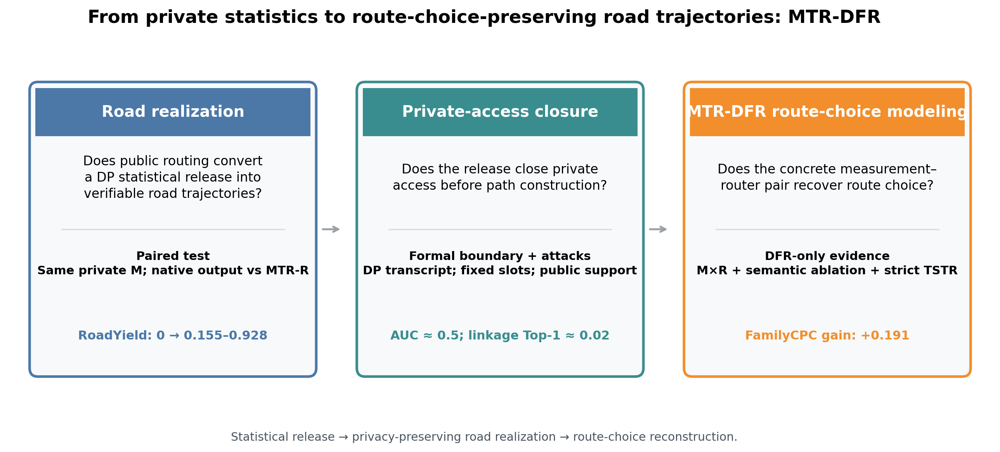
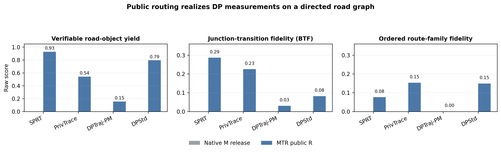
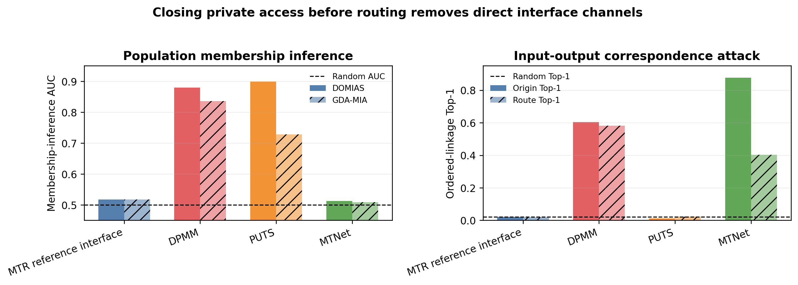
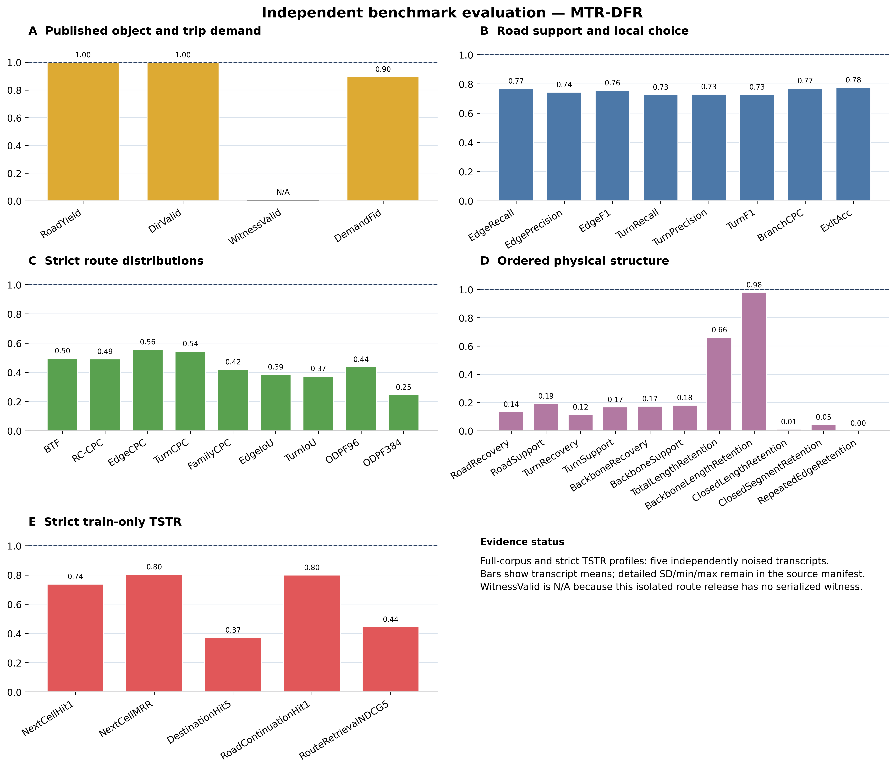
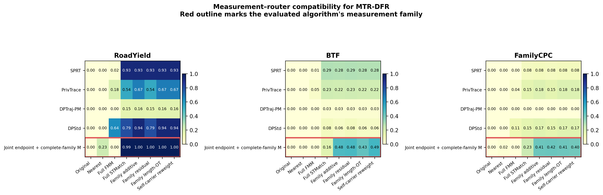
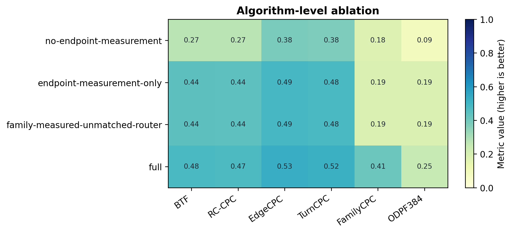
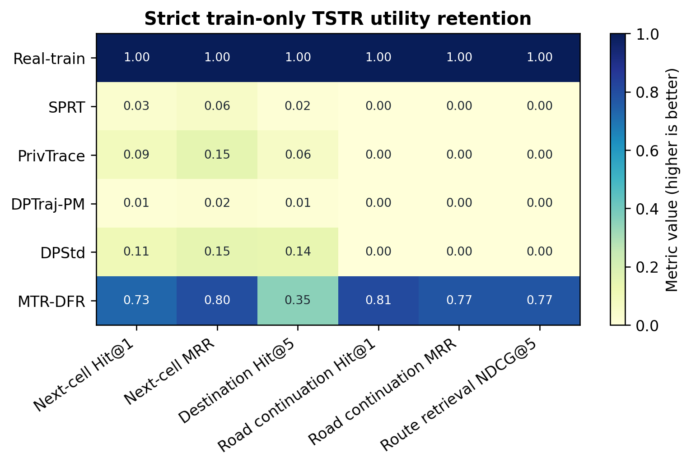
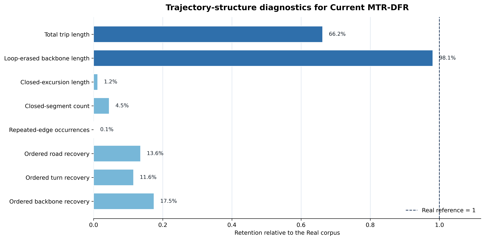

# MTR-DFR：按论文顺序复现实验

> 本 README 说明两种可复现路径：
> 1. **预计算结果复现**：不需要北京原始轨迹或 FMM/STMatch，直接重画论文结果并检查随包数据；
> 2. **从原始数据重跑**：需要下载 GeoLife 原始轨迹、准备公共道路图，并安装道路匹配器运行库。所有外部材料、版本和路径都在本文明确列出。

## 复现边界与外部材料

本仓库不重新分发 GeoLife 原始 GPS 轨迹，也不重新分发第三方 FMM/STMatch 可执行文件。原因是原始数据和匹配器分别受其公开数据许可和第三方软件许可约束。没有这些外部材料时，仍可复现随包保存的合成发布、指标 CSV、已冻结的 TSTR 结果和论文图片；隐私攻击入口可以运行，但当前 DFR 的完整攻击结果尚未冻结。有这些材料时，可以从真实轨迹重新生成道路参考并重新运行生成、评估和作图流程。

| 外部材料 | 用途 | 获取/准备方式 | README 中的路径参数 |
|---|---|---|---|
| Microsoft GeoLife GPS Trajectories 1.3 `.plt` 文件 | 北京真实轨迹输入 | 从 [Microsoft 官方下载页](https://www.microsoft.com/en-us/download/details.aspx?id=52367) 下载并解压 `Data` 目录 | `--source-dir` |
| 北京公共道路图（Shapefile） | FMM/STMatch 和路线参考 | 使用与论文相同的公开道路图，放置 `.shp/.dbf/.shx/.prj` 四个同名文件 | `--network` |
| FMM/UBODT | 公共道路匹配和 FMM M×R 路由 | 使用随项目记录的 FMM 版本，或从其官方发布获取 Windows 二进制 | `--fmm`、`--ubodt-bin` |
| STMatch | 公共道路匹配 | 使用随项目记录的 STMatch Windows 二进制 | `--stmatch-bin` |
| GDAL 2.4.4、Boost.Serialization 1.75.0 | Windows 匹配器 DLL | 通过 conda-forge 安装，见“道路匹配运行时” | `--runtime-dir`、`--fmm-runtime-dir` |

外部材料只作为输入或公共资源使用，不参与私有测量。下载后应分别计算 SHA-256，并把路径写入本轮运行的 `manifest.json`；命令不会从当前工作目录猜测道路图。

## 两种完整复现模式

### A. 不下载原始数据：复现随包结果和全部论文图

适用于审阅者、只需要检查代码和图表的人。先在仓库根目录执行：

```powershell
python commands/reproduce.py verify
python commands/reproduce.py smoke
python commands/reproduce.py all-precomputed
```

预期结果：

```text
VERIFY OK: 04_dfr_full_baseline_code (386 files)
smoke: OK
```

随后重新绘制论文图片：

```powershell
python commands/reproduce.py plot -- --figure framework --data-root experiment_results/frozen
python commands/reproduce.py plot -- --figure privacy --data-root experiment_results/frozen
python commands/reproduce.py plot -- --figure profile --data-root experiment_results/frozen
python commands/reproduce.py plot -- --figure mr --data-root experiment_results/frozen
python commands/reproduce.py plot -- --figure ablation --data-root experiment_results/frozen
python commands/reproduce.py plot -- --figure tstr --data-root experiment_results/frozen
python commands/reproduce.py plot -- --figure structure --data-root experiment_results/frozen
```

预期输出位于 `experiment_results/regenerated_figures/`，包括对应的 `.png` 和 `.pdf`。这一模式读取仓库中已保存的合成发布和结果表，不声称重新访问了 GeoLife 原始数据。

### B. 从原始数据重跑：重新生成论文实验

这一模式需要完成以下顺序，不能跳过数据准备和道路参考：

1. 安装 Python 依赖；
2. 安装道路匹配运行时；
3. 准备 GeoLife 输入并核对哈希；
4. 准备真实道路参考；
5. 生成 DFR 和四个统计 baseline；
6. 依次运行框架、完整画像、M×R、消融、隐私、TSTR 和结构实验；
7. 使用本轮结果目录作图。

每一步都使用显式输入和输出路径。命令不会覆盖 `experiment_results/frozen/`。

本目录包含 MTR-DFR、四种统计式 DP baseline 的合成数据、统一指标结果和论文图片。下面按照实验章节的叙述顺序执行合成、道路重建、指标与任务评估，最后调用对应作图命令，在 `experiment_results/regenerated_figures/` 产生 PNG 和 PDF。

目录内容和每项实验的已保存事实见 [`docs/REPRODUCTION_FACTS_CN.md`](docs/REPRODUCTION_FACTS_CN.md)。本目录只包含 MTR-DFR、四个统计式 baseline 及其评估工具。

尚未完成的实验逐项列在 [`docs/UNCOMPLETED_EXPERIMENTS_CN.md`](docs/UNCOMPLETED_EXPERIMENTS_CN.md)，未完成项目不会被冻结表格或图片替代。



## 0. 安装环境

```powershell
python -m venv .venv
.\\.venv\\Scripts\\Activate.ps1
python -m pip install --upgrade pip
python -m pip install -r requirements-lock.txt
```

安装完成后，本目录中的生成、评估和作图命令均使用这个 Python 3.11 环境。`requirements.txt` 包含 SPRT 所需的 `requests` 和 PrivTrace 优化后处理所需的 `cvxpy`；缺少后者时 PrivTrace 会退回到不同的归一化流程。

Windows 道路匹配器依赖 GDAL 与 Boost 运行库。使用 conda-forge 按已验证版本建立独立运行时；此环境只提供随包 FMM/STMatch 所需的 DLL，不替代上面的 Python 环境：

```powershell
conda create --prefix "C:\fmm-runtime" --override-channels --channel conda-forge --repodata-fn repodata.json libgdal=2.4.4 boost-cpp=1.75.0 --yes
$runtime = "C:\fmm-runtime"
$runtimeBin = "$runtime\Library\bin"
Copy-Item "$runtimeBin\gdal204.dll" $runtime -Force
Copy-Item "$runtimeBin\boost_serialization.dll" $runtime -Force
$env:PATH = "$runtimeBin;$env:PATH"
$env:GDAL_DATA = "$runtime\Library\share\gdal"
$env:PROJ_LIB = "$runtime\Library\share\proj"
```

下文 `--runtime-dir` 和 `--fmm-runtime-dir` 均使用 `$runtime`。这些版本已与仓库内 Windows 匹配器实测兼容。

每条命令的全部参数、默认行为、物理含义和跨数据集替换规则见 [`docs/COMMAND_PARAMETERS_CN.md`](docs/COMMAND_PARAMETERS_CN.md)。所有 `commands/reproduce.py` 入口都按脚本自身位置定位文件夹，因此可以从任意当前目录用绝对脚本路径调用。

北京论文输入不随代码复制发布，但可从 [Microsoft GeoLife GPS Trajectories 1.3](https://www.microsoft.com/en-us/download/details.aspx?id=52367) 的公开 `.plt` 文件重建：

```powershell
python commands/reproduce.py prepare-geolife -- --source-dir "C:\data\Geolife Trajectories 1.3\Data" --out "C:\data\real_full_frozen.pkl" --expected-sha256 6a160ca557fbd7bab97af489b56c931e73532c498c390e31965c0d61e53361fd
```

这一步生成 17,123 条、298,170,617 字节的论文输入；下文 `C:\data\real_full_frozen.pkl` 可替换为该文件。随后检查本机 FMM/STMatch 运行库，并由真实轨迹和公共道路图建立道路参考：

```powershell
python commands/reproduce.py verify-matcher -- --runtime-dir $runtime
python commands/reproduce.py prepare-road-reference -- --dataset-config geolife --real "C:\data\real_full_frozen.pkl" --network public_assets\beijing_network\network.shp --stmatch-bin public_assets\matcher\stmatch.exe --runtime-dir $runtime --max-points 32 --radius-m 200 --gps-error-m 50 --candidates 8 --batch-size 20000 --omp-threads-per-worker 8 --out-dir "C:\runs\real_road_reference"
```

第二条命令生成 `C:\runs\real_road_reference\matched_paths\Real.pkl.gz` 及 manifest，供下文的 `--real-routes` 和 MTR-DFR 的 `--real-matched` 使用。真实道路参考只保留成功匹配且连通的路线；合成发布的所有固定槽位仍参与 RoadYield、BTF 和 FamilyCPC 计分，失败槽位计零。公开目录提供完整命令，但没有原始轨迹时无法独立重算论文的精确北京数值。

## 1. 从统计发布到道路轨迹

这一实验先得到 SPRT、PrivTrace、DPTraj-PM 和 DPStd 的统计式合成轨迹，再比较它们的原生输出与加入 MTR 公共道路路由后的输出。比较保持私有测量不变，只改变道路重建过程，因此直接展示 MTR 路由带来的 RoadYield、BTF 和 FamilyCPC 变化。评估命令输出的单次 MTR-DFR 行对应指定种子；`experiment_results/frozen/metrics.csv` 中的 MTR-DFR 效用值是五个种子的汇总，不能把两者按逐位相等核对。

先生成本工程的 MTR-DFR 发布，供后续攻击、效用和 M×R 比较共用：

```powershell
python commands/reproduce.py generate-main -- --real-matched "C:\runs\real_road_reference\matched_paths\Real.pkl.gz" --edge-cache "public_assets\ordered_portal_route_cache.pkl.gz" --network "public_assets\beijing_network\network.shp" --seed 20260719 --length-aware --public-slot-count 17123 --out-dir "C:\runs\mtr_dfr"
```

DFR 的分辨率和预算敏感性使用同一个生成入口，不复用 GSRT 的 Q5 结果。`--resolution-k` 是每个端点角色保留的私有细胞数，控制私有测量分辨率；公共道路图、固定输出槽位和路由支撑不随 K 改变。省略该参数时使用论文冻结值 `K=8`。`--epsilon-total` 按冻结的测量块比例缩放端点、OD、路线族、计数（以及启用 `--length-aware` 时的长度）预算，并把实际组合预算写入 manifest。例如：

```powershell
python commands/reproduce.py generate-main -- --real-matched "C:\runs\real_road_reference\matched_paths\Real.pkl.gz" --edge-cache "public_assets\ordered_portal_route_cache.pkl.gz" --network "public_assets\beijing_network\network.shp" --seed 20260719 --length-aware --resolution-k 16 --epsilon-total 0.4 --public-slot-count 17123 --out-dir "C:\runs\dfr_k16_eps04"
```

该命令生成 `road_routes.pkl.gz`、`dp_transcript.pkl.gz`、`manifest.json` 和 `input_lineage.json`；manifest 中的 `resolution_k`、`privacy.composition` 和 `privacy.epsilon` 是本轮实际值。通过改变 `--resolution-k`（例如 2、4、8、16、32、64）或 `--epsilon-total`（例如 0.2、0.4、0.7、1.0、1.4、2.0、3.0）即可得到 DFR 自身的分辨率/预算曲线。每个点必须使用独立 `--out-dir`，不能覆盖冻结结果。

运行四种统计式 DP 合成算法：

```powershell
$methods = @("sprt-native", "privtrace-native", "dptrajpm-native", "dpstd-native")
foreach ($method in $methods) {
  $methodEpsilon = if ($method -eq "privtrace-native") { "1.0" } else { "1.4" }
  python commands/reproduce.py generate-baselines -- --method $method --data "C:\data\real_full_frozen.pkl" --epsilon $methodEpsilon --seed 42 --bbox 39.75 40.15 116.10 116.65 --osm-cache "generation\baselines\data\osm\osm_cache_beijing.pkl" --public-slot-count 17123 --out-dir "C:\runs\baselines\$method"
  if ($LASTEXITCODE -ne 0) { throw "baseline generation failed: $method" }
}
```

这四条生成命令按顺序运行。每种方法都会建立公共北京道路路由器；在内存有限的机器上同时启动多种方法可能耗尽内存。四种源码生成已分别用完整 17,123 条北京输入运行，且严格 train-only 的 13,698 条输入也已逐方法运行。

`--seed 42` 在模型拟合和合成抽样前设置，覆盖本入口使用的 NumPy 随机性。随包历史 `.pkl` 来自 `manifests/synthetic_data_provenance.json` 记录的既有发布批次；其方法变体、运行批次与这条新生成命令未必相同，因此不能把不同文件的 SHA-256 直接作为同一运行的复现判据。重新执行时，后续匹配、评估与作图始终引用这一轮新生成的文件；重画随包历史图则读取 `datasets/synthetic/baselines/` 中的对应发布。

参数说明：`--method` 选择实际运行的 baseline；`--data` 可替换为任意同格式真实数据；`--epsilon` 是该算法隐私预算；`--seed` 固定随机性；`--bbox` 给出城市经纬度范围，`--osm-cache` 指向对应的公共道路缓存，`--public-slot-count` 预先固定合成条数；`--out-dir` 为该方法的新合成发布目录。陌生数据集必须显式给出这三项公共配置，不会默默套用北京道路图。可选的 `--tag/--format/--extra-arg` 分别控制输出标识、序列化格式和方法特定参数。

运行结束后形成四个目录，每个目录包含一份 `.pkl` 合成轨迹、一个方法协议 JSON 和一个运行信息 JSON：

```text
C:\runs\baselines\
├─ sprt-native\sprt-native.pkl
├─ privtrace-native\privtrace-native.pkl
├─ dptrajpm-native\dptrajpm-native.pkl
└─ dpstd-native\dpstd-native.pkl
```

四种统计发布经过同一公共路由器得到的合成路线对象位于 `datasets/synthetic/route_experiments/`。第一条命令逐条读取这些合成路线，重新检查有向连续性，并从用户提供的真实道路参考重新计算 RoadYield、BTF 和 FamilyCPC；第二条命令只作图：

```powershell
python commands/reproduce.py run-framework -- --real-routes "C:\runs\real_road_reference\matched_paths\Real.pkl.gz" --routed "SPRT=datasets\synthetic\route_experiments\SPRT\STMatch.pkl.gz" --routed "PrivTrace=datasets\synthetic\route_experiments\PrivTrace\STMatch.pkl.gz" --routed "DPTraj-PM=datasets\synthetic\route_experiments\DPTraj-PM\STMatch.pkl.gz" --routed "DPStd=datasets\synthetic\route_experiments\DPStd\STMatch.pkl.gz" --out-dir experiment_results/recomputed/framework
python commands/reproduce.py plot -- --figure framework --data-root experiment_results/recomputed
```

参数说明：`--real-routes` 是该城市的真实匹配道路路线；每个 `--routed NAME=PATH` 指定一个方法及其在同一道路图上的合成路线；`--out-dir` 保存本轮新计算结果。作图命令中的 `--figure framework` 选择本实验，`--data-root` 强制读取刚生成的结果。迁移城市时还应显式加入 `--edge-cache <新城市缓存>`。

第一条命令实际计算并生成 `framework/results.csv` 和 `framework/manifest.json`；第二条命令读取本次运行结果生成：

```text
experiment_results/regenerated_figures/
├─ 02_mtr_framework_lift.png
└─ 02_mtr_framework_lift.pdf
```



## 2. MTR 两阶段接口的隐私攻击结果

这一实验比较总体成员推断、轨迹成员推断、起点链接和路线链接。MTR 的攻击结果接近随机参考，DPMM 与 private-origin MTNet 作为具有显式对应或私有条件通道的比较接口。

先从同一严格训练/测试划分生成成员、非成员和独立参考集合，再实际运行总体链接与 GDA-MIA：

```powershell
python commands/reproduce.py prepare-split -- --data "C:\data\real_full_frozen.pkl" --input-order --train-fraction 0.8 --seed 20260713 --out-dir "C:\runs\strict_split"
python commands/reproduce.py prepare-attack-split -- --split-dir "C:\runs\strict_split" --out-dir "C:\runs\attack_split"
python commands/reproduce.py routes-to-coordinates -- --routes "C:\runs\mtr_dfr\seed_20260719_length\road_routes.pkl.gz" --network "public_assets\beijing_network\network.shp" --edge-cache "public_assets\ordered_portal_route_cache.pkl.gz" --out "C:\runs\mtr_dfr_privacy_coordinates.pkl"
python commands/reproduce.py run-privacy -- --members "C:\runs\attack_split\member_candidates.pkl" --nonmembers "C:\runs\attack_split\nonmember_candidates.pkl" --reference "C:\runs\attack_split\reference.pkl" --release "SPRT=C:\runs\baselines\sprt-native\sprt-native.pkl" --release "PrivTrace=C:\runs\baselines\privtrace-native\privtrace-native.pkl" --release "DPTraj-PM=C:\runs\baselines\dptrajpm-native\dptrajpm-native.pkl" --release "DPStd=C:\runs\baselines\dpstd-native\dpstd-native.pkl" --release "MTR-DFR=C:\runs\mtr_dfr_privacy_coordinates.pkl" --bbox 39.75 40.15 116.10 116.65 --out-dir experiment_results/recomputed/privacy
python commands/reproduce.py plot -- --figure privacy --data-root experiment_results/recomputed
```

参数说明：划分命令的 `--data` 是任意真实轨迹集，`--train-fraction` 是训练比例，`--seed` 固定划分，`--out-dir` 保存互斥划分；攻击划分的 `--split-dir` 读取该结果。`run-privacy` 的 `--method` 是显示名，`--members/--nonmembers/--reference` 是三个互斥攻击集合，`--release` 是被攻击的合成发布，`--bbox` 依次为纬度最小/最大、经度最小/最大，`--out-dir` 保存新攻击结果。

攻击程序从合成发布重新训练攻击分类器并生成 `privacy/results.csv`。本命令执行 MTR 的总体链接和 GDA-MIA；DPMM 与 MTNet 的对照结果位于已发表比较图。



## 3. 从道路合法性到路线选择保真度

第 1 节已生成 `C:\runs\mtr_dfr`；此处使用同一发布评估道路合法性和路线选择。

参数说明：`--real-matched` 指定匹配到有向道路 ID 的真实轨迹；`--edge-cache` 与 `--network` 必须来自同一公共图；`--seed` 固定 DP 噪声和生成；`--length-aware` 启用最终 MTR-DFR 版本的 DP 长度测量和长度条件化端点恢复；`--public-slot-count` 是预声明输出数；`--out-dir` 是本轮独立输出目录。`--formal/--check-only` 可替代 `--seed`，分别运行正式随机机制或仅检查依赖。

输出结构：

```text
C:\runs\mtr_dfr\seed_20260719_length\
├─ road_routes.pkl.gz        17,123 条有向道路路线
├─ dp_transcript.pkl.gz      私有端点、路线族与长度测量
└─ manifest.json             预算、种子与输出信息
```

MTR-DFR 输出有向道路边序列。下方先用公共道路几何将本次生成的路线转换为坐标轨迹，再与四份 baseline 合成数据一起进入统一评估器，生成每种方法的指标 JSON 和汇总 CSV。

对刚生成的主方法和四份 baseline 合成数据逐份运行统一评估器，再生成完整效用热力图：

```powershell
python commands/reproduce.py routes-to-coordinates -- --routes "C:\runs\mtr_dfr\seed_20260719_length\road_routes.pkl.gz" --network "public_assets\beijing_network\network.shp" --edge-cache "public_assets\ordered_portal_route_cache.pkl.gz" --out "C:\runs\mtr_dfr_coordinates.pkl"
python commands/reproduce.py run-profile -- --real "C:\data\real_full_frozen.pkl" --bbox 39.75 40.15 116.10 116.65 --osm-cache "evaluation\data\osm\osm_cache_beijing.pkl" --public-slot-count 17123 --synthetic "SPRT=C:\runs\baselines\sprt-native\sprt-native.pkl" --synthetic "PrivTrace=C:\runs\baselines\privtrace-native\privtrace-native.pkl" --synthetic "DPTraj-PM=C:\runs\baselines\dptrajpm-native\dptrajpm-native.pkl" --synthetic "DPStd=C:\runs\baselines\dpstd-native\dpstd-native.pkl" --synthetic "MTR-DFR=C:\runs\mtr_dfr_coordinates.pkl" --road-routes "MTR-DFR=C:\runs\mtr_dfr\seed_20260719_length\road_routes.pkl.gz" --edge-cache "public_assets\ordered_portal_route_cache.pkl.gz" --out-dir experiment_results/recomputed/profile
python commands/reproduce.py plot -- --figure profile --data-root experiment_results/recomputed
```

参数说明：`--real` 是真实参考；每个 `--synthetic NAME=PATH` 加入一份待评估合成数据；`--road-routes NAME=PATH` 指定与 DFR 坐标发布对应的有向路线，`--edge-cache` 指定公共道路边。路线转坐标命令同时生成同名 `.manifest.json`，评估器核对坐标、路线和公共边缓存的哈希，再验证完整路线的道路有效性。`--witness NAME=PATH` 用于另一类附带 witness 的发布；`--bbox/--osm-cache` 定义同城公共道路；`--public-slot-count` 是预声明评估条数；`--out-dir` 保存逐方法指标。已有注册数据集也可用 `--dataset-config` 作为快捷方式。

统一评估器为每份合成数据生成 `raw/<方法>/metrics.json`，汇总为 `profile/results.csv`，然后生成效用热力图。重新计算的 `TripSim=1-trip_error` 是端点分布相似度；冻结综合表的 `DemandFid` 是道路需求覆盖率，定义不同，不能将两列数值直接比较。



## 4. 测量 M 与路由 R 的组合

M×R 实验把同一批私有测量分别交给不同公共路由器，再比较 RoadYield、BTF 与 FamilyCPC。它展示统计测量本身携带了多少道路选择信息，以及路由器能否使用这些信息。

下面的默认命令复算随包保存的 M×R 路线。若使用本轮新生成的数据，先把 MTR-DFR 路线转成坐标，再分别用 FMM 与 STMatch 对四种基线和 MTR-DFR 坐标重新匹配：

```powershell
python commands/reproduce.py routes-to-coordinates -- --routes "C:\runs\mtr_dfr\seed_20260719_length\road_routes.pkl.gz" --network "public_assets\beijing_network\network.shp" --edge-cache "public_assets\ordered_portal_route_cache.pkl.gz" --out "C:\runs\mtr_dfr_coordinates.pkl"
python evaluation/evaluation/prepare_road_evaluation_network.py --dataset-config geolife --out-dir "C:\runs\fmm_network" --ubodt-format csv --ubodt-delta-m 1000 --ubodt-bin public_assets\matcher\ubodt_gen.exe --fmm-runtime-dir "C:\fmm-runtime"
python evaluation/evaluation/explore_fmm_road_alignment.py --method "SPRT=datasets\synthetic\baselines\sprt_native.pkl" --method "PrivTrace=datasets\synthetic\baselines\privtrace_native.pkl" --method "DPTraj-PM=datasets\synthetic\baselines\dptrajpm_native.pkl" --method "DPStd=datasets\synthetic\baselines\dpstd_native.pkl" --method "MTR-DFR=C:\runs\mtr_dfr_coordinates.pkl" --network "C:\runs\fmm_network\network.shp" --ubodt "C:\runs\fmm_network\ubodt.txt" --fmm public_assets\matcher\fmm.exe --fmm-runtime-dir "C:\fmm-runtime" --limit 17123 --max-points 32 --radius-m 200 --gps-error-m 50 --candidates 8 --routes-out-dir "C:\runs\mtr_routes\fmm" --out-dir "C:\runs\mtr_routes\fmm_audit"
python evaluation/evaluation/cache_common_road_matches.py --dataset-config geolife --real "C:\data\real_full_frozen.pkl" --corpus "SPRT=datasets\synthetic\baselines\sprt_native.pkl" --corpus "PrivTrace=datasets\synthetic\baselines\privtrace_native.pkl" --corpus "DPTraj-PM=datasets\synthetic\baselines\dptrajpm_native.pkl" --corpus "DPStd=datasets\synthetic\baselines\dpstd_native.pkl" --corpus "MTR-DFR=C:\runs\mtr_dfr_coordinates.pkl" --network public_assets\beijing_network\network.shp --stmatch-bin public_assets\matcher\stmatch.exe --runtime-dir "C:\fmm-runtime" --limit 17123 --max-points 32 --radius-m 200 --gps-error-m 50 --candidates 8 --batch-size 20000 --out-dir "C:\runs\mtr_routes\stmatch"
```

这些命令分别生成 `C:\runs\mtr_routes\fmm\matched_paths\<方法>.pkl.gz` 和 `C:\runs\mtr_routes\stmatch\matched_paths\<方法>.pkl.gz`。CSV UBODT 使用 1,000 m 邻接搜索半径，与随包 FMM 二进制兼容。将两类路线缓存与原生 MTR-DFR 路线一起交给 `run-mr`：

```powershell
python commands/reproduce.py run-mr -- --real-routes "C:\runs\real_road_reference\matched_paths\Real.pkl.gz" --route "SPRT::FMM=C:\runs\mtr_routes\fmm\matched_paths\SPRT.pkl.gz" --route "SPRT::STMatch=C:\runs\mtr_routes\stmatch\matched_paths\SPRT.pkl.gz" --route "PrivTrace::FMM=C:\runs\mtr_routes\fmm\matched_paths\PrivTrace.pkl.gz" --route "PrivTrace::STMatch=C:\runs\mtr_routes\stmatch\matched_paths\PrivTrace.pkl.gz" --route "DPTraj-PM::FMM=C:\runs\mtr_routes\fmm\matched_paths\DPTraj-PM.pkl.gz" --route "DPTraj-PM::STMatch=C:\runs\mtr_routes\stmatch\matched_paths\DPTraj-PM.pkl.gz" --route "DPStd::FMM=C:\runs\mtr_routes\fmm\matched_paths\DPStd.pkl.gz" --route "DPStd::STMatch=C:\runs\mtr_routes\stmatch\matched_paths\DPStd.pkl.gz" --route "MTR-DFR::FMM=C:\runs\mtr_routes\fmm\matched_paths\MTR-DFR.pkl.gz" --route "MTR-DFR::STMatch=C:\runs\mtr_routes\stmatch\matched_paths\MTR-DFR.pkl.gz" --route "MTR-DFR::Native=C:\runs\mtr_dfr\seed_20260719_length\road_routes.pkl.gz" --edge-cache public_assets\ordered_portal_route_cache.pkl.gz --out-dir experiment_results/recomputed/mr
python commands/reproduce.py plot -- --figure mr --data-root experiment_results/recomputed
```

参数说明：`--real-routes` 是真实道路路线；默认从包内 `route_experiments/<M>/<R>` 读取组合。迁移或加入新组合时使用 `--edge-cache <同图缓存>`、重复的 `--route "M::R=PATH"`，或 `--route-dir <组合根目录>`；`--out-dir` 保存重新计算的矩阵。

第一条命令遍历 `datasets/synthetic/route_experiments/<M>/<R>.pkl[.gz]` 中的每个实际路线输出，从真实道路参考计算每个 M×R 单元的 BTF、RC-CPC、EdgeCPC、TurnCPC 与 FamilyCPC；第二条命令将 `mr/results.csv` 绘制成热力图。



同一真实道路参考还可计算按公共 OD 分层的有序道路公里数、转向与消环骨干的物理质量恢复率：

```powershell
python commands/reproduce.py run-physical -- --real-routes "C:\runs\real_road_reference\matched_paths\Real.pkl.gz" --synthetic-routes "C:\runs\mtr_dfr\seed_20260719_length\road_routes.pkl.gz" --method MTR-DFR --edge-cache public_assets\ordered_portal_route_cache.pkl.gz --network public_assets\beijing_network\network.shp --cap-per-stratum 20 --out-dir experiment_results/recomputed/physical
```

运行后生成 `physical/results.csv` 和记录真实参考、合成路线、公共图 SHA-256 的 `manifest.json`。

## 5. MTR-DFR 算法级消融

消融实验保持数据、预算和评估方法一致，只移除或替换算法级测量与路由模块。它给出完整方案与各消融臂在路线选择指标上的差异。

```powershell
python commands/reproduce.py run-ablation -- --real-routes "C:\runs\real_road_reference\matched_paths\Real.pkl.gz" --edge-cache "public_assets\ordered_portal_route_cache.pkl.gz" --network "public_assets\beijing_network\network.shp" --seed 20260719 --length-aware --public-slot-count 17123 --variants no-endpoint-measurement endpoint-measurement-only family-measured-unmatched-router full --out-dir experiment_results/recomputed/ablation
python commands/reproduce.py plot -- --figure ablation --data-root experiment_results/recomputed
```

参数说明：这条命令不读取冻结消融表。它读取显式数据和公共道路资产，用同一预算、随机种子和固定输出规模逐臂重新合成。DFR 的 `--variants` 控制端点测量、路线族测量和匹配路由的组合。`--out-dir` 同时保存每一臂新生成的合成数据、指标和汇总表。

第一条命令对每个指定算法臂重新执行私有测量和公共路由，将新合成数据写入 `ablation/arms/`，将逐臂指标写入 `ablation/raw/`，再形成 `ablation/results.csv` 和参数 manifest；第二条命令只读取这些新结果生成 `05_ablation.png` 和 `05_ablation.pdf`。



## 6. 严格 train-only TSTR 下游实验

严格 TSTR 只使用真实训练划分生成合成数据，在合成数据上训练下游模型，再到未参与生成的真实测试划分上计算 NextCell、Destination、RoadContinuation 与路线检索结果。

先固定真实训练/测试划分：

```powershell
python commands/reproduce.py prepare-split -- --data "C:\data\real_full_frozen.pkl" --input-order --train-fraction 0.8 --seed 20260713 --out-dir "C:\runs\strict_split"
```

参数说明：`--data` 是待划分的任意真实数据集；`--train-fraction` 是只允许合成器访问的训练比例；`--seed` 固定索引；`--out-dir` 写出 train、test 和索引 manifest。

该命令实际写出 `C:\runs\strict_split\train.pkl`、`test.pkl` 和 `split_manifest.json`。随后只用训练划分生成 MTR-DFR 与可执行的 baseline 发布：

```powershell
python commands/reproduce.py subset-routes -- --matched-full "C:\runs\real_road_reference\matched_paths\Real.pkl.gz" --split-manifest "C:\runs\strict_split\split_manifest.json" --out "C:\runs\strict_split\train_road_routes.pkl.gz"
python commands/reproduce.py generate-main -- --real-matched "C:\runs\strict_split\train_road_routes.pkl.gz" --edge-cache "public_assets\ordered_portal_route_cache.pkl.gz" --network "public_assets\beijing_network\network.shp" --seed 20260719 --length-aware --public-slot-count 13698 --out-dir "C:\runs\tstr\mtr_dfr"
python commands/reproduce.py routes-to-coordinates -- --routes "C:\runs\tstr\mtr_dfr\seed_20260719_length\road_routes.pkl.gz" --network "public_assets\beijing_network\network.shp" --edge-cache "public_assets\ordered_portal_route_cache.pkl.gz" --out "C:\runs\tstr\mtr_dfr_coordinates.pkl"
$methods = @("sprt-native", "privtrace-native", "dptrajpm-native", "dpstd-native")
foreach ($method in $methods) {
  $methodEpsilon = if ($method -eq "privtrace-native") { "1.0" } else { "1.4" }
  python commands/reproduce.py generate-baselines -- --method $method --data "C:\runs\strict_split\train.pkl" --epsilon $methodEpsilon --seed 42 --bbox 39.75 40.15 116.10 116.65 --osm-cache "generation\baselines\data\osm\osm_cache_beijing.pkl" --public-slot-count 13698 --out-dir "C:\runs\tstr\$method"
  if ($LASTEXITCODE -ne 0) { throw "baseline generation failed: $method" }
}
```

参数说明：主方法和可执行 baseline 的生成命令都把 `train.pkl` 作为唯一私有输入；隐私预算、随机种子、固定输出数和公共道路资产均在命令中显式给出。DFR 还先用 `subset-routes` 按同一 manifest 取得 train-only 道路路线，再用 `routes-to-coordinates` 将合成道路 ID 序列转为坐标；两步的输入图必须一致。

接着在四份基线和 MTR-DFR 的合成训练语料上分别训练并测试下游模型。该命令会执行通用移动任务和道路网络挖掘任务，而不是读取论文表格：

```powershell
python commands/reproduce.py run-tstr -- --train-real "C:\runs\strict_split\train.pkl" --test-real "C:\runs\strict_split\test.pkl" --synthetic "C:\runs\tstr\sprt-native\sprt-native.pkl" --synthetic "C:\runs\tstr\privtrace-native\privtrace-native.pkl" --synthetic "C:\runs\tstr\dptrajpm-native\dptrajpm-native.pkl" --synthetic "C:\runs\tstr\dpstd-native\dpstd-native.pkl" --synthetic "C:\runs\tstr\mtr_dfr_coordinates.pkl" --names SPRT PrivTrace DPTraj-PM DPStd MTR-DFR --osm-cache "evaluation\data\osm\osm_cache_beijing.pkl" --bbox 39.75 40.15 116.10 116.65 --out-dir experiment_results/recomputed/tstr
python commands/reproduce.py plot -- --figure tstr --data-root experiment_results/recomputed
```

参数说明：`--train-real/--test-real` 必须互斥；每个 `--synthetic` 是只由 train 生成的训练语料；`--names` 与这些路径严格同序；`--osm-cache/--bbox` 定义测试城市；可用 `--seed` 固定下游训练；`--out-dir` 保存实际训练和测试结果。

下游程序分别写出 `tstr/raw_generic/` 与 `tstr/raw_road/` 的逐任务 JSON/CSV；`tstr/results.csv` 保留七项任务结果，每项先以可回答查询比例乘以已回答查询上的质量，再除以 Real-train 的同一乘积。主图展示其中六项，将 Destination MRR 留在结果表。随包的五方法实跑参考值在 `experiment_results/executed_reference/tstr/`；不传 `--data-root` 时从这里重画，传入后只读本次新结果。作图命令生成 `06_strict_tstr.png` 和 `06_strict_tstr.pdf`。



## 7. 逐轨迹结构比较

Real 与 MTR-DFR 在主干占比、闭合结构、重复边和回访行为上的比较，用于说明路线分布指标之外的具体轨迹形态。

```powershell
python commands/reproduce.py run-structure -- --dataset "Real=C:\data\real_full_frozen.pkl" --dataset "SPRT=C:\runs\baselines\sprt-native\sprt-native.pkl" --dataset "PrivTrace=C:\runs\baselines\privtrace-native\privtrace-native.pkl" --dataset "DPTraj-PM=C:\runs\baselines\dptrajpm-native\dptrajpm-native.pkl" --dataset "DPStd=C:\runs\baselines\dpstd-native\dpstd-native.pkl" --dataset "MTR-DFR=C:\runs\mtr_dfr_coordinates.pkl" --out-dir experiment_results/recomputed/structure
python commands/reproduce.py plot -- --figure structure --data-root experiment_results/recomputed
```

参数说明：每个 `--dataset "NAME=PATH"` 加入一份真实或合成轨迹，允许替换为任意同坐标系数据；`--out-dir` 保存逐轨迹诊断和汇总。作图命令只读取该目录。

第一条命令逐轨迹重新计算可用率、点数、重复访问、闭合行程和路径直接度，生成 `structure/results.csv`；第二条命令只负责绘图。



## 8. 按顺序运行整套实验

第 1–7 节中的每个实验都由“生成或读取合成发布 → 执行评估 → 作图”三步组成。依次运行各节命令后，可统一重画已经产生实验结果的图：

```powershell
python commands/reproduce.py plot -- --figure all --data-root experiment_results/recomputed
```

参数说明：`--figure all` 依次绘制全部实验；`--data-root` 指向前面各实验实际生成的共同结果根目录，任一结果缺失都会报错，不会退回冻结表格。

前六个 `run-*` 入口和 `run-structure` 分别生成七个实验子目录；上述命令从这些结果统一生成八张 PNG 和 PDF。

完整数值分析见 `docs/FROZEN_EXPERIMENT_REPORT_CN.md`。
## 发布批次与实验输入

精确复算使用 Python 3.11.15 和 `requirements-lock.txt`，其中同时固定直接与间接依赖；`requirements.txt` 保留主要依赖列表。这里的环境版本已经在独立 Windows 环境测试，不把未经运行的其它平台称为相同数值环境。

### 带生成来源记录的 train-only 实验

新增 `commands/generate_train_only.py` 实际调用本文件夹的生成算法，并把训练输入、生成源码、命令、退出码及输出哈希存为独立的本地记录。测试文件只用于记录划分哈希，不传入生成器。逐步命令及全部参数见 [TRAIN_ONLY_GENERATION_CN.md](docs/TRAIN_ONLY_GENERATION_CN.md)。

运行后得到合成数据目录和目录外的 `lineage.json`/`lineage.log`。评分命令追加 `--synthesis-lineage "方法名=记录路径" --require-synthesis-lineage`，在训练下游模型之前核对每份生成记录；M×R 聚合也可追加 `--require-synthesis-lineage`。旧结果保持原样，新结果输出到新的目录。

统一指标评估还生成 `destination_model_audit.json`，记录 Destination 模型使用的依赖版本、特征、预测和参数哈希，便于定位不同环境的评分差异。

保存数据与新生成数据分开评估；全量拟合任务与严格 train-only TSTR 分开报告。逐文件预算来源、批次核查命令、三路由聚合检查和跨城市参数见 [数据批次与评估流程](docs/RELEASE_BATCHES_AND_PROTOCOLS_CN.md)。

`all-precomputed` 只校验保存数据并重画已有结果，不执行合成、攻击或下游训练，也不表示已从零复现整篇论文。保存的 PrivTrace 是 epsilon=1 的 official-stageA+p30 批次，本轮按要求不更换其预算；新的 privtrace-native 发布是独立批次。
# Porto、San Francisco 与自定义数据

输入准备、公共道路图、合成、重新评分和图片输入的逐步命令见 [跨城市运行](docs/CROSS_CITY_COMMANDS_CN.md)。Porto 与 SF 公共 OSM cache 已随目录提供；真实轨迹从公开原始数据准备。新的实验使用新的输出目录。
