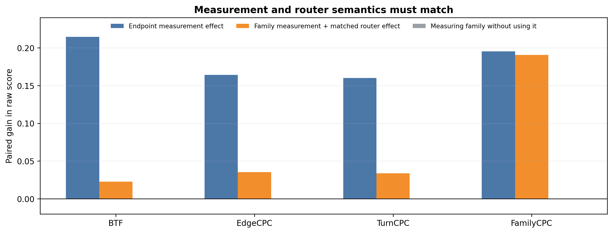
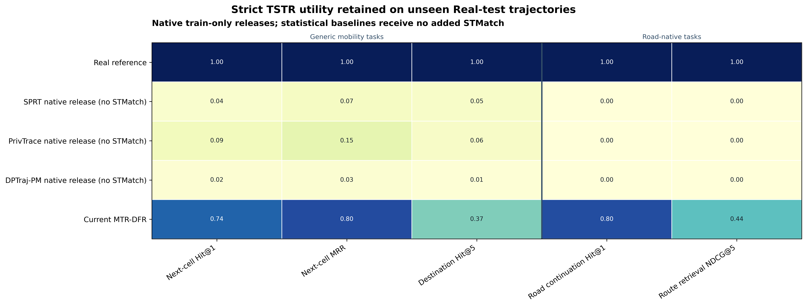

# MTR-DFR：从私有统计到路线族恢复的完整实验报告

本报告只评价 MTR-DFR。论证从统计发布无法直接形成道路轨迹这一缺口出发，先识别 MTR 公共路由带来的道路实现能力，再验证私有访问在道路构造前闭合，最后联合评价 DFR 的 endpoint demand、complete-family measurement 与匹配路由。

实验顺序对应数据在机制中的流动顺序：私有统计首先被实现为道路对象；道路构造只能读取 DP 转录和公共图；路线族测量随后决定这些合法路径是否保留真实道路选择。

## 从统计发布到道路轨迹

固定同一份私有测量，只比较原生输出与 MTR 公共路由后的输出，可以直接识别公共路由的作用。

| 固定私有测量 | 原生 RoadYield | 加入 MTR-R | BTF | FamilyCPC |
|---|---:|---:|---:|---:|
| SPRT | 0 | **0.928** | 0.286 | 0.076 |
| PrivTrace | 0 | **0.540** | 0.225 | 0.153 |
| DPTraj-PM | 0 | **0.155** | 0.030 | 0.001 |
| DPStd | 0 | **0.794** | 0.082 | 0.149 |

四种原生统计发布的 RoadYield 均为 0；加入 MTR 公共路由后提升至 0.155--0.928。公共路由把测量中的端点、中间点和区域转移落实为公共道路图上的连续对象，却没有增加新的私有测量。BTF 和 FamilyCPC 的差异进一步说明：道路实现可以复用现有统计，但路线偏好只能来自测量阶段真正发布的信息。

## 在道路构造前闭合私有访问

DFR 的 endpoint demand 与 complete-family 查询定义在预先声明的公共域上，私有测量机制满足 \((1.05,10^{-6})\)-DP。路由器只读取 DP 转录、公共道路图、固定输出槽位和新随机性，因此完整发布

\[
\mathcal M_{\mathrm{DFR}}(D)
=R_{\mathrm{DFR}}(A_{\mathrm{DFR}}(D),G,U)
\]

是私有测量的后处理。候选路径、道路连接和坐标恢复不重新访问原始轨迹，也不引入私有服务条件或输入基数通道。

| 接口 | DOMIAS AUC | GDA-MIA AUC | Origin Top-1 | Route Top-1 |
|---|---:|---:|---:|---:|
| MTR reference interface | 0.518 | 0.518 | 0.020 | 0.019 |
| DPMM | 0.880 | 0.835 | 0.603 | 0.582 |
| PUTS | 0.899 | 0.728 | 0.012 | 0.023 |
| MTNet | 0.512 | 0.509 | 0.877 | 0.404 |

随机参考分别为成员 AUC 0.5 和 50 候选链接 Top-1 0.02。冻结的 MTR 参考接口接近两条随机参考，正对照接口则暴露成员、起点或对应关系。该攻击检查 MTR 的发布边界；DFR 自身的隐私结论由 \((1.05,10^{-6})\)-DP 测量及后处理证明建立，而不是把参考接口数值当作一次 DFR 专属攻击重跑。

## 从合法道路对象到路线族选择

DFR 使用 endpoint demand 表达“从哪里到哪里”，使用 complete-family measurement 表达“相同需求下选择哪一条有序路线”，再由共享同一表示的公共路由器恢复道路轨迹。

| DemandFid | EdgeF1 | TurnF1 | BranchCPC | ExitAcc |
|---:|---:|---:|---:|---:|
| 0.896 | 0.756 | 0.727 | 0.770 | 0.776 |

| BTF | RC-CPC | EdgeCPC | TurnCPC | FamilyCPC | EdgeIoU | TurnIoU |
|---:|---:|---:|---:|---:|---:|---:|
| 0.496 | 0.492 | 0.557 | 0.544 | 0.419 | 0.386 | 0.374 |

RoadYield 和 DirValid 均为 1，因此剩余差异来自道路使用、路口转向和路线族选择，而不是能否生成可通行路径。探索版本尚未序列化消费者可见 witness，WitnessValid 记为 N/A。

## M×R 矩阵揭示测量与路由的联合必要性

路线合成包含两个不可分割的问题：测量必须发布对目标路线任务充分的信息，路由必须能够解释这些信息。只比较最终算法会把二者混在一起。M×R 矩阵固定其中一个因素并替换另一个因素：纵向比较不同测量在同一路由下的可恢复信息，横向比较同一测量被不同路由利用的程度，测量与路由的交互则揭示二者是否共享同一种路线语义。

矩阵保留四种统计式测量和 DFR 的 joint endpoint + complete-family measurement。固定 DFR 测量后：

- Full STMatch 得到 BTF 0.165、FamilyCPC 0.235；
- Family additive 得到 BTF 0.476、FamilyCPC 0.412；
- Family residual 得到 BTF 0.482、FamilyCPC 0.418；
- Self-carrier reweight 得到 BTF 0.494、FamilyCPC 0.400。

同一份私有测量连接普通道路匹配时无法充分恢复路线族；连接能够解释 complete-family 表示的路由器后，BTF 和 FamilyCPC 同时提高。这一结果说明增益不来自任意后处理，而来自测量与路由共享路线表示。测量给出可恢复路线信息的上限，匹配路由负责把该信息转化为实际道路选择。

## 路线表示的配对消融

| 算法因素 | ΔBTF | ΔEdgeCPC | ΔTurnCPC | ΔFamilyCPC |
|---|---:|---:|---:|---:|
| endpoint demand measurement | +0.214 | +0.164 | +0.160 | +0.195 |
| family measurement + matched router | +0.023 | +0.035 | +0.034 | **+0.191** |
| 测量 family 但路由不使用 | 0 | 0 | 0 | 0 |

Endpoint demand 恢复行程方向和主要道路骨干，因此对四项指标均产生广泛提升。Complete-family measurement 与匹配路由主要提高 FamilyCPC，说明其专门作用是区分端点相同、骨干相近但有序道路选择不同的路线。只测量 family 而不让路由使用时增益为 0，这个负对照把“测量了什么”与“路由能否解释它”连接起来，并与 M×R 矩阵形成一致证据。

## 未见轨迹上的任务替代能力

严格 TSTR 只允许真实训练集进入私有测量、合成和参数选择。下游模型在合成轨迹上训练，最终在生成器从未访问的真实测试轨迹上评价。五个独立 DP transcript 的均值为：NextCell Hit@1 0.738、NextCell MRR 0.804、Destination Hit@5 0.372、RoadContinuation Hit@1 0.800、RouteRetrieval NDCG@5 0.445。结果说明 endpoint 与 family 表示保存了能够迁移到未见轨迹的局部道路连续性和路线排序信息。

## 逐轨迹结构仍缺失什么

| 轨迹结构 | 保留比例 |
|---|---:|
| BackboneLengthRetention | **0.981** |
| ClosedLengthRetention | 0.012 |
| RepeatedEdgeRetention | 0.001 |

DFR 几乎完整恢复连接端点的主要道路骨干，但真实轨迹中的闭合回访、掉头和重复道路访问仍然缺失。因此，当前算法恢复的是行程需求、道路骨干和粗粒度路线族选择，而不是完整逐轨迹循环结构。该审计给出了算法能力的结构边界，也说明下一步测量需要针对重复访问和闭合子路径建立新的低维表示。

## 综合结论

固定测量的配对实验说明，MTR 能够把已有 DP 统计实现为道路轨迹；形式化边界和接口攻击说明，这一实现没有重新打开私有访问；完整指标、M×R 矩阵和配对消融则说明，DFR 的路线效用来自 endpoint、complete-family measurement 与匹配路由的语义协同。严格 TSTR 验证了这些信息能够迁移到未见真实轨迹，而逐轨迹审计将剩余误差定位到闭合回访和重复道路结构。
