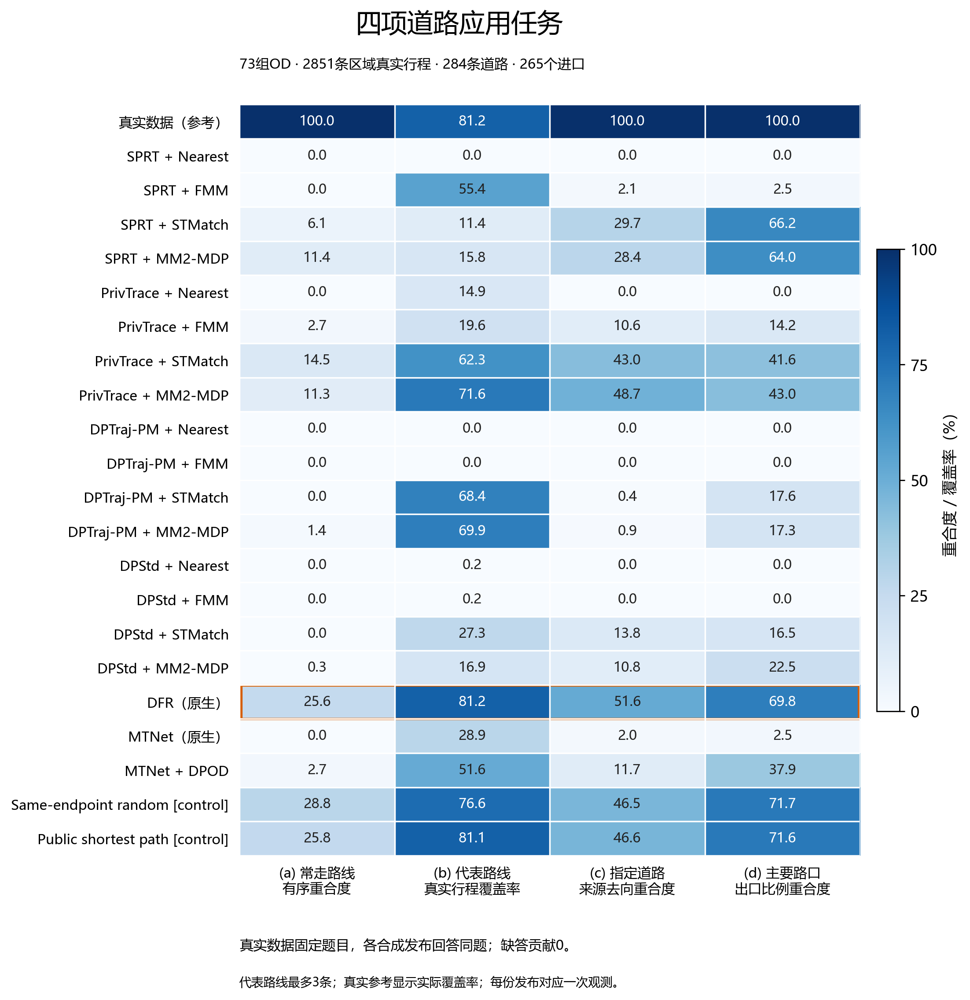
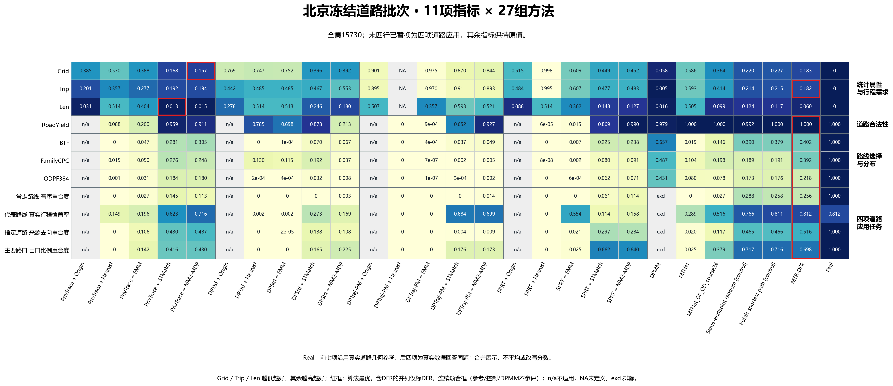

# 第05节 四项道路应用与图件

所有命令仍在 `reproduction/beijing` 执行。先完成全集生成和道路输出，本节只读取这些结果，不重训、不重跑路由。四任务是“真实数据出题，合成数据回答同题”。

## 05.1 准备公共图与统一道路槽

沿用第01节定义的$Network、$MetricCache、$RoadRecords、$FullSlots。public导出公共有向道路及原区域编号；adapt将accepted/cpath道路结果转为逐槽JSON。空槽保留，未知编号或已接受但不连通的路线报错，不补路、不再次匹配。

```powershell
.venv/Scripts/python.exe prepare_application_inputs.py public --network $Network --metric-cache $MetricCache --out results/application_inputs/public
.venv/Scripts/python.exe prepare_application_inputs.py adapt --input $RoadRecords --public-edges results/application_inputs/public/public_edges.jsonl.gz --slots $FullSlots --out results/application_inputs/Real
.venv/Scripts/python.exe prepare_application_inputs.py adapt --input results/reproduction_checked_20261024/routes/SPRT/Nearest/synthetic_routes.pkl.gz --public-edges results/application_inputs/public/public_edges.jsonl.gz --slots $FullSlots --out results/application_inputs/SPRT__Nearest
.venv/Scripts/python.exe prepare_application_inputs.py adapt --input results/reproduction_checked_20261024/routes/SPRT/FMM/synthetic_routes.pkl.gz --public-edges results/application_inputs/public/public_edges.jsonl.gz --slots $FullSlots --out results/application_inputs/SPRT__FMM
.venv/Scripts/python.exe prepare_application_inputs.py adapt --input results/reproduction_checked_20261024/routes/SPRT/STMatch/synthetic_routes.pkl.gz --public-edges results/application_inputs/public/public_edges.jsonl.gz --slots $FullSlots --out results/application_inputs/SPRT__STMatch
.venv/Scripts/python.exe prepare_application_inputs.py adapt --input results/reproduction_checked_20261024/routes/SPRT/MM2-MDP/synthetic_routes.pkl.gz --public-edges results/application_inputs/public/public_edges.jsonl.gz --slots $FullSlots --out results/application_inputs/SPRT__MM2-MDP
.venv/Scripts/python.exe prepare_application_inputs.py adapt --input results/reproduction_checked_20261024/routes/PrivTrace/Nearest/synthetic_routes.pkl.gz --public-edges results/application_inputs/public/public_edges.jsonl.gz --slots $FullSlots --out results/application_inputs/PrivTrace__Nearest
.venv/Scripts/python.exe prepare_application_inputs.py adapt --input results/reproduction_checked_20261024/routes/PrivTrace/FMM/synthetic_routes.pkl.gz --public-edges results/application_inputs/public/public_edges.jsonl.gz --slots $FullSlots --out results/application_inputs/PrivTrace__FMM
.venv/Scripts/python.exe prepare_application_inputs.py adapt --input results/reproduction_checked_20261024/routes/PrivTrace/STMatch/synthetic_routes.pkl.gz --public-edges results/application_inputs/public/public_edges.jsonl.gz --slots $FullSlots --out results/application_inputs/PrivTrace__STMatch
.venv/Scripts/python.exe prepare_application_inputs.py adapt --input results/reproduction_checked_20261024/routes/PrivTrace/MM2-MDP/synthetic_routes.pkl.gz --public-edges results/application_inputs/public/public_edges.jsonl.gz --slots $FullSlots --out results/application_inputs/PrivTrace__MM2-MDP
.venv/Scripts/python.exe prepare_application_inputs.py adapt --input results/reproduction_checked_20261024/routes/DPTraj-PM/Nearest/synthetic_routes.pkl.gz --public-edges results/application_inputs/public/public_edges.jsonl.gz --slots $FullSlots --out results/application_inputs/DPTraj-PM__Nearest
.venv/Scripts/python.exe prepare_application_inputs.py adapt --input results/reproduction_checked_20261024/routes/DPTraj-PM/FMM/synthetic_routes.pkl.gz --public-edges results/application_inputs/public/public_edges.jsonl.gz --slots $FullSlots --out results/application_inputs/DPTraj-PM__FMM
.venv/Scripts/python.exe prepare_application_inputs.py adapt --input results/reproduction_checked_20261024/routes/DPTraj-PM/STMatch/synthetic_routes.pkl.gz --public-edges results/application_inputs/public/public_edges.jsonl.gz --slots $FullSlots --out results/application_inputs/DPTraj-PM__STMatch
.venv/Scripts/python.exe prepare_application_inputs.py adapt --input results/reproduction_checked_20261024/routes/DPTraj-PM/MM2-MDP/synthetic_routes.pkl.gz --public-edges results/application_inputs/public/public_edges.jsonl.gz --slots $FullSlots --out results/application_inputs/DPTraj-PM__MM2-MDP
.venv/Scripts/python.exe prepare_application_inputs.py adapt --input results/reproduction_checked_20261024/routes/DPStd/Nearest/synthetic_routes.pkl.gz --public-edges results/application_inputs/public/public_edges.jsonl.gz --slots $FullSlots --out results/application_inputs/DPStd__Nearest
.venv/Scripts/python.exe prepare_application_inputs.py adapt --input results/reproduction_checked_20261024/routes/DPStd/FMM/synthetic_routes.pkl.gz --public-edges results/application_inputs/public/public_edges.jsonl.gz --slots $FullSlots --out results/application_inputs/DPStd__FMM
.venv/Scripts/python.exe prepare_application_inputs.py adapt --input results/reproduction_checked_20261024/routes/DPStd/STMatch/synthetic_routes.pkl.gz --public-edges results/application_inputs/public/public_edges.jsonl.gz --slots $FullSlots --out results/application_inputs/DPStd__STMatch
.venv/Scripts/python.exe prepare_application_inputs.py adapt --input results/reproduction_checked_20261024/routes/DPStd/MM2-MDP/synthetic_routes.pkl.gz --public-edges results/application_inputs/public/public_edges.jsonl.gz --slots $FullSlots --out results/application_inputs/DPStd__MM2-MDP
.venv/Scripts/python.exe prepare_application_inputs.py adapt --input results/reproduction_dfr_length_20261024/full_routes/MTR-DFR/synthetic_routes.pkl.gz --public-edges results/application_inputs/public/public_edges.jsonl.gz --slots $FullSlots --out results/application_inputs/MTR-DFR
.venv/Scripts/python.exe prepare_application_inputs.py adapt --input results/reproduction_native_20261024/full/MTNet_routes/synthetic_routes.pkl.gz --public-edges results/application_inputs/public/public_edges.jsonl.gz --slots $FullSlots --out results/application_inputs/MTNet
```

`--input`是对应方法已完成的道路文件；`--slots`包含空槽；`--public-edges`是同一张公共图。以上文件名是北京示例，改名时同步修改后续引用。坐标方法Origin没有原生道路，本节不临时再匹配后冒称Origin道路成绩。DFR和MTNet各用自身原生发布。DPMM依本四任务研究范围不列入，工具并未按名称禁止其它方法。

## 05.2 一次配置，先计算真实参考，再分别答题

完整对照表还包括两个已生成的同端点控制，先转成同格式再配置。下面输入自己批次里已完成的道路发布文件路径，不是坐标文件；不重新生成或匹配。缺少控制输入时不能宣称整图已补齐。

```powershell
$SameEndpointRandomRoutes = Read-Host "输入同端点随机路线 synthetic_routes.pkl.gz 的路径"
$PublicShortestRoutes = Read-Host "输入公共最短路线 synthetic_routes.pkl.gz 的路径"
.venv/Scripts/python.exe prepare_application_inputs.py adapt --input $SameEndpointRandomRoutes --public-edges results/application_inputs/public/public_edges.jsonl.gz --slots $FullSlots --out results/application_inputs/SameEndpointRandom
.venv/Scripts/python.exe prepare_application_inputs.py adapt --input $PublicShortestRoutes --public-edges results/application_inputs/public/public_edges.jsonl.gz --slots $FullSlots --out results/application_inputs/PublicShortest
```

北京随代码提供冻结的73组OD、284条道路、265个进口及固定4公里区域，代表路线主预算最多3条，补充1/5条。题集在评估所有合成方法前固定，不能按方法分数再挑题。记录槽位数、区域几何、文件路径与摘要由配置程序登记，用户不用手改Python或填写摘要。

```powershell
.venv/Scripts/python.exe configure_applications.py --questions configs/application_tasks/beijing_questions.json --region configs/application_tasks/beijing_region.json --public-edges results/application_inputs/public/public_edges.jsonl.gz --real-slots results/application_inputs/Real/slots.jsonl.gz --release SPRT__Nearest=results/application_inputs/SPRT__Nearest/slots.jsonl.gz --release SPRT__FMM=results/application_inputs/SPRT__FMM/slots.jsonl.gz --release SPRT__STMatch=results/application_inputs/SPRT__STMatch/slots.jsonl.gz --release SPRT__MM2-MDP=results/application_inputs/SPRT__MM2-MDP/slots.jsonl.gz --release PrivTrace__Nearest=results/application_inputs/PrivTrace__Nearest/slots.jsonl.gz --release PrivTrace__FMM=results/application_inputs/PrivTrace__FMM/slots.jsonl.gz --release PrivTrace__STMatch=results/application_inputs/PrivTrace__STMatch/slots.jsonl.gz --release PrivTrace__MM2-MDP=results/application_inputs/PrivTrace__MM2-MDP/slots.jsonl.gz --release DPTraj-PM__Nearest=results/application_inputs/DPTraj-PM__Nearest/slots.jsonl.gz --release DPTraj-PM__FMM=results/application_inputs/DPTraj-PM__FMM/slots.jsonl.gz --release DPTraj-PM__STMatch=results/application_inputs/DPTraj-PM__STMatch/slots.jsonl.gz --release DPTraj-PM__MM2-MDP=results/application_inputs/DPTraj-PM__MM2-MDP/slots.jsonl.gz --release DPStd__Nearest=results/application_inputs/DPStd__Nearest/slots.jsonl.gz --release DPStd__FMM=results/application_inputs/DPStd__FMM/slots.jsonl.gz --release DPStd__STMatch=results/application_inputs/DPStd__STMatch/slots.jsonl.gz --release DPStd__MM2-MDP=results/application_inputs/DPStd__MM2-MDP/slots.jsonl.gz --release MTR-DFR=results/application_inputs/MTR-DFR/slots.jsonl.gz --release MTNet=results/application_inputs/MTNet/slots.jsonl.gz --slots $FullSlots --resources results/application_tasks/resources --release "Same-endpoint random [control]=results/application_inputs/SameEndpointRandom/slots.jsonl.gz" --release "Public shortest path [control]=results/application_inputs/PublicShortest/slots.jsonl.gz" --out configs/application_tasks/beijing.json
.venv/Scripts/python.exe evaluate_applications.py prepare --config configs/application_tasks/beijing.json --out results/application_tasks/resources
.venv/Scripts/python.exe evaluate_applications.py answer --config configs/application_tasks/beijing.json --method Real --out results/application_tasks/answers/Real
.venv/Scripts/python.exe evaluate_applications.py answer --config configs/application_tasks/beijing.json --method SPRT__Nearest --reference results/application_tasks/answers/Real --out results/application_tasks/answers/SPRT__Nearest
.venv/Scripts/python.exe evaluate_applications.py answer --config configs/application_tasks/beijing.json --method SPRT__FMM --reference results/application_tasks/answers/Real --out results/application_tasks/answers/SPRT__FMM
.venv/Scripts/python.exe evaluate_applications.py answer --config configs/application_tasks/beijing.json --method SPRT__STMatch --reference results/application_tasks/answers/Real --out results/application_tasks/answers/SPRT__STMatch
.venv/Scripts/python.exe evaluate_applications.py answer --config configs/application_tasks/beijing.json --method SPRT__MM2-MDP --reference results/application_tasks/answers/Real --out results/application_tasks/answers/SPRT__MM2-MDP
.venv/Scripts/python.exe evaluate_applications.py answer --config configs/application_tasks/beijing.json --method PrivTrace__Nearest --reference results/application_tasks/answers/Real --out results/application_tasks/answers/PrivTrace__Nearest
.venv/Scripts/python.exe evaluate_applications.py answer --config configs/application_tasks/beijing.json --method PrivTrace__FMM --reference results/application_tasks/answers/Real --out results/application_tasks/answers/PrivTrace__FMM
.venv/Scripts/python.exe evaluate_applications.py answer --config configs/application_tasks/beijing.json --method PrivTrace__STMatch --reference results/application_tasks/answers/Real --out results/application_tasks/answers/PrivTrace__STMatch
.venv/Scripts/python.exe evaluate_applications.py answer --config configs/application_tasks/beijing.json --method PrivTrace__MM2-MDP --reference results/application_tasks/answers/Real --out results/application_tasks/answers/PrivTrace__MM2-MDP
.venv/Scripts/python.exe evaluate_applications.py answer --config configs/application_tasks/beijing.json --method DPTraj-PM__Nearest --reference results/application_tasks/answers/Real --out results/application_tasks/answers/DPTraj-PM__Nearest
.venv/Scripts/python.exe evaluate_applications.py answer --config configs/application_tasks/beijing.json --method DPTraj-PM__FMM --reference results/application_tasks/answers/Real --out results/application_tasks/answers/DPTraj-PM__FMM
.venv/Scripts/python.exe evaluate_applications.py answer --config configs/application_tasks/beijing.json --method DPTraj-PM__STMatch --reference results/application_tasks/answers/Real --out results/application_tasks/answers/DPTraj-PM__STMatch
.venv/Scripts/python.exe evaluate_applications.py answer --config configs/application_tasks/beijing.json --method DPTraj-PM__MM2-MDP --reference results/application_tasks/answers/Real --out results/application_tasks/answers/DPTraj-PM__MM2-MDP
.venv/Scripts/python.exe evaluate_applications.py answer --config configs/application_tasks/beijing.json --method DPStd__Nearest --reference results/application_tasks/answers/Real --out results/application_tasks/answers/DPStd__Nearest
.venv/Scripts/python.exe evaluate_applications.py answer --config configs/application_tasks/beijing.json --method DPStd__FMM --reference results/application_tasks/answers/Real --out results/application_tasks/answers/DPStd__FMM
.venv/Scripts/python.exe evaluate_applications.py answer --config configs/application_tasks/beijing.json --method DPStd__STMatch --reference results/application_tasks/answers/Real --out results/application_tasks/answers/DPStd__STMatch
.venv/Scripts/python.exe evaluate_applications.py answer --config configs/application_tasks/beijing.json --method DPStd__MM2-MDP --reference results/application_tasks/answers/Real --out results/application_tasks/answers/DPStd__MM2-MDP
.venv/Scripts/python.exe evaluate_applications.py answer --config configs/application_tasks/beijing.json --method MTR-DFR --reference results/application_tasks/answers/Real --out results/application_tasks/answers/MTR-DFR
.venv/Scripts/python.exe evaluate_applications.py answer --config configs/application_tasks/beijing.json --method MTNet --reference results/application_tasks/answers/Real --out results/application_tasks/answers/MTNet
.venv/Scripts/python.exe evaluate_applications.py answer --config configs/application_tasks/beijing.json --method "Same-endpoint random [control]" --reference results/application_tasks/answers/Real --out results/application_tasks/answers/SameEndpointRandom
.venv/Scripts/python.exe evaluate_applications.py answer --config configs/application_tasks/beijing.json --method "Public shortest path [control]" --reference results/application_tasks/answers/Real --out results/application_tasks/answers/PublicShortest
```

`--release 名称=文件`可重复登记方法；`--reference`必须指向同一真实参考。已有另外生成并验收的MTNet+DPOD发布时，可在配置时增加相应release，并像其它方法一样独立answer，不复用原MTNet分数。首次成功后不要重新执行同一out；失败保留证据，在新目录恢复。

换城市时，公共图/发布可沿用前文城市配置，但必须另给该城市的同格式真实题集与区域，不能复用北京名册。本节已经验收北京；Porto四任务尚未验收，不把北京结果复制给Porto。

## 05.3 汇总与绘图

```powershell
.venv/Scripts/python.exe evaluate_applications.py summarize --config configs/application_tasks/beijing.json --input results/application_tasks/answers/Real --input results/application_tasks/answers/SPRT__Nearest --input results/application_tasks/answers/SPRT__FMM --input results/application_tasks/answers/SPRT__STMatch --input results/application_tasks/answers/SPRT__MM2-MDP --input results/application_tasks/answers/PrivTrace__Nearest --input results/application_tasks/answers/PrivTrace__FMM --input results/application_tasks/answers/PrivTrace__STMatch --input results/application_tasks/answers/PrivTrace__MM2-MDP --input results/application_tasks/answers/DPTraj-PM__Nearest --input results/application_tasks/answers/DPTraj-PM__FMM --input results/application_tasks/answers/DPTraj-PM__STMatch --input results/application_tasks/answers/DPTraj-PM__MM2-MDP --input results/application_tasks/answers/DPStd__Nearest --input results/application_tasks/answers/DPStd__FMM --input results/application_tasks/answers/DPStd__STMatch --input results/application_tasks/answers/DPStd__MM2-MDP --input results/application_tasks/answers/MTR-DFR --input results/application_tasks/answers/MTNet --input results/application_tasks/answers/SameEndpointRandom --input results/application_tasks/answers/PublicShortest --out results/application_tasks/summary
.venv/Scripts/python.exe plot_applications.py --summary results/application_tasks/summary --out results/application_tasks/figures
```

输出`summary/results.csv`及来源清单；每份答案含raw_answers.json、details.json、metrics.json和manifest.json。汇总拒绝混用不同图、发布、槽数或题目，缺少已登记方法则停止。图包含四个清楚标注的任务列、统一0—100色标，以及彩色/灰度PNG和PDF。

| 结果列 | 含义 |
| --- | --- |
| MFPOrderedRouteOverlap | 常走路线的长度加权有序重合度 |
| RepresentativeRealCoverage | 最多3条代表路线覆盖真实区域行程的比例 |
| SelectedRoadMarginalOverlap | 指定道路的来源、去向两个边缘分布重合度 |
| IncomingExitDistributionOverlap | 固定真实进口的具体出口比例重合度 |

缺答贡献0，不再乘一遍全局道路证据比例。代表路线的真实参考显示实际覆盖率，不强制设为1。其它三项直接比较真实答案与合成答案。

随后进入第09节，使用`reference_results/matrix/spec_framework.json`收集并绘制最终11项大图。新四项替换旧下游任务，Real合列、DFR倒二、连续红框均由正式绘图入口完成。缺失适用成绩时停止，不用旧成绩填充新随机批次。

北京既有结果的程序验证及本轮生成图：



*22个既有条件（含真实参考、两个控制与MTNet+DPOD变体）。上述默认命令运行18份主算法发布、两个控制和真实参考，共21条件；变体只在已有独立发布时加入，不能复用原MTNet冒充。加入时，对其执行同一adapt/answer命令，configure增加同名--release，summarize增加其答案--input；名称统一使用MTNet_DP_OD_coarse24。*



*原大图末四项已替换；11项指标×27列。末六列为MTNet、MTNet+DPOD、同端点随机、公共最短路、DFR、Real。三种旧真实参考合并为Real显示，前七项取原几何参考、后四项取真实答题参考，逐格保留来源，不平均。两个控制已补测，MTNet+DPOD十一格来自自身记录；88格应用成绩齐备。Origin不适用为n/a，DPMM四格按要求排除（excl.）。并列含DFR仅框DFR，连续项合成大红框。*
