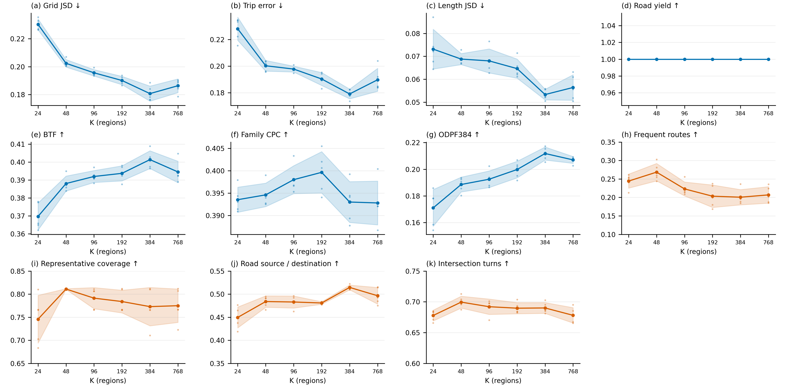
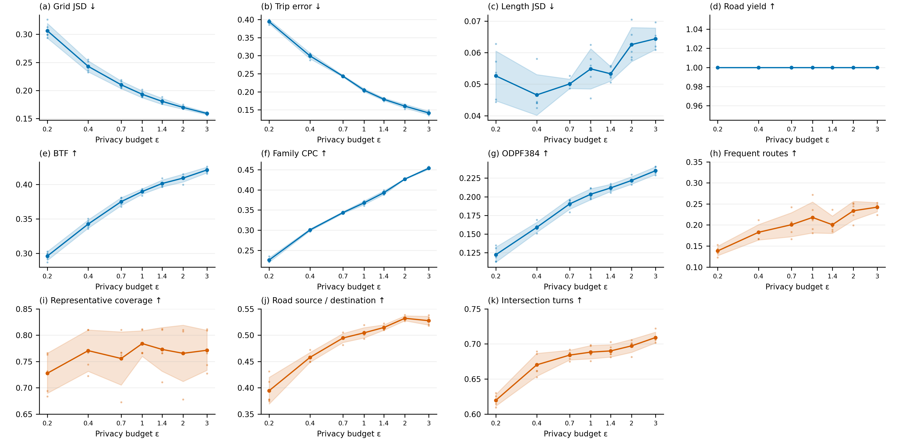

# 第08节 敏感性结果汇总与作图

[完整运行指南](../README_CN.md#sec-08) · [上一节：07-3](第07-3节_准确端点诊断.md) · [下一节：09](第09节_完整矩阵与图件.md)

所有命令均在仓库的 `reproduction/beijing` 工作目录执行；文档位于仓库根目录，不要因为打开了分节文件就切换工作目录。北京默认，Porto只在第01节首次处理数据前选择一次配置。完整指南与分节版内容相同，选择一种阅读执行，不要两份都跑。

命令中的文件名和目录名沿用当前北京示例。`--config` 是配置，`--input` 是上游产物，`--out` 是新输出目录；自行改名时同步修改后续引用。每条命令成功并核对产物后再继续，已有成功产物按记录接续，不从头重复生成。

个别命令的 `--document` 指向仓库原命令文件，供执行来源登记使用；这些文件保留，无需跳过去阅读或再次执行。

只有第07节各组评分齐全后才运行这里。K与预算必须同时完成主实验使用的新四项应用，不能用旧目的地/下一地区预测代替。以下只读取已生成道路轨迹，不重新训练、生成或匹配。

## 先补齐每组的四项应用

先完成第05节的真实数据答题，再准备30组K和35组预算的逐条补评命令。所有组共用第05节锁定的真实问题、区域、覆盖距离及路线预算；同一份产物被两种实验复用时只答一次，分别纳入对应统计。

```powershell
.venv/Scripts/python.exe tools/prepare_sweep_applications.py --plan configs/experiments/sweeps_plan.json --application-config configs/application_tasks/beijing.json --reference results/application_tasks/answers/Real --out results/sweep_applications
```

`--plan`读取第07节每组产物位置；`--application-config`复用第05节问题与公共资源；`--reference`是第05节真实答案；`--out`必须是新目录。准备会一次检查65组道路输入及其来源清单，任何组缺失就停止，不启动半套评分。准备成功后依次复制执行 `results/sweep_applications/COMMANDS_CN.md` 中的原句：每份道路表示转换、配置绑定、四项答题分开。失败保留该组目录，从失败步骤恢复，不重复成功组。

```powershell
.venv/Scripts/python.exe tools/collect_sweep_applications.py --plan results/sweep_applications/plan.json --out results/sweep_applications/summary.json
```

成功条件：65组、每组四项分数，共260分数；每档5种子，问题/图/轨迹绑定一致。原始端点准确诊断不纳入这65组DP曲线。

如果只运行其中一类，在准备与应用汇总命令后均添加 `--kind k` 或 `--kind budget`，分别要求30组/120分数或35组/140分数；不会等待未运行的另一类。下方结构汇总的 `--applications-plan` 指向相应准备产出的plan.json，程序同时核对应用与结构评分使用同一组道路文件。

恢复时只将失败步骤的部分输出改名保留（例如 `answers.failed`），再执行该步骤原命令；已成功的上游、其它组及原始道路文件不移动、不重跑。


## k 汇总

**步骤 08.01：把已完成的各组评分汇总成曲线数据。**

读取：--kind选择的实验计划和各组实际结果。

```powershell
.venv/Scripts/python.exe tools/collect_portable_sweeps.py --kind k --config configs/experiments/configs/beijing.json --plan configs/experiments/sweeps_plan.json --applications-plan results/sweep_applications/plan.json --out results/summaries/k
```

| 参数 | 简单含义 |
|---|---|
| `--kind` | 选择汇总类型：k、budget或endpoint_diagnostic。 |
| `--config` | 读取这一份实验配置：真实数据、道路图、分集和算法设置从这里取得。 |
| `--plan` | 记录每组配置、生成目录和评分目录的实验计划JSON，汇总按它找结果。 |
| `--out` | 本次输出的位置；改名后，后续读取这个结果的路径也要一起改。 |

完成后：summary.json、per_run.csv及清单；缺组时先补对应实验。

## budget 汇总

**步骤 08.02：把已完成的各组评分汇总成曲线数据。**

读取：--kind选择的实验计划和各组实际结果。

```powershell
.venv/Scripts/python.exe tools/collect_portable_sweeps.py --kind budget --config configs/experiments/configs/beijing.json --plan configs/experiments/sweeps_plan.json --applications-plan results/sweep_applications/plan.json --out results/summaries/budget
```

| 参数 | 简单含义 |
|---|---|
| `--kind` | 选择汇总类型：k、budget或endpoint_diagnostic。 |
| `--config` | 读取这一份实验配置：真实数据、道路图、分集和算法设置从这里取得。 |
| `--plan` | 记录每组配置、生成目录和评分目录的实验计划JSON，汇总按它找结果。 |
| `--out` | 本次输出的位置；改名后，后续读取这个结果的路径也要一起改。 |

完成后：summary.json、per_run.csv及清单；缺组时先补对应实验。

## endpoint_diagnostic 汇总

**步骤 08.03：把已完成的各组评分汇总成曲线数据。**

读取：--kind选择的实验计划和各组实际结果。

```powershell
.venv/Scripts/python.exe tools/collect_portable_sweeps.py --kind endpoint_diagnostic --config configs/experiments/configs/beijing.json --plan configs/experiments/sweeps_plan.json --out results/summaries/endpoint_diagnostic
```

| 参数 | 简单含义 |
|---|---|
| `--kind` | 选择汇总类型：k、budget或endpoint_diagnostic。 |
| `--config` | 读取这一份实验配置：真实数据、道路图、分集和算法设置从这里取得。 |
| `--plan` | 记录每组配置、生成目录和评分目录的实验计划JSON，汇总按它找结果。 |
| `--out` | 本次输出的位置；改名后，后续读取这个结果的路径也要一起改。 |

完成后：summary.json、per_run.csv及清单；缺组时先补对应实验。

## K与预算作图

**步骤 08.04：绘制预算变化曲线和指标附录。**

读取：已经汇总的summary.json。

```powershell
.venv/Scripts/python.exe plotting/render_current_sweeps.py --kind k --source results/summaries/k/summary.json --applications results/sweep_applications/summary.json --out results/figures/k
.venv/Scripts/python.exe plotting/render_current_sweeps.py --kind budget --source results/summaries/budget/summary.json --applications results/sweep_applications/summary.json --out results/figures/budget
```

| 参数 | 简单含义 |
|---|---|
| `--source` | 输入来源路径；登记MTNet时是native_release目录，预算作图时是summary.json。 |
| `--out` | 本次输出的位置；改名后，后续读取这个结果的路径也要一起改。 |

完成后：两张11指标图（Grid、Trip、Len、RoadYield、BTF、FamilyCPC、ODPF384和新四项应用）及PDF、逐点数据和来源清单。点为5种子均值，阴影为样本标准差，不是置信区间。旧预测任务不再展示。作图不重新生成数据。

以下为北京15730条冻结批次已验收结果。蓝色为已有分布/结构指标，橙色为新四项真实问题任务；不要求所有任务都随参数单调变化。

四项应用采用局部纵轴范围，并在K与预算两图间保持一致：常走路线0.10—0.35、代表路线覆盖0.65—0.85、道路来源/去向0.35—0.55、路口转向0.60—0.75。范围覆盖全部种子及误差带，不做分数缩放；其它数据超出时自动扩展。图内仅保留指标标题和轴标签。ODPF384另见[独立指标说明](../reproduction/beijing/docs/ODPF384说明.md)，不在图中放解释文字。





逐点数据、五种子原值和文件来源见 [已验收结果清单](../reproduction/beijing/reference_results/sensitivity_current/manifest.json)。这些北京参考结果不替代其它城市的新运行。

---

[完整运行指南](../README_CN.md#sec-08) · [上一节：07-3](第07-3节_准确端点诊断.md) · [下一节：09](第09节_完整矩阵与图件.md)
